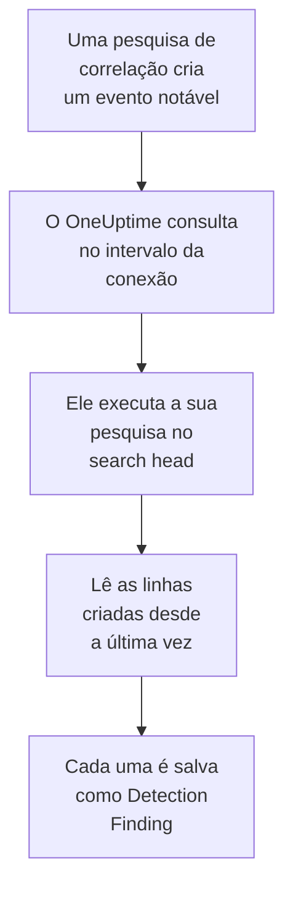

# Splunk Enterprise Security

Importe os eventos notáveis que as pesquisas de correlação do [Splunk Enterprise Security](https://www.splunk.com/en_us/products/enterprise-security.html) criam para os eventos de segurança do OneUptime. Lá você os pesquisa ao lado dos seus logs, traces e métricas, correlaciona-os com todas as outras fontes e aciona o plantão para os que importam. O OneUptime os lê executando uma pesquisa no seu search head, como um usuário do Splunk que você cria, e não altera nada no Splunk. Como é só uma pesquisa, ele importa qualquer índice ou a saída de qualquer pesquisa salva, não só eventos notáveis.

:::cards
- [Configurar a conexão](#configurar-a-conexão): Um token, uma função e o formulário da conexão.
- [O que é importado](#o-que-é-importado): Como cada linha da pesquisa vira um evento de segurança.
- [Como a consulta funciona](#como-a-consulta-funciona): A janela que cada consulta lê, e o que um search head movimentado faz com ela.
- [Solução de problemas](#solução-de-problemas): O que cada erro significa e o que mudar.
:::

## Como funciona



A cada minuto, o OneUptime consulta cada conexão habilitada cujo intervalo de consulta já passou. Uma consulta executa a sua pesquisa pela API REST do search head, sobre as linhas criadas desde a última consulta, e salva cada linha como um evento [OCSF](https://schema.ocsf.io/) Detection Finding (classe `2004`). As regras de detecção, os monitores e os painéis então o tratam como um evento de segurança de qualquer outra fonte.

## Antes de começar

- No OneUptime, a função Project Owner, Project Admin ou Security Admin. As funções Security Member e Security Viewer veem as conexões e o histórico de execuções delas, mas não podem alterá-las.
- Um search head com Splunk Enterprise 9.0.1 ou posterior, ou Splunk Cloud Platform. O OneUptime fala com a API REST dele na porta de gerenciamento, normalmente `8089`. O Splunk Web, na porta `8000`, não serve a API REST.
- Um usuário do Splunk para o OneUptime, cuja função tenha a capacidade `search` e possa ler o índice que a pesquisa lê: `notable` para os eventos notáveis. As funções `ess_analyst` e `ess_user` do Enterprise Security concedem as duas coisas. A conexão só lê, então a função não precisa de mais nada.
- Um search head que o OneUptime consiga alcançar por HTTPS. O OneUptime Cloud se conecta pela internet, então o search head precisa de um endereço público: endereços privados são recusados. Um OneUptime auto-hospedado se conecta a partir dos contêineres do aplicativo e dos workers, e consegue alcançar um search head na sua rede privada, a menos que `DATA_SOURCE_BLOCK_PRIVATE_ADDRESSES` seja `true`.

## Configurar a conexão

A conexão se autentica com um token de autenticação do Splunk, ou com um nome de usuário e uma senha.

:::steps
### Criar um token de autenticação

1. No Splunk Web, abra **Settings → Tokens**. Se o Splunk disser que a autenticação por token está desativada, selecione primeiro **Enable Token Authentication**.
2. Selecione **New Token**. Em **User**, informe o usuário do Splunk criado para o OneUptime, e em **Audience**, diga para que serve o token, por exemplo `OneUptime security events`.
3. Escolha uma **Expiration**, ou nenhuma. Um token que expira interrompe a conexão até que você o substitua.
4. Selecione **Create** e copie o token. O Splunk só o mostra uma vez.

Para se autenticar com uma senha em vez disso, pule esta etapa e tenha à mão o nome e a senha do usuário.

### Adicionar a conexão no OneUptime

Abra **Produtos → Security Events → Conexões** (`/dashboard/{projectId}/security-events/connections`), clique em **Adicionar conexão**, escolha **Splunk Enterprise Security** e clique em **Próximo**. Preencha as configurações da tabela abaixo, clique em **Próximo** e cole o token em **Authentication token**, ou a senha em **Senha**.

### Testar antes de salvar

Clique em **Testar estas configurações** em **Testar antes de salvar**. O teste se autentica e executa a sua pesquisa com os valores do formulário, sem salvar nada, então uma porta errada ou uma função que falta aparece antes de a conexão existir. Depois clique em **Próximo**, dê um **Nome** à conexão e crie-a.
:::

| Configuração | O que informar |
| --- | --- |
| **Splunk management URL** | A API REST do search head, por exemplo `https://splunk.example.com:8089`. Ela deve usar `https`, sem query string. Um caminho é mantido, para um proxy reverso que serve a API sob um caminho. |
| **Pesquisar** | A pesquisa que escolhe o que importar, `index=notable` enquanto você não a mudar. Restrinja-a, por exemplo com `index=notable urgency IN (high, critical)`. O OneUptime adiciona o intervalo de tempo por conta própria, então a pesquisa não pode definir `earliest` nem `latest`, nem começar com um pipe. Um `search` inicial é removido. |
| **Nome de usuário** | O nome do usuário do Splunk, só se ele se autentica com senha. |
| **Authentication token** | O token da primeira etapa. Quando há um token salvo, é ele que é usado, e não o nome de usuário nem a senha. |
| **Senha** | A senha do usuário do Splunk, só quando nenhum token é usado. |

**Authentication token** e **Senha** são criptografados, nunca devolvidos pela API e nunca mostrados de novo. Substitua um deles com **Atualizar credenciais** na conexão. Para trocar de uma forma de autenticação para a outra, informe a nova ali e ative **Remove the stored Authentication token** ou **Remove the stored Password**.

A etapa **Consulta periódica** também tem uma **Descrição** opcional, o **Intervalo de consulta (minutos)**, um número inteiro de `1` a `1440` que começa em `5`, e **Habilitado**, que começa ativado.

## O que é importado

Cada linha que a pesquisa devolve vira um evento Detection Finding (classe OCSF `2004`), com o fornecedor `Splunk` e o produto `Splunk Enterprise Security`. Para um evento notável:

| Campo do Splunk | Coluna do OneUptime |
| --- | --- |
| `event_id`, senão `_bkt` e `_cd`, senão um hash da linha | UID do evento, que também serve para descartar duplicatas |
| `_time`, quando a pesquisa de correlação criou o evento notável | Horário do evento |
| `rule_name`, senão `search_name`, senão `source` | Nome da regra |
| `search_name`, senão `source`, senão `rule_name` | ID da regra |
| `rule_title`, senão `rule_description`, senão o nome da regra | Mensagem |
| `urgency`, senão `severity` | Gravidade |
| `status_label`, senão `status_description`, senão o nome do status de revisão que `status` contém | Status |
| `annotations.mitre_attack`, e campos como `mitre_technique_id` e `mitre_tactic` | Táticas e técnicas do MITRE ATT&CK |
| `user` ou `src_user`; `src`, `src_ip` ou `src_host`; `process`, `process_name` ou `parent_process` | Usuário, IP, host e processo do ator |
| `process_name` ou `process_exec`, `process_path` e `process`; `parent_process_name` ou `parent_process_exec`, `parent_process_path` e `parent_process` | Nome, caminho e linha de comando do processo; nome, caminho e linha de comando do processo pai |
| `dest_user`; `dest`, `dest_ip` ou `dest_host`; `dest_port` | Usuário, IP, host e porta do alvo |
| `file_path`, `url` ou `risk_object` | Recurso alvo |
| Cada usuário, host e IP, além de `dvc`, `host`, `file_hash`, `file_name`, `url`, `domain`, `query` e `risk_object` | Observáveis |
| Cada campo da linha, por exemplo `security_domain`, `owner`, `orig_sid` e `_raw` | `attributes`, com o nome próprio do campo |

Uma linha de outro índice é importada do mesmo jeito. As colunas que os campos dela não preenchem ficam vazias, e cada campo continua pesquisável em `attributes`.

## Como a consulta funciona

Cada consulta executa uma pesquisa de exportação sobre a sua janela, da mais antiga para a mais nova:

```text
POST {Splunk management URL}/services/search/v2/jobs/export
    search=search index=notable | fields * | sort 0 _time | head 10001
    earliest_time={window start}
    latest_time={window end}
    output_mode=json
```

- **O horário de criação é o cursor.** A janela é sobre `_time`, que para um evento notável é quando a pesquisa de correlação o criou, e não quando aconteceu a atividade que ela encontrou. Uma pesquisa que roda de hora em hora data os seus eventos notáveis no horário da sua execução, então nenhum fica para trás do cursor.
- **A primeira consulta olha 24 horas para trás**, para que uma nova conexão mostre logo os eventos notáveis recentes dela.
- **Cada consulta seguinte começa 1 minuto antes do cursor salvo**, para que uma linha criada na fronteira entre duas janelas nunca se perca.
- **Uma consulta lê no máximo 24 horas além do cursor.** Uma conexão cujo cursor ficou para trás se atualiza em uma série de janelas de 24 horas, e a **Integridade** dela mostra **Catching up**.
- **As duplicatas são descartadas por `event_id`**, ou pelos `_bkt` e `_cd` próprios do Splunk, dentro do projeto, para que a sobreposição, uma janela repetida e uma importação nunca salvem uma linha duas vezes.

Um search head anterior ao 9.0.1 responde `404` à requisição para `search/v2/jobs/export`. O OneUptime então a envia para `search/jobs/export`, que está obsoleto, e a execução diz isso em um aviso. Atualize o search head: as versões atuais desativam esse endpoint.

### Quando uma janela contém mais do que uma consulta consegue ler

Uma consulta lê no máximo 10.000 linhas. Quando uma janela contém mais, a execução fica **Parcial**, com um aviso como este:

```text
Stopped after collecting 10000 records; the window holds more. Records are read oldest first, and the last one read was created at 2026-09-14T08:12:44.000Z, where the next poll can resume.
```

A pesquisa ordena a janela por `_time`, da mais antiga para a mais nova, então o OneUptime move o cursor para o horário de criação da última linha lida, e a consulta seguinte começa ali, com o mesmo tamanho de janela. Um search head movimentado se atualiza 10.000 linhas por consulta, em vez de reler as mesmas. As linhas criadas no mesmo instante são lidas duas vezes, e a verificação de duplicatas descarta a segunda cópia. O Splunk ordena a janela inteira antes de devolver uma linha, então uma pesquisa em **Pesquisar** que encontra muito mais do que o necessário deixa cada consulta mais lenta. Mantenha-a focada.

Quando uma execução não consegue passar do cursor salvo de jeito nenhum, o OneUptime encurta a janela em vez disso:

1. **Reduzir.** A consulta seguinte lê uma janela com a metade do tamanho, a partir do mesmo ponto de partida, e continua dividindo pela metade até que uma janela seja lida por inteiro, até um minuto. O aviso da execução diz isso: `This window holds more records than one poll can read; the next poll reads a {n} minute window from the same starting point.`
2. **Voltar a crescer.** Depois que uma janela é lida por inteiro, a seguinte volta a ter o dobro do tamanho, até 24 horas.
3. **Passar de um único minuto.** Se até um minuto contém mais do que uma consulta consegue ler, a consulta passa dele, para que os eventos notáveis mais novos continuem chegando. A execução continua **Parcial**, e **Último erro** mostra `More records were created in the one minute from {cursor} to {end} than one poll can read. Polling moved past this minute so newer records keep arriving; use Import this time range in Diagnostics on this minute to recover what one run can read.` Importe esse minuto com **Import this time range** para recuperar o que uma execução consegue ler.

Uma execução que falha por completo, com um erro do Splunk, mantém o cursor e o tamanho da janela, e a consulta seguinte relê a mesma janela. A única exceção é uma requisição que expirou: o cursor fica, mas a janela seguinte tem a metade do tamanho, porque uma janela pesada demais para ser respondida a tempo expiraria em toda tentativa. Mudar o **Intervalo de consulta (minutos)** não muda nada disso: ele decide com que frequência uma consulta começa, não onde a janela dela começa.

### Executar, pré-visualizar e importar sob demanda

Clique em **Diagnóstico** em uma conexão para ver as execuções recentes dela e trabalhar com ela manualmente. Quem pode alterar a conexão pode iniciar essas ações; quem pode vê-la pode ler o histórico.

- **Executar agora** inicia uma consulta na hora, com o cursor de sempre, mesmo quando a conexão não está **Habilitado**.
- **Preview notable events** lê um intervalo de tempo de até 7 dias e não importa nada.
- **Import this time range** importa um intervalo de até 7 dias, depois que você confirma, sem mover o cursor. As linhas já importadas são puladas.
- **Copy diagnostics** em uma execução copia o relatório dela para o suporte. Ele nunca inclui credenciais.

## Testar conexão

**Testar conexão** na linha de uma conexão, e **Testar estas configurações** no formulário, rodam no processo da API, não em um worker em segundo plano, para que um teste responda mesmo quando o problema são os workers. Ele faz estas verificações, em ordem:

| Verificação | O que ela verifica |
| --- | --- |
| **Configuração** | Cada configuração está presente e bem formada. Nada é contatado quando isso falha. |
| **Authenticate with Splunk** | O Splunk aceita o token, ou o nome de usuário e a senha, e informa o usuário e as funções dele, para que você os compare com a função que queria conceder. |
| **Run the search on Splunk** | A pesquisa de **Pesquisar** roda sobre as últimas 24 horas, para uma linha, e informa qual endpoint de exportação respondeu. |
| **Notable events available to import** | Quantas linhas a pesquisa de **Pesquisar** encontra nas últimas 24 horas e nos últimos 7 dias. Nenhuma em 7 dias é um aviso, não uma falha. |
| **Background workers**, **Poll scheduler**, **Security event storage** | O lado do próprio OneUptime: um processo pega os jobs da fila Worker, o job de consulta roda a cada minuto e o armazenamento de eventos de segurança responde. |
| **Scheduled polling** | Para uma conexão salva: a consulta está ativada, nenhuma execução está presa esperando um worker e as consultas rodam no horário. |

Cada requisição de um teste tem um prazo de 20 segundos. Um teste nunca importa nada nem move o cursor, e cada verificação que falha diz o que mudar.

## Enviar eventos de segurança ao Splunk

O OneUptime também pode enviar o que encontra ao Splunk, pelo HTTP Event Collector (HEC) dele, para que as suas pesquisas e dashboards vejam as detecções do OneUptime ao lado das suas. Cada evento de segurança é um evento HEC com o sourcetype `oneuptime:security`, com os campos nomeados como o Common Information Model do Splunk os nomeia: `src`, `src_ip`, `src_user`, `dest`, `dest_ip`, `dest_port`, `user`, `signature` e `severity`.

:::steps
### Crie um token HEC

No Splunk Web, abra **Settings → Data inputs → HTTP Event Collector** e clique em **New Token**. Dê um nome a ele, escolha os índices em que ele pode gravar e o índice padrão dele, e copie o valor do token. No Splunk Cloud, o HEC escuta em `https://http-inputs-<stack>.splunkcloud.com`; no Splunk Enterprise, na porta `8088` depois que **Global Settings** ativa os tokens.

### Adicione o destino

Abra **Produtos → Security Events → Conexões**. Em **Enviar para o seu SIEM**, clique em **Adicionar destino**, escolha Splunk em **SIEM** e clique em **Próximo**. Preencha a **URL do HEC** e cole o token em **Token do HEC**. **Índice** e **Tipo de origem** são opcionais: vazios, os eventos vão para o índice padrão do token com o sourcetype `oneuptime:security`.

### Envie um evento de teste e comece a enviar

Clique em **Enviar um evento de teste**: um evento informativo vai para o Splunk com as configurações do formulário, e nada é salvo. Pesquise-o com `sourcetype="oneuptime:security"`. Depois, em **O que enviar**, mantenha **Somente detecções** ou escolha **Todos os eventos de segurança**, e clique em **Começar a enviar**.
:::

- A **URL do HEC** precisa usar `https`, com um certificado em que o OneUptime confie: as verificações de certificado nunca são ignoradas.
- Os eventos vão em lotes de até 500. Um evento que o Splunk recusa fica de fora e é citado em **Ver erro**, um coletor ocupado (`503`) é tentado de novo, e um token ou índice recusado interrompe o envio até você corrigi-lo.
- Os notable events que o OneUptime importou do Splunk nunca são enviados de volta a ele.

## Solução de problemas

O **Último erro** da conexão guarda a mensagem de erro completa, com as credenciais ocultadas, atrás de um prefixo que nomeia a etapa que falhou. Quando uma conexão tem um erro, selecione **Ver erro** na coluna **Ações** dela para lê-lo, e **Copiar erro** na caixa de diálogo para copiá-lo. Leia o prefixo primeiro.

:::details Last Error começa com `Splunk Enterprise Security authentication request`
- `Splunk Enterprise Security authentication request failed (HTTP ...)`: o Splunk se recusou a dizer quem é o chamador.
  - `HTTP 401`: o Splunk não aceitou as credenciais. O token está errado, expirou ou foi excluído, a autenticação por token está desativada no search head, ou o nome de usuário ou a senha estão errados. Crie um novo token e salve-o com **Atualizar credenciais**.
  - `HTTP 404`: a **Splunk management URL** não é a API REST. Ela aponta para o Splunk Web na porta `8000`, ou tem um caminho que o search head não serve.
- `Splunk Enterprise Security authentication request returned ...`: respondeu algo diferente da API REST do search head, por exemplo o HTML do Splunk Web na porta `8000` ou a página de um proxy. Aponte a URL para a porta de gerenciamento.
:::

:::details Last Error começa com `Splunk Enterprise Security search export` ou `Splunk Enterprise Security count search`
- `Splunk Enterprise Security search export failed (HTTP ...)`: o Splunk se recusou a executar a pesquisa.
  - `HTTP 400`: o Splunk não consegue interpretar a pesquisa. Execute a pesquisa de **Pesquisar** no Splunk Web para ler o erro dela.
  - `HTTP 403`: falta à função do usuário a capacidade `search`, ou ela não consegue ler o índice. Adicione `notable`, ou o seu índice, aos índices em que a função pode pesquisar.
  - `HTTP 404`: nenhum dos dois endpoints de exportação existe nessa URL, então ela não é a porta de gerenciamento de um search head.
  - `HTTP 429` ou `HTTP 5xx`: o Splunk está limitando o usuário, está sobrecarregado, ou a pesquisa atingiu um dos limites dela. A consulta seguinte tenta de novo.
- `Splunk Enterprise Security search export was rejected by Splunk on an HTTP 200`: o Splunk respondeu, mas interrompeu a pesquisa com um erro. A mensagem o cita.
- `Splunk Enterprise Security search export returned a body that is not newline-delimited JSON.`: respondeu algo diferente da API REST, por exemplo o Splunk Web ou a página de login de um proxy. Isso é relatado em vez de ser tomado como uma janela vazia, para que o cursor nunca passe de linhas que ninguém leu.
- `Splunk Enterprise Security count search ...`: as mesmas falhas, vindas da contagem de **Notable events available to import**, que só um teste executa.
:::

:::details Last Error termina com `did not complete`
`Splunk Enterprise Security search export did not complete`, e o mesmo para as outras etapas, significa que a requisição não recebeu resposta: um tempo limite esgotado, um nome que não resolve, um certificado em que o OneUptime não confia, ou um endereço privado recusado. Verifique se o aplicativo do OneUptime e os workers conseguem abrir uma conexão HTTPS para a porta de gerenciamento. Um search head que responde a outras requisições mas expira na pesquisa está ordenando demais: a consulta seguinte lê uma janela com a metade do tamanho, e uma pesquisa mais focada em **Pesquisar** resolve de vez.
:::

:::details Last Polled é Never e Last Error está vazio
Nenhuma consulta terminou para essa conexão. Rode **Testar conexão**: as verificações **Background workers** e **Poll scheduler** dele nomeiam a causa. Em uma instalação auto-hospedada, a causa comum é `DISABLE_QUEUE_WORKERS=true` no aplicativo, sem um deployment separado de workers que pegue os jobs: defina como `false`, ou rode o deployment de workers (Helm: `worker.enabled: true`).
:::

:::details Uma execução está Partial
- `Stopped after collecting 10000 records; the window holds more`: a janela continha mais do que as 10.000 linhas que uma execução lê. Nada se perde: a consulta seguinte começa depois da última linha lida. Uma conexão que continua **Parcial** consulta após consulta está se atualizando de um atraso, e os seus **Última consulta** e **Último evento importado** continuam avançando. Se ela nunca se atualiza, a pesquisa de **Pesquisar** encontra mais de 10.000 linhas por intervalo de consulta: restrinja-a, ou encurte o **Intervalo de consulta (minutos)**.
- `More records were created in the one minute from ... than one poll can read`: a consulta passou desse minuto. Importe-o com **Import this time range** em **Diagnóstico**. Uma importação lê tanto quanto uma consulta.
:::

:::details O teste passa, mas nada é importado
Leia **Notable events available to import** no relatório do teste. `0` nos últimos 7 dias significa que a pesquisa de **Pesquisar** não encontrou nada no Splunk: verifique no Incident Review se as pesquisas de correlação estão habilitadas e criam eventos notáveis, e se a pesquisa de **Pesquisar** não é mais restrita do que você queria.
:::

## O que você ganha

- **Pesquisa.** Filtre os eventos notáveis por urgência, status, regra, usuário, host ou qualquer observável no explorador de eventos de segurança, ao lado de todas as outras fontes.
- **Correlação.** Os usuários, hosts, IPs e domínios de cada linha são indexados como observáveis, então uma pesquisa encontra tudo o que os menciona.
- **Regras de detecção.** Regras Sigma que rodam em uma programação sobre os seus eventos de segurança, e abrem alertas que acionam o plantão.
- **Monitores.** Os monitores de eventos de segurança contam os eventos correspondentes, por exemplo novos eventos notáveis críticos, e abrem incidentes ou alertas acima de um limite.

Os eventos de segurança são cobrados como o resto da sua telemetria, por GB ingerido. Veja os [preços](https://oneuptime.com/pricing).

## Próximos passos

:::cards
- [Eventos de segurança](/docs/telemetry/security-events): Pesquise, correlacione e alerte sobre o que você importa.
- [Elastic Security](/docs/integrations/elastic-security): Importe também os alertas de detecção de uma stack do Elastic.
- [Funções](/docs/permissions/reference#funções): O que as funções Security podem ver e alterar.
- [Visão geral das integrações](/docs/integrations/index): As outras ferramentas que você pode conectar.
:::
