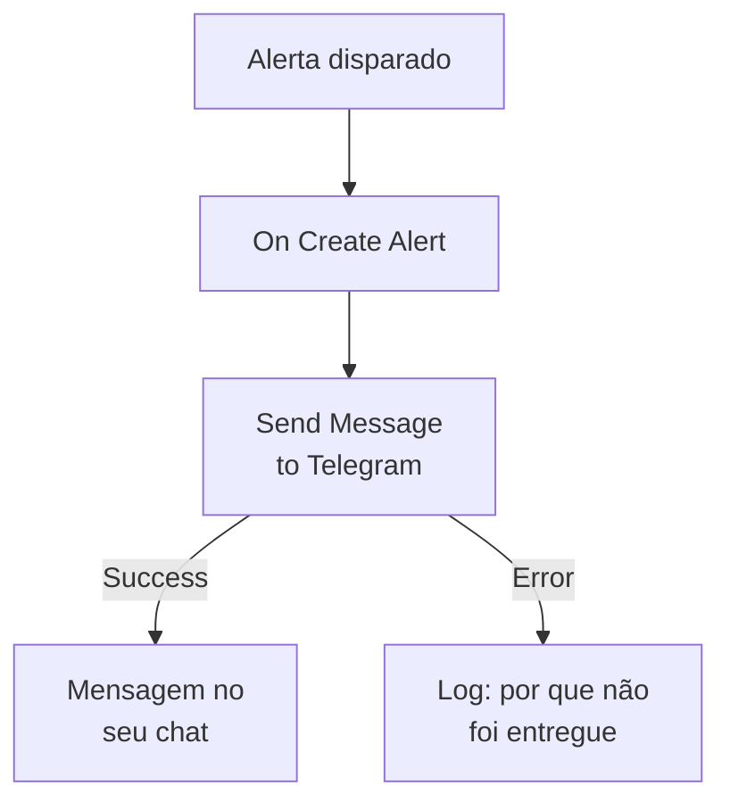

# Telegram

Envie uma mensagem para um chat, grupo ou canal do [Telegram](https://telegram.org) quando um alerta dispara ou um incidente é aberto. A etapa de workflow **Send Message to Telegram** do OneUptime a envia como um bot que você cria, e um modelo pronto monta o workflow para alertas. Esta integração é de **saída**: o bot envia mensagens e não lê o que é dito no chat.

:::cards
- [Como funciona](#como-funciona): O que o workflow faz quando um alerta dispara.
- [Configuração](#configurar-a-integração): Um bot, o chat dele e depois o workflow: pelo modelo ou do zero.
- [Dicas](#dicas): Texto simples, mensagens longas e incidentes.
- [Solução de problemas](#solução-de-problemas): O que os erros do Telegram significam e o que mudar.
:::

## Como funciona



A etapa envia o **Message Text** para o chat, como o seu bot, pela Bot API do Telegram. Ela segue pela saída **Success** quando o Telegram aceita a mensagem, e pela saída **Error**, com o motivo do Telegram, quando o Telegram a recusa. O modelo conecta uma etapa **Log** a **Error**, para que uma execução que não conseguiu enviar diga por quê.

## Antes de começar

- Uma conta do Telegram, para criar o bot e adicioná-lo ao chat.
- No OneUptime, o direito de criar workflows e variáveis. No OneUptime Cloud, os workflows precisam do plano **Growth** ou superior.

## Configurar a integração

:::steps
### Criar um bot

No Telegram, envie `/newbot` para [@BotFather](https://t.me/BotFather) e responda às perguntas dele. Ele dá a você o token do bot, por exemplo `123456789:ABCdefGhIJKlmnoPQRstuVWxyz`. Quem tiver o token pode enviar mensagens como o seu bot, então guarde-o com o mesmo cuidado que uma senha.

### Encontrar o ID do chat

1. Adicione o bot ao grupo, ou torne-o administrador do canal. Para escrever para uma pessoa, ela primeiro inicia um chat com o bot.
2. Envie no grupo uma mensagem que mencione o bot, por exemplo `/start@your_bot`, para que o bot a veja.
3. Abra `https://api.telegram.org/bot<token>/getUpdates` em um navegador, com o token do bot no lugar de `<token>`.
4. Procure `"chat":{"id":` na resposta. O número que vem depois é o ID do chat. O ID de um grupo começa com `-`, e o de um grupo grande com `-100`.

Um canal público pode ser indicado pelo seu `@username` em vez de um ID.

### Criar o workflow

Comece pelo modelo, que monta o workflow inteiro para alertas, ou do zero.

:::tabs
@tab Pelo modelo
1. Abra **Fluxos de trabalho** e clique em **Criar fluxo de trabalho**.
2. Digite `Telegram` em **Pesquisar modelos…**, clique em **Tell Telegram when an alert fires** e depois em **Usar este modelo**.
3. Mantenha o nome **Notify Telegram on new alert** ou mude-o, e clique em **Próximo**.
4. Cole o token em **Telegram Bot Token** e o ID em **Telegram Chat ID**, e clique em **Criar fluxo de trabalho**.

O workflow abre no **Construtor** com três etapas: **On Create Alert**; **Send Message to Telegram**, que envia o número, o título, a gravidade e o estado do alerta; e uma etapa **Log** na saída **Error** dela. O token é salvo como a variável secreta `telegramBotToken` do workflow, e o ID como `telegramChatId`.
@tab Do zero
1. Salve o token como uma variável global secreta: vá em **Fluxos de trabalho → Variáveis globais**, clique em **Criar: Fluxo de trabalho Variável**, dê o nome `TELEGRAM_BOT_TOKEN` e clique em **Próximo**. Cole o token em **Conteúdo**, ative **Segredo** e clique em **Criar: Fluxo de trabalho Variável**.
2. Vá em **Fluxos de trabalho**, clique em **Criar fluxo de trabalho**, escolha **Começar do zero**, dê um nome ao workflow e clique em **Criar fluxo de trabalho**.
3. No **Construtor**, clique em **Escolha o que inicia este fluxo de trabalho** e escolha **On Create Alert** em **Populares**. Clique no gatilho: os seus **Fields to pass on** começam com **Título**, então clique em **Adicionar campo** e escolha os outros campos que a sua mensagem mostra, por exemplo **Alert Number With Prefix**.
4. Clique em **Adicionar componente**, pesquise `telegram` e clique em **Send Message to Telegram**. Conecte a saída **Success** do gatilho a ela.
5. Clique na nova etapa. Em **Telegram Bot Token**, clique em **{ }** e escolha `TELEGRAM_BOT_TOKEN` em **Global variables**. Informe o ID do chat em **Chat ID**, escreva a mensagem em **Message Text** e insira os campos do alerta com **{ }**.
:::

Uma mensagem feita do zero lê os campos do alerta com referências como estas:

```text
🚨 Alert {{local.components.alert-on-create-1.returnValues.model.alertNumberWithPrefix}} fired
Title: {{local.components.alert-on-create-1.returnValues.model.title}}
```

### Ativar e testar

Ative o interruptor **Habilitado** no topo do **Construtor**. A partir daí, cada novo alerta é enviado para o chat.

Para testar sem disparar um alerta, clique em **Executar fluxo de trabalho** e escolha um alerta que você já tem em **Alerta**: os mais recentes são listados, e digitar o número dele ou parte do título encontra outro. Clique em **Executar fluxo de trabalho manualmente** e confirme com **Executar**. O painel **Execução do Fluxo de Trabalho** acompanha a execução, e a mensagem aparece no chat. Se a etapa seguir por **Error**, a linha da etapa **Log** diz por quê: veja [Solução de problemas](#solução-de-problemas).
:::

## Dicas

- **Texto simples.** A etapa envia o texto como foi digitado, sem a formatação do Telegram, então `*` e `_` aparecem como estão.
- **Respeitar o limite de 4.096 caracteres.** O Telegram aceita mensagens de até 4.096 caracteres. Uma mais longa é cortada, e termina com "… (truncated — see OneUptime for the full text)", em vez de ser recusada.
- **Incidentes também.** Monte o mesmo workflow sobre **On Create Incident**, ou sobre **On Update Incident** para mudanças de estado. Para enviar só alguns alertas, coloque um bloco **If / Else** antes da etapa.
- **O formato do token é verificado.** Um token que não tem o formato `123456789:ABCdef…` interrompe a execução antes de qualquer envio, e o token nunca é gravado no log.

## Solução de problemas

Quando a etapa segue por **Error**, a execução diz por quê: a etapa **Log** do modelo escreve `❌ Telegram could not deliver the alert notification:`, o motivo do Telegram e um lembrete de que o bot precisa estar no chat.

:::details O Telegram responde "Bad Request: chat not found"
O **Chat ID** está errado, ou o bot não consegue ver o chat: adicione o bot ao grupo, torne-o administrador do canal, ou peça à pessoa que inicie um chat com o bot. O ID de um grupo começa com `-`.
:::

:::details O Telegram responde "Forbidden: bot was blocked by the user" ou "bot is not a member"
A pessoa bloqueou o bot, ou o bot foi removido do grupo ou do canal. Adicione-o de novo, ou envie para outro chat.
:::

:::details O Telegram responde "Unauthorized"
O Telegram não aceitou o token: ele foi revogado no @BotFather, ou copiado errado. Copie o token atual do bot no @BotFather e substitua o valor da variável.
:::

:::details O Telegram responde "Too Many Requests: retry after"
O Telegram limita a velocidade com que um bot envia, principalmente para um grupo. Uma rajada de alertas pode atingir esse limite: envie menos mensagens, por exemplo só para algumas gravidades.
:::

## Próximos passos

:::cards
- [Componentes de workflow](/docs/workflows/components#telegram): Cada configuração da etapa e o que as saídas dela significam.
- [Discord](/docs/integrations/discord): A mesma ideia, em um canal do Discord.
- [Execuções de workflow](/docs/workflows/runs-and-logs): Leia o que cada execução do workflow fez.
- [Visão geral das integrações](/docs/integrations/index): O padrão de saída e as outras ferramentas que você pode conectar.
:::
