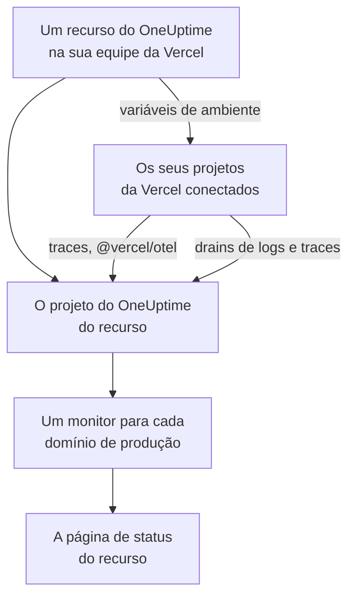

# Vercel

Adicione o OneUptime à sua equipe da Vercel pelo [Vercel Marketplace](https://vercel.com/marketplace). Você entra com a sua conta da Vercel e paga na sua fatura da Vercel, e os seus projetos da Vercel ganham traces, logs, monitoramento de disponibilidade e uma página de status no OneUptime, sem nada para configurar à mão.

:::cards
- [Adicionar o OneUptime à sua equipe da Vercel](#adicionar-o-oneuptime-à-sua-equipe-da-vercel): Um recurso, um plano e os seus projetos, no painel da Vercel.
- [Enviar traces com @vercel/otel](#enviar-traces-com-vercelotel): As variáveis de ambiente já estão lá.
- [Enviar logs e traces com drains](#enviar-logs-e-traces-com-drains): Os logs e spans da própria Vercel, nos planos Pro e Enterprise.
- [Planos e cobrança](#planos-e-cobrança): Os planos do OneUptime, na sua fatura da Vercel.
:::

## Como funciona

Cada recurso do OneUptime que você adiciona na Vercel é um projeto separado do OneUptime. A Vercel passa as variáveis de ambiente do recurso a cada projeto da Vercel que você conecta a ele, e são elas que enviam os traces do projeto ao OneUptime. Os drains enviam os logs e spans da Vercel, e o domínio de produção de cada projeto conectado ganha um monitor de disponibilidade na página de status do recurso.



A integração é para o OneUptime Cloud (`oneuptime.com`). Um OneUptime auto-hospedado não pode ser adicionado pelo Vercel Marketplace: veja [OneUptime auto-hospedado](#oneuptime-auto-hospedado).

## Antes de começar

- **Uma equipe da Vercel**, em qualquer plano. Os drains de logs e de traces precisam do plano Pro ou Enterprise da Vercel; os traces do `@vercel/otel` funcionam em todos os planos.
- **Um endereço de e-mail verificado** na sua conta da Vercel. O OneUptime faz o seu login com ele e, se você ainda não tiver uma conta do OneUptime, cria uma com esse endereço.
- **Um método de pagamento na Vercel**, para todos os planos: monitores e telemetria são cobrados conforme o uso, inclusive no plano Free. Veja [Planos e cobrança](#planos-e-cobrança).

## Adicionar o OneUptime à sua equipe da Vercel

:::steps
### Abrir o OneUptime no Vercel Marketplace

No painel da Vercel, abra **Integrations**, depois **Browse Marketplace**, e encontre o OneUptime em **Observability**. Clique em **Instalação** e aceite os termos do OneUptime.

### Escolher um plano

Escolha **Grátis**, **Growth** ou **Scale**. Os planos são os do próprio OneUptime, com os preços de [oneuptime.com/pricing](https://oneuptime.com/pricing).

### Dar um nome ao recurso e escolher as configurações dele

Dê ao recurso o nome do que ele monitora, como `storefront`: o projeto do OneUptime e a página de status do recurso recebem esse nome. Duas configurações começam ativadas:

- **Monitor production domains**: um monitor de site para o domínio de produção de cada projeto da Vercel que você conectar.
- **Create a status page**: uma página de status pública para o recurso, que mostra esses monitores.

### Conectar os seus projetos

Escolha os projetos da Vercel que enviam dados para este recurso e os ambientes que recebem as variáveis de ambiente dele. Não dê um prefixo personalizado à conexão: o `@vercel/otel` lê as variáveis pelos nomes originais.
:::

O recurso fica pronto em poucos segundos. Clique em **Open in OneUptime** para ver o projeto dele.

## O que você ganha com cada recurso

| O quê | Onde encontrar |
| --- | --- |
| Um projeto do OneUptime, com o nome do recurso | Você é o proprietário. Os seus colegas de equipe entram nele quando o abrem pela Vercel. |
| Uma chave de ingestão chamada `Vercel` | **Configurações do projeto → Telemetria e APM → Chaves de ingestão** |
| Variáveis de ambiente em cada projeto da Vercel conectado | Em **Settings → Environment Variables** do projeto, na Vercel |
| Um monitor de site para cada projeto conectado | **Monitores**, com o nome do projeto da Vercel |
| Uma página de status pública | **Páginas de status**, com o nome do recurso |

As variáveis de ambiente são as mesmas em todos os projetos conectados:

| Variável | Valor |
| --- | --- |
| `OTEL_EXPORTER_OTLP_ENDPOINT` | `https://oneuptime.com/otlp` |
| `OTEL_EXPORTER_OTLP_HEADERS` | `x-oneuptime-token=` e a chave de ingestão do recurso |
| `OTEL_EXPORTER_OTLP_PROTOCOL` | `http/protobuf` |
| `ONEUPTIME_TELEMETRY_INGESTION_KEY` | Só a chave de ingestão, que os drains enviam |

Uma implantação recebe as variáveis no momento do build: faça uma nova implantação depois de conectar um projeto.

## Enviar traces com @vercel/otel

O `@vercel/otel` é o pacote de OpenTelemetry da Vercel para o Next.js e os outros frameworks que a Vercel executa. Ele lê as variáveis `OTEL_EXPORTER_OTLP_*`, então um projeto conectado ao recurso só precisa do pacote.

:::steps
### Instalar o pacote

```bash
npm install @vercel/otel @opentelemetry/api @opentelemetry/api-logs
```

### Registrar o pacote

Crie `instrumentation.ts` na raiz do projeto, ou em `src` se o projeto tiver essa pasta, e dê um nome ao serviço:

```ts title="instrumentation.ts"
import { registerOTel } from "@vercel/otel";

export function register(): void {
  registerOTel({ serviceName: "storefront" });
}
```

### Implantar

Implante o projeto. Os traces dele aparecem em **Traços**, sob o nome do serviço.
:::

Nos planos Pro e Enterprise da Vercel, adicione também um drain de traces: a Vercel passa então a enviar ao OneUptime os próprios spans de cada requisição, junto com os da sua aplicação, e o `@vercel/otel` deixa esses spans para o drain, para que nada chegue duas vezes.

## Enviar logs e traces com drains

Um drain envia ao OneUptime o que a Vercel registra sobre os seus projetos: um drain de logs envia os logs de build, de funções, de edge e de requisições deles, e um drain de traces envia os spans deles. Os drains precisam do plano Pro ou Enterprise da Vercel, e a Vercel cobra os dados que eles enviam na sua fatura da Vercel.

:::steps
### Adicionar um drain

Na Vercel, abra **Team Settings → Drains** e clique em **Add Drain**. Escolha **Logs** ou **Traces** e depois o OneUptime em **Native Integrations**.

### Escolher os projetos

Escolha os projetos e, para logs, as fontes e os ambientes. O drain envia com a chave de ingestão do recurso: não há nada para digitar.
:::

Cada projeto da Vercel é um serviço no OneUptime, com o nome do projeto. Um log mantém o horário, o nível e a mensagem, e a requisição dele fica sob os nomes do OpenTelemetry:

| Campo da Vercel | No OneUptime |
| --- | --- |
| `projectName` | O serviço, `service.name` |
| `timestamp`, `level`, `message` | O horário, a gravidade e o corpo do log |
| `deploymentId`, `environment` | `vercel.deployment.id`, `deployment.environment.name` |
| `proxy.method`, `proxy.path`, `proxy.statusCode` | `http.request.method`, `url.path`, `vercel.proxy.status_code` |
| `traceId`, `spanId` | O trace do log, com link para o trace em **Traços** |
| Todos os outros campos | Um atributo sob `vercel.`, como `vercel.source` |

## Monitores de disponibilidade e a página de status

Quando você conecta um projeto da Vercel, o OneUptime cria um monitor de site para o domínio de produção dele, verificado pelas sondas do OneUptime, e o adiciona à página de status do recurso. Um projeto conectado antes da primeira implantação de produção ainda não tem domínio: o monitor dele é criado nessa implantação. Desconectar o projeto exclui o monitor dele.

Cada monitor é um monitor ativo, cobrado como qualquer outro, e funciona como um que você mesmo tivesse criado: veja [Monitor de site](/docs/monitor/website-monitor). Para não criar nenhum, desative **Monitor production domains** nas configurações do recurso na Vercel. Ativá-la de novo cria os monitores que ainda faltam.

## Abrir o OneUptime pela Vercel

Clique em **Open in OneUptime** no recurso, ou em qualquer um dos links dele na Vercel, e você entra no OneUptime com o endereço de e-mail da sua conta da Vercel. Na primeira vez, você é adicionado ao projeto do recurso: como administrador se for proprietário ou membro da equipe da Vercel, e como membro se tiver uma das funções somente leitura dela.

Se já existe uma conta do OneUptime com esse endereço de e-mail, é nela que você entra. Uma conta com autenticação de dois fatores ativada, ou que pertence a um administrador do OneUptime, entra com a própria senha. Você fica no projeto do mesmo jeito.

## Planos e cobrança

| | Como funciona |
| --- | --- |
| Planos | **Grátis**, **Growth** e **Scale**, com os preços de oneuptime.com: o preço do plano por usuário, monitores ativos a $1 por monitor por mês, e telemetria por GB. |
| Onde você paga | Na sua fatura da Vercel, uma vez por mês, para cada recurso. A Vercel mostra no recurso o uso do mês até agora, atualizado a cada hora. |
| Períodos de teste | Nenhuma cobrança enquanto durar o período de teste do plano: nem pelos usuários, nem pelos monitores, nem pela telemetria. |
| Mudar de plano | Na Vercel, no recurso, ou no OneUptime em **Configurações do projeto → Cobrança e faturas → Cobrança**. A mudança feita em um dos lugares vale para os dois. |
| Faturas não pagas | A Vercel tenta o pagamento de novo por 15 dias. Depois disso, o projeto fica indisponível até a fatura ser paga: os dados dele são mantidos, e nada é excluído. |

Na fatura, cada recurso tem uma linha para os usuários, os monitores ativos, a telemetria e eventuais recargas de saldo, em unidades de uso de $0.01.

## Remover o OneUptime

| Você | O que acontece |
| --- | --- |
| Exclui um recurso na Vercel | O projeto dele é excluído, depois que o uso até ali é cobrado. Os projetos da Vercel conectados perdem as variáveis de ambiente dele na próxima implantação. |
| Desinstala o OneUptime da equipe | O projeto de cada recurso é excluído, e a fatura final é enviada. |
| Exclui o projeto no OneUptime | O recurso também é excluído na Vercel. |

> [!CAUTION]
> Excluir um projeto exclui de vez os monitores, a página de status, os incidentes e a telemetria dele. Exporte primeiro tudo o que quiser manter.

## OneUptime auto-hospedado

Um OneUptime auto-hospedado não pode ser adicionado pelo Vercel Marketplace, que só provisiona o OneUptime Cloud. Mesmo assim, os seus projetos da Vercel podem enviar dados para ele:

- **Traces**: em **Settings → Environment Variables** do projeto da Vercel, defina as variáveis de [O que você ganha com cada recurso](#o-que-você-ganha-com-cada-recurso), com `https://YOUR-ONEUPTIME-HOST/otlp` como endpoint e uma chave de ingestão do seu projeto.
- **Logs**: adicione um drain de logs personalizado em **Team Settings → Drains**, para `https://YOUR-ONEUPTIME-HOST/telemetry/vercel/v1/logs`, em JSON ou NDJSON. Adicione o cabeçalho `x-oneuptime-token` com a sua chave de ingestão e defina o segredo de assinatura do drain com a mesma chave: o OneUptime só aceita entregas que a Vercel assinou com ela.

O mesmo drain personalizado funciona no OneUptime Cloud, com `oneuptime.com` como host.

## Solução de problemas

:::details Nenhum trace chega
- Implante o projeto de novo: uma implantação feita antes de o projeto ser conectado não tem as variáveis `OTEL_EXPORTER_OTLP_*`.
- Confira os nomes das variáveis em **Settings → Environment Variables** do projeto. Uma conexão feita com um prefixo personalizado as renomeia, e o `@vercel/otel` deixa de lê-las: conecte o projeto de novo sem prefixo.
- Verifique se `instrumentation.ts` chama `registerOTel` e, no Next.js 14 e anteriores, se `experimental.instrumentationHook` está ativado em `next.config.js`.
:::

:::details A Vercel mostra o drain com erro
A Vercel mostra a resposta do OneUptime às entregas do drain:

- `403` com `x-vercel-signature` na mensagem: a Vercel não assinou a entrega com a chave que ela envia. Para um drain personalizado, verifique o cabeçalho `x-oneuptime-token` dele e defina o segredo de assinatura dele com a mesma chave.
- `401`: o OneUptime não conhece nenhum projeto com a chave que o drain envia: ela foi excluída, ou digitada errado nos dois lugares. Use uma chave de **Configurações do projeto → Telemetria e APM → Chaves de ingestão**.
- `422`: a chave foi desativada. Ative-a de novo na mesma página, ou use outra.
:::

:::details Um projeto conectado não tem monitor
- **Monitor production domains** está desativada nas configurações do recurso na Vercel.
- O projeto ainda não tem domínio de produção: o monitor dele é criado na primeira implantação de produção.
- O plano do projeto já tem tantos monitores ativos quanto permite: faça upgrade do plano e depois desative e ative de novo **Monitor production domains**.
:::

:::details A Vercel pede que você verifique o seu endereço de e-mail
O OneUptime precisa de um endereço de e-mail que a Vercel tenha verificado, e uma conta do OneUptime que já exista com esse endereço também precisa ter o próprio endereço verificado. Verifique o endereço e depois adicione o recurso ou abra o OneUptime de novo.
:::

## Próximos passos

:::cards
- [Explorador de traços](/docs/telemetry/traces-explorer): Encontre uma requisição lenta e os spans dela.
- [Explorador de registros](/docs/telemetry/logs-explorer): Pesquise os seus logs da Vercel.
- [Páginas de status](/docs/status-pages/index): Aplique a sua marca à página de status do recurso e adicione assinantes.
- [Chaves de ingestão](/docs/telemetry/ingestion-keys): Troque ou desative a chave do recurso.
:::
