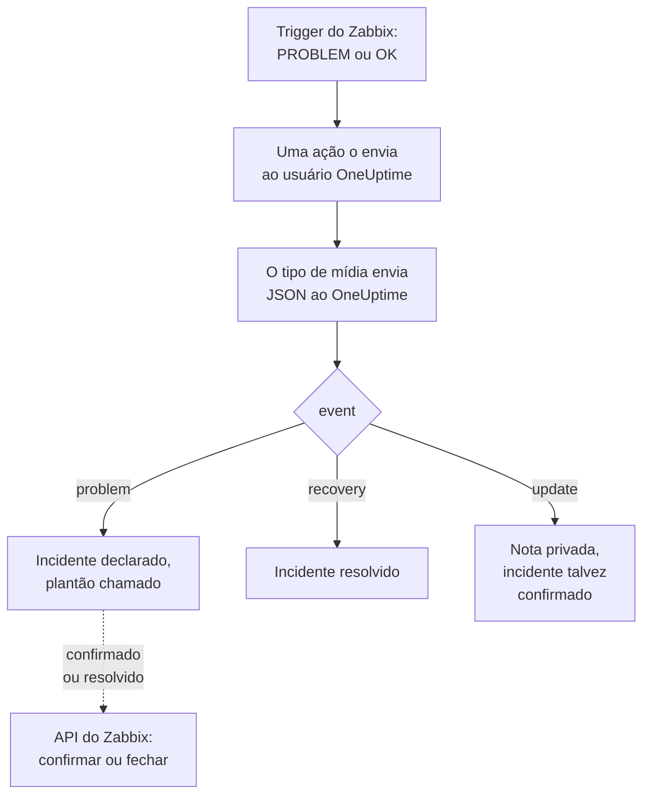

# Zabbix

Envie os problemas do [Zabbix](https://www.zabbix.com) para o OneUptime, para que cada problema vire um incidente que chama a sua equipe de plantão e seja resolvido quando o Zabbix se recuperar. Modelos de workflow prontos mantêm os dois lados em sincronia: o que as pessoas fazem no Zabbix é anotado no incidente, e confirmar ou resolver o incidente confirma ou fecha o problema no Zabbix. O Zabbix envia cada problema por um tipo de mídia webhook, então não há nada a instalar em nenhum dos lados.

:::cards
- [Escolher como o OneUptime recebe os problemas](#escolher-como-o-oneuptime-recebe-os-problemas): Modelos de workflow ou um monitor Incoming Request.
- [Começar pelos modelos](#começar-pelos-modelos): Seis modelos, o que fazem e o que pedem.
- [Configurar o Zabbix](#configurar-o-zabbix): Um tipo de mídia, um usuário e uma ação.
- [Solução de problemas](#solução-de-problemas): Quando os problemas não chegam ou os incidentes ficam abertos.
:::

## Como funciona



O Zabbix envia um problema a um usuário, pelas mídias desse usuário. Aqui a mídia é um tipo de mídia webhook chamado **OneUptime**: o script dele envia ao OneUptime um pequeno documento JSON para cada problema, para a recuperação dele e para cada atualização que alguém faz nele no Zabbix, com o ID do evento, o nome, o host e a gravidade do problema. É pelo ID do evento que o OneUptime encontra o incidente que um problema abriu.

## Antes de começar

- Um servidor Zabbix que você administra. Este guia foi escrito para o Zabbix 6.0 LTS e 7.0 LTS. Os tipos de mídia webhook funcionam da mesma forma a partir do Zabbix 5.0. Os modelos que chamam a API do Zabbix precisam do Zabbix 6.4 ou posterior, ou de [uma mudança no Zabbix 6.0](#no-zabbix-60).
- Um servidor Zabbix que consiga alcançar o seu OneUptime por HTTPS e, para os modelos que chamam o Zabbix, um OneUptime que consiga alcançar o Zabbix.
- No OneUptime, permissão para criar workflows, ou monitores se você seguir esse caminho. No OneUptime Cloud, os workflows precisam do plano **Growth** ou superior.

## Escolher como o OneUptime recebe os problemas

Configure o OneUptime primeiro: ele fornece a URL para a qual o Zabbix envia.

| Forma | Use quando |
| --- | --- |
| Os modelos de workflow (recomendados) | Você quer cada problema como um incidente ou um alerta na gravidade do Zabbix, com o plantão chamado para High e Disaster, resolvido na recuperação, com o que as pessoas fazem no Zabbix anotado nele, e o Zabbix confirmado ou fechado a partir do OneUptime. |
| Um monitor Incoming Request | Você quer incidentes sem um workflow, em qualquer plano, e um monitor cujo status acompanha o Zabbix. Nada volta para o Zabbix. |

Os dois recebem o mesmo JSON do mesmo tipo de mídia, então você pode começar com um e trocar depois mudando uma única URL no Zabbix.

## Começar pelos modelos

A caixa de diálogo **Criar um fluxo de trabalho** tem seis modelos do Zabbix, em **Zabbix** na lista de categorias: três para incidentes e depois os mesmos três para alertas.

| Modelo | O que faz | O que pede |
| --- | --- | --- |
| **Incidentes** | | |
| Declare an incident for each Zabbix problem | O workflow para o qual o Zabbix envia cada evento. Ele declara um incidente para cada problema, chama o plantão para High e Disaster, anota as atualizações feitas no Zabbix e resolve o incidente na recuperação. | Zabbix URL |
| Acknowledge or close the Zabbix problem with the incident | Quando o incidente é confirmado, confirma o problema dele. Quando é resolvido, fecha o problema, ou o confirma quando o Zabbix não permite fechá-lo manualmente. | Zabbix URL, Zabbix API Token |
| Copy incident private notes to the Zabbix problem | Adiciona cada nota privada do incidente ao problema dele como mensagem. | Zabbix URL, Zabbix API Token |
| **Alertas** | | |
| Create an alert for each Zabbix problem | O mesmo que para incidentes, com um alerta para cada problema. | Zabbix URL |
| Acknowledge or close the Zabbix problem with the alert | O mesmo que para incidentes, a partir do estado do alerta. | Zabbix URL, Zabbix API Token |
| Copy alert private notes to the Zabbix problem | Adiciona cada nota privada do alerta ao problema dele como mensagem. | Zabbix URL, Zabbix API Token |

Comece por **Declare an incident for each Zabbix problem**, ou por **Create an alert for each Zabbix problem** para alertas: o incidente ou alerta que ele abre guarda o ID do evento do problema no seu campo personalizado `zabbixEventId`, e os outros dois modelos encontram o problema por ele.

### O que os modelos pedem

- **Zabbix URL**: o endereço em que você abre o Zabbix, como `https://zabbix.example.com`, ou `https://example.com/zabbix` quando o Zabbix roda sob um caminho. Os links para um problema vão para lá, e os modelos que chamam o Zabbix enviam as requisições para o `api_jsonrpc.php` dele. O campo recusa o endereço de uma página dentro do Zabbix.
- **Zabbix API Token**: um token de API do usuário do Zabbix com o qual o workflow age. [Criar o token de API](#criar-o-token-de-api) mostra como. Ele é salvo como variável secreta e só é enviado ao Zabbix: no cabeçalho `Authorization`, ou no corpo da requisição no Zabbix 6.0.

### Receber problemas com o modelo

:::steps
1. Vá para **Fluxos de trabalho** e clique em **Criar fluxo de trabalho**. Em **Ou começar a partir de um modelo**, escolha **Zabbix** na lista de categorias, clique em **Declare an incident for each Zabbix problem** e depois em **Usar este modelo**.
2. Preencha **Zabbix URL**. Em **Who to page for High and Disaster problems**, escolha as políticas de plantão a acionar, ou nenhuma para não acionar ninguém, e clique em **Criar fluxo de trabalho**. O workflow abre no **Construtor**, desativado.
3. Clique no gatilho **Webhook**, depois em **Copiar URL**, e guarde a URL para o Zabbix.
4. Ative **Habilitado** no topo do **Construtor**. Um workflow desativado responde ao Zabbix com `400`.
:::

Depois [configure o Zabbix](#configurar-o-zabbix) para enviar os problemas dele para essa URL.

### O que o workflow faz

Depois do gatilho **Webhook**, a etapa **Check With JavaScript** `read-event-1` lê o `event` que o tipo de mídia envia, e **Incident From Another Tool**, ou **Alert From Another Tool** no modelo de alertas, faz o que ele significa, pelo ID de evento do problema:

| Evento | O que o workflow faz |
| --- | --- |
| `problem` | Declara um incidente com o título `Zabbix: <problem> on <host>`, na gravidade que corresponde à gravidade do Zabbix, fora das suas páginas de status. A descrição dele aponta para o problema no Zabbix e mostra o host, a gravidade, quando começou, os dados operacionais e as tags. Para um problema High ou Disaster, chama a política de plantão que você escolheu. Um problema que o Zabbix envia de novo, com o mesmo ID de evento, não abre um segundo incidente. |
| `recovery` | Resolve o incidente do problema, a menos que ele já esteja resolvido. O motivo fica na linha do tempo dele. |
| `update` | Adiciona ao incidente, como nota privada, o que foi feito no Zabbix: quem fez, o que fez e o que escreveu. Quando a atualização confirmou o problema, também confirma o incidente, o que faz o plantão parar de escalá-lo. |

Todo o resto, como uma requisição de outra ferramenta, é deixado como está: `read-event-1` segue por **No**, e as **Etapas** da execução dizem por quê. Uma etapa que falha faz a execução falhar, e a entrada dela em **Etapas** diz por quê.

### Gravidades

Em um projeto novo, o modelo mapeia as seis gravidades do Zabbix nestas gravidades de incidente e de alerta:

| Gravidade do Zabbix | Incidente | Alerta | Plantão |
| --- | --- | --- | --- |
| Disaster | Critical Incident | High | Chamado |
| High | Critical Incident | High | Chamado |
| Average | Major Incident | Low | Não chamado |
| Warning | Major Incident | Low | Não chamado |
| Information | Minor Incident | Low | Não chamado |
| Not classified | Minor Incident | Low | Não chamado |

Com gravidades próprias, Disaster e High vão para a sua mais grave, Average e Warning para a do meio, e Information e Not classified para a sua menos grave. O Zabbix numera as gravidades de 0 (Not classified) a 5 (Disaster), e o modelo lê o número, então renomear uma gravidade no Zabbix não muda nada.

- Para mapear uma gravidade para uma das suas pelo nome, edite `SEVERITY_BY_NAME` na etapa `read-event-1`, como `{ 2: 'Minor Incident' }` para Warning.
- Para chamar o plantão também para problemas Average, defina **Compare with** da etapa `if-page-1` **If / Else** como `3`.

### Enviar confirmações e notas de volta ao Zabbix

:::steps
1. [Crie o token de API](#criar-o-token-de-api).
2. Crie um workflow a partir de **Acknowledge or close the Zabbix problem with the incident**. Preencha **Zabbix URL** e **Zabbix API Token**, clique em **Criar fluxo de trabalho** e ative **Habilitado**.
3. Se você também quer as notas no Zabbix, faça o mesmo com **Copy incident private notes to the Zabbix problem**.
:::

O modelo de estado pergunta primeiro ao Zabbix sobre o problema, então um problema que o Zabbix já confirmou ou resolveu é deixado como está. Para fechar um problema, o trigger dele precisa de **Allow manual close** no Zabbix. Sem isso, o problema é confirmado no lugar, com uma mensagem dizendo que o incidente foi resolvido, e o Zabbix o fecha quando se recuperar. Incidentes que nenhum problema do Zabbix abriu, e incidentes marcados como **Incidente privado**, nunca são enviados ao Zabbix.

### Criar o token de API

:::steps
1. Use o usuário `OneUptime` que [recebe os problemas](#criar-um-usuário-para-receber-os-problemas). O Zabbix não envia a um usuário as próprias atualizações dele, então, com o token desse usuário, as confirmações e mensagens do OneUptime nunca voltam ao OneUptime como atualizações.
2. Verifique a função do usuário em **Users → User roles**. Ela precisa de **Access to API** ativado, e de **Acknowledge problems**, **Add problem comments** e **Close problems** permitidos. A **User role** os permite, a menos que alguém a tenha alterado.
3. Verifique o grupo do usuário em **Users → User groups**. A permissão **Read** nos grupos de hosts basta para confirmar problemas e adicionar mensagens. Para fechar problemas, ele precisa de **Read-write**.
4. Vá para **Users → API tokens** e clique em **Create API token**. Escolha o usuário `OneUptime`, desmarque **Set expiration date and time** ou anote a data, e clique em **Add**.
5. Copie o **Auth token**: o Zabbix o mostra só uma vez. Cole-o em **Zabbix API Token**.
:::

### No Zabbix 6.0

O Zabbix 6.0 lê o token de API do corpo da requisição, não do cabeçalho `Authorization`. Na etapa **Update Zabbix Problem** de cada modelo que chama o Zabbix, ative **Zabbix 6.0**, em **Mais campos**. O Zabbix 7.2 e posteriores recusam um token no corpo, então desative-o de novo quando atualizar.

## Receber problemas com um monitor

Um [monitor Incoming Request](/docs/monitor/incoming-request-monitor) fornece uma URL, e os critérios dele decidem o que cada requisição faz.

:::steps
### Criar o monitor

Vá para **Monitores** e clique em **Criar monitor**. Escolha **Incoming Request** em **Tipo de monitor**, dê o nome `Zabbix` e clique em **Próximo**.

### Declarar um incidente para cada problema

Na etapa **Critérios**, abra o primeiro critério, o que marca o monitor como offline. Defina o filtro dele como **Corpo da Requisição**, **Contém**, `"status":"1"`. Esse critério já declara um incidente quando o filtro corresponde. Preencha o incidente:

- **Título do Incidente**: `Zabbix: {{requestBody.name}} on {{requestBody.host}}`.
- **Gravidade**: a gravidade de incidente que os problemas do Zabbix devem ter.
- **Políticas de plantão**, em **Plantão**: as políticas a chamar.
- **Resolver incidente automaticamente**, em **Mais campos**: deixe ativado, como já vem. Sem isso, as recuperações são ignoradas e os incidentes ficam abertos.

### Abrir um incidente por problema

No mesmo critério, abra **Configurações** e ative **Group incidents and alerts by a payload field**. Preencha como abaixo, para que cada problema tenha o seu próprio incidente e a recuperação dele o resolva:

| Campo | Valor |
| --- | --- |
| **Open a separate incident for each…** | `requestBody.event_id` |
| **Field that signals recovery** | `requestBody.status` |
| **Value that means recovered** | `0` |

### Colocar o monitor online de novo

Abra o segundo critério, o que marca o monitor como online, e defina o filtro dele como **Corpo da Requisição**, **Contém**, `"status":"0"`.

### Copiar a URL

Clique em **Criar monitor**. A página **Visão geral** do monitor mostra a **Heartbeat URL** dele. Copie-a para o Zabbix:

```text
https://oneuptime.com/heartbeat/<secret key>
```

Uma instalação auto-hospedada tem o próprio host no lugar de `oneuptime.com`.
:::

O monitor lê o JSON da requisição como ele foi escrito: `"status":"1"`, sem espaços. Veja [Receber alertas de outro sistema](/docs/monitor/incoming-request-monitor#receber-alertas-de-outro-sistema) para saber o que cada configuração faz. Uma atualização feita no Zabbix também é enviada com `"status":"1"`, que o monitor lê de novo como o problema, sem abrir um segundo incidente.

## Configurar o Zabbix

O Zabbix precisa de três coisas: um tipo de mídia que envie ao OneUptime, um usuário para quem enviar e uma ação que envie os problemas a esse usuário.

:::steps
### Criar o tipo de mídia OneUptime

1. Vá para **Alerts → Media types**, ou **Administration → Media types** no Zabbix 6.0, e clique em **Create media type**.
2. Defina **Name** como `OneUptime` e **Type** como **Webhook**.
3. Adicione estes **Parameters**. Cada um leva uma [macro](https://www.zabbix.com/documentation/current/en/manual/appendix/macros/supported_by_location) do Zabbix para a requisição:

   | Nome | Valor |
   | --- | --- |
   | `url` | `{ALERT.SENDTO}` |
   | `event_id` | `{EVENT.ID}` |
   | `event_name` | `{EVENT.NAME}` |
   | `event_value` | `{EVENT.VALUE}` |
   | `event_severity` | `{EVENT.SEVERITY}` |
   | `event_nseverity` | `{EVENT.NSEVERITY}` |
   | `host` | `{HOST.NAME}` |
   | `event_date` | `{EVENT.DATE}` |
   | `event_time` | `{EVENT.TIME}` |
   | `event_opdata` | `{EVENT.OPDATA}` |
   | `event_tags` | `{EVENT.TAGSJSON}` |
   | `trigger_id` | `{TRIGGER.ID}` |
   | `event_update_status` | `{EVENT.UPDATE.STATUS}` |
   | `event_update_action` | `{EVENT.UPDATE.ACTION}` |
   | `event_update_message` | `{EVENT.UPDATE.MESSAGE}` |
   | `event_update_user` | `{USER.FULLNAME}` |

4. Cole isto em **Script**:

   ```javascript
   var params = JSON.parse(value);

   // Zabbix leaves a macro it has no value for as it is written, such as
   // {EVENT.UPDATE.MESSAGE} on a problem: it is sent as nothing.
   function given(text) {
     var written = String(text === undefined || text === null ? "" : text);
     return /^\{[A-Z0-9_.]+\}$/.test(written) || written === "*UNKNOWN*"
       ? ""
       : written;
   }

   var isUpdate = given(params.event_update_status) === "1";
   var payload = {
     source: "zabbix",
     // "problem", "recovery" or "update".
     event: isUpdate
       ? "update"
       : params.event_value === "0"
         ? "recovery"
         : "problem",
     event_id: params.event_id,
     name: params.event_name,
     host: params.host,
     severity: params.event_severity,
     // 0 Not classified, 1 Information, 2 Warning, 3 Average, 4 High, 5 Disaster.
     severity_number: params.event_nseverity,
     // "1" for a problem, "0" for its recovery.
     status: params.event_value,
     date: params.event_date,
     time: params.event_time,
     opdata: given(params.event_opdata),
     tags: [],
     trigger_id: params.trigger_id,
   };

   try {
     var tags = JSON.parse(given(params.event_tags) || "[]");
     payload.tags = Array.isArray(tags) ? tags : [];
   } catch (error) {
     payload.tags = [];
   }

   if (isUpdate) {
     payload.update = {
       action: given(params.event_update_action),
       message: given(params.event_update_message),
       user: given(params.event_update_user),
     };
   }

   var request = new HttpRequest();
   request.addHeader("Content-Type: application/json");

   var response = request.post(params.url, JSON.stringify(payload));

   if (request.getStatus() < 200 || request.getStatus() >= 300) {
     throw (
       "OneUptime responded with HTTP " + request.getStatus() + ": " + response
     );
   }

   return "OK";
   ```

5. Na aba **Message templates**, adicione um modelo para **Problem**, um para **Problem recovery** e um para **Problem update**. Deixe o texto deles vazio: o script monta a requisição. O Zabbix só usa um tipo de mídia para os tipos de evento para os quais ele tem um modelo.
6. Clique em **Add**.

### Criar um usuário para receber os problemas

1. Vá para **Users → Users**, ou **Administration → Users** no Zabbix 6.0, e clique em **Create user**. Dê o nome `OneUptime` e atribua um grupo de usuários e uma função que possa receber notificações, como **User role**.
2. Na aba **Media**, clique em **Add**. Defina **Type** como `OneUptime` e **Send to** como a URL que você copiou do OneUptime. Deixe **When active** e as gravidades como estão, ou desmarque as gravidades que o OneUptime não deve receber.
3. Clique em **Add** e depois em **Add** de novo para salvar o usuário.

### Enviar os problemas ao OneUptime com uma ação

1. Vá para **Alerts → Actions → Trigger actions**, ou **Configuration → Actions** no Zabbix 6.0, e clique em **Create action**. Dê o nome `Notify OneUptime`.
2. Em **Conditions**, restrinja-a se quiser, por exemplo com **Trigger severity is greater than or equals Warning**. Sem condições, todo problema é enviado.
3. Na aba **Operations**, adicione uma operação que envie ao usuário `OneUptime` pelo tipo de mídia `OneUptime`.
4. Adicione a mesma operação em **Recovery operations**, para que as recuperações também sejam enviadas, e em **Update operations**, para que as confirmações e os comentários feitos no Zabbix sejam enviados.
5. Clique em **Add** e verifique se a ação está habilitada.
:::

Para enviar alguns problemas ao modelo de incidentes e outros ao modelo de alertas, dê ao usuário `OneUptime` duas mídias do tipo `OneUptime`: cada uma envia para a URL de um workflow, com as gravidades que ele deve receber.

## Testar

1. No Zabbix, abra **Alerts → Media types** e clique em **Test** ao lado de `OneUptime`. Informe a URL que você copiou e valores de exemplo como `event_id` `12345`, `event_name` `Test problem`, `host` `web-1`, `event_nseverity` `4` e `event_value` `1`. Clique em **Test**: o Zabbix mostra a resposta do script, `OK`, ou o erro que ele lançou.
2. No OneUptime, abra **Registros → Execuções** do workflow e confira a execução, ou abra o monitor e verifique se um incidente foi aberto.
3. Teste de novo com `event_value` `0` e o mesmo `event_id`. O incidente é resolvido.

Depois deixe um trigger real disparar, por exemplo baixando um limite por um momento, e veja o problema chegar. Para testar uma atualização, confirme o problema no Zabbix com uma mensagem: o incidente recebe uma nota privada e é confirmado.

## Mapear as gravidades do Zabbix

O Zabbix envia a gravidade como texto: `Not classified`, `Information`, `Warning`, `Average`, `High` ou `Disaster`.

- **Com os modelos**, as gravidades são mapeadas para você: veja [Gravidades](#gravidades).
- **Com o monitor**, clique em **Adicionar critérios** para cada grupo de gravidades e arraste o novo critério para cima do primeiro: os critérios são verificados de cima para baixo, e o primeiro que corresponde decide. Dê a cada um dois filtros, `"status":"1"` e uma gravidade como `"severity":"Disaster"`, com **Condição de correspondência** em **Todos**. Dê a cada um um incidente com a sua própria **Gravidade** e **Resolver incidente automaticamente**, e as mesmas configurações de agrupamento.

## Solução de problemas

:::details Nada chega ao OneUptime
- No Zabbix, abra **Reports → Action log** e verifique se a ação enviou o problema e o que voltou.
- A partir do servidor Zabbix, envie você mesmo uma requisição: `curl -i -X POST <url> -H 'Content-Type: application/json' -d '{"source":"zabbix","event":"problem","event_id":"1","name":"Test","host":"test","severity_number":"4","status":"1"}'`.
- O monitor responde `200` na hora, antes de verificar qualquer coisa, mesmo com uma chave secreta errada. Confira a linha do tempo do monitor para ver se as requisições chegam.
- Um workflow desativado responde `400`. Ative **Habilitado** no topo do **Construtor** dele.
:::

:::details O Zabbix informa um erro de script
Abra o tipo de mídia e use **Test**: o Zabbix mostra o resultado do script ou o erro que ele lançou. Uma resposta do OneUptime diferente de `2xx` é lançada pelo script junto com o status dela, então verifique a URL primeiro.
:::

:::details Os incidentes abrem, mas nunca são resolvidos
- A ação precisa de **Recovery operations**, ou o Zabbix nunca envia a recuperação.
- Com o modelo, abra **Registros → Execuções** do workflow e a execução da recuperação: a última etapa dela diz por quê. Uma recuperação de um problema que não abriu nenhum incidente não muda nada.
- Com o monitor, o incidente do critério precisa de **Resolver incidente automaticamente**, em **Mais campos**. **Field that signals recovery** deve ser `requestBody.status`, e **Value that means recovered** exatamente `0`.
:::

:::details O problema do Zabbix não é confirmado nem fechado
Abra a execução do modelo de estado em **Registros → Execuções**: a última etapa dela diz o que o Zabbix respondeu.

- `Not authorized`: o token de API está errado, expirado ou desativado, ou o Zabbix é anterior ao 6.4 (veja [No Zabbix 6.0](#no-zabbix-60)).
- `Cannot close problem: trigger does not allow manual closing`: ative **Allow manual close** no trigger. O modelo já confirma esses problemas em vez de fechá-los.
- `No permissions to referred object or it does not exist!`: o usuário vê o problema, mas precisa da permissão **Read-write** para fechá-lo.
- `Zabbix has no problem with event ID`: o usuário não vê o host do problema. Dê ao grupo de usuários dele a permissão **Read** no grupo de hosts.
:::

:::details O incidente mostra uma referência em vez de um valor
Uma referência a um campo que a requisição não tem fica como foi escrita, com chaves e tudo, em vez de ser esvaziada. Verifique se o Zabbix envia `Content-Type: application/json` e se os nomes de campo que você usa (`name`, `host`, `severity`, `status`, `event_id`) correspondem ao payload do script. Para um workflow, abra a execução em **Registros → Execuções** e compare com o que o gatilho recebeu. Veja [Armadilhas](/docs/workflows/variables#armadilhas).
:::

:::details Cada problema chega duas vezes
Provavelmente a ação tem duas operações que enviam ao mesmo usuário, como uma primeira etapa e uma etapa de escalonamento. O modelo abre um só incidente por ID de evento, chegue o que chegar, mas cada entrega é uma execução. Confira as **Operations** da ação.
:::

## Segurança

- **Trate a URL como uma senha.** Quem a tiver pode abrir incidentes. Se ela vazar, redefina-a: **Redefinir URL** no gatilho **Webhook** do workflow, ou **Redefinir chave secreta de requisição recebida** na página **Configurações** do monitor. Depois atualize **Send to** na mídia do usuário do Zabbix.
- **Os links vão para o seu Zabbix.** O modelo aponta um problema no site que o **Zabbix URL** dele nomeia, diga o que disser uma requisição, e escreve o que o Zabbix enviou como texto.
- **Limite o token de API ao que o workflow faz.** Ele é uma variável secreta, ocultada nos logs de execução e enviada só ao Zabbix, no cabeçalho `Authorization`, a menos que **Zabbix 6.0** esteja ativado. Dê ao usuário dele uma função sem nada além das ações acima, e exclua o token em **Users → API tokens** se ele vazar.
- **Envie só o que precisa de um incidente.** Use as condições da ação, ou as gravidades da mídia do usuário, para deixar no Zabbix os problemas de baixa gravidade.
- **Auto-hospedado?** Deixe o seu servidor Zabbix alcançar o seu OneUptime por HTTPS através do firewall. Para chamar um Zabbix em uma rede privada, o workflow precisa de [acesso de rede de saída](/docs/workflows/configuration#acesso-de-rede-para-fora).

## Próximos passos

:::cards
- [Modelos de workflow](/docs/workflows/authoring): Crie um workflow a partir de um modelo e altere-o no Construtor.
- [Monitor de requisições recebidas](/docs/monitor/incoming-request-monitor): Cada configuração do monitor que recebe os problemas do Zabbix.
- [Regras de escalonamento](/docs/on-call/escalation-rules): Decida quem uma política de plantão chama, e quando.
- [Visão geral das integrações](/docs/integrations/index): As outras ferramentas que você pode conectar.
:::
