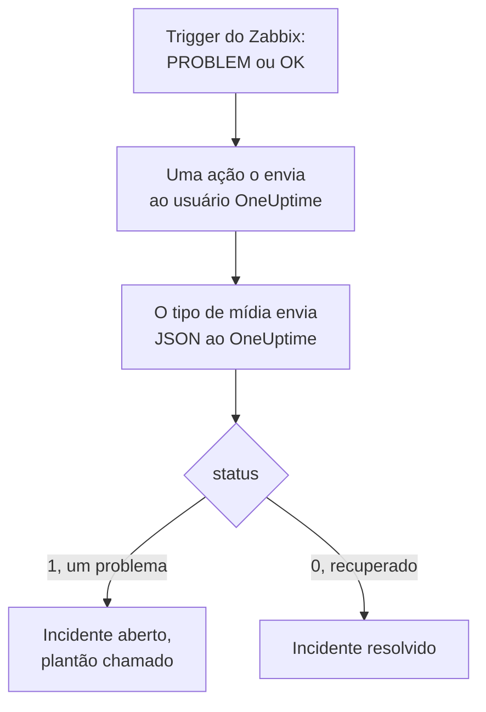

# Zabbix

Envie os problemas do [Zabbix](https://www.zabbix.com) para o OneUptime, para que cada problema vire um incidente que chama a sua equipe de plantão e seja resolvido quando o Zabbix se recuperar. O Zabbix envia cada problema por um tipo de mídia webhook, então não há nada a instalar em nenhum dos lados.

:::cards
- [Escolher como o OneUptime recebe os problemas](#escolher-como-o-oneuptime-recebe-os-problemas): Um monitor Incoming Request ou um workflow seu.
- [Receber problemas com um monitor](#receber-problemas-com-um-monitor): Um incidente por problema, resolvido na recuperação.
- [Configurar o Zabbix](#configurar-o-zabbix): Um tipo de mídia, um usuário e uma ação.
- [Solução de problemas](#solução-de-problemas): Quando os problemas não chegam ou os incidentes ficam abertos.
:::

## Como funciona



O Zabbix envia um problema a um usuário, pelas mídias desse usuário. Aqui a mídia é um tipo de mídia webhook chamado **OneUptime**: o script dele envia ao OneUptime um pequeno documento JSON com o ID do evento, o nome, o host, a gravidade e o status do problema. O status é `1` para um problema e `0` para a recuperação dele.

## Antes de começar

- Um servidor Zabbix que você administra. Este guia foi escrito para o Zabbix 6.0 LTS e 7.0 LTS. Os tipos de mídia webhook funcionam da mesma forma a partir do Zabbix 5.0.
- Um servidor Zabbix que consiga alcançar o seu OneUptime por HTTPS.
- No OneUptime, permissão para criar monitores, ou workflows se você seguir esse caminho.

## Escolher como o OneUptime recebe os problemas

Configure o OneUptime primeiro: ele fornece a URL para a qual o Zabbix envia.

| Forma | Use quando |
| --- | --- |
| Um monitor Incoming Request (recomendado) | Você quer que cada problema do Zabbix seja um incidente que chama o plantão e é resolvido quando o Zabbix se recupera. Não há nada a montar. |
| Um workflow com um gatilho Webhook | Você precisa de uma lógica própria: filtrar os problemas, mudar o formato deles ou chamar outros sistemas antes. Um workflow não resolve o incidente sozinho na recuperação. |

Os dois recebem o mesmo JSON do mesmo tipo de mídia, então você pode começar com um e trocar depois mudando uma única URL no Zabbix.

## Receber problemas com um monitor

Um [monitor Incoming Request](/docs/monitor/incoming-request-monitor) fornece uma URL, e os critérios dele decidem o que cada requisição faz.

:::steps
### Criar o monitor

Vá para **Monitores** e clique em **Criar monitor**. Escolha **Incoming Request** em **Tipo de monitor**, dê o nome `Zabbix` e clique em **Próximo**.

### Declarar um incidente para cada problema

Na etapa **Critérios**, abra o primeiro critério, o que marca o monitor como offline. Defina o filtro dele como **Corpo da Requisição**, **Contém**, `"status":"1"`. Esse critério já declara um incidente quando o filtro corresponde. Preencha o incidente:

- **Título do Incidente**: `Zabbix: {{requestBody.name}} on {{requestBody.host}}`.
- **Gravidade**: a gravidade de incidente que os problemas do Zabbix devem ter.
- **Políticas de plantão**, em **Plantão**: as políticas a chamar.
- **Resolver incidente automaticamente**, em **Mais campos**: deixe ativado, como já vem. Sem isso, as recuperações são ignoradas e os incidentes ficam abertos.

### Abrir um incidente por problema

No mesmo critério, abra **Configurações** e ative **Group incidents and alerts by a payload field**. Preencha como abaixo, para que cada problema tenha o seu próprio incidente e a recuperação dele o resolva:

| Campo | Valor |
| --- | --- |
| **Open a separate incident for each…** | `requestBody.event_id` |
| **Field that signals recovery** | `requestBody.status` |
| **Value that means recovered** | `0` |

### Colocar o monitor online de novo

Abra o segundo critério, o que marca o monitor como online, e defina o filtro dele como **Corpo da Requisição**, **Contém**, `"status":"0"`.

### Copiar a URL

Clique em **Criar monitor**. A página **Visão geral** do monitor mostra a **Heartbeat URL** dele. Copie-a para o Zabbix:

```text
https://oneuptime.com/heartbeat/<secret key>
```

Uma instalação auto-hospedada tem o próprio host no lugar de `oneuptime.com`.
:::

O monitor lê o JSON da requisição como ele foi escrito: `"status":"1"`, sem espaços. Veja [Receber alertas de outro sistema](/docs/monitor/incoming-request-monitor#receber-alertas-de-outro-sistema) para saber o que cada configuração faz.

## Receber problemas com um workflow

Use um [workflow](/docs/workflows/index) quando você precisar de etapas próprias entre o Zabbix e o incidente.

:::steps
### Criar o workflow

Vá para **Fluxos de trabalho**, clique em **Criar fluxo de trabalho** e depois em **Começar do zero**. Dê o nome `Zabbix problems` e clique em **Criar fluxo de trabalho**.

### Adicionar o gatilho Webhook

Clique no bloco tracejado **Choose what starts this workflow** e escolha **Webhook**. Clique no gatilho e depois em **Copiar URL**, e guarde a URL para o Zabbix.

### Verificar que é um problema

Clique em **Adicionar componente**, adicione um bloco **If / Else** e ligue a ele o ponto **Out** do gatilho. Defina **Value to check** como `{{local.components.webhook-1.returnValues.request-body.status}}`, **Comparison** como **is equal to** e **Compare with** como `1`.

### Declarar o incidente

Adicione um bloco **Create One Incident** e ligue a ele o lado **Yes** do bloco **If / Else**. Em **Incident Template**, escolha um modelo que defina a gravidade e as políticas de plantão a chamar (veja [Modelos de incidente](/docs/incidents/settings#modelos-de-incidentes)). Em **JSON Object**, defina o que vem do Zabbix:

```json
{
  "title": "Zabbix: {{local.components.webhook-1.returnValues.request-body.name}}",
  "description": "Host: {{local.components.webhook-1.returnValues.request-body.host}}\nSeverity: {{local.components.webhook-1.returnValues.request-body.severity}}\nZabbix event: {{local.components.webhook-1.returnValues.request-body.event_id}}"
}
```

Sem um modelo, o **JSON Object** também precisa de `incidentSeverityId`, o ID de uma das gravidades de incidente do projeto.

### Ativá-lo

Ative **Habilitado** no topo do **Construtor**. Um workflow desativado responde ao Zabbix com `400`.
:::

Uma recuperação segue o lado **No** do bloco **If / Else**, onde não há nada ligado, então a execução termina ali. Para resolver os incidentes na recuperação, use o monitor.

## Configurar o Zabbix

O Zabbix precisa de três coisas: um tipo de mídia que envie ao OneUptime, um usuário para quem enviar e uma ação que envie os problemas a esse usuário.

:::steps
### Criar o tipo de mídia OneUptime

1. Vá para **Alerts → Media types**, ou **Administration → Media types** no Zabbix 6.0, e clique em **Create media type**.
2. Defina **Name** como `OneUptime` e **Type** como **Webhook**.
3. Adicione estes **Parameters**. Cada um leva uma [macro](https://www.zabbix.com/documentation/current/en/manual/appendix/macros/supported_by_location) do Zabbix para a requisição:

   | Nome | Valor |
   | --- | --- |
   | `url` | `{ALERT.SENDTO}` |
   | `event_id` | `{EVENT.ID}` |
   | `event_name` | `{EVENT.NAME}` |
   | `event_value` | `{EVENT.VALUE}` |
   | `event_severity` | `{EVENT.SEVERITY}` |
   | `host` | `{HOST.NAME}` |
   | `event_date` | `{EVENT.DATE}` |
   | `event_time` | `{EVENT.TIME}` |

4. Cole isto em **Script**:

   ```javascript
   var params = JSON.parse(value);
   var request = new HttpRequest();
   request.addHeader("Content-Type: application/json");

   var payload = {
     source: "zabbix",
     event_id: params.event_id,
     name: params.event_name,
     host: params.host,
     severity: params.event_severity,
     // "1" for a problem, "0" for its recovery.
     status: params.event_value,
     date: params.event_date,
     time: params.event_time,
   };

   var response = request.post(params.url, JSON.stringify(payload));

   if (request.getStatus() < 200 || request.getStatus() >= 300) {
     throw (
       "OneUptime responded with HTTP " + request.getStatus() + ": " + response
     );
   }

   return "OK";
   ```

5. Na aba **Message templates**, adicione um modelo para **Problem** e um para **Problem recovery**. Deixe o texto deles vazio: o script monta a requisição. O Zabbix só usa um tipo de mídia para os tipos de evento para os quais ele tem um modelo.
6. Clique em **Add**.

### Criar um usuário para receber os problemas

1. Vá para **Users → Users**, ou **Administration → Users** no Zabbix 6.0, e clique em **Create user**. Dê o nome `OneUptime` e atribua um grupo de usuários e uma função que possa receber notificações, como **User role**.
2. Na aba **Media**, clique em **Add**. Defina **Type** como `OneUptime` e **Send to** como a URL que você copiou do OneUptime. Deixe **When active** e as gravidades como estão, ou desmarque as gravidades que o OneUptime não deve receber.
3. Clique em **Add** e depois em **Add** de novo para salvar o usuário.

### Enviar os problemas ao OneUptime com uma ação

1. Vá para **Alerts → Actions → Trigger actions**, ou **Configuration → Actions** no Zabbix 6.0, e clique em **Create action**. Dê o nome `Notify OneUptime`.
2. Em **Conditions**, restrinja-a se quiser, por exemplo com **Trigger severity is greater than or equals Warning**. Sem condições, todo problema é enviado.
3. Na aba **Operations**, adicione uma operação que envie ao usuário `OneUptime` pelo tipo de mídia `OneUptime`.
4. Adicione a mesma operação em **Recovery operations**, para que as recuperações também sejam enviadas.
5. Clique em **Add** e verifique se a ação está habilitada.
:::

## Testar

1. No Zabbix, abra **Alerts → Media types** e clique em **Test** ao lado de `OneUptime`. Informe a URL que você copiou e valores de exemplo como `event_id` `12345`, `event_name` `Test problem`, `host` `web-1` e `event_value` `1`. Clique em **Test**: o Zabbix mostra a resposta do script, `OK`, ou o erro que ele lançou.
2. No OneUptime, abra o monitor e verifique se um incidente foi aberto, ou abra **Registros → Execuções** do workflow e confira a execução.
3. Teste de novo com `event_value` `0` e o mesmo `event_id`. Com o monitor, o incidente é resolvido.

Depois deixe um trigger real disparar, por exemplo baixando um limite por um momento, e veja o problema chegar.

## Mapear as gravidades do Zabbix

O Zabbix envia a gravidade como texto: `Not classified`, `Information`, `Warning`, `Average`, `High` ou `Disaster`.

- **Com o monitor**, clique em **Adicionar critérios** para cada grupo de gravidades e arraste o novo critério para cima do primeiro: os critérios são verificados de cima para baixo, e o primeiro que corresponde decide. Dê a cada um dois filtros, `"status":"1"` e uma gravidade como `"severity":"Disaster"`, com **Condição de correspondência** em **Todos**. Dê a cada um um incidente com a sua própria **Gravidade** e **Resolver incidente automaticamente**, e as mesmas configurações de agrupamento.
- **Com o workflow**, adicione um bloco [Switch / Case](/docs/workflows/components#switch-case) sobre `{{local.components.webhook-1.returnValues.request-body.severity}}`, com um caso para cada gravidade, e um bloco **Create One Incident**, com o seu próprio modelo, depois de cada caso.

## Solução de problemas

:::details Nada chega ao OneUptime
- No Zabbix, abra **Reports → Action log** e verifique se a ação enviou o problema e o que voltou.
- A partir do servidor Zabbix, envie você mesmo uma requisição: `curl -i -X POST <url> -H 'Content-Type: application/json' -d '{"status":"1","event_id":"1","name":"Test","host":"test"}'`.
- O monitor responde `200` na hora, antes de verificar qualquer coisa, mesmo com uma chave secreta errada. Confira a linha do tempo do monitor para ver se as requisições chegam.
- Um workflow desativado responde `400`. Ative **Habilitado** no topo do **Construtor** dele.
:::

:::details O Zabbix informa um erro de script
Abra o tipo de mídia e use **Test**: o Zabbix mostra o resultado do script ou o erro que ele lançou. Uma resposta do OneUptime diferente de `2xx` é lançada pelo script junto com o status dela, então verifique a URL primeiro.
:::

:::details Os incidentes abrem, mas nunca são resolvidos
- A ação precisa de **Recovery operations**, ou o Zabbix nunca envia a recuperação.
- O incidente do critério precisa de **Resolver incidente automaticamente**, em **Mais campos**.
- **Field that signals recovery** deve ser `requestBody.status`, e **Value that means recovered** exatamente `0`.
- Um workflow não resolve os incidentes na recuperação. Use o monitor.
:::

:::details O incidente mostra uma referência em vez de um valor
Uma referência a um campo que a requisição não tem fica como foi escrita, com chaves e tudo, em vez de ser esvaziada. Verifique se o Zabbix envia `Content-Type: application/json` e se os nomes de campo que você usa (`name`, `host`, `severity`, `status`, `event_id`) correspondem ao payload do script. Para um workflow, abra a execução em **Registros → Execuções** e compare com o que o gatilho recebeu. Veja [Armadilhas](/docs/workflows/variables#armadilhas).
:::

:::details Cada problema chega duas vezes
Provavelmente a ação tem duas operações que enviam ao mesmo usuário, como uma primeira etapa e uma etapa de escalonamento. Confira as **Operations** da ação.
:::

## Segurança

- **Trate a URL como uma senha.** Quem a tiver pode abrir incidentes. Se ela vazar, redefina-a: **Redefinir chave secreta de requisição recebida** na página **Configurações** do monitor, ou **Redefinir URL** no gatilho **Webhook** do workflow. Depois atualize **Send to** na mídia do usuário do Zabbix.
- **Envie só o que precisa de um incidente.** Use as condições da ação, ou as gravidades da mídia do usuário, para deixar no Zabbix os problemas de baixa gravidade.
- **Auto-hospedado?** Deixe o seu servidor Zabbix alcançar o seu OneUptime por HTTPS através do firewall.

## Próximos passos

:::cards
- [Monitor de requisições recebidas](/docs/monitor/incoming-request-monitor): Cada configuração do monitor que recebe os problemas do Zabbix.
- [Regras de escalonamento](/docs/on-call/escalation-rules): Decida quem uma política de plantão chama, e quando.
- [Gatilhos de workflow](/docs/workflows/triggers#webhook): Como funciona a URL de webhook de um workflow.
- [Visão geral das integrações](/docs/integrations/index): As outras ferramentas que você pode conectar.
:::
