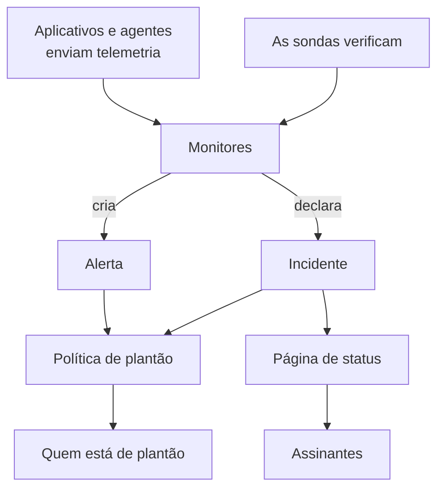
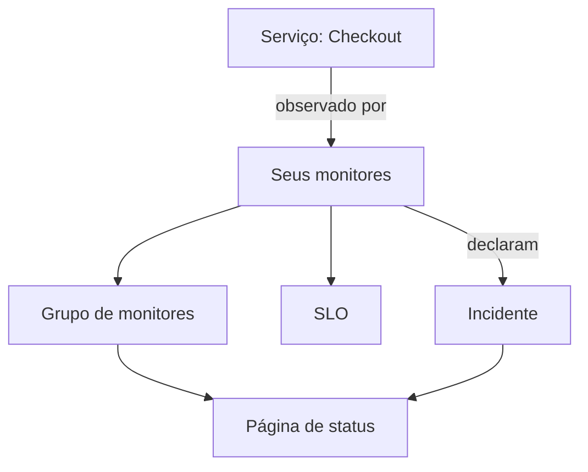

# Conceitos básicos

O OneUptime tem muitos produtos, mas eles se apoiam em um punhado de ideias: projetos, monitores, incidentes e alertas, plantão, páginas de status e telemetria. Ao redor delas estão o que você observa, o que você instala e as regras que agem por você. Esta página explica cada uma em poucas frases, mostra como se conectam e leva às páginas que tratam de cada uma em detalhe. Leia-a uma vez, e todas as outras páginas da documentação ficam mais fáceis de ler. Para uma palavra de cada vez, veja o [Glossário](/docs/introduction/glossary); para escolher entre duas coisas parecidas, veja [Qual devo usar?](/docs/introduction/which-one).

:::cards
- [Projetos e pessoas](#projetos-e-pessoas): Onde tudo fica, e quem pode fazer o quê.
- [Monitores e sondas](#monitores-e-sondas): Como o OneUptime percebe que algo está errado.
- [Incidentes e alertas](#incidentes-e-alertas): O registro com o qual sua equipe trabalha.
- [Plantão](#plantão): Quem é acionado, como, e quem vem a seguir.
:::

## Como as peças se conectam

Um problema percorre o OneUptime em uma só direção. As sondas e a sua própria telemetria alimentam os monitores. Os critérios de um monitor decidem quando algo está errado e o que abrir: um incidente, um alerta ou os dois. As políticas de plantão acionam as pessoas, e as páginas de status informam seus clientes sobre os incidentes.

## Projetos e pessoas

Um **projeto** contém tudo: monitores, incidentes, políticas de plantão, páginas de status, telemetria e configurações. A maioria das empresas precisa de um, e algumas mantêm um por ambiente ou unidade de negócio. Nada do que você cria em um projeto aparece em outro.

Sua **conta** é separada dos seus projetos. Uma conta, com um e-mail e uma senha, pode pertencer a quantos projetos você quiser; troque entre eles com o seletor de projetos no canto superior esquerdo. Veja [Sua conta](/docs/introduction/your-account).

As pessoas fazem parte de um projeto por meio de **equipes**, e as permissões de uma equipe decidem o que seus membros podem fazer. Todo projeto novo começa com três equipes: Owners, com você dentro, Admin e Members. No OneUptime Cloud, cada projeto tem o próprio plano.

:::cards
- [Usuários, equipes e permissões](/docs/permissions/index): Convidar pessoas e decidir o que elas podem fazer.
:::

## Monitores e sondas

Um **monitor** verifica algo que você executa e decide se está funcionando. A maioria dos monitores é verificada por **sondas**: máquinas que executam a verificação em uma programação, como pedir uma página, chamar uma API, fazer ping em um host ou consultar um banco de dados. O OneUptime Cloud executa sondas em várias regiões, uma instalação auto-hospedada executa as suas, e você pode adicionar sondas personalizadas dentro da sua rede. Outros monitores leem o que você envia: a telemetria dos seus aplicativos, ou os dados que um agente relata a partir dos seus servidores, clusters Kubernetes e do resto da infraestrutura.

Os **critérios** de um monitor decidem o que cada resultado significa. Eles são avaliados em ordem, e o primeiro que corresponde pode mudar o status do monitor, declarar um incidente, criar um alerta ou as três coisas. Todo projeto novo tem três status de monitor: **Operacional**, **Degradado** e **Offline**.

:::cards
- [Criar um monitor](/docs/monitor/create-monitor): Escolher um tipo, dizer o que verificar e com que frequência.
- [Sondas personalizadas](/docs/probe/custom-probe): Verificar o que só a sua própria rede alcança.
:::

## O que você observa

Um monitor verifica uma coisa. Em torno dos seus monitores, o OneUptime mantém um registro do que você executa, e você encontra esses registros no menu:

- Um **grupo de monitores** reúne vários monitores em um único status, para que uma página de status possa mostrar algo feito de muitas partes, como Checkout, em uma única linha.
- Um **serviço** é um aplicativo ou microsserviço que você executa. O OneUptime o adiciona na primeira vez que a telemetria dele chega, e reúne os logs, traces, métricas, exceções e incidentes dele em uma única página.
- **Hosts**, clusters **Kubernetes** e o resto da **Infraestrutura** são as máquinas e plataformas que você executa, preenchidas pelos agentes que você instala.
- O **Inventário** é uma única lista de tudo isso: serviços, hosts, clusters, dispositivos, recursos de nuvem e as coisas que não enviam telemetria alguma.

Eles se encontram onde um problema aparece. Os monitores de um serviço podem ser agregados em um grupo de monitores, um SLO os mede, e quando um deles falha, ele declara um incidente. O incidente lista o serviço entre os recursos que afeta, e a página de status mostra o grupo e o incidente.

:::cards
- [Grupos de monitores](/docs/monitor/monitor-groups): Reunir vários monitores em um único status.
- [Serviços](/docs/telemetry/services): Cada aplicativo que você executa, cada um em sua própria página.
- [Visão geral do inventário](/docs/inventory/overview): Tudo o que o OneUptime sabe sobre o seu ambiente.
:::

## Metas de confiabilidade

Um **SLO** (objetivo de nível de serviço) é uma meta de confiabilidade para o que você monitora, como estar no ar 99,9% do tempo em 30 dias. O OneUptime o mede a partir dos seus monitores a cada 5 minutos. O tempo de inatividade que a meta permite é o seu orçamento de erros: com bastante sobrando, você pode correr riscos, e com pouco sobrando, você desacelera e investe em estabilidade.

:::cards
- [Visão geral dos SLOs](/docs/slo/introduction): Definir uma meta e ver quanto do orçamento ainda resta.
:::

## Incidentes e alertas

Os dois registram um problema, e os dois podem acionar quem está de plantão. O que os diferencia é quem o problema afeta.

| | Incidente | Alerta |
| --- | --- | --- |
| **O que é** | Um problema que afeta seus usuários, como uma queda ou uma lentidão | Um problema que sua equipe deve investigar antes que os usuários sejam afetados |
| **Nas páginas de status** | Pode aparecer, e avisa os assinantes | Nunca |
| **Estados iniciais** | **Identificado**, **Confirmado**, **Resolvido** | **Identificado**, **Confirmado**, **Resolvido** |
| **Severidades iniciais** | Critical Incident, Major Incident, Minor Incident | **Alto**, **Baixo** |

Confirmar indica que alguém está cuidando, e impede que as políticas de plantão acionem o próximo nível. Resolver encerra. Você pode adicionar seus próprios estados e severidades, e vincular alertas ao incidente do qual eles acabaram fazendo parte.

Um **episódio** agrupa incidentes relacionados, ou alertas relacionados, para que sua equipe trabalhe neles como um só. Regras de agrupamento decidem o que fica junto.

:::cards
- [Visão geral dos incidentes](/docs/incidents/index): Como os incidentes são declarados, tratados e resolvidos.
- [Visão geral dos alertas](/docs/alerts/index): De onde vêm os alertas e como os episódios os agrupam.
- [Alertas vinculados](/docs/incidents/linked-alerts): Vincular ao incidente os alertas gerados por uma queda.
:::

## Plantão

Uma **política de plantão** decide quem é acionado sobre um incidente ou alerta, e quem vem a seguir se ninguém responder. Suas **regras de escalonamento** são seus níveis: cada uma aciona suas pessoas e espera alguém confirmar antes de acionar o próximo nível. Um nível pode acionar pessoas, equipes ou uma **escala de plantão**, um rodízio que sabe a cada momento quem está de plantão.

Como cada pessoa é contatada é ela quem decide. Em **Configurações do usuário**, cada um guarda as formas pelas quais o OneUptime pode contatá-lo, como e-mail, SMS, chamadas, notificações push, Slack ou Microsoft Teams, e quais usar quando for acionado.

:::cards
- [Visão geral do plantão](/docs/on-call/index): Como um acionamento chega a alguém e onde fica cada peça.
- [Regras de escalonamento](/docs/on-call/escalation-rules): Acionar pessoas nível a nível até alguém responder.
- [Agendamentos de plantão](/docs/on-call/schedules): Rodízios, camadas e passagens de turno.
- [Como o OneUptime chega até você](/docs/notifications/index): Os métodos, regras e configurações que decidem como cada pessoa é contatada.
:::

## Páginas de status e manutenção

Uma **página de status** mostra aos seus clientes se seus serviços funcionam. Você escolhe quais monitores ela mostra, com nomes que seus clientes entendem. Enquanto um incidente em um desses monitores está ativo, a página o mostra, e seus **assinantes** são avisados por e-mail, SMS, Slack, Microsoft Teams ou webhook. Uma página de status pode ser pública, ou privada para as pessoas que você deixar entrar.

A **manutenção programada** anuncia com antecedência um trabalho planejado. Um evento passa por **Agendado**, **Em andamento**, **Encerrado** e **Concluído**, e as páginas de status em que você o mostra informam visitantes e assinantes.

:::cards
- [Visão geral das páginas de status](/docs/status-pages/index): Criar uma página de status e decidir o que ela mostra.
- [Assinantes e comunicados](/docs/status-pages/subscribers): Quem é avisado, e quando.
- [Visão geral da manutenção programada](/docs/scheduled-maintenance/index): Como um evento transcorre, e o que ele pausa.
:::

## Telemetria

**Telemetria** é o que seus sistemas enviam ao OneUptime: logs, métricas, traces, exceções e perfis. Os aplicativos a enviam com OpenTelemetry, e os agentes do OneUptime a enviam a partir de hosts, clusters Kubernetes, hosts Docker e do resto da infraestrutura. Todo remetente usa uma **chave de ingestão**, criada em **Configurações do projeto → Telemetria e APM → Chaves de ingestão**. Você pesquisa a telemetria, a exibe em painéis e a acompanha com monitores de telemetria, que abrem incidentes e alertas como qualquer outro monitor. No menu, **Registros**, **Métricas**, **Traços**, **Perfis** e **Exceções** abrem, cada um, um tipo de dado; **IA / LLM** acompanha as conversas da sua IA, **Observabilidade de dados** observa as tabelas dos seus bancos de dados, e **Topologia** mapeia como tudo se conecta.

:::cards
- [OpenTelemetry](/docs/telemetry/open-telemetry): Enviar logs, métricas e traces dos seus aplicativos.
- [Monitor de logs](/docs/monitor/logs-monitor): Saber quando um padrão aparece nos seus logs.
:::

## Segurança

**Eventos de segurança** guarda os eventos de segurança dos seus logs, das suas ferramentas de segurança e de tudo o mais que você envia. As regras de detecção dele transformam o que encontram em casos de segurança, que sua equipe trata em uma fila e aos quais os playbooks respondem. **Segurança de dados** encontra os dados sensíveis nos seus buckets, bancos de dados e telemetria, e o que há de errado na forma como eles são guardados.

:::cards
- [Primeiros passos com a segurança](/docs/telemetry/security-getting-started): Encontrar ameaças nos dados que você já tem.
- [Visão geral da Segurança de dados](/docs/data-security/index): Encontrar seus dados sensíveis e corrigir a forma como são guardados.
:::

## O que você instala e as chaves

A maior parte do OneUptime não precisa de nada instalado. Você só instala algo para alcançar o que o OneUptime não consegue ver de fora, e cada peça abre uma conexão de saída até o OneUptime, com uma chave:

- Uma sonda personalizada executa as verificações dos monitores dentro da sua rede, com o próprio ID de sonda e a própria chave.
- O **OpenTelemetry Collector**, o agente Kubernetes e o agente Docker enviam telemetria com uma **chave de ingestão**. O agente de infraestrutura por trás de um monitor de servidor / VM envia com a chave secreta desse monitor.
- Um **Runner** executa etapas de runbook dentro da sua infraestrutura, com o próprio ID de Runner e a própria chave.

Uma chave de ingestão só envia telemetria para dentro. Uma **chave de API** é o outro tipo: ela permite que um script, a CLI, o Terraform ou um assistente de IA leia e altere o seu projeto, com as permissões que você der a ela. Nenhuma das duas funciona no lugar da outra.

:::cards
- [Qual devo usar?](/docs/introduction/which-one#sonda-agente-coletor-ou-runner): O que instalar, e a chave que cada um usa.
- [Chaves de ingestão](/docs/telemetry/ingestion-keys): Criar, delimitar e rotacionar as chaves que enviam telemetria.
:::

## Automação e IA

- Os **Fluxos de trabalho** executam ações quando algo acontece, como publicar no Slack quando um incidente é declarado.
- Os **Runbooks** transformam um procedimento de resposta em passos que sua equipe pode executar, manualmente ou automaticamente.
- A **OneUptime AI** investiga novos incidentes e alertas e publica o que encontrou na linha do tempo deles, e **Pergunte à IA** responde perguntas sobre o seu projeto. Um projeto novo começa com a IA ligada; o interruptor **Habilitar IA** em **Configurações do projeto → IA → Recursos de IA** desliga tudo isso.

:::cards
- [Visão geral dos workflows](/docs/workflows/index): Automatizar ações com gatilhos e componentes.
- [AI SRE](/docs/ai/ai-sre): Como a OneUptime AI investiga incidentes e alertas.
:::

## Rótulos e proprietários

**Rótulos** são etiquetas que você coloca em monitores, incidentes, páginas de status e na maioria dos outros recursos, para filtrá-los e agrupá-los. As permissões de uma equipe podem ser limitadas aos recursos com certos rótulos. **Proprietários** são as pessoas e equipes responsáveis por um recurso: elas são avisadas quando algo acontece com ele. Regras de rótulos e de proprietários adicionam rótulos e proprietários aos recursos novos para você.

:::cards
- [Regras de rótulos e proprietários](/docs/configuration/label-and-owner-rules): Rotular recursos novos e dar proprietários a eles automaticamente.
:::

## Os tipos de regra

Muitas coisas no OneUptime se chamam regra. Cada uma toma uma decisão por você quando algo novo chega, e elas se dividem em algumas famílias. A maioria fica em **Regras** nos menus laterais de **Incidentes** e **Alertas**.

| O que decide | Regras |
| --- | --- |
| Quem é acionado | As **Regras de Plantão** escolhem as políticas de plantão que um novo incidente ou alerta executa, e as **Regras de escalonamento** de uma política acionam nível a nível |
| Quem é o proprietário, e como é rotulado | **Regras de proprietário**, **Regras de Rótulos** e **Regras de privacidade** |
| O que fica junto | As **Regras de agrupamento** abrem episódios e acrescentam itens a eles |
| O que é executado nele | As **Regras de runbook** iniciam runbooks, e as **Regras de IA** decidem o que a OneUptime AI investiga e corrige |
| Quando acompanhar | As **Regras de SLA** controlam os tempos de resposta e de resolução, e as **Regras de lembrete** lembram os proprietários enquanto ele está aberto |

As regras próprias de um monitor são os critérios dele. As regras de plantão em **Configurações do usuário** são outra coisa: são de cada pessoa, e decidem como um acionamento chega a essa pessoa.

:::cards
- [Configurações e automação de incidentes](/docs/incidents/settings#regras-executadas-quando-um-incidente-é-criado): As regras que são executadas quando um incidente é criado, em ordem.
- [Como me contatar](/docs/notifications/on-call-rules): Como um acionamento chega até você.
:::

## Próximos passos

:::cards
- [Início rápido](/docs/introduction/quickstart): Colocar essas ideias em prática em quinze minutos.
- [Glossário](/docs/introduction/glossary): Cada palavra que o OneUptime usa, em uma ou duas frases.
- [Qual devo usar?](/docs/introduction/which-one): Incidente ou alerta, fluxo de trabalho ou runbook, e as outras coisas parecidas.
- [Visão geral dos incidentes](/docs/incidents/index): O que acontece depois que um monitor declara um incidente.
:::
