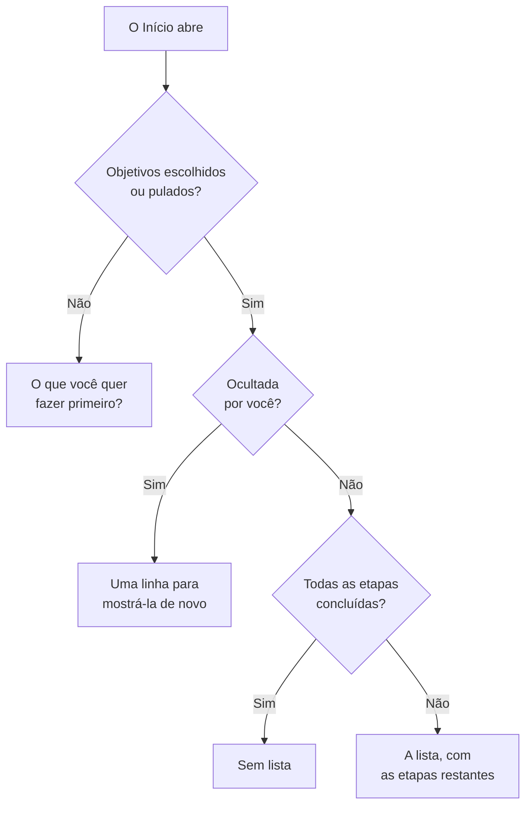

# Página inicial e atalhos

O Início é a primeira página que você vê em um projeto. Ele mostra num relance se algo precisa de você agora, e guia um projeto novo pela primeira configuração. Esta página explica o que o Início mostra, como encontrar qualquer produto, página ou ação no painel, e os atalhos de teclado que poupam idas e vindas pelos menus.

:::cards
- [O que o Início mostra](#o-que-o-início-mostra): Se algo está errado, o que precisa de você, o que o projeto contém e todos os produtos.
- [Encontrar o caminho](#encontrar-o-caminho): O menu Produtos e as barras no topo de cada página.
- [Pesquisar](#pesquisar-uma-página-uma-configuração-ou-uma-ação): Encontrar qualquer página, configuração ou ação digitando o nome.
- [Atalhos de teclado](#atalhos-de-teclado): Ir ao Início, aos Monitores ou aos Incidentes com duas teclas.
:::

## O que o Início mostra

Abra **Início** na barra do topo, ou pressione `g` e depois `h` de qualquer lugar. O Início é a visão geral do seu projeto, uma única página sem menu lateral. De cima para baixo, ele mostra:

1. Uma caixa de pesquisa, com **Declarar incidente** e **Criar** ao lado.
2. Uma linha que diz se algo está errado, acima de cinco números que contam o que precisa de atenção.
3. **Boas-vindas ao OneUptime 👋**, uma lista para um projeto novo, até que esteja concluída.
4. **Requer atenção**, cada problema aberto neste momento, pelo nome.
5. **Seu projeto**, do que o projeto é feito, e **Próximas manutenções** quando houver alguma programada.
6. **Explore o OneUptime**, todos os produtos, uma categoria por vez.

### Pesquisar e criar

A caixa de pesquisa abre a pesquisa, assim como `Mod` + `K`: digite o nome de qualquer página, monitor, incidente, alerta, página de status ou política de plantão. Veja [Pesquisar](#pesquisar-uma-página-uma-configuração-ou-uma-ação). **Declarar incidente** abre o formulário que declara um incidente. **Criar** oferece **Criar monitor**, **Agendar manutenção** e **Criar anúncio**. Cada um só aparece para quem tem permissão para usá-lo.

### A manchete

A linha do topo nomeia o que há de mais urgente em aberto, numa cor correspondente:

| Quando | O Início diz |
| --- | --- |
| Um incidente está aberto | Quantos incidentes estão ativos, em vermelho |
| Nenhum incidente está aberto, mas há alertas abertos, monitores que não estão operacionais ou SLOs em risco | Quantos problemas precisam de atenção, em âmbar |
| Nada está errado e há manutenção em andamento | Quantos eventos de manutenção estão em andamento |
| Há monitores em execução e nada está aberto | **Todos os sistemas estão operacionais** |
| O projeto ainda não tem monitores | **Nada está sendo monitorado ainda** |

Ao lado, o Início diz quando leu o projeto pela última vez, e **Atualizar** o lê de novo. Quando você volta a uma aba do Início depois de um minuto ou mais, ele se atualiza sozinho.

Enquanto nada está sendo monitorado, a linha termina com o botão **Crie seu primeiro monitor**, que abre a configuração guiada **Saber quando meu site ou API cair**. Só quem tem permissão para criar monitores o vê.

### Os cinco números

Cada número conta algo, diz se isso precisa de você e abre a lista por trás dele, no produto a que ela pertence.

| Número | O que conta | Quando o número é zero | Abre |
| --- | --- | --- | --- |
| **Incidentes ativos** | Incidentes não resolvidos | **Tudo certo** | **Incidentes → Incidentes ativos** |
| **Alertas ativos** | Alertas não resolvidos | **Tudo certo** | **Alertas → Alertas ativos** |
| **Monitores não operacionais** | Monitores cujo status não é operacional. Monitores arquivados, e monitores com o monitoramento desligado, não entram. | **Todos operacionais** | **Monitores → Não operacional** |
| **Manutenção em andamento** | Eventos de manutenção programada em andamento | **Nenhuma em andamento** | **Manutenção programada → Eventos de manutenção em andamento** |
| **SLOs em risco** | SLOs ativados que estão em risco ou esgotaram o orçamento de erro | **Orçamentos saudáveis** | **SLOs** |

Um número acima de zero mostra **Requer atenção**, ou **Em andamento** e **Orçamento se esgotando** para manutenção e SLOs. Enquanto algum SLO estiver em risco, **SLOs em risco** abre a lista **SLOs** filtrada para esses SLOs. Um projeto sem monitores vê **Nenhum monitor ainda**, e um sem SLOs vê **Nenhum SLO ainda**: um projeto vazio não é o mesmo que um projeto saudável. Esses dois abrem então as listas **Monitores** e **SLOs**, onde você cria um.

### A lista de boas-vindas

Na primeira vez que um proprietário ou administrador do projeto abre o Início de um projeto novo, o cartão pergunta **O que você quer fazer primeiro?** Marque um ou mais objetivos, como **Saber quando meu site ou API cair** ou **Só estou dando uma olhada**, e clique em **Continuar**: a lista passa a ter as etapas de que esses objetivos precisam. **Pular** dá as quatro etapas que todo projeto recebe. Para responder de novo depois, clique em **Alterar** na lista. Um projeto que já usa monitores, telemetria ou plantão não é perguntado.

Cada etapa se marca sozinha quando a coisa funciona, não quando um registro existe, e todos que configuram o projeto veem a mesma lista, em todos os dispositivos:

| Etapa | Concluída quando | Abre |
| --- | --- | --- |
| **Importe da sua ferramenta atual** | Uma importação de outra ferramenta termina. | **Importar de outra ferramenta** |
| **Crie seu primeiro monitor** | Chega a primeira verificação. | A configuração guiada **Saber quando meu site ou API cair**, ou a lista **Monitores** para quem não pode criar monitores. |
| **Conecte um servidor ou cluster** | Chegam as primeiras métricas. | **Hosts** |
| **Envie seus primeiros logs, métricas ou traces** | Chegam os primeiros logs, métricas, traces, exceções ou perfis do projeto. | A configuração guiada **Enviar registros, métricas e traços e receber alertas** |
| **Configure uma política de plantão** | Um acionamento de teste é reconhecido, um acionamento alcança alguém, ou uma regra de plantão executa uma política que pode alcançar alguém. | A configuração guiada **Acionar a pessoa certa quando algo quebrar** |
| **Publique uma página de status** | Uma página de status mostra um monitor. | A configuração guiada **Publique uma página de status**, ou a lista **Páginas de status** para quem não pode criar páginas de status. |
| **Convide sua equipe** | Alguém aceita seu convite. | **Usuários** |

A etapa a fazer primeiro é marcada com **Próxima etapa**. No plano Free do OneUptime Cloud, que tem uma pessoa, **Convide sua equipe** diz que precisa do plano Growth e abre **Cobrança**. Em um servidor auto-hospedado que ainda não pode enviar e-mails, os administradores do servidor veem primeiro **Este servidor ainda não pode enviar e-mails**, que abre o painel de administração.

Uma configuração guiada faz todo o trabalho em uma só página, uma etapa de cada vez, e termina com o que configurou e o que fazer em seguida. Para abri-la de novo mais tarde, pesquise pelo nome dela.

Abaixo das etapas, **Como o OneUptime funciona** mostra os quatro produtos principais na ordem em que um problema passa por eles: **Monitores**, **Incidentes e alertas**, **Plantão** e **Páginas de status**. Clique em um para abri-lo. Abaixo, ele diz o que alimenta esse ciclo, a telemetria e a infraestrutura, e leva a [Conceitos básicos](/docs/introduction/core-concepts) e [Glossário](/docs/introduction/glossary).

A lista some para todos quando todas as etapas estão concluídas. Para ocultá-la antes, clique em **Ocultar**: ela fica oculta só para você, em todos os dispositivos, e fica uma linha com **Mostrar** e **Como o OneUptime funciona**. Quem foi convidado ao projeto como membro não vê a lista. **Como o OneUptime funciona** continua a um clique, em qualquer projeto: abra-o em **Ajuda** ou com o botão ao lado de **Explore o OneUptime**.

### Requer atenção

**Requer atenção** lista, pelo nome, o que os números contam: os incidentes abertos, os alertas abertos, os monitores que não estão operacionais, os SLOs em risco e as manutenções em andamento, os mais urgentes primeiro. Cada linha mostra a severidade ou o status, diz quando um incidente ou alerta começou e quando a manutenção termina, e abre o registro. Cada tipo mostra até cinco, com **Mostrar todos** para o resto, que abre a mesma lista que o seu número. Quando nada está aberto, diz **Nada precisa da sua atenção**.

### Saúde da configuração

Quando algo na configuração do projeto impediria que as pessoas fossem avisadas, **Requer atenção** termina com **Configuração**: quantas coisas precisam de uma olhada. Ela abre **Saúde da configuração**, que lista o que está mal configurado, o mais grave primeiro, em **Os acionamentos não chegarão**, **Vale corrigir** e **Sugestões**: um monitor que não aciona ninguém, uma política de plantão que nada executa, uma pessoa que não pode ser acionada, SMS desativado, um agendamento de plantão sem ninguém de plantão, uma página de status que não mostra nenhum monitor. Cada descoberta diz em uma frase o que está errado, com o botão que abre a correção, e as descobertas de um monitor são as falhas que o cartão **Quando cair** dele aponta. Uma descoberta que sua equipe deixa assim de propósito pode ser dispensada com um motivo, para todos, e restaurada em **Dispensado**. A pesquisa encontra a página como **Saúde da configuração**, e Pergunte à IA responde "minha configuração está OK?" a partir dela.

### Seu projeto

**Seu projeto** conta os **Monitores**, as **Páginas de status**, as **Políticas de plantão**, os **SLOs**, os **Serviços**, os **Painéis** e os **Fluxos de trabalho** do projeto, sem contar os arquivados. Cada linha abre a sua lista. Quando o projeto não tem nenhum item de um tipo, a linha mostra **Configurar** em vez de um número.

**Próximas manutenções** lista as três próximas janelas de manutenção programada, a mais próxima primeiro. Não aparece quando não há nada programado.

### Explore o OneUptime

**Explore o OneUptime** mostra os produtos do menu **Produtos** uma categoria por vez, começando pelos essenciais. Cada produto diz para que serve e abre quando você clica nele. Os produtos que o seu projeto oculta ficam de fora.

## Encontrar o caminho

Tudo no OneUptime fica em **Produtos**, na barra do topo. O menu lista seus grupos como as linhas de uma única lista, e sempre abre com o primeiro deles, os essenciais, expandido: Monitores, Incidentes, Alertas, Plantão, Páginas de status, Manutenção programada e SLOs. Cada um dos outros grupos (Observabilidade, Segurança, IA, Código, Recursos, Infraestrutura, Nuvem, Painéis e automação e Configurações) fica recolhido em uma linha da mesma lista. Cada linha nomeia os produtos do grupo e diz quantos são. Clique em uma linha para expandi-la ou recolhê-la, ou chegue até ela com as setas e pressione **Enter**.

- **A pesquisa encontra tudo.** Digite na caixa de pesquisa do menu para encontrar qualquer produto pelo nome, pelo que ele faz ou por uma palavra conhecida como `k8s` ou `RUM`. A pesquisa procura também dentro dos grupos recolhidos.
- **Você começa onde está.** O grupo da página em que você está se expande sozinho, e os produtos que você abriu recentemente aparecem no topo.
- **Suas escolhas ficam.** O menu lembra, no seu navegador, quais dos outros grupos você expandiu ou recolheu. Os essenciais voltam a ficar expandidos cada vez que você abre o menu, mesmo que você os tenha recolhido.
- **No celular**, o botão do menu lista os produtos do mesmo jeito: os essenciais expandidos no topo, e cada um dos outros grupos como uma linha que abre com um toque.
- **Produtos que o projeto não usa.** Um proprietário ou administrador do projeto pode ocultá-los em **Configurações do projeto → Básico → Produtos**. Um produto oculto vai para **Mais produtos**, a última linha do menu: a pesquisa ainda o encontra, suas páginas continuam funcionando e seus dados continuam chegando. Quando um deles começa a receber dados, o Início avisa quem pode mostrá-lo de novo.
- **Fixar.** Mantenha um produto na barra superior, ao lado de **Início** e **Produtos**: toque no alfinete do cartão dele no menu, ou em **Fixar** ao lado do título da página dele. Você pode fixar cinco, e eles acompanham você em qualquer navegador. No celular, seus produtos fixados vêm primeiro no menu.
- **O que está em uso.** Em cada grupo, exceto os essenciais e as configurações, os produtos que o seu projeto usa vêm primeiro, e um que você ainda não configurou diz **Não configurado**. No OneUptime Cloud, um produto que o seu plano não inclui nomeia o plano que o inclui.

### As barras do topo

Duas barras atravessam o topo de cada página.

| Onde | O que há |
| --- | --- |
| Canto superior esquerdo | O seletor de projetos: trocar para outro dos seus projetos, ou criar um novo. |
| Canto superior direito | **Pesquisar** e **Pergunte à IA**, o sino de notificações com o que precisa de você agora (incidentes e alertas ativos, as políticas de plantão em que você está de turno, convites pendentes), **Ajuda**, e sua foto, que abre o menu da sua [conta](/docs/introduction/your-account). |
| Abaixo delas | **Início** e **Produtos** à esquerda, **Configurações do usuário** à direita: como o OneUptime contata você neste projeto. |

**Ajuda** começa pelo que ajuda a aprender: **Início rápido**, **Como o OneUptime funciona**, **Glossário** e esta documentação (**Documentação**). Abaixo ficam a lista **Atalhos de teclado** e o suporte por e-mail e no Slack. Em um tablet ou em uma janela estreita, **Pergunte à IA** sai para ganhar espaço: ela está entre as ações de **Pesquisar**. Em um celular, **Pesquisar** e **Ajuda** passam para a lista do botão de menu, no topo e no final; o sino e sua foto ficam.

Uma palavra com uma linha pontilhada embaixo, como **Sondas** no formulário de um novo monitor, diz o que significa quando você aponta para ela, chega a ela com Tab ou toca nela. O **Ler mais** dela abre a palavra no [Glossário](/docs/introduction/glossary).

### Páginas e listas

Acima do título de cada página, uma trilha como *Projeto › Docker › Configurações › Regras de proprietário* diz onde a página está. Cada passo antes do último abre a sua página.

- **As listas se mantêm atualizadas sozinhas.** Quando um incidente ou alerta é criado, reconhecido ou resolvido em qualquer lugar, as listas de incidentes, alertas e episódios o mostram em segundos, sem recarregar. Enquanto você está no meio de algo em uma lista, como linhas marcadas ou uma caixa de diálogo aberta, ela espera e se atualiza quando você termina.
- **No celular, os chips de filtro se recolhem** atrás de **Filtro**, para que a lista comece mais acima. Os chips que você definiu continuam à vista, com **Limpar tudo**. Toque em **Filtro** para ver todos os chips, e de novo para recolhê-los.
- A opção **Colunas** no menu **⋯** de uma lista escolhe quais colunas a lista mostra e em que ordem, e as guarda para você neste navegador. Um proprietário ou um administrador do projeto também pode marcar ali **Mostrar estas colunas a todos neste projeto**: quem não escolheu as próprias colunas para essa lista vê essas, e **Redefinir para o padrão do projeto** volta as suas para elas.
- A opção **Linhas compactas**, no mesmo menu, deixa mais baixas as linhas de todas as listas, então uma lista longa mostra cerca de um quinto a mais delas. A escolha fica guardada neste navegador.
- **No celular, ou em um cartão estreito demais para as suas linhas, uma lista aparece como cartões, um por linha.** A faixa acima deles diz em que ordem estão, como **Ordenado por Nome**: toque nela para escolher a coluna da ordenação, e **Crescente** ou **Decrescente**.
- **As páginas de um incidente começam pelo número dele.** O título, o passo dele na trilha e a aba do navegador mostram `INC-42 Checkout is down`, assim como as caixas de diálogo que o nomeiam, para que incidentes com o mesmo título se distingam. Alertas, eventos de manutenção programada e episódios fazem o mesmo.

## Pesquisar uma página, uma configuração ou uma ação

Pressione **Cmd+K** (Mac) ou **Ctrl+K** (Windows e Linux), ou clique no ícone de pesquisa na barra do topo, e comece a digitar. A pesquisa encontra:

- **Todas as páginas dos menus**, pelo nome que o menu dá a elas: Chaves de API, Zona de perigo, Agendamentos de plantão, Severidade do incidente, seus próprios Métodos de notificação. Cada resultado diz onde fica, por exemplo *Configurações do projeto › Avançado*, para que páginas com o mesmo nome (Campos personalizados em Incidentes, Alertas e Monitores) sejam fáceis de distinguir.
- **As configurações de uma página**, pelo nome que o cartão ou o botão delas mostra: *Exigir SSO para login* encontra SSO, e *Configurações SMTP Personalizadas* encontra Canais de notificação. Digite o nome em inglês ou no seu idioma.
- **Ações**, pelo que você quer fazer: Declarar incidente, Criar monitor ou Delete Project, que abre a Zona de perigo. Uma ação que muda algo só é oferecida a quem tem permissão para fazê-la.
- **Seus monitores, incidentes, alertas, páginas de status e políticas de plantão**, pelo nome, e incidentes e alertas também pelo número, como `INC-42`. Cada resultado de incidente ou alerta começa pelo número dele, para que dois com o mesmo título se distingam.
- **A documentação**, em um grupo *Documentação* abaixo de todo o resto: as páginas e seções cujas palavras correspondem ao que você digitou, no seu idioma, mesmo com um erro de digitação. Cada uma abre em uma nova aba, para você não perder seu lugar.

A pesquisa lê o que você digita do jeito que você quer dizer:

- Maiúsculas, acentos, espaços e hífens não importam: *on-call*, *on call* e *oncall* encontram as mesmas páginas, e as palavras podem vir em qualquer ordem.
- Ela conhece outras palavras para muitas páginas, em inglês: *pager* ou *escalation* para Políticas de plantão, *rota* para Agendamentos de plantão, *2fa* para a autenticação em dois fatores, *delete project* para a Zona de perigo.
- Acrescente o nome do produto para restringir uma pesquisa: *incident custom fields* encontra a página Campos personalizados de Incidentes.
- Um pequeno erro de digitação, como *incidnet*, ainda encontra o que você queria quando nada corresponde do jeito que foi digitado.

Com a caixa de pesquisa vazia, a pesquisa lista as páginas que você abriu recentemente, as ações e os produtos.

## Atalhos de teclado

Pressione `?` em qualquer lugar do painel para ver todos os atalhos, ou abra **Ajuda** e escolha **Atalhos de teclado**. No Mac, `Mod` é a tecla Command; no Windows e no Linux, é Ctrl.

| Teclas | O que fazem |
| --- | --- |
| `Mod` + `K` | Abrir a paleta de comandos: pesquisar qualquer página, configuração ou ação. |
| `Mod` + `I` | Perguntar à IA sobre o que você está vendo. |
| `/` | Pesquisar na lista desta página. |
| `?` | Mostrar os atalhos de teclado. |
| `Esc` | Fechar uma caixa de diálogo ou um painel. |

### Ir a um produto

Pressione `g` e depois uma letra para ir direto a um produto. Pressione a letra em até um segundo e meio depois de `g`.

| Teclas | Vai para |
| --- | --- |
| `g` depois `h` | Início |
| `g` depois `m` | Monitores |
| `g` depois `i` | Incidentes |
| `g` depois `a` | Alertas |
| `g` depois `o` | Plantão |
| `g` depois `s` | Páginas de status |
| `g` depois `e` | Manutenção programada |
| `g` depois `d` | Painéis |
| `g` depois `l` | Registros |
| `g` depois `t` | Traços |

Os atalhos não atrapalham. `?`, `/` e `g` não fazem nada enquanto você digita em um campo, e nada tira você da página enquanto uma caixa de diálogo está aberta, então uma tecla sem querer não faz você perder um formulário preenchido pela metade. Qualquer outro produto está a uma pesquisa de distância com `Mod` + `K`.

## Próximos passos

:::cards
- [Início rápido](/docs/introduction/quickstart): Seguir a lista de boas-vindas, etapa por etapa.
- [Sua conta](/docs/introduction/your-account): Seu perfil, a segurança do seu login, o idioma e o tema.
- [Pergunte à IA](/docs/ai/ask-ai): O que a IA pode responder e fazer por você.
- [Conceitos básicos](/docs/introduction/core-concepts): O que são monitores, incidentes, alertas e plantão.
:::
