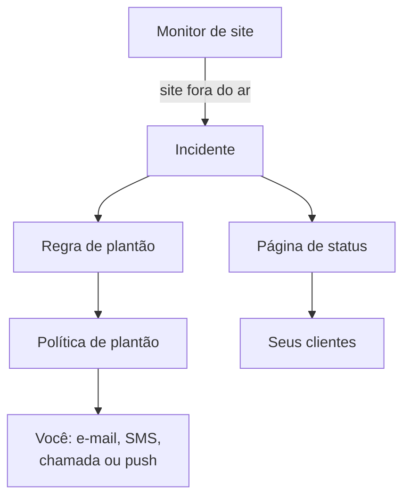

# Início rápido

Este guia leva você de uma conta nova a uma configuração funcionando em cerca de quinze minutos: um monitor que verifica seu site a cada cinco minutos, uma política de plantão que aciona você quando o site cai e uma página de status que informa seus clientes. Ele segue a lista **Boas-vindas ao OneUptime 👋** na página inicial do seu projeto, e as configurações guiadas que as etapas dela abrem.

Vindo de outra ferramenta? Primeiro [importe sua configuração](/docs/introduction/getting-started#vindo-de-outra-ferramenta): seus monitores, agendamentos de plantão e páginas de status vêm junto.

## Antes de começar

- **Uma conta.** No OneUptime Cloud, cadastre-se em [oneuptime.com](https://oneuptime.com/accounts/register) e abra o link do e-mail que você receber. Na sua própria instalação, abra-a no navegador e cadastre-se: a primeira conta se torna o administrador principal. Para instalar uma, veja [Docker Compose](/docs/installation/docker-compose).
- **Um site para monitorar.** Qualquer endereço que responda por HTTP ou HTTPS, como a página inicial da sua empresa.

## Criar um projeto

No OneUptime, tudo fica em um projeto: seus monitores, incidentes, políticas de plantão, páginas de status e as pessoas que trabalham neles.

:::steps
### Começar um projeto novo

Na primeira vez que você entra, o OneUptime mostra **Nenhum projeto**. Clique em **Criar Novo Projeto**. Se alguém já convidou você para um projeto, aceite o convite na mesma página.

### Dar um nome

Digite um **Nome do projeto**, por exemplo o nome da sua empresa. No OneUptime Cloud, escolha também um plano logo abaixo: o Free já vem escolhido, e os planos pagos começam com um teste grátis.

### Criar o projeto

Clique em **Criar projeto**. A página inicial do seu projeto abre, com a lista **Boas-vindas ao OneUptime 👋** no topo. Primeiro ele pergunta **O que você quer fazer primeiro?**: marque **Saber quando meu site ou API cair**, **Acionar a pessoa certa quando algo quebrar** e **Informar meus clientes com uma página de status**, e clique em **Continuar**.
:::

## Monitorar seu site

:::steps
### Abrir a configuração do site

Na lista, clique em **Crie seu primeiro monitor**. Isso abre a configuração guiada **Saber quando meu site ou API cair**, que verifica seu site, escolhe quem é avisado e envia um teste, em uma só página. Quem não pode criar monitores vê a lista **Monitores** no lugar.

### Digitar o endereço

Em **O que devemos verificar?**, digite o endereço completo do seu site em **Endereço do site ou da API**, por exemplo `https://example.com`, e clique em **Começar a verificar**. As sondas verificam o site na hora e depois a cada 5 minutos: quando o site não responde, ou responde com um erro, o monitor fica **Offline** e declara um incidente. Clique em **Continuar**.

No plano Free do OneUptime Cloud, os monitores são cobrados conforme o uso, então o projeto precisa de uma forma de pagamento antes de poder verificar o seu site: sem ela, a etapa pede que você [adicione uma forma de pagamento](/docs/configuration/billing#métodos-de-pagamento).

### Escolher quem é avisado

Em **Quem deve ser avisado?**, você já está em **Quem é acionado**. Clique em **Salvar e continuar**: isso cria a `Default on-call policy`, que aciona você a cada novo incidente e a cada novo alerta do projeto, por e-mail para começar. Para acionar também membros da equipe que já estão no projeto, clique antes em **Adicionar membros da equipe**.

### Enviar um teste para você

Em **Envie um teste**, clique em **Enviar uma chamada de teste para mim**, escolha uma **Gravidade** e clique em **Enviar chamada de teste**. Abra o link no e-mail, que diz TEST, e confirme o acionamento lá. Depois clique em **Concluído** na caixa de diálogo, e em **Continuar**: a configuração termina com um resumo do que ela configurou.
:::

Para definir você mesmo cada opção, ou para verificar algo que não seja um site, abra **Monitores** no menu **Produtos** e clique em **Criar monitor**. [Criar um monitor](/docs/monitor/create-monitor) descreve o formulário e cada tipo de monitor.

Para verificar também uma API, e saber o que fazer quando a primeira verificação nunca volta, siga [Saber quando seu site ou sua API cai](/docs/guides/website-down).

## Ser acionado quando cair

A configuração do site já criou a `Default on-call policy`, que aciona você por e-mail a cada novo incidente e a cada novo alerta, então a lista marca **Configure uma política de plantão** como concluída. A configuração guiada dela ainda adiciona seu telefone, as pessoas acionadas com você e o que acontece quando ninguém responde.

:::steps
### Abrir a configuração de plantão

Pressione `Ctrl+K` (`Cmd+K` em um Mac), digite `get paged` e escolha **Acionar a pessoa certa quando algo quebrar**. Enquanto a lista não marcar **Configure uma política de plantão**, essa etapa abre a mesma configuração guiada.

### Escolher como você é contatado

Em **Como devemos contatar você?**, seu e-mail de login já aparece. Para notificações push, instale o app OneUptime On-Call pela App Store ou pelo Google Play, faça login e clique em **Verificar de novo**. Para receber também SMS e chamadas, clique em **Ativar SMS e chamadas**, digite seu número em **Seu número de telefone** e clique em **Enviar um código por SMS**: no OneUptime Cloud, SMS e chamadas são pagos com o saldo do projeto, então a etapa pede que você adicione saldo primeiro. Clique em **Continuar**.

### Escolher quem mais é acionado

Em **Quem mais está de plantão?**, mantenha a `Default on-call policy` em **Política de plantão**. Para acionar membros da equipe com você, adicione-os em **Adicionar à primeira regra de escalonamento**. Clique em **Salvar e continuar**.

### Decidir o que acontece se ninguém responder

Em **E se ninguém responder?**, escolha **Acionar as mesmas pessoas de novo** enquanto você for a única pessoa no projeto. Quando houver membros da equipe, **Acionar outra pessoa** aciona a pessoa que você escolher em **Acionados em seguida**. No OneUptime Cloud, só os planos pagos oferecem essa opção. Clique em **Salvar e continuar**.

### Enviar uma chamada de teste

Em **Enviar uma chamada de teste**, clique em **Testar esta política**, escolha uma **Gravidade** e clique em **Enviar chamada de teste**. Confirme o acionamento pelo e-mail, pelo SMS ou pela ligação, depois clique em **Concluído** na caixa de diálogo, e em **Continuar**. A configuração termina em **O acionamento está configurado**.
:::

> [!NOTE]
> SMS e chamadas telefônicas ficam desativados em um projeto novo. Um proprietário do projeto, um Billing Admin ou alguém com Manage Billing os ativa no cartão **Canais de notificação**, em **Configurações do projeto → Notificações → Canais de notificação**.

Duas regras de plantão disparam a política: uma a cada novo incidente e outra a cada novo alerta. Para ver a primeira, abra **Incidentes** no menu **Produtos**, expanda **Regras** no menu lateral e escolha **Regras de Plantão**: ela corresponde a **Todos os incidentes**. Para disparar a política só em alguns incidentes, como os críticos, edite a regra ali, ou clique em **Criar: Incident On-Call Rule** para adicionar uma sua.

Para montar uma política campo a campo, abra **Plantão** no menu **Produtos** e clique em **Criar: Política de plantão**. Para mais níveis, rodízios e quanto tempo cada nível espera, veja [Regras de escalonamento](/docs/on-call/escalation-rules) e [Agendamentos de plantão](/docs/on-call/schedules).

Para cada tela da configuração, e o que fazer quando um acionamento não chega, siga [Ser acionado por telefone, SMS ou push](/docs/guides/paging).

## Publicar uma página de status

:::steps
### Abrir a configuração da página de status

Na lista, clique em **Publique uma página de status**. Isso abre a configuração guiada **Publique uma página de status**, que dá nome à página, coloca seu monitor nela e mostra o que seus clientes veem. Quem não pode criar páginas de status vê a lista **Páginas de status** no lugar. O resumo da configuração do site abre a mesma configuração, como **Mostrar em uma página de status**.

### Dar um nome e escolher seu monitor

Em **Dê um nome e escolha o que ela mostra**, mantenha o **Nome da página de status** sugerido, ou digite o seu. Em **O que ela mostra**, marque o monitor do seu site, e clique em **Criar a página de status**. A partir deste momento a página é pública no link dela: qualquer pessoa com o endereço pode abri-la.

### Abrir a página

Em **É isto que seus clientes veem**, abra o endereço em **Link público**: seu site aparece como operacional. De volta à configuração, clique em **Parece bom**. A configuração termina com um resumo do que fazer em seguida.
:::

Para criar uma página à mão, abra **Páginas de status** no menu **Produtos** e clique em **Criar página de status**, depois adicione seu monitor com **Adicionar monitores** na **Visão geral** dela. Para dar à página seu próprio logotipo e suas cores, veja [Marca e domínios da página de status](/docs/status-pages/branding-and-domains).

Para colocar a página de status no seu próprio domínio, por HTTPS, siga [Publicar uma página de status](/docs/guides/status-page).

## Convidar sua equipe

Na lista, clique em **Convide sua equipe**, ou abra **Usuários** no menu **Produtos**, em **Configurações**. Clique em **Convidar Usuário**, digite o **E-mail** da pessoa e escolha uma **Equipe**: a equipe de membros vem escolhida. Clique em **Convidar**. O OneUptime envia o convite por e-mail, e a equipe decide o que a pessoa pode fazer. Veja [Usuários, equipes e permissões](/docs/permissions/index).

## Testar

Declare um incidente de teste para ver toda a cadeia funcionando.

:::steps
### Declarar um incidente de teste

Abra **Incidentes** e clique em **Declarar incidente**. Digite um **Título**, por exemplo `Test incident`, escolha uma **Severidade do incidente** e clique em **Próximo**. Em **Monitores**, escolha o monitor do seu site, para que o incidente apareça na sua página de status. Clique em **Próximo** até chegar ao resumo e depois em **Declarar incidente**.

### Ver o que acontece

Em um ou dois minutos, sua política de plantão aciona você, e o incidente aparece na sua página de status.

### Resolver

Na página do incidente, clique em **Resolver**. Os acionamentos param, e o incidente sai da sua página de status.
:::

> [!WARNING]
> Qualquer pessoa que abrir sua página de status verá o incidente de teste até você resolvê-lo. Faça o teste antes de compartilhar o endereço da página.

## Solução de problemas

:::details Não fui acionado
Abra o incidente e escolha **Execuções de plantão** no menu lateral dele: ali você vê se sua política foi executada e quem ela acionou. Se não foi executada, verifique se sua regra de plantão está ativada e indica a política. Se foi executada, verifique se seus métodos em **Configurações do usuário → Métodos de notificação** estão verificados.
:::

:::details O incidente não aparece na minha página de status
Uma página de status mostra um incidente quando um dos monitores do incidente está na página. Verifique se o incidente lista seu monitor entre os recursos afetados, e se o monitor está na página de status.
:::

:::details O monitor diz que está offline, mas meu site funciona
Abra o monitor e confira o que as sondas receberam. Veja a seção de solução de problemas de [Monitor de site](/docs/monitor/website-monitor).
:::

## Próximos passos

:::cards
- [Conceitos básicos](/docs/introduction/core-concepts): As ideias por trás do que você acabou de configurar.
- [Glossário](/docs/introduction/glossary): Cada palavra que você encontrou pelo caminho, em uma ou duas frases.
- [Agendamentos de plantão](/docs/on-call/schedules): Dividir o plantão com sua equipe.
- [Marca e domínios da página de status](/docs/status-pages/branding-and-domains): Deixar a página de status com a sua cara.
- [OpenTelemetry](/docs/telemetry/open-telemetry): Enviar logs, métricas e traces dos seus aplicativos.
:::
