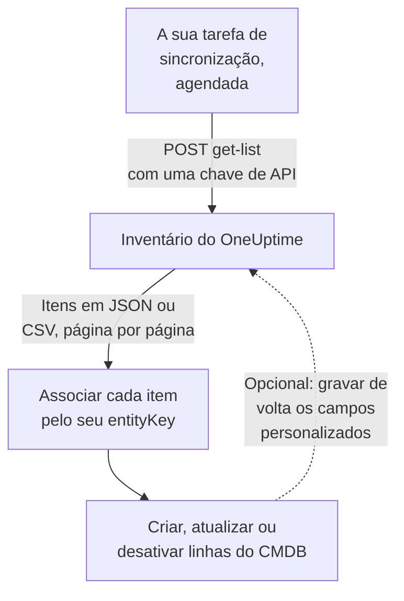

# Exportar para um CMDB

Se você já mantém um CMDB ou um registro de ativos, o OneUptime não pretende substituí-lo. O que ele tem e que costuma faltar a um CMDB é um retrato do que está realmente rodando, mantido em dia sem que ninguém precise cuidar dele: descoberto a partir da telemetria e dos coletores que já observam a sua rede e as suas contas de nuvem. Esta página é a receita para levar esse retrato ao seu próprio sistema de registro.

:::cards
- [Como uma sincronização funciona](#como-uma-sincronização-funciona): Uma tarefa agendada que lê a lista e associa por uma chave estável.
- [Buscar o catálogo](#buscar-o-catálogo): A requisição, página por página, em JSON ou CSV.
- [Detalhes do ativo](#detalhes-do-ativo): Os mesmos dados e chaves para hosts e dispositivos de rede.
- [Gravar de volta](#gravar-de-volta): Levar as suas etiquetas de ativos para o OneUptime e adicionar o que ele não vê.
:::

## Como uma sincronização funciona

Uma sincronização é uma tarefa que você executa de forma agendada. Ela lê a lista do inventário pela API REST com uma chave de API, associa cada item a uma linha do seu CMDB pela chave de identidade dele e cria, atualiza ou desativa linhas para que correspondam. Ela também pode gravar valores de volta nos campos personalizados dos itens.



## O que você pode buscar

Três recursos REST, cada um com os endpoints padrão da [API do OneUptime](/docs/api-reference/api-reference):

| Recurso | Endpoint | O que contém |
| --- | --- | --- |
| Item de inventário | `/api/inventory-item` | Uma linha para cada coisa do ambiente |
| Definições de campos personalizados | `/api/inventory-item-custom-field` | O vocabulário de campos do seu projeto |
| Relações | `/api/inventory-item-relationship` | As ligações direcionadas entre os itens |

As colunas úteis de um item de inventário:

| Coluna | Significado |
| --- | --- |
| `_id` | O ID do OneUptime: use como a sua referência externa |
| `entityType` | `host`, `k8s.pod`, `network.device`, `appliance`, … |
| `entityKey` | Um hash de identidade estável. Sobrevive a renomeações, então é a melhor chave para associar |
| `displayName` | O nome que as pessoas leem |
| `source` | `discovered`, `inventory` ou `manual` |
| `description` | Texto livre |
| `identifyingAttributes` | Os atributos que fazem do item o que ele é, e que nunca mudam |
| `descriptiveAttributes` | Todo o resto observado nele: veja [Detalhes do ativo](#detalhes-do-ativo), [Atributos de ativo dos hosts](#atributos-de-ativo-dos-hosts) e [Atributos de ativo dos dispositivos de rede](#atributos-de-ativo-dos-dispositivos-de-rede) abaixo |
| `customFields` | Os seus próprios campos, indexados pelo nome do campo |
| `resourceType` / `resourceId` | Um ponteiro para o registro mais completo do OneUptime, quando existe |
| `firstSeenAt` / `lastSeenAt` | Quando foi observado pela primeira e pela última vez |
| `isArchived` | Se foi tirado da lista ativa |

## Antes de começar

Uma sincronização precisa de uma chave de API que possa ler o inventário. No OneUptime Cloud, as chaves de API precisam do plano **Growth** ou superior.

:::steps
### Criar uma chave de API

Abra **Configurações do projeto → Avançado → Chaves de API** e clique em **Criar: Chave de API**. Dê a ela um **Nome** e, em **Acesso**, escolha **Visualizador** para ler tudo no projeto, ou **Escolher as permissões depois** para dar a ela só o que uma sincronização precisa.

### Dar a ela só o que precisa

Uma exportação somente leitura precisa de uma única permissão, **Read Telemetry Service**: o inventário compartilha as permissões de telemetria em vez de ter as suas. Na página da chave, clique em **Adicionar permissão** e escolha-a. Para gravar valores de volta, adicione também **Edit Telemetry Service**.

### Copiar a chave

Copie a **Chave de API** da página da chave e deixe-a disponível para a sua tarefa:

```bash
export ONEUPTIME_API_KEY="your-api-key"
```
:::

A chave é enviada no cabeçalho `ApiKey` de cada requisição e lê o inventário do próprio projeto, então uma requisição não cita nenhum projeto.

## Buscar o catálogo

Faça um `POST` no endpoint de lista com as colunas que você quer. `select` é obrigatório: a API só devolve o que você pede.

```bash
curl -X POST 'https://oneuptime.com/api/inventory-item/get-list' \
  -H "ApiKey: $ONEUPTIME_API_KEY" \
  -H 'Content-Type: application/json' \
  -d '{
    "query": { "isArchived": false },
    "select": {
      "_id": true,
      "entityType": true,
      "entityKey": true,
      "displayName": true,
      "source": true,
      "customFields": true,
      "descriptiveAttributes": true,
      "lastSeenAt": true
    },
    "sort": { "displayName": "ASC" },
    "limit": 100,
    "skip": 0
  }'
```

Em uma instalação auto-hospedada, use o seu próprio endereço do OneUptime no lugar de `https://oneuptime.com`. A resposta é `{ "data": [...], "count": ... }`, em que `count` é quantos itens correspondem no total. Pagine aumentando `skip` pelo seu `limit` até ter todos; `limit` vai até 10.000. Datas e IDs que não sejam `_id` voltam embrulhados, como `{ "_type": "DateTime", "value": "..." }` e `{ "_type": "ObjectID", "value": "..." }`: leia-os de `value`.

### Só os dispositivos de rede

Restrinja a lista por `entityType`:

```bash
curl -X POST 'https://oneuptime.com/api/inventory-item/get-list' \
  -H "ApiKey: $ONEUPTIME_API_KEY" \
  -H 'Content-Type: application/json' \
  -d '{
    "query": { "entityType": "network.device", "isArchived": false },
    "select": { "_id": true, "entityKey": true, "displayName": true, "customFields": true },
    "limit": 100,
    "skip": 0
  }'
```

Os `descriptiveAttributes` de cada dispositivo de rede trazem o nome do host, o endereço IP, o número de série, o endereço MAC, a marca, o modelo, o firmware, o sistema operacional, a função, o site e a localização: veja [Atributos de ativo dos dispositivos de rede](#atributos-de-ativo-dos-dispositivos-de-rede) abaixo. O restante do que o coletor sabe, como interfaces e vizinhos, fica no próprio registro Network Device: siga `resourceId` até `/api/network-device/:id/get-item`, ou busque `/api/network-device/get-list` diretamente.

### Em CSV

Qualquer endpoint de lista responde em CSV em vez de JSON com `?output-type=csv`:

```bash
curl -X POST 'https://oneuptime.com/api/inventory-item/get-list?output-type=csv' \
  -H "ApiKey: $ONEUPTIME_API_KEY" \
  -H 'Content-Type: application/json' \
  -d '{ "query": {}, "select": { "displayName": true, "entityType": true, "customFields": true }, "limit": 500, "skip": 0 }' \
  -o inventory.csv
```

A lista **All Items** do painel exporta da mesma forma, com as colunas de campos personalizados que você ativou. Cada [detalhe do ativo](#detalhes-do-ativo) também é uma coluna ali: **Nome do host**, **Endereço IP**, **Número de série**, **Modelo** e as demais começam ocultas, então ative-as no seletor de colunas, e a exportação traz uma coluna por dado, seja a linha um host ou um dispositivo de rede.

## Detalhes do ativo

Hosts e dispositivos de rede são descritos pelos mesmos dados, guardados com as mesmas chaves. Uma coluna do CMDB guarda o número de série seja a linha um servidor ou um switch, e o cartão **Detalhes do ativo** de um item no painel mostra cada dado na mesma ordem para os dois. Um dado que nada informou aparece como **Desconhecido** em vez de ser omitido, para que uma lacuna fique visível.

| Dado | Chave | Em um host | Em um dispositivo de rede |
| --- | --- | --- | --- |
| Nome do host | `host.name` | O nome do host. É a identidade do host, então fica em `identifyingAttributes` | O nome próprio do dispositivo: o seu `sysName` SNMP, senão o nome NetBIOS ou DNS que a descoberta encontrou. Nunca o endereço IP |
| Endereço IP | `host.ip` | Cada endereço que o coletor informa | O endereço que o OneUptime consulta, quando é um endereço IP; senão, o endereço para o qual a sonda resolveu esse nome DNS |
| Endereço MAC | `host.mac` | Detectado | Digitado no dispositivo, ou aprendido na tabela ARP de um roteador percorrido |
| Número de série | `host.serial_number` | Carimbado | ENTITY-MIB |
| Fabricante | `device.manufacturer` | Carimbado | ENTITY-MIB, senão o que `sysDescr` ou `sysObjectID` cita |
| Modelo | `device.model.name` | Carimbado | ENTITY-MIB, senão o que `sysDescr` cita |
| Versão do firmware | `device.firmware.version` | Carimbada | ENTITY-MIB, senão o que `sysDescr` cita |
| Sistema operacional | `os.name` | `os.description` (ou `os.type`) | O que `sysDescr` cita: Cisco IOS, Junos OS, Arista EOS, Linux |
| Versão do SO | `os.version` | Detectada | ENTITY-MIB, senão o que `sysDescr` cita |
| Device Type | `device.type` | Carimbado. Senão o cartão o classifica pelo sistema operacional e pelo nome (Servidor, Firewall, ...) | A sua função: a que você atribuiu, senão aquela com que o mapa de topologia o desenha |
| Local | `device.location` | Carimbada. Senão o cartão mostra a sua zona de nuvem | `sysLocation`. O cartão mostra primeiro o seu site |

A [tabela de hosts](#atributos-de-ativo-dos-hosts) e a [tabela de dispositivos de rede](#atributos-de-ativo-dos-dispositivos-de-rede) abaixo dizem em detalhe de onde vem cada valor.

## Atributos de ativo dos hosts

`descriptiveAttributes` em um host traz os dados de ativo que uma linha de CMDB costuma querer, indexados pelo nome do atributo do OpenTelemetry:

| Campo | Chave | Coletado por padrão? |
| --- | --- | --- |
| Endereços IP | `host.ip` | Sim: separados por vírgulas quando a máquina tem vários |
| Endereços MAC | `host.mac` | Sim: separados por vírgulas, um por interface ativa, como `AC-DE-48-23-45-67` |
| Arquitetura | `host.arch` | Sim |
| ID da máquina | `host.id` | Sim: o GUID da máquina no Windows, `/etc/machine-id` no Linux |
| Sistema operacional | `os.type`, `os.description`, `os.version` | Sim |
| Posição na nuvem | `cloud.provider`, `cloud.region`, `cloud.availability_zone` | Só com um detector de nuvem |
| Número de série | `host.serial_number` | Precisa de uma etapa de configuração |
| Marca | `device.manufacturer` | Precisa de uma etapa de configuração |
| Modelo | `device.model.name` | Precisa de uma etapa de configuração |
| Versão do firmware (BIOS ou UEFI) | `device.firmware.version` | Precisa de uma etapa de configuração |
| Nome do sistema operacional | `os.name` | Só dos SDKs que o informam: senão `os.description` cita o sistema |
| Tipo de dispositivo | `device.type` | Opcional: carimbe da mesma forma (`Hypervisor`, `Workstation`) |
| Localização | `device.location` | Opcional: carimbe da mesma forma (`Frankfurt DC, Rack B4`) |

Tudo o que está marcado com Sim vem do processador `resourcedetection` do coletor e já está na configuração que o OneUptime gera para você.

As chaves `cloud.*` precisam de um detector de nuvem nesse processador: `detectors: [system, env, ec2]`, ou `gcp` ou `azure` para as outras. A configuração fornecida só executa `[system, env]`, então essas três ficam vazias até você adicionar um.

O número de série, a marca, o modelo e o firmware não têm detector de recursos: ficam no firmware da máquina, lidos por WMI no Windows e por DMI no Linux, então são carimbados no recurso uma vez, quando a máquina é provisionada. Um tipo de dispositivo ou uma localização que você queira na linha é carimbado da mesma forma. [Atributos de inventário](/docs/telemetry/host-otel-collector#atributos-de-inventário-ip-mac-número-de-série-fabricante-modelo-firmware) tem o trecho exato para cada sistema operacional. `host.manufacturer`, `host.model.name`, `host.firmware.version` e `host.bios.version` são aceitos como grafias alternativas e guardados com as chaves `device.*` (e `device.serial_number` com `host.serial_number`), então uma sincronização só lê uma chave por dado.

Vale a pena olhar `host.id` como chave de associação se o seu CMDB já usa um identificador de hardware: ao contrário de `entityKey`, ele é o ID da própria máquina, então corresponde ao que uma ferramenta de gerenciamento de endpoints informa para a mesma máquina.

Os atributos são acrescentados e nunca apagados: um que deixa de ser informado continua na linha, então um valor que a sua sincronização já leu nunca desaparece em silêncio.

## Atributos de ativo dos dispositivos de rede

Um dispositivo de rede (`entityType: network.device`) é espelhado a partir do seu registro Network Device, e os seus `descriptiveAttributes` usam as mesmas chaves que um host usa para os mesmos dados, então uma coluna do CMDB guarda o número de série seja a linha um servidor ou um switch:

| Campo | Chave | De onde vem |
| --- | --- | --- |
| Nome do host | `host.name` | O nome próprio do dispositivo: o seu `sysName` SNMP, senão o nome NetBIOS ou DNS reverso que a descoberta encontrou. Omitido quando só o endereço IP o identifica |
| Endereço IP | `host.ip` | O endereço que o OneUptime consulta, quando é um endereço IP. Para um dispositivo consultado por um nome DNS, o endereço para o qual a sonda resolveu esse nome da última vez |
| Nome DNS | `net.device.dns_name` | O nome DNS reverso encontrado na descoberta, ou o nome DNS que o OneUptime consulta |
| Endereço MAC | `host.mac` | Digitado no dispositivo, ou aprendido na tabela ARP de um roteador percorrido |
| Marca | `device.manufacturer` | ENTITY-MIB `entPhysicalMfgName`, senão o fabricante que `sysDescr` cita, senão o fornecedor do `sysObjectID` |
| Modelo | `device.model.name` | ENTITY-MIB `entPhysicalModelName`, senão o modelo que `sysDescr` cita |
| Número de série | `host.serial_number` | ENTITY-MIB `entPhysicalSerialNum` |
| Versão do firmware | `device.firmware.version` | ENTITY-MIB `entPhysicalFirmwareRev`, senão o firmware que `sysDescr` cita nos dispositivos Ubiquiti, HPE e Aruba |
| Sistema operacional | `os.name` | O sistema operacional que `sysDescr` cita |
| Versão do software ou do SO | `os.version` | ENTITY-MIB `entPhysicalSoftwareRev`, senão a versão que `sysDescr` cita |
| Descrição do sistema | `os.description` | `sysDescr` |
| Tipo de dispositivo | `device.type` | A função que você atribuiu ao dispositivo, senão a função com que o mapa de topologia o classifica, pelo nome que o seu projeto dá a ela |
| Localização | `device.location` | `sysLocation`, a menos que seja o padrão de um agente, como "Sitting on the Dock of the Bay" do Net-SNMP |
| Site | `oneuptime.site.name` | O Network Site ao qual o dispositivo está atribuído |
| Endereço consultado | `net.device.hostname` | O endereço que o OneUptime consulta: um endereço IP ou um nome DNS. Mantido para as sincronizações escritas antes de existirem `host.name` e `host.ip` |

As linhas de ENTITY-MIB se preenchem depois do primeiro walk SNMP do dispositivo. Um dispositivo que não é percorrido, por ser monitorado só por ping ou ainda não consultado, ainda obtém o nome, a marca, o sistema operacional e a localização do que a última varredura de descoberta do seu endereço leu por SNMP, e o endereço MAC da tabela ARP de um roteador percorrido. Um dispositivo que não implementa ENTITY-MIB não tem número de série nem firmware para informar. O seu `sysDescr` ainda cita o modelo e o sistema operacional em muitas plataformas: um Cisco Meraki MX informa `Meraki MX85`, o que preenche a marca e o modelo. Uma plataforma cujo `sysDescr` não tem formato conhecido não acrescenta nada, em vez de chutar.

Um dispositivo Meraki obtém do painel do Meraki o que a sua própria consulta deixa vazio, quando uma [conexão do Meraki](/docs/monitor/network-traffic#cisco-meraki-sem-netflow) lê a organização dele: o número de série, o modelo, o firmware e a marca, o endereço MAC, o nome, o endereço de gerenciamento, o endereço postal em que está cadastrado e o tipo. Um dispositivo é um dos dispositivos da organização quando tem o número de série ou o endereço MAC do dispositivo Meraki, ou quando o OneUptime o consulta no endereço de gerenciamento do dispositivo Meraki e ele tem o mesmo nome. Um valor salvo no dispositivo, e o que a sua própria consulta lê, vêm primeiro.

Um valor salvo no dispositivo, digitado ou definido pela API, nunca é substituído pelo que a descoberta lê. Entre um valor que o próprio walk do dispositivo leu e um que uma varredura leu, vale o mais recente. O que uma varredura leu só é usado quando ela encontrou a mesma máquina no endereço: quando o nome do sistema, o `sysObjectID` ou o nome NetBIOS que ela leu contradiz o do dispositivo, nada do que ela leu ali é usado. O cartão **Detalhes do ativo** do item mostra de onde veio cada valor e quando.

O nome do host nunca é o endereço IP. Um dispositivo que só o endereço identifica tem `host.ip` e nenhum `host.name`. Quando o seu walk SNMP informa um nome de sistema, `host.name` aparece na próxima passagem.

Esses valores são copiados do registro Network Device a cada quinze minutos e **substituem** os valores anteriores em vez de se somarem a eles, então um valor apagado no dispositivo (um endereço MAC removido, por exemplo) também sai do item do inventário.

Não há versão de *atualização disponível*: o SNMP não tem um objeto padrão para isso, então o OneUptime registra a versão que o dispositivo está executando.

## Associar itens às linhas do CMDB

Associe por `entityKey`, não por `displayName`. Ele é um hash dos atributos de identificação do item, então sobrevive a renomeações e novas tags: um host que recebe outra etiqueta mantém a mesma chave enquanto o nome exibido muda. `_id` é igualmente estável e é a chave estrangeira mais simples se você só fala com um projeto.

As datas em `customFields` são strings ISO-8601 em UTC, e a exportação CSV as grava assim em vez de na forma mais amigável que o painel mostra, para que sejam importadas sem surpresas de análise.

## Manter tudo em dia

Não há um feed de mudanças. Consulte o endpoint de lista no intervalo que preferir e compare por `entityKey`. `lastSeenAt` diz quando um item foi observado pela última vez, o que costuma ser a forma mais barata de perceber o que ficou em silêncio desde a sua última execução.

Para ler um dispositivo de rede de novo agora, sem esperar a próxima consulta e a próxima cópia, clique em **Atualizar** no cartão **Detalhes do ativo** do item dele, ou envie `POST /api/network-device/{id}/refresh` com uma chave que tenha **Edit Network Device**. A sonda dele o consulta em até um minuto, a conexão do Meraki lê a organização de novo, e o item é copiado assim que a nova leitura chega.

Um item que desaparece entre execuções expirou (um item descoberto que ficou em silêncio além da sua janela) ou teve o seu registro de origem excluído. Um item espelhado que tem valores de campos personalizados é arquivado em vez de excluído quando o seu registro some, então consulte com `"isArchived": true` para ver o que foi desativado sem perder os dados de ativo ligados a ele.

## Gravar de volta

Os mesmos endpoints aceitam gravações, então uma sincronização pode enviar valores para `customFields`: por exemplo, a etiqueta de ativo que o seu CMDB já mantém, carimbada no item correspondente do OneUptime. A chave precisa de **Edit Telemetry Service** para isso.

Você também pode adicionar itens para coisas que o OneUptime não vê, com `POST /api/inventory-item`, um `entityType` de `external.service`, `external.database` ou `appliance` e um `displayName`. O OneUptime calcula a chave de identidade para você, e esses itens nunca expiram. A chave precisa de **Create Telemetry Service** para isso.

## Solução de problemas

:::details Toda requisição é recusada com 402 Payment Required
No OneUptime Cloud, as chaves de API só funcionam enquanto o projeto está no plano **Growth** ou superior. Nada é excluído: a chave volta a funcionar como está assim que o projeto volta ao plano. Veja [Chaves de API e SCIM abaixo do plano](/docs/api-reference/api-reference#chaves-de-api-e-scim-abaixo-do-plano).
:::

:::details Toda requisição responde 422 You do not have permissions
A chave não tem nenhuma permissão que leia o inventário. Uma chave criada com **Escolher as permissões depois** não pode fazer nada até receber uma: adicione **Read Telemetry Service** na página dela, como em [Antes de começar](#antes-de-começar).
:::

:::details A lista volta sem as colunas de que preciso
A lista só devolve as colunas que `select` cita, mais `_id`. Adicione a `select` cada coluna que você lê, incluindo `descriptiveAttributes` e `customFields`.
:::

:::details Um item que eu esperava está faltando
Os itens arquivados ficam de fora quando você envia `"isArchived": false`. Um item descoberto é removido depois de ficar em silêncio além da sua janela, e um espelhado sai junto com o seu registro. Peça `"isArchived": true` para ver os arquivados.
:::

## Próximos passos

:::cards
- [Visão geral do inventário](/docs/inventory/overview): De onde vêm os itens e por quanto tempo cada um fica.
- [Campos personalizados do inventário](/docs/inventory/custom-fields): Definir os campos que a sua sincronização lê e grava.
- [Referência da API OneUptime](/docs/api-reference/api-reference): Requisições, códigos de status e as regras que toda gravação segue.
:::
