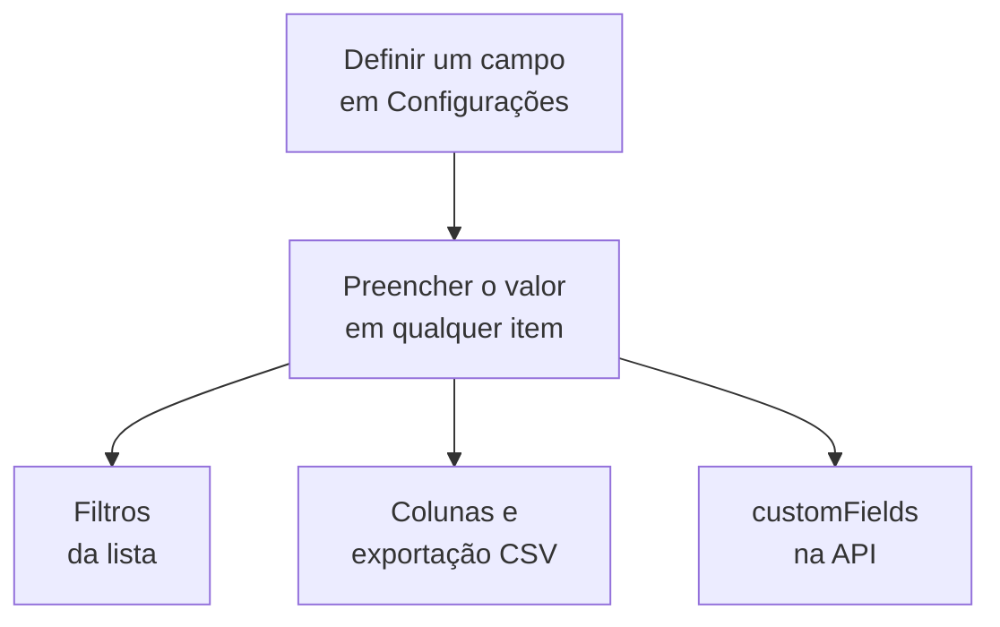

# Campos personalizados do inventário

O OneUptime descobre o que existe no seu ambiente. Os campos personalizados registram o que nenhuma observação consegue dizer: o número de série na etiqueta, a data em que a garantia vence, qual equipe é dona de algo, se está em uso ou em uma gaveta de peças de reposição. Defina os campos uma vez para o projeto e depois preencha-os em cada item.

:::cards
- [Como os campos personalizados funcionam](#como-os-campos-personalizados-funcionam): Um vocabulário, em cada item, seja qual for a origem.
- [Definir os campos](#definir-os-campos): Criar um campo, escolher o tipo, listar as opções de uma lista suspensa.
- [Filtrar a lista](#filtrar-a-lista): Encontrar o que vence no próximo trimestre em dois cliques.
- [Observações e limites](#observações-e-limites): Renomeações, duplicatas, datas e campos excluídos.
:::

## Como os campos personalizados funcionam

Um campo é definido uma vez para o projeto, e cada item pode ter um valor para ele: os que o OneUptime descobriu, os que ele espelha e os que você adicionou manualmente. Um campo vira um filtro acima da lista, uma coluna opcional e uma coluna da exportação CSV. A API lê e grava os mesmos valores, em `customFields` de cada item.

> [!NOTE]
> No OneUptime Cloud, os campos personalizados fazem parte do plano **Growth** e superiores. Abaixo dele, os campos não podem ser definidos, listados nem alterados: a API responde `402 Payment Required`, e a lista não mostra filtros nem colunas de campos personalizados.

## Definir os campos

:::steps
### Abrir a página de campos personalizados

Vá para **Produtos → Recursos → Inventário**, abra **Configurações** no menu lateral e depois **Campos personalizados**.

### Criar um campo

Clique em **Criar: Inventory Item Custom Field**. Dê a ele um **Nome do campo**, uma **Descrição do campo** opcional e um **Tipo do campo** da tabela abaixo.

### Listar as opções de uma lista suspensa

Para um tipo lista suspensa, adicione as opções em **Opções do menu suspenso**. Cada opção pode ter uma cor, usada da mesma forma na célula da tabela e no filtro: escolha uma das cores com nome, **Sem cor**, ou **Cor personalizada** para um código de cor exato. Arraste uma opção pela alça para mudar a posição dela na lista.
:::

| Tipo | Use para |
| --- | --- |
| **Texto** | Número de série, etiqueta de ativo, posição no rack, número do pedido de compra |
| **Número** | Custo, unidade de rack, quantidade de portas |
| **Booleano** | Com suporte, no escopo PCI |
| **Lista suspensa (seleção única)** | Status do ciclo de vida, ambiente, criticidade: uma resposta de uma lista fixa |
| **Lista suspensa (seleção múltipla)** | Escopos de conformidade, tags: várias respostas de uma lista fixa |
| **Data** | Data de compra, vencimento da garantia, data de fim de vida |
| **Data e hora** | Última auditoria em, desativado em |
| **Texto longo** | Instruções de acesso, anotações: várias linhas de texto simples |
| **Texto formatado (Markdown)** | Anotações com formatação e links, escritas no editor Markdown |
| **Arquivo** | Um certificado de garantia, uma ordem de compra assinada, uma foto da etiqueta do rack: um arquivo |
| **Vários arquivos** | Manuais, faturas e fotos: até 10 arquivos |

## Um vocabulário de ativos completo

Um registro típico de ativos de hardware se encaixa diretamente nesses campos:

| Nome do campo | Tipo | Exemplo |
| --- | --- | --- |
| `Serial Number` | Texto | `FDO24160ABC` |
| `Asset Tag` | Texto | `IT-004821` |
| `Purchase Date` | Data | 2024-03-11 |
| `Warranty Expiry` | Data | 2027-03-10 |
| `Lifecycle Status` | Lista suspensa | Em uso, Reserva, Em reparo, Desativado |
| `Assigned Site` | Lista suspensa | Data center de Londres, Data center de Frankfurt, Sede |
| `Owner Team` | Lista suspensa | Rede, Plataforma, Segurança |
| `Cost Centre` | Texto | `CC-4410` |

Preencha os valores na página **Campos personalizados** de um item. Qualquer item os aceita, seja qual for a origem, então os switches que o OneUptime descobriu e os dispositivos de rede que ele espelha carregam o mesmo vocabulário de ativos que os appliances que você adicionou manualmente.

## Filtrar a lista

Cada campo personalizado vira um filtro acima da lista **All Items**, e o filtro oferece as comparações que combinam com o tipo dele:

| Tipo do campo | Comparações |
| --- | --- |
| **Texto**, **Texto longo**, **Texto formatado (Markdown)** | é, não é, contém, não contém, começa com, termina com, está vazio, não está vazio |
| **Número** | é, não é, é maior que, é maior ou igual a, é menor que, é menor ou igual a, está vazio, não está vazio |
| **Booleano**, **Lista suspensa (seleção única)**, **Lista suspensa (seleção múltipla)** | é, não é, está vazio, não está vazio |
| **Data**, **Data e hora** | é, é antes de, é depois de, está entre, está vazio, não está vazio |
| **Arquivo**, **Vários arquivos** | é |

Um chip de **Arquivo** ou **Vários arquivos** pergunta uma coisa só: se o campo **Tem arquivos** ou está **Sem arquivos**.

Os filtros se combinam com E, então "Warranty Expiry é antes de 2026-10-01 E Lifecycle Status é Em uso" é uma única visão da lista. Essa é a pergunta que um registro de ativos existe para responder, e o motivo para usar os tipos de data em vez de uma data em um campo de texto: um campo de texto guarda `2026-10-01` sem reclamar e depois não consegue dizer o que vence no próximo trimestre.

As colunas de campos personalizados começam ocultas: ative-as no seletor de colunas. Elas não podem ser ordenadas, porque os valores ficam juntos em uma única coluna JSON pela qual a lista não consegue ordenar.

## Observações e limites

- Os valores são guardados em cada item com o nome do campo. Renomear um campo não move os valores já guardados com o nome antigo. Os campos personalizados de incidentes são a exceção: renomear um move os valores dele (veja [Renomear um campo](/docs/incidents/settings#renomear-um-campo)).
- As opções de uma lista suspensa podem ser adicionadas, renomeadas, arrastadas para uma nova ordem e removidas depois que os itens têm valores. Renomear uma opção a altera em cada item que a tem; uma opção removida continua nos itens que a têm, mostrada como não sendo mais uma opção, a menos que você escolha outra para eles (veja [Alterar as opções de uma lista suspensa](/docs/incidents/settings#alterar-as-opções-de-uma-lista-suspensa)).
- Nada torna um valor único. Dois itens podem ter o mesmo número de série, e nada impede isso.
- As datas são guardadas como timestamps ISO-8601 em UTC e mostradas no seu próprio fuso horário.
- Excluir um campo o tira da lista e da barra de filtros. Os valores já gravados continuam nos itens.
- Um campo **Arquivo** ou **Vários arquivos** aceita arquivos de até 10 MB cada, dos tipos listados em [Campos de arquivo](/docs/incidents/settings#campos-de-arquivo), enviados no projeto. Só quem pode ver o item pode baixá-los, e um arquivo é excluído assim que nada mais o guarda.

## Próximos passos

:::cards
- [Visão geral do inventário](/docs/inventory/overview): De onde vêm os itens e o que cada página mostra.
- [Exportar para um CMDB](/docs/inventory/cmdb-sync): Levar os itens e os campos personalizados deles para outro sistema.
- [Campos personalizados de incidentes](/docs/incidents/settings#campos-personalizados): Os mesmos tipos de campo nos incidentes, com alguns extras.
:::
