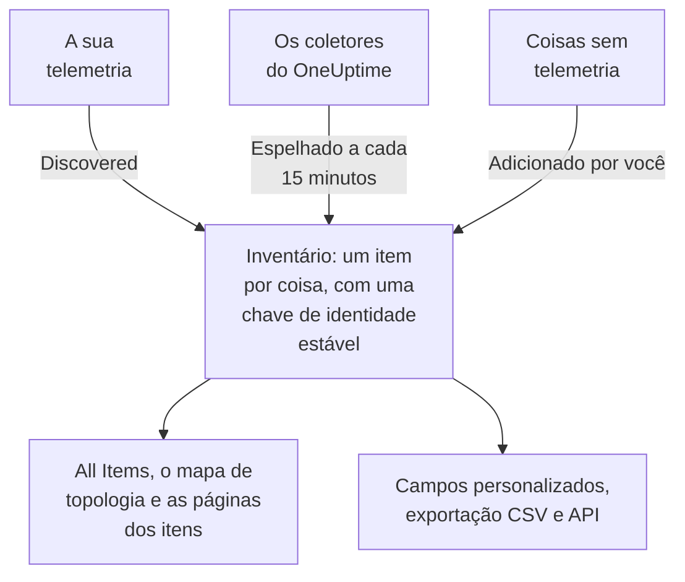

# Visão geral do inventário

O inventário é uma única lista de tudo o que o OneUptime sabe sobre o seu ambiente: serviços, hosts, objetos do Kubernetes, máquinas virtuais, dispositivos de rede, recursos de nuvem, dispositivos IoT, funções serverless e as coisas que não enviam nenhuma telemetria. Quase tudo se preenche sozinho a partir do que o OneUptime já observa. Você acrescenta o que a observação não consegue dizer: para que algo serve, de quem é, quando a garantia vence.

:::cards
- [Como os itens chegam ao inventário](#como-os-itens-chegam-ao-inventário): Descobertos, espelhados ou adicionados por você.
- [Como se orientar](#como-se-orientar): As páginas do inventário e as páginas próprias de cada item.
- [Adicionar algo manualmente](#adicionar-algo-manualmente): Uma API de terceiros, um banco de dados externo ou um appliance.
- [Arquivar em vez de excluir](#arquivar-em-vez-de-excluir): O jeito de organizar a lista que permanece.
:::

## Como os itens chegam ao inventário

O OneUptime já observa o seu ambiente para monitorá-lo, então o catálogo é construído a partir do que ele vê, e não do que alguém lembrou de digitar. Cada item tem uma origem, e a origem decide a quem o item pertence: se você pode editá-lo e se ele pode sumir sozinho.

| Origem | Na API | De onde vem | Por quanto tempo fica |
| --- | --- | --- | --- |
| **Discovered** | `discovered` | Atributos de recurso do OpenTelemetry, lidos à medida que a telemetria chega: um serviço, host, objeto do Kubernetes ou máquina virtual que envia telemetria. | Registrado de novo a cada lote. Removido depois de ficar em silêncio por mais tempo que a janela do seu tipo (veja abaixo). |
| **Mirrored** | `inventory` | Um registro que um coletor do OneUptime mantém: dispositivos de rede, recursos de nuvem, dispositivos IoT, funções serverless, aplicações RUM, hosts Docker e hosts Podman. Copiado a cada 15 minutos. | Enquanto o seu registro existir. Exclua o registro e o item vai junto. |
| **Added by you** | `manual` | Adicionado por você, para algo que o OneUptime não consegue ver: uma API de terceiros, um banco de dados gerenciado por um fornecedor, um appliance em um rack. | Até você excluí-lo. Nada o faz expirar. |

Um item descoberto ou espelhado não pode ser renomeado nem mudar de tipo: a sua origem sobrescreveria a mudança na próxima passagem. A página **Configurações** do item diz onde fazer uma mudança duradoura em vez disso. O que você sempre pode acrescentar a qualquer item, seja qual for a origem, são valores de campos personalizados: veja [Campos personalizados do inventário](/docs/inventory/custom-fields).

### Por quanto tempo um item silencioso fica

Um item descoberto tem pulsação. Cada vez que chega telemetria para ele, o horário em que foi visto por último avança, e a coluna **Status** da lista mostra quão recente isso é. Itens espelhados e os que você adicionou não têm pulsação, então o status deles fica em branco em vez de alarmar.

| Status | O que significa |
| --- | --- |
| **Ao vivo** | Visto nos últimos 30 minutos. |
| **Recent** | Visto no último dia. |
| **Stale** | Não visto há mais de um dia. A página **Gone Quiet** lista esses itens. |

A cada três horas, o OneUptime remove os itens descobertos que ficaram em silêncio por mais tempo que a janela do seu tipo, inclusive os arquivados, e os valores de campos personalizados deles vão junto. Itens espelhados e os que você adicionou nunca são removidos dessa forma.

| Tipo de item | Removido após este tempo sem telemetria |
| --- | --- |
| Pods, implantações, convidados do Proxmox e máquinas virtuais do VMware | 1 dia |
| Nós e namespaces do Kubernetes, nós do Proxmox, hosts, clusters e datastores do VMware, e os bancos de dados e serviços remotos que os seus traces chamam | 7 dias |
| Serviços, hosts, clusters do Kubernetes, do Proxmox e do Ceph, storage arrays, vCenters e clusters do Docker Swarm | 30 dias |

Uma relação que o OneUptime descobriu é removida quando não é vista de novo por 30 dias.

## Como se orientar

Abra **Produtos → Recursos → Inventário**. O menu lateral tem estas páginas. **By Source**, **Configurações**, **Ajuda** e **Avançado** começam recolhidas: clique no título de uma seção para abri-la.

| Página | O que você encontra |
| --- | --- |
| **Visão geral** | Quantos itens você tem, o que são, quantos ficaram em silêncio e o que foi adicionado mais recentemente. |
| **All Items** | Todos os itens. Pesquise por nome, descrição ou chave de identidade, filtre a lista por tipo, origem, status ou campo personalizado e adicione um item manualmente. |
| **Topology Map** | Como os itens se conectam: os serviços, o que eles chamam e os hosts, pods e dispositivos em que rodam. |
| **Gone Quiet** | Os itens descobertos que não enviam telemetria há mais de um dia. |
| **By Source** | Os itens de uma origem: **Discovered**, **Mirrored** ou **Added by You**. |
| **Configurações → Campos personalizados** | Os campos que o seu projeto mantém em cada item. |
| **Ajuda → Documentação** | Um guia curto do inventário, com os tipos de item que ele reconhece. |
| **Avançado → Arquivado** | Os itens que você arquivou. Desarquive-os aqui. |

Abra um item, e o menu lateral dele tem a sua **Visão geral** (o tipo, a origem e o status, e cada atributo observado nele), as suas **Conexões** e os seus **Campos personalizados**; os seus **Registros**, **Traços**, **Métricas**, **Perfis de desempenho** e **Exceções**; e os seus **Incidentes**, **Alertas** e **Manutenção programada**. Em **Avançado** ficam as suas **Configurações**, os seus **Registros de auditoria** e **Delete Item**. As páginas de telemetria mostram o que o próprio item enviou. Os incidentes, alertas e eventos de manutenção são os do serviço, host ou cluster do Kubernetes que o item representa; em qualquer outro item, essas páginas dizem qual recurso consultar em vez disso.

### Detalhes do ativo

Um host ou um dispositivo de rede tem um cartão **Detalhes do ativo** que descreve os dois da mesma forma: nome do host, endereço IP, endereço MAC, número de série, fabricante, modelo, versão do firmware, sistema operacional, versão do sistema operacional, tipo de dispositivo e localização. Um dado que nada informou aparece como **Desconhecido**, e o cartão explica como os desconhecidos são preenchidos.

- Os dados de um host vêm dos atributos de recurso da sua telemetria: os endereços IP e MAC, a arquitetura e o sistema operacional de imediato, e o número de série, a marca, o modelo e o firmware depois que você os carimba.
- Os dados de um dispositivo de rede vêm da sua consulta SNMP, da sua função e do seu site. O que a sua consulta não leu vem da descoberta: a última varredura do seu endereço, a tabela ARP de um roteador ou a consulta DNS da sua sonda. Um dispositivo sem ENTITY-MIB, como um Meraki MX, ainda obtém a marca e o modelo da sua descrição de sistema. O endereço IP dele nunca é mostrado como nome do host.

O cartão mostra de onde veio cada dado e quando. A fonte que a maioria dos dados compartilha, como o coletor de um host, a própria consulta SNMP de um dispositivo de rede ou a varredura de descoberta que o leu, é citada uma só vez, abaixo dos dados. Qualquer outra fonte, como a tabela ARP de um roteador ou um valor salvo no dispositivo, é citada sob o seu dado. Um valor salvo em um dispositivo de rede nunca é substituído pelo que a descoberta lê, e quando os dois diferem, o cartão mostra os dois.

Os mesmos dados são colunas da lista **All Items**, ocultas até você ativá-las, e entram na sua exportação CSV. [Exportar para um CMDB](/docs/inventory/cmdb-sync#detalhes-do-ativo) lista as chaves deles.

### Conexões

A página **Conexões** de um item lista os seus vizinhos nas duas direções, agrupados em **Chamadas**, **Chamado por**, **Executado em** e **Relacionados**. Cada grupo mostra o seu total (um grupo com mais de 100.000 conexões mostra "100.000+"), e **Mostrar mais** percorre o restante, então um cluster, namespace ou nó movimentado mostra todas as conexões, e não só as primeiras. A página não se limita a um intervalo de tempo: inclui relações adicionadas manualmente pela API e vizinhos arquivados. Um vizinho que não está mais no inventário aparece pela sua chave.

## Adicionar algo manualmente

Adicione um item para algo que o OneUptime nunca verá sozinho, para que uma dependência termine em algo real e essa coisa possa carregar os seus campos personalizados.

:::steps
### Abrir All Items

Vá para **Produtos → Recursos → Inventário** e depois para **All Items**.

### Adicionar o item

Clique em **Adicionar: Item**. Escolha o **Tipo**, dê um **Nome** e, se quiser, uma **Descrição**. O nome e o tipo juntos são a identidade do item, então dois itens do mesmo tipo não podem ter o mesmo nome.

### Preencher os campos personalizados

Abra o novo item. A origem dele indica **Added by you**, e a página **Campos personalizados** dele recebe os valores que o seu projeto acompanha.
:::

Você pode adicionar três tipos manualmente:

- `external.service` (**Serviço externo**): uma API de terceiros ou uma dependência de software como serviço.
- `external.database` (**Banco de dados externo**): um banco de dados que não é um servidor que o OneUptime consiga modelar. Um servidor de banco de dados, auto-hospedado ou gerenciado, do PostgreSQL ao Snowflake, fica em **Databases → Criar: Banco de dados** em vez disso ([Bancos de dados](/docs/telemetry/databases)): esse registro se liga aos traces, contêineres e métricas do mecanismo que citam o mesmo endereço, o que um item do inventário nunca faz, e adicionar o mesmo servidor das duas formas deixa dois registros sem ligação.
- `appliance` (**Appliance**): hardware ou software sem agente.

A restrição evita duplicatas. Um item feito à mão de um tipo que o OneUptime consegue observar, como um host, seria identificado pelo nome que você digitou, enquanto o item descoberto da mesma máquina é identificado pelos atributos que ela informa. Os dois nunca se juntariam, então o mesmo host ficaria na sua lista duas vezes, para sempre.

## Arquivar em vez de excluir

Arquivar tira um item da lista enquanto ele mantém a sua identidade, o seu histórico e os seus valores de campos personalizados. Isso diz: já vi isto e não quero na minha lista. Um item arquivado continua coletando telemetria.

| Origem | Arquivar | Excluir |
| --- | --- | --- |
| **Discovered** | Continua arquivado. | Volta com o próximo lote da sua telemetria. |
| **Mirrored** | Continua arquivado. | Volta com a próxima cópia. Exclua o registro original em vez disso. |
| **Added by you** | Continua arquivado. | Some para sempre. |

Para arquivar itens, selecione-os em **All Items** e arquive-os de uma vez, ou abra um item e use o cartão **Arquivar** da página **Configurações** dele. Os itens arquivados ficam em **Inventário → Avançado → Arquivado**, onde você pode selecioná-los e desarquivá-los.

> [!NOTE]
> Quando um dispositivo espelhado é removido do seu registro de origem, o OneUptime também remove o item dele, a menos que o item tenha valores de campos personalizados que você digitou. Esses valores são a única cópia e não há como desfazer, então o item é arquivado em vez de excluído. Você o encontra em **Avançado → Arquivado** com tudo o que digitou intacto.

## Relações e topologia

O OneUptime liga os itens com relações direcionadas à medida que as observa. **Inventário → Topology Map** as desenha, e a página **Conexões** de um item lista as dele. Veja [Topologia](/docs/telemetry/topology).

| Relação | Por exemplo |
| --- | --- |
| `runs-on` | Um pod roda em um nó; uma máquina virtual roda no seu host. |
| `member-of` | Um pod, nó ou namespace é membro de um cluster. |
| `hosted-on` | Um serviço está hospedado em um host. |
| `part-of` | Um pod faz parte da sua implantação. |
| `depends-on` | Um serviço chama outro, segundo os spans que passam de um para o outro. |

## Próximos passos

:::cards
- [Campos personalizados do inventário](/docs/inventory/custom-fields): Acompanhar números de série, datas de garantia, responsáveis e status do ciclo de vida.
- [Exportar para um CMDB](/docs/inventory/cmdb-sync): Levar o catálogo para o seu próprio sistema de registro.
- [Bancos de dados](/docs/telemetry/databases): Monitorar os servidores de banco de dados que os seus serviços usam.
:::
