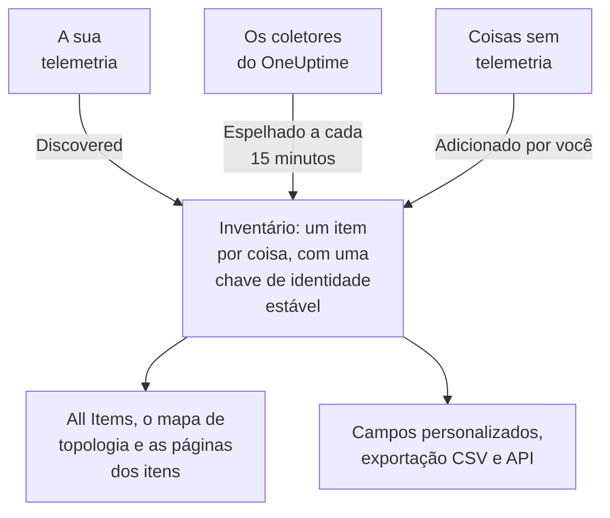

# Visão geral do inventário

O inventário é uma única lista de tudo o que o OneUptime sabe sobre o seu ambiente: serviços, hosts, objetos do Kubernetes, máquinas virtuais, dispositivos de rede, recursos de nuvem, dispositivos IoT, funções serverless e as coisas que não enviam nenhuma telemetria. Quase tudo se preenche sozinho a partir do que o OneUptime já observa. Você acrescenta o que a observação não consegue dizer: para que algo serve, de quem é, quando a garantia vence. O [Glossário](/docs/introduction/glossary#o-que-você-observa) diz o que é cada tipo de registro que ele contém.

:::cards
- [Como os itens chegam ao inventário](#como-os-itens-chegam-ao-inventário): Descobertos, espelhados ou adicionados por você.
- [Como se orientar](#como-se-orientar): As páginas do inventário e as páginas próprias de cada item.
- [Importar dispositivos do Esper](#importar-dispositivos-do-esper): Todos os dispositivos Android e Apple que o seu locatário do Esper registra, mantidos atualizados.
- [Importar dispositivos do Microsoft Intune](#importar-dispositivos-do-microsoft-intune): Todos os PCs com Windows, Macs, iPhones, iPads e dispositivos Android que o Intune gerencia, mantidos atualizados.
- [Importar dispositivos do Workspace ONE UEM](#importar-dispositivos-do-workspace-one-uem): Todos os celulares, tablets e computadores que o Workspace ONE gerencia, mantidos atualizados.
- [Importar dispositivos do SOTI MobiControl](#importar-dispositivos-do-soti-mobicontrol): Todos os dispositivos robustos, celulares, tablets e computadores que o MobiControl gerencia, mantidos atualizados.
- [Adicionar algo manualmente](#adicionar-algo-manualmente): Uma API de terceiros, um banco de dados externo ou um appliance.
- [Arquivar em vez de excluir](#arquivar-em-vez-de-excluir): O jeito de organizar a lista que permanece.
:::

## Como os itens chegam ao inventário

O OneUptime já observa o seu ambiente para monitorá-lo, então o catálogo é construído a partir do que ele vê, e não do que alguém lembrou de digitar. Cada item tem uma origem, e a origem decide a quem o item pertence: se você pode editá-lo e se ele pode sumir sozinho.

| Origem | Na API | De onde vem | Por quanto tempo fica |
| --- | --- | --- | --- |
| **Descoberto** | `discovered` | Atributos de recurso do OpenTelemetry, lidos à medida que a telemetria chega: um serviço, host, objeto do Kubernetes ou máquina virtual que envia telemetria. | Registrado de novo a cada lote. Removido depois de ficar em silêncio por mais tempo que a janela do seu tipo (veja abaixo). |
| **Replicado** | `inventory` | Um registro que um coletor do OneUptime mantém: dispositivos de rede, recursos de nuvem, dispositivos IoT, funções serverless, aplicações RUM, hosts Docker, hosts Podman e os dispositivos que a conexão de um gerenciador de dispositivos importa. Copiado a cada 15 minutos. Um dispositivo gerenciado, a cada leitura da conexão dele. | Enquanto o seu registro existir. Exclua o registro e o item vai junto. |
| **Adicionado por você** | `manual` | Adicionado por você, para algo que o OneUptime não consegue ver: uma API de terceiros, um banco de dados gerenciado por um fornecedor, um appliance em um rack. | Até você excluí-lo. Nada o faz expirar. |

Um item descoberto ou espelhado não pode ser renomeado nem mudar de tipo: a sua origem sobrescreveria a mudança na próxima passagem. A página **Configurações** do item diz onde fazer uma mudança duradoura em vez disso. O que você sempre pode acrescentar a qualquer item, seja qual for a origem, são valores de campos personalizados: veja [Campos personalizados do inventário](/docs/inventory/custom-fields).

### Por quanto tempo um item silencioso fica

Um item descoberto tem pulsação. Cada vez que chega telemetria para ele, o horário em que foi visto por último avança, e a coluna **Status** da lista mostra quão recente isso é. O mesmo acontece com um dispositivo gerenciado: a cada check-in que ele faz no gerenciador de dispositivos dele. Os outros itens espelhados e os que você adicionou não têm pulsação, então o status deles fica em branco em vez de alarmar.

| Status | O que significa |
| --- | --- |
| **Ao vivo** | Visto nos últimos 30 minutos. |
| **Recente** | Visto no último dia. |
| **Desatualizado** | Não visto há mais de um dia. A página **Em silêncio** lista esses itens. |

A cada três horas, o OneUptime remove os itens descobertos que ficaram em silêncio por mais tempo que a janela do seu tipo, inclusive os arquivados, e os valores de campos personalizados deles vão junto. Itens espelhados e os que você adicionou nunca são removidos dessa forma.

| Tipo de item | Removido após este tempo sem telemetria |
| --- | --- |
| Pods, implantações, convidados do Proxmox, instâncias do OpenStack e máquinas virtuais do VMware | 1 dia |
| Nós e namespaces do Kubernetes, nós do Proxmox, hipervisores do OpenStack, hosts, clusters e datastores do VMware, e os bancos de dados e serviços remotos que os seus traces chamam | 7 dias |
| Serviços, hosts, clusters do Kubernetes, do Proxmox e do Ceph, nuvens OpenStack, storage arrays, vCenters e clusters do Docker Swarm | 30 dias |

Uma relação que o OneUptime descobriu é removida quando não é vista de novo por 30 dias.

## Como se orientar

Abra **Produtos → Recursos → Inventário**. O menu lateral tem estas páginas. **Por origem**, **Configurações**, **Ajuda** e **Avançado** começam recolhidas: clique no título de uma seção para abri-la.

| Página | O que você encontra |
| --- | --- |
| **Visão geral** | Quantos itens você tem, o que são, quantos ficaram em silêncio e o que foi adicionado mais recentemente. |
| **Todos os itens** | Todos os itens. Pesquise por nome, descrição ou chave de identidade, filtre a lista por tipo, origem, status ou campo personalizado e adicione um item manualmente. |
| **Dispositivos gerenciados** | As suas conexões de gerenciadores de dispositivos — Esper, Microsoft Intune, Workspace ONE UEM e SOTI MobiControl — e todos os dispositivos que elas importam, com o status, o grupo, o modelo e o sistema operacional de cada um. |
| **Mapa de topologia** | Como os itens se conectam: os serviços, o que eles chamam e os hosts, pods e dispositivos em que rodam. |
| **Em silêncio** | Os itens sem notícias há mais de um dia: itens descobertos que não enviaram telemetria e dispositivos que pararam de fazer check-in no gerenciador de dispositivos deles. |
| **Por origem** | Os itens de uma origem: **Descoberto**, **Replicado** ou **Adicionado por você**. |
| **Configurações → Campos personalizados** | Os campos que o seu projeto mantém em cada item. |
| **Ajuda → Documentação** | Um guia curto do inventário, com os tipos de item que ele reconhece. |
| **Avançado → Arquivado** | Os itens que você arquivou. Desarquive-os aqui. |

Abra um item, e o menu lateral dele tem a sua **Visão geral** (o tipo, a origem e o status, e cada atributo observado nele), as suas **Conexões** e os seus **Campos personalizados**; os seus **Registros**, **Traços**, **Métricas**, **Perfis** e **Exceções**; e os seus **Incidentes**, **Alertas** e **Manutenção programada**. Em **Avançado** ficam as suas **Configurações**, os seus **Registros de auditoria** e **Excluir item**. As páginas de telemetria mostram o que o próprio item enviou. Os incidentes, alertas e eventos de manutenção são os do serviço, host ou cluster do Kubernetes que o item representa; em qualquer outro item, essas páginas dizem qual recurso consultar em vez disso.

### Detalhes do ativo

Um host ou um dispositivo de rede tem um cartão **Detalhes do ativo** que descreve os dois da mesma forma: nome do host, endereço IP, endereço MAC, número de série, fabricante, modelo, versão do firmware, sistema operacional, versão do sistema operacional, tipo de dispositivo e localização. O cartão de um dispositivo Android também tem o nível do patch de segurança dele, vindo do Android Agent ou do gerenciador de dispositivos dele. Um dado que nada informou aparece como **Desconhecido**, e o cartão explica por que isso acontece e como os desconhecidos são preenchidos: um dispositivo que não os informa por SNMP, um dispositivo ainda não lido, ou um dispositivo Meraki cujo painel os contém.

- Os dados de um host vêm dos atributos de recurso da sua telemetria: os endereços IP e MAC, a arquitetura e o sistema operacional de imediato, e o número de série, a marca, o modelo e o firmware depois que você os carimba.
- Os dados de um dispositivo de rede vêm da sua consulta SNMP, da sua função e do seu site. O que a sua consulta não leu vem da descoberta: a última varredura do seu endereço, a tabela ARP de um roteador ou a consulta DNS da sua sonda. Um dispositivo sem ENTITY-MIB, como um Meraki MX, ainda obtém a marca, o modelo e o sistema operacional da sua descrição de sistema, e o endereço MAC das suas próprias portas. O endereço IP dele nunca é mostrado como nome do host.
- Um dispositivo Meraki também obtém do painel do Meraki o que a sua consulta deixa vazio, entre eles o número de série, o modelo e o firmware, quando uma [conexão do Meraki](/docs/monitor/network-traffic#cisco-meraki-sem-netflow) lê a organização dele.

**Todos os itens** encontra os dispositivos Android que exigem ação. O filtro **Nível do patch de segurança** lista em **Atualização necessária** os dispositivos cujo nível do patch de segurança tem mais de 90 dias, a mesma regra que o alerta Security Patch Out of Date do [Monitor de hosts](/docs/monitor/host-monitor) usa. O filtro **Permissões do agente** lista os dispositivos em que o [Android Agent](/docs/telemetry/android-agent) ainda não tem READ_LOGS, READ_DROPBOX_DATA ou acesso ao uso. Cada filtro tem uma coluna com o mesmo nome, oculta até você ativá-la, e a exportação CSV a inclui.

O cartão mostra de onde veio cada dado e quando. A fonte que a maioria dos dados compartilha, como o coletor de um host, a própria consulta SNMP de um dispositivo de rede ou a varredura de descoberta que o leu, é citada uma só vez, abaixo dos dados. Qualquer outra fonte, como a tabela ARP de um roteador ou um valor salvo no dispositivo, é citada sob o seu dado. Um valor salvo em um dispositivo de rede nunca é substituído pelo que a descoberta lê, e quando os dois diferem, o cartão mostra os dois.

O cartão de um dispositivo de rede tem um botão **Atualizar** para quem pode editar dispositivos de rede. Ele lê o dispositivo de novo agora: a sonda o consulta em até um minuto, e a conexão do Meraki lê a organização de novo. O cartão diz quando a nova leitura chegou, ou que a sonda não conseguiu alcançar o dispositivo, e o item é copiado do dispositivo assim que a leitura chega.

Os mesmos dados são colunas da lista **Todos os itens**, ocultas até você ativá-las, e entram na sua exportação CSV. [Exportar para um CMDB](/docs/inventory/cmdb-sync#detalhes-do-ativo) lista as chaves deles.

### Conexões

A página **Conexões** de um item lista os seus vizinhos nas duas direções, agrupados em **Chamadas**, **Chamado por**, **Executado em** e **Relacionados**. Cada grupo mostra o seu total (um grupo com mais de 100.000 conexões mostra "100.000+"), e **Mostrar mais** percorre o restante, então um cluster, namespace ou nó movimentado mostra todas as conexões, e não só as primeiras. A página não se limita a um intervalo de tempo: inclui relações adicionadas manualmente pela API e vizinhos arquivados. Um vizinho que não está mais no inventário aparece pela sua chave.

## Importar dispositivos do Esper

Conecte um locatário do Esper, e todos os dispositivos que ele registra ficam no inventário: os dispositivos Android, inclusive aqueles cujo aplicativo nunca foi iniciado, e os iPhones, iPads e Apple TVs. Cada dispositivo é um host, com o que só o Esper sabe sobre ele: o grupo, o sistema operacional e a build, o número de série e o IMEI, a bateria e o armazenamento, e, num dispositivo Android, o nível do patch de segurança e os aplicativos instalados. O Esper não envia nada por conta própria, então o OneUptime o lê em uma programação: os dispositivos a cada 15 minutos, e os aplicativos de cada dispositivo Android a cada 6 horas.

:::steps
### Criar uma chave de API no Esper

No console do Esper, crie uma chave em API Key Management. O OneUptime só faz leituras, então basta a chave de um usuário cuja função no Esper possa ler dispositivos, grupos e aplicativos. Uma chave deixa de funcionar quando é substituída ou quando o usuário dela é excluído.

### Conectar o locatário

Vá para **Produtos → Recursos → Inventário**, depois para **Dispositivos gerenciados**, clique em **Conectar um gerenciador de dispositivos** e escolha **Esper**. Informe o **Locatário**, o nome antes de `.esper.cloud` no endereço do seu console do Esper (`acme` para `acme.esper.cloud`), e a **Chave de API**. **Mais campos** guarda o nome da conexão e com que frequência ela é lida.

### Conferir a primeira leitura

**Conectar** testa a chave antes de salvar qualquer coisa: diz quantos dispositivos uma leitura vai importar, ou o que está errado e como corrigir. A primeira leitura começa em até um minuto, e a linha da conexão mostra como ela foi.
:::

| O que o Esper informa | Onde aparece |
| --- | --- |
| Modelo, fabricante, número de série, sistema operacional e a versão dele, build e endereços IP e MAC | O cartão **Detalhes do ativo** do dispositivo e as colunas de **Todos os itens** |
| Status, último check-in, grupo, nível do patch de segurança, IMEI, bateria, armazenamento e agente do Esper | O cartão **Esper** do dispositivo e a lista **Dispositivos** de **Dispositivos gerenciados** |
| Aplicativos e as versões deles | A lista **Aplicativos instalados** do dispositivo |

### Um dispositivo, não dois

Um aplicativo ou o Android Agent que envia telemetria de um dispositivo se junta ao dispositivo que o Esper importa como um só item quando nomeia o dispositivo do mesmo jeito que o Esper. Defina estes atributos de recurso a partir da configuração gerenciada que o Esper preenche em cada dispositivo:

| Atributo de recurso | Valor na configuração gerenciada | O que é |
| --- | --- | --- |
| `host.name` | `${esper.deviceName}` | O nome do dispositivo no Esper, como `ESP-ID-AAAAW`. Obrigatório. |
| `host.serial_number` | `${esper.serialNumber}` | O número de série do dispositivo. Opcional. |

O OneUptime encontra o item de um dispositivo pelo nome dele no Esper, depois pelo número de série, e só cria um quando nenhum corresponde. O Android Agent define os dois a partir das configurações `device_name` e `device_serial` dele, e [Configuração para Android](/docs/rum/android-setup#importar-a-frota-do-esper) mostra a configuração gerenciada de um aplicativo.

### Quando um dispositivo fica em silêncio ou sai do Esper

Um dispositivo Android que não faz check-in há 30 minutos fica **Offline** e mostra há quanto tempo fez o último; um iPhone, iPad ou Apple TV, que faz check-in quando o serviço de push da Apple o acorda, muitas vezes com horas de intervalo, fica **Offline** depois de um dia. O **Status** do item dele segue o último check-in, ou a telemetria quando ela é mais recente, então um dispositivo em silêncio por um dia aparece na página **Em silêncio**.

Um dispositivo removido do Esper é marcado como **Removido**, e o item dele é arquivado: sai da lista e fica aguardando em **Avançado → Arquivado**. Um dispositivo que volta ao Esper volta à lista. 30 dias depois de sair, o dispositivo é excluído, e o item dele também, a menos que a telemetria ou você tenham acrescentado algo a ele.

### Receber um alerta quando um dispositivo deixar de fazer check-in

Em **Dispositivos gerenciados**, clique em **Configurar alertas** na linha da conexão e crie **Esper Android Device Stopped Checking In** e **Esper Apple Device Stopped Checking In**. O primeiro abre um alerta para cada dispositivo Android que não faz check-in no Esper há mais de uma hora, e o segundo para cada dispositivo Apple que não faz há mais de um dia, cada um com o nome do dispositivo e resolvido assim que ele volta a fazer check-in.

Cada leitura da conexão registra há quantos minutos cada dispositivo fez o último check-in, como a métrica `oneuptime.managed_device.check_in.age`, e o monitor verifica o valor mais recente de cada dispositivo a cada 5 minutos. Um dispositivo que também executa o Android Agent fica a cargo de **Host Stopped Reporting**, então nunca alerta duas vezes, e um dispositivo removido do Esper resolve o seu alerta. Uma leitura que falha não registra nada, então nenhum alerta abre nem se resolve até a próxima. Para uma frota desligada à noite, aumente o limite do monitor.

## Importar dispositivos do Microsoft Intune

Conecte um locatário do Microsoft Intune, e todos os dispositivos que o Intune gerencia ficam no inventário: os PCs com Windows, Macs, iPhones, iPads, dispositivos Android e máquinas Linux. Cada dispositivo é um host, com o que o Intune sabe sobre ele: a categoria, o sistema operacional e a versão, o número de série e o IMEI, a conformidade, a propriedade e o registro, o armazenamento e os aplicativos que o Intune descobriu nele. O Intune não envia nada por conta própria, então o OneUptime o lê em uma programação: os dispositivos a cada 15 minutos, e os aplicativos de cada dispositivo a cada 6 horas.

:::steps
### Registre um aplicativo no Microsoft Entra

No centro de administração do Microsoft Entra, abra `App registrations` e clique em `New registration`. Dê um nome, mantenha `Accounts in this organizational directory only` e registre o aplicativo. A página `Overview` dele mostra os dois IDs que o OneUptime pede: o `Application (client) ID` e o `Directory (tenant) ID`.

### Deixe-o ler os dispositivos do Intune

Em `API permissions`, clique em `Add a permission`, depois em `Microsoft Graph`, depois em `Application permissions`, e adicione `DeviceManagementManagedDevices.Read.All`. Em seguida, clique em `Grant admin consent`, o que só um administrador do locatário pode fazer. Essa única permissão é tudo de que o OneUptime precisa: ela lista os dispositivos e os aplicativos que o Intune descobriu neles, e não pode mudar nada.

### Crie um segredo do cliente

Em `Certificates & secrets`, clique em `New client secret` e copie o `Value` dele, não o `Secret ID`: a Microsoft mostra o valor uma única vez. Um segredo para de funcionar quando expira, então, antes disso, crie um novo e informe-o ao editar a conexão.

### Conecte o locatário do Intune

Vá para **Produtos → Recursos → Inventário**, depois para **Dispositivos gerenciados**, clique em **Conectar um gerenciador de dispositivos** e escolha **Microsoft Intune**. Informe o **ID do locatário**, o **ID do aplicativo (cliente)** e o **Client Secret**. Se o locatário estiver em uma nuvem do governo dos EUA, escolha-a como **Nuvem** em **Mais campos**. **Conectar** testa o registro de aplicativo antes de salvar qualquer coisa: diz quantos dispositivos uma leitura vai importar, ou o que está errado e como corrigir.
:::

Um dispositivo faz check-in no Intune mais ou menos a cada oito horas, e o último check-in dele é a última vez que fez: um dispositivo que não faz há um dia fica **Offline**. Os aplicativos dele são os que o Intune descobriu nele, que o Microsoft Graph só lista na versão beta: num dispositivo pessoal, os aplicativos que o Intune gerencia. Os grupos do Intune são grupos do Microsoft Entra, que essa permissão não lê, então o grupo de um dispositivo é a categoria de dispositivo dele. Nada sobre o usuário de um dispositivo é lido.

O Intune dá a um dispositivo o nome que o dono deu, então dois dispositivos podem ter o mesmo nome: todo iPhone que ninguém renomeou se chama `iPhone`. Um nome que dois dispositivos de uma conexão compartilham não é de nenhum dos dois no inventário: cada um passa a ter o nome do número de série, e recupera o nome assim que nenhum outro dispositivo o tiver.

Para receber um alerta quando um dispositivo parar de fazer check-in, clique em **Configurar alertas** na linha da conexão e crie **Intune Device Stopped Checking In**. Ele abre um alerta para cada dispositivo que não faz check-in no Intune há mais de um dia, com o nome do dispositivo. Um notebook desligado num fim de semana aparece igual, então aumente o limite do monitor se um dia for pouco para os seus.

## Importar dispositivos do Workspace ONE UEM

Conecte um servidor do Workspace ONE UEM, e todos os dispositivos que ele gerencia ficam no inventário: os iPhones, iPads, Macs, PCs com Windows, dispositivos Android e máquinas Linux. Cada dispositivo é um host, com o que o Workspace ONE sabe sobre ele: o grupo organizacional, o sistema operacional e a versão, o modelo, o número de série e o IMEI, a conformidade, o registro e a propriedade, a bateria, o armazenamento e a memória, e os aplicativos. O Workspace ONE não envia nada por conta própria, então o OneUptime o lê em uma programação: os dispositivos a cada 15 minutos, e os aplicativos de cada dispositivo a cada 6 horas.

:::steps
### Crie uma função somente leitura

No console do Workspace ONE UEM, vá para `Accounts`, depois para `Administrators`, depois para `Roles`, e clique em `Add Role`. Em `API`, depois em `REST`, selecione `Read` para `Devices` e para `Apps`, e nada mais. Essa função é tudo de que o OneUptime precisa: ela lista os dispositivos e os aplicativos deles, e não pode mudar nada.

### Crie um cliente OAuth

Vá para `Groups & Settings`, depois para `Configurations`, depois para `OAuth Client Management`, e clique em `Add`. Escolha o grupo organizacional cujos dispositivos o OneUptime lê e dê ao cliente a função que você criou. Copie o `Client ID` e o `Client Secret` dele: o Workspace ONE mostra o segredo uma única vez.

### Conecte o servidor

Vá para **Produtos → Recursos → Inventário**, depois para **Dispositivos gerenciados**, clique em **Conectar um gerenciador de dispositivos** e escolha **Workspace ONE UEM**. Informe a **URL da REST API**, que `Groups & Settings`, `All Settings`, `System`, `Advanced`, `API`, `REST API` mostra, como `https://as1234.awmdm.com`. Mantenha **Cliente OAuth** em **Entrar com**, informe o **Client ID** e o **Client Secret** e escolha a **Região** do serviço de token do seu data center. **Conectar** testa o cliente antes de salvar qualquer coisa: diz quantos dispositivos uma leitura vai importar, ou o que está errado e como corrigir.
:::

Um servidor do Workspace ONE on-premises não tem serviço de token: escolha **Conta de administrador** em **Entrar com** e informe o **Nome de usuário** e a **Senha** de um administrador com a função somente leitura, e a **Chave da REST API** das mesmas configurações de REST API, onde a autenticação básica precisa estar permitida. O OneUptime Cloud só lê servidores na internet pública, então um servidor em uma rede privada é lido por um OneUptime auto-hospedado.

Um dispositivo se reporta ao Workspace ONE na programação dele, um iPhone com horas de intervalo, então um dispositivo que não se reporta há um dia fica **Offline**. Um dispositivo que não está mais registrado fica de fora. Um dispositivo recebe o nome que ele informa, não o nome amigável, que o Workspace ONE monta a partir do nome do usuário dele, e nada sobre o usuário de um dispositivo é lido. Cada requisição conta para a cota diária de API do locatário, então uma leitura lê os aplicativos de no máximo 25 dispositivos, e a próxima leitura os dos próximos.

Um aplicativo ou o Android Agent que envia telemetria de um dispositivo se junta a ele como um só item pelo número de série do dispositivo: defina a configuração `device_serial` do Android Agent como o valor de pesquisa `{DeviceSerialNumber}` na configuração gerenciada dele.

Para receber um alerta quando um dispositivo parar de fazer check-in, clique em **Configurar alertas** na linha da conexão e crie **Workspace ONE Device Stopped Checking In**. Ele abre um alerta para cada dispositivo que não se reporta ao Workspace ONE há mais de um dia, com o nome do dispositivo.

## Importar dispositivos do SOTI MobiControl

Conecte um servidor do SOTI MobiControl, na nuvem da SOTI ou on-premises, e todos os dispositivos que ele gerencia ficam no inventário: os dispositivos Android robustos, celulares, tablets e scanners, os iPhones, iPads e Macs, e os computadores Windows e Linux. Cada dispositivo é um host, com o que o MobiControl sabe sobre ele: o grupo de dispositivos, o sistema operacional e a versão, o modelo, o número de série e o IMEI, a conformidade, o agente, a bateria, o armazenamento e a memória, e os aplicativos instalados. O MobiControl não envia nada por conta própria, então o OneUptime o lê em uma programação: os dispositivos a cada 15 minutos, e os aplicativos de cada dispositivo a cada 6 horas.

:::steps
### Crie um usuário do MobiControl somente leitura

No console web do MobiControl, adicione um usuário do próprio MobiControl, não um usuário do SOTI Identity. Permita `Web Console Access` e `View Installed Applications` nas permissões gerais dele e nada mais, e dê a ele `View Groups` nos grupos de dispositivos que o OneUptime lê. Esse usuário é tudo de que o OneUptime precisa: ele pode ver os dispositivos e os aplicativos deles, e não pode mudar nada.

### Crie um cliente de API

No console web, vá para `Global Settings`, depois para `Services`, depois para `API Client`, e adicione um. Copie o `Client ID` e o `Client Secret` dele: o MobiControl mostra o segredo uma única vez. Um servidor anterior ao MobiControl 2024.0 cria um no servidor com `MCAdmin.exe APIClientAdd -n:OneUptime`.

### Conecte o servidor do MobiControl

Vá para **Produtos → Recursos → Inventário**, depois para **Dispositivos gerenciados**, clique em **Conectar um gerenciador de dispositivos** e escolha **SOTI MobiControl**. Informe o **Servidor**, o endereço do seu console web sem `/MobiControl`, como `https://acme.mobicontrolcloud.com`, e o **Client ID** e o **Client Secret** do cliente de API, depois o **Nome de usuário** e a **Senha** do usuário. **Conectar** testa o login antes de salvar qualquer coisa: diz quantos dispositivos uma leitura vai importar, ou o que está errado e como corrigir.
:::

Um agente do MobiControl mantém uma conexão ativa com o servidor dele, então um dispositivo cujo agente está conectado fica online, e um cujo agente não está conectado há 30 minutos fica **Offline**. Um iPhone, iPad ou Mac faz check-in pelo serviço de push da Apple, com horas de intervalo, e fica **Offline** depois de um dia. Um dispositivo que um administrador desabilitou fica **Desabilitado**, e um que está tendo o registro cancelado fica de fora. O OneUptime Cloud só lê servidores na internet pública, então um servidor em uma rede privada é lido por um OneUptime auto-hospedado. Nada sobre o usuário de um dispositivo é lido.

Um aplicativo ou o Android Agent que envia telemetria de um dispositivo se junta a ele como um só item pelo número de série do dispositivo: defina a configuração `device_serial` do Android Agent como a macro `%SERIALNUM%` na configuração gerenciada dele.

Para receber um alerta quando um dispositivo parar de fazer check-in, clique em **Configurar alertas** na linha da conexão e crie **SOTI Device Stopped Checking In** e **SOTI Apple Device Stopped Checking In**. O primeiro abre um alerta para cada dispositivo Android, Windows ou Linux cujo agente não está conectado há mais de uma hora, e o segundo para cada dispositivo Apple que não faz check-in há mais de um dia, cada um com o nome do dispositivo.

## Adicionar algo manualmente

Adicione um item para algo que o OneUptime nunca verá sozinho, para que uma dependência termine em algo real e essa coisa possa carregar os seus campos personalizados.

:::steps
### Abrir Todos os itens

Vá para **Produtos → Recursos → Inventário** e depois para **Todos os itens**.

### Adicionar o item

Clique em **Adicionar: Item**. Escolha o **Tipo**, dê um **Nome** e, se quiser, uma **Descrição**. O nome e o tipo juntos são a identidade do item, então dois itens do mesmo tipo não podem ter o mesmo nome.

### Preencher os campos personalizados

Abra o novo item. A origem dele indica **Adicionado por você**, e a página **Campos personalizados** dele recebe os valores que o seu projeto acompanha.
:::

Você pode adicionar três tipos manualmente:

- `external.service` (**Serviço externo**): uma API de terceiros ou uma dependência de software como serviço.
- `external.database` (**Banco de dados externo**): um banco de dados que não é um servidor que o OneUptime consiga modelar. Um servidor de banco de dados, auto-hospedado ou gerenciado, do PostgreSQL ao Snowflake, fica em **Bancos de dados → Criar: Banco de dados** em vez disso ([Bancos de dados](/docs/telemetry/databases)): esse registro se liga aos traces, contêineres e métricas do mecanismo que citam o mesmo endereço, o que um item do inventário nunca faz, e adicionar o mesmo servidor das duas formas deixa dois registros sem ligação.
- `appliance` (**Appliance**): hardware ou software sem agente.

A restrição evita duplicatas. Um item feito à mão de um tipo que o OneUptime consegue observar, como um host, seria identificado pelo nome que você digitou, enquanto o item descoberto da mesma máquina é identificado pelos atributos que ela informa. Os dois nunca se juntariam, então o mesmo host ficaria na sua lista duas vezes, para sempre.

## Arquivar em vez de excluir

Arquivar tira um item da lista enquanto ele mantém a sua identidade, o seu histórico e os seus valores de campos personalizados. Isso diz: já vi isto e não quero na minha lista. Um item arquivado continua coletando telemetria.

| Origem | Arquivar | Excluir |
| --- | --- | --- |
| **Descoberto** | Continua arquivado. | Volta com o próximo lote da sua telemetria. |
| **Replicado** | Continua arquivado. | Volta com a próxima cópia. Exclua o registro original em vez disso. |
| **Adicionado por você** | Continua arquivado. | Some para sempre. |

Para arquivar itens, selecione-os em **Todos os itens** e arquive-os de uma vez, ou abra um item e use o cartão **Arquivar** da página **Configurações** dele. Os itens arquivados ficam em **Inventário → Avançado → Arquivado**, onde você pode selecioná-los e desarquivá-los.

> [!NOTE]
> Quando um dispositivo espelhado é removido do seu registro de origem, o OneUptime também remove o item dele, a menos que o item tenha valores de campos personalizados que você digitou. Esses valores são a única cópia e não há como desfazer, então o item é arquivado em vez de excluído. Você o encontra em **Avançado → Arquivado** com tudo o que digitou intacto.

## Relações e topologia

O OneUptime liga os itens com relações direcionadas à medida que as observa. **Inventário → Mapa de topologia** as desenha, e a página **Conexões** de um item lista as dele. Veja [Topologia](/docs/telemetry/topology).

| Relação | Por exemplo |
| --- | --- |
| `runs-on` | Um pod roda em um nó; uma máquina virtual roda no seu host. |
| `member-of` | Um pod, nó ou namespace é membro de um cluster. |
| `hosted-on` | Um serviço está hospedado em um host. |
| `part-of` | Um pod faz parte da sua implantação. |
| `depends-on` | Um serviço chama outro, segundo os spans que passam de um para o outro. |

## Próximos passos

:::cards
- [Campos personalizados do inventário](/docs/inventory/custom-fields): Acompanhar números de série, datas de garantia, responsáveis e status do ciclo de vida.
- [Exportar para um CMDB](/docs/inventory/cmdb-sync): Levar o catálogo para o seu próprio sistema de registro.
- [Bancos de dados](/docs/telemetry/databases): Monitorar os servidores de banco de dados que os seus serviços usam.
:::
