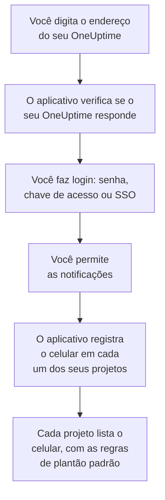

# Instalação no Android

Instale o **OneUptime On-Call** num celular ou tablet Android, conecte-o ao seu OneUptime e faça login. Depois envie a si mesmo uma notificação de teste, e deixe os acionamentos de plantão urgentes tocarem mesmo no modo silencioso e no Não Perturbe.

:::cards
- [Instalar o aplicativo](#instalar-o-aplicativo): Pelo Google Play, ou o APK num celular sem Google Play.
- [Fazer login](#fazer-login): O endereço do seu OneUptime, depois a sua conta.
- [Verificar que os acionamentos chegam ao celular](#verificar-que-os-acionamentos-chegam-ao-celular): Encontrar o celular no painel e testá-lo.
- [Tocar mesmo no modo silencioso](#tocar-mesmo-no-modo-silencioso): Os alertas críticos e o som de alarme.
- [Solução de problemas](#solução-de-problemas): Problemas de login, notificações e instalação.
:::

## Antes de começar

- Um celular ou tablet com Android 7.0 ou posterior.
- Uma conta num projeto do OneUptime. Para ser acionado, você também precisa estar de plantão: veja [Regras de escalonamento](/docs/on-call/escalation-rules).
- O endereço do seu OneUptime: `https://oneuptime.com` no OneUptime Cloud, ou o seu, por exemplo `https://oneuptime.example.com`. O aplicativo só se conecta por HTTPS.

## Instalar o aplicativo

:::tabs
@tab Google Play
1. No celular, abra [OneUptime On-Call no Google Play](https://play.google.com/store/apps/details?id=com.oneuptime.oncall), ou procure OneUptime On-Call no Google Play.
2. Toque em **Instalar** e depois em **Abrir**.

O Google Play mantém o aplicativo atualizado.
@tab APK
Para um celular sem Google Play. O APK é compilado a partir do mesmo código para cada versão do OneUptime e anexado à versão no GitHub.

1. No celular, abra [o APK mais recente](https://github.com/OneUptime/oneuptime/releases/latest/download/oneuptime-on-call-android-app.apk).
2. Abra o arquivo baixado. Se o Android pedir, permita que o navegador instale apps desconhecidos e depois toque em **Instalar**.
3. Abra o OneUptime On-Call nos seus apps.

Um APK não se atualiza sozinho: de vez em quando, instale o mais recente por cima. O seu login e as suas configurações são mantidos.
:::

## Fazer login



:::steps
### Digitar o endereço do seu OneUptime
Abra o aplicativo. Em **Connect your workspace**, mantenha `https://oneuptime.com` para o OneUptime Cloud, ou digite o endereço do seu próprio OneUptime, e toque em **Connect**. O aplicativo continua assim que `https://<your-oneuptime>/api/status` responde.

### Entrar na sua conta
Use a forma de login da sua conta:

- O seu e-mail e a sua senha, depois **Sign In**. **Forgot password?** envia por e-mail um link para definir uma nova.
- **Sign in with a passkey**, depois de adicionar uma no painel: veja [Adicionar uma chave de acesso](/docs/introduction/your-account#adicionar-uma-chave-de-acesso). O navegador abre para confirmá-la e depois traz você de volta.
- **Sign in with SSO**, se a sua organização usa login único. Escolha o seu provedor, ou digite o seu e-mail de trabalho e toque em **Continue**. Um navegador seguro abre, e você volta ao aplicativo assim que fizer login.

Com a autenticação de dois fatores ativada, digite o código de seis dígitos do seu aplicativo autenticador, ou um dos seus códigos de backup. Uma chave de segurança não pode ser usada no aplicativo. Se o seu administrador exige a autenticação de dois fatores e você ainda não a configurou, o aplicativo configura primeiro um aplicativo autenticador com você.

### Permitir as notificações
Quando o Android perguntar se o OneUptime On-Call pode enviar notificações, toque em **Permitir**. O Android 13 e posteriores perguntam; as versões anteriores as permitem enquanto você não as desativar.

Depois, o aplicativo registra o celular em cada um dos seus projetos. Cada projeto o lista entre os seus dispositivos push, com as regras de plantão padrão, para que os seus acionamentos cheguem a ele daqui em diante.
:::

O aplicativo mostra um projeto por vez: toque no nome do projeto no topo de uma tela para trocar. Um projeto que exige login único aparece como **SSO Required** em **Settings → Manage Projects** até você tocar ali em **Authenticate with SSO**.

## Verificar que os acionamentos chegam ao celular

:::steps
### Encontrar o celular no painel
No painel, abra **Configurações do usuário → Métodos de notificação** e a aba **Push Notifications**. O celular aparece em **Dispositivos de Notificação Push** com o nome do modelo. Cada projeto mantém a sua própria lista.

### Enviar um teste
Clique em **Notificação de teste** na linha do celular. Uma notificação chega ao celular; toque nela para abrir o aplicativo.
:::

As suas regras de plantão decidem quais acionamentos vão para o celular, e com que rapidez: veja **Configurações do usuário → Regras de Plantão**. Um celular novo recebe as mesmas regras padrão que qualquer outro método que você adicione.

## Tocar mesmo no modo silencioso

Por padrão, um acionamento de plantão segue as configurações de som do celular: um celular silenciado fica quieto, e o Não Perturbe segura o acionamento. Os alertas críticos fazem os acionamentos de plantão tocarem apesar dos dois. Eles ficam desativados até você ativá-los, celular por celular.

```mermaid title="Se um acionamento de plantão toca mesmo assim no Android"
flowchart TB
    Page["Um acionamento de<br/>plantão para este celular"]
    Rule{"Regra em<br/>Alerta crítico?"}
    Device{"Critical On-Call<br/>Alerts ativado?"}
    Quiet["Segue o som e o<br/>Não Perturbe<br/>do celular"]
    Loud["Toca o seu alarme<br/>mesmo no silencioso<br/>e no Não Perturbe"]
    Page --> Rule
    Rule -->|"não: Normal"| Quiet
    Rule -->|"sim"| Device
    Device -->|"não"| Quiet
    Device -->|"sim"| Loud
```

:::steps
### Ativar Critical On-Call Alerts
No aplicativo, abra **Settings** e ative **Critical On-Call Alerts** em **Notifications**.

### Permitir o acesso ao Não Perturbe
O Android abre a lista **Acesso ao Não perturbe**. Ative o acesso para o OneUptime On-Call e volte ao aplicativo: ele verifica o acesso e diz abaixo da chave se os acionamentos vão tocar.

### Escolher um som de alarme
Toque em **Alarm sound** abaixo da chave. Além do som do próprio celular, ele oferece Klaxon, Siren, Digital alarm, Smoke alarm e Rising alarm, que começa baixo e vai aumentando. Toque em reproduzir ao lado de um som para ouvi-lo. Um acionamento crítico toca no volume de alarme do celular, então mantenha-o alto.
:::

Só os acionamentos de plantão tocam mesmo assim, e só os de regras de plantão em **Alerta crítico**, o padrão. Uma regra em **Normal** segue as configurações do celular, diga o que disser a chave, assim você pode ser acordado por um incidente crítico e acionado em silêncio por um menor. Envie uma **Notificação de teste** com o celular silenciado para ouvir o que um acionamento fará.

## Evitar que os acionamentos cheguem atrasados

O OneUptime envia os acionamentos de plantão com prioridade alta, que o Android entrega até a um celular parado há horas. Um celular que restringe o uso de bateria do aplicativo ainda pode segurá-los:

- Abra **Configurações → Apps → OneUptime On-Call → Bateria** e escolha **Sem restrições**. Alguns celulares chamam isso de **Uso da bateria do app**.
- Verifique se as notificações do aplicativo estão ativadas, em **Configurações → Apps → OneUptime On-Call → Notificações**.
- Deixe o OneUptime On-Call fora de qualquer lista de economia de bateria ou de apps em suspensão que o seu celular mantenha.

## Bloquear o aplicativo

Ative **Biometrics Login** em **Settings** no aplicativo, e ele pedirá a sua digital, o seu rosto ou o bloqueio de tela do celular sempre que abrir. A chave aparece quando o celular tem desbloqueio por digital ou por rosto configurado. **Appearance**, na mesma tela, escolhe a aparência clara ou escura, ou segue o celular.

## Atualizar, sair ou desinstalar

- **Atualizar.** O Google Play atualiza o aplicativo. Com o APK, instale o mais recente por cima. A versão do aplicativo aparece no fim da tela **Settings** dele.
- **Sair.** **Settings → Log Out** faz você sair e remove o celular dos seus dispositivos push em todos os projetos, junto com as regras de plantão dele. Se você entrar de novo, ele volta com as regras padrão.
- **Desinstalar.** Remova o aplicativo como qualquer outro. Se você ainda estava conectado, o celular continua na sua lista até um push para ele falhar: o OneUptime então o marca como **Não está recebendo notificações**. Exclua essa entrada com **Excluir**: se você reinstalar o aplicativo e entrar, o celular é adicionado como uma entrada nova, com as regras padrão.

## Solução de problemas

:::details “Could not connect to the server”
O aplicativo não conseguiu chegar a `https://<your-oneuptime>/api/status`. Verifique o endereço, incluindo `https://`. Se o seu OneUptime está numa rede privada, conecte o celular a ela primeiro, pela sua VPN, por exemplo. Abra esse endereço no navegador do celular: ele mostra `{"status":"ok"}` quando o celular consegue chegar ao OneUptime.
:::

:::details Nenhuma notificação chega
- Verifique nas configurações do Android se as notificações do aplicativo estão ativadas, e se o Não Perturbe está desativado ou os alertas críticos ativados.
- Verifique se o celular aparece em **Push Notifications** em **Configurações do usuário → Métodos de notificação**, e envie a ele uma **Notificação de teste**.
- Se o celular está marcado como **Não está recebendo notificações**, abra o aplicativo estando conectado. Ele registra o celular de novo; veja [Quando um celular precisa se registrar de novo](/docs/mobile-desktop-apps/faq-troubleshooting#quando-um-celular-precisa-se-registrar-de-novo).
- Verifique as suas regras de plantão em **Configurações do usuário → Regras de Plantão**.
- Num OneUptime auto-hospedado, verifique se o seu servidor chega ao relay push dele: veja [Notificações push](/docs/self-hosted/push-notifications#acesso-de-rede).
:::

:::details Os alertas críticos ficam mudos no Não Perturbe
Abra **Settings** no aplicativo: a linha abaixo de **Critical On-Call Alerts** diz o que falta. Normalmente o acesso ao Não Perturbe não foi permitido: permita-o em **Configurações → Notificações → Acesso ao Não perturbe** e volte ao aplicativo. Se você escolheu um som de alarme, o canal de notificação desse som também precisa poder ignorar o Não Perturbe.
:::

:::details “App não instalado” ao instalar o APK
O OneUptime On-Call já está no celular vindo de outra fonte, como o Google Play, e o Android não instala um por cima do outro. Desinstale-o, instale o APK e faça login de novo.
:::

:::details Não há chave Biometrics Login
A chave aparece quando o desbloqueio por digital ou por rosto está configurado nas configurações do Android.
:::

## Próximos passos

:::cards
- [Perguntas frequentes e solução de problemas](/docs/mobile-desktop-apps/faq-troubleshooting): O que fazer quando um celular para de receber acionamentos.
- [Instalação no iOS](/docs/mobile-desktop-apps/ios-installation): O mesmo aplicativo num iPhone ou iPad.
- [Regras de escalonamento](/docs/on-call/escalation-rules): Decidir quem é acionado, e quando.
- [Notificações push](/docs/self-hosted/push-notifications): Como um OneUptime auto-hospedado envia os acionamentos aos celulares.
:::
