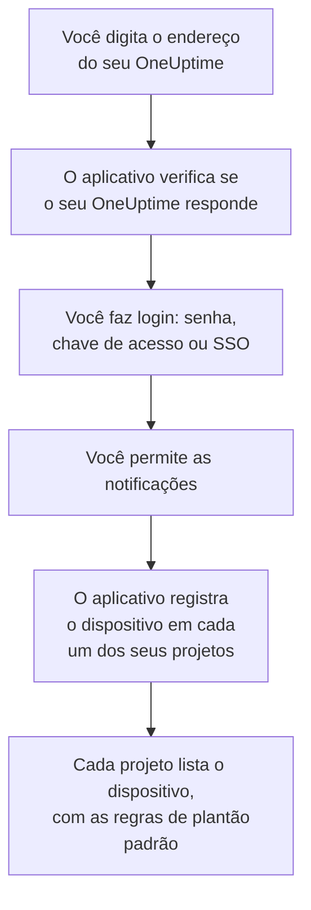

# Instalação no iOS

Instale o **OneUptime On-Call** pela App Store num iPhone ou iPad, conecte-o ao seu OneUptime e faça login. Depois envie a si mesmo uma notificação de teste, e deixe os acionamentos de plantão urgentes tocarem mesmo no modo silencioso e nos modos de Foco.

:::cards
- [Instalar o aplicativo](#instalar-o-aplicativo): Pela App Store.
- [Fazer login](#fazer-login): O endereço do seu OneUptime, depois a sua conta.
- [Verificar que os acionamentos chegam ao dispositivo](#verificar-que-os-acionamentos-chegam-ao-dispositivo): Encontrá-lo no painel e testá-lo.
- [Tocar mesmo no modo silencioso](#tocar-mesmo-no-modo-silencioso): Os alertas críticos, o som de alarme e o volume dele.
- [Solução de problemas](#solução-de-problemas): Problemas de login, notificações e alertas críticos.
:::

## Antes de começar

- Um iPhone ou iPad com iOS 16.4 ou posterior, ou iPadOS 16.4 ou posterior.
- Uma conta num projeto do OneUptime. Para ser acionado, você também precisa estar de plantão: veja [Regras de escalonamento](/docs/on-call/escalation-rules).
- O endereço do seu OneUptime: `https://oneuptime.com` no OneUptime Cloud, ou o seu, por exemplo `https://oneuptime.example.com`. O aplicativo só se conecta por HTTPS.

## Instalar o aplicativo

1. No iPhone ou iPad, abra [OneUptime On-Call na App Store](https://apps.apple.com/us/app/oneuptime-on-call/id6759615391), ou procure OneUptime On-Call na App Store.
2. Toque em **Obter** e confirme com Face ID, Touch ID ou a senha da sua Conta Apple.
3. Toque em **Abrir**, ou abra o OneUptime On-Call na Tela de Início.

A App Store mantém o aplicativo atualizado enquanto **Atualizações de Apps** estiver ativado, em **Ajustes → App Store**.

## Fazer login



:::steps
### Digitar o endereço do seu OneUptime
Abra o aplicativo. Em **Connect your workspace**, mantenha `https://oneuptime.com` para o OneUptime Cloud, ou digite o endereço do seu próprio OneUptime, e toque em **Connect**. O aplicativo continua assim que `https://<your-oneuptime>/api/status` responde.

### Entrar na sua conta
Use a forma de login da sua conta:

- O seu e-mail e a sua senha, depois **Sign In**. **Forgot password?** envia por e-mail um link para definir uma nova.
- **Sign in with a passkey**, depois de adicionar uma no painel: veja [Adicionar uma chave de acesso](/docs/introduction/your-account#adicionar-uma-chave-de-acesso). Uma folha do navegador abre para confirmá-la e depois traz você de volta.
- **Sign in with SSO**, se a sua organização usa login único. Escolha o seu provedor, ou digite o seu e-mail de trabalho e toque em **Continue**. Um navegador seguro abre, e você volta ao aplicativo assim que fizer login.

Com a autenticação de dois fatores ativada, digite o código de seis dígitos do seu aplicativo autenticador, ou um dos seus códigos de backup. Uma chave de segurança não pode ser usada no aplicativo. Se o seu administrador exige a autenticação de dois fatores e você ainda não a configurou, o aplicativo configura primeiro um aplicativo autenticador com você.

### Permitir as notificações
Quando o iOS perguntar se o OneUptime On-Call pode enviar notificações, toque em **Permitir**.

Depois, o aplicativo registra o iPhone ou iPad em cada um dos seus projetos. Cada projeto o lista entre os seus dispositivos push, com as regras de plantão padrão, para que os seus acionamentos cheguem a ele daqui em diante.
:::

O aplicativo mostra um projeto por vez: toque no nome do projeto no topo de uma tela para trocar. Um projeto que exige login único aparece como **SSO Required** em **Settings → Manage Projects** até você tocar ali em **Authenticate with SSO**.

## Verificar que os acionamentos chegam ao dispositivo

:::steps
### Encontrar o dispositivo no painel
No painel, abra **Configurações do usuário → Métodos de notificação** e a aba **Push Notifications**. O iPhone ou iPad aparece em **Dispositivos de Notificação Push** com o nome do modelo. Cada projeto mantém a sua própria lista.

### Enviar um teste
Clique em **Notificação de teste** na linha do dispositivo. Uma notificação chega ao dispositivo; toque nela para abrir o aplicativo.
:::

As suas regras de plantão decidem quais acionamentos vão para o dispositivo, e com que rapidez: veja **Configurações do usuário → Regras de Plantão**. Um dispositivo novo recebe as mesmas regras padrão que qualquer outro método que você adicione.

## Tocar mesmo no modo silencioso

Por padrão, um acionamento de plantão segue as configurações de som do dispositivo: o modo silencioso o deixa mudo, e um Foco como o Não Perturbe o segura. Os alertas críticos fazem os acionamentos de plantão tocarem apesar dos dois. Eles ficam desativados até você ativá-los, dispositivo por dispositivo.

```mermaid title="Se um acionamento de plantão toca mesmo assim num iPhone ou iPad"
flowchart TB
    Page["Um acionamento de plantão<br/>para este dispositivo"]
    Rule{"A regra de plantão dele está<br/>em Alerta crítico?"}
    Device{"Critical On-Call Alerts está<br/>ativado neste dispositivo?"}
    Quiet["Segue as configurações de som,<br/>silencioso e Foco<br/>do dispositivo"]
    Loud["Toca o seu som de alarme,<br/>no seu volume, mesmo no<br/>modo silencioso e no Foco"]
    Page --> Rule
    Rule -->|"não: Normal"| Quiet
    Rule -->|"sim"| Device
    Device -->|"não"| Quiet
    Device -->|"sim"| Loud
```

:::steps
### Ativar Critical On-Call Alerts
No aplicativo, abra **Settings** e ative **Critical On-Call Alerts** em **Notifications**.

### Permitir os alertas críticos
Quando o iOS perguntar se o OneUptime On-Call pode enviar alertas críticos, toque em **Permitir**. O iOS então adiciona uma chave **Alertas Críticos** para o aplicativo em **Ajustes → Notificações → OneUptime On-Call**, onde você pode mudar de ideia depois. A linha abaixo da chave do aplicativo diz se os acionamentos vão tocar.

### Escolher um som de alarme e o volume dele
Toque em **Alarm sound** abaixo da chave. Além do som de alerta crítico do próprio dispositivo, ele oferece Klaxon, Siren, Digital alarm, Smoke alarm e Rising alarm, que começa baixo e vai aumentando. Toque em reproduzir ao lado de um som para ouvi-lo. Depois escolha o volume em que um acionamento toca: 25%, 50%, 75% ou 100%, o padrão.
:::

Só os acionamentos de plantão tocam mesmo assim, e só os de regras de plantão em **Alerta crítico**, o padrão. Uma regra em **Normal** segue as configurações do dispositivo, diga o que disser a chave, assim você pode ser acordado por um incidente crítico e acionado em silêncio por um menor. Envie uma **Notificação de teste** com o dispositivo no silencioso para ouvir o que um acionamento fará. A prévia da tela **Alarm sound** toca no volume da campainha, e nada no silencioso; um acionamento real toca mesmo no modo silencioso, no volume que você escolheu.

> [!NOTE]
> Os alertas críticos precisam do OneUptime On-Call 1.5.0 ou posterior da App Store. As versões anteriores foram compiladas sem a permissão da Apple para alertas críticos, então o iOS nunca lhes ofereceu a chave.

## Evitar que os acionamentos fiquem retidos

Sem alertas críticos, um Foco ou um resumo podem reter os acionamentos:

- **Foco.** Adicione o OneUptime On-Call aos apps que cada Foco permite, em **Ajustes → Foco**.
- **Resumo Agendado.** Deixe o OneUptime On-Call de fora, em **Ajustes → Notificações → Resumo Agendado**: uma notificação do resumo espera o próximo horário do resumo.
- **Notificações.** Mantenha **Permitir Notificações** ativado, em **Ajustes → Notificações → OneUptime On-Call**.

## Bloquear o aplicativo

Ative **Biometrics Login** em **Settings** no aplicativo, e ele pedirá Face ID, Touch ID ou o seu código sempre que abrir. A chave aparece quando o Face ID ou o Touch ID estão configurados no dispositivo. **Appearance**, na mesma tela, escolhe a aparência clara ou escura, ou segue o dispositivo.

## Atualizar, sair ou apagar o aplicativo

- **Atualizar.** A App Store atualiza o aplicativo; você também pode atualizá-lo pela sua conta na App Store. A versão do aplicativo aparece no fim da tela **Settings** dele.
- **Sair.** **Settings → Log Out** faz você sair e remove o dispositivo dos seus dispositivos push em todos os projetos, junto com as regras de plantão dele. Se você entrar de novo, ele volta com as regras padrão.
- **Apagar.** Toque e mantenha pressionado o ícone do aplicativo, depois toque em **Remover App** e em **Apagar App**. Se você ainda estava conectado, o dispositivo continua na sua lista até um push para ele falhar: o OneUptime então o marca como **Não está recebendo notificações**. Se você reinstalar o aplicativo e entrar, essa entrada costuma voltar, com as regras dela; se não usa mais o dispositivo, exclua a entrada com **Excluir**.

## Solução de problemas

:::details “Could not connect to the server”
O aplicativo não conseguiu chegar a `https://<your-oneuptime>/api/status`. Verifique o endereço, incluindo `https://`. Se o seu OneUptime está numa rede privada, conecte o dispositivo a ela primeiro, pela sua VPN, por exemplo. Abra esse endereço no Safari do dispositivo: ele mostra `{"status":"ok"}` quando o dispositivo consegue chegar ao OneUptime.
:::

:::details Nenhuma notificação chega
- Verifique se **Permitir Notificações** está ativado em **Ajustes → Notificações → OneUptime On-Call**, e se nenhum Foco está retendo os acionamentos.
- Verifique se o dispositivo aparece em **Push Notifications** em **Configurações do usuário → Métodos de notificação**, e envie a ele uma **Notificação de teste**.
- Se o dispositivo está marcado como **Não está recebendo notificações**, abra o aplicativo estando conectado. Ele registra o dispositivo de novo; veja [Quando um celular precisa se registrar de novo](/docs/mobile-desktop-apps/faq-troubleshooting#quando-um-celular-precisa-se-registrar-de-novo).
- Verifique as suas regras de plantão em **Configurações do usuário → Regras de Plantão**.
- Num OneUptime auto-hospedado, verifique se o seu servidor chega ao relay push dele: veja [Notificações push](/docs/self-hosted/push-notifications#acesso-de-rede).
:::

:::details Não há chave Alertas Críticos nos Ajustes do iOS
Ative primeiro **Critical On-Call Alerts** no aplicativo: o iOS só adiciona a chave dele depois que o aplicativo pediu alertas críticos. Se o aplicativo disser que esta versão não pode receber alertas críticos, atualize o OneUptime On-Call pela App Store.
:::

:::details Os alertas críticos ficam mudos
Abra **Settings** no aplicativo: a linha abaixo de **Critical On-Call Alerts** diz o que falta. Verifique se **Alertas Críticos** está ativado em **Ajustes → Notificações → OneUptime On-Call**, e se o volume na tela **Alarm sound** do aplicativo não está baixo.
:::

:::details Não há chave Biometrics Login
A chave aparece quando o Face ID ou o Touch ID estão configurados em **Ajustes → Face ID e Código** ou **Ajustes → Touch ID e Código**.
:::

## Próximos passos

:::cards
- [Perguntas frequentes e solução de problemas](/docs/mobile-desktop-apps/faq-troubleshooting): O que fazer quando um celular para de receber acionamentos.
- [Instalação no Android](/docs/mobile-desktop-apps/android-installation): O mesmo aplicativo no Android.
- [Regras de escalonamento](/docs/on-call/escalation-rules): Decidir quem é acionado, e quando.
- [Notificações push](/docs/self-hosted/push-notifications): Como um OneUptime auto-hospedado envia os acionamentos aos celulares.
:::
