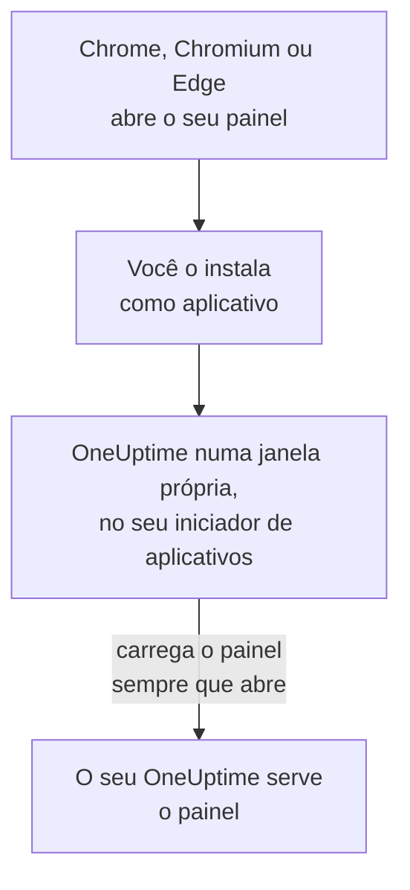

# Instalação no Linux

O painel do OneUptime é instalado no Linux como um aplicativo, pelo Google Chrome, pelo Chromium ou pelo Microsoft Edge. Ele abre numa janela própria, com a sua própria entrada no iniciador de aplicativos da sua área de trabalho, e pode mostrar notificações. Não há nada para baixar: o aplicativo é o painel do seu OneUptime, e fica atualizado assim que o seu OneUptime fica.

:::cards
- [Instalar o aplicativo](#instalar-o-aplicativo): Pelo Chrome, Chromium ou Edge.
- [Abri-lo pelo seu iniciador](#abri-lo-pelo-seu-iniciador): Como qualquer outro aplicativo de desktop.
- [Receber notificações neste computador](#receber-notificações-neste-computador): Registrar o navegador para notificações push.
- [Solução de problemas](#solução-de-problemas): Sem ícone de instalação, sem notificações, sem entrada no iniciador.
:::

## Como o aplicativo de desktop funciona

O aplicativo instalado compartilha o login, as configurações e a permissão de notificações do navegador dele. Feche o navegador e o aplicativo continua rodando na sua própria janela.

## Antes de começar

- Uma área de trabalho Linux com um Google Chrome, Chromium ou Microsoft Edge recente.
- O endereço do seu OneUptime, por HTTPS: `https://oneuptime.com` no OneUptime Cloud, ou o seu, por exemplo `https://oneuptime.example.com`.
- Uma conta com a qual você consiga entrar no painel.

## Instalar o aplicativo

:::tabs
@tab Chrome
1. Abra o seu OneUptime no Chrome ou no Chromium e faça login.
2. Em qualquer página do painel, clique no ícone de instalação à direita da barra de endereços e depois em **Instalar**. Ou abra **⋮ → Transmitir, salvar e compartilhar → Instalar página como app…**.
3. O Chrome abre o OneUptime numa janela própria e o adiciona ao seu iniciador de aplicativos.
@tab Edge
1. Abra o seu OneUptime no Edge e faça login.
2. Em qualquer página do painel, clique no ícone de instalação à direita da barra de endereços e depois em **Instalar**. Ou abra **Configurações e mais (…) → Mais ferramentas → Aplicativos → Instalar este site como um aplicativo**.
3. O Edge abre o OneUptime numa janela própria e o adiciona ao seu iniciador de aplicativos.
:::

Instale a partir de uma página do painel, depois de entrar: a página de login não é o aplicativo.

## Abri-lo pelo seu iniciador

O navegador adiciona uma entrada de desktop para o aplicativo, um arquivo `.desktop` em `~/.local/share/applications`, para que o OneUptime apareça no GNOME, no KDE Plasma e em outros iniciadores. Fixe-o ali no seu dock ou painel, como qualquer outro aplicativo.

## Receber notificações neste computador

O aplicativo mostra notificações pelo navegador dele, depois que você registra o navegador para notificações push em cada projeto do qual quer recebê-las.

:::steps
### Abrir os seus dispositivos push
No aplicativo, abra **Configurações do usuário → Métodos de notificação** e a aba **Push Notifications**.

### Registrar este navegador
Clique em **Registrar Dispositivo**, mantenha o valor sugerido em **Nome do dispositivo**, por exemplo `Chrome on Linux`, ou altere-o, e clique de novo em **Registrar Dispositivo**. Quando o navegador perguntar se o OneUptime pode mostrar notificações, escolha **Permitir**.

### Enviar um teste
Na caixa de diálogo **Browser Registered**, clique em **Send Test Notification**. A sua área de trabalho a mostra pelo serviço de notificações dela; se nada aparecer, veja [Solução de problemas](#solução-de-problemas).
:::

Um navegador não consegue tocar apesar do Não Perturbe da sua área de trabalho. Para acionamentos que precisam acordar você, use o aplicativo móvel com alertas críticos: veja [Instalação no Android](/docs/mobile-desktop-apps/android-installation#tocar-mesmo-no-modo-silencioso).

Num OneUptime auto-hospedado, as notificações do navegador precisam das chaves VAPID do servidor: veja [Notificações push](/docs/self-hosted/push-notifications#configuração-auto-hospedada).

## Atualizações

Não há nada para atualizar. O aplicativo carrega o painel do seu OneUptime sempre que abre, então ele muda quando o seu OneUptime é atualizado. Se uma janela está aberta desde a atualização, recarregue-a com Ctrl+R.

## Desinstalar

:::tabs
@tab Chrome
Na janela do aplicativo, abra o menu **⋮**, escolha o item que desinstala o aplicativo e depois **Remover**.
@tab Edge
Abra `edge://apps` no Edge, escolha **Detalhes** em OneUptime e depois **Desinstalar**.
:::

Desinstalar o aplicativo não cancela o registro do navegador dele: ele continua recebendo notificações. Para pará-las, exclua o navegador em **Configurações do usuário → Métodos de notificação**, na aba **Push Notifications**, com **Excluir**.

## Solução de problemas

:::details Não há ícone de instalação na barra de endereços
Abra uma página do painel depois de entrar, não a página de login, e verifique se o endereço começa com `https://`: os navegadores só instalam aplicativos de sites seguros. Se o ícone continuar sem aparecer, use o menu do navegador como acima. Outros navegadores talvez não instalem sites como aplicativos; use o Chrome, o Chromium ou o Edge.
:::

:::details Nenhuma notificação aparece
- Em **Configurações do usuário → Métodos de notificação**, aba **Push Notifications**, verifique se este navegador aparece na lista, e envie a ele uma **Notificação de teste**.
- Verifique se o Não Perturbe da sua área de trabalho está desativado e se as configurações de notificação dela permitem o navegador.
- Se o navegador bloqueia as notificações do OneUptime, clique no ícone à esquerda da barra de endereços, permita as notificações do site e registre o navegador de novo.
- Num OneUptime auto-hospedado, a caixa de diálogo **Registrar Dispositivo** avisa quando o servidor não tem chaves VAPID.
:::

:::details O aplicativo não aparece no iniciador
Abra-o pelo navegador: `chrome://apps` no Chrome ou no Chromium, `edge://apps` no Edge. Um iniciador que só lê as entradas de desktop ao iniciar a sessão o mostra depois que você sair e entrar de novo.
:::

## Próximos passos

:::cards
- [Instalação no Android](/docs/mobile-desktop-apps/android-installation): Receber os acionamentos no seu celular, com alertas críticos.
- [Instalação no Windows](/docs/mobile-desktop-apps/windows-installation): O mesmo aplicativo no Windows.
- [Perguntas frequentes e solução de problemas](/docs/mobile-desktop-apps/faq-troubleshooting): Respostas sobre os dois aplicativos.
- [Sua conta](/docs/introduction/your-account): Como o OneUptime chega a você em cada projeto.
:::
