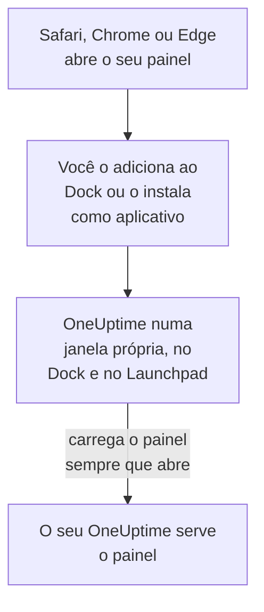

# Instalação no macOS

O painel do OneUptime é instalado num Mac como um aplicativo: adicione-o ao Dock pelo Safari, ou instale-o pelo Google Chrome ou pelo Microsoft Edge. Ele abre numa janela própria, com o seu próprio ícone no Dock e no Launchpad, e pode mostrar notificações. Não há nada para baixar: o aplicativo é o painel do seu OneUptime, e fica atualizado assim que o seu OneUptime fica.

:::cards
- [Instalar o aplicativo](#instalar-o-aplicativo): Pelo Safari, Chrome ou Edge.
- [Mantê-lo no Dock](#mantê-lo-no-dock): Abri-lo com um clique, ou ao iniciar a sessão.
- [Receber notificações neste Mac](#receber-notificações-neste-mac): Registrar o aplicativo para notificações push.
- [Solução de problemas](#solução-de-problemas): Sem Adicionar ao Dock, sem notificações, entrar de novo.
:::

## Como o aplicativo de desktop funciona

Um app web do Safari tem o seu próprio login, cookies e configurações, separados do Safari. Um aplicativo instalado pelo Chrome ou pelo Edge os compartilha com esse navegador.

## Antes de começar

- macOS Sonoma 14 ou posterior para o Safari. O Chrome e o Edge instalam aplicativos em qualquer macOS em que rodem.
- O endereço do seu OneUptime, por HTTPS: `https://oneuptime.com` no OneUptime Cloud, ou o seu, por exemplo `https://oneuptime.example.com`.
- Uma conta com a qual você consiga entrar no painel.

## Instalar o aplicativo

:::tabs
@tab Safari
1. Abra o seu OneUptime no Safari e faça login.
2. Em qualquer página do painel, escolha **Arquivo → Adicionar ao Dock**, ou clique no botão Compartilhar da barra de ferramentas e depois em **Adicionar ao Dock**.
3. Mantenha o nome ou altere-o, e clique em **Adicionar**.
4. Abra o OneUptime pelo Dock e faça login mais uma vez: o app web não compartilha o login do Safari.
@tab Chrome
1. Abra o seu OneUptime no Chrome e faça login.
2. Em qualquer página do painel, clique no ícone de instalação à direita da barra de endereços e depois em **Instalar**. Ou abra **⋮ → Transmitir, salvar e compartilhar → Instalar página como app…**.
3. O Chrome abre o OneUptime numa janela própria e o adiciona ao Launchpad.
@tab Edge
1. Abra o seu OneUptime no Edge e faça login.
2. Em qualquer página do painel, clique no ícone de instalação à direita da barra de endereços e depois em **Instalar**. Ou abra **Configurações e mais (…) → Mais ferramentas → Aplicativos → Instalar este site como um aplicativo**.
3. O Edge abre o OneUptime numa janela própria e o adiciona ao Launchpad.
:::

Instale a partir de uma página do painel, depois de entrar: a página de login não é o aplicativo. O Safari salva o app web na pasta Aplicativos da sua pasta de início.

## Mantê-lo no Dock

- **Dock.** Com o aplicativo aberto, clique no ícone dele no Dock mantendo a tecla Control pressionada e escolha **Opções → Manter no Dock**. Um app web do Safari já fica no Dock.
- **Abrir ao iniciar a sessão.** Clique no ícone do Dock mantendo a tecla Control pressionada e escolha **Opções → Abrir ao Iniciar Sessão**.
- **Spotlight.** Pressione Command + Espaço e digite OneUptime.

## Receber notificações neste Mac

O aplicativo mostra notificações depois que você o registra para notificações push, em cada projeto do qual quer recebê-las. Registre o app web do Safari de dentro do próprio app web: ele é um navegador à parte. Um aplicativo instalado pelo Chrome ou pelo Edge é registrado com o navegador dele.

:::steps
### Abrir os seus dispositivos push
No aplicativo, abra **Configurações do usuário → Métodos de notificação** e a aba **Push Notifications**.

### Registrar este aplicativo
Clique em **Registrar Dispositivo**, mantenha o valor sugerido em **Nome do dispositivo**, por exemplo `Safari on macOS`, ou altere-o, e clique de novo em **Registrar Dispositivo**. Quando o macOS ou o navegador perguntar se o OneUptime pode enviar notificações, escolha **Permitir**.

### Enviar um teste
Na caixa de diálogo **Browser Registered**, clique em **Send Test Notification**. Se nada aparecer, veja as configurações de notificação do Mac: veja [Solução de problemas](#solução-de-problemas).
:::

Um navegador não consegue tocar apesar de um Foco como o Não Perturbe. Para acionamentos que precisam acordar você, use o aplicativo móvel com alertas críticos: veja [Instalação no iOS](/docs/mobile-desktop-apps/ios-installation#tocar-mesmo-no-modo-silencioso).

Num OneUptime auto-hospedado, as notificações do navegador precisam das chaves VAPID do servidor: veja [Notificações push](/docs/self-hosted/push-notifications#configuração-auto-hospedada).

## Atualizações

Não há nada para atualizar. O aplicativo carrega o painel do seu OneUptime sempre que abre, então ele muda quando o seu OneUptime é atualizado. Se uma janela está aberta desde a atualização, recarregue-a com Command + R.

## Desinstalar

:::tabs
@tab Safari
No Finder, abra a sua pasta de início, depois a pasta Aplicativos dela, e arraste o OneUptime para o Lixo.
@tab Chrome
Na janela do aplicativo, abra o menu **⋮**, escolha o item que desinstala o aplicativo e depois **Remover**.
@tab Edge
Abra `edge://apps` no Edge, escolha **Detalhes** em OneUptime e depois **Desinstalar**.
:::

Desinstalar o aplicativo não cancela o registro dele: o navegador dele continua recebendo notificações. Para pará-las, exclua-o em **Configurações do usuário → Métodos de notificação**, na aba **Push Notifications**, com **Excluir**.

## Solução de problemas

:::details Não há Adicionar ao Dock no Safari
O Safari adiciona apps web ao Dock a partir do macOS Sonoma 14. Atualize o macOS, ou instale o aplicativo pelo Chrome ou pelo Edge.
:::

:::details Nenhuma notificação aparece
- Em **Configurações do usuário → Métodos de notificação**, aba **Push Notifications**, verifique se o aplicativo ou o navegador dele aparece na lista, e envie a ele uma **Notificação de teste**.
- No Mac, abra **Ajustes do Sistema → Notificações** e verifique se o OneUptime, ou o navegador pelo qual ele foi instalado, pode enviar notificações, e se nenhum Foco as está retendo.
- Se o navegador bloqueia as notificações do OneUptime, permita-as nas configurações dele para o site e registre de novo.
- Num OneUptime auto-hospedado, a caixa de diálogo **Registrar Dispositivo** avisa quando o servidor não tem chaves VAPID.
:::

:::details O aplicativo pede para entrar de novo
Um app web do Safari tem o seu próprio login: entre dentro do aplicativo. Um aplicativo instalado pelo Chrome ou pelo Edge compartilha o login do navegador dele, então sair no navegador, ou apagar os cookies dele, também o desconecta.
:::

## Próximos passos

:::cards
- [Instalação no iOS](/docs/mobile-desktop-apps/ios-installation): Receber os acionamentos no seu iPhone, com alertas críticos.
- [Instalação no Windows](/docs/mobile-desktop-apps/windows-installation): O mesmo aplicativo no Windows.
- [Perguntas frequentes e solução de problemas](/docs/mobile-desktop-apps/faq-troubleshooting): Respostas sobre os dois aplicativos.
- [Sua conta](/docs/introduction/your-account): Como o OneUptime chega a você em cada projeto.
:::
