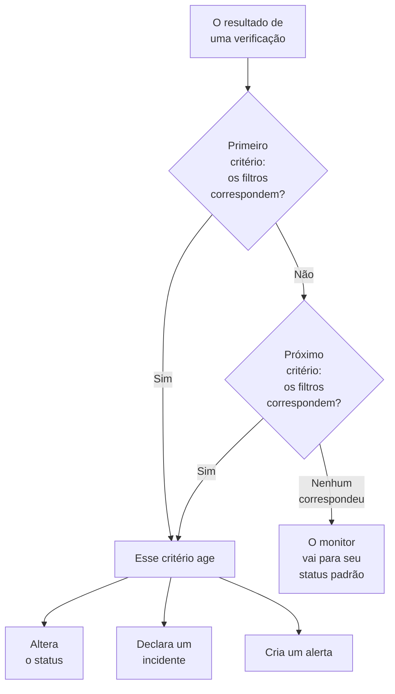
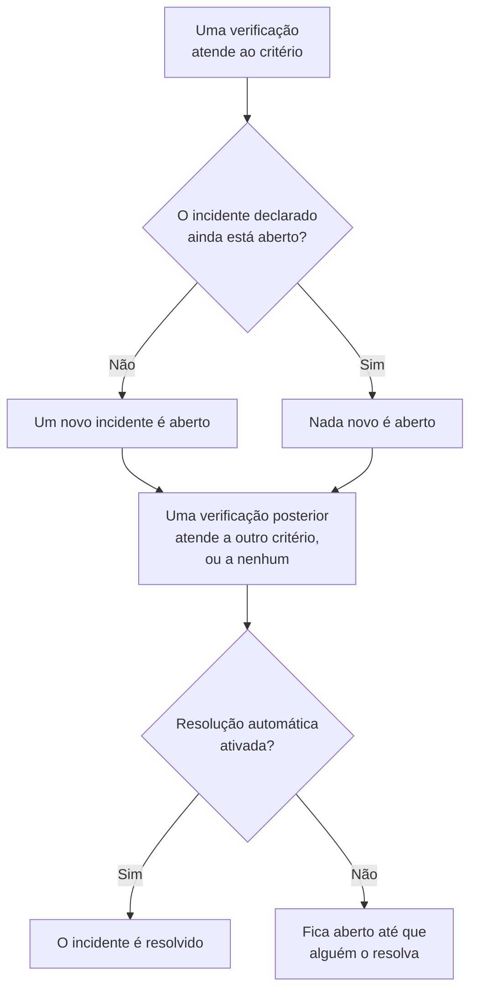

# Critérios e status de monitores

Os critérios de um monitor decidem o que cada verificação significa: se o monitor está no ar ou fora do ar, e se o OneUptime declara um incidente ou cria um alerta. Os status são a lista do seu projeto com o que um monitor pode ser, de **Operacional** a **Offline**. Esta página explica os dois para todo tipo de monitor; a página de cada tipo lista os filtros que ele oferece.

:::cards
- [Como os critérios decidem](#como-os-critérios-decidem): De cima para baixo, e a primeira correspondência vence.
- [O que um critério contém](#o-que-um-critério-contém): Filtros, uma condição de correspondência, ações e configurações.
- [Alterar os critérios de um monitor](#alterar-os-critérios-de-um-monitor): Editar, adicionar, reordenar e testar critérios.
- [Status de monitor](#status-de-monitor): Os status integrados e os seus próprios status.
:::

## Como os critérios decidem

Sempre que um monitor é verificado, seus critérios julgam o resultado do topo da lista para baixo. O primeiro critério cujos filtros correspondem decide o que acontece, e os critérios abaixo dele não são examinados nessa verificação. Quando nenhum corresponde, o monitor vai para o seu **Status Padrão do Monitor**.

A ordem faz parte da regra. Um novo monitor lista seus critérios do pior caso para o melhor: offline, depois um aviso quando o tipo tem um (um certificado ou um domínio que expira em breve), depois online. Um critério saudável e amplo, como **Is Online** definido como **Verdadeiro**, corresponde a quase toda verificação, então ele fica por último: acima dos outros, corresponderia primeiro todas as vezes e os outros nunca agiriam.

Um critério que corresponde mas não altera nenhum status ainda decide a verificação: o monitor mantém o status que tem, e os critérios abaixo esperam a próxima verificação. O **Status Padrão do Monitor** só se aplica quando nenhum critério corresponde. Em um novo monitor ele é **Operacional**; altere-o em **Mais campos**, abaixo dos critérios.

> [!NOTE]
> Um monitor que abre um incidente ou alerta por host, contêiner, disco ou interface julga todos os critérios a cada verificação, de modo que dois hosts podem corresponder a dois critérios diferentes ao mesmo tempo. É um monitor cuja consulta tem um **Agrupar Por**, como um monitor de métricas ou de logs, ou um critério que indica `*` para cada disco ou interface. Um monitor de requisições recebidas que agrupa incidentes por um campo do payload ainda para na primeira correspondência.

## O que um critério contém

Abra um critério: ele tem um nome e três seções, cada uma das quais se recolhe em um resumo de uma linha.

| Parte | O que contém |
| --- | --- |
| **Nome dos Critérios** | O nome na lista de critérios e na causa raiz de cada incidente e alerta que o critério abre. **Adicionar critérios** dá a um novo critério o nome dos seus filtros, e o nome os acompanha até você digitar um próprio. |
| **Filtros** | O que a verificação precisa mostrar, como um ou mais filtros. Os monitores de Kubernetes e de métricas os chamam de **Alert Rules**. |
| **Ações** | O que acontece quando os filtros correspondem: alterar o status, criar um alerta, declarar um incidente ou qualquer combinação. |
| **Configurações** | **Habilitar este critério**, uma **Descrição** opcional e, nos monitores de requisições recebidas, **Group incidents and alerts by a payload field**. |

### Filtros

Um filtro lê um dado da verificação e o compara: um **Tipo de filtro** (o que ler, como **Código de status da resposta**), uma **Condição do filtro** (como comparar, como **Maior que**) e um **Valor**. Monitores que comparam métricas, como os de Kubernetes e de métricas, pedem em vez disso uma **Condição** e um **Limite**. Cada tipo de monitor oferece seus próprios tipos de filtro, listados em sua página, por exemplo [Monitor de site](/docs/monitor/website-monitor#critérios-de-monitoramento).

Com dois filtros ou mais, a **Condição de correspondência** aparece abaixo deles: **Todos** significa que todo filtro precisa corresponder, **Qualquer** que um basta. Um novo critério começa em **Todos**.

Os filtros que medem cada verificação, como **Is Online**, **Código de status da resposta** e **Tempo de resposta (em ms)**, oferecem **Avaliar este critério durante um período de tempo**. Isso julga uma janela de verificações recentes em vez da última apenas, e começa com os últimos 5 minutos e **All Values**, que só corresponde quando toda verificação da janela correspondeu. Veja [Avaliar durante um período de tempo](/docs/monitor/website-monitor#avaliar-durante-um-período-de-tempo).

### Ações

Cada ação é uma chave em **Ações**:

| Chave | O que faz |
| --- | --- |
| **Quando os filtros corresponderem, alterar o status do monitor.** | Leva o monitor ao status escolhido em **Alterar status do monitor para**. |
| **Quando os filtros corresponderem, criar um alerta.** | Cria os alertas configurados em **Criar alerta**. Um alerta avisa sua equipe e nunca aparece em uma página de status. |
| **Quando os filtros corresponderem, declarar um incidente.** | Declara os incidentes configurados em **Criar incidente**. Suas páginas de status podem exibi-los. |

Um incidente ou alerta pede um título, uma **Gravidade** e, recolhidos, uma descrição, proprietários, rótulos e políticas de plantão. Títulos e descrições podem conter valores da verificação, como `{{monitorName}}`: veja [Modelos de incidentes e alertas](/docs/monitor/incident-alert-templating). Para acionar alguém quando o critério corresponder, escolha uma política em **Plantão**: veja [Políticas de plantão](/docs/on-call/policies).

### Configurações

**Habilitar este critério** vem ligado em todo novo critério. Desligue-o para manter um critério sem usá-lo: ele é ignorado em toda verificação, não altera nenhum status, não abre nada e seu cabeçalho mostra **Desabilitado**.

**Group incidents and alerts by a payload field** abre um incidente para cada valor encontrado em uma requisição recebida, de modo que um único endereço de webhook pode manter vários incidentes abertos. Veja [Ativar o agrupamento de incidentes](/docs/monitor/incoming-request-monitor#ligar-o-agrupamento-de-incidentes).

## Quando incidentes e alertas abrem e fecham

Um critério que declara incidentes abre um quando corresponde. Quando o monitor se recupera, o incidente se fecha sozinho se o critério assim determinar.

- **Um de cada vez.** Enquanto um incidente que um critério declarou ainda estiver aberto, o mesmo critério, ao corresponder de novo, não declara outro. Os alertas funcionam da mesma forma. Um monitor que agrupa por host ou por campo do payload mantém um aberto por host ou por valor, e um critério de monitor de e-mail recebido com **Abrir um novo incidente para cada e-mail** abre um por e-mail.
- **O fechamento.** Em uma verificação posterior em que outro critério corresponde, ou nenhum, é resolvido um incidente cujo critério tem **Resolver incidente automaticamente** ligado, e também um alerta com **Resolver alerta automaticamente**. Ambos ficam em **Mais campos** dentro do incidente ou do alerta, e os critérios com que um novo monitor começa os têm ligados.
- **Várias sondas.** Um monitor verificado por mais de uma sonda só muda quando suas sondas concordam. Veja [Como os critérios são avaliados](/docs/monitor/create-monitor#como-os-critérios-são-avaliados).
- **Um monitor pai fora do ar.** Na página **Configuração → Dependências** de um monitor, **Depends On Monitors** indica os monitores dos quais ele depende. Enquanto um deles estiver em um status listado em **Suppress When Parent Status Is** (qualquer status offline, se ficar vazio), o monitor não abre incidentes nem alertas. Seu status continua mudando, e o que está aberto continua sendo resolvido.
- **A manutenção programada.** Um monitor em um evento de manutenção em andamento não é verificado, então seus critérios não são executados. Veja [Visão geral da manutenção programada](/docs/scheduled-maintenance/index).

Para ver como uma verificação foi julgada, abra a **Visão geral** do monitor: o cartão **Resumo do monitor** mostra qual critério correspondeu e o que cada um fez, incluindo um incidente ignorado porque já havia um aberto.

## Alterar os critérios de um monitor

:::steps
### Abrir a página de critérios

Vá para **Monitores** e abra o monitor. Expanda **Configuração** no menu lateral dele e clique em **Critérios**. O cartão **Critérios de Monitoramento** mostra cada critério, o que ele verifica e o que faz.

### Clicar em Editar critérios de monitoramento

O editor mostra cada critério aberto. Clique no cabeçalho de um critério para recolhê-lo em uma linha: seu nome, quantos filtros tem e o que faz.

### Adicionar, alterar ou reordenar critérios

**Adicionar critérios** adiciona um no final, aberto e com o nome do seu filtro. Arraste um critério pela alça à esquerda para movê-lo: a primeira correspondência vence, então coloque o pior caso primeiro. **Excluir critérios** remove um; um monitor mantém pelo menos um critério.

### Salvar os critérios

Clique em **Salvar alterações**. A próxima verificação é julgada pelos novos critérios.

### Testar o monitor

Em um monitor verificado por sondas, clique em **Testar monitor** no cartão, escolha uma sonda em **Selecionar Sonda** e clique em **Executar teste**. **Resultado do Teste do Monitor** mostra o que a verificação encontrou.
:::

Um monitor manual não tem critérios: você mesmo define o status dele. Veja [Atualizar o status](/docs/monitor/manual-monitor#atualizar-o-status).

## Status de monitor

Um monitor está sempre em um dos status do seu projeto. Um novo projeto tem três, do mais saudável ao pior:

| Status | Posição | Cor | O que o OneUptime faz com ele |
| --- | --- | --- | --- |
| **Operacional** | 1 | Verde | Novos monitores começam nele, e ele é o **Status Padrão do Monitor** de um novo monitor. Integrado. |
| **Degradado** | 2 | Amarelo | Nada por conta própria: um critério seu leva um monitor até ele. |
| **Offline** | 3 | Vermelho | O critério offline de um novo monitor o leva até ele, e o OneUptime trata um monitor nesse status como fora do ar. Integrado. |

A lista é uma ordem. Onde monitores aparecem juntos, vence o status mais abaixo na lista: um grupo de monitores, um grupo de página de status e o status geral de uma página de status mostram cada um o pior status dos seus monitores.

### Onde um status conta

| Onde | O que o status decide |
| --- | --- |
| A lista **Monitores** | O status atual de cada monitor. **Não operacional** lista os monitores em qualquer status exceto o operacional, com um contador vermelho ao lado. |
| Páginas de status | A cor de cada linha e sua disponibilidade: só contam contra ela os status em **Conta como indisponibilidade** da página. Uma nova página de status começa com todos os status exceto o operacional. Veja [Escolher o que aparece na página](/docs/status-pages/index#escolher-o-que-aparece-na-página). |
| Grupos de monitores | O status do grupo: o pior dos seus monitores. Veja [Grupos de monitores](/docs/monitor/monitor-groups). |
| SLOs | A indisponibilidade que um SLO conta, a partir da sua própria lista de status. Veja [Quais status contam como indisponibilidade](/docs/slo/introduction#quais-status-contam-como-indisponibilidade). |
| Dependências | Se um monitor pai segura os incidentes e alertas dos monitores que dependem dele: por padrão, enquanto ele estiver em um status offline. |

Um status que você adicionar depois não entra na lista **Conta como indisponibilidade** de uma página de status existente: adicione-o lá você mesmo.

### Adicionar um status próprio

:::steps
### Abrir Status do monitor

Vá para **Monitores → Configurações → Status do monitor**. **Configurações** começa recolhido no menu lateral: expanda-o primeiro. O cartão **Monitor Status** lista os status do mais saudável ao pior.

### Criar o status

Clique em **Criar: Status do monitor** e preencha **Nome**, **Descrição** e **Cor**. O novo status entra logo acima do status offline, para que uma queda continue sendo o pior caso.

### Colocá-lo no lugar

Arraste o status pela alça. Um status mais abaixo na lista conta como pior que todos os status acima dele.

### Usá-lo em um critério

Um status não faz nada até que um critério leve monitores até ele. Escolha-o em **Alterar status do monitor para** no critério que deve defini-lo.
:::

Os status operacional e offline são marcados como **Integrado**: você pode renomeá-los e mudar a cor deles, mas não excluí-los. No OneUptime Cloud, criar ou alterar um status exige o plano Growth. Gerenciar status exige o papel Project Owner, Project Admin ou Monitor Admin, ou um papel personalizado com a permissão de status de monitor correspondente.

### A linha do tempo de status

Toda mudança de status fica na **Linha do tempo de status** do monitor: quando começou, quanto durou e **Ver causa** para o critério que a definiu. **Criar: Monitor Status Evento** adiciona um status manualmente. Em um monitor verificado por sondas, a próxima verificação que corresponder a um critério com status define esse status de novo.

Uma mudança de status só avisa os proprietários do monitor se eles tiverem ligado **Status do monitor alterado** nas suas configurações de notificação: começa desligado. Um monitor que volta ao seu **Status Padrão do Monitor** porque nenhum critério correspondeu não avisa ninguém. Veja [O que fica ligado para um novo membro](/docs/notifications/notification-settings#o-que-fica-ativado-para-um-novo-membro).

## Arquivar um status de monitor

Arquive um status que sua equipe não deve mais usar, em vez de excluí-lo. Arquivar não altera nenhum monitor: um monitor nesse status permanece nele até que o status mude, e sua linha do tempo de status ainda o mostra.

- **Arquivar** fica no menu **⋯** da linha. Ele pede confirmação primeiro e lista os critérios de monitor, modelos e páginas de status configurados para usar o status: eles continuam usando-o até que você os altere.
- **Ninguém pode escolhê-lo novamente.** Um critério, o menu de status de um monitor, o status de monitor de um incidente ou de um evento de manutenção e os status de indisponibilidade de uma página de status o deixam de fora. A API, o Terraform e o MCP o recusam.
- **Os status arquivados são listados à parte**, na seção recolhida **Status de monitor arquivados** abaixo da tabela. **Desarquivar** devolve um como era.
- **Os status integrados não podem ser arquivados.** Novos monitores começam no status operacional, e o OneUptime considera fora do ar um monitor no status offline. O **Arquivar** deles fica bloqueado, com o motivo.

## Solução de problemas

:::details O site está fora do ar, mas o monitor continua Operacional
Um critério mais acima na lista correspondeu primeiro. Abra **Configuração → Critérios** e verifique a ordem: o critério saudável fica por último. Verifique também se o critério offline está com **Habilitar este critério** ligado, e se a ação **Quando os filtros corresponderem, alterar o status do monitor.** está ligada com um status escolhido.
:::

:::details Nenhum incidente foi aberto quando o monitor caiu
Verifique o critério que correspondeu: **Quando os filtros corresponderem, declarar um incidente.** precisa estar ligado. Um incidente não é declarado enquanto o incidente do mesmo critério ainda estiver aberto, enquanto um monitor pai em **Depends On Monitors** estiver fora do ar, ou enquanto o monitor estiver em manutenção programada. O cartão **Resumo do monitor** na **Visão geral** do monitor diz qual foi.
:::

:::details O incidente continua aberto depois que o monitor se recuperou
Abra o critério do incidente e expanda **Mais campos** no incidente dele: **Resolver incidente automaticamente** precisa estar ligado. Um incidente de um critério que você excluiu depois não é resolvido pelo monitor: resolva-o manualmente.
:::

:::details O botão de excluir de Offline está bloqueado
**Operacional** e **Offline** são integrados: o OneUptime leva monitores até eles, então podem ser renomeados, mas não excluídos. Exclua em vez disso um status seu, ou renomeie o integrado.
:::

## Próximos passos

:::cards
- [Criar um monitor](/docs/monitor/create-monitor): As três etapas de um novo monitor.
- [Modelos de incidentes e alertas](/docs/monitor/incident-alert-templating): Colocar valores da verificação em títulos e descrições.
- [Grupos de monitores](/docs/monitor/monitor-groups): Reunir vários monitores em um único status.
- [Visão geral dos incidentes](/docs/incidents/index): O que acontece depois que um critério declara um incidente.
:::
