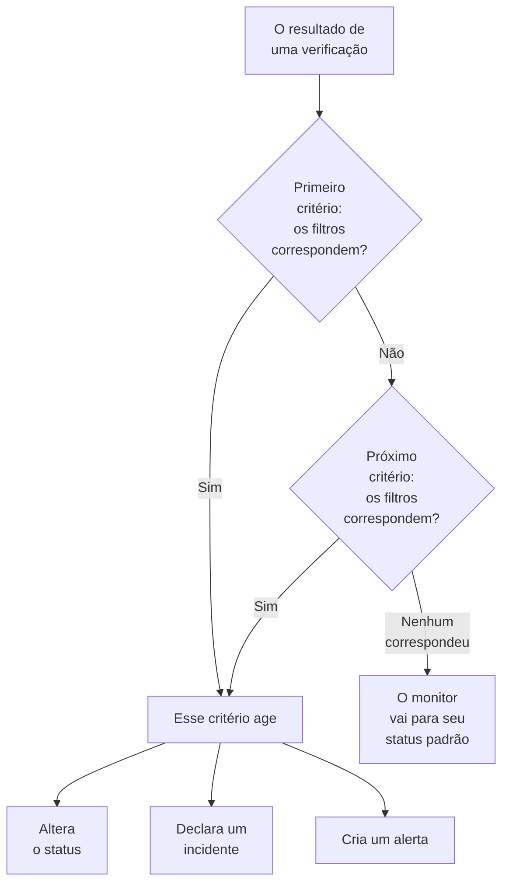
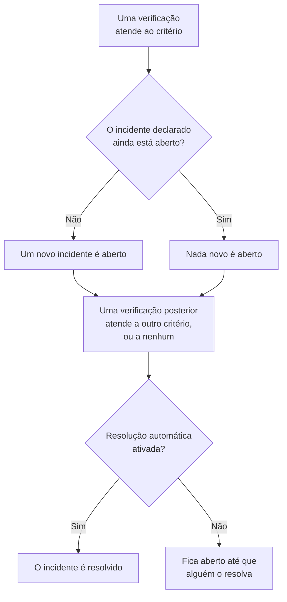

# Critérios e status

Os critérios de um monitor decidem o que cada verificação significa: se o monitor está no ar ou fora do ar, e se o OneUptime declara um incidente ou cria um alerta. Os status são a lista do seu projeto com o que um monitor pode ser, de **Operacional** a **Offline**. Esta página explica os dois para todo tipo de monitor; a página de cada tipo lista os filtros que ele oferece.

:::cards
- [Como os critérios decidem](#como-os-critérios-decidem): De cima para baixo, e a primeira correspondência vence.
- [O que um critério contém](#o-que-um-critério-contém): Filtros, uma condição de correspondência, ações e configurações.
- [Julgar uma janela de verificações](#julgar-uma-janela-de-verificações): Contar verificações com falha, detectar instabilidade, ler um percentil.
- [Alterar os critérios de um monitor](#alterar-os-critérios-de-um-monitor): Editar, adicionar, reordenar e testar critérios.
- [Status de monitor](#status-de-monitor): Os status integrados e os seus próprios status.
:::

## Como os critérios decidem

Sempre que um monitor é verificado, seus critérios julgam o resultado do topo da lista para baixo. O primeiro critério cujos filtros correspondem decide o que acontece, e os critérios abaixo dele não são examinados nessa verificação. Quando nenhum corresponde, o monitor vai para o seu **Status Padrão do Monitor**. Em vez disso, ele mantém seu status enquanto um critério que o traz de volta ainda não correspondeu: veja [Quando um critério se recupera](#quando-um-critério-se-recupera).

A ordem faz parte da regra. Um novo monitor lista seus critérios do pior caso para o melhor: offline, depois um aviso quando o tipo tem um (um certificado ou um domínio que expira em breve), depois online. Um critério saudável e amplo, como **Online** definido como **Verdadeiro**, corresponde a quase toda verificação, então ele fica por último: acima dos outros, corresponderia primeiro todas as vezes e os outros nunca agiriam.

Um critério que corresponde mas não altera nenhum status ainda decide a verificação: o monitor mantém o status que tem, e os critérios abaixo esperam a próxima verificação. O **Status Padrão do Monitor** só se aplica quando nenhum critério corresponde. Em um novo monitor ele é **Operacional**; altere-o em **Mais campos**, abaixo dos critérios.

> [!NOTE]
> Um monitor que abre um incidente ou alerta por host, contêiner, disco ou interface julga todos os critérios a cada verificação, de modo que dois hosts podem corresponder a dois critérios diferentes ao mesmo tempo. É um monitor cuja consulta tem um **Agrupar Por**, como um monitor de métricas ou de logs, ou um critério que indica `*` para cada disco ou interface. O mesmo vale para um monitor de métricas que observa uma expressão PromQL: cada série que a expressão retorna é julgada por si. Um monitor de requisições recebidas que agrupa incidentes por um campo do payload ainda para na primeira correspondência.
>
> Um monitor assim ainda tem um único status, definido pelo primeiro critério que corresponde. Um critério que apenas o traz de volta ao seu **Status Padrão do Monitor**, sem abrir incidente nem alerta, espera pelos hosts que atenderam a um critério que define outro status: corresponde quando cada um deles o atende, faça o que fizerem os outros hosts. Até lá, o monitor mantém seu status, mesmo quando nenhum critério corresponde, enquanto os incidentes e alertas de cada host continuam se resolvendo cada um por conta própria.

## O que um critério contém

Abra um critério: ele tem um nome e três seções, cada uma das quais se recolhe em um resumo de uma linha.

| Parte | O que contém |
| --- | --- |
| **Nome dos Critérios** | O nome na lista de critérios e na causa raiz de cada incidente e alerta que o critério abre. **Adicionar critérios** dá a um novo critério o nome dos seus filtros, e o nome os acompanha até você digitar um próprio. |
| **Filtros** | O que a verificação precisa mostrar, como um ou mais filtros. Os monitores de Kubernetes e de métricas os chamam de **Regras de alertas**. |
| **Ações** | O que acontece quando os filtros correspondem: alterar o status, criar um alerta, declarar um incidente ou qualquer combinação. |
| **Configurações** | **Habilitar este critério**, uma **Descrição** opcional, quando ele se recupera e quando é julgado e, em monitores de requisições recebidas, **Group incidents and alerts by a payload field**. |

### Filtros

Um filtro lê um dado da verificação e o compara: um **Tipo de filtro** (o que ler, como **Código de status da resposta**), uma **Condição do filtro** (como comparar, como **Maior que**) e um **Valor**. Monitores que comparam métricas, como os de Kubernetes e de métricas, pedem em vez disso uma **Condição** e um **Limite**. Cada tipo de monitor oferece seus próprios tipos de filtro, listados em sua página, por exemplo [Monitor de site](/docs/monitor/website-monitor#critérios-de-monitoramento).

Com dois filtros ou mais, a **Condição de correspondência** aparece abaixo deles: **Todos** significa que todo filtro precisa corresponder, **Qualquer** que um basta. Um novo critério começa em **Todos**.

Os filtros que medem cada verificação, como **Online**, **Código de status da resposta** e **Tempo de resposta (em ms)**, oferecem **Avaliar este critério durante um período de tempo**. Isso julga uma janela de verificações recentes em vez da última apenas, e começa com os últimos 5 minutos e **Todos os valores**, que só corresponde quando toda verificação da janela correspondeu. A janela pode ter até 24 horas e contar as verificações, como explica [Julgar uma janela de verificações](#julgar-uma-janela-de-verificações). Veja [Avaliar durante um período de tempo](/docs/monitor/website-monitor#avaliar-durante-um-período-de-tempo).

### Ações

Cada ação é uma chave em **Ações**:

| Chave | O que faz |
| --- | --- |
| **Quando os filtros corresponderem, alterar o status do monitor.** | Leva o monitor ao status escolhido em **Alterar status do monitor para**. |
| **Quando os filtros corresponderem, criar um alerta.** | Cria os alertas configurados em **Criar alerta**. Um alerta avisa sua equipe e nunca aparece em uma página de status. |
| **Quando os filtros corresponderem, declarar um incidente.** | Declara os incidentes configurados em **Criar incidente**. Suas páginas de status podem exibi-los. |

Um incidente ou alerta pede um título, uma **Gravidade** e, recolhidos, uma descrição, proprietários, rótulos e políticas de plantão. Títulos e descrições podem conter valores da verificação, como `{{monitorName}}`: veja [Modelos de incidentes e alertas](/docs/monitor/incident-alert-templating). Para acionar alguém quando o critério corresponder, escolha uma política em **Plantão**: veja [Políticas de plantão](/docs/on-call/policies).

### Configurações

**Habilitar este critério** vem ligado em todo novo critério. Desligue-o para manter um critério sem usá-lo: ele é ignorado em toda verificação, não altera nenhum status, não abre nada e seu cabeçalho mostra **Desabilitado**.

**Group incidents and alerts by a payload field** abre um incidente para cada valor encontrado em uma requisição recebida, de modo que um único endereço de webhook pode manter vários incidentes abertos. Veja [Ativar o agrupamento de incidentes](/docs/monitor/incoming-request-monitor#ligar-o-agrupamento-de-incidentes).

**Recuperar apenas quando uma condição própria for atendida** e **Avaliar este critério apenas em certos dias e horários** vêm desativados em um critério novo. Veja [Quando um critério se recupera](#quando-um-critério-se-recupera) e [Apenas em certos dias e horários](#apenas-em-certos-dias-e-horários).

## Julgar uma janela de verificações

Com **Avaliar este critério durante um período de tempo** marcado, **Avaliar** diz como as verificações da janela são julgadas, e **No último período de** quanto dura a janela, de 2 minutos a 24 horas. A condição do próprio filtro, como **Online** definido como **Falso**, diz o que cada verificação deve mostrar.

| Avaliar | Corresponde quando |
| --- | --- |
| **Todos os valores** | Todas as verificações da janela atenderam à condição. |
| **Qualquer valor** | Pelo menos uma verificação da janela atendeu à condição. |
| **Média**, **Soma**, **Valor máximo**, **Valor mínimo** | Esse valor, calculado sobre os valores da janela, atende à condição, como um tempo de resposta médio acima de 300 ms. |
| **Percentil** | O percentil escolhido em **Percentil**, de p50 a p99, atende à condição: p95 acima de 300 ms significa que os 5% mais lentos das verificações passam de 300 ms. |
| **Contagem** | O número de verificações que atenderam à condição é comparado conforme definido em **Verificações correspondentes**: **Maior que** 30, por exemplo. |
| **Porcentagem** | A proporção delas entre as verificações da janela é comparada conforme definido em **Proporção de verificações correspondentes**: **Maior que** 10%, por exemplo. |
| **Mudanças de status** | O número de vezes que as verificações passaram de atender à condição para não atender, ou o contrário, é comparado conforme definido em **Vezes que mudou**. Um dispositivo que cai e volta muda duas vezes. |

Uma frase abaixo das configurações da janela repete o filtro como ele está definido: “Verificar se "Online" é falso em mais de 30 verificações do último período de 8 horas”.

- **Cada sonda por si.** **Contagem**, **Porcentagem** e **Mudanças de status** contam as verificações da sonda que fez a verificação, então um monitor verificado a partir de três sondas não conta três vezes mais rápido, e suas sondas depois precisam concordar como em qualquer critério.
- **Uma janela que ainda não está cheia.** Até que as verificações cheguem ao início da janela, um monitor que acabou de começar tem menos verificações do que terá. **Contagem** e **Mudanças de status** correspondem cedo quando já passaram de **Maior que** ou **Maior ou igual a**, já que mais verificações só aumentam esses números; todo o resto espera uma janela cheia.
- **Uma janela sem verificações.** Enquanto a janela não tiver verificações, ou ainda não estiver cheia, **Se não houver dados** decide: **Ignore** espera, **Gatilho** corresponde, e **Treat As Zero** a julga como se as verificações que faltam não tivessem atendido à condição.

As médias e os percentis leem os valores das verificações de todas as sondas, como **Média** sempre fez. **Contagem**, **Porcentagem** e **Mudanças de status** são oferecidos para todo filtro ao qual se oferece uma janela: em monitores Website, API, Ping, IP e Port, para CPU, memória, discos e carga de um servidor, para **Dispositivo SNMP online** e o tempo de resposta de um dispositivo de rede, e em monitores DNS, NTP, de banco de dados, de página de status externa e de status de sondas. **Online** de um monitor de servidor não é contado: é julgado pelo tempo desde o último relatório do servidor. Monitores de métricas e outros de telemetria julgam em vez disso o intervalo de tempo da sua consulta, com a agregação da própria consulta, que também lê percentis.

### Exemplo: um ponto de acesso fora do ar e outro instável

Um monitor Ping verifica um ponto de acesso de escritório a cada minuto. Antes que as janelas pudessem contar verificações, um ponto de acesso que caía o tempo todo parecia um fora do ar, ou nada demais. Estes três critérios, nesta ordem, distinguem os dois:

| Critério | Filtro | Avaliar | Muda o status para |
| --- | --- | --- | --- |
| O ponto de acesso está fora do ar | **Online** é **Falso** | **Todos os valores**, **No último período de** 5 minutos | **Offline**, e declara um incidente de interrupção |
| O ponto de acesso está instável | **Online** é **Falso** | **Mudanças de status**, **Maior que** 5, **No último período de** 1 hora | **Degradado**, e declara um incidente de instabilidade |
| O ponto de acesso está online | **Online** é **Verdadeiro** | Não durante um período | **Operacional** |

No segundo, ative **Recuperar apenas quando uma condição própria for atendida** com **Mudanças de status**, **Menor ou igual a** 1, **No último período de** 1 hora: o incidente de instabilidade fica aberto até o ponto de acesso ficar estável por uma hora, em vez de fechar no primeiro minuto em que ele responde. Para alertar quando ele falhar mais de 30 pings em 8 horas, defina o segundo critério como **Contagem**, **Maior que** 30, **No último período de** 8 horas.

## Quando um critério se recupera

Um critério para de agir assim que seus filtros deixam de corresponder: nessa verificação, seu incidente e seu alerta são resolvidos, quando **Resolver incidente automaticamente** e **Resolver alerta automaticamente** estão ativados, e o monitor passa para o próximo critério que corresponder.

**Recuperar apenas quando uma condição própria for atendida** mantém o critério em vigor depois que seus filtros deixam de corresponder, até que os filtros em **Recupera quando** correspondam. Eles começam como o oposto dos filtros do critério, nos últimos 10 minutos, e podem usar tudo o que um filtro oferece, como uma janela que conta verificações. Um critério está em vigor enquanto o monitor tem o status que ele define ou está aberto um incidente ou alerta que ele declarou. Enquanto se mantém, ele conta como uma correspondência no seu lugar da lista: um critério acima dele que corresponda ainda assume.

Quando nenhum critério corresponde, um monitor que um critério tirou do seu **Status Padrão do Monitor** mantém o status que tem, desde que também tenha um critério que apenas o traz de volta a esse status e não abre nada. Essa é a margem de recuperação: os modelos disparam acima de 90% e voltam em 81% ou menos, então em 89% o monitor fica onde está. Seus incidentes e alertas ainda são resolvidos quando o próprio critério deles deixa de corresponder. Um monitor sem um critério assim vai para o seu **Status Padrão do Monitor**, como sempre.

## Apenas em certos dias e horários

**Avaliar este critério apenas em certos dias e horários** define os dias, **Hora de início** e **Horário de término**, e **Fuso horário**, que começa como o seu. Fora desses horários o critério é ignorado como um critério desativado: não corresponde a nada, então o que ele abriu é resolvido, e o registro de avaliação diz que estava fora dos seus horários. Os horários são lidos no relógio desse fuso horário, então 08:00 continua 08:00 depois da mudança de horário, e horários que terminam antes de começar seguem até a manhã seguinte.

## Quando incidentes e alertas abrem e fecham

Um critério que declara incidentes abre um quando corresponde. Quando o monitor se recupera, o incidente se fecha sozinho se o critério assim determinar.

- **Um de cada vez.** Enquanto um incidente que um critério declarou ainda estiver aberto, o mesmo critério, ao corresponder de novo, não declara outro. Os alertas funcionam da mesma forma. Um monitor que agrupa por host ou por campo do payload mantém um aberto por host ou por valor, e um critério de monitor de e-mail recebido com **Abrir um novo incidente para cada e-mail** abre um por e-mail.
- **O fechamento.** Em uma verificação posterior em que outro critério corresponde, ou nenhum, é resolvido um incidente cujo critério tem **Resolver incidente automaticamente** ligado, e também um alerta com **Resolver alerta automaticamente**. Ambos ficam em **Mais campos** dentro do incidente ou do alerta, e os critérios com que um novo monitor começa os têm ligados.
- **Várias sondas.** Um monitor verificado por mais de uma sonda só muda quando suas sondas concordam. Veja [Como os critérios são avaliados](/docs/monitor/create-monitor#como-os-critérios-são-avaliados).
- **Um monitor pai fora do ar.** Na página **Configuração → Dependências** de um monitor, **Depende dos monitores** indica os monitores dos quais ele depende. Enquanto um deles estiver em um status listado em **Suprimir quando o status do pai for** (qualquer status offline, se ficar vazio), o monitor não abre incidentes nem alertas. Seu status continua mudando, e o que está aberto continua sendo resolvido.
- **A manutenção programada.** Um monitor em um evento de manutenção em andamento não é verificado, então seus critérios não são executados. Veja [Visão geral da manutenção programada](/docs/scheduled-maintenance/index).

Para ver como uma verificação foi julgada, abra a **Visão geral** do monitor: o cartão **Resumo do monitor** mostra qual critério correspondeu e o que cada um fez, incluindo um incidente ignorado porque já havia um aberto.

## Quem é avisado quando ele cai

**Quando cair** diz em poucas frases o que acontece quando o monitor falha e quem é avisado: o status que ele define, o incidente ou alerta que ele abre, quem recebe e-mail e quem ele aciona, pelo nome. Cada coisa que impediria alguém de ser avisado aparece em uma linha própria, com um link para a página que a corrige. Ele aparece na **Visão geral** de um monitor, abaixo dos critérios na página **Critérios**, na etapa de critérios de **Criar monitor** para o monitor que você está configurando, e na configuração guiada de sites.

Ele monta a cadeia como um incidente ou alerta real faz: com as regras de proprietário, regras de privacidade, regras de rótulos e regras de plantão do seu projeto, a regra de incidente de alertas que transforma um alerta em incidente, e quem a primeira regra de escalonamento de cada política de plantão alcança agora. Uma regra de plantão que pergunta quem é o proprietário de um alerta (**Proprietário do alerta**) é comparada com os proprietários que o alerta terá: as pessoas e equipes que seus critérios indicam, os proprietários do dispositivo de rede que o monitor observa e os que as regras de proprietário adicionam. Uma variável do título que só uma verificação preenche é mostrada como está escrita. **Mostrar a cadeia** a abre linha por linha:

| Linha | O que diz |
| --- | --- |
| **Status** | O status que os critérios definem. |
| **Abre** | O incidente ou alerta, sua gravidade entre parênteses e seu título. |
| **E-mails** | Quem o e-mail de criação alcança: seus proprietários, os que as regras de proprietário adicionam, ou os Proprietários do projeto quando não há nenhum. Quem o acionamento de plantão alcança primeiro não recebe também o e-mail como proprietário. |
| **Regras de proprietário** | As regras de proprietário que adicionam seus proprietários. |
| **Privado** | Por que é privado: uma regra de privacidade ou os critérios. Um incidente privado não aparece em nenhuma página de status e não avisa nenhum assinante, e somente seus proprietários, os Proprietários do projeto e os Administradores do projeto podem vê-lo. |
| **Regras de Rótulos** | As regras de rótulos cujos rótulos mudam quais regras de plantão são acionadas. |
| **Regras de plantão** | As regras de plantão que correspondem a ele. Para uma regra que compara quem é o proprietário de um alerta, diz qual proprietário faz com que ela corresponda. |
| **Política de plantão** | Cada política que essas regras acionam: quem sua primeira regra de escalonamento alcança agora e por qual meio, e quem ela não alcança, e por quê. |
| **Páginas de status** | As páginas de status que o mostram, cada uma com o grupo de monitores pelo qual mostra o monitor. |
| **Regra de incidente** | Para um alerta: a regra de incidente de alertas que declara um incidente a partir dele, imediatamente ou depois que o alerta fica aberto, e esse incidente, descrito como qualquer incidente. |

### O que impede alguém de ser avisado

| O que impede | Link |
| --- | --- |
| Nenhum critério muda o status ou abre um incidente ou alerta. | **Abrir critérios** |
| Ninguém é acionado: nenhuma regra de plantão corresponde, ou o projeto ainda não tem uma política de plantão. | **Configurar acionamentos** |
| O monitor abre alertas, e só os incidentes têm regras de plantão. | **Configurar acionamentos** |
| Uma política de plantão não tem regras de escalonamento. | **Abrir política de plantão** |
| Uma política de plantão não alcança ninguém agora. | **Abrir política de plantão** |
| Alguém que uma política aciona não pode ser alcançado: cancelou a inscrição, não tem método verificado, ou não tem regra para a gravidade em um projeto sem alternativa. | **Abrir prontidão** |
| SMS, chamadas, WhatsApp ou Telegram estão desativados no projeto. | **Abrir canais de notificação** |
| O projeto não tem mais saldo para SMS e chamadas (OneUptime Cloud). | **Abrir faturamento** |
| O servidor ainda não consegue enviar e-mails nem SMS, nem fazer chamadas. | **Abrir o Painel do administrador**, para os administradores do servidor |

Um alerta que uma regra de incidente de alertas transforma em um incidente que aciona alguém não é uma interrupção: as políticas do incidente é que são verificadas.

Os proprietários que não recebem e-mail são listados depois das interrupções, cada um com o motivo e o lugar onde foi indicado: alguém que não é membro do projeto, uma equipe sem ninguém que seja (**Abrir equipe**), ou uma equipe de outro projeto, indicada nos critérios (**Abrir critérios**), no dispositivo de rede que o monitor observa (**Abrir dispositivo de rede**) ou por uma regra de proprietário (**Abrir regras de proprietário**). O e-mail sai mesmo assim, para os proprietários que ele alcança ou para os Proprietários do projeto, então eles não são interrupções. A saúde da configuração também os lista, como algo que vale corrigir.

### Verificar de novo, e o que você pode ver

A resposta tem no máximo um minuto, e **Verificar de novo** a calcula de novo. Quando uma nova verificação falha, o cartão mantém a última resposta e diz abaixo por quê.

O cartão nomeia apenas o que você pode ler. Uma política de plantão, uma regra, uma página de status ou um grupo de monitores que você não pode ver mantém seu lugar sem o nome, e um incidente ou alerta privado que você não poderá ver diz apenas que é aberto e que é privado.

## O que um incidente ou alerta guarda da verificação

Um incidente ou alerta que um monitor abre guarda a verificação que o abriu, para que você veja o porquê muito depois de os registros do próprio monitor terem sido apagados. Abaixo da causa raiz, a seção **Detalhes da avaliação** nomeia o critério que correspondeu e, para cada filtro que correspondeu, o que a verificação encontrou. **Mostrar detalhes** acrescenta o resto das evidências, os filtros que não corresponderam e a própria verificação: a solicitação, quando foi feita, de qual sonda e o que voltou. O que um filtro encontrou pode ser:

- **O campo.** Onde um filtro **Corpo da Resposta** correspondeu em um corpo JSON, como `checks[1].status`, ou o cabeçalho em que um filtro **Valor do cabeçalho da resposta** correspondeu.
- **Os valores.** O que cada valor lido por uma **Expressão JavaScript** continha quando ela foi avaliada, como `responseBody.status = "down"`.
- **Um trecho.** Uma pequena parte da resposta em volta da correspondência, com ela destacada: nunca o corpo inteiro.

Segredos e dados pessoais são mascarados antes de qualquer coisa ser guardada: cabeçalhos como `Authorization`, `Cookie` e `Set-Cookie`, campos cujos nomes dizem `password`, `token`, `key`, `session` ou `email`, e texto que parece um token bearer, um JWT, um número de cartão ou um endereço de e-mail. A URL da solicitação é a configurada no monitor, então `{{monitorSecrets.NAME}}` continua sendo um nome, e um valor secreto da consulta é mascarado. Os **Registros de monitoramento** do monitor, e qualquer valor que uma causa raiz cite, são mascarados da mesma forma. Um incidente ou alerta aberto manualmente, ou antes de os detalhes da avaliação serem guardados, não tem nenhum.

> [!TIP]
> Quando as respostas de um monitor de site ou de API forem sensíveis por si só, desative **Manter o conteúdo da resposta** no cartão **Conteúdo da resposta** da página **Avançado → Configurações** dele. Os registros de monitoramento, incidentes e alertas dele passam a guardar quais filtros corresponderam, o código de status e o tempo de resposta, e nenhuma parte da resposta. Um monitor de requisições recebidas tem o mesmo interruptor para as requisições que recebe: **Manter o conteúdo da solicitação**, no cartão **Conteúdo da solicitação**. O interruptor vale para as verificações executadas, e para os incidentes e alertas abertos, depois que você o muda. A última requisição na visão geral de um monitor de requisições recebidas segue o interruptor na hora.

## Alterar os critérios de um monitor

:::steps
### Abrir a página de critérios

Vá para **Monitores** e abra o monitor. Expanda **Configuração** no menu lateral dele e clique em **Critérios**. O cartão **Critérios** mostra cada critério, o que ele verifica e o que faz.

### Clicar em Editar critérios de monitoramento

O editor mostra cada critério aberto. Clique no cabeçalho de um critério para recolhê-lo em uma linha: seu nome, quantos filtros tem e o que faz.

### Adicionar, alterar ou reordenar critérios

**Adicionar critérios** adiciona um no final, aberto e com o nome do seu filtro. Arraste um critério pela alça à esquerda para movê-lo: a primeira correspondência vence, então coloque o pior caso primeiro. **Excluir critérios** remove um; um monitor mantém pelo menos um critério.

### Salvar os critérios

Clique em **Salvar alterações**. A próxima verificação é julgada pelos novos critérios.

### Testar o monitor

Em um monitor verificado por sondas, clique em **Testar monitor** no cartão: o teste começa em uma sonda que verifica o monitor. Se quiser, escolha outra em **Selecionar Sonda** e depois clique em **Executar teste**. **Resultado do Teste do Monitor** mostra o que a verificação encontrou. Ele também diz qual critério a resposta atende e o que viria a seguir: o status, o incidente ou alerta, e quem é avisado.
:::

Um monitor manual não tem critérios: você mesmo define o status dele. Veja [Atualizar o status](/docs/monitor/manual-monitor#atualizar-o-status).

## Status de monitor

Um monitor está sempre em um dos status do seu projeto. Um novo projeto tem três, do mais saudável ao pior:

| Status | Posição | Cor | O que o OneUptime faz com ele |
| --- | --- | --- | --- |
| **Operacional** | 1 | Verde | Novos monitores começam nele, e ele é o **Status Padrão do Monitor** de um novo monitor. Integrado. |
| **Degradado** | 2 | Amarelo | Nada por conta própria: um critério seu leva um monitor até ele. |
| **Offline** | 3 | Vermelho | O critério offline de um novo monitor o leva até ele, e o OneUptime trata um monitor nesse status como fora do ar. Integrado. |

A lista é uma ordem. Onde monitores aparecem juntos, vence o status mais abaixo na lista: um grupo de monitores, um grupo de página de status e o status geral de uma página de status mostram cada um o pior status dos seus monitores.

### Onde um status conta

| Onde | O que o status decide |
| --- | --- |
| A lista **Monitores** | O status atual de cada monitor. **Não operacional** lista os monitores em qualquer status exceto o operacional, com um contador vermelho ao lado. Monitores com o monitoramento desligado ficam de fora: nada os verifica, e **Desabilitado** os lista. **Desabilitado** fica sob **Todos os monitores** no menu lateral, com um contador cinza: desligar o monitoramento é uma escolha, não uma falha. Ao lado de **Não operacional**, sob **Atenção necessária**, **Sondas desconectadas** lista os monitores cujas sondas habilitadas estão todas desconectadas, e **Nenhuma sonda habilitada** os monitores que nenhuma sonda habilitada verifica: suas sondas estão todas desabilitadas, ou eles não têm nenhuma. |
| Páginas de status | A cor de cada linha e sua disponibilidade: só contam contra ela os status em **Conta como indisponibilidade** da página. Uma nova página de status começa com todos os status exceto o operacional. Veja [Escolher o que aparece na página](/docs/status-pages/index#escolher-o-que-aparece-na-página). |
| Grupos de monitores | O status do grupo: o pior dos seus monitores. Veja [Grupos de monitores](/docs/monitor/monitor-groups). |
| SLOs | A indisponibilidade que um SLO conta, a partir da sua própria lista de status. Veja [Quais status contam como indisponibilidade](/docs/slo/introduction#quais-status-contam-como-indisponibilidade). |
| Dependências | Se um monitor pai segura os incidentes e alertas dos monitores que dependem dele: por padrão, enquanto ele estiver em um status offline. |

Um status que você adicionar depois não entra na lista **Conta como indisponibilidade** de uma página de status existente: adicione-o lá você mesmo.

### Adicionar um status próprio

:::steps
### Abrir Status do monitor

Vá para **Monitores → Configurações → Status do monitor**. **Configurações** começa recolhido no menu lateral: expanda-o primeiro. O cartão **Status dos monitores** lista os status do mais saudável ao pior.

### Criar o status

Clique em **Criar: Status do monitor** e preencha **Nome**, **Descrição** e **Cor**. O novo status entra logo acima do status offline, para que uma queda continue sendo o pior caso.

### Colocá-lo no lugar

Arraste o status pela alça. Um status mais abaixo na lista conta como pior que todos os status acima dele.

### Usá-lo em um critério

Um status não faz nada até que um critério leve monitores até ele. Escolha-o em **Alterar status do monitor para** no critério que deve defini-lo.
:::

Os status operacional e offline são marcados como **Integrado**: você pode renomeá-los e mudar a cor deles, mas não excluí-los. No OneUptime Cloud, criar ou alterar um status exige o plano Growth. Gerenciar status exige o papel Proprietário do projeto, Administrador do projeto ou Administrador de monitores, ou um papel personalizado com a permissão de status de monitor correspondente.

### A linha do tempo de status

Toda mudança de status fica na **Linha do tempo de status** do monitor: quando começou, quanto durou e **Ver causa** para o critério que a definiu. **Criar: Evento de status do monitor** adiciona um status manualmente. Em um monitor verificado por sondas, a próxima verificação que corresponder a um critério com status define esse status de novo.

Uma mudança de status só avisa os proprietários do monitor se eles tiverem ligado **Status do monitor alterado** nas suas configurações de notificação: começa desligado. Um monitor que volta ao seu **Status Padrão do Monitor** porque nenhum critério correspondeu não avisa ninguém. Veja [O que fica ligado para um novo membro](/docs/notifications/notification-settings#o-que-fica-ativado-para-um-novo-membro).

## Arquivar um status de monitor

Arquive um status que sua equipe não deve mais usar, em vez de excluí-lo. Arquivar não altera nenhum monitor: um monitor nesse status permanece nele até que o status mude, e sua linha do tempo de status ainda o mostra.

- **Arquivar** fica no menu **⋯** da linha. Ele pede confirmação primeiro e lista os critérios de monitor, modelos e páginas de status configurados para usar o status: eles continuam usando-o até que você os altere.
- **Ninguém pode escolhê-lo novamente.** Um critério, o menu de status de um monitor, o status de monitor de um incidente ou de um evento de manutenção e os status de indisponibilidade de uma página de status o deixam de fora. A API, o Terraform e o MCP o recusam.
- **Os status arquivados são listados à parte**, na seção recolhida **Status de monitor arquivados** abaixo da tabela. **Desarquivar** devolve um como era.
- **Os status integrados não podem ser arquivados.** Novos monitores começam no status operacional, e o OneUptime considera fora do ar um monitor no status offline. O **Arquivar** deles fica bloqueado, com o motivo.

## Solução de problemas

:::details O site está fora do ar, mas o monitor continua Operacional
Um critério mais acima na lista correspondeu primeiro. Abra **Configuração → Critérios** e verifique a ordem: o critério saudável fica por último. Verifique também se o critério offline está com **Habilitar este critério** ligado, e se a ação **Quando os filtros corresponderem, alterar o status do monitor.** está ligada com um status escolhido.
:::

:::details Nenhum incidente foi aberto quando o monitor caiu
Verifique o critério que correspondeu: **Quando os filtros corresponderem, declarar um incidente.** precisa estar ligado. Um incidente não é declarado enquanto o incidente do mesmo critério ainda estiver aberto, enquanto um monitor pai em **Depende dos monitores** estiver fora do ar, ou enquanto o monitor estiver em manutenção programada. O cartão **Resumo do monitor** na **Visão geral** do monitor diz qual foi.
:::

:::details O incidente continua aberto depois que o monitor se recuperou
Abra o critério do incidente e expanda **Mais campos** no incidente dele: **Resolver incidente automaticamente** precisa estar ligado. Um incidente de um critério que você excluiu depois não é resolvido pelo monitor: resolva-o manualmente.
:::

:::details O botão de excluir de Offline está bloqueado
**Operacional** e **Offline** são integrados: o OneUptime leva monitores até eles, então podem ser renomeados, mas não excluídos. Exclua em vez disso um status seu, ou renomeie o integrado.
:::

## Próximos passos

:::cards
- [Criar um monitor](/docs/monitor/create-monitor): As três etapas de um novo monitor.
- [Modelos de incidentes e alertas](/docs/monitor/incident-alert-templating): Colocar valores da verificação em títulos e descrições.
- [Grupos de monitores](/docs/monitor/monitor-groups): Reunir vários monitores em um único status.
- [Visão geral dos incidentes](/docs/incidents/index): O que acontece depois que um critério declara um incidente.
:::
