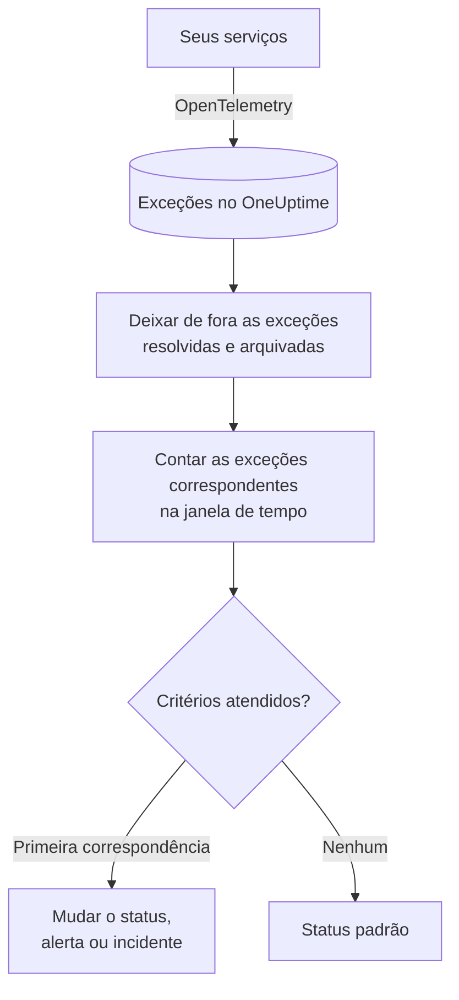

# Monitor de exceções

Um monitor de exceções conta, em uma janela de tempo, as exceções que seus serviços informam ao OneUptime e que correspondem aos seus filtros (mensagem, tipo de exceção, ambiente, serviço). Quando a contagem atende aos seus critérios, ele muda o status do monitor, cria um alerta ou declara um incidente. Use-o para alertar sobre qualquer nova falha em produção, sobre um tipo de exceção específico ou sobre um aumento repentino de erros.

:::cards
- [Criar o monitor](#criar-um-monitor-de-exceções): Escolha quais exceções contar e quando alertar.
- [Ambientes](#ambientes): Limite o monitor a `production`.
- [Como ele é avaliado](#como-ele-é-avaliado): O que é contado e o que resolver uma exceção faz.
- [Critérios](#critérios): As condições e os valores padrão.
:::

## Como funciona



A cada minuto, o OneUptime conta as exceções que correspondem aos filtros do monitor e ocorreram dentro da sua janela de tempo, deixando de fora as exceções que você marcou como resolvidas ou arquivou. Ele compara essa contagem com os critérios do monitor de cima para baixo, e o primeiro critério que corresponde decide o que acontece. Quando nenhum corresponde, o monitor volta ao seu status padrão.

## Antes de começar

- Seus serviços enviam exceções ao OneUptime pelo OpenTelemetry. Veja [OpenTelemetry](/docs/telemetry/open-telemetry).
- Para limitar um monitor a um ambiente, seus serviços precisam definir o atributo de recurso `deployment.environment`.

## Criar um monitor de exceções

:::steps
### Começar um novo monitor

Vá para **Monitores** e clique em **Criar monitor**. Ou, na página de uma exceção, clique em **Criar monitor** ao lado de **Resolver**: o novo monitor já começa observando o tipo dessa exceção no serviço dela, e alerta quando ela acontece de novo.

### Escolher Exceptions

Em **Tipo de monitor**, clique em **Mais tipos de monitor** e escolha **Exceções** em **Telemetria**, ou digite `exceptions` na caixa de pesquisa. Digite um **Nome** e clique em **Próximo**.

### Escolher sobre o que o monitor avisa você

Em **Sobre o que este monitor deve avisar você?**, escolha **Qualquer exceção** ou **Exceções demais**. Cada opção preenche a regra, que você pode alterar mais abaixo. Escolha **Outra coisa** para configurá-la você mesmo. **Uma exceção nova**, **Uma exceção resolvida volta** e **Pico de exceções** alertam sobre uma exceção vista pela primeira vez, sobre uma que voltou depois que você a resolveu e sobre um aumento muito acima do habitual.

### Escolher as exceções a contar

Em **Exceções a observar**, defina **A mensagem contém**, **Tipos de exceção** e **Environments**. Um filtro deixado vazio corresponde a todas as exceções. **Exceções correspondentes**, abaixo dos filtros, mostra as exceções a que eles correspondem agora.

### Refinar (opcional)

Abra **Mais campos** para filtrar por serviço de telemetria ou entidade de infraestrutura, ou para contar também as exceções resolvidas e arquivadas.

### Dizer quando alertar

Em **Quando alertar**, escolha uma **Condição**, o **Número de exceções** e uma **Janela de tempo**. A frase abaixo deles repete a regra em palavras simples. O gráfico abaixo dela conta as exceções correspondentes em cada janela nas últimas horas, desenha o número da regra como uma linha e diz quantas vezes a regra teria alertado. O botão dele sugere um número que a regra não teria ultrapassado nesse período. **Alertar sobre** escolhe o que a regra compara: **Exceções**, **Exceções novas**, **Exceções que voltaram** ou **Um aumento acima do habitual**. O gráfico só é desenhado para **Exceções**.

### Escolher o que acontece

Em **O que acontece**, escolha **Criar um alerta**, **Declarar um incidente** ou **Ambos**, e dê a ele um título e uma severidade. Enquanto a regra corresponde, o monitor mostra o status indicado em **Mais campos**; quando deixa de corresponder, o monitor volta ao seu status padrão e o alerta ou o incidente se resolve sozinho.

### Criar o monitor

Clique em **Criar monitor**. O monitor abre na sua página **Visão geral**, e sua primeira avaliação acontece em até um minuto.
:::

## O que ele consulta

| Campo | Com o que corresponde | Padrão |
| --- | --- | --- |
| **A mensagem contém** | Exceções cuja mensagem contém este texto, sem diferenciar maiúsculas de minúsculas. | Vazio: todas as exceções |
| **Tipos de exceção** | Exceções de qualquer um destes tipos, separados por vírgulas, como `TypeError, NullReferenceException`. O nome do tipo precisa corresponder exatamente. | Vazio: todos os tipos |
| **Environments** | Exceções de qualquer um destes ambientes, separados por vírgulas (veja [Ambientes](#ambientes)). | Vazio: todos os ambientes |
| **Janela de tempo** (em **Quando alertar**) | Exceções dos últimos 5 segundos até as últimas 24 horas. | **Últimos 5 minutos** |
| **Filtrar por serviço de telemetria** (em **Mais campos**) | Exceções de qualquer um dos serviços escolhidos. | Vazio: todos os serviços |
| **Filtrar por entidade de infraestrutura** (em **Mais campos**) | Exceções de qualquer um dos hosts, pods, contêineres e outras entidades escolhidos. | Vazio: todas as entidades |
| **Incluir Exceções Resolvidas** (em **Mais campos**) | Contar também as exceções marcadas como resolvidas. | Desativado |
| **Incluir Exceções Arquivadas** (em **Mais campos**) | Contar também as exceções arquivadas. | Desativado |

Todos os filtros que você definir precisam corresponder para que uma exceção seja contada.

### Ambientes

Os ambientes vêm do atributo de recurso do OpenTelemetry `deployment.environment` de cada exceção, o mesmo valor que o explorador de exceções filtra com `env:production`. Digite um ambiente, ou vários separados por vírgulas; uma exceção é contada quando seu ambiente corresponde a qualquer um deles.

A correspondência é exata e diferencia maiúsculas de minúsculas: `production` não corresponde a `Production` nem a `prod`. Exceções sem ambiente não são contadas quando este filtro está definido. Deixe-o vazio para contar as exceções de todos os ambientes, inclusive as que não têm ambiente.

O filtro de ambiente se combina com todos os outros filtros, então um monitor limitado a um serviço de telemetria e a `production` só conta as exceções de produção desse serviço.

Ao criar o monitor pela API, defina `environments` no `exceptionMonitor` da etapa como uma lista de nomes de ambiente:

```json
{
  "exceptionMonitor": {
    "telemetryServiceIds": [],
    "environments": ["production"],
    "exceptionTypes": [],
    "message": "",
    "includeResolved": false,
    "includeArchived": false,
    "lastXSecondsOfExceptions": 300
  }
}
```

## Como ele é avaliado

- **A cada minuto.** Um monitor de exceções não é verificado por sondas, por isso não tem intervalo para configurar nem página **Sondas e intervalo**.
- **Ocorrências, não tipos de exceção.** O monitor conta cada vez que uma exceção correspondente ocorreu dentro da **Janela de tempo**. Uma exceção lançada 40 vezes conta 40.
- **Exceções resolvidas e arquivadas ficam de fora.** A menos que você ative **Incluir Exceções Resolvidas** ou **Incluir Exceções Arquivadas**, as ocorrências de uma exceção que você marcou como resolvida ou arquivou não contam. Por isso, marcar uma exceção como resolvida pode fechar o incidente que ela abriu. Quando uma exceção resolvida volta a ocorrer, ela deixa de estar resolvida automaticamente e volta a ser contada.
- **Nenhuma exceção é uma contagem de 0.**
- **A indisponibilidade do próprio OneUptime não é silêncio.** Enquanto a janela de tempo contiver um período em que o próprio OneUptime não estava recebendo dados (estava reiniciando, sendo atualizado ou recuperando um atraso), a verificação espera: o status não muda, e nenhum incidente ou alerta é aberto ou resolvido. Veja [Quando o OneUptime não recebe dados](/docs/monitor/when-oneuptime-is-not-receiving).
- **Critérios de cima para baixo.** O primeiro critério que corresponde decide, então coloque o mais grave primeiro.

Cada mudança de status, com o motivo, fica registrada na **Linha do tempo de status** do monitor.

## Critérios

Os critérios de um monitor de exceções têm quatro opções de **Tipo de filtro**: **Exception Count**, o número de exceções que corresponderam na janela, e **New Exceptions**, **Regressed Exceptions** e **Exception Increase (in %)**, descritos abaixo. **Quando alertar** configura um critério, cuja **Condição** é **Mais de**, **Pelo menos**, **Menos de**, **No máximo** ou **Exatamente**. Para vários critérios, ou um com mais de um filtro, clique em **Editar como critérios personalizados** em **Mais campos** de **O que acontece**: cada critério ali tem uma **Condição do filtro** e um **Valor**.

| Condição do filtro | Corresponde quando a contagem de exceções está… |
| --- | --- |
| **Maior que** | acima do valor |
| **Maior ou igual a** | no valor ou acima |
| **Menor que** | abaixo do valor |
| **Menor ou igual a** | no valor ou abaixo |
| **Igual a** | exatamente no valor |
| **Diferente de** | em qualquer valor, menos esse |

As contagens de exceções não têm condições de anomalia: não há uma linha de base com que compará-las.

Um monitor de exceções criado em Criar monitor começa com a regra do que você escolheu em **Sobre o que este monitor deve avisar você?**:

| Opção | Regra | O que acontece |
| --- | --- | --- |
| **Qualquer exceção** | **Mais de** `0` em **Últimos 5 minutos** | Cria um alerta, que se resolve sozinho |
| **Exceções demais** | **Mais de** `20` em **Últimos 5 minutos** | Cria um alerta, que se resolve sozinho |
| **Uma exceção nova** | **Exceções novas**: **Mais de** `0` em **Últimos 10 minutos** | Cria um alerta, que se resolve sozinho |
| **Uma exceção resolvida volta** | **Exceções que voltaram**: **Mais de** `0` em **Últimos 10 minutos** | Cria um alerta, que se resolve sozinho |
| **Pico de exceções** | **Um aumento acima do habitual**: **Mais de** `200` em **Últimos 15 minutos** | Cria um alerta, que se resolve sozinho |

Um monitor de exceções criado pela API ou pelo Terraform sem critérios começa com estes critérios:

| Critério | Filtro | Efeito |
| --- | --- | --- |
| Check if … has exceptions | **Exception Count** **Maior que** `0` | Coloca o monitor offline e declara um incidente, resolvido automaticamente |
| Check if … has no exceptions | **Exception Count** **Igual a** `0` | Coloca o monitor online |

## Exceções novas, que voltam e em alta

Além de quantas exceções aconteceram, um monitor de exceções pode alertar sobre o que um rastreador de erros destaca primeiro. Cada um é lido só quando um critério o verifica.

| Tipo de filtro | O que conta na janela |
| --- | --- |
| **New Exceptions** | Exceções correspondentes vistas pela primeira vez que não estão resolvidas nem arquivadas. |
| **Regressed Exceptions** | Exceções correspondentes que você resolveu, que voltaram e continuam abertas. |
| **Exception Increase (in %)** | Quanto o número de exceções correspondentes está acima do habitual: o dia anterior à janela, por janela da mesma duração, no mínimo uma. Dez exceções depois de um dia calmo dão 900%. |

Exceções novas e que voltaram são filtradas por serviço, tipo de exceção, ambiente e mensagem; o filtro por entidade de infraestrutura vale só para os outros dois.

## Exemplo prático: só as exceções de produção

Você quer um incidente sempre que a API lançar uma exceção em produção, e nada para o staging. Você escolhe **Qualquer exceção**, define **Environments** como `production`, mantém a **Janela de tempo** em **Últimos 5 minutos** e escolhe **Declarar um incidente** em **O que acontece**. Nos últimos cinco minutos:

| Exceções | Ambiente | Estado | Contadas? |
| --- | --- | --- | --- |
| `TypeError` × 3 | `production` | Ativa | Sim: 3 |
| `TypeError` × 40 | `staging` | Ativa | Não: outro ambiente |
| `TimeoutError` × 2 | nenhum | Ativa | Não: sem ambiente |
| `NullReferenceException` × 4 | `production` | Resolvida depois de ocorrer | Não: resolvida |

O **Exception Count** é 3, então **Mais de** `0` corresponde: o monitor fica offline e um incidente é declarado. Depois que passam cinco minutos sem nenhuma exceção de produção ativa, a regra deixa de corresponder, o monitor volta ao seu status padrão e o incidente se resolve sozinho.

## Solução de problemas

:::details As exceções aparecem no explorador, mas o monitor conta 0
Compare o valor de **Environments** com o filtro `env:` do explorador: a correspondência é exata e diferencia maiúsculas de minúsculas, e as exceções sem ambiente ficam de fora quando o filtro está definido. Depois verifique se essas exceções estão resolvidas ou arquivadas. Abra a página **Critérios** do monitor (em **Configuração**) e clique em **Edit Monitoring Criteria**: **Exceções correspondentes** mostra o que os filtros selecionam.
:::

:::details O incidente se resolveu quando resolvi a exceção
É o esperado. As exceções resolvidas não são contadas, então a contagem caiu e o critério deixou de corresponder. Se a exceção voltar a ocorrer, ela deixa de estar resolvida e volta a ser contada. Ative **Incluir Exceções Resolvidas** para contá-las mesmo assim.
:::

:::details Um filtro de tipo de exceção não corresponde a nada
Os **Tipos de exceção** são comparados exatamente com o nome do tipo com que a exceção foi informada, como `TypeError`. Copie o tipo do explorador de exceções.
:::

## Próximos passos

:::cards
- [Monitor de traces](/docs/monitor/traces-monitor): Alerte sobre spans e endpoints com falha.
- [Monitor de logs](/docs/monitor/logs-monitor): Alerte sobre o volume e o conteúdo dos logs.
- [Modelos de incidentes e alertas](/docs/monitor/incident-alert-templating): Escreva títulos e descrições de alertas úteis.
- [OpenTelemetry](/docs/telemetry/open-telemetry): Envie exceções ao OneUptime.
:::
