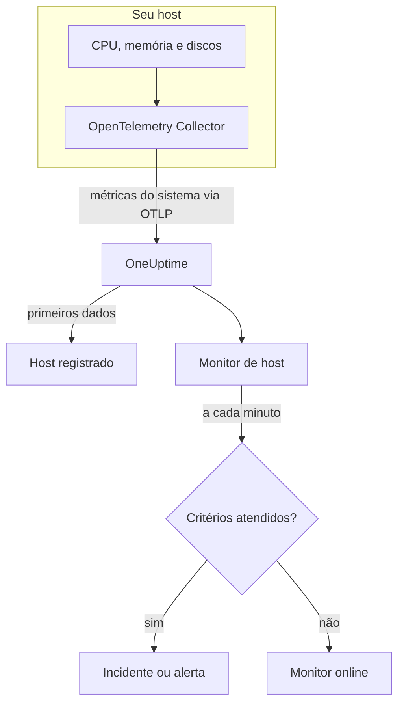

# Monitor de hosts

Um monitor de host acompanha uma máquina – CPU, memória, discos, carga e processos – e avisa você quando ela está saturada ou enchendo. Ele lê as métricas `system.*` do OpenTelemetry que um OpenTelemetry Collector envia do host, os mesmos dados que o produto **Hosts** mostra, então nada é sondado de fora.

:::cards
- [Criar o monitor](#criar-um-monitor-de-host): Seis passos no painel.
- [Modelos](#modelos-de-alerta-prontos): Dez alertas prontos para um host silencioso ou reiniciado, CPU, memória, swap, disco, inodes, carga, processos e unidades systemd com falha.
- [Métricas](#métricas-coletadas): As métricas de host com que você pode alertar, e suas unidades.
- [Host ou servidor / VM?](#monitor-de-host-ou-monitor-de-servidor-vm): Qual dos dois monitores de máquinas usar.
:::

## Como funciona

Um OpenTelemetry Collector é executado no host com o receptor `hostmetrics`. A cada 30 segundos, ele lê os números de CPU, memória, disco, rede, carga e processos do host e os envia para o OneUptime via OTLP. Os primeiros dados de um host o registram em **Hosts**.

Um monitor de host está vinculado a um host. A cada minuto, ele executa sua consulta sobre as métricas desse host e compara o resultado com seus critérios.

### Monitor de host ou monitor de servidor / VM?

O OneUptime tem dois monitores para máquinas. Eles podem rodar no mesmo host.

| | Monitor de host | Monitor de servidor / VM |
| --- | --- | --- |
| **Agente** | Um OpenTelemetry Collector com o receptor `hostmetrics` | O agente de infraestrutura do OneUptime |
| **Dados** | Métricas `system.*` e `process.*` do OpenTelemetry, as mesmas que as páginas de **Hosts** mostram em gráficos | Um relatório de status que o agente envia para o monitor |
| **Critérios** | Limites ou detecção de anomalias sobre qualquer consulta de métricas ou fórmula | Verificações integradas, como uso de CPU, memória e disco |
| **Configuração** | Instalar o coletor; o host se registra sozinho | Criar o monitor e depois passar a chave secreta dele para o agente |

Use o monitor de host quando o host já envia dados do OpenTelemetry, ou quando você quer logs e métricas mais ricas do mesmo coletor. Consulte [Monitor de servidor / VM](/docs/monitor/server-monitor) para o outro.

## Antes de começar

- **Execute um OpenTelemetry Collector no host** com o receptor `hostmetrics`. O caminho mais rápido é [Hosts](/docs/telemetry/hosts): um comando instala o coletor, e o OneUptime o configura. [Coletor OpenTelemetry no host](/docs/telemetry/host-otel-collector) cobre Linux, macOS e Windows, e **Produtos → Infraestrutura → Hosts → Documentação** traz uma configuração pronta.
- **Ative as métricas de utilização.** `system.cpu.utilization`, `system.memory.utilization` e `system.filesystem.utilization` são opcionais no receptor, e os modelos de CPU, memória e sistema de arquivos precisam delas. A configuração do painel as ativa.
- **Verifique se o host está registrado.** Ele aparece em **Produtos → Infraestrutura → Hosts → Todos os hosts**, com o nome do seu `host.name`, assim que chegam os primeiros dados.

## Criar um monitor de host

:::steps
### Começar um monitor novo

Acesse **Monitores** e clique em **Criar monitor**.

### Escolher Host

Em **Tipo de monitor**, clique em **Mais tipos de monitor** e escolha **Host** em **Infraestrutura**. Informe um **Nome** – ele é usado nos títulos de incidentes e alertas – e clique em **Próximo**.

### Escolher a máquina

Em **Host Monitor Configuration**, escolha a máquina em **Host**. Todo host que enviou dados está na lista. Depois da escolha, uma linha abaixo do campo diz se estão chegando dados. **Adicionar host** abre passos de configuração com as suas chaves já preenchidas, que esperam os primeiros dados.

### Escolher o que monitorar

Um monitor novo começa com **Host Stopped Reporting**, em **Sobre o que alertar**. Para vigiar outra coisa:

- **Alterar** – escolha outro [modelo](#modelos-de-alerta-prontos). Ele define a métrica, a agregação, o intervalo de tempo e os limites, e substitui os critérios abaixo pelos dele. Você ainda pode mudar o **Intervalo de tempo**.
- **Custom Metric** (em **Mais campos**) – escolha uma métrica em **Host Metric** e depois defina **Agregação** e **Intervalo de tempo**.
- **Avançado** (em **Mais campos**) – monte você mesmo consultas e fórmulas em **Selecionar Métricas**, por exemplo um filtro em `state` ou um agrupamento por `mountpoint`.

### Revisar os critérios

Abra cada critério em **Critérios** e confira sua **Métrica**, **Agregação**, **Condição** e **Limite**. Um modelo os preenche. Com **Custom Metric** ou **Avançado**, o monitor começa com os [critérios padrão](#critérios-padrão), que só percebem uma métrica que não envia dados, então defina o seu próprio limite.

### Criar o monitor

Clique em **Criar monitor**. O OneUptime abre a página do monitor e o avalia a cada minuto. Os incidentes e alertas que ele gera também aparecem nas páginas **Incidentes** e **Alertas** do host.
:::

> [!TIP]
> Para configurar vários modelos de uma vez, abra o host em **Produtos → Infraestrutura → Hosts** e vá para **Recomendações**. Escolha os modelos que quiser, escolha quem é acionado, e o OneUptime cria um monitor por modelo.

## Configurações do monitor

| Campo | Aba | O que faz |
| --- | --- | --- |
| **Host** | Todas | Obrigatório. Restringe cada consulta ao `resource.host.name` do host. |
| **Host Metric** | Custom Metric | Uma métrica do [catálogo](#métricas-coletadas), agrupada em CPU, memória, disco, rede, carga e processos. |
| **Agregação** | Custom Metric | Como as amostras são combinadas: **Média**, **Máximo**, **Mínimo**, **Soma** ou **Contagem**. Começa na agregação usual da métrica. |
| **Intervalo de tempo** | Todas | A janela móvel que a consulta lê, de **Past 1 Minute** a **Past 365 Days**. Um monitor novo começa em **Past 1 Minute**; os modelos definem a sua. |
| **Selecionar Métricas** | Avançado | O construtor de consultas: **Métrica**, **Aggregate by**, **Filter by attributes**, **Agrupar por**, além de **Adicionar métrica** e **Adicionar fórmula** para combinar consultas. |

## Modelos de alerta prontos

A lista de **Sobre o que alertar** oferece dez modelos. Cada um monta um monitor completo: uma consulta, um critério que dispara e outro que se recupera. Os limites são pontos de partida que você pode editar.

Um critério só dispara quando a condição vale em todos os minutos da sua janela, e se recupera 10% além do limite para que um valor oscilando na linha não fique mudando de estado.

| Modelo | Gravidade | Monitora | Dispara quando | Recupera quando |
| --- | --- | --- | --- | --- |
| Host Stopped Reporting | Crítico | `system.memory.usage`, Count, últimos 10 minutos | Nenhum dado durante toda a janela | Os dados voltam a chegar |
| Host Restarted | Aviso | `system.uptime`, Min, últimos 5 minutos | Algum valor está abaixo de 600 (dez minutos) | Todos os valores estão em 660 ou mais |
| High CPU Utilization | Aviso | `system.cpu.utilization` para os estados `user` e `system`, somados e mostrados como porcentagem, últimos 5 minutos | Acima de 80% | Em 72% ou menos |
| High Memory Utilization | Aviso | `system.memory.utilization` para o estado `used`, como porcentagem, últimos 5 minutos | Acima de 85% | Em 76,5% ou menos |
| High Swap Usage | Aviso | `system.paging.usage` para os estados `used` e `free`, usado dividido por usado mais livre, como porcentagem, últimos 5 minutos | Acima de 80% | Em 72% ou menos |
| High Filesystem Usage | Crítico | `system.filesystem.utilization`, Max por `mountpoint` e `device`, como porcentagem, últimos 5 minutos | Acima de 90% | Em 81% ou menos |
| Running Out of Inodes | Crítico | `system.filesystem.inodes.usage` para os estados `used` e `free`, usado dividido por usado mais livre, por `mountpoint` e `device`, como porcentagem, últimos 5 minutos | Acima de 90% | Em 81% ou menos |
| High Load Average (1m) | Aviso | `system.cpu.load_average.1m`, Avg, últimos 5 minutos | Acima de 4 | Em 3,6 ou menos |
| High Process Count | Aviso | `system.processes.count`, Max, últimos 5 minutos | Acima de 2000 | Em 1800 ou menos |
| Systemd Unit Failed | Aviso | `systemd.unit.state` com `systemd.unit.active_state = failed`, Max por `resource.systemd.unit.name`, últimos 5 minutos | Acima de 0 | Em 0 ou menos |

**Gravidade** é o rótulo que o seletor mostra. O incidente e o alerta que um modelo cria começam com a gravidade de incidente e de alerta mais alta do seu projeto; altere-as nos critérios.

- **Host Stopped Reporting** dispara quando nada chega do host por dez minutos: a máquina está fora do ar ou inacessível, ou o coletor dela parou, perdeu a rota até o OneUptime ou teve o token revogado. Ele se resolve quando os dados voltam. Quando os dados param, os outros modelos não têm nada para comparar e mantêm o último status, então é este que avisa você.
- **Host Restarted** dispara no primeiro relatório após uma inicialização: o host está ativo há menos de dez minutos. Ele lê `system.uptime` do scraper `system` do coletor, que as configurações padrão do OneUptime ativam, e se resolve sozinho cerca de quinze minutos após a inicialização, quando cada valor da sua janela de cinco minutos chega a pelo menos onze minutos. Um host fora do ar dispara **Host Stopped Reporting** no lugar.
- **CPU** é o tempo ocupado (`user` mais `system`), o mesmo número que a **Visão geral** do host mostra em gráfico. Espera de E/S e steal ficam de fora.
- **Memória** exclui buffers e cache de páginas, então um host ocupado principalmente por cache não o dispara.
- **Swap** é o swap usado dividido por usado mais livre, em todos os dispositivos de swap, como `free` e `swapon` o mostram. Um host sem swap não informa nenhum e nunca dispara.
- **Sistema de arquivos** abre um incidente por montagem. Pseudo sistemas de arquivos somente leitura, como montagens snap `squashfs` ou `devfs` do macOS, estão sempre 100% cheios: as configurações de coletor do OneUptime os deixam de fora do scraper `filesystem` com `exclude_fs_types`, e uma configuração sua precisa do mesmo.
- **Inodes** abre um incidente por montagem, como **Sistema de arquivos**. Quando um sistema de arquivos fica sem inodes, nada mais consegue criar um arquivo nele, por mais espaço livre que haja. Um sistema de arquivos sem tabela de inodes própria, como o btrfs, não informa nenhum e nunca dispara.
- **Média de carga** é um tamanho bruto da fila de execução, não dividido pelo número de núcleos: 4 é saturação em um host de 2 núcleos e rotina em um de 32, então aumente-o em hosts grandes.
- **Contagem de processos** compara o maior estado de processo individual (`running`, `sleeping`, …), não o total do host, então não vai bater com uma listagem de processos. O scraper de processos informa no Linux, macOS e BSD, não no Windows.
- **Systemd Unit Failed** abre um alerta por serviço systemd no estado `failed`, a partir do receiver `systemd` do coletor, que a configuração padrão do OneUptime lê em hosts Linux com systemd. Ele se resolve quando a unidade volta a rodar ou quando `systemctl reset-failed` a limpa.

## Métricas coletadas

A lista **Host Metric** oferece estas métricas. Cada uma traz `resource.host.name`, que é como o monitor restringe suas consultas a um host. Escolhida ali, a CPU conta o estado `user`, o uso de memória e de sistemas de arquivos o estado `used`, e sistemas de arquivos e processos dão uma série por ponto de montagem e por status.

> [!IMPORTANT]
> As métricas de utilização são uma razão de 0 a 1, não uma porcentagem: use `0.8` para 80% em um limite sobre a métrica bruta. Os modelos convertem para porcentagem com uma fórmula, então os limites deles são 80, 85 e 90.

### CPU

| Métrica | Unidade | Descrição |
| --- | --- | --- |
| `system.cpu.utilization` | ratio | Parcela do tempo de CPU em cada `state` (`user`, `system`, `idle`, …). Filtre por `state`: uma média de todos os estados nunca atinge um limite útil. |
| `process.cpu.utilization` | ratio | Uso de CPU de cada processo do host. |

### Memória

| Métrica | Unidade | Descrição |
| --- | --- | --- |
| `system.memory.utilization` | ratio | Parcela da memória física em cada `state` (`used`, `free`, `cached`, …). Filtre por `state = used` para a memória em uso. |
| `system.memory.usage` | bytes | Uso de memória em bytes. |

### Disco

| Métrica | Unidade | Descrição |
| --- | --- | --- |
| `system.filesystem.utilization` | ratio | Parcela da capacidade de cada sistema de arquivos em uso, por `mountpoint` e `device`. |
| `system.filesystem.usage` | bytes | Uso do sistema de arquivos em bytes. |

### Rede

| Métrica | Unidade | Descrição |
| --- | --- | --- |
| `system.network.io` | bytes | Bytes recebidos e enviados. Um contador de toda a vida útil. |

### Carga

| Métrica | Unidade | Descrição |
| --- | --- | --- |
| `system.cpu.load_average.1m` | count | Média de carga do último minuto. |
| `system.cpu.load_average.5m` | count | Média de carga dos últimos 5 minutos. |
| `system.cpu.load_average.15m` | count | Média de carga dos últimos 15 minutos. |

### Processos

| Métrica | Unidade | Descrição |
| --- | --- | --- |
| `system.processes.count` | count | Processos do host, uma série por `status` de processo. |

O construtor de consultas em **Avançado** lista todas as métricas que o host envia, não só estas.

## Critérios de monitoramento

Um critério compara uma das consultas ou fórmulas do monitor com um limite. Os critérios de um monitor de host não têm **Tipo de filtro**: cada regra verifica o valor da métrica, com estes campos.

| Campo | O que faz |
| --- | --- |
| **Métrica** | A consulta ou fórmula a verificar, pelo nome da variável. |
| **Agregação** | Como os valores da janela viram uma única resposta: **Média**, **Soma**, **Valor máximo**, **Valor mínimo**, **Todos os valores** (todos os valores precisam corresponder, na janela inteira) ou **Qualquer valor** (basta um). |
| **Condição** | **Maior que**, **Menor que**, **Maior ou igual a**, **Menor ou igual a** ou **Igual a** – ou uma condição de anomalia: **Anomalamente alto**, **Anomalamente baixo** ou **Anômalo**. **Sem dados** corresponde quando a consulta não retornou nada na janela, e **Com dados** quando retornou algo. **Previsão acima de** e **Previsão abaixo de** correspondem quando a tendência da métrica na janela tiver passado do limite ao fim de **Horizonte**. |
| **Limite** | O valor com que comparar. Uma lista de unidades fica ao lado quando a métrica tem unidade. Não aparece em condições de anomalia. |
| **Sensibilidade** | Só condições de anomalia. **Baixo** (4σ), **Médio** (3σ, o padrão) ou **Alto** (2σ). |
| **Janela de linha de base** | Só condições de anomalia. 14 dias (o padrão), 28, 60 ou 90 dias de histórico. |
| **Se não houver dados** | Em **Mais campos**. O que acontece quando a janela não tem amostras: **Ignore** (o padrão), **Treat As Zero** ou **Gatilho**. |

As condições de anomalia comparam cada valor com a mesma hora da semana na linha de base. Elas ficam em um estado "Learning", e não geram nada, até a janela de linha de base ter histórico suficiente. Este monitor filtra suas consultas por atributos, então cada consulta, e cada série de uma consulta agrupada, é comparada com o próprio histórico, até onde suas métricas são mantidas. Se isso for menos de duas semanas, uma soma, uma contagem ou uma consulta sobre um histograma permanece nesse estado para sempre, e todo o resto é comparado com todas as séries da métrica. Um percentil de um histograma sempre permanece nesse estado.

Cada critério também diz o que fazer quando corresponde: mudar o status do monitor, criar um alerta ou declarar um incidente. Os critérios são verificados de cima para baixo, e o primeiro que corresponde decide.

### Critérios padrão

Um monitor que você não cria a partir de um modelo começa com dois critérios:

| Ordem | Critério | Corresponde quando | Então |
| --- | --- | --- | --- |
| 1 | Check if _monitor name_ is offline | A primeira consulta não tem dados em toda a janela | Marca o monitor como **Offline** e declara o incidente "_monitor name_ is offline", que se resolve sozinho quando o monitor se recupera. |
| 2 | Check if _monitor name_ is online | A primeira consulta tem dados | Marca o monitor como **Operacional**. |

> [!IMPORTANT]
> Um valor de `0` é um dado, então uma métrica que costuma ser zero, como reinícios ou erros, não deixa o monitor offline. Para receber alertas sobre um valor, comece por um modelo ou adicione um critério com um limite. Quando nenhum dado chega e nenhum critério corresponde, o monitor mantém o status e os incidentes abertos continuam abertos: silêncio não é recuperação. O tempo em que o próprio OneUptime não recebia dados nunca conta como falta de dados: uma verificação cuja janela o inclui espera, como explica [Quando o OneUptime não recebe dados](/docs/monitor/when-oneuptime-is-not-receiving).

## Solução de problemas

:::details O host não aparece na lista Host
Os hosts se registram sozinhos a partir dos dados do coletor, que precisam de um `host.name` e do tipo de sistema operacional do host – os dois vêm do processador `resourcedetection` do coletor. Verifique se o coletor está em execução e se o host aparece em **Produtos → Infraestrutura → Hosts → Todos os hosts**. [Coletor OpenTelemetry no host](/docs/telemetry/host-otel-collector) cobre a configuração.
:::

:::details Um limite de CPU ou de memória nunca dispara
As métricas de utilização são razões que chegam no máximo a `1.0`, então um limite digitado à mão de `80` nunca é cruzado: use `0.8`, ou comece por um modelo, que converte para porcentagem. Filtre também por `state` – `user` e `system` para a CPU, `used` para a memória. Uma média de todos os estados fica perto de 1 dividido pelo número de estados.
:::

:::details Os incidentes disparam para o host errado
O monitor restringe cada consulta a `resource.host.name` igual ao host que você escolheu. Hosts que informam o mesmo `host.name` se fundem em uma única série, então dê a cada host um nome único.
:::

:::details High Filesystem Usage dispara para uma montagem que está sempre cheia
Pseudo sistemas de arquivos somente leitura, como montagens loop snap `squashfs` em `/snap` ou `devfs` do macOS, estão 100% cheios por design e nunca se recuperam. As configurações que o OneUptime executa e fornece os deixam de fora com `exclude_fs_types`; uma configuração sua, ou uma Configuração do coletor criada antes disso, precisa do mesmo: copie-o de [Métricas do host](/docs/telemetry/host-otel-collector#métricas-do-host). Deixe de fora outra montagem sempre cheia, como um `.dmg` montado, com `exclude_mount_points`.
:::

## Próximos passos

:::cards
- [Coletor OpenTelemetry no host](/docs/telemetry/host-otel-collector): Instalar e configurar o coletor que este monitor lê.
- [Monitor de servidor / VM](/docs/monitor/server-monitor): O monitor de máquinas para o qual um agente envia relatórios.
- [Monitor de métricas](/docs/monitor/metrics-monitor): Alertar com base em qualquer métrica, entre hosts e serviços.
- [Visão geral dos incidentes](/docs/incidents/index): O que acontece depois que um critério declara um incidente.
:::
