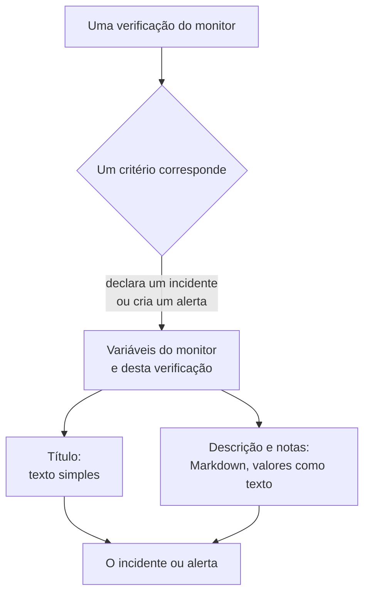

# Modelos de incidentes e alertas

Quando os critérios de um monitor declaram um incidente ou criam um alerta, eles preenchem o título, a descrição e as notas de remediação a partir de um modelo que você escreve. Coloque neles marcadores `{{variable}}`, como `{{monitorName}}` ou `{{responseStatusCode}}`, e cada incidente diz o que deu errado, com os valores da verificação que o abriu.

:::cards
- [Onde você escreve um modelo](#onde-você-escreve-um-modelo): O título, a descrição e as notas de remediação do incidente ou do alerta de um critério.
- [Uso básico](#uso-básico): Marcadores, caminhos dentro de objetos e listas.
- [Variáveis de todo monitor](#variáveis-de-todo-monitor): O nome do monitor e o recurso que ultrapassou o limite.
- [Variáveis por tipo de monitor](#variáveis-por-tipo-de-monitor): O que cada tipo de verificação informa.
:::

## Como os modelos funcionam

Um modelo é preenchido uma única vez, quando o critério cria o incidente ou o alerta. O OneUptime reúne as variáveis do monitor e da verificação que correspondeu, coloca cada valor no lugar do seu marcador e salva o resultado. Alterar o modelo depois muda os incidentes e alertas criados a partir de então, não os que já estão abertos.



- **O título é texto simples.** Onde quer que seja exibido, ele é lido exatamente como o modelo o gerou.
- **A descrição e as notas de remediação são Markdown.** O Markdown que você escreve é renderizado, e cada valor que o sistema monitorado enviou é colocado como texto, de modo que nada nele pode adicionar um link, uma imagem ou uma menção. Veja [Valores em descrições e notas de remediação](#valores-em-descrições-e-notas-de-remediação).
- **Um monitor agrupado preenche cada incidente para a sua própria série.** Um monitor que abre um incidente por host, pod ou dispositivo preenche cada modelo com os valores dessa série, e adiciona o nome da série ao título quando o seu modelo ainda não o menciona.

## Onde você escreve um modelo

:::steps
### Abrir os critérios do monitor

Vá em **Monitores**, abra o monitor e clique em **Critérios** no menu lateral dele. Clique em **Editar: Critérios de Monitoramento**.

### Ativar o incidente ou o alerta

Em um critério, em **Ações**, ative **Quando os filtros corresponderem, declarar um incidente.** ou **Quando os filtros corresponderem, criar um alerta.** O formulário do incidente ou do alerta abre abaixo.

### Escrever o título

Digite o título em **Título do Incidente** ou **Título do alerta**, por exemplo `{{monitorName}} is down`. **Learn about dynamic templates**, ao lado, abre **Dynamic Template Variables**: cada variável que o tipo deste monitor tem, com o que ela contém. Clique em uma variável para copiá-la.

### Escrever a descrição e as notas de remediação

Abra **Descrição** para **Descrição do incidente** ou **Descrição do alerta**, e **Mais campos** para **Notas de remediação**. Esses editores oferecem as próprias variáveis: **Variáveis de modelo** as lista abaixo do editor, **Inserir variável** na barra de ferramentas abre a mesma lista, e digitar `{{` a abre no cursor.

### Salvar os critérios

Clique em **Salvar alterações**. O próximo incidente ou alerta que este critério criar usará os novos modelos.
:::

## Uso básico

Um marcador é o nome de uma variável entre chaves duplas. Quando o incidente é criado, o OneUptime o substitui pelo valor da variável e mantém o texto ao redor como você o escreveu.

```text title="Title template"
{{monitorName}} returned {{responseStatusCode}} in {{responseTimeInMs}} ms
```

Se o monitor se chama `Checkout API`, o código de status da resposta é `502` e a resposta levou `842` milissegundos, o incidente recebe o título:

```text title="Title as created"
Checkout API returned 502 in 842 ms
```

### Caminhos dentro de objetos e listas

Uma variável que contém um objeto ou uma lista é lida com um caminho, da mesma forma que nas [expressões JavaScript](/docs/monitor/javascript-expression):

| Escreva | Para ler | Exemplo |
| --- | --- | --- |
| `{{object.field}}` | Um campo de um objeto, em qualquer profundidade | `{{responseBody.error.message}}` |
| `{{list[0]}}` ou `{{list.0}}` | Um item de uma lista, contando a partir de 0 | `{{diskMetrics[0].usagePercent}}` |
| `{{list[last]}}` | O último item de uma lista | `{{processes[last].name}}` |
| `{{object}}` | O objeto ou a lista inteira, como JSON | `{{responseBody}}` |

Um nome de campo pode conter um hífen, como em `{{responseHeaders.content-type}}`. Um índice negativo, como `[-1]`, não lê nada: use `[last]`.

### Quando falta um valor

Um marcador cujo caminho não leva a lugar algum fica no texto como você o escreveu, com chaves e tudo: se a resposta não tem um campo `error`, `{{responseBody.error.id}}` aparece como está no título. O mesmo vale para uma variável que esta verificação não informou, como `failureCause` em uma verificação que não falhou. Um valor que a verificação informou como texto vazio é substituído por nada.

Para escrever um modelo que funcione com o monitor agrupado ou não, use as variáveis de [recurso afetado](#recurso-afetado): elas sempre existem e ficam vazias quando o monitor não está agrupado.

### Valores em descrições e notas de remediação

Uma descrição e notas de remediação são Markdown: elas aparecem na página do incidente ou do alerta, no e-mail e nos canais do Slack e do Microsoft Teams. Os valores que um modelo coloca ali são o que o sistema monitorado enviou - um corpo ou cabeçalho de resposta, uma requisição ou um e-mail recebido, os rótulos de um dispositivo ou de uma série -, então cada um é colocado como texto. Ele é lido exatamente como foi enviado, onde quer que o modelo o coloque, e um link, uma imagem, uma tag HTML ou uma menção do Slack como `<!channel>` dentro dele aparece como texto em vez de agir. Um endereço web solto em um valor ainda vira um link, que mostra para onde leva. O Markdown que você escreve no próprio modelo é renderizado como você o escreveu.

Um valor pode ter qualquer tamanho - um corpo de resposta ou um log de muitos megabytes - e a notificação ainda sai com ele. Cada canal transporta o que aceita, e uma descrição longa demais para ele é cortada, em uma quebra de linha quando houver, terminando com "… (truncated — see OneUptime for the full text)":

- **E-mail**: cada descrição, nota ou causa raiz transporta até cerca de 256 KB do texto do e-mail, e a nota no fim de um texto mais longo leva ao incidente ou ao alerta. Um e-mail inteiro - o texto e as capturas de tela - fica abaixo de 3 MB, o que todo servidor de e-mail e o Microsoft Graph aceitam: uma captura de tela que não cabe ao lado do texto é deixada de fora, com uma nota no lugar.
- **A página do incidente ou do alerta** mostra tudo. Uma descrição com mais de 128 KB que demoraria para ser diagramada é exibida como texto simples, linha por linha.
- **Slack** transporta no máximo o que o Slack mostra de uma mensagem (cerca de 30.000 caracteres). **Microsoft Teams** transporta cerca de 40.000 caracteres em uma mensagem do aplicativo OneUptime, e cerca de 12.000 por um webhook de entrada (assinantes de páginas de status, workflows) - medidos no envio da mensagem, então uma tabela conta como o HTML em que se transforma.
- **SMS, chamadas telefônicas, notificações push, WhatsApp e Telegram** transportam o que os seus provedores aceitam: veja [Como os níveis acionam as pessoas](/docs/on-call/escalation-rules#como-os-níveis-acionam-as-pessoas).

Cada canal renderiza o texto em um tempo que cresce com o seu tamanho. Uma parte que levaria muito mais tempo para um renderizador - uma linha com mais de 64 KB, um parágrafo longo de linhas simples, um parágrafo cheio de `*`, `_` ou `[` que nunca se fecham, citações ou listas aninhadas em mais de dezesseis níveis e, na página do incidente ou do alerta, uma tabela ou lista com mais de mil linhas - é lida como texto simples onde está, e o restante da descrição é renderizado normalmente.

## Uso avançado

### Percorrer uma lista

`{{#each path}}` repete o texto até `{{/each}}` uma vez para cada item da lista em `path`:

```text title="Loop syntax"
{{#each arrayPath}}
  ...text with {{field}} placeholders for each item...
{{/each}}
```

Dentro do loop:

- `{{field}}` e `{{field.nested}}` leem o item atual. Um nome que o item não tem é procurado no item que o contém e depois nas variáveis do modelo inteiro.
- `{{@index}}` é a posição do item, contando a partir de 0.
- `{{this}}` é o próprio item, para uma lista de valores simples como strings.
- Um loop sobre um caminho que não é uma lista, ou sobre uma lista vazia, não escreve nada.
- Os loops podem ser aninhados: um `{{#each}}` dentro de outro lê a lista interna de cada item externo.

Por exemplo, um [monitor de requisições recebidas](/docs/monitor/incoming-request-monitor) que recebe esta notificação de alerta:

```json title="Request body"
{
  "receiver": "payments",
  "alerts": [
    { "status": "firing", "labels": { "alertname": "HighLatency" } },
    { "status": "resolved", "labels": { "alertname": "DiskFull" } }
  ]
}
```

e tem este modelo de descrição:

```text title="Description template"
Alerts for {{requestBody.receiver}}:
{{#each requestBody.alerts}}
- {{@index}}: {{labels.alertname}} ({{status}})
{{/each}}
```

cria um incidente cuja descrição fica como abaixo. Cada item mantém as quebras de linha ao seu redor, então uma linha em branco separa os itens, e a descrição continua mostrando uma única lista:

```text title="Description as created"
Alerts for payments:

- 0: HighLatency (firing)

- 1: DiskFull (resolved)
```

### Valores de um monitor agrupado

Um monitor baseado em métricas com atributos em **Group by** abre um incidente por série, e o valor de cada atributo é uma variável com o nome do atributo. Agrupar por `host.name` dá `{{host.name}}`, e agrupar por `resource.k8s.pod.name` dá `{{resource.k8s.pod.name}}`. `{{seriesLabels}}` contém todos eles, como um objeto.

Um [monitor de logs](/docs/monitor/logs-monitor) agrupado funciona da mesma forma: o valor de cada atributo de agrupamento é uma variável com a sua chave.

## Variáveis de todo monitor

### Monitor

| Variável | O que contém | Exemplo |
| --- | --- | --- |
| `monitorName` | O nome do monitor. | `Checkout API` |
| `monitorId` | O ID do monitor. | `a0f78958-da0a-4775-9fd9-c9fc63d3456f` |
| `monitorType` | O tipo do monitor. | `Website`, `Synthetic Monitor` |

### Recurso afetado

Estas variáveis descrevem a série para a qual um monitor agrupado abriu o incidente: um pod, um contêiner, um host, um disco. Elas ficam vazias em um monitor não agrupado, então um modelo pode usá-las em qualquer monitor.

| Variável | O que contém |
| --- | --- |
| `seriesResourceSuffix` | A identidade da série, começando com um separador, para colocar no fim de um título. |
| `seriesResourceSummary` | A mesma identidade sem o separador, para colocar em uma frase. |
| `seriesResourceBlock` | Cada rótulo da série, como uma lista Markdown. Ideal em uma descrição. |
| `seriesDebugCommands` | Comandos somente leitura para este recurso exato, como `kubectl` ou `docker`, como uma lista Markdown. |

## Variáveis por tipo de monitor

### Monitores de sites e APIs

| Variável | O que contém | Tipo |
| --- | --- | --- |
| `responseBody` | O corpo da resposta: um objeto quando é JSON, caso contrário o texto. | `JSON` ou `string` |
| `responseHeaders` | Os cabeçalhos da resposta, pelo nome em minúsculas. | `Dictionary<string>` |
| `responseStatusCode` | O código de status HTTP. | `number` |
| `responseTimeInMs` | O tempo de resposta, em milissegundos. | `number` |
| `isOnline` | Se o monitor considerou a resposta como online. | `boolean` |

### Monitores de requisições recebidas

| Variável | O que contém | Tipo |
| --- | --- | --- |
| `requestBody` | O corpo da requisição: um objeto quando é JSON. | `JSON` ou `string` |
| `requestHeaders` | Os cabeçalhos da requisição, pelo nome em minúsculas. | `Dictionary<string>` |
| `requestMethod` | O método HTTP, como `POST`. | `string` |
| `incomingRequestReceivedAt` | Quando a requisição foi recebida, como um carimbo de data/hora ISO 8601. | `string` |

Quando o critério tem **Group incidents and alerts by a payload field** ativado, a chave de agrupamento também é uma variável, com o nome do **último segmento** do caminho de agrupamento: agrupar por `requestBody.alerts[*].labels.alertname` dá `{{alertname}}`, e agrupar por `requestBody.alerts[*].fingerprint` dá `{{fingerprint}}`. O `requestBody` inteiro continua disponível ao lado.

> [!NOTE]
> `[*]` só funciona nos campos de caminho de agrupamento. Em um modelo ele não lê nada, então o marcador fica como foi escrito. `{{requestBody.alerts[0].annotations.summary}}` sempre lê o primeiro alerta do payload, não aquele para o qual o incidente foi aberto: use a variável de agrupamento e os campos compartilhados do payload, como `commonLabels` e `commonAnnotations`. Veja [Monitor de requisições recebidas](/docs/monitor/incoming-request-monitor).

### Monitores de e-mails recebidos

| Variável | O que contém | Tipo |
| --- | --- | --- |
| `emailSubject` | O assunto do e-mail. | `string` |
| `emailFrom` | O endereço de e-mail do remetente. | `string` |
| `emailTo` | Para quem o e-mail foi enviado, com o endereço do próprio monitor mascarado. | `string` |
| `emailBody` | O corpo do e-mail em texto simples. | `string` |
| `emailReceivedAt` | Quando o e-mail foi recebido, como um carimbo de data/hora ISO 8601 em UTC. | `string` |

Em um título, cada uma é cortada para uma linha de no máximo 150 caracteres. As descrições e as notas de remediação recebem o valor completo. Veja [Monitor de e-mails recebidos](/docs/monitor/incoming-email-monitor#variáveis-de-modelo).

### Monitores de ping, IP e porta

| Variável | O que contém | Tipo |
| --- | --- | --- |
| `isOnline` | Se o destino respondeu. | `boolean` |
| `responseTimeInMs` | O tempo de resposta, em milissegundos. Para uma porta, a consulta DNS e a conexão TCP juntas. | `number` |
| `failureCause` | Por que a verificação falhou, quando falhou. | `string` |
| `isTimeout` | Se a verificação expirou. | `boolean` |

### Monitores NTP

| Variável | O que contém | Tipo |
| --- | --- | --- |
| `isOnline` | Se o servidor de horário respondeu à requisição da sonda. | `boolean` |
| `isSynchronized` | Se ele respondeu com stratum de 1 a 15, sem o alarme de leap e com carimbos de data/hora reais. | `boolean` |
| `stratum` | O stratum informado pelo servidor: 1 para um servidor primário, 16 quando não está sincronizado, 0 para um kiss-o'-death. | `number` |
| `clockOffsetInMs` | Quanto o relógio do servidor está distante do da sonda, em milissegundos. Positivo significa que o servidor está adiantado. | `number` |
| `referenceId` | Com o que o servidor se sincroniza: uma fonte como `GPS` no stratum 1, ou o endereço do seu servidor de origem. | `string` |
| `leapIndicator` | De 0 a 2 quando está tudo bem, 3 quando o servidor diz que o seu relógio não está sincronizado. | `number` |
| `kissCode` | Com stratum 0, o código de quatro letras que o servidor enviou no lugar do horário, como `RATE`. | `string` |
| `responseTimeInMs` | O tempo da requisição até a resposta, em milissegundos. | `number` |
| `roundTripDelayInMs` | A ida e volta pela rede da troca, sem o tempo de processamento do próprio servidor. | `number` |
| `rootDelayInMs` | A ida e volta do servidor até o seu relógio de referência, em milissegundos. | `number` |
| `rootDispersionInMs` | A estimativa do próprio servidor do seu erro máximo, em milissegundos. | `number` |
| `serverTime` | O relógio do servidor quando ele enviou a resposta, como um carimbo de data/hora ISO 8601. | `string` |
| `referenceTime` | Quando o relógio do servidor foi ajustado ou corrigido pela última vez, como um carimbo de data/hora ISO 8601. | `string` |
| `serverAddress` | O endereço para o qual a requisição foi enviada. | `string` |
| `port` | A porta UDP para a qual a requisição foi enviada. | `number` |
| `failureCause` | Por que o servidor não respondeu, ou por que não está sincronizado. | `string` |
| `isTimeout` | Se o servidor não respondeu a tempo. | `boolean` |

### Monitores de certificados SSL

| Variável | O que contém | Tipo |
| --- | --- | --- |
| `isOnline` | Se a verificação do certificado foi bem-sucedida. | `boolean` |
| `isSelfSigned` | Se o certificado é autoassinado. | `boolean` |
| `createdAt` | Quando o certificado foi emitido, como um carimbo de data/hora ISO 8601. | `string` |
| `expiresAt` | Quando o certificado expira, como um carimbo de data/hora ISO 8601. | `string` |
| `commonName` | O nome comum (CN) do certificado. | `string` |
| `organizationalUnit` | A sua unidade organizacional (OU). | `string` |
| `organization` | A sua organização (O). | `string` |
| `locality` | A sua localidade (L). | `string` |
| `state` | O seu estado ou província (ST). | `string` |
| `country` | O seu país (C). | `string` |
| `serialNumber` | O seu número de série. | `string` |
| `fingerprint` | A sua impressão digital SHA-1. | `string` |
| `fingerprint256` | A sua impressão digital SHA-256. | `string` |
| `failureCause` | Por que a verificação falhou, quando falhou. | `string` |

### Monitores DNS

| Variável | O que contém | Tipo |
| --- | --- | --- |
| `isOnline` | Se a consulta foi respondida. | `boolean` |
| `responseTimeInMs` | O tempo da consulta, em milissegundos. | `number` |
| `isTimeout` | Se a consulta expirou. | `boolean` |
| `isDnssecValid` | O resultado da validação DNSSEC. | `boolean` |
| `records` | Os registros retornados, cada um como `{type, value, ttl}`. | `Array<Object>` |
| `recordValues` | Apenas os valores dos registros. | `Array<string>` |
| `failureCause` | Por que a consulta falhou, quando falhou. | `string` |

### Monitores DNSSEC

| Variável | O que contém | Tipo |
| --- | --- | --- |
| `isOnline` | Se a verificação foi concluída. | `boolean` |
| `domainName` | A zona verificada. | `string` |
| `isZoneSigned` | Se a zona tem registros DNSKEY. | `boolean` |
| `isParentDsPresent` | Se a zona pai tem registros DS para ela. | `boolean` |
| `isChainValid` | Se a cadeia de confiança é validada. | `boolean` |
| `resolverConsensusAd` | Se todos os resolvedores retornaram a flag AD. | `boolean` |
| `isNameserverConsistent` | Se todos os servidores de nomes autoritativos retornaram o mesmo serial SOA. | `boolean` |
| `earliestSignatureExpiration` | Quando a primeira assinatura RRSIG expira, como um carimbo de data/hora ISO 8601. | `string` |
| `daysUntilSignatureExpiry` | Os dias que faltam para essa assinatura expirar. | `number` |
| `dnskeyCount` | O número de registros DNSKEY. | `number` |
| `dsRecordCount` | O número de registros DS na zona pai. | `number` |
| `rrsigCount` | O número de registros RRSIG vistos. | `number` |
| `responseTimeInMs` | Quanto tempo a verificação levou, em milissegundos. | `number` |
| `failureCause` | Por que a verificação falhou, quando falhou. | `string` |

### Monitores de domínio

| Variável | O que contém | Tipo |
| --- | --- | --- |
| `isOnline` | Se a consulta do registro foi bem-sucedida. | `boolean` |
| `domainName` | O domínio consultado. | `string` |
| `lookupMethod` | O protocolo que respondeu: RDAP ou WHOIS. | `string` |
| `registrar` | O registrador. | `string` |
| `createdDate` | Quando o domínio foi registrado. | `string` |
| `updatedDate` | Quando o registro mudou pela última vez. | `string` |
| `expiresDate` | Quando o registro expira. | `string` |
| `nameServers` | Os servidores de nomes do domínio. | `Array<string>` |
| `domainStatus` | Os códigos de status do registro, como `clientTransferProhibited`. | `Array<string>` |
| `dnssec` | O status DNSSEC do registro. | `string` |
| `responseTimeInMs` | Quanto tempo a consulta levou, em milissegundos. | `number` |
| `failureCause` | Por que a consulta falhou, quando falhou. | `string` |

### Monitores de servidor / VM

| Variável | O que contém | Tipo |
| --- | --- | --- |
| `hostname` | O nome de host do servidor. | `string` |
| `requestReceivedAt` | Quando o relatório do servidor foi recebido, como um carimbo de data/hora ISO 8601. | `string` |
| `cpuUsagePercent` | CPU em uso, de 0 a 100. | `number` |
| `cpuCores` | O número de núcleos de CPU. | `number` |
| `memoryUsagePercent` | Memória em uso, de 0 a 100. | `number` |
| `memoryFreePercent` | Memória livre, de 0 a 100. | `number` |
| `memoryTotalBytes` | Memória total, em bytes. | `number` |
| `diskMetrics` | Uma entrada por disco montado. | `Array<Object>` |
| `diskMetrics[].diskPath` | O ponto de montagem do disco. | `string` |
| `diskMetrics[].usagePercent` | Espaço em uso no disco, de 0 a 100. | `number` |
| `diskMetrics[].freePercent` | Espaço livre no disco, de 0 a 100. | `number` |
| `diskMetrics[].totalBytes` | O tamanho do disco, em bytes. | `number` |
| `processes` | Os processos em execução que o agente informou. | `Array<Object>` |
| `processes[].pid` | O ID do processo. | `number` |
| `processes[].name` | O nome do processo. | `string` |
| `processes[].command` | O comando com o qual o processo foi iniciado. | `string` |
| `failureCause` | Por que a verificação falhou, quando falhou. | `string` |

### Monitores sintéticos

Um monitor sintético executa o seu script uma vez para cada navegador e tamanho de tela que está configurado para usar, como o Chromium em uma tela de desktop e o Firefox em uma tela de celular. `syntheticResponses` contém uma entrada por execução: leia uma execução pela posição, como em `{{syntheticResponses[0].browserType}}`, ou todas com `{{#each syntheticResponses}}`.

| Variável | O que contém | Tipo |
| --- | --- | --- |
| `failureCause` | Por que a verificação falhou, quando falhou. | `string` |
| `syntheticResponses` | Uma entrada por navegador e tamanho de tela em que o script foi executado. | `Array<Object>` |
| `syntheticResponses[].executionTimeInMs` | Quanto tempo a execução levou, em milissegundos. | `number` |
| `syntheticResponses[].result` | O que o script retornou. | `string`, `number`, `boolean` ou `JSON` |
| `syntheticResponses[].scriptError` | O erro com que a execução terminou, se houver. | `string` |
| `syntheticResponses[].logMessages` | O que a execução registrou em log. | `Array<string>` |
| `syntheticResponses[].screenshots` | As capturas de tela que a execução fez, por nome, cada uma como texto base64. Veja [Mostrar uma captura de tela](#mostrar-uma-captura-de-tela). | `Object` |
| `syntheticResponses[].browserType` | O navegador da execução. | `string` |
| `syntheticResponses[].screenSizeType` | O tamanho de tela da execução. | `string` |

#### Mostrar uma captura de tela

Cada entrada de `screenshots` é uma captura de tela que o script fez, com o nome que o script deu a ela (`screenshots["login-page"] = await page.screenshot()`), como texto base64. Para mostrar uma na descrição ou nas notas de remediação de um incidente ou alerta, escreva uma imagem ao redor dela:

```text title="Description template"
{{syntheticResponses[0].scriptError}}


```

A captura de tela então aparece na página do incidente ou do alerta, nas páginas de status que mostram o incidente, nas notificações por e-mail sobre ele e nas mensagens do Slack e do Microsoft Teams sobre ele. Em um e-mail ela é anexada e mostrada no corpo, que o Gmail, o Outlook e o Apple Mail exibem, para que quem estiver de plantão veja como a página estava sem abrir o OneUptime.

- Capturas de tela PNG, JPEG, GIF e WebP são exibidas. `image/png` também funciona para uma captura JPEG (`page.screenshot({ type: "jpeg" })`).
- Um e-mail transporta no máximo 2 MB de imagens, e no máximo 20. Uma imagem que não cabe é substituída por uma nota com o seu texto alternativo, então dê um texto alternativo a cada imagem. Uma captura JPEG é muito menor que uma PNG, e uma captura da execução que falhou costuma dizer mais que todas as capturas de todas as execuções.
- No Slack e no Microsoft Teams a captura de tela aparece onde a descrição a coloca: uma imagem em uma linha própria ocupa o lugar dessa linha, e uma imagem no meio de uma frase, de uma lista ou de uma tabela deixa ali o seu texto alternativo e aparece depois. O Slack mostra capturas PNG, JPEG e GIF, no máximo 10 e 10 MB por mensagem; o aplicativo OneUptime envia cada uma para o seu workspace do Slack, de forma privada, e a mostra na mensagem. O Teams mostra capturas PNG, JPEG e GIF de até 1 MB cada dentro do card da mensagem, no máximo 10 e 2 MB por mensagem.
- O envio para o Slack precisa da permissão `files:write` do aplicativo. Se o seu workspace conectou o Slack antes de o OneUptime pedi-la, conecte o Slack de novo em **Configurações do projeto → Espaço de trabalho → Slack** (em um servidor auto-hospedado, adicione antes a permissão ao seu aplicativo do Slack - veja [Integração com Slack](/docs/self-hosted/slack-integration#imagens-nas-mensagens)).
- Uma captura de tela que um chat não consegue mostrar - um WebP, uma acima desses limites, uma que o Slack ou o Teams recusem, ou qualquer captura em uma mensagem enviada por um webhook de entrada - aparece como o seu texto alternativo, ou "[image]" quando não tem um, então dê um texto alternativo a cada imagem. O base64 da imagem nunca chega ao chat.
- Só é exibida uma imagem que você escreve no modelo. Uma imagem dentro de um valor que a página ou o script monitorado informou - uma mensagem de erro, uma linha de log - continua aparecendo como texto (veja [Valores em descrições e notas de remediação](#valores-em-descrições-e-notas-de-remediação)).
- O OneUptime AI lê o texto ao redor de uma captura de tela, não a captura. O que uma investigação, um postmortem ou uma nota redigidos, a etapa de IA de um runbook ou a etapa de IA de um workflow entregam ao modelo traz uma nota curta no lugar da imagem, como `[image omitted: PNG, 340 KB]`: um modelo lê texto, não imagens, e o base64 de uma captura seriam centenas de milhares de tokens em cada chamada. A atividade da investigação informa o que foi deixado de fora.

Para mostrar a captura de tela de cada execução que falhou, coloque a imagem em um loop. Aqui o script salva cada captura como `screenshots["failure"]`:

```text title="Description template"
### What the page looked like
{{#each syntheticResponses}}
**{{browserType}} / {{screenSizeType}}**: {{scriptError}}


{{/each}}
```

### Monitores de código JavaScript personalizado

| Variável | O que contém | Tipo |
| --- | --- | --- |
| `result` | O que o script retornou. Leia um campo com um caminho, como em `{{result.status}}`. | `string`, `number`, `boolean` ou `JSON` |
| `executionTimeInMs` | Quanto tempo o script rodou, em milissegundos. | `number` |
| `scriptError` | O erro com que o script terminou, se houver. | `string` |
| `logMessages` | O que o script registrou com `console.log`. | `Array<string>` |
| `failureCause` | Por que a verificação falhou, quando falhou. | `string` |

### Monitores de dispositivos de rede

| Variável | O que contém | Tipo |
| --- | --- | --- |
| `isOnline` | Se o dispositivo está acessível, por ping **ou** SNMP. Definido a cada coleta. | `boolean` |
| `responseTimeInMs` | O tempo de resposta da **varredura** SNMP, em milissegundos. Nunca a ida e volta do ping. | `number` |
| `failureCause` | Por que a varredura SNMP falhou, quando falhou. | `string` |
| `isTimeout` | Se a varredura SNMP expirou. | `boolean` |
| `oidResponses` | Os OIDs consultados, cada um como `{oid, name, value, type}`. | `Array<Object>` |
| `{{OID_NAME}}` | O valor de um OID nomeado, pelo seu nome, como em `{{sysUpTime}}`. | `string` ou `number` |
| `sysName` | O nome do dispositivo, do grupo de sistema SNMP. | `string` |
| `sysDescr` | A descrição do dispositivo, do grupo de sistema SNMP. | `string` |
| `sysObjectId` | O OID corporativo registrado do fabricante: a impressão digital do dispositivo. | `string` |
| `sysLocation` | A localização do dispositivo, do grupo de sistema SNMP. | `string` |
| `downInterfaces` | Interfaces ativas administrativamente, mas inativas operacionalmente, cada uma como `{name, alias, interfaceIndex}`. Requer o monitoramento de interfaces. | `Array<Object>` |
| `interfacesTotal` | O número de interfaces varridas. | `number` |
| `interfacesUp` | Interfaces ativas administrativa e operacionalmente. | `number` |
| `interfacesDown` | Interfaces ativas administrativamente, mas inativas operacionalmente. | `number` |
| `interfaceWalkFailure` | O erro, quando a varredura de interfaces falhou. | `string` |
| `tables` | As tabelas SNMP do dispositivo, por chave: `rowCount`, `rows`, `unhealthyRowCount` e `unhealthyRows` de cada uma, como em `{{tables.ipsec_tunnels.unhealthyRowCount}}`. | `Object` |
| `snmpTable` | A tabela SNMP de que trata um alerta por linha. | `string` |
| `snmpTableRow` | A linha de que trata um alerta por linha: um túnel, um rádio, um vizinho. | `string` |
| `trapOid` | O OID do trap. Só quando um trap SNMP disparou a verificação. | `string` |
| `trapSourceIp` | O endereço de onde veio o trap. Só quando um trap SNMP disparou a verificação. | `string` |
| `trapVarbinds` | Os varbinds do trap, cada um como `{oid, value}`. Só quando um trap SNMP disparou a verificação. | `Array<Object>` |

Um dispositivo de rede recebe ping a cada coleta e só é varrido por SNMP quando tem credenciais, então **`isOnline` é a única variável acima que um dispositivo só com ping preenche**: todas as outras vêm da varredura SNMP e, sem ela, ficam como escritas. Comece com `{{isOnline}}` e o nome do dispositivo nos modelos que possam ser usados para dispositivos sem credenciais. Veja [Monitor de dispositivos de rede](/docs/monitor/network-device-monitor#what-a-poll-actually-does) para o que cada tipo de coleta reúne.

### Monitores de saúde de banco de dados

| Variável | O que contém | Tipo |
| --- | --- | --- |
| `isOnline` | Se a sonda conseguiu se conectar e executar a consulta base. Métricas ausentes nunca o tornam falso. | `boolean` |
| `responseTimeInMs` | O tempo para se conectar e executar a consulta base, em milissegundos. | `number` |
| `failureCause` | Por que a verificação falhou, quando falhou. | `string` |
| `connectionError` | O erro de conexão, sem credenciais nem a string de conexão. | `string` |
| `engineVersion` | A versão informada pelo servidor do banco de dados. | `string` |
| `collectedGroups` | Os grupos de métricas que produziram valores nesta verificação. | `Array<string>` |
| `unavailableGroups` | Os grupos que não puderam ser coletados, cada um como `{group, reason, message, remediation}`. | `Array<Object>` |
| `collectionIssueSummary` | Uma linha sobre cada grupo indisponível, pronta para um título. Vazia quando tudo foi coletado. | `string` |
| `metrics` | Os valores coletados, por nome de série. | `Object` |

Os nomes de série em `metrics` contêm pontos, como `oneuptime.monitor.database.connections.used.percent`, e um caminho lê cada ponto como um passo dentro de um objeto, então um modelo não consegue tirar um único valor de `metrics`. Coloque `{{metrics}}` inteiro, como JSON, ou use `{{collectionIssueSummary}}`. Uma métrica que não foi coletada fica ausente de `metrics`, não vale zero. Para agir sobre um valor, compare-o no critério com uma [expressão JavaScript](/docs/monitor/javascript-expression).

### Monitores de páginas de status externas

| Variável | O que contém | Tipo |
| --- | --- | --- |
| `overallStatus` | O status geral da página de status, como `major_outage`. | `string` |
| `activeIncidentCount` | O número de incidentes abertos na página de status. | `number` |
| `componentStatuses` | Os seus componentes, cada um como `{name, status, description, groupName}`. | `Array<Object>` |
| `provider` | O tipo de página de status: Atlassian Statuspage, incident.io, RSS ou Atom. | `string` |
| `componentGroup` | O grupo de componentes que o monitor observa, se observa um. | `string` |
| `componentName` | O componente que o monitor observa, se observa um. | `string` |
| `isOnline` | Se a página de status respondeu. | `boolean` |
| `responseTimeInMs` | Quanto tempo a página de status levou para responder, em milissegundos. | `number` |
| `failureCause` | Por que a verificação falhou, quando falhou. | `string` |

### Monitores de métricas e infraestrutura

Os monitores Metrics, Kubernetes, Docker, Host, Podman, Docker Swarm, Proxmox, VMware, Ceph e Storage Array têm uma variável própria:

| Variável | O que contém | Tipo |
| --- | --- | --- |
| `metricName` | O nome da métrica que a primeira consulta do monitor lê, como `container.cpu.time`. | `string` |

Agrupados, eles também têm o valor de cada atributo de **Group by**, e `seriesLabels`: veja [Valores de um monitor agrupado](#valores-de-um-monitor-agrupado). Um monitor IoT Device não tem `metricName`, mas um agrupado, como os seus modelos são, tem `{{device.id}}`.

### Outros tipos de monitor

Os monitores Logs, Traces, Exceptions, Security Events, AI / LLM e SQL Query não têm variáveis próprias. Use as [variáveis de todo monitor](#variáveis-de-todo-monitor) e, em um monitor Logs agrupado, os [valores do grupo](#valores-de-um-monitor-agrupado).

## Exemplos

### Uma API lenta

```text title="Title"
{{monitorName}} is slow: {{responseTimeInMs}} ms
```

```text title="Description"
### API error
Status: **{{responseStatusCode}}**
Latency: **{{responseTimeInMs}} ms**
Message: `{{responseBody.error.message}}`
```

### Um certificado prestes a expirar

```text title="Title"
Certificate for {{commonName}} expires {{expiresAt}}
```

### Um servidor ficando sem espaço

```text title="Description"
### {{hostname}}
CPU: **{{cpuUsagePercent}}%**
Memory: **{{memoryUsagePercent}}%**

**Disks:**
{{#each diskMetrics}}
- {{diskPath}}: {{usagePercent}}% used ({{freePercent}}% free)
{{/each}}

**Processes:**
{{#each processes}}
- [{{pid}}] {{name}}: {{command}}
{{/each}}
```

### Uma verificação de ping, IP ou porta que falhou

```text title="Description"
{{monitorName}} could not be reached: {{failureCause}}
Timed out: {{isTimeout}}
Response time: {{responseTimeInMs}} ms
```

### Cada execução de um monitor sintético

```text title="Description"
### Synthetic monitor results
{{#each syntheticResponses}}
- **{{browserType}} / {{screenSizeType}}**: {{result}} in {{executionTimeInMs}} ms
  - Script error: {{scriptError}}
  - First log line: {{logMessages[0]}}
{{/each}}
```

### Uma verificação de código personalizado

```text title="Description"
The script ran for {{executionTimeInMs}} ms and returned {{result}}.
Last log line: {{logMessages[last]}}
```

### Um dispositivo de rede

Estes exemplos supõem que o dispositivo tem credenciais SNMP: em um dispositivo só com ping, tudo exceto `{{isOnline}}` fica como escrito.

```text title="Title"
{{sysName}}: {{interfacesDown}} interfaces down
```

```text title="Description"
### {{sysName}} ({{sysLocation}})
Online: {{isOnline}}
SNMP walk: {{responseTimeInMs}} ms

{{#each downInterfaces}}
- {{name}} ({{alias}}) is down
{{/each}}
```

### Alertas do Alertmanager ou do Grafana

```text title="Title"
[{{requestBody.status}}] {{requestBody.receiver}}
```

```text title="Description"
### Alerts from {{requestBody.receiver}}
{{#each requestBody.alerts}}
**Alert {{@index}}**: {{labels.alertname}}
- Status: {{status}}
- Summary: {{annotations.summary}}
- Source: {{generatorURL}}
{{/each}}
```

## Solução de problemas

:::details O título mostra o marcador, com chaves e tudo
O caminho não leva a um valor nesta verificação. Confira o nome da variável e as maiúsculas nas tabelas acima, ou abra **Learn about dynamic templates** no critério: ele lista as variáveis do tipo deste monitor. Um caminho dentro do corpo de uma resposta ou de uma requisição precisa corresponder ao corpo como foi enviado, e `[*]` e índices negativos como `[-1]` não leem nada: use `[0]` ou `[last]`.
:::

:::details Um valor aparece como JSON
O caminho para em um objeto ou em uma lista, então o conteúdo inteiro é colocado como JSON. Adicione ao caminho o campo que você quer, como em `{{responseBody.error.message}}`, ou percorra uma lista com `{{#each}}`.
:::

:::details Um loop não escreve nada
O caminho depois de `#each` não é uma lista nesta verificação, ou a lista está vazia. Confira o caminho com o payload, e se cada `{{#each}}` tem o seu `{{/each}}`.
:::

:::details O Markdown em um valor aparece como texto
É intencional: um valor que o sistema monitorado enviou é colocado como texto, para que nunca possa adicionar um link, uma imagem ou uma menção à descrição. Escreva a formatação no modelo, ao redor do valor. Veja [Valores em descrições e notas de remediação](#valores-em-descrições-e-notas-de-remediação).
:::

:::details Uma captura de tela não aparece no Slack, no Microsoft Teams ou no e-mail
Confira o formato e o tamanho da imagem em [Mostrar uma captura de tela](#mostrar-uma-captura-de-tela). No Slack, o aplicativo OneUptime precisa da permissão `files:write`: conecte o Slack de novo em **Configurações do projeto → Espaço de trabalho → Slack** se o seu workspace o conectou antes de o OneUptime pedi-la.
:::

## Próximos passos

:::cards
- [Expressões JavaScript](/docs/monitor/javascript-expression): Os mesmos marcadores, nas condições de um critério.
- [Declarar um incidente](/docs/incidents/declaring-incidents): O que acontece depois que um critério declara um.
- [Monitor sintético](/docs/monitor/synthetic-monitor): Faça as capturas de tela que uma descrição pode mostrar.
- [Monitor de requisições recebidas](/docs/monitor/incoming-request-monitor): Transforme webhooks em incidentes com o nome de cada alerta.
:::
