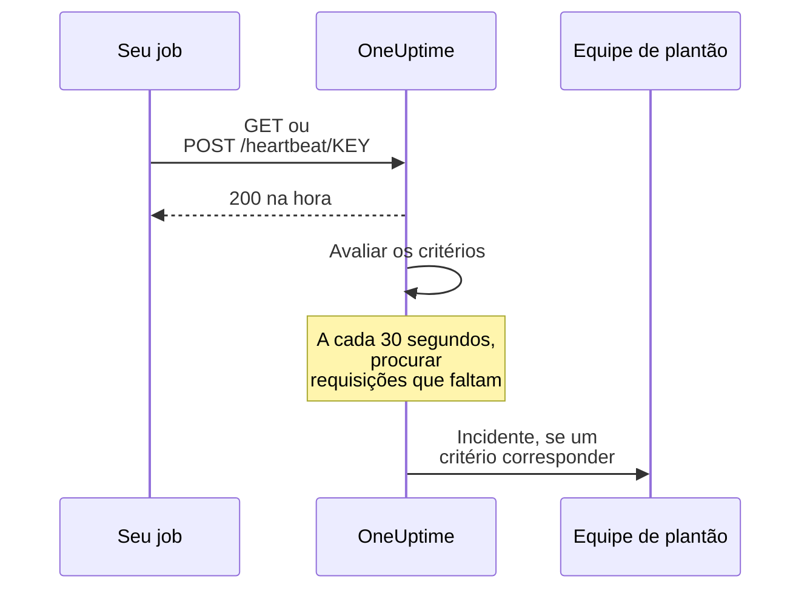

# Monitor de requisições recebidas

Um monitor de requisições recebidas dá a você uma URL para a qual outros sistemas enviam requisições HTTP. O OneUptime avalia cada requisição com base nos seus critérios e pode mudar o status do monitor, declarar incidentes e acionar sua escala de plantão.

Ele cobre dois trabalhos diferentes:

- **Monitoramento por heartbeat** — um cron job, um worker ou um dispositivo chama a URL periodicamente, e o OneUptime abre um incidente quando as chamadas param de chegar.
- **Receber alertas de outro sistema** — Prometheus Alertmanager, Grafana ou qualquer coisa capaz de enviar JSON por POST envia seus alertas, e o OneUptime transforma cada um em um incidente com escalonamento de plantão e resolução automática na recuperação.

Os dois usam o mesmo tipo de monitor. O que os separa são os critérios que você configura.

:::cards
- [Criar o monitor](#criar-um-monitor-de-requisições-recebidas): Obtenha uma URL de heartbeat em poucos passos.
- [Enviar um heartbeat](#enviar-um-heartbeat): Pelo curl, cron, Node.js, Python ou Go.
- [Alertar quando as chamadas param](#marcar-como-offline-se-não-houver-heartbeat-em-10-minutos-um-interruptor-de-homem-morto): Transforme o monitor em um interruptor de homem morto.
- [Receber alertas](#receber-alertas-de-outro-sistema): Um incidente por alerta do Alertmanager ou do Grafana.
- [Assinar o SNS ou o Event Grid](#assinar-o-amazon-sns-ou-o-azure-event-grid): Confirme a assinatura com um clique.
:::

## Como funciona

Nada verifica seu sistema de fora: seu sistema chama a URL do monitor, o OneUptime responde na hora e depois avalia a requisição com base nos critérios do monitor. Um critério que procura requisições que *pararam* de chegar também é reavaliado em segundo plano a cada 30 segundos, para que o silêncio também possa abrir um incidente.



Use-o para:

- Monitorar cron jobs e tarefas agendadas
- Verificar se os workers em segundo plano estão rodando
- Monitorar serviços atrás de firewalls que não podem ser alcançados de fora
- Receber alertas do Prometheus Alertmanager, do Grafana e de outros sistemas de alerta
- Acompanhar sinais de heartbeat de qualquer sistema capaz de usar HTTP

## Criar um monitor de requisições recebidas

:::steps
### Começar um novo monitor

Vá para **Monitores** e clique em **Criar monitor**.

### Escolher Requisição recebida

Em **Tipo de monitor**, escolha **Requisição recebida**: ele é um dos tipos comuns no topo. Digite um **Nome** e clique em **Próximo**.

### Revisar os critérios

A etapa **Critérios** começa com [os critérios padrão](#o-que-você-recebe-de-saída). Para um heartbeat, clique em **Adicionar critérios** e dê ao novo critério um filtro **Requisição recebida** / **Não recebido em minutos** que mude o status para offline e declare um incidente, com **Resolver incidente automaticamente** ligado. Depois arraste-o para o topo da lista: veja [Critérios de exemplo](#critérios-de-exemplo) para entender por quê.

### Criar o monitor

Clique em **Criar monitor**. O monitor abre na página **Visão geral**, onde o cartão **Send the first heartbeat** mostra a **Heartbeat URL** com um botão de copiar e um comando `curl` de exemplo.

### Enviar a primeira requisição

Configure seu serviço para enviar requisições a essa URL (veja [Enviar um heartbeat](#enviar-um-heartbeat)). Quando a primeira requisição chega, o cartão dá lugar ao histórico do monitor, e um cartão **Heartbeat URL** mostra a URL e quando chegou a última requisição.
:::

> [!NOTE]
> A URL contém a chave secreta do monitor, então só as pessoas que podem editar monitores conseguem vê-la. Você pode encontrá-la de novo a qualquer momento na página **Documentação** do monitor, na seção **Configuração** do menu lateral.

## A URL de requisição

Seu monitor tem uma URL única neste formato:

```text
https://oneuptime.com/heartbeat/YOUR_SECRET_KEY
```

Substitua `https://oneuptime.com` pela URL da sua instância do OneUptime se ela for auto-hospedada.

Envie requisições **GET** ou **POST** para essa URL. HEAD é aceito e tratado como GET; PUT, PATCH e DELETE retornam 404. A chave secreta no caminho é a credencial: não é preciso cabeçalho nem token, a menos que o projeto [exija um segredo em toda requisição](#exigir-um-segredo-em-toda-requisição). Query strings são ignoradas: envie o que os critérios devem ler no corpo ou nos cabeçalhos.

> [!WARNING]
> Qualquer pessoa que conheça essa URL pode marcar o monitor como saudável, então trate-a como um segredo. Se ela vazar, abra a página **Configurações** do monitor e clique em **Redefinir chave secreta de requisição recebida**, depois atualize cada remetente. A visão geral do monitor mostra a última requisição como os registros dele a guardam: com segredos e dados pessoais mascarados, e sem cabeçalhos nem corpo quando **Manter o conteúdo da solicitação** está desligado. O mascaramento reconhece os nomes e padrões que conhece, então não envie chaves de API nem tokens para esse endpoint.

> [!IMPORTANT]
> O OneUptime responde `200` com um objeto JSON vazio (`{}`) na hora e processa a requisição em uma fila. Essa resposta é escrita antes de qualquer validação, então um `200` **não** confirma que a requisição foi aceita: uma chave secreta errada, um monitor excluído e um monitor desativado também retornam `200`. Confira a linha do tempo do monitor para confirmar que as requisições estão chegando. Um projeto que exige um segredo em toda requisição responde `401` a uma requisição sem nenhum, e um serviço que verifica a URL antes de entregar algo recebe a resposta que espera: veja [Serviços que verificam a URL primeiro](#serviços-que-verificam-a-url-primeiro).

### Enviar um corpo de requisição

Se você quiser acessar campos dentro do corpo (`{{requestBody.status}}` em um título de incidente, um caminho JSON no agrupamento de incidentes ou um critério de expressão JavaScript), envie `Content-Type: application/json`. É o formato que esta documentação pressupõe o tempo todo. O corpo precisa ser um objeto ou um array JSON: um JSON malformado, ou um valor solto como `"error"`, é recusado com um `500`.

| Tipo de conteúdo | O que critérios e modelos veem |
| --- | --- |
| `application/json` | O JSON analisado. |
| `application/x-www-form-urlencoded` | O formulário analisado. Chaves entre colchetes são aninhadas (`alerts[0][status]=firing`), e cada valor é uma string. |
| `text/plain` | O JSON analisado, quando o texto é um objeto ou um array JSON: o Amazon SNS envia suas mensagens assim. Qualquer outro texto é o próprio texto, então `backup failed: error 42` deixa o monitor offline com os critérios padrão. |
| `application/cloudevents+json`, ou outro tipo `+json` | O JSON analisado: o Azure Event Grid entrega CloudEvents assim. |
| Qualquer outro, ou nenhum | Um corpo vazio (`{}`), então nenhuma referência a `requestBody` é resolvida, e um modelo a imprime literalmente. |

Corpos de até 50 MB são aceitos; um maior é recusado com um `413`. Não comprima o corpo com `Content-Encoding: gzip`: ele não é armazenado como JSON, e os caminhos dentro dele não serão resolvidos.

### Enviar um heartbeat

Cada exemplo envia uma requisição. Substitua `YOUR_SECRET_KEY` pela chave da URL do seu monitor.

:::tabs
@tab curl
```bash
# Simple GET request
curl https://oneuptime.com/heartbeat/YOUR_SECRET_KEY

# POST request with a JSON body
curl -X POST https://oneuptime.com/heartbeat/YOUR_SECRET_KEY \
  -H "Content-Type: application/json" \
  -d '{"status": "healthy", "version": "1.2.3"}'
```
@tab Cron
```bash
# Send a heartbeat every 5 minutes
*/5 * * * * curl -fsS https://oneuptime.com/heartbeat/YOUR_SECRET_KEY > /dev/null

# Or ping only when the job succeeds, so a failed run counts as a missed heartbeat
0 2 * * * /usr/local/bin/backup.sh && curl -fsS https://oneuptime.com/heartbeat/YOUR_SECRET_KEY > /dev/null
```
@tab Node.js
```javascript title="heartbeat.mjs"
// Node.js 18 or later: fetch is built in. Run with `node heartbeat.mjs`.
const response = await fetch(
  "https://oneuptime.com/heartbeat/YOUR_SECRET_KEY",
  {
    method: "POST",
    headers: { "Content-Type": "application/json" },
    body: JSON.stringify({ status: "healthy", version: "1.2.3" }),
  },
);

console.log(response.status); // 200
```
@tab Python
```python title="heartbeat.py"
# Python 3, standard library only. Run with `python3 heartbeat.py`.
import json
import urllib.request

request = urllib.request.Request(
    "https://oneuptime.com/heartbeat/YOUR_SECRET_KEY",
    data=json.dumps({"status": "healthy", "version": "1.2.3"}).encode(),
    headers={"Content-Type": "application/json"},
    method="POST",
)

with urllib.request.urlopen(request, timeout=10) as response:
    print(response.status)  # 200
```
@tab Go
```go title="heartbeat.go"
// Run with `go run heartbeat.go`.
package main

import (
	"bytes"
	"fmt"
	"net/http"
)

func main() {
	body := []byte(`{"status": "healthy", "version": "1.2.3"}`)

	resp, err := http.Post(
		"https://oneuptime.com/heartbeat/YOUR_SECRET_KEY",
		"application/json",
		bytes.NewReader(body),
	)
	if err != nil {
		panic(err)
	}
	defer resp.Body.Close()

	fmt.Println(resp.StatusCode) // 200
}
```
@tab PowerShell
```powershell
# Windows PowerShell 5.1 or PowerShell 7
Invoke-RestMethod -Method Post `
  -Uri "https://oneuptime.com/heartbeat/YOUR_SECRET_KEY" `
  -ContentType "application/json" `
  -Body '{"status": "healthy", "version": "1.2.3"}'
```
:::

## Exigir um segredo em toda requisição

Qualquer pessoa que tenha a URL de um monitor pode enviar requisições a ele. Um Proprietário do projeto ou Administrador do projeto pode fazer cada monitor de requisições recebidas do projeto exigir também um dos segredos do próprio projeto, não importa quem configurou o monitor: ative **Exigir um segredo em toda requisição**. Uma requisição sem nenhum é recusada com `401` e o motivo, antes de contar como heartbeat, de ser guardada como a última requisição do monitor ou de chegar a qualquer critério. Uma requisição com um segue para os critérios do próprio monitor, como antes.

Os Proprietários do projeto e os Administradores do projeto gerenciam os segredos e o interruptor, assim como uma função personalizada com as permissões Create, Read, Edit e Delete Incoming Request Secret: Read mostra os valores dos segredos, e Edit também liga e desliga o interruptor.

:::steps
### Crie um segredo

Vá em **Monitores → Configurações → Segredos de requisição recebida** e crie um segredo. Dê um nome a ele e o OneUptime gera o valor; copie-o da lista.

### Envie-o de cada remetente

Envie o segredo no cabeçalho `X-OneUptime-Secret`, ou como token Bearer no cabeçalho `Authorization`, conforme o que seu remetente conseguir definir. Um remetente que não consegue definir um cabeçalho próprio pode, em vez disso, assinar cada requisição com o segredo: veja [Assinar as requisições com o segredo](#assinar-as-requisições-com-o-segredo).

### Encontre os remetentes que faltam

Assim que o projeto tem um segredo, o OneUptime verifica cada requisição, ainda sem recusar nenhuma. **Requisições sem segredo**, na mesma página, lista cada monitor de requisições recebidas que recebeu uma requisição sem um segredo válido nas últimas 24 horas, e por quê: nenhum segredo foi enviado, ou um errado. Corrija esses remetentes. Um monitor cujos remetentes foram corrigidos mostra em **Última com segredo** um horário posterior ao de **Última sem segredo**, e sai da lista em até 24 horas.

### Ative a exigência

Ative **Exigir um segredo em toda requisição**. A exigência não pode ser ativada enquanto o projeto não tiver nenhum segredo, para que nenhum remetente seja recusado por engano. Antes de ativar, ela diz quantos monitores de requisições recebidas receberam uma requisição sem um segredo válido nas últimas 24 horas, se houver: os remetentes deles são recusados a partir de então.
:::

```bash
curl -X POST https://oneuptime.com/heartbeat/YOUR_SECRET_KEY \
  -H "X-OneUptime-Secret: YOUR_PROJECT_SECRET"

# Or as a bearer token
curl -X POST https://oneuptime.com/heartbeat/YOUR_SECRET_KEY \
  -H "Authorization: Bearer YOUR_PROJECT_SECRET"
```

O OneUptime nunca guarda o segredo: ele tira o cabeçalho da requisição e mascara um token Bearer que seja um dos segredos do projeto antes de guardar qualquer coisa.

Um endereço que envia a um monitor mais de 10 segredos errados diferentes em 15 minutos é recusado em seguida com `429` para qualquer segredo que envie, certo ou errado, até a hora que o cabeçalho `Retry-After` indicar, no máximo 15 minutos. Remetentes em outros endereços não são afetados, e um remetente que continua enviando um segredo antigo continua recebendo o `401` que diz o que está errado.

> [!TIP]
> Para substituir um segredo sem recusar ninguém, crie um segundo, passe seus remetentes para ele e depois exclua o antigo quando o **Último uso** dele parar de mudar. Qualquer segredo do projeto é aceito, a menos que esteja limitado a outros monitores, e o último que cobre um monitor não pode ser excluído enquanto a exigência estiver ativa.

### Assinar as requisições com o segredo

Um remetente pode assinar cada requisição com o segredo em vez de enviá-lo, o que é mais seguro: nada secreto trafega, e uma requisição que alguém capturou não pode ser enviada de novo depois. Prefira isso sempre que um remetente souber assinar. O OneUptime verifica estas assinaturas, cada uma um HMAC-SHA256 em hexadecimal com o segredo como chave:

| Remetente | Cabeçalho | O que é assinado |
| --- | --- | --- |
| Seu próprio código | `X-OneUptime-Signature: t=<time>,v1=<signature>` | `<time>.<body>` |
| Webhooks do GitHub | `X-Hub-Signature-256` | O corpo |
| Slack | `X-Slack-Signature`, com `X-Slack-Request-Timestamp` | `v0:<time>:<body>` |
| Stripe | `Stripe-Signature` | `<time>.<body>` |

`<time>` é o momento em que a requisição foi assinada, em segundos desde 1970. Uma assinatura a mais de 5 minutos do relógio do OneUptime é recusada, assim como uma requisição assinada enviada uma segunda vez; a assinatura do GitHub não tem horário, então o OneUptime lembra cada uma por um dia. Para o GitHub, dê ao webhook um dos segredos do projeto como segredo dele. Slack e Stripe criam o próprio segredo de assinatura: crie o segredo do projeto com esse valor, em **Mais campos**.

```bash
body='{"status":"healthy"}'
t=$(date +%s)
sig=$(printf '%s.%s' "$t" "$body" | openssl dgst -sha256 -hmac "YOUR_PROJECT_SECRET" | sed 's/^.* //')

curl -X POST https://oneuptime.com/heartbeat/YOUR_SECRET_KEY \
  -H "Content-Type: application/json" \
  -H "X-OneUptime-Signature: t=$t,v1=$sig" \
  -d "$body"
```

Um segredo na query string da URL não é aceito: proxies e logs de acesso guardam as URLs inteiras, ao lado da chave do próprio monitor. O ingress de requisições recebidas de uma sonda encaminha o corpo de uma requisição assinada como ele chegou, então a assinatura vale também por esse caminho.

### Limitar um segredo a alguns monitores

Um segredo é aceito por todo monitor de requisições recebidas do projeto, a menos que você o limite, como faz um projeto cujos inquilinos enviam cada um o próprio segredo: em **Mais campos**, escolha **Monitores específicos** ou **Monitores com rótulos**. Qualquer outro monitor o recusa com `401`, como recusa um segredo errado, e **Requisições sem segredo** dá o motivo como **Segredo não vale para este monitor**. Enquanto a exigência estiver ativa, o projeto mantém pelo menos um segredo que cobre um monitor.

## Critérios de monitoramento

Você pode configurar critérios para determinar quando seu serviço é considerado online, degradado ou offline. Cada filtro de critério tem um **Tipo de filtro** (o que olhar), uma **Condição do filtro** (como comparar) e um **Valor**.

### O que você recebe de saída

Um novo monitor de requisições recebidas é criado com dois critérios que leem o corpo da requisição:

| Critério | Tipo de filtro | Condição do filtro | Valor | Efeito |
| -------- | ------------ | ---------------- | ------- | -------------------------------------------- |
| Offline  | Corpo da Requisição | Contém | `error` | Marca o monitor como offline, abre um incidente |
| Online   | Corpo da Requisição | Não contém | `error` | Marca o monitor como online |

Isso atende ao caso comum em que o remetente informa a própria saúde no payload: uma requisição cujo corpo menciona `error` deixa o monitor offline, e a próxima requisição sem essa palavra o traz de volta e resolve o incidente. Uma requisição sem corpo nenhum conta como "não contém `error`", então uma simples chamada de heartbeat mantém o monitor online.

Troque o valor pelo que seu remetente realmente emite (`"status":"firing"`, `FAILED` e assim por diante): a correspondência é uma busca de substring que diferencia maiúsculas de minúsculas em todo o corpo, chaves incluídas, então `{"error":null}` também corresponde a `error`.

> [!NOTE]
> Esses critérios padrão **não** são um interruptor de homem morto: nada aqui dispara quando as requisições param de chegar. Se você quiser ser alertado sobre o silêncio, adicione um critério **Requisição recebida** / **Não recebido em minutos** como descrito abaixo.

### Tipos de filtro disponíveis

| Tipo de filtro | Verifica | Observações |
| --------------------- | ------------------------------------------------------ | -------------------------------------------------------------------------------------------- |
| Requisição recebida | Se uma requisição foi recebida dentro de uma janela de tempo | A única verificação que pode disparar quando nada chega |
| Corpo da Requisição | O corpo da requisição | Busca de substring. Corpos de objeto são comparados como JSON compacto |
| Cabeçalho da requisição | Os nomes dos cabeçalhos da requisição | Correspondência exata com um nome de cabeçalho inteiro, sem diferenciar maiúsculas de minúsculas |
| Valor do cabeçalho da requisição | Os valores dos cabeçalhos da requisição | Correspondência exata com um valor de cabeçalho inteiro, sem diferenciar maiúsculas de minúsculas |
| Expressão JavaScript | Qualquer expressão sobre `requestBody` e `requestHeaders` | A opção mais flexível: veja [Expressões JavaScript](/docs/monitor/javascript-expression) |

### Condições do filtro

Cada tipo de filtro oferece suas próprias condições:

| Tipo de filtro | Condições |
| --- | --- |
| **Requisição recebida** | **Recebido em minutos**: uma requisição foi recebida dentro do número de minutos informado. **Não recebido em minutos**: nenhuma requisição foi recebida dentro do número de minutos informado. |
| **Corpo da Requisição**, **Cabeçalho da requisição**, **Valor do cabeçalho da requisição** | **Contém** e **Não contém** |
| **Expressão JavaScript** | **Resulta em verdadeiro** |

> [!NOTE]
> Nomes e valores de cabeçalhos são comparados em minúsculas, com o nome ou o valor inteiro, não com uma substring: `application/json` não corresponde a `application/json; charset=utf-8`. Só **Corpo da Requisição** faz busca de substring. Os cabeçalhos que seu proxy ou o balanceador de carga do OneUptime adicionam (`x-forwarded-for`, `x-real-ip`) também são armazenados.

Corpos de objeto são comparados como JSON compacto sem espaços, então um filtro **Corpo da Requisição** / **Contém** precisa ser escrito `"status":"firing"`: copiar `"status": "firing"` de um payload formatado nunca vai corresponder.

### Critérios de exemplo

#### Marcar como offline se não houver heartbeat em 10 minutos (um interruptor de homem morto)

| Campo | Valor |
| --- | --- |
| **Tipo de filtro** | Requisição recebida |
| **Condição do filtro** | Não recebido em minutos |
| **Valor** | `10` |

#### Marcar como degradado com base no conteúdo do corpo da requisição

| Campo | Valor |
| --- | --- |
| **Tipo de filtro** | Corpo da Requisição |
| **Condição do filtro** | Contém |
| **Valor** | `"status":"degraded"` |

> [!IMPORTANT]
> Coloque o interruptor de homem morto **acima** dos critérios padrão. Os critérios são verificados de cima para baixo, e o primeiro que corresponde decide. A verificação em segundo plano relê a última requisição, então o critério online padrão ("Corpo da Requisição Não contém `error`") continua correspondendo a ela, e um critério abaixo dele nunca tem sua vez. **Adicionar critérios** adiciona um critério no final: arraste-o para cima.

> [!WARNING]
> Um monitor só é reavaliado em segundo plano se pelo menos um dos seus critérios verificar **Requisição recebida**. Um monitor cujos critérios só verificam o corpo da requisição, Cabeçalho da requisição ou uma expressão JavaScript é avaliado quando uma requisição chega e em nenhum outro momento, então nunca pode ficar offline sozinho. Se você quer um alarme de heartbeat ausente, precisa de um critério **Requisição recebida**.

A verificação em segundo plano conta minutos inteiros e dispara quando passou *mais* que o valor: "Não recebido em minutos: 10" dispara cerca de 11 minutos depois da última requisição (a verificação roda a cada 30 segundos). Um monitor que nunca recebeu uma requisição é tratado como se a hora de criação fosse a última requisição, então o mesmo critério em um monitor recém-criado dispara cerca de 11 minutos depois da criação, mesmo que o remetente nunca tenha sido configurado. Só contam os minutos em que o OneUptime estava recebendo: os minutos em que o próprio OneUptime reinicia, é atualizado ou se recupera de atrasos não contam, como explica [Quando o OneUptime não recebe dados](/docs/monitor/when-oneuptime-is-not-receiving).

## Receber alertas de outro sistema

Alertmanager, Grafana e ferramentas parecidas enviam por POST um documento JSON que descreve um ou mais alertas. Por padrão, um critério abre **um** incidente, então um payload com cinco alertas geraria um único incidente. O agrupamento de incidentes muda isso: ele extrai um valor do payload e abre um **incidente separado para cada valor distinto**, todos podendo estar abertos ao mesmo tempo.

```mermaid title="Agrupamento de incidentes: um incidente por alerta do payload"
flowchart TB
    payload["Payload do webhook"] --> keys["Uma chave por alerta"]
    keys --> state{"Alerta resolvido?"}
    state -->|Não| open["Abrir ou manter o incidente dele"]
    state -->|Sim| resolve["Resolver o incidente dele"]
```

### Ligar o agrupamento de incidentes

:::steps
1. Abra o critério e expanda **Configurações**.
2. Ligue **Group incidents and alerts by a payload field**.
3. Preencha **Open a separate incident for each…**. Para que cada incidente se resolva sozinho, preencha também o campo e o valor em **Auto-resolve each incident when…** (abaixo). Depois, salve o monitor.
:::

| Campo | Exemplo | O que faz |
| ---------------------------------- | ---------------------------------------- | ---------------------------------------------------------------------- |
| Open a separate incident for each… | `requestBody.alerts[*].labels.alertname` | O caminho cujos valores distintos separam os incidentes |
| Field that signals recovery | `requestBody.alerts[*].status` | O caminho verificado para decidir que um alerta se recuperou |
| Value that means recovered | `resolved` | O valor exato que marca a recuperação |
| Max incidents per request | `100` (padrão) | Limite de segurança para que um campo com muitos valores não abra incidentes sem limite |

O agrupamento pertence ao critério em que está ligado. Os outros critérios do monitor não agrupam: quando um deles corresponde a uma solicitação, abre o seu incidente e o seu alerta como faria em um monitor em que nenhum critério agrupa.

### Sintaxe dos caminhos

Os caminhos precisam começar com o prefixo literal `requestBody.`. Um caminho sem ele, como `alerts[*].labels.alertname`, não encontra valor em nenhuma solicitação. O invólucro `{{ }}` é opcional: `requestBody.status` e `{{requestBody.status}}` se comportam igual.

- `[*]` se expande sobre um array: um incidente por valor **distinto**. Dois elementos que dão o mesmo valor se fundem em um único incidente, e o estado dele (disparado/resolvido) vem do **primeiro** elemento correspondente. **Só o primeiro `[*]` de um caminho é um curinga**; `requestBody.groups[*].alerts[*].name` não corresponde a nada.
- `[0]` e `[last]` selecionam um único elemento, e podem vir depois de um `[*]`.
- Valores de objeto e de array, strings vazias e valores nulos são ignorados. `0` e `false` são chaves válidas.
- O corpo precisa ser um objeto JSON; um payload cujo nível superior é um array não é agrupado.

### Solicitações sem o campo

Uma solicitação que corresponde a um critério agrupado, mas não tem valor no caminho dele (o campo está ausente ou vazio, contém um objeto ou uma lista, ou o corpo não é um objeto JSON), ainda abre o incidente e o alerta desse critério: um só para o monitor inteiro, como o critério faria sem agrupamento. O mesmo vale para um critério agrupado que corresponde porque as solicitações pararam de chegar. Um título que cita a variável de agrupamento, como `{{alertname}}`, mostra-a como está escrita, pois não há valor para pôr no lugar.

Esse incidente é resolvido, se **Resolver incidente automaticamente** estiver ligado, quando uma solicitação posterior sem o campo informa que se recuperou, ou quando uma solicitação posterior corresponde a outro critério. Essa recuperação não abre nada novo.

Quando alguns elementos de um array têm valor e outros não, cada valor abre o seu próprio incidente, e os elementos sem valor não abrem nada por conta própria.

O cartão **Resumo do monitor** na **Visão geral** do monitor mostra o que cada solicitação fez, inclusive quando um critério a tratou para o monitor inteiro ou não abriu nada novo.

### A resolução é orientada a eventos

Um webhook descreve apenas o que está naquele payload, então o OneUptime nunca resolve um incidente porque a chave dele deixou de aparecer. Um incidente só é resolvido quando um payload diz explicitamente que aquela chave se recuperou. As duas coisas precisam ser verdadeiras:

1. **Field that signals recovery** e **Value that means recovered** estão definidos e correspondem ao payload. A comparação é exata e diferencia maiúsculas de minúsculas: `Resolved` não corresponde a `resolved`.
2. O incidente do critério tem **Resolver incidente automaticamente** ligado, em **Mais campos** no formulário do incidente. Sem isso, os eventos de recuperação correspondentes são ignorados e os incidentes ficam abertos. (O mesmo vale para alertas e **Resolver alerta automaticamente**.) O critério offline padrão já começa com isso ligado; um incidente que você mesmo adiciona a um critério começa com a opção desligada.

Um alerta que você mesmo adiciona a um critério também começa com **Resolver alerta automaticamente** desligado, então uma recuperação deixa o alerta aberto até que a opção seja ligada. **Auto-resolve each incident when…** mostra quais incidentes e alertas do critério uma recuperação resolve e nomeia cada um que ela deixaria aberto, com um botão que liga a opção correspondente. O cartão **Resumo do monitor** na **Visão geral** do monitor nomeia cada incidente e alerta que uma recuperação deixou aberto, e o motivo.

Uma recuperação resolve apenas os incidentes e alertas do critério que a lê: aquele cujos **Field that signals recovery** e **Value that means recovered** correspondem ao payload. Os incidentes e alertas de outro critério para o mesmo valor continuam abertos, e os de um critério que deixa esses campos em branco são resolvidos manualmente.

**Max incidents per request** limita a extração, não só a criação. As chaves além do limite também ficam invisíveis para a recuperação, então, em um payload com mais chaves distintas que o limite, um alerta que informe `resolved` além dele não vai fechar o incidente dele.

> [!NOTE]
> Um monitor com um critério que agrupa por um campo do payload avalia cada requisição que recebe, uma de cada vez e na ordem em que chegaram, então uma rajada de alertas e recuperações abre e resolve o incidente e o alerta de cada valor. Até 1.000 requisições, ou 16 MB delas, esperam para ser avaliadas; além disso, as mais antigas em espera são puladas, e o cartão **Resumo do monitor** diz quantas. Um monitor sem agrupamento avalia apenas a mais recente das requisições que o esperam.

> [!NOTE]
> Se **Field that signals recovery** contém `[*]` mas **Open a separate incident for each…** não, uma solicitação só se recuperou quando todos os elementos daquele array dizem isso. Com `requestBody.alerts[*].status` e `resolved`, um incidente agrupado por `requestBody.groupLabels.alertname` é resolvido quando todos os alertas de uma solicitação estão resolvidos, e continua aberto enquanto algum ainda estiver disparado.

> [!WARNING]
> Um caminho de recuperação sem `[*]` é avaliado no payload inteiro, então um `status: resolved` no nível do payload resolve todas as chaves daquele payload, inclusive alertas cujo próprio status ainda está disparado.

### Dar nome aos incidentes

A chave de agrupamento fica disponível para os modelos de incidente e de alerta como uma variável com o nome do **último segmento do caminho**:

| Caminho | Variável |
| ---------------------------------------- | ----------------- |
| `requestBody.alerts[*].labels.alertname` | `{{alertname}}`   |
| `requestBody.alerts[*].fingerprint`      | `{{fingerprint}}` |
| `requestBody.commonLabels.severity`      | `{{severity}}`    |

O payload completo fica disponível ao lado dela, então funcionam tanto um título de incidente `{{alertname}}` quanto uma descrição que faça referência a `{{requestBody.commonAnnotations.summary}}`. Veja [Modelos de incidentes e alertas](/docs/monitor/incident-alert-templating).

> [!WARNING]
> O nome da variável faz parte da identidade que o OneUptime usa para associar um evento de recuperação a um incidente aberto. Trocar o caminho de agrupamento por um com outro último segmento deixa órfãos todos os incidentes abertos com o caminho antigo: eles não podem mais ser resolvidos automaticamente e precisam ser fechados à mão.

`[*]` funciona **só** nos dois campos de caminho de agrupamento. Em qualquer outro lugar ele não é resolvido, e um placeholder não resolvido é impresso **literalmente** em vez de ficar vazio: um título `{{requestBody.alerts[*].labels.alertname}}` aparece com as chaves. Um título `{{requestBody.alerts[0].annotations.summary}}` é resolvido, mas sempre lê o primeiro alerta do payload, não aquele para o qual este incidente foi aberto. Prefira a variável de agrupamento mais os campos compartilhados `commonAnnotations` do payload.

### Exemplo completo

Para uma configuração completa do Alertmanager, veja [Prometheus Alertmanager](/docs/integrations/prometheus-alertmanager). Para o Grafana, veja [Grafana](/docs/integrations/grafana).

## Serviços que verificam a URL primeiro

Alguns serviços verificam um novo endpoint antes de entregar algo a ele: enviam uma requisição e só entregam quando ele responde do jeito que esperam. O OneUptime responde a essas verificações sozinho, então basta colar a **Heartbeat URL** do monitor no serviço.

| Serviço | A verificação | O que o OneUptime responde |
| --- | --- | --- |
| Azure Event Grid, esquema Event Grid | Um `SubscriptionValidationEvent` | O `validationCode` dele, como `validationResponse` |
| Azure Event Grid, esquema CloudEvents | Uma requisição `OPTIONS` que nomeia sua origem | `WebHook-Allowed-Origin`, com essa origem |
| API de eventos do Slack | Uma requisição `url_verification` | O `challenge` dela |
| Notificações de alteração do Microsoft Graph | Um `POST` com um `validationToken` | O token, como `text/plain` |
| Event hooks do Okta | Um `GET` com `X-Okta-Verification-Challenge` | O desafio, como `verification` |

Uma verificação só é respondida na URL do próprio monitor, e só quando a requisição conta: em um projeto que exige um segredo em toda requisição, uma verificação que não envia nenhum é recusada com `401`, como qualquer requisição, então o serviço precisa enviar o segredo em um cabeçalho. A resposta contém o que o serviço enviou para ser devolvido, e nada mais da requisição, e só quando tem a forma que o serviço lhe dá.

Uma verificação chega ao monitor como qualquer requisição, então os critérios dele a avaliam e ela aparece na **Visão geral** do monitor; a verificação do CloudEvents é respondida e nada mais. O ingress de requisições recebidas de uma sonda responde a uma verificação como responde a toda requisição, com `{}`, então envie esses serviços para a URL do próprio OneUptime.

## Assinar o Amazon SNS ou o Azure Event Grid

O Amazon SNS não envia nada a um novo endpoint até que alguém confirme a assinatura, abrindo um link que ele envia para lá. O Azure Event Grid também envia um link assim, a um endpoint que não responde à sua verificação, e o OneUptime responde a ela. Quando chega um link que ainda precisa ser aberto, o cartão **Resumo do monitor** na **Visão geral** do monitor mostra o que o serviço está esperando, o tópico e um único botão que abre o link em uma nova aba.

| Serviço | A requisição | Botão | O link funciona por |
| --- | --- | --- | --- |
| Amazon SNS | `SubscriptionConfirmation`, para uma nova assinatura HTTPS | **Confirmar assinatura** | Dois dias |
| Amazon SNS | `UnsubscribeConfirmation`, quando a assinatura é excluída | **Restaurar assinatura** | Dois dias |
| Azure Event Grid | `SubscriptionValidationEvent`, para uma nova assinatura de evento de webhook | **Validar assinatura** | 10 minutos |

O botão continua lá até a próxima requisição do monitor chegar, mesmo depois que você abre o link. Quando o prazo do link acaba, o cartão diz, em vez disso, como obter um novo. Se chegaram requisições mais novas, abra **Registros de monitoramento** e clique em **Ver resumo** na linha da requisição.

O link, e o token que ele contém, ficam sem máscara em todo lugar onde a requisição é guardada: nos detalhes dela, nos registros dela e nos incidentes e alertas que ela abre. Tudo o que o link pode fazer é iniciar as entregas para este monitor. Só conta um link para o endereço do próprio serviço: qualquer outro é mascarado como de costume e não ganha botão.

### Amazon SNS

:::steps
1. No console do Amazon SNS, abra o tópico e escolha **Create subscription**. Escolha `HTTPS` como protocolo e cole a **Heartbeat URL** do monitor como endpoint.
2. Abra a **Visão geral** do monitor e clique em **Confirmar assinatura** no cartão **Resumo do monitor**. No console do SNS, a assinatura passa de **Pending confirmation** para confirmada.
:::

O SNS envia suas mensagens como JSON rotulado `text/plain`, e o monitor as lê como JSON, então critérios, modelos e o agrupamento de incidentes podem usar os campos delas, como `{{requestBody.Subject}}` e `{{requestBody.Message}}`. O JSON próprio de uma notificação, como o de um alarme do CloudWatch, chega como texto em `Message`.

Se o cartão disser que o link não pode mais ser aberto, selecione a assinatura no console do SNS e escolha **Request confirmation**. O SNS exclui uma assinatura que não é confirmada em 48 horas; se isso acontecer, crie a assinatura de novo.

### Azure Event Grid

:::steps
1. No portal do Azure, abra o recurso cujos eventos você quer receber e adicione uma assinatura de evento. Escolha **Event Grid Schema** ou **Cloud Event Schema v1.0** como esquema de evento, **Web Hook** como tipo de endpoint e a **Heartbeat URL** do monitor como endpoint.
2. Crie a assinatura de evento. O OneUptime responde à verificação do Event Grid, então a assinatura é validada ao ser criada, e os eventos dela começam a chegar.
:::

O Event Grid valida um endpoint que lhe devolve um código, ou cujo dono abre o link que ele envia. O OneUptime devolve o código, então o cartão **Resumo do monitor** oferece **Validar assinatura** só para uma validação que o OneUptime não respondeu: abra-o em até 10 minutos. O link aponta para o Event Grid na porta 553, que um firewall na frente do seu navegador precisa permitir. Se os 10 minutos passarem antes, a assinatura de evento falha: crie-a de novo.

## Boas práticas

1. **Defina bem a janela de tempo**: se seu cron job roda a cada 5 minutos, defina o limite "Não recebido em minutos" em 10–15 minutos para acomodar atrasos ocasionais, e coloque esse critério em primeiro lugar.
2. **Inclua dados úteis**: envie informações de status no corpo da requisição para poder montar critérios detalhados.
3. **Use POST com `Content-Type: application/json`**: tudo o que lê dentro do corpo depende disso.
4. **Não misture os dois trabalhos em um monitor**: um monitor que recebe alertas orientados a eventos não tem uma cadência regular, então um critério "Não recebido em minutos" nele ficaria oscilando. Use um monitor separado para o interruptor de homem morto.
5. **Monitore o monitor**: garanta que o serviço que envia as requisições trate bem os erros, para que requisições que falharam não passem despercebidas.

## Solução de problemas

:::details Meu remetente recebe 200, mas nada aparece no monitor
O `200` é enviado antes de a requisição ser validada, então não prova que ela foi aceita. Confira se a chave secreta da URL corresponde à **Heartbeat URL** do monitor, e se o monitor não está desativado. Depois, olhe a linha do tempo do monitor para ver se as requisições estão chegando.
:::

:::details Meu remetente recebe um 401
O projeto exige um segredo em toda requisição, e a requisição não enviou nenhum, ou enviou um que não é do projeto: a resposta diz qual dos dois. Envie um dos segredos do projeto no cabeçalho `X-OneUptime-Secret` ou como token Bearer, como mostra [Exigir um segredo em toda requisição](#exigir-um-segredo-em-toda-requisição). Uma requisição recusada nunca chega ao monitor. Ela também recebe `401` com um dos segredos do projeto limitado a outros monitores, e uma requisição assinada cuja assinatura tem mais de 5 minutos, já foi enviada antes, ou foi feita com outro segredo ou sobre um corpo que mudou no caminho.
:::

:::details Meu remetente recebe um 429
O endereço dele enviou a um monitor mais de 10 segredos ou assinaturas errados diferentes em 15 minutos, então toda requisição com um segredo que ele envia a esse monitor é recusada até a hora do cabeçalho `Retry-After`. Um remetente que assina com um segredo errado gera uma nova assinatura errada a cada vez e chega aqui rápido: dê a ele um segredo que o monitor aceite, como mostra [Exigir um segredo em toda requisição](#exigir-um-segredo-em-toda-requisição), e as requisições dele são aceitas quando o tempo acabar.
:::

:::details O monitor parou de receber requisições depois que um segredo passou a ser exigido
Seus remetentes não enviam nenhum segredo, ou enviam um errado, então toda requisição que eles enviam é recusada. Uma linha abaixo da **Heartbeat URL** do monitor diz quando chegou a última requisição recusada, e **Requisições sem segredo** lista cada monitor que recebeu uma nas últimas 24 horas, e por quê. Envie um dos segredos do projeto a partir desses remetentes, como mostra [Exigir um segredo em toda requisição](#exigir-um-segredo-em-toda-requisição).
:::

:::details O monitor nunca fica offline quando os heartbeats param
Só um critério **Requisição recebida** (**Não recebido em minutos**) consegue perceber o silêncio. Adicione um, se não houver, e arraste-o para cima dos critérios padrão: o critério online padrão corresponde à última requisição a cada verificação em segundo plano, e o primeiro critério que corresponde decide.
:::

:::details Um filtro Corpo da Requisição nunca corresponde
Envie `Content-Type: application/json`, e escreva o valor como JSON compacto: `"status":"firing"`, sem espaço depois dos dois-pontos. Sem um tipo de conteúdo JSON, de formulário ou `text/plain`, o corpo fica vazio, e um filtro sobre ele nunca corresponde.
:::

:::details Um serviço diz que a URL não respondeu à verificação dele
Dê ao serviço a **Heartbeat URL** do monitor, no próprio OneUptime e não em uma sonda. Se o projeto exige um segredo em toda requisição, a verificação é recusada com `401`, a menos que o serviço envie o segredo. Depois peça ao serviço que verifique a URL de novo: ela é respondida na hora.
:::

:::details Um filtro Cabeçalho da requisição nunca corresponde
Nomes e valores de cabeçalhos são comparados inteiros. Informe o valor completo, como `application/json; charset=utf-8`, em vez de parte dele.
:::

:::details O Amazon SNS diz que a assinatura está aguardando confirmação
Clique em **Confirmar assinatura** no cartão **Resumo do monitor** na **Visão geral** do monitor. Se chegaram requisições mais novas, abra **Registros de monitoramento** e clique em **Ver resumo** na linha da confirmação. Com **Manter o conteúdo da solicitação** desligado, o monitor não guarda nenhum corpo e, portanto, nenhum link: ligue-o nas **Configurações** do monitor, e a última requisição volta a ser mostrada com o link dela.
:::

:::details O remetente recebe 500
A requisição diz `Content-Type: application/json`, mas o corpo dela não é um objeto nem um array JSON. Envie um JSON válido, ou um tipo de conteúdo diferente.
:::

## Próximos passos

:::cards
- [Prometheus Alertmanager](/docs/integrations/prometheus-alertmanager): Uma configuração completa de alertas recebidos.
- [Grafana](/docs/integrations/grafana): O mesmo, para os alertas do Grafana.
- [Modelos de incidentes e alertas](/docs/monitor/incident-alert-templating): Todas as variáveis disponíveis em títulos e descrições.
- [Expressões JavaScript](/docs/monitor/javascript-expression): Sintaxe das expressões e regras de aspas.
:::
