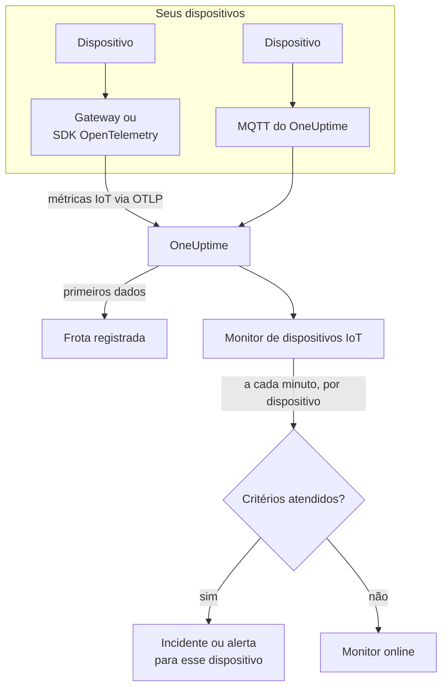

# Monitor de dispositivos IoT

Um monitor de dispositivos IoT observa uma frota de dispositivos e avisa você quando um dispositivo fica offline, a sua bateria fica fraca, o seu sinal enfraquece, ele superaquece ou a sua CPU continua ocupada. Ele lê as métricas `iot_*` que os seus dispositivos enviam ao OneUptime, via OpenTelemetry ou MQTT, então nada é verificado de fora e nenhuma sonda participa.

:::cards
- [Criar o monitor](#criar-um-monitor-de-dispositivos-iot): Seis passos no painel.
- [Modelos](#modelos-de-alerta-prontos): Cinco alertas prontos, um incidente por dispositivo.
- [Detecção de offline](#detecção-de-offline): Como um dispositivo morto ou silencioso é percebido.
- [Métricas](#métricas-coletadas): As séries `iot_*` que o monitor lê.
:::

## Como funciona

Os seus dispositivos, ou o gateway com que eles se comunicam, enviam as suas leituras ao OneUptime: via OpenTelemetry, ou direto para o endpoint MQTT do OneUptime. Cada leitura traz o nome da frota, `iot.fleet.name`, e o ID do próprio dispositivo, `device.id`. Os primeiros dados registram a frota.

Um monitor de dispositivos IoT fica vinculado a uma frota. A cada minuto ele executa a sua consulta sobre as métricas dessa frota e compara o resultado com os seus critérios. Os modelos agrupam por `device.id`, então 30 sensores offline abrem 30 incidentes, cada um com o nome do seu dispositivo, e cada um se resolve sozinho quando o seu dispositivo se recupera.



## Antes de começar

- **Faça os seus dispositivos enviarem dados.** O [guia de dispositivos IoT](/docs/telemetry/iot-devices) mostra como enviar métricas com um SDK ou um Collector do OpenTelemetry, ou via MQTT.
- **Verifique se a frota está registrada.** Ela aparece em **Produtos → Infraestrutura → IoT → All Fleets**, com o nome do `iot.fleet.name` que os dispositivos enviam.
- **Registre os dispositivos que você espera**, no **Device Registry** da frota, para ser avisado quando um ficar em silêncio: veja [Detecção de offline](#detecção-de-offline).

## Criar um monitor de dispositivos IoT

:::steps
### Começar um novo monitor

Vá em **Monitores** e clique em **Criar monitor**.

### Escolher IoT Device

Em **Tipo de monitor**, clique em **Mais tipos de monitor** e escolha **IoT Device** em **Infraestrutura**, ou digite `iot` na caixa de pesquisa. Informe um **Nome** - ele é usado nos títulos de incidentes e alertas - e clique em **Próximo**.

### Escolher a frota

Em **IoT Monitor Configuration**, escolha a frota em **IoT Fleet**. Toda frota que enviou dados está na lista.

### Escolher o que observar

Escolha uma das três abas:

- **Quick Setup** - clique em um [modelo](#modelos-de-alerta-prontos). Ele define a métrica, a agregação, o intervalo de tempo, um agrupamento por `device.id` e os limites, e substitui os critérios abaixo pelos seus. Você ainda pode mudar o **Intervalo de tempo**.
- **Custom Metric** - escolha uma métrica em **IoT Metric** e depois defina **Agregação** e **Intervalo de tempo**. Os [filtros](#configurações-do-monitor) a restringem a um dispositivo ou a um tipo de dispositivo. Uma métrica personalizada não é agrupada: ela avalia a frota como um todo.
- **Avançado** - monte você mesmo consultas e fórmulas em **Selecionar Métricas**, inclusive sobre nomes de métricas próprios, por exemplo a memória em uso como porcentagem do tamanho da memória de um dispositivo. Use **Group by** `device.id` para avaliar cada dispositivo separadamente.

### Conferir os critérios

Abra cada critério em **Critérios do monitor** e confira **Select Metric Variable**, **Agregação**, **Condição** e **Threshold**. Um modelo os preenche. Com **Custom Metric** ou **Avançado**, o monitor começa com os [critérios padrão](#critérios-padrão), que só percebem uma métrica caindo para zero, então defina o seu próprio limite.

### Criar o monitor

Clique em **Criar monitor**. O OneUptime abre a página do monitor e o avalia a cada minuto. Os incidentes e alertas que ele dispara chegam às suas políticas de plantão, Slack, Microsoft Teams, e-mail, SMS e webhooks como os de qualquer outro monitor.
:::

> [!TIP]
> Para configurar vários modelos de uma vez, abra a frota em **Produtos → Infraestrutura → IoT** e vá em **Recommendations**. Escolha os modelos que quiser, decida quem é acionado, e o OneUptime cria um monitor por modelo.

## Configurações do monitor

| Campo | Aba | O que faz |
| --- | --- | --- |
| **IoT Fleet** | Todas | Obrigatório. Restringe cada consulta a `resource.iot.fleet.name`. |
| **Escopo do recurso** | Custom Metric, Avançado | Opcional. **Dispositivo** ou **Fleet**: uma correspondência exata com o atributo `iot.scope`. Escolher uma métrica o define como **Dispositivo**. |
| **Device ID** | Custom Metric, Avançado | Opcional. Um dispositivo, pelo seu `device.id`, como `sensor-001`. |
| **Device Type** | Custom Metric, Avançado | Opcional. Os dispositivos que informam este `iot.device.type`, como `sensor` ou `gateway`. |
| **IoT Metric** | Custom Metric | Uma métrica do [catálogo](#métricas-coletadas). |
| **Agregação** | Custom Metric | Como as amostras são combinadas: **Média**, **Máximo**, **Mínimo**, **Soma** ou **Contagem**. Começa na agregação usual da métrica. |
| **Intervalo de tempo** | Todas | A janela móvel que a consulta lê, de **Past 1 Minute** a **Past 365 Days**. Um monitor novo começa em **Past 1 Minute**; os modelos definem a sua. |
| **Selecionar Métricas** | Avançado | O construtor de consultas: **Métrica**, **Aggregate by**, **Filter by attributes**, **Group by**, além de **Adicionar métrica** e **Adicionar fórmula** para combinar consultas. |

Os filtros atuam juntos: com um **Device ID** e um **Device Type**, um dispositivo de outro tipo não corresponde a nada.

## Modelos de alerta prontos

O **Quick Setup** oferece 5 modelos. Cada um monta um monitor completo: a consulta da métrica, um agrupamento por `device.id`, um critério que dispara e outro que recupera. Os limites são pontos de partida que você pode editar.

Um critério só dispara quando a condição vale em cada minuto da sua janela - exceto o **Device Offline**, que dispara na primeira leitura abaixo de 1. Um critério de limite se recupera 10 % além do seu limite, então um valor que oscila na linha não fica alternando.

| Modelo | Categoria | Gravidade | Observa | Dispara quando | Recupera quando |
| --- | --- | --- | --- | --- | --- |
| Device Offline | Disponibilidade | Crítico | `iot_device_up`, Min por `device.id`, últimos 30 minutos | Alguma leitura fica abaixo de 1, ou um dispositivo registrado não envia nada durante a janela inteira | De volta a 1 |
| Low Battery | Power | Warning | `iot_battery_percent`, Avg por `device.id`, últimos 5 minutos | Abaixo de 20 % | Em 22 % ou mais |
| Weak Signal | Connectivity | Warning | `iot_signal_strength_dbm`, Avg por `device.id`, últimos 5 minutos | Abaixo de -100 dBm | Em -90 dBm ou mais |
| High Temperature | Ambiente | Crítico | `iot_temperature_celsius`, Max por `device.id`, últimos 5 minutos | Acima de 70 °C | Em 63 °C ou menos |
| High CPU Usage | System | Warning | `iot_cpu_usage_ratio`, Avg por `device.id`, últimos 5 minutos | Acima de 0.9 (90 % da sua CPU) | Em 0.81 ou menos |

**Gravidade** é o rótulo que o seletor mostra. O incidente e o alerta que um modelo cria começam na gravidade de incidente e de alerta mais alta do seu projeto; altere-as no critério.

- **O Device Offline lê 30 minutos** para que um dispositivo que informa a cada poucos minutos não seja considerado offline entre dois relatórios. Um dispositivo que informa com menos frequência do que a cada 15 minutos, aproximadamente, precisa de uma janela maior.
- **O High Temperature usa Max** em cada minuto, para que uma leitura quente não seja escondida por leituras mais frias no mesmo minuto. Ainda assim, ela precisa continuar quente em cada minuto da janela.
- **O High CPU Usage compara uma proporção:** `iot_cpu_usage_ratio` vai de 0 a 1, então 0.9 é 90 %.

## Detecção de offline

O **Device Offline** dispara quando um dispositivo informa `iot_device_up = 0`. Um dispositivo morto ou silencioso o dispara de três formas:

| Como | O que acontece |
| --- | --- |
| **O gateway informa** | O gateway ou o coletor envia `iot_device_up = 0` para um dispositivo que ele não consegue mais alcançar. |
| **MQTT Last Will** | Um dispositivo conectado ao endpoint MQTT do OneUptime registra um Last Will no seu tópico `status`. Quando o dispositivo morre, o broker envia `iot_device_up = 0` por ele no momento em que a sessão cai: sem polling, sem esperar por um relatório perdido. Veja [Enviar métricas via MQTT](/docs/telemetry/iot-devices#enviando-métricas-via-mqtt). |
| **O dispositivo está registrado** | Um dispositivo no **Device Registry** da frota é esperado. Quando ele não envia nada durante a janela inteira, o monitor o trata como se informasse `0`, então ele recebe um incidente próprio, que se resolve sozinho quando o dispositivo volta a informar. |

Um dispositivo registrado também é mantido como offline no inventário da frota, enquanto um não registrado é removido depois de 15 minutos de silêncio. A detecção de silêncio precisa da política de ausência de dados **Treat As Zero** no critério de `iot_device_up`, que os monitores Device Offline criados a partir do modelo têm. Um monitor Device Offline criado antes de existir o registro de dispositivos precisa que ela seja definida à mão, ou precisa ser criado de novo a partir do modelo.

> [!NOTE]
> Um dispositivo não registrado que fica em silêncio, sem Last Will nem relatório do gateway, apenas para de enviar dados, e um monitor agrupado por dispositivo não consegue destacá-lo. Registre os seus dispositivos, ou dê a um dispositivo crítico um monitor próprio (**Custom Metric**, com o seu **Device ID**) e defina **Se não houver dados** como **Trigger**. A detecção de silêncio também precisa de pelo menos um outro dispositivo da frota ainda informando: uma frota que se apaga por completo, durante uma queda do gateway, por exemplo, dispara um incidente para o monitor, não um por dispositivo.

## Métricas coletadas

Cada série traz o rótulo `device.id` do dispositivo, e os atributos `iot.scope`, `iot.device.type` e `iot.device.kind`.

| Métrica | Unidade | Descrição |
| --- | --- | --- |
| `iot_device_up` | — | 1 quando o dispositivo está ativo, 0 quando está fora do ar ou offline. |
| `iot_battery_percent` | `%` | Carga restante da bateria, de 0 a 100. Um nível em queda significa que o dispositivo logo vai parar de informar. |
| `iot_signal_strength_dbm` | `dBm` | Intensidade do sinal sem fio. Mais perto de 0 é mais forte; um sinal fraco vem antes das conexões perdidas. |
| `iot_temperature_celsius` | `°C` | A temperatura do dispositivo. Uma leitura alta pode significar hardware superaquecido ou um problema ao redor dele. |
| `iot_cpu_usage_ratio` | `ratio` | CPU em uso, de 0 a 1, onde 1 é o uso total. |
| `iot_memory_usage_bytes` | `bytes` | Memória em uso. Compare-a com o tamanho da memória do dispositivo para ver a pressão de memória. |
| `iot_uptime_seconds` | `s` | Há quanto tempo o dispositivo está rodando. Volta a zero quando ele reinicia. |

## Critérios de monitoramento

Um critério compara uma das consultas ou fórmulas do monitor com um limite. Os critérios de um monitor de dispositivos IoT oferecem um único **Tipo de filtro**, **Metric Value**: cada regra verifica o valor da métrica, com estes campos.

| Campo | O que faz |
| --- | --- |
| **Tipo de filtro** | Sempre **Metric Value**, a única verificação que este monitor oferece. |
| **Select Metric Variable** | A consulta ou fórmula a verificar, pelo nome da sua variável. |
| **Agregação** | Como os valores da janela viram uma única resposta: **Média**, **Soma**, **Maximum Value**, **Minimum Value**, **All Values** (todo valor precisa corresponder) ou **Any Value** (basta um). |
| **Condição** | **Greater Than**, **Less Than**, **Greater Than Or Equal To**, **Less Than Or Equal To** ou **Equal To** — ou uma condição de anomalia: **Anomalously High**, **Anomalously Low** ou **Anomalous**. |
| **Threshold** | O valor com que comparar. Uma lista de unidades fica ao lado quando a métrica tem unidade. Não aparece nas condições de anomalia. |
| **Sensibilidade** | Só condições de anomalia. **Baixo** (4σ), **Médio** (3σ, o padrão) ou **Alto** (2σ). |
| **Janela de linha de base** | Só condições de anomalia. 14 dias (o padrão), 28, 60 ou 90 dias de histórico. |
| **Se não houver dados** | Em **Mais campos**. O que acontece quando uma série não tem amostras na janela: **Ignore** (o padrão) a ignora, **Treat As Zero** a lê como `0`, e **Trigger** faz o critério corresponder. |

As condições de anomalia comparam cada valor com a mesma hora da semana na linha de base. Elas ficam em um estado "Learning", e não disparam nada, até que a janela de linha de base tenha histórico suficiente.

### Critérios padrão

Um monitor que você não monta a partir de um modelo começa com dois critérios:

| Ordem | Critério | Corresponde quando | Então |
| --- | --- | --- | --- |
| 1 | Check if _monitor name_ is offline | Algum valor da primeira consulta é `0` | Marca o monitor como **Offline** e declara o incidente "_monitor name_ is offline", que se resolve sozinho quando o monitor se recupera. |
| 2 | Check if _monitor name_ is online | Algum valor está acima de `0` | Marca o monitor como **Operacional**. |

> [!IMPORTANT]
> O silêncio não corresponde a nenhum dos dois critérios: uma frota que para de enviar dados deixa o monitor como estava. Para ser avisado quando os dados param, defina **Se não houver dados** como **Trigger** em um critério. O tempo em que o próprio OneUptime não estava recebendo nunca conta como ausência de dados: uma verificação cuja janela o contém espera, como explica [Quando o OneUptime não recebe dados](/docs/monitor/when-oneuptime-is-not-receiving).

## Terraform

O [provedor Terraform do OneUptime](/docs/terraform/monitor-steps) leva a configuração de uma etapa de monitor de dispositivos IoT no atributo `iot_monitor`: o JSON bruto da configuração `iotMonitor` (`fleetIdentifier`, `resourceFilters`, `metricViewConfig`, `rollingTime`), escrito com `jsonencode()`:

```hcl title="main.tf"
monitor_steps = [{
  iot_monitor = jsonencode({
    fleetIdentifier = "building-a-sensors"
    resourceFilters = {}
    rollingTime     = "Past 5 Minutes"
    metricViewConfig = {
      queryConfigs = [{
        metricAliasData = { metricVariable = "battery_percent", title = "Battery", description = "", legend = "" }
        metricQueryData = {
          filterData = {
            metricName     = "iot_battery_percent"
            attributes     = {}
            aggegationType = "Avg"
            aggregateBy    = {}
          }
          groupByAttributeKeys = ["device.id"]
        }
      }]
      formulaConfigs = []
    }
  })
  criteria = [ /* ... */ ]
}]
```

`fleetIdentifier` é o `iot.fleet.name` da frota, não o seu ID no OneUptime.

## Solução de problemas

:::details A frota não está na lista IoT Fleet
As frotas se registram sozinhas a partir dos dados dos dispositivos. Verifique se os dispositivos enviam `iot.fleet.name`, e siga o [guia de dispositivos IoT](/docs/telemetry/iot-devices) para confirmar que os dados chegam.
:::

:::details Um incidente dispara para a frota inteira em vez de um por dispositivo
A consulta não está agrupada. Monitores com **Custom Metric** avaliam a frota como um todo; use um modelo, ou **Avançado** com **Group by** `device.id`.
:::

:::details Um dispositivo morreu mas o Device Offline não disparou
O dispositivo não enviou nenhum Last Will e nenhum gateway o informou, então ele apenas ficou em silêncio. Registre-o no **Device Registry** da frota, e verifique se **Se não houver dados** do critério de `iot_device_up` está em **Treat As Zero**. Veja [Detecção de offline](#detecção-de-offline).
:::

:::details O Device Offline dispara para dispositivos que estão bem
Eles informam com menos frequência do que a janela de 30 minutos cobre, então algumas janelas não contêm nada deles. Aumente o **Intervalo de tempo**, ou faça os dispositivos informarem com mais frequência. No endpoint MQTT por WebSocket, mantenha o keepalive do MQTT abaixo de 5 minutos: o OneUptime fecha conexões WebSocket ociosas depois de 300 segundos, o que envia o Last Will.
:::

:::details Um modelo não mostra dados
Os modelos leem exatamente os nomes de métricas `iot_*`, e agrupam pelo rótulo `device.id`. Compare o que os seus dispositivos enviam, na página **Métricas** da frota, com as [convenções de métricas](/docs/telemetry/iot-devices#convenções-de-métricas).
:::

## Próximos passos

:::cards
- [Dispositivos IoT](/docs/telemetry/iot-devices): Enviar métricas de dispositivos via OpenTelemetry ou MQTT.
- [Monitor de métricas](/docs/monitor/metrics-monitor): Alertar sobre qualquer métrica, não só as de IoT.
- [Modelos de incidentes e alertas](/docs/monitor/incident-alert-templating): Colocar o ID do dispositivo nos títulos dos incidentes.
:::
