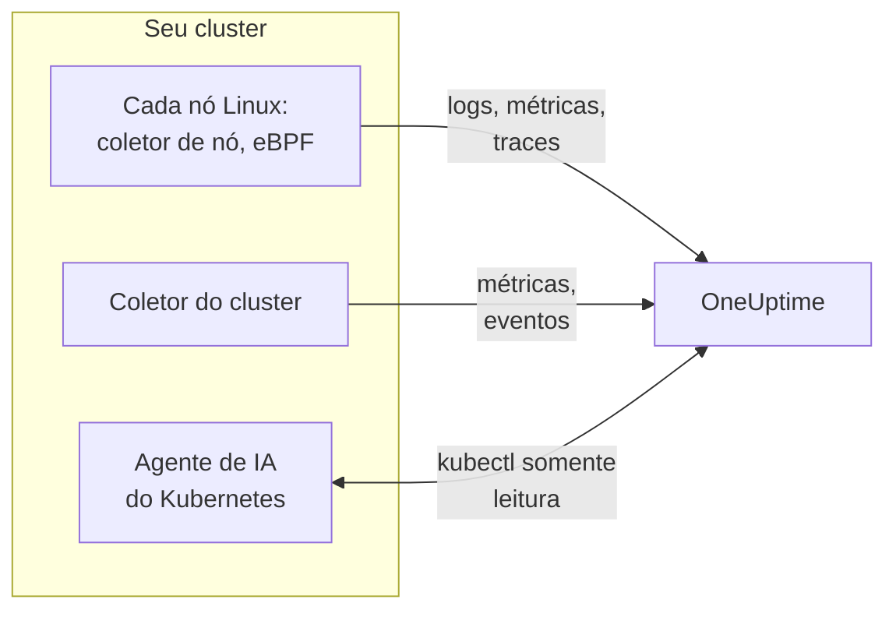

# Agente Kubernetes (instalação via Helm)

O agente Kubernetes do OneUptime é um chart Helm que coleta as métricas, os eventos e os logs de pods do seu cluster, traces de aplicações capturados com eBPF e as métricas de sistema operacional de cada nó, e os envia ao OneUptime. Um único `helm install` o coloca em funcionamento, sem mudanças no código das suas aplicações. Os [monitores de Kubernetes](/docs/monitor/kubernetes-monitor) alertam sobre o que ele envia.

:::cards
- [Instalar o agente](#instalar-o-agente): Quatro passos com Helm.
- [Escolher um preset](#escolher-um-preset): Clusters padrão, GKE Autopilot ou EKS Fargate.
- [Opções comuns](#opções-comuns): As configurações que a maioria dos clusters altera.
- [Solução de problemas](#solução-de-problemas): Um script de diagnóstico e os problemas mais comuns.
:::

## O que o chart instala

O chart executa algumas cargas de trabalho no seu próprio namespace. Cada uma envia o que coleta para a sua URL do OneUptime via OTLP, com a chave de ingestão que você fornece.



| Carga de trabalho | Tipo | O que faz | Ativo por padrão |
| --- | --- | --- | --- |
| Coletor do cluster | Deployment | Métricas do cluster, eventos do Kubernetes e as especificações completas de pods, nós e cargas de trabalho, a partir da API do Kubernetes. | Sim |
| Coletor de nó | DaemonSet | Logs de pods de `/var/log/pods`, métricas do kubelet e do cAdvisor, e as métricas de sistema operacional do nó. | Sim |
| Instrumentação eBPF (OBI) | DaemonSet | Traces HTTP, gRPC, SQL e Redis e métricas de requisições de cada pod, e o mapa de serviços. | Sim |
| Agente de IA do Kubernetes | Deployment | Permite que o OneUptime AI execute `kubectl` somente leitura enquanto investiga um incidente ou alerta deste cluster. | Sim |
| Leitor de logs | Deployment | Logs de pods pela API do Kubernetes, onde o coletor de nó não consegue lê-los. | Com os presets `gke-autopilot` e `eks-fargate` |
| Profiler eBPF | DaemonSet | Flame graphs contínuos de CPU de cada processo. | Não |
| kube-state-metrics | Deployment | Fases dos pods, motivos de espera dos contêineres e cotas de recursos. | Não |

Toda imagem do agente é só para Linux, então cada carga de trabalho fica fixada em nós Linux.

## Antes de começar

- **Uma chave de ingestão.** Crie uma no OneUptime em **Configurações do projeto → Telemetria e APM → Chaves de ingestão**. O agente a envia como o cabeçalho `x-oneuptime-token`, então uma chave de API de projeto não funciona aqui.
- **Helm 3** e acesso `kubectl` ao cluster. As atualizações usam `--reset-then-reuse-values`, que exige o Helm 3.14 ou posterior.
- **Um nome para o cluster**, único no seu projeto. O chart se recusa a instalar sem um: dois clusters com o mesmo nome apareceriam como um só.
- **HTTPS de saída** do cluster para a sua URL do OneUptime.

## Instalar o agente

:::steps
### Adicionar o repositório Helm

```bash
helm repo add oneuptime https://helm-chart.oneuptime.com
helm repo update
```

### Instalar o chart

Substitua a URL pela sua URL do OneUptime, e os dois marcadores pela sua chave de ingestão e pelo nome do cluster:

```bash
helm install oneuptime-agent oneuptime/kubernetes-agent \
  --namespace oneuptime-kubernetes-agent \
  --create-namespace \
  --set oneuptime.url=https://oneuptime.com \
  --set oneuptime.apiKey=<YOUR_API_KEY> \
  --set clusterName=<A_UNIQUE_NAME_FOR_THIS_CLUSTER>
```

Isso usa o preset `standard`. No GKE Autopilot ou no EKS Fargate, [escolha o preset deles](#escolher-um-preset).

### Verificar se os pods estão rodando

```bash
kubectl get pods -n oneuptime-kubernetes-agent
```

Cada pod deve chegar a `Running` em um ou dois minutos.

### Encontrar o cluster no OneUptime

Abra **Produtos → Infraestrutura → Kubernetes → Todos os clusters**. O cluster aparece com o seu nome em poucos minutos, e os seus nós, pods e cargas de trabalho vão sendo preenchidos.
:::

## Escolher um preset

Algumas plataformas Kubernetes não permitem que uma carga de trabalho monte um volume `hostPath` ou execute um DaemonSet, que é o que o coletor de nó usa. A configuração `preset` escolhe o que funciona na sua:

| Preset | Usar para | Logs de pods | Em cada nó |
| --- | --- | --- | --- |
| `standard` (padrão) | Autogerenciado, **EKS on EC2**, **GKE Standard**, **AKS**, minikube, kind, k3s | O coletor de nó lê `/var/log/pods` | Métricas do kubelet, do cAdvisor e do sistema operacional |
| `gke-autopilot` | **GKE Autopilot** | O leitor de logs os lê pela API do Kubernetes | Métricas do kubelet e do cAdvisor, sem `hostPath` |
| `eks-fargate` | **EKS Fargate** | O leitor de logs os lê pela API do Kubernetes | Nada: o Fargate não executa DaemonSets |

Se não tiver certeza, deixe `preset` sem definir para obter `standard`. Se a instalação falhar com um erro de Pod Security que cita `hostPath`, instale de novo com `gke-autopilot`, ou com `eks-fargate` no EKS Fargate.

O GKE Autopilot e o EKS Fargate também recusam pods privilegiados, de que a instrumentação eBPF e o profiling precisam, então os presets deles deixam ambos de fora:

:::tabs
@tab Standard
```bash
helm install oneuptime-agent oneuptime/kubernetes-agent \
  --namespace oneuptime-kubernetes-agent --create-namespace \
  --set oneuptime.url=https://oneuptime.com \
  --set oneuptime.apiKey=<YOUR_API_KEY> \
  --set clusterName=prod
```
@tab GKE Autopilot
```bash
helm install oneuptime-agent oneuptime/kubernetes-agent \
  --namespace oneuptime-kubernetes-agent --create-namespace \
  --set oneuptime.url=https://oneuptime.com \
  --set oneuptime.apiKey=<YOUR_API_KEY> \
  --set clusterName=prod-gke-autopilot \
  --set preset=gke-autopilot
```
@tab EKS Fargate
```bash
helm install oneuptime-agent oneuptime/kubernetes-agent \
  --namespace oneuptime-kubernetes-agent --create-namespace \
  --set oneuptime.url=https://oneuptime.com \
  --set oneuptime.apiKey=<YOUR_API_KEY> \
  --set clusterName=prod-eks-fargate \
  --set preset=eks-fargate
```
:::

## Marcar o cluster com rótulos

Os rótulos que você passa na instalação são associados ao cluster, e aos serviços e hosts que este agente informa. `--set oneuptime.labels.<key>=<value>` vira um rótulo de projeto chamado `<key>:<value>`:

```bash
helm install oneuptime-agent oneuptime/kubernetes-agent \
  --namespace oneuptime-kubernetes-agent \
  --create-namespace \
  --set oneuptime.url=https://oneuptime.com \
  --set oneuptime.apiKey=<YOUR_API_KEY> \
  --set clusterName=prod \
  --set oneuptime.labels.team=payments \
  --set oneuptime.labels.env=production \
  --set oneuptime.labels.region=us-east-1
```

Ou mantenha-os em um arquivo de valores:

```yaml title="values.yaml"
oneuptime:
  url: https://oneuptime.com
  apiKey: <YOUR_API_KEY>
  labels:
    team: payments
    env: production
    region: us-east-1
clusterName: prod
```

```bash
helm install oneuptime-agent oneuptime/kubernetes-agent \
  --namespace oneuptime-kubernetes-agent --create-namespace \
  -f values.yaml
```

Todo registro que este agente envia - logs, métricas, traces e perfis - passa então a carregar `team:payments`, `env:production` e `region:us-east-1`. Cada rótulo é um atributo de recurso `oneuptime.label.<key>=<value>`, e o OneUptime transforma em rótulo todo atributo que começa com `oneuptime.label.`. Os rótulos são comparados sem diferenciar maiúsculas de minúsculas, então um rótulo `Production` existente é reaproveitado, não duplicado. O agente nunca remove um rótulo que você adicionou no OneUptime.

## Logs de pods

`preset` define `logs.mode`, que você também pode definir:

| `logs.mode` | Como os logs são lidos | Vantagens | Atenção a |
| --- | --- | --- | --- |
| `daemonset` | Um coletor de nó por nó acompanha os arquivos em `/var/log/pods`. | Menor sobrecarga, escala com os nós, nenhuma carga no servidor de API do Kubernetes, acompanha a rotação de logs. | Precisa de `hostPath` e de DaemonSets. |
| `api` | Um leitor de logs transmite o log de cada contêiner a partir da API do Kubernetes, como faz `kubectl logs -f`. | Funciona onde `hostPath` está bloqueado ou onde se aplica o Pod Security Standard `restricted`. | Cada fluxo de contêiner é uma conexão de longa duração com o servidor de API. Uma réplica dá conta de alguns milhares de contêineres. |
| `disabled` | Nada. | Para aplicações que já enviam os seus logs de outra forma. | |

Para desativar a coleta de logs, defina `--set logs.enabled=false` e envie os logs das aplicações com os SDKs do [OpenTelemetry](/docs/telemetry/open-telemetry). As métricas não são afetadas: o coletor de nó continua rodando.

### Clusters com vários sistemas operacionais (pools de nós Windows)

Nós Windows nunca executam um pod do agente. Os dados de nível de cluster sobre eles e os seus pods continuam chegando, porque vêm da API do Kubernetes: condições dos nós, fases dos pods, eventos do Kubernetes e kube-state-metrics. O que falta aos nós Windows é o que é coletado no nó: métricas de sistema operacional, métricas do kubelet e do cAdvisor, traces eBPF, perfis e, no modo de logs `daemonset`, os logs de pods.

Para coletar também os logs dos pods em nós Windows, ative o modo híbrido:

```bash
helm upgrade oneuptime-agent oneuptime/kubernetes-agent \
  --namespace oneuptime-kubernetes-agent --reset-then-reuse-values \
  --set logs.windowsPods.enabled=true
```

O leitor de logs passa então a rodar ao lado dos coletores de nó, só para os pods em nós Windows. Os pods Linux mantêm a leitura de arquivos, mais barata, e os dois dividem os pods pelo sistema operacional do nó, então nenhuma linha de log é enviada duas vezes.

- **Versão da imagem do leitor.** A divisão só para Windows está embutida na imagem `kubernetes-log-tailer`. Uma imagem mais antiga a ignora e acompanha *todos* os pods, enviando duas vezes os logs de cada pod Linux. Não fixe `logs.api.image.tag` em uma versão mais antiga que o lançamento do chart e, se um nó puder ter em cache uma imagem `release` antiga, adicione `--set logs.api.image.pullPolicy=Always` à atualização.
- **Filtragem por severidade.** Com `filters.logs.minSeverity` definido, uma linha sem severidade reconhecível é descartada no caminho do coletor de nó, mas mantida no do leitor de logs - veja [Filtragem por severidade de log](/docs/telemetry/kubernetes-agent#filtragem-por-severidade-de-log). Os pods Windows podem então enviar mais linhas sem nível do que os pods Linux.

## Traces de aplicações com eBPF

O chart executa o [OpenTelemetry eBPF Instrumentation (OBI)](https://opentelemetry.io/docs/zero-code/obi/) em cada nó. O OBI carrega programas eBPF no kernel Linux e observa o tráfego de rede de cada pod, para conseguir reconstruir chamadas HTTP e HTTPS, gRPC, e SQL e Redis sem nenhuma mudança nas suas aplicações: sem SDK, sem sidecar. Ele as envia ao OneUptime como traces e métricas de requisições.

Os seus serviços aparecem em **Produtos → Traços** e no mapa de serviços em um ou dois minutos, com `k8s.cluster.name` definido como o nome do cluster, para que você possa filtrar por cluster.

### Quando desativar o eBPF

O eBPF vem ativado por padrão. Desative-o com `--set ebpf.enabled=false` quando:

- O cluster for **GKE Autopilot** ou **EKS Fargate**. Os presets deles fazem isso por você: essas plataformas recusam pods privilegiados, e o OBI precisa ser privilegiado para carregar os seus programas.
- Os nós rodarem um kernel anterior ao **Linux 5.8** sem BTF. Debian 11, Ubuntu 20.10, Fedora 34, RHEL 9 e posteriores servem.
- As suas aplicações já enviarem traces com um SDK do OpenTelemetry, e você não os quiser em dobro.

### O que o eBPF envia

O OBI envia vários tipos de sinal. Cada um pode ser desativado com `--set ebpf.features.<key>=false`:

| Configuração | Padrão | O que adiciona |
| --- | --- | --- |
| `ebpf.features.httpMetrics` | ativado | Métricas de requisições HTTP e gRPC por serviço: taxa de requisições, histogramas de latência e erros. |
| `ebpf.features.spanMetrics` | ativado | Métricas de spans: chamadas e duração por serviço, rota ou operação, tipo de span e status - `traces.span.metrics.calls` e `traces.span.metrics.duration` (segundos). |
| `ebpf.features.serviceGraph` | ativado | A taxa e a latência de cada chamada de um serviço para outro, que desenham o mapa de serviços. |
| `ebpf.features.networkMetrics` | ativado | Bytes e pacotes entre cada par de pods, via TCP e UDP, com os seus nomes no Kubernetes. Mostra cada par de pods que se comunicam, mesmo por protocolos que o OBI não consegue ler. |
| `ebpf.features.networkInterZoneMetrics` | desativado | O mesmo entre zonas. Dobra o número de séries: ative-o só se você agenda por zona. |
| `ebpf.features.tcpStats` | ativado | Estatísticas TCP por nó: tempos de ida e volta, conexões que falharam e retransmissões. |

### Ligar traces entre serviços

O OBI também pode levar o trace através de uma chamada: quando o pod A chama o pod B via HTTP ou gRPC, o span do lado de B se junta ao trace de A, sem SDK em nenhuma das aplicações. **Isso vem desativado por padrão.** Ative com `--set ebpf.contextPropagation=true`, depois de ler o aviso abaixo.

| Opção | Padrão | O que faz |
| --- | --- | --- |
| `ebpf.contextPropagation` | desativado | Escreve um `traceparent` W3C no tráfego de saída, para que os spans se liguem entre serviços. |
| `ebpf.contextPropagationMode` | `headers` | Como: `headers` (cabeçalhos de requisição HTTP/1.1, o mais restrito), `tcp` (uma opção TCP, via Linux Traffic Control) ou `all` (ambos). Só é lido quando `contextPropagation` está ativado. |
| `ebpf.trackRequestHeaders` | ativado | Acompanha os cabeçalhos de requisição no kernel, para que o lado receptor encontre o `traceparent` também em servidores HTTP simples. Só tem efeito quando `contextPropagation` está ativado. |

> [!WARNING]
> Todo modo de propagação altera um tráfego que já está em trânsito. Para HTTP simples, o OBI aumenta a requisição de saída no kernel para caber o cabeçalho; para TLS e TCP puro, ele adiciona uma opção TCP a partir de um hook do Traffic Control, reescrevendo o pacote e o seu checksum. Quando a contagem de bytes da conexão não é então corrigida com exatidão, o fluxo se **dessincroniza**: transferências por um proxy como o nginx travam no meio, assim que uma resposta passa de cerca de 64 KB, até a conexão expirar. Requisições pequenas continuam funcionando, então parece um bug da aplicação ou do proxy. Nenhuma versão do kernel faz a reescrita desaparecer. Traces, métricas de requisições e o mapa de serviços funcionam todos sem ela; um SDK do OpenTelemetry nos seus serviços liga os traces sem nenhuma reescrita no kernel. Se você a ativar, teste primeiro em um cluster que não seja de produção, e verifique transferências grandes pelo seu proxy.

### Ligar logs a traces

**Desativado por padrão.** Quando está ativado, o OBI anexa uma sonda à chamada de sistema `write()` de cada processo que ele instrumenta, e:

- Uma **linha de log JSON** recebe os campos `trace_id` e `span_id` (os campos que a linha já tem são mantidos). O coletor de nó os move para os campos de trace do próprio registro de log, então os logs de um span ficam a um clique no OneUptime, assim como o trace de uma linha de log.
- **Qualquer outra linha de log** é coletada sem alterações, sem a ligação.

```bash
helm upgrade oneuptime-agent oneuptime/kubernetes-agent \
  --namespace oneuptime-kubernetes-agent --reset-then-reuse-values \
  --set ebpf.logToTraceCorrelation=true
```

| Opção | Padrão | O que faz |
| --- | --- | --- |
| `ebpf.logToTraceCorrelation` | `false` | Ativa o enriquecedor de logs do OBI e o deslocamento do `trace_id` no coletor de nó. |
| `ebpf.logEnricher.services` | `[{service: [{exe_path: "*"}]}]` | Quais processos o enriquecedor toca. Cada entrada é um seletor [GlobAttributes](https://opentelemetry.io/docs/zero-code/obi/configure/options/#service-discovery) do OBI, com campos como `exe_path`, `languages`, `k8s_pod_labels`, `k8s_pod_annotations`, `open_ports` e `cmd_args`. |

#### Agentes APM que travam com ele

O enriquecedor reescreve o buffer de saída da aplicação **dentro do processo**: quando um processo selecionado chama `write()`, o OBI apaga os bytes originais e escreve uma cópia enriquecida. Agentes APM que são carregados via `LD_PRELOAD` e envolvem o próprio `write()` não sobrevivem a isso:

| Agente APM | Biblioteca | O que acontece |
| --- | --- | --- |
| Dynatrace OneAgent | `liboneagentproc.so` | A aplicação trava com SIGSEGV (código de saída 139). O próprio `write()` do watchdog do Dynatrace passa do seu limite de 10 segundos e o OneAgent reinicia em loop. |
| New Relic | `libnewrelic*.so` | O mesmo tipo de travamento. |
| AppDynamics | `libappdynamics*.so` | O mesmo tipo de travamento. |
| Datadog | `libdd*.so` | O mesmo tipo de travamento. |
| Instana | `libinstana*.so` | O mesmo tipo de travamento. |

**As aplicações .NET são as mais expostas:** o agente .NET do Dynatrace sempre é carregado via `LD_PRELOAD`, e o log de console do Microsoft.Extensions.Logging não usa buffer, então cada linha segue esse caminho. Aplicações Python e Go costumam não ser afetadas.

Para usá-lo ao lado de um desses agentes, aponte `logEnricher.services` só para os pods que não têm um. O enriquecedor não sabe excluir, então liste os que devem ser enriquecidos:

```yaml title="values.yaml"
ebpf:
  logToTraceCorrelation: true
  logEnricher:
    services:
      # Enrich only pods with the apm-agent=none label
      - service:
          - k8s_pod_labels:
              apm-agent: "none"
```

Ou escolha por runtime. O carregamento via `LD_PRELOAD` do Dynatrace atinge o .NET, então enriquecer só Python, Go, Ruby e Node.js o evita:

```yaml title="values.yaml"
ebpf:
  logToTraceCorrelation: true
  logEnricher:
    services:
      - service:
          - languages: "python,go,ruby,nodejs"
```

#### Os logs precisam ser JSON e sem buffer

- **Só as linhas JSON recebem um `trace_id`.** Mude o logger para um formato JSON: `structlog`, `pino`, `winston`, `serilog`, `logback-json`, klog `--logging-format=json` e similares.
- **Saída com buffer quebra a ligação**, porque então o `write()` acontece em outra thread que não a da requisição. Em **Python**, defina `PYTHONUNBUFFERED=1`. Em **.NET**, chame `Console.SetOut(new StreamWriter(Console.OpenStandardOutput()) { AutoFlush = true })` na inicialização; o `AddConsole()` do Microsoft.Extensions.Logging e os sinks assíncronos do Serilog não funcionam, o `WriteTo.Console()` simples do Serilog funciona.
- Greenlet, gevent, Tornado e outros runtimes assíncronos personalizados não são cobertos.

### Ajustar o eBPF

| Opção | Padrão | O que faz |
| --- | --- | --- |
| `ebpf.enabled` | `true` | Executa o DaemonSet do eBPF. `false` o deixa de fora. |
| `ebpf.image.tag` | `v0.14.0` | A imagem do OBI. O OBI está antes da 1.0: fixe uma versão que você testou, e teste de novo antes de trocá-la. |
| `ebpf.autoTargetExe` | `*` | Globs dos executáveis a instrumentar, separados por vírgula. Restrinja-o, como em `*/python,*/java`, para instrumentar menos runtimes. |
| `ebpf.excludeExePaths` | Shells, infraestrutura do cluster, sidecars de service mesh, agentes CNI, navegadores, ClickHouse, coletores e o próprio OBI | Globs dos executáveis a ignorar, separados por vírgula. Um glob amplo ignora também os seus próprios binários. |
| `ebpf.logLevel` | `info` | `debug`, `info`, `warn` ou `error`. |
| `ebpf.printTraces` | `false` | Também imprime os spans no log do próprio OBI, para verificar o que ele captura. |
| `ebpf.resources.*` | `100m` de CPU e `512Mi` de memória solicitados, limites de `2000m` e `2Gi` | Aumente-os para nós com muito tráfego ou muitos processos de curta duração. |

Para verificar se o OBI está rodando e vendo tráfego:

```bash
kubectl get pods -n oneuptime-kubernetes-agent -l component=ebpf-instrument
kubectl logs -n oneuptime-kubernetes-agent -l component=ebpf-instrument --tail=200
```

## Profiling contínuo de CPU

O [OpenTelemetry eBPF Profiler](https://github.com/open-telemetry/opentelemetry-ebpf-profiler) também pode rodar em cada nó, como a imagem `otel/opentelemetry-collector-ebpf-profiler`. Ele amostra o que cada processo está executando, 19 vezes por segundo, em Go, Java, .NET, Python, Ruby, Node.js, PHP, Perl, C, C++ e Rust, e envia os perfis ao OneUptime. Eles aparecem em **Produtos → Perfis de desempenho**, e como um flame graph em cada span de trace.

**O profiling vem desativado por padrão:** ele custa mais CPU e memória por nó do que a instrumentação eBPF. Ative com `--set profiling.enabled=true`.

Com a instrumentação eBPF também ativada (o padrão), cada amostra carrega o trace ao qual pertence, então um span tem o seu próprio flame graph. Para isso, o chart pede ao OBI que mantenha disponível o contexto de trace em curso (`OTEL_EBPF_BPF_POPULATE_TRACE_CONTEXT=true`), o que custa um pouco às aplicações instrumentadas a cada troca de contexto assíncrona. Defina `profiling.obiProcessContext=false` para ter flame graphs sem a ligação com os spans.

O profiling precisa do **Linux 5.10** ou posterior, e de um pod privilegiado com os IDs de processo do nó: ele não pode rodar no GKE Autopilot nem no EKS Fargate, e os presets deles o deixam desativado. Em nós que são eles próprios contêineres, como kind ou k3d, ele não consegue distinguir os processos, e quase nenhuma amostra se liga a um span.

| Opção | Padrão | O que faz |
| --- | --- | --- |
| `profiling.enabled` | `false` | Executa o DaemonSet do profiler. |
| `profiling.image.tag` | `0.152.0` | A imagem do profiler. Ela está antes da 1.0: fixe uma versão que você testou. |
| `profiling.samplesPerSecond` | `19` | Quantas amostras por segundo. 19 evita coincidir com frequências de timer comuns. |
| `profiling.offCpuThreshold` | `0` | Um valor acima de 0 e até 1 também perfila o tempo passado fora da CPU, o que mostra disputa de locks e E/S bloqueante, com um custo extra. |
| `profiling.tracers` | `""` (todo runtime) | Os tracers de linguagem a carregar, separados por vírgula, como `go,python`. |
| `profiling.obiProcessContext` | `true` | Liga as amostras aos traces do OBI, e faz o OBI manter o contexto de trace disponível para isso. |

## Outras coletas de dados

| Opção | Padrão | O que adiciona |
| --- | --- | --- |
| `hostMetrics.enabled` | ativado | As métricas de sistema operacional de cada nó a partir de `/proc` e `/sys`: filas de E/S de disco, inodes dos sistemas de arquivos, erros das interfaces de rede, paginação e carga média. Roda no coletor de nó, sem pods extras. |
| `kubeletstats.utilizationMetrics.enabled` | ativado | CPU e memória de contêineres e pods como porcentagem da sua requisição e do seu limite, que os monitores de saturação de CPU e memória leem. Sempre 0 para um pod sem requisição ou limite. |
| `kubeletstats.volumeMetrics.enabled` | ativado | O espaço livre e total de cada PVC (`k8s.volume.available`, `k8s.volume.capacity`), que o monitor PVC Low Disk Space lê. Uma série por PVC e por pod. |
| `cadvisor.enabled` | ativado | Estrangulamento de CPU e encerramentos por OOM a partir do `/metrics/cadvisor` de cada kubelet: `container_cpu_cfs_throttled_seconds_total`, `container_cpu_cfs_periods_total` e `container_oom_events_total`, e nada mais. |
| `kubeStateMetrics.enabled` | desativado | Fases dos pods (Pending, Terminating), pods que não podem ser agendados, motivos de espera dos contêineres (CrashLoopBackOff, ImagePullBackOff) e uso das cotas de recursos, a partir do kube-state-metrics. `kubeStateMetrics.mode: bundled` (o padrão) executa um pequeno kube-state-metrics para você; `external` lê um que você já executa, em `kubeStateMetrics.endpoint`. |
| `auditLogs.enabled` | desativado | O log de auditoria do Kubernetes, `/var/log/kubernetes/audit.log`: cada requisição à API, de quem, sobre o quê. Só clusters autogerenciados: os gerenciados (EKS, GKE, AKS, DOKS) o enviam ao provedor de nuvem. |
| `csi.enabled` | desativado | As métricas dos drivers de armazenamento CSI, de pods com o rótulo `app=csi-driver` ou `app.kubernetes.io/component=csi-driver`: tempos de anexar e desanexar volumes, falhas de provisionamento, IOPS. |
| `coreDns.enabled` | desativado | As métricas do CoreDNS em `:9153/metrics`: taxa de consultas, latência, acertos de cache e erros. |
| `controlPlane.enabled` | desativado | etcd, o servidor de API, o scheduler e o controller manager. Só clusters autogerenciados: os gerenciados não os expõem. |
| `cost.enabled` | desativado | Quanto custa cada carga de trabalho. Veja [Observabilidade de custos do Kubernetes](/docs/telemetry/kubernetes-cost). |

## Opções comuns

| Opção | Padrão | O que faz |
| --- | --- | --- |
| `oneuptime.url` | (obrigatório) | A sua URL do OneUptime. |
| `oneuptime.apiKey` | (obrigatório) | A chave de ingestão, de **Configurações do projeto → Telemetria e APM → Chaves de ingestão**. Enviada como o cabeçalho `x-oneuptime-token`; uma chave de API de projeto não funciona. |
| `clusterName` | (obrigatório) | O nome do cluster, único no projeto. Todo registro o carrega como `k8s.cluster.name`. |
| `preset` | (vazio: `standard`) | `standard`, `gke-autopilot` ou `eks-fargate`. Veja [Escolher um preset](#escolher-um-preset). |
| `oneuptime.labels` | `{}` | Rótulos para todo registro deste agente. Veja [Marcar o cluster com rótulos](#marcar-o-cluster-com-rótulos). |
| `namespaceFilters.rules` | Deixa `kube-system` fora de `podLogs` e `ebpfDiscovery` | Regras que incluem ou excluem namespaces, para `podLogs`, `ebpfDiscovery`, `metrics` e `traces`. Os padrões podem usar `*`, e a exclusão sempre vence. |
| `filters.logs.minSeverity` | `""` | Descarta as linhas de log de pods abaixo deste nível: `TRACE`, `DEBUG`, `INFO`, `WARN`, `ERROR` ou `FATAL`. |
| `filters.metrics.exclude` | `[]` | Nomes de métricas a descartar. |
| `sampling.traces.percentage` | `100` | A parcela de traces a manter, de 0 a 100. Os traces são mantidos ou descartados inteiros. |
| `logs.enabled` | `true` | Coleta os logs de pods. |
| `logs.mode` | (do `preset`) | `daemonset`, `api` ou `disabled`. Prevalece sobre o preset. |
| `logs.windowsPods.enabled` | `false` | Também acompanha os pods em nós Windows. Veja [Clusters com vários sistemas operacionais](#clusters-com-vários-sistemas-operacionais-pools-de-nós-windows). |
| `logs.api.replicas` | `1` | Réplicas do leitor de logs, no modo `api`. |
| `ebpf.enabled` | `true` | Traces eBPF e métricas de requisições. Veja [Traces de aplicações com eBPF](#traces-de-aplicações-com-ebpf). |
| `profiling.enabled` | `false` | Flame graphs de CPU. Veja [Profiling contínuo de CPU](#profiling-contínuo-de-cpu). |
| `kubeStateMetrics.enabled` | `false` | O estado do cluster a partir do kube-state-metrics. |
| `aiAgent.enabled` | `true` | O agente de IA do Kubernetes. Veja [Agente de IA do Kubernetes](/docs/telemetry/kubernetes-agent#agente-de-ia-do-kubernetes) para o que ele pode fazer. |

O [`values.yaml`](https://github.com/OneUptime/oneuptime/blob/master/HelmChart/Public/kubernetes-agent/values.yaml) do chart lista e explica cada opção, e [Agente Kubernetes](/docs/telemetry/kubernetes-agent) trata de filtragem, amostragem e de como manter baixo o volume de dados.

## Atualização

```bash
helm repo update
helm upgrade oneuptime-agent oneuptime/kubernetes-agent \
  --namespace oneuptime-kubernetes-agent \
  --reset-then-reuse-values
```

`--reset-then-reuse-values` (Helm 3.14 e posterior) mantém os valores que você definiu - o preset, o nome do cluster, os filtros - e pega todos os outros valores do novo chart. Adicione qualquer `--set` novo depois dele. No Helm 3.13 ou anterior, atualize com os valores que você definiu:

```bash
helm repo update
helm get values oneuptime-agent --namespace oneuptime-kubernetes-agent -o yaml > values.yaml && \
  helm upgrade oneuptime-agent oneuptime/kubernetes-agent \
  --namespace oneuptime-kubernetes-agent -f values.yaml
```

Não atualize com `--reuse-values`: ele mantém também os padrões do chart a partir do qual você atualiza, então os padrões de um chart mais novo, entre eles a sua imagem eBPF, nunca são aplicados. Quando um release roda com os padrões de um chart mais antigo, as notas que o Helm imprime depois da instalação ou da atualização terminam com um aviso e o comando que corrige isso.

> [!WARNING]
> **As métricas de spans do eBPF têm novos nomes.** `ebpf.features.spanMetrics` agora envia `traces.span.metrics.calls` e `traces.span.metrics.duration` (segundos) em vez de `traces_spanmetrics_calls_total` e `traces_spanmetrics_latency`: as mesmas séries, com os nomes que o OBI mantém (ele descontinuou os antigos). Um dashboard, um gráfico ou um monitor de métricas com um nome antigo não recebe dados novos depois da atualização, sem nenhum erro - mude-o para o novo nome, e atualize qualquer entrada de `filters.metrics` que cite um nome antigo.

## Desinstalação

```bash
helm uninstall oneuptime-agent --namespace oneuptime-kubernetes-agent
kubectl delete namespace oneuptime-kubernetes-agent
```

## Solução de problemas

:::details O cluster aparece como Disconnected, ou nenhum dado chega
Execute o script de diagnóstico do chart. Ele verifica os pods, a chave de ingestão e a saída do cluster, pergunta ao OneUptime se a chave é aceita e imprime um único veredito. Ele só lê, e não altera nada:

```bash
curl -fsSL https://raw.githubusercontent.com/OneUptime/oneuptime/master/HelmChart/Public/kubernetes-agent/troubleshoot.sh \
  | bash -s -- -n oneuptime-kubernetes-agent
```

A causa mais comum, principalmente depois de uma reinstalação, é uma chave de ingestão errada ou revogada: o OneUptime a recusa, e o coletor descarta cada lote enquanto os seus pods continuam `Running`.
:::

:::details A instalação falha com "hostPath volumes are not allowed"
O cluster bloqueia `hostPath`. Mude para um preset que lê os logs pela API do Kubernetes; ele também deixa o eBPF de fora:

```bash
helm repo update
helm upgrade oneuptime-agent oneuptime/kubernetes-agent \
  --namespace oneuptime-kubernetes-agent \
  --reset-then-reuse-values \
  --set preset=gke-autopilot
```

No EKS Fargate, use `--set preset=eks-fargate`.
:::

:::details Pods do agente presos em ImagePullBackOff em nós Windows
Charts mais antigos agendavam os DaemonSets do agente em nós Windows, onde as suas imagens Linux nunca podem ser baixadas. Execute `helm upgrade`: o chart atual fixa cada carga de trabalho em nós Linux, e os pods presos desaparecem. Para coletar os logs dos pods em nós Windows, veja [Clusters com vários sistemas operacionais](#clusters-com-vários-sistemas-operacionais-pools-de-nós-windows).
:::

:::details Nenhum log chega ao OneUptime
Verifique os pods do agente e os seus logs:

```bash
kubectl get pods -n oneuptime-kubernetes-agent
kubectl logs -n oneuptime-kubernetes-agent -l app.kubernetes.io/part-of=oneuptime --tail=200
```

No modo `api`, o leitor de logs responde em `/healthz`, porta 13133, com o estado das suas exportações: acesse-o com `kubectl port-forward`.
:::

:::details Os pods do eBPF estão em CrashLoopBackOff, ou não iniciam
Leia o log do OBI:

```bash
kubectl logs -n oneuptime-kubernetes-agent -l component=ebpf-instrument --tail=200
```

- **O kernel é antigo demais, ou não tem BTF.** O OBI precisa do Linux 5.8 ou posterior com BTF; confira com `uname -r` em um nó. Se não puder atualizá-lo, desative o eBPF com `--set ebpf.enabled=false`.
- **Pods privilegiados são recusados.** Alguns clusters os recusam mesmo fora do Autopilot e do Fargate. Desative o eBPF.
- **O OBI roda, mas nenhum trace chega.** Defina `--set ebpf.printTraces=true` e leia o log do OBI de novo. Spans ali significam que a exportação para o OneUptime falha: confira a URL e a chave de ingestão. Nenhum span ali pode significar que o tráfego é criptografado por uma biblioteca TLS que o OBI não consegue ler, como uma ligada estaticamente.
:::

:::details Transferências grandes travam depois de ativar a ligação de traces
É o `ebpf.contextPropagation` reescrevendo o tráfego: veja o aviso em [Ligar traces entre serviços](#ligar-traces-entre-serviços). Desative com `--set ebpf.contextPropagation=false`.
:::

:::details Aplicações travam com o código de saída 139 depois de ativar a ligação de logs
Um agente APM carregado via `LD_PRELOAD` está nos mesmos pods: veja [Agentes APM que travam com ele](#agentes-apm-que-travam-com-ele). Desative `ebpf.logToTraceCorrelation`, ou aponte `ebpf.logEnricher.services` para pods sem esse agente.
:::

:::details Um único leitor de logs não basta para o cluster (modo api)
Divida os namespaces entre vários releases, cada um instalado com as suas próprias regras de namespace:

```bash
helm install oneuptime-agent-ns-a oneuptime/kubernetes-agent \
  --set preset=gke-autopilot \
  --set-json 'namespaceFilters.rules=[{"action":"include","namespaces":["app-a","app-b"],"scopes":["podLogs"]}]' \
  ...
```

Aumentar `logs.api.replicas` adiciona leitores, mas cada um lê todos os namespaces permitidos, então você ainda precisa dividir os namespaces para evitar duplicatas.
:::

## Próximos passos

:::cards
- [Monitor de Kubernetes](/docs/monitor/kubernetes-monitor): Alertar sobre o que o agente envia.
- [Agente Kubernetes](/docs/telemetry/kubernetes-agent): Filtragem, amostragem, o agente de IA e como manter baixo o volume de dados.
- [Observabilidade de custos do Kubernetes](/docs/telemetry/kubernetes-cost): Ver quanto custa cada carga de trabalho.
- [Monitor de traces](/docs/monitor/traces-monitor): Alertar sobre os traces que o eBPF captura.
:::
