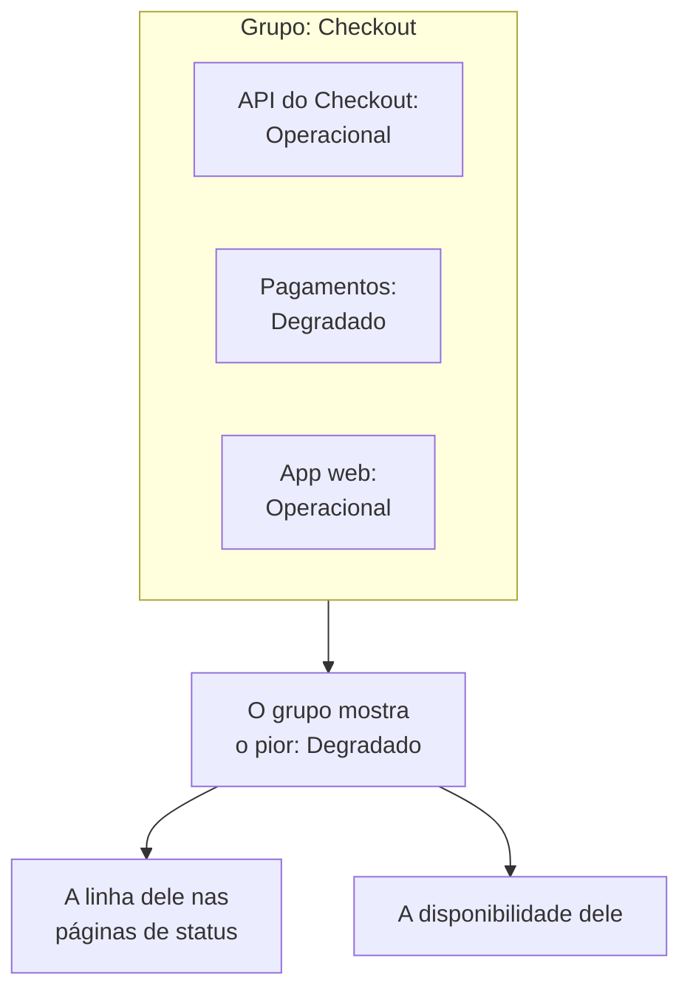

# Grupos de monitores

Um grupo de monitores reúne vários monitores em um único status. Agrupe os monitores que juntos formam um serviço, como Checkout: a API, o serviço de pagamentos e o app web dele. O grupo mostra o pior status entre eles, tem a sua própria disponibilidade, e uma página de status pode mostrar o grupo inteiro como uma única linha.

:::cards
- [Como o status de um grupo é calculado](#como-o-status-de-um-grupo-é-calculado): O pior status entre os seus monitores.
- [Ativar os grupos de monitores](#ativar-os-grupos-de-monitores): Uma chave nas configurações do projeto.
- [Criar um grupo de monitores](#criar-um-grupo-de-monitores): Dê um nome e depois adicione os monitores.
- [Mostrar um grupo em uma página de status](#mostrar-um-grupo-em-uma-página-de-status): Uma linha para o grupo inteiro.
:::

## Como o status de um grupo é calculado

Um grupo começa no seu status operacional e assume o pior status entre os seus monitores: o que fica mais abaixo na lista de status de monitor do seu projeto. Um monitor que passa para **Degradado** deixa o grupo inteiro **Degradado**; um que passa para **Offline** o deixa **Offline**.

- **Monitores arquivados não contam.** Um monitor arquivado não é verificado, então o status dele fica congelado; o grupo o deixa de fora.
- **Um grupo vazio está operacional.** Um grupo sem monitores, ou só com monitores arquivados, mostra o seu status operacional. Até você adicionar um monitor, o painel mostra **Nenhum monitor ainda** no lugar do status dele.
- **A ordem é sua.** Qual status é o pior segue a ordem de **Monitores → Configurações → Status do monitor**. Veja [Status de monitor](/docs/monitor/criteria-and-statuses#status-de-monitor).

Um grupo de monitores não é um grupo de página de status. Um grupo de página de status é um título em uma página de status que reúne linhas. Um grupo de monitores é uma linha que representa vários monitores, e qualquer página de status pode mostrá-lo.

## Antes de começar

- **O seu plano.** No OneUptime Cloud, grupos de monitores exigem o plano Scale.
- **A chave.** Os grupos de monitores ficam ocultos até que **Grupos de monitores** seja ativado para o projeto (veja abaixo). Ativá-lo exige o papel Project Owner, ou um papel personalizado com a permissão Edit Project ou Manage Billing.
- **O seu papel.** Criar, alterar e excluir grupos exige o papel Project Owner, Project Admin, Project Member, Monitor Admin ou Monitor Member, ou um papel personalizado com as permissões de grupo de monitores correspondentes. Um Viewer pode ver os grupos, mas não alterá-los.

## Ativar os grupos de monitores

:::steps
### Abrir os sinalizadores de recursos

Vá para **Configurações do projeto → Avançado → Sinalizadores de recursos**. **Avançado** começa recolhido no menu lateral: expanda-o primeiro.

### Ligar a chave

Ligue a chave **Grupos de monitores**. Ela salva na hora: **Grupos de monitores** aparece no menu lateral de **Monitores**, e o item **Monitores** de cada página de status passa a se chamar **Recursos**, onde você pode adicionar um grupo.
:::

Desligar a chave de novo esconde **Grupos de monitores** do menu. Nenhum grupo é excluído.

## Criar um grupo de monitores

:::steps
### Abrir Grupos de monitores

Vá para **Monitores → Grupos de monitores**. O cartão **Grupos de monitores** lista cada grupo com o seu **Status Atual**, rótulos e proprietários.

### Criar o grupo

Clique em **Criar: Monitor Grupo**, digite um **Nome** e, se quiser, uma **Descrição**, e clique em **Criar: Monitor Grupo** no final do formulário. O grupo começa sem monitores.

### Adicionar os monitores

Abra o grupo: enquanto ele não tiver nenhum monitor, a **Visão geral** dele oferece **Adicionar monitores**. Depois, clique em **Monitores** no menu lateral dele e em **Adicionar monitores**. Escolha cada monitor do grupo em **Monitores** e clique em **Adicionar monitores**.

### Conferir o status

Clique em **Visão geral**. **Status Atual** mostra o status do grupo agora, e **Gráfico de tempo de atividade** mostra os últimos 90 dias dele, uma barra por dia.
:::

Para tirar um monitor do grupo, clique em **Remover** na linha dele em **Monitores no Grupo**. O monitor em si não muda. Um monitor pode pertencer a mais de um grupo.

## As páginas de um grupo

Abra um grupo para ver as páginas dele no menu lateral:

| Página | O que mostra |
| --- | --- |
| **Visão geral** | **Detalhes do Grupo de Monitores**, **Status Atual** e **Gráfico de tempo de atividade** com a porcentagem de disponibilidade do grupo nos últimos 90 dias. Um grupo sem monitores oferece **Adicionar monitores** no lugar do gráfico. |
| **Monitores** | **Monitores no Grupo**, com **Adicionar monitores** e **Remover**. |
| **Incidentes** | Os incidentes em qualquer monitor do grupo. |
| **Alertas** | Os alertas em qualquer monitor do grupo. |
| **Proprietários** | As pessoas e equipes responsáveis pelo grupo. Fica em **Avançado**, que começa recolhido. |
| **Registros de auditoria** | Quem alterou o grupo, e quando, também em **Avançado**. |
| **Excluir grupo** | Exclui o grupo, também em **Avançado**. |

A disponibilidade em **Visão geral** conta como indisponibilidade todo status exceto o operacional. Uma página de status conta só os status da sua própria lista **Conta como indisponibilidade**: veja [Escolher o que aparece na página](/docs/status-pages/index#escolher-o-que-aparece-na-página).

A lista **Grupos de monitores** pode filtrar grupos por proprietário e rótulo, definir rótulos e proprietários em muitos grupos de uma vez, e exportar ou importar grupos como JSON.

## Mostrar um grupo em uma página de status

:::steps
### Abrir os recursos da página de status

Vá para **Páginas de status**, abra a página e clique em **Recursos** no menu lateral dela.

### Trocar o diálogo para um grupo

Clique em **Adicionar monitor**. Abaixo da lista suspensa de monitores, clique em **Add a Monitor Group instead.** A lista suspensa vira **Monitor Grupo**.

### Escolher o grupo e adicioná-lo

Escolha o grupo. **Nome de exibição**, o nome que os visitantes leem, assume o nome do grupo até você digitar um próprio. Clique em **Adicionar monitor**: a linha aparece na página com o status do grupo.
:::

Na página de status, a linha representa cada monitor do grupo:

- **O status dela.** É o do grupo: o pior dos seus monitores.
- **Os incidentes dela.** Um incidente em qualquer monitor do grupo aparece na página, com o grupo entre os recursos afetados.
- **Os assinantes dela.** Um assinante que escolhe o grupo recebe avisos sobre cada monitor que ele contém. Veja [Deixar os assinantes escolherem recursos e tipos de evento](/docs/status-pages/subscribers#deixar-o-assinante-escolher-recursos-e-tipos-de-evento).

Para as demais opções da linha, como a disponibilidade e o gráfico de histórico, veja [Recursos e grupos da página de status](/docs/status-pages/resources-and-groups).

> [!WARNING]
> Excluir um grupo de monitores também exclui a linha dele de toda página de status que o mostra. Os monitores do grupo, e os incidentes deles, não são excluídos.

## API e Terraform

Um grupo é `/api/monitor-group`, e cada monitor nele é uma linha de `/api/monitor-group-resource` que liga um `monitorGroupId` a um `monitorId`. No Terraform eles são `oneuptime_monitor_group` e `oneuptime_monitor_group_resource`: veja [Grupo de monitores](/docs/terraform/examples#grupo-de-monitores).

## Solução de problemas

:::details Grupos de monitores não aparece no menu Monitores
A chave **Grupos de monitores** está desligada. Ligue-a em **Configurações do projeto → Avançado → Sinalizadores de recursos**. No OneUptime Cloud, os grupos também exigem o plano Scale.
:::

:::details O grupo mostra Offline, mas a maioria dos monitores está no ar
É a regra: o grupo mostra o seu pior monitor. Abra **Monitores** no grupo para encontrar o monitor fora do ar, ou remova um monitor que não pertence ao grupo.
:::

:::details Uma página de status não consegue adicionar o grupo
**Add a Monitor Group instead.** só aparece no diálogo enquanto a chave **Grupos de monitores** estiver ligada para o projeto.
:::

## Próximos passos

:::cards
- [Critérios e status de monitores](/docs/monitor/criteria-and-statuses): O que define o status de cada monitor.
- [Recursos e grupos da página de status](/docs/status-pages/resources-and-groups): Organizar as linhas de uma página de status.
- [Assinantes e comunicados](/docs/status-pages/subscribers): Avisar os clientes sobre os incidentes de um grupo.
:::
