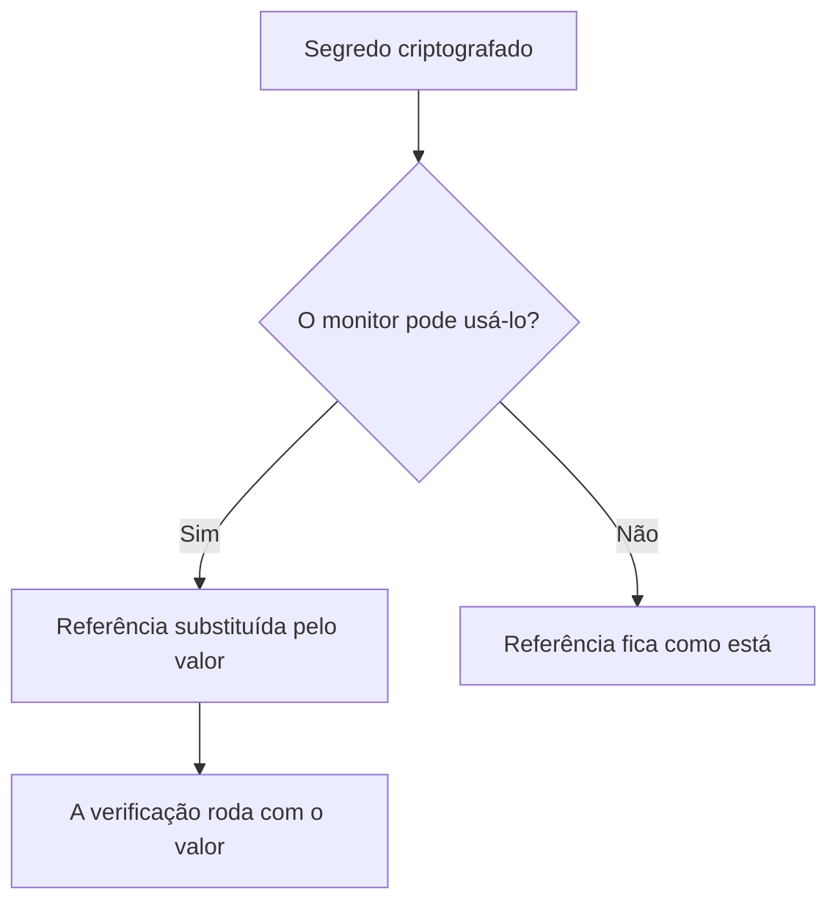

# Segredos do monitor

Os segredos do monitor mantêm fora do próprio monitor as senhas, chaves de API e tokens de que os seus monitores precisam. Você guarda um valor uma vez, criptografado, escolhe quais monitores podem usá-lo e faz referência a ele com `{{monitorSecrets.NAME}}` onde o monitor precisar.

:::cards
- [Adicionar um segredo](#adicionar-um-segredo): Guardar um valor e escolher quem pode usá-lo.
- [Escolher o acesso](#escolher-quais-monitores-podem-usar-um-segredo): Todos os monitores, monitores específicos ou monitores com rótulos.
- [Usar um segredo](#usar-um-segredo): Onde `{{monitorSecrets.NAME}}` funciona.
- [Entrar com um código de uso único](#entrar-com-um-código-de-uso-único): Deixar um monitor passar pela autenticação de dois fatores de um site.
:::

## Como os segredos chegam a um monitor

Um segredo é guardado criptografado e nunca mais é mostrado depois de salvo. Antes de entregar um monitor a uma sonda, o OneUptime substitui cada referência que o monitor pode usar pelo valor descriptografado; uma referência que o monitor não pode usar fica como está escrita. Um segredo de código de uso único é a exceção: a sonda gera o código dele quando a verificação roda (veja [Entrar com um código de uso único](#entrar-com-um-código-de-uso-único)).



A sonda que executa a verificação recebe o valor, então um monitor que usa um segredo deve rodar em sondas em que você confia: as do OneUptime, ou uma [sonda personalizada](/docs/probe/custom-probe) que você mesmo opera.

## Antes de começar

- **O plano Growth ou superior**, no OneUptime Cloud. Instalações auto-hospedadas não têm planos.
- **Uma função que possa gerenciar segredos**: Proprietário do projeto, Administrador do projeto, ou uma função personalizada com a permissão Create Monitor Secret.

## Trabalhar com segredos

### Adicionar um segredo

:::steps
1. Vá em **Monitores → Configurações → Segredos** e clique em **Criar: Segredo do monitor**.
2. Digite um **Nome** e o **Valor do segredo**. O nome é o que você referencia, por exemplo `ApiKey`. Ele só pode conter letras, números, hifens (`-`) e sublinhados (`_`), e dois segredos de um mesmo projeto não podem ter o mesmo. Para a chave de configuração de dois fatores de um site, escolha primeiro **Código de uso único (TOTP)** (veja [Entrar com um código de uso único](#entrar-com-um-código-de-uso-único)).
3. No passo **Acesso**, escolha quais monitores podem usá-lo (veja a próxima seção) e clique em **Criar: Segredo do monitor**.
:::

> [!IMPORTANT]
> Os segredos são criptografados e guardados com segurança. O valor do segredo nunca mais é mostrado depois de salvo — nem na tabela, nem no formulário de edição, nem pela API. Se você perder o valor, precisará obtê-lo de onde ele veio e defini-lo de novo. Para rotacionar um segredo, use o botão **Atualizar Valor do Segredo** na linha dele; você não precisa excluí-lo e criá-lo de novo.

### Escolher quais monitores podem usar um segredo

Cada segredo tem uma de três opções de acesso:

| Opção | Quais monitores podem usar o segredo | Use para |
| --- | --- | --- |
| **Todos os monitores** | Todos os monitores do projeto, incluindo os que você criar depois. | Uma credencial que muitos monitores compartilham. |
| **Monitores específicos** | Só os monitores que você escolher. É o padrão, e os segredos criados antes de existirem estas opções funcionam assim. | Uma credencial para um ou poucos monitores. |
| **Monitores com rótulos** | Os monitores que têm pelo menos um dos rótulos que você escolher. Adicionar um desses rótulos a um monitor dá acesso a ele, e remover o rótulo tira o acesso na próxima vez que o monitor rodar. | Uma credencial para um grupo de monitores que muda com o tempo. |

Você pode mudar a opção a qualquer momento com **Editar** na linha do segredo. Só a lista da opção escolhida é mantida: mudar para **Todos os monitores** esvazia as listas de monitores e de rótulos do segredo, e mudar entre **Monitores específicos** e **Monitores com rótulos** esvazia a lista que você deixou.

Um segredo nunca fica disponível para monitores de outro projeto.

> [!WARNING]
> Qualquer pessoa que possa editar um monitor capaz de usar um segredo pode enviar esse segredo para qualquer lugar ao qual o monitor se conecte. Com **Todos os monitores**, é qualquer pessoa que possa criar ou editar monitores no projeto. Com **Monitores com rótulos**, inclui também qualquer pessoa que possa adicionar um desses rótulos a um monitor.

Na API, a opção de acesso é o campo `monitorAccess`: `All Monitors`, `Specific Monitors` ou `Monitors With Labels`. Os campos `monitors` e `labels` guardam as listas. Um segredo criado sem `monitorAccess` recebe `Specific Monitors`.

### Usar um segredo

Para usar um segredo, escreva `{{monitorSecrets.SECRET_NAME}}` num campo que aceite segredos. Por exemplo, um cabeçalho de requisição `Authorization: Bearer {{monitorSecrets.ApiKey}}` envia o valor do segredo `ApiKey`.

Estes tipos de monitor e campos aceitam segredos:

| Tipo de monitor | Campos |
| --- | --- |
| API | A URL, os cabeçalhos e o corpo da requisição, e o certificado do cliente, a chave privada e a frase secreta (mTLS) |
| Site | A URL, e o certificado do cliente, a chave privada e a frase secreta (mTLS) |
| Ping, IP, Porta, NTP, Certificado SSL | O host ou a URL a verificar |
| DNS | O nome de domínio e o servidor DNS |
| DNSSEC, Domínio | O nome de domínio |
| Consulta SQL | O host, o nome do banco de dados, o usuário, a senha e a consulta |
| Integridade do banco de dados | O host, o nome do banco de dados, o usuário e a senha |
| Página de status externa | A URL da página de status |
| Monitor sintético, Código JavaScript personalizado | O script |
| Dispositivo de rede | A community string SNMP, e as chaves de autenticação e de privacidade do SNMPv3 |

Os segredos são preenchidos antes de o script de um monitor Monitor sintético ou Código JavaScript personalizado rodar, então uma referência como `{{monitorSecrets.ApiKey}}` dentro do script é o valor descriptografado quando ele roda.

Se um monitor faz referência a um segredo que não pode usar, a referência fica como está e não é substituída pelo valor.

Quando você testa um monitor antes de salvá-lo, só os segredos disponíveis para **Todos os monitores** são preenchidos, porque um monitor novo não está em nenhuma lista e ainda não tem rótulos. Depois que você salva o monitor, os testes usam todos os segredos que o monitor pode usar.

## Entrar com um código de uso único

Alguns sites pedem um código de um aplicativo autenticador quando você entra. Um segredo **Código de uso único (TOTP)** guarda a chave de configuração desse site, para que um monitor possa entrar como você entra: onde quer que o monitor use o segredo, a sonda gera o código atual com o próprio relógio, no momento em que a verificação precisa dele. A chave de configuração é guardada criptografada e nunca mais é mostrada, como qualquer valor de segredo, e nunca é escrita no monitor.

1. Ative a autenticação de dois fatores na conta com que o monitor entra. Onde o site mostrar um código QR, peça para digitar a chave manualmente, e copie a chave de configuração ou o link `otpauth://`.
2. Vá em **Monitores → Configurações → Segredos**, clique em **Criar: Segredo do monitor**, escolha **Código de uso único (TOTP)** e cole a chave ou o link em **Chave de configuração**.
3. Confira se o **Código atual** abaixo do campo é igual ao código que seu aplicativo autenticador mostra agora, e depois escolha quais monitores podem usar o segredo no passo **Acesso**, como em qualquer segredo.

| O que você cola | Os códigos que o monitor gera |
| --- | --- |
| Uma chave de configuração, como `JBSW Y3DP EHPK 3PXP` | SHA1, 6 dígitos e um novo código a cada 30 segundos: o que todo aplicativo autenticador pressupõe |
| Um link `otpauth://totp/` | Os parâmetros do link `algorithm` (`SHA1`, `SHA256` ou `SHA512`), `digits` (`6` ou `8`) e `period` em segundos (`30` quando o link não tem um) |

| Tipo de monitor | Onde o código entra, e quando é gerado |
| --- | --- |
| API | `{{monitorSecrets.NAME}}` na URL, num cabeçalho de requisição ou no corpo da requisição, logo antes de cada tentativa ser enviada |
| Monitor sintético, Código JavaScript personalizado | `{{monitorSecrets.NAME}}` no script, quando o script começa, e `await oneuptime.getTotpCode("NAME")`, quando o script pede |

Todos os outros campos mantêm `{{monitorSecrets.NAME}}` como está escrito. Num corpo de requisição JSON, coloque a referência entre aspas, como em `{"otp": "{{monitorSecrets.LoginCode}}"}`, porque um código pode começar com zero.

Um login costuma chegar ao pedido do código algumas páginas depois de o script começar, então peça o código nesse ponto. Este script entra com uma senha e um código de uso único:

```javascript
await page.goto("https://app.example.com/login");
await page.fill("#email", "monitoring@example.com");
await page.fill("#password", "{{monitorSecrets.AppPassword}}");
await page.click("button[type=submit]");

// The code is made now, when the sign-in asks for it.
await page.waitForSelector("#otp");
await page.fill("#otp", await oneuptime.getTotpCode("AppLoginCode"));
await page.click("button[type=submit]");

await page.waitForSelector(".dashboard", { timeout: 10000 });

return {
  data: { signedIn: true },
};
```

A sonda nunca entrega um código com menos de cinco segundos restantes, ou menos de um terço do período quando o período é mais curto: em vez disso, ela espera pelo próximo código, no máximo cinco segundos, e deixa essa espera fora do tempo de execução da verificação. Todo código que uma verificação gera aparece como asteriscos, como `******`, nas mensagens de log, no resultado, no erro e nos nomes das capturas de tela dela. Uma captura de tela é uma imagem da página, então tire-a antes de o código ser digitado ou depois que a página avançar.

> [!NOTE]
> A sonda gera os códigos, então atualize uma sonda personalizada antes de usar um segredo de código de uso único: uma sonda mais antiga envia `{{monitorSecrets.NAME}}` como está escrito. O relógio da sonda também precisa estar certo, porque uma sonda com um minuto de diferença gera códigos que o site já deixou para trás.

## Solução de problemas

:::details `{{monitorSecrets.NAME}}` é enviado literalmente
O monitor não pode usar o segredo, ou o nome não confere. Confira a opção de acesso do segredo com **Editar** na linha dele, e se o nome na referência é exatamente o nome do segredo.
:::

:::details Testar um monitor novo não preenche o segredo
Antes de um monitor ser salvo, só os segredos disponíveis para **Todos os monitores** são preenchidos. Salve o monitor e teste-o de novo.
:::

:::details Um campo ignora o segredo
Só os campos da tabela acima aceitam segredos. Em qualquer outro campo, `{{monitorSecrets.NAME}}` é enviado como está escrito.
:::

:::details O site recusa o código de uso único
Confira se o **Código atual** era igual ao do seu aplicativo autenticador quando você salvou o segredo, se o relógio da sonda está certo e se uma referência num corpo de requisição JSON está entre aspas. Se o login demora a chegar ao pedido do código, peça o código nesse ponto com `oneuptime.getTotpCode`.
:::

## Próximos passos

:::cards
- [Monitor de API](/docs/monitor/api-monitor): Enviar um segredo num cabeçalho de requisição.
- [Monitor sintético](/docs/monitor/synthetic-monitor): Usar um segredo dentro de um script de navegador.
- [Monitor de consultas SQL](/docs/monitor/sql-monitor): Manter criptografada a senha de um banco de dados.
:::
