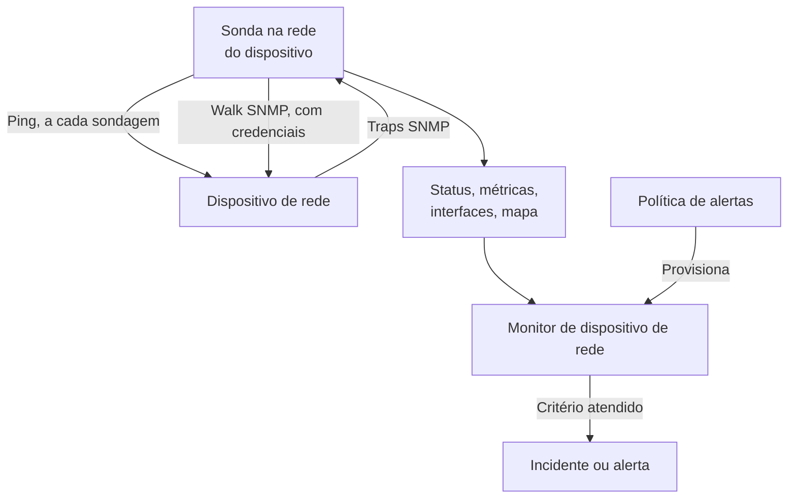
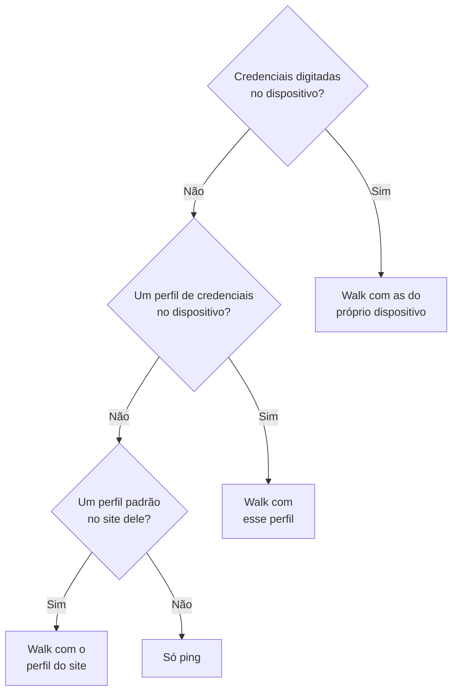
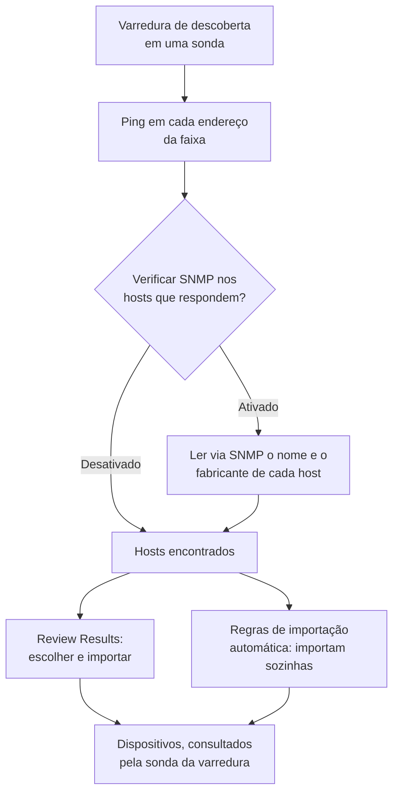
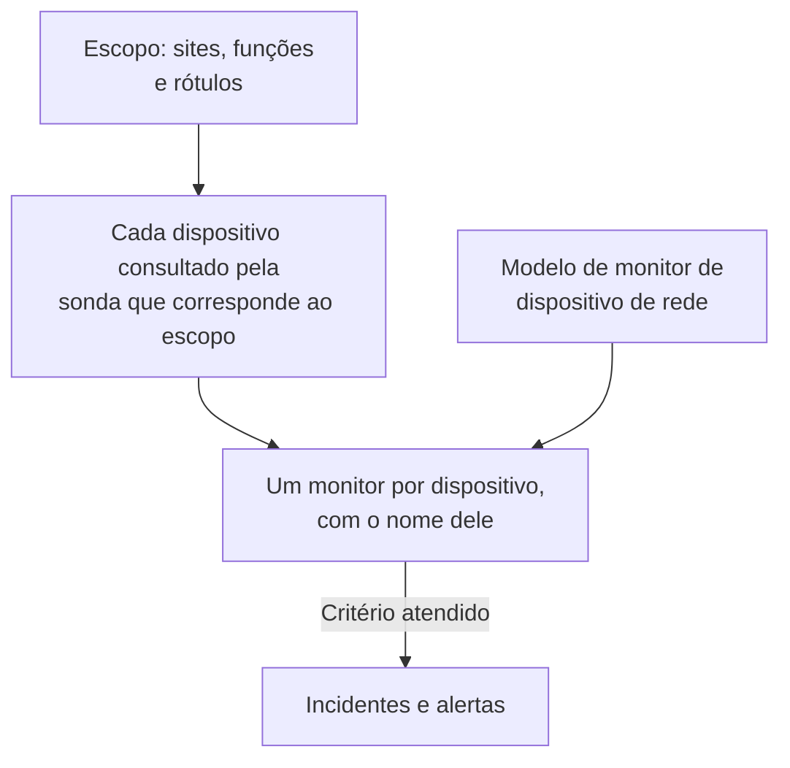
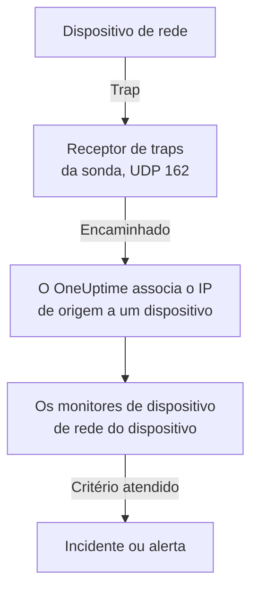

# Monitor de dispositivos de rede

Monitore switches, roteadores, firewalls, access points, PDUs, câmeras e impressoras: tudo o que tem um endereço na sua rede, fale SNMP ou não.

Adicione um dispositivo com o endereço dele e uma sonda, e a sonda envia ping a ele de acordo com um agendamento: o dispositivo ganha um status ativo ou fora do ar, um lugar no mapa da rede e um voto na saúde do seu site. Dê a ele credenciais SNMP e a mesma sonda também faz o walk SNMP: as interfaces e os ópticos dentro delas, o inventário de hardware, os vizinhos LLDP e CDP e os OIDs de saúde. Adicione um monitor, ou uma política de alertas para uma frota inteira, e as sondagens e os traps dele abrem incidentes e alertas.

:::cards
- [Adicionar um dispositivo](#adicionar-um-dispositivo-de-rede): O endereço e uma sonda, em uma única página.
- [Descobrir uma rede](#descobrir-dispositivos-com-uma-varredura-de-rede): Varra uma faixa de endereços e importe o que responder.
- [Ler dispositivos via SNMP](#credenciais-snmp-e-perfis-de-credenciais): Interfaces, ópticos, inventário e saúde.
- [Receber alertas](#alertas): Um monitor para um dispositivo, uma política para uma frota.
- [Ver o mapa](#topologia-da-rede): Vizinhos desenhados ao vivo, exportados em PDF.
- [Resolver um problema](#solução-de-problemas): Dispositivos pendentes, walks que falham, traps que não chegam.
:::

## Como funciona



O dispositivo e o monitor fazem trabalhos diferentes:

| Parte | O que faz | Quando você precisa |
| --- | --- | --- |
| O dispositivo | A sonda dele o consulta no agendamento do próprio dispositivo. Cada sondagem registra a acessibilidade, o tempo de ida e volta do ping e a perda de pacotes; uma sondagem com credenciais SNMP também lê a identidade, as interfaces, os vizinhos e os OIDs de saúde do dispositivo. | Sempre: o dispositivo é o que você adiciona. |
| Um monitor | Avalia critérios sobre cada resultado de sondagem e cada trap do dispositivo, e abre incidentes e alertas. | Só para incidentes e alertas. Status, inventário, gráficos e o mapa não precisam de monitor. |

## Antes de começar

- **Uma sonda que consiga alcançar o dispositivo.** A sonda envia ping e faz o walk do dispositivo a partir da própria rede, então um dispositivo em um endereço privado precisa de uma [sonda personalizada](/docs/probe/custom-probe) dentro dessa rede: uma sonda na internet pública não consegue alcançá-lo.
- **SNMP, para ir além do ping.** Opcional. Uma community string v1 ou v2c, ou um usuário SNMPv3, configurados no dispositivo, com UDP 161 aberto a partir da sonda. Sem isso, o dispositivo só recebe ping.
- **Traps, syslog e fluxos.** Opcional. A sonda recebe traps SNMP em UDP 162, syslog em UDP 5140 depois que você o ativa, e registros de fluxo em UDP 2055, 4739 e 6343, então libere essas portas dos seus dispositivos até a sonda.

## A visão geral da rede

**Rede → Visão geral** é onde a área de Rede abre, e ela começa pela resposta: uma frase que diz se a sua rede está saudável e, quando não está, o que está errado, a pior notícia primeiro.

| O que diz | Quando |
| --- | --- |
| **3 dispositivos estão fora do ar** | A sonda ou o monitor de um dispositivo não consegue alcançá-lo. |
| **2 sites precisam de atenção** | Todos os dispositivos respondem, mas a saúde de um site não está operacional. |
| **5 interfaces estão fora do ar** | Todos os dispositivos respondem, mas há portas apagadas. |
| **2 dispositivos não estão informando seus detalhes** | Respondem ao ping, mas o walk SNMP deles está falhando, então as interfaces e a saúde não são atualizadas: geralmente são as credenciais. |
| **Aguardando a primeira verificação** | Dispositivos foram adicionados e a sonda deles ainda não os verificou. |
| **Todos os 40 dispositivos estão ativos** | Todos os dispositivos respondem. Os dispositivos que ainda aguardam a primeira verificação são contados em uma linha própria. |

Abaixo dela, uma linha diz se alguma coisa abre um incidente quando um dispositivo cai: quantas [políticas de alertas](#políticas-de-alertas) estão ativas, ou um link **Set up alerts** quando não há nenhuma. Os botões **Add Device** e **Discover Devices** ao lado abrem esses formulários, e os blocos e listas abaixo trazem o detalhe: dispositivos e sites que precisam de atenção, a frota por fabricante e as varreduras recentes.

Antes de qualquer coisa ser adicionada, a visão geral mostra no lugar as duas formas de começar: **Descobrir dispositivos** varre uma faixa de endereços para você escolher o que adicionar, o melhor para uma rede inteira ou um site novo, e **Adicionar um único dispositivo** adiciona um pelo endereço IP ou nome do host.

O menu Rede mantém à vista o que você abre todos os dias: **Visão geral**, **Devices**, **Sites**, **Map**, **Traffic** e **Discovery**. O resto fica recolhido em seções, e uma seção se abre sozinha em qualquer uma das suas páginas:

| Seção | Páginas |
| --- | --- |
| **Topologia** | **Device Topology**, **Endpoints**, **Latency Matrix**, **Site Links**, **Device Links** |
| **Regras** | **Auto Import Rules**, **Site Assignment Rules**, **Regras de proprietário**, **Regras de Rótulos**, **Link Rules** |
| **Configurações** | **Alert Policies**, **Credenciais SNMP**, **Device Roles**, **Site Types**, **OID Collection Templates** |
| **Avançado** | **Archived Devices** |

## Adicionar um dispositivo de rede

:::steps
### Abrir a lista de dispositivos
Acesse **Rede → Devices** e clique em **Add Device**. **Add Device** na **Visão geral** da Rede abre o mesmo formulário.

### Digitar o endereço do dispositivo
Em **Nome do host**, digite o endereço IP ou o nome do host. Deixe **Nome** vazio para que o dispositivo receba o nome do seu host.

### Conferir o site e a sonda
Escolha o **Site** em que o dispositivo está, se você usa sites. **Sonda** se preenche sozinha com a sonda padrão do site, ou com a única sonda personalizada do projeto; confirme que é uma sonda que consegue alcançar o dispositivo.

### Adicionar o dispositivo
Clique em **Add Device**. Em poucos minutos a sonda envia ping ao dispositivo e o status dele passa a **Up** ou **Down**. Com credenciais SNMP, a visão geral dele também se preenche com a identidade, as interfaces e a saúde do dispositivo depois do primeiro walk bem-sucedido.
:::

O formulário é uma única página — o nome do host, um nome, o site e a sonda —, com **SNMP** e **Mais campos** recolhidos embaixo. Ele não pergunta nada sobre como o dispositivo é monitorado: todo dispositivo que você adiciona é consultado pela sua sonda, e a [substituição por monitor vinculado](#a-substituição-por-monitor-vinculado) fica na página **Configurações** do dispositivo para os poucos dispositivos que precisam dela.

Os detalhes de um dispositivo — nome, descrição, função, site, rótulos e endereços — são editados depois em um só lugar: o cartão **Device Settings** da página **Configurações** dele. O cartão **Detalhes do dispositivo** na visão geral os mostra, com um link **Editar nas configurações**.

### O dispositivo

| Campo | Descrição | Obrigatório |
| --- | --- | --- |
| Nome do host | O endereço IP ou nome do host para o qual a sonda envia ping, e do qual faz o walk SNMP quando o dispositivo tem credenciais. | Sim |
| Nome | Um nome amigável, como core-switch-01. Deixe vazio e o dispositivo recebe o nome do seu host. A API faz o mesmo: um dispositivo criado sem nome recebe o nome do seu host. | Não |
| Site | O [site de rede](/docs/monitor/network-sites) em que o dispositivo está. A saúde do site é resumida a partir dos seus dispositivos, e um site com uma sonda padrão preenche a sonda abaixo. | Não |
| Sonda | A sonda que envia ping a este dispositivo, faz o walk SNMP quando ele tem credenciais e recebe os traps, o syslog e os [registros de fluxo](/docs/monitor/network-traffic) dele. Ela precisa alcançar o dispositivo diretamente: uma sonda na internet pública não alcança um endereço privado. | Sim |

**Sonda** se preenche sozinha quando pode: um projeto com exatamente uma sonda personalizada começa com ela, e escolher um site a substitui pela [sonda padrão do site](/docs/monitor/network-sites#padrões-de-monitoramento). Ela nunca sobrescreve uma sonda que você escolheu. Defina uma sonda padrão nos seus sites e um dispositivo poderá ser adicionado só com o endereço.

### Mais campos (recolhidos)

| Campo | Descrição | Obrigatório |
| --- | --- | --- |
| Descrição | Texto livre. | Não |
| Device Role | Switch de núcleo, switch de acesso, firewall e assim por diante. Define o nível do dispositivo no mapa e delimita as políticas de alertas. | Não |
| Endereço MAC | O MAC do próprio dispositivo. O mapa o usa para colocar um dispositivo que não fala LLDP nem CDP na porta do switch que o aprendeu; veja [Dispositivos só com ping e a porta do switch deles](#dispositivos-só-com-ping-e-a-porta-do-switch-deles). Normalmente é aprendido para você a partir da tabela ARP de um roteador. | Não |
| Criar também um monitor Ping para incidentes | A sonda já envia ping ao dispositivo e dá um status a ele; um monitor Ping é o que transforma pings com falha em um incidente. Marque e um monitor é criado no nome do host e vinculado ao dispositivo ao salvar. Ele conta para o seu plano, e os incidentes dele ficam desativados até você ativá-los na página do monitor. | Não |

Marcar a caixa do monitor Ping mostra **Ping from probes**, as sondas do próprio monitor. Elas precisam alcançar a rede do dispositivo; deixe o campo vazio para usar as sondas padrão do projeto. Para alertar sobre muitos dispositivos de uma vez, use [políticas de alertas](#políticas-de-alertas).

### SNMP (recolhido, opcional)

Deixe recolhido e o dispositivo só recebe ping: a seção recolhida diz isso em uma frase. O dispositivo ainda ganha um status a partir da primeira sondagem e continua no seu site e no mapa, mas não tem interfaces, inventário nem OIDs de saúde até ter credenciais. Abra a seção para digitar uma community string ou um usuário v3, ou para escolher um perfil de credenciais salvo.

:::tabs
@tab SNMP v1 / v2c
| Campo | Descrição | Obrigatório |
| --- | --- | --- |
| Versão SNMP | V1, V2c ou V3. | Sim, começa em V2c |
| SNMP Community String | A community string v1 ou v2c, como `public`. | Não: vazia significa só ping |
| SNMP Port | A porta UDP em que o agente escuta. | Não, 161 por padrão |
| SNMP Credential Profile | Um conjunto de credenciais salvo para usar no lugar de digitar credenciais aqui. | Não |
@tab SNMPv3
| Campo | Descrição | Obrigatório |
| --- | --- | --- |
| SNMP v3 Security Level | No Auth, No Priv; Auth, No Priv; ou Auth, Priv. | Sim |
| SNMP v3 Username | O nome de segurança (usuário) configurado no dispositivo. | Sim: vazio significa só ping |
| SNMP v3 Authentication Protocol | MD5, SHA, SHA-256 ou SHA-512. | Com autenticação |
| SNMP v3 Authentication Key | A frase secreta de autenticação. | Com autenticação |
| SNMP v3 Privacy Protocol | DES, AES ou AES-256. | Com privacidade |
| SNMP v3 Privacy Key | A frase secreta de privacidade (criptografia). | Com privacidade |
:::

As credenciais digitadas no dispositivo prevalecem sobre um perfil de credenciais escolhido ao lado delas, e o site do dispositivo também pode ter um perfil padrão. As credenciais de um perfil são criptografadas em repouso. As credenciais digitadas em um dispositivo são protegidas pelas mesmas permissões de leitura, mas não são criptografadas em repouso: mais um motivo para manter credenciais compartilhadas em um perfil.

## Alterar muitos dispositivos de uma vez

Uma varredura de descoberta da rede de um cliente traz dezenas de dispositivos que pertencem a um só site, compartilham uma função e vêm de um só fabricante. Você não abre um por um: selecione-os na lista **Devices**, marcando linhas ou selecionando todos os dispositivos que os filtros encontram, e abra **Ações em massa**.

| Ação | O que faz |
| --- | --- |
| **Definir site** / **Remover do site** | Move cada dispositivo selecionado para o site que você escolher, onde ele conta para a saúde do site; um dispositivo sem sonda própria assume a sonda padrão do site. **Remover do site** os tira dos seus sites. Um dispositivo que uma regra de atribuição de site encontra volta para o site da regra na próxima sondagem, então, para os dispositivos que a descoberta continua encontrando, adicione uma regra em **Rede → Regras → Site Assignment Rules**; a caixa de diálogo **Definir site** leva até lá. |
| **Definir função do dispositivo** / **Remover função do dispositivo** | Dá a mesma função a cada dispositivo selecionado, como os vinte switches que são todos "Access Switch". As funções são as do projeto, em **Rede → Configurações → Device Roles**, para onde a caixa de diálogo leva. **Remover função do dispositivo** volta a deduzir a função de cada dispositivo a partir da identidade SNMP dele. |
| **Aplicar modelo do fabricante** | Adiciona os OIDs de saúde e as tabelas SNMP de um [modelo do fabricante](#modelos-de-saúde-dos-fabricantes) a cada dispositivo selecionado. **De acordo com o fabricante de cada dispositivo**, a primeira opção da caixa de diálogo, escolhe o modelo de cada dispositivo a partir do que o walk SNMP dele informa, para que uma seleção mista receba o modelo certo em todo lugar; ou escolha um único modelo para todos. |

Cada ação é uma caixa de diálogo e um salvamento para a seleção inteira, e cada dispositivo passa pelas mesmas verificações de uma edição na própria página de Configurações: permissões, o escopo de rótulos e de proprietários da sua função e os limites do que um dispositivo pode coletar.

**Aplicar modelo do fabricante** mostra o que vai fazer antes de fazer qualquer coisa: quantos dispositivos recebem qual modelo, e quantos ele deixa como estão e por quê. Ele acrescenta ao que cada dispositivo já coleta e não remove nada, e um dispositivo que já tem tudo o que o modelo traz não é regravado. Ele deixa como estão um dispositivo baseado em monitor (nada o consulta), um dispositivo vinculado a um [OID Collection Template](#oid-collection-templates) (o modelo decide o que ele coleta, então adicione lá os OIDs do fabricante) e, na correspondência, um dispositivo que ainda não passou por walk SNMP ou cujo fabricante não tem modelo.

Quando uma ação termina, ela lista quantos dispositivos mudaram, quais falharam e por quê — um dispositivo que a sua função não pode editar, uma lista acima do limite — e quais não mudaram e por quê: um dispositivo que já estava naquele site ou função, ou um que o modelo do fabricante deixa como está.

As demais ações em massa são tratadas onde fazem sentido: **Set OID Collection Template** em [OID Collection Templates](#oid-collection-templates), **Set SNMP Credential Profile**, **Switch to Probe Polling** e **Create Ping Monitors** em [Em massa](#em-massa), e **Shorten Names to Hostname** em [Como os dispositivos descobertos recebem nome](#como-os-dispositivos-descobertos-recebem-nome).

## O que uma sondagem realmente faz

Toda sondagem de um dispositivo consultado pela sonda é um ping. Quando o dispositivo tem credenciais SNMP utilizáveis, a sonda também executa um walk SNMP completo. Os dois correm lado a lado e o walk nunca espera o ping, então um equipamento SNMP atrás de uma ACL que descarta ICMP continua aparecendo como **Up**.

| Resultado | Dispositivo só com ping | Dispositivo com credenciais SNMP |
| --- | --- | --- |
| Status (Up ou Down) | Do ping | Do ping ou do walk: basta um dos dois responder |
| Tempo de ida e volta do ping e perda de pacotes | Registrados como métricas do dispositivo | Registrados como métricas do dispositivo |
| Tempo de resposta SNMP | — | O tempo do walk, nunca o do ping |
| Interfaces, vizinhos, endpoints | — | De um walk bem-sucedido |
| Identidade do sistema, fabricante, modelo, número de série | — | De um walk bem-sucedido |
| OIDs de saúde e tabelas SNMP | — | De um walk bem-sucedido |

Credenciais utilizáveis são um conjunto v1 ou v2c com uma community string, ou um conjunto v3 com um nome de usuário, encontrados pela [cadeia de credenciais](#credenciais-snmp-e-perfis-de-credenciais). Um conjunto vazio é ignorado, então um dispositivo nunca passa por walk com uma community padrão adivinhada.

A perda de pacotes reutiliza a série do [monitor Ping](/docs/monitor/ping-monitor), então ela é lida da mesma forma em todo o produto. O tempo de ida e volta tem uma série própria, `oneuptime.monitor.ping.round.trip.time`, porque em um dispositivo de rede o tempo de resposta simples é o do walk SNMP. A página **Métricas** do dispositivo mostra em gráficos a utilização das interfaces e os OIDs de saúde; o tempo de ida e volta da última hora aparece no painel do dispositivo no mapa.

### "SNMP failing" não é "Down"

Um dispositivo que responde ao ping mas cujo walk falha está **Up**, marcado com **SNMP failing**, e as duas metades importam:

- Ele está ativo porque algo responde naquele endereço. Pintá-lo de vermelho colocaria na sua contagem de incidentes um dispositivo que está funcionando bem.
- Ele está com SNMP failing porque as interfaces, o inventário e os OIDs de saúde dele pararam de ser atualizados, quase sempre por causa de credenciais, de um agente SNMP desativado ou de uma ACL. Nada mais na página diria a você que os números estão congelados.

Um dispositivo cujo ping e cujo walk falham é simplesmente **Down**, então a marcação só aparece ao lado de um status verde.

### Lendo o status de um dispositivo

Todo lugar que mostra um dispositivo — a lista Devices, a página Devices de um site, a visão geral, o mapa — usa os mesmos três veredictos e os mesmos qualificadores ao lado deles.

| Veredicto | Significa |
| --- | --- |
| **Up** | A última sondagem (ping ou SNMP), ou o monitor vinculado, alcançou o dispositivo. |
| **Down** | A última sondagem (ping ou SNMP), ou o monitor vinculado, não conseguiu alcançar o dispositivo. |
| **Pendente** | Ainda sem veredicto: nunca consultado, sem sonda atribuída ou sem monitor vinculado. |

| Qualificador | Aparece quando | O que fazer |
| --- | --- | --- |
| **Stale** | Nenhuma sondagem foi tentada há bem mais tempo que o intervalo do dispositivo. | Confira se a sonda do dispositivo está online e dando conta da sua frota. |
| **No probe** | O dispositivo é consultado pela sonda, mas não tem uma, ou a sondagem dele está desativada. | Atribua uma sonda que consiga alcançá-lo; até lá nada o consulta. |
| **No monitor** | O dispositivo usa a [substituição por monitor vinculado](#a-substituição-por-monitor-vinculado) e nada está vinculado. | Vincule um monitor, ou volte a sondagem pela sonda. |
| **SNMP failing** | Ativo no ping, mas o último walk SNMP falhou. | Confira as credenciais, o agente SNMP ou uma ACL. |

A lista **Devices** tem um filtro **SNMP** com três valores: **OK** (o último walk deu certo), **Failing** (o último walk falhou) e **Not configured** (só ping, sem credenciais, ou nunca consultado). "Quais dispositivos têm credenciais que pararam de funcionar" está a um clique. A coluna **Interfaces (Up / Down)** da lista mostra **No SNMP** em vez de `0 / 0` para um dispositivo que recebe ping e nunca passa por walk: zero portas funcionando seria outra afirmação, e errada.

## Credenciais SNMP e perfis de credenciais

Um dispositivo passa por walk com o primeiro conjunto de credenciais utilizável encontrado nesta ordem, e a busca para no primeiro encontrado:



A etapa do site lê o próprio site do dispositivo e nada além: um dispositivo em uma unidade não assume um perfil definido na região acima dela. Já a sonda padrão de um site desce pela árvore, porque uma sonda é copiada uma vez para o dispositivo, enquanto as credenciais são lidas de novo a cada sondagem; [Sites de rede](/docs/monitor/network-sites#padrões-de-monitoramento) tem os detalhes.

### A página Credenciais SNMP

**Rede → Configurações → Credenciais SNMP** guarda os perfis de credenciais do projeto. Um perfil é um conjunto com nome — uma community string v1 ou v2c, ou um usuário v3 com seu nível de segurança, protocolos e chaves — para o qual apontam quantos dispositivos e sites você quiser. Nada é copiado para os dispositivos, então trocar uma community string é uma única edição aqui, e cada dispositivo que usa o perfil assume o novo valor na próxima sondagem.

Os segredos de um perfil são criptografados em repouso, e só as funções que podem ler as credenciais próprias de um dispositivo podem lê-los. Um dispositivo ou site que mostra o seu perfil mostra o nome e a versão do perfil, nunca os segredos.

Um perfil para o qual um dispositivo ou site ainda aponta não pode ser excluído: a exclusão é recusada com a contagem do que está no caminho. Mova esses dispositivos e sites para outro perfil, ou remova o perfil deles, e então exclua-o.

### Voltar um dispositivo a só ping

Na página **Configurações** do dispositivo, **Editar definições** tem uma caixa **Ping only — clear this device's own SNMP credentials** na etapa **Credenciais SNMP**. Ela apaga a community string e o nome de usuário v3 do próprio dispositivo ao salvar. Ela existe porque esvaziar o campo certo não é óbvio: um dispositivo v3 continua passando por walk enquanto o nome de usuário existir, não importa o que mais você apague.

Apagar as credenciais próprias do dispositivo não apaga um perfil. Se o dispositivo ou o site dele ainda indicarem um, o dispositivo continua passando por walk com ele; remova também o perfil para que o dispositivo só receba ping.

### Em massa

Selecione dispositivos na lista **Devices** e use:

- **Set SNMP Credential Profile** / **Clear SNMP Credential Profile**: vincular um perfil a uma seleção, ou retirá-lo.
- **Switch to Probe Polling**: para dispositivos com a substituição por monitor vinculado. Escolha uma sonda, e cada dispositivo selecionado passa a receber ping no seu agendamento a partir daí, e walk quando tiver credenciais. Um monitor já vinculado continua vinculado; o status do dispositivo passa a vir da sonda.
- **Create Ping Monitors**: para dispositivos com a substituição por monitor vinculado, cria um monitor Ping no nome do host de cada dispositivo e o vincula, para que o dispositivo apareça como Up ou Down.

A página **Devices** mostra um banner quando o projeto tem dispositivos com a substituição por monitor vinculado sem nada vinculado — dispositivos que nada consulta e sobre os quais nada informa — e leva à seleção que os corrige.

## Padrões de monitoramento do site

Um [site de rede](/docs/monitor/network-sites#padrões-de-monitoramento) carrega dois padrões para os dispositivos dele. A **Default Probe** dele é copiada para um dispositivo criado no site, ou movido para ele, sem sonda própria. O **Default SNMP Credential Profile** dele é lido a cada sondagem de um dispositivo do site que não tem credenciais próprias. Defina os dois em um site e um dispositivo dali pode ser adicionado só com o endereço, recebendo ping e walk desde a primeira sondagem. O guia de sites diz até onde cada padrão desce pela árvore de sites.

## A substituição por monitor vinculado

Alguns equipamentos nenhuma sonda consegue alcançar ou consultar com ping de forma útil: um dispositivo atrás de um NAT, um appliance cuja saúde é melhor avaliada por uma verificação HTTP, um serviço cujo sinal real é uma verificação de porta. Para esses, **Editar definições** na página **Configurações** do dispositivo tem um **Monitoring Method**:

| Método | O que significa |
| --- | --- |
| **Sonda** | O padrão. Recebe ping da sonda atribuída no agendamento dela, e walk SNMP quando tem credenciais. |
| **Bound monitor** | O status de um monitor existente é o status deste dispositivo. |

Mudar um dispositivo para **Bound monitor** interrompe a sondagem dele. A sonda, o intervalo e o interruptor de sondagem saem do cartão **Polling & Data Collection**, os resultados de sondagem antigos do dispositivo são apagados, e o status dele vem do monitor que você vincular. Vincular um é opcional: até você fazer isso, o dispositivo aparece como **Pendente**, marcado com **No monitor**.

Voltar para **Sonda** restaura a sondagem e pede uma sonda. Um monitor que estava vinculado continua vinculado e continua alertando; ele só deixa de decidir o status do dispositivo.

A maioria dos dispositivos não precisa disso. Todo dispositivo consultado pela sonda já tem um status de acessibilidade, então não é preciso vincular um monitor Ping para ter um; vincule um monitor quando quiser os incidentes desse monitor.

## Sondagem e coleta de dados

A sondagem fica na página **Configurações** do dispositivo, no cartão **Polling & Data Collection** (**Editar: Polling**). Os padrões servem para um dispositivo novo, que não precisa de ajustes:

| Configuração | Descrição | Padrão |
| --- | --- | --- |
| Sonda | A sonda que consulta o dispositivo. | Definida quando o dispositivo é adicionado |
| Polling Enabled | A sonda consulta o dispositivo no agendamento abaixo. Desative para pausar a sondagem sem excluir o dispositivo. | Ativado |
| Polling Interval (Minutes) | Com que frequência a sonda consulta o dispositivo. No mínimo 1 minuto. | 5 |
| Walk Interfaces | Faz o walk das tabelas de interfaces (IF-MIB) a cada sondagem: status, largura de banda, utilização e erros de cada porta, além dos vizinhos LLDP e CDP para o mapa. | Ativado |
| Collect Connected Endpoints | Também faz o walk das tabelas ARP e de encaminhamento da bridge para descobrir o que está conectado ao dispositivo: terminais de ponto de venda, impressoras, telefones, notebooks. A partir de uma tabela ARP, também preenche o endereço MAC dos dispositivos registrados nesses endereços. Custa walks extras a cada sondagem. | Desativado |
| OID Collection Template | Uma lista de OIDs compartilhada e com nome que o dispositivo coleta. Editar o modelo altera cada dispositivo vinculado na próxima sondagem dele. | Nenhum |
| Device-Specific Health OIDs | OIDs extras que só este dispositivo coleta, além dos do seu modelo. | Nenhum |
| Auto-Apply Vendor Health Template | Quando o fabricante do dispositivo é reconhecido e a lista de OIDs dele está vazia, preenche a lista com o modelo do fabricante na próxima sondagem. | Desativado; ativado para dispositivos que a descoberta importa |
| Device-Specific SNMP Tables | [Tabelas SNMP](#tabelas-snmp) extras das quais só este dispositivo faz walk, além das do seu modelo. Uma tabela com a mesma chave de uma tabela do modelo a substitui neste dispositivo. | Nenhuma |

Tudo de **Walk Interfaces** para baixo precisa de credenciais SNMP: em um dispositivo só com ping essas configurações são mantidas e não têm nenhum walk ao qual se aplicar.

### Walk das interfaces

Com **Walk Interfaces** ativado e credenciais encontradas, cada sondagem acompanha, em cada interface, o status operacional e administrativo, os bits de entrada e saída, a utilização e os erros. O mesmo walk coleta os vizinhos LLDP e CDP para o mapa.

Silencie uma interface na página **Interfaces** do dispositivo, para uma porta de laboratório ou um enlace desconectado de propósito, e ela continua no inventário, mas sai dos alertas e das métricas. Um walk com falha nunca apaga pela metade o que foi coletado: o último instantâneo das interfaces permanece, e o dispositivo é marcado com **SNMP failing** para que ninguém o tome por um atual.

### Modelos de saúde dos fabricantes

No editor **Health OIDs**, **Vendor Health Template** aplica um conjunto pronto de OIDs para o fabricante do dispositivo. Muitos modelos também trazem [tabelas SNMP](#tabelas-snmp), adicionadas com **Add a Vendor's Tables** no editor **SNMP Tables**.

| Modelo do fabricante | OIDs de saúde | Tabelas SNMP |
| --- | --- | --- |
| Generic (Host Resources MIB) | Carga da CPU, RAM total e disponível, carga média | Núcleos da CPU (uma linha por núcleo, seja qual for a numeração da plataforma) |
| Arista EOS | Carga da CPU, carga média, RAM total e disponível | — |
| Cambium Networks cnMatrix | CPU, RAM, flash, temperatura, tensão de alimentação | Ventoinhas, portas PoE, fonte de alimentação redundante |
| Cambium Networks Enterprise Wi-Fi (cnPilot, XV, XE, XH) | CPU, memória livre, clientes Wi-Fi, conexão com o cnMaestro | Rádios Wi-Fi (banda, canal, largura, potência de transmissão, clientes, ruído de fundo, airtime, estado), SSIDs |
| Cisco IOS / IOS-XE | CPU, memória usada e livre, temperatura, estado das ventoinhas, estado das fontes | — |
| Dell Force10 / OS9 | CPU, memória | — |
| Extreme Networks EXOS / Switch Engine | CPU, temperatura, alarme de superaquecimento, estado da alimentação | Fontes de alimentação, ventoinhas, memória por slot, membros da pilha |
| Extreme Networks Fabric Engine / VOSS | Sessão vIST, contagem de I-SIDs | Adjacências do fabric (IS-IS) nomeadas pelo vizinho, CPU e memória por slot, sensores de temperatura, ventoinhas, fontes de alimentação |
| Extreme Networks IQ Engine (HiveOS) Access Points | CPU, memória, clientes Wi-Fi, temperatura | Rádios Wi-Fi (canal, potência de transmissão, ruído de fundo), SSIDs |
| Extreme Networks Wireless Controller (XIQ-C, ExtremeWireless) | Access points, access points ativos, clientes Wi-Fi | Access points (estado, clientes, endereço, software), rádios Wi-Fi (banda, canal, largura, ruído de fundo, airtime ocupado), WLANs (SSID, clientes) |
| Fortinet FortiGate | CPU, memória, disco | — |
| HPE / Aruba ProCurve | CPU, memória total e livre | — |
| HPE Aruba Instant (AOS 8) | Nome do cluster, versão do firmware, conductor | Access points (status, modelo, CPU, memória), rádios Wi-Fi nomeados pelo access point (canal, potência de transmissão, ruído de fundo, utilização, clientes, estado), SSIDs (clientes) |
| HPE Aruba Mobility Controller (AOS 8) | Access points, clientes Wi-Fi, função do controlador | Access points (status, modelo, grupo de AP), rádios Wi-Fi nomeados pelo access point (banda, canal, potência de transmissão, utilização, clientes, modo), SSIDs (clientes, access points ativos e fora do ar), processadores, memória |
| Huawei VRP | CPU, memória, temperatura | — |
| Juniper Junos | CPU, buffer de memória, temperatura | — |
| MikroTik RouterOS | Carga da CPU, temperatura, tensão | — |
| Palo Alto PAN-OS | CPU de gerenciamento, utilização de sessões, sessões ativas | — |
| Sophos Firewall (SFOS / XGS) | Memória, disco, swap, estado de HA e estado do par, serviço IPsec, temperatura da CPU (SFOS v22 e posteriores) | Túneis IPsec (o status exige SFOS v20 e posteriores), núcleos da CPU |
| TP-Link Omada Access Points (EAP) | Clientes Wi-Fi | — |
| Ubiquiti EdgeOS / EdgeSwitch / UniFi Switches | Carga da CPU, RAM total e disponível | — |
| Ubiquiti UniFi Access Points | Estado isolado, carga média, RAM total e disponível | Rádios Wi-Fi (banda, airtime), SSIDs (banda, canal, clientes, potência de transmissão, qualidade da conexão), núcleos da CPU |

Os OIDs do modelo são copiados para a lista própria do dispositivo, onde você pode podá-los ou ampliá-los. Depois que o primeiro walk identifica o fabricante, a página do dispositivo sugere o modelo correspondente. A correspondência lê o `sysObjectID` do dispositivo, e o `sysDescr` dele quando um mesmo número enterprise abriga dois sistemas operacionais: o Extreme Fabric Engine em hardware universal informa o mesmo enterprise (1916) que o EXOS, e só a descrição dele (`…-FabricEngine (9.0.4.0)`) os diferencia. Os access points UniFi são diferenciados dos roteadores da Ubiquiti da mesma forma (`U6-Pro 6.6.50.15098`), também quando um firmware mais antigo responde com o ramo do Net-SNMP, e os access points IQ Engine dos switches Aerohive que compartilham o ramo deles (`AP230, HiveOS 8.2r1`).

Os dispositivos com **Auto-Apply Vendor Health Template** ativado recebem os OIDs e as tabelas do modelo na primeira sondagem: os dispositivos que uma regra de importação automática traz, e os importados de **Review Results** com o interruptor do modelo do fabricante ativado, como ele fica a menos que você o desative. Para dar a muitos dispositivos o modelo deles de uma vez, como uma frota descoberta antes de o interruptor existir, selecione-os na lista **Devices** e use **Aplicar modelo do fabricante** (veja [Alterar muitos dispositivos de uma vez](#alterar-muitos-dispositivos-de-uma-vez)).

Aplicar um modelo do fabricante é uma cópia única, então nada se propaga quando o modelo muda. Para qualquer coisa além de um único dispositivo, use um **OID Collection Template**; os modelos dos fabricantes são oferecidos como ponto de partida quando você cria um.

### OID Collection Templates

Um **OID Collection Template** (**Rede → Configurações → OID Collection Templates**) é uma lista de OIDs com nome, normalmente o de um tipo de dispositivo como "Cisco Catalyst 9300", à qual quantos dispositivos você quiser se vinculam. O vínculo é vivo, não uma cópia: a lista de OIDs de um dispositivo é montada a cada sondagem, então editar um modelo muda o que cada dispositivo vinculado coleta na próxima sondagem, sem nenhuma etapa de sincronização.

Antes de criar um, confirme que você precisa dele. Os bits de entrada e saída por porta, o status operacional, a utilização e os erros por segundo são coletados de cada porta a cada sondagem sem OID nenhum (veja [Walk das interfaces](#walk-das-interfaces)), e já podem gerar alertas por porta. Os modelos servem para o que não é por porta: CPU, memória, temperatura, ventoinhas, fontes de alimentação, pares BGP.

Vindo do Zabbix:

| Zabbix | OneUptime |
| --- | --- |
| Template | OID Collection Template |
| Item | Um OID desse modelo |
| Regra de descoberta "Network interfaces by SNMP" com protótipos de item | Embutido e sempre ativo para os contadores de interface: nada a escrever |
| Trigger | Critérios do monitor |
| Protótipo de trigger, um por interface descoberta | Um critério com **Interface** definido como `*`, que se desdobra por porta |
| Regra de descoberta sobre qualquer outra tabela SNMP (túneis, rádios, ventoinhas) com protótipos de item | Uma [tabela SNMP](#tabelas-snmp) no modelo |
| Protótipo de trigger sobre uma tabela assim | Um critério SNMP Table Value ou SNMP Table Row Is Unhealthy com **Row** definido como `*` |
| Grupo de hosts | Rótulos |
| Ação "Link template on host discovery" | O **OID Collection Template** de uma regra de importação automática |
| Ação sobre um grupo de hosts ("alertar em cada switch") | Uma [política de alertas](#políticas-de-alertas) |

Um OID em um modelo é coletado como está escrito, então um OID que aponta para uma linha de uma tabela (`…ifSpeed.3`) coleta só essa linha, seja o que for que estiver no índice 3 no dia da sondagem. Tudo o que é uma lista — túneis, rádios, ventoinhas, vizinhos — pertence a uma [tabela SNMP](#tabelas-snmp), que faz o walk de cada linha e acompanha as linhas conforme elas aparecem e somem. Os dados de interface por porta não precisam de nenhum dos dois: o walk das interfaces registra como séries o status operacional, os bits de entrada e saída por segundo, a utilização e uma taxa combinada de erros por segundo. Os erros por direção, os descartes, o status administrativo e a velocidade do enlace vão para o inventário de interfaces do dispositivo, mas não são séries e não podem gerar alertas.

Há três formas de vincular dispositivos, e em uma frota que a descoberta continua encontrando, a terceira é a que mais importa:

- Um dispositivo de cada vez, no cartão **Polling & Data Collection** do dispositivo.
- Em massa, selecionando dispositivos na lista **Devices** e usando **Set OID Collection Template**. A coluna **Template** da lista mostra quais dispositivos estão vinculados a quê.
- Automaticamente, definindo um OID Collection Template em uma regra de importação automática, para que cada dispositivo importado por uma varredura seja vinculado no momento em que é criado.

Um dispositivo coleta primeiro os OIDs do seu modelo e depois os seus próprios **Device-Specific Health OIDs**. Quando os dois apontam para o mesmo OID, ele é coletado uma vez, prevalecem o nome e a descrição do dispositivo, e as entradas do modelo mantêm o seu lugar, então os acréscimos específicos do dispositivo nunca conseguem empurrá-las para fora.

| Limite | Valor |
| --- | --- |
| OIDs de saúde que um dispositivo consulta | 200 |
| OIDs em um modelo | 150 |
| OIDs próprios de um dispositivo vinculado | 50 |
| OIDs próprios de um dispositivo não vinculado | 200 |

Os limites se somam, então um dispositivo vinculado nunca pode consultar mais de 200 OIDs. Ultrapassá-los é um erro de validação ao salvar, nunca um corte silencioso na sondagem, e vincular um dispositivo que já tem mais de 50 OIDs próprios é recusado com uma mensagem que diz quantos remover.

Um modelo ao qual ainda há dispositivos vinculados não pode ser excluído. Desvincule-os antes, por exemplo com a ação em massa **Clear OID Collection Template**, para que uma exclusão nunca interrompa em silêncio a coleta de uma frota inteira.

### OIDs personalizados

Adicione os OIDs que você quiser coletar a cada sondagem, em um modelo ou como acréscimos específicos do dispositivo:

| Campo | Descrição | Obrigatório |
| --- | --- | --- |
| OID | O OID numérico, como 1.3.6.1.2.1.1.1.0. | Sim |
| Nome | Um nome amigável para o OID, como sysDescr. | Não |
| Descrição | O que o OID representa. | Não |

Os valores coletados aparecem em gráficos na página **Métricas** do dispositivo, e os critérios **SNMP OID Value** e **SNMP OID Exists** alertam sobre eles. O seletor de OIDs desses critérios lista os OIDs que o dispositivo escolhido coleta, os do modelo e os dele, então não há nada para digitar.

Listas longas de OIDs são divididas em várias requisições SNMP GET para que cada uma caiba em um único datagrama UDP. Se você mantinha suas listas de OIDs curtas porque uma versão anterior informava como offline um dispositivo que respondia `tooBig`, não precisa mais.

### Tabelas SNMP

Parte do que um dispositivo sabe é uma lista: uma linha por túnel IPsec, rádio Wi-Fi, SSID, vizinho do fabric, ventoinha ou fonte de alimentação. Uma tabela SNMP é definida pelas suas colunas, e cada linha passa por walk a cada sondagem, então um túnel adicionado, renomeado ou excluído é acompanhado sem que ninguém edite nada.

| Campo | O que faz |
| --- | --- |
| Nome e chave | Como a tabela se chama. A chave (letras, dígitos e sublinhados, gerada a partir do nome quando deixada em branco) é o que critérios, métricas e variáveis de modelo usam, então renomear uma tabela nunca quebra um alerta. |
| Tipo | O que são as linhas: túneis VPN, access points Wi-Fi, rádios Wi-Fi, SSIDs Wi-Fi, vizinhos de roteamento, hardware ou genérico. Os tipos Wi-Fi alimentam a [página Wi-Fi](#a-aba-wi-fi) do dispositivo. |
| Colunas | Os OIDs de coluna a coletar (o OID da entrada da tabela mais o número da coluna, como `1.3.6.1.4.1.2604.5.1.6.1.1.1.1.9` para o status de um túnel Sophos), cada um com um nome e, opcionalmente, uma unidade, uma função (status, banda, canal, largura do canal, potência de transmissão, clientes, ruído de fundo, utilização, SSID), rótulos de valores e valores saudáveis. |
| Nomes das linhas | Colunas opcionais cujos valores dão nome a cada linha, como o nome da conexão de um túnel. Sem elas, as linhas recebem o nome do seu índice. Um nome pode vir de uma tabela irmã que compartilha o índice (o Fabric Engine nomeia as adjacências IS-IS a partir de `rcIsisAdjHostName`), ou de uma tabela mãe cujo índice começa o desta tabela (o Aruba Instant nomeia cada rádio pelo seu access point). Uma tabela indexada por um nome (o ArubaOS indexa os seus SSIDs pelo SSID) recebe o nome do seu índice decodificado. |
| Limite de linhas | Quantas linhas manter: 100 por padrão, 250 no máximo. |

Números são lidos como números, e um texto que começa com um número é lido como esse número (`"36"`, `"-95 dBm"`, `"80MHz"`), porque muitos fabricantes colocam números dentro de strings. Defina o tipo de valor de uma coluna como **Text only** para valores que só parecem numéricos. Os **Value labels** transformam códigos em palavras (`0=inactive, 1=active`): o valor bruto continua sendo o que vai para os gráficos e as comparações, o rótulo é o que é exibido. Os **Healthy values** (`1`) dizem quais valores significam que está tudo bem: eles colorem a linha na página **SNMP Tables** do dispositivo e alimentam o critério **SNMP Table Row Is Unhealthy**.

Algumas colunas dos modelos dos fabricantes também **ajustam** o número que leem, para MIBs que guardam um valor em uma unidade própria: o ArubaOS informa a potência de transmissão dobrada (lida × 0.5), o Aruba Instant o ruído de fundo sem o sinal (× −1), o Aerohive o ruído de fundo mais 256 (− 256), e o controlador da Extreme a largura do canal em passos de 20 MHz (× 20). O número ajustado é o que é exibido, colocado em gráficos e comparado, então **Noise Floor Greater Than -80** significa o mesmo em todos os fabricantes, e o editor de tabelas mostra a conta embaixo da coluna.

As tabelas vêm de um [OID Collection Template](#oid-collection-templates), compartilhado por cada dispositivo vinculado (até 10 tabelas), ou do próprio dispositivo em **Device-Specific SNMP Tables** (até mais 10). Elas são mescladas por chave a cada sondagem, o modelo primeiro, e uma tabela do dispositivo com a mesma chave substitui a do modelo. Os dois editores oferecem **Add a Vendor's Tables**.

A sonda faz o walk de cada coluna como uma subárvore, dentro de um orçamento de 30 segundos compartilhado por todas as tabelas do dispositivo. Uma tabela cujo walk não é possível diz por quê e nunca faz a sondagem falhar: a página **SNMP Tables** do dispositivo mantém as últimas linhas válidas e informa que o walk mais recente falhou, enquanto os critérios julgam só o que este walk produziu, então um timeout nunca é lido como uma tabela vazia. Cada célula numérica é registrada como a métrica `oneuptime.monitor.snmp.table.value`, com os atributos `snmpTableKey`, `snmpTableName`, `snmpTableColumn`, `snmpTableColumnOid`, `snmpTableRow` e `snmpTableRowIndex`, então um painel pode mostrar o status de cada túnel ou a potência de transmissão de cada rádio, e um monitor de métricas pode agrupar por `snmpTableRow`.

### A aba Wi-Fi

Um dispositivo cujo walk inclui uma tabela Wi-Fi — access points, rádios ou SSIDs, como os modelos Wi-Fi dos fabricantes os trazem — ganha uma página **Wi-Fi**. Ela abre com os access points ativos (em um controlador), os rádios ligados, os clientes e os SSIDs, e depois lista cada access point que um controlador gerencia com o seu estado, rádios e clientes; cada rádio com banda, canal, frequência, largura do canal, potência de transmissão, clientes, ruído de fundo e airtime; e cada SSID com a sua banda e os seus clientes. As colunas são encontradas pela função delas, então as tabelas de qualquer fabricante que marquem as próprias colunas aparecem da mesma forma.

Os fabricantes dividem essas informações de formas diferentes, e a página as junta de novo:

- A frequência é calculada a partir da banda e do canal com o plano de canais 802.11 (2.4, 5 e 6 GHz). Um controlador que informa a frequência onde a MIB dele diz canal (o da Extreme) é lido ao contrário.
- Um rádio que não informa a banda é posicionado pelo canal: de 1 a 14 é 2.4 GHz, de 32 a 177 é 5 GHz, e um número que só o 6 GHz usa (37, 53, 181…) é 6 GHz.
- O UniFi informa canal, potência de transmissão e clientes por SSID: um rádio os obtém dos SSIDs da sua banda.
- A Aruba conta os clientes por rádio: os clientes de um access point são os dos seus rádios.
- Uma interface que não transmite nenhuma rede (o IQ Engine lista todas as interfaces, com N/A nessas) não é listada como SSID.

Em um dispositivo que ainda não informa Wi-Fi, a página indica o modelo do fabricante dele, encontrado a partir da última sondagem da mesma forma que a aplicação automática, e o aplica com **Aplicar modelo**; os rádios aparecem depois da próxima sondagem.

### Fabricantes de Wi-Fi compatíveis

O que cada fabricante de Wi-Fi informa via SNMP, e o que só a nuvem dele tem:

| Fabricante | Access points e controladores | Modelo do fabricante | Lido via SNMP | Exige a API em nuvem do fabricante (não desenvolvida) |
| --- | --- | --- | --- | --- |
| Cambium Networks | Access points Wi-Fi corporativos (cnPilot, XV, XE, XH) | Cambium Networks Enterprise Wi-Fi (cnPilot, XV, XE, XH) | Banda, canal, largura, potência de transmissão, clientes, ruído de fundo, airtime e estado de cada rádio; SSIDs; CPU, memória | Visões da frota no cnMaestro |
| Ubiquiti UniFi | Access points UniFi (UAP, U6, U7, UK) | Ubiquiti UniFi Access Points | Banda e airtime de cada rádio; canal, clientes e potência de transmissão de cada SSID; CPU por núcleo, memória | Dados por cliente e visões por site no aplicativo UniFi Network |
| HPE Aruba | Clusters Instant (AOS 8), por meio do controlador virtual | HPE Aruba Instant (AOS 8) | Status, CPU e memória de cada access point; canal, potência de transmissão, ruído de fundo, utilização, clientes e estado de cada rádio; SSIDs com clientes | — |
| HPE Aruba | Mobility Controllers (AOS 8) | HPE Aruba Mobility Controller (AOS 8) | Status de cada access point gerenciado; banda, canal, potência de transmissão, utilização e clientes de cada rádio; SSIDs com clientes; CPU e memória do controlador | — |
| HPE Aruba | Access points com AOS 10, gerenciados pelo Aruba Central | — | Acessibilidade (ping) | Rádios, SSIDs e clientes: a API do Aruba Central |
| Extreme Networks | Access points IQ Engine (HiveOS) | Extreme Networks IQ Engine (HiveOS) Access Points | Canal, potência de transmissão e ruído de fundo de cada rádio; SSIDs; CPU, memória, clientes, temperatura | Visões de clientes e da frota no ExtremeCloud IQ |
| Extreme Networks | ExtremeCloud IQ Controller (antigo Extreme Campus Controller) e controladores ExtremeWireless | Extreme Networks Wireless Controller (XIQ-C, ExtremeWireless) | Estado e clientes de cada access point; banda, canal, largura, ruído de fundo e airtime ocupado de cada rádio; WLANs com clientes | — |
| TP-Link | Access points Omada (EAP) | TP-Link Omada Access Points (EAP) | A contagem de clientes, em firmware com a MIB de clientes EAP da TP-Link | Rádios, canais e SSIDs: a API do Omada Controller |
| Juniper | Access points Mist | — | Acessibilidade (ping); access points que ficam ativos e fora do ar, pelos webhooks do Mist | Todo o resto: a API em nuvem do Mist |

Os modelos são correspondidos a partir do `sysObjectID` e do `sysDescr` de cada dispositivo, então a aplicação automática, o **De acordo com o fabricante de cada dispositivo** da ação em massa **Aplicar modelo do fabricante** e a página Wi-Fi os escolhem sem que você precise dizer, exceto o da TP-Link, que você mesmo aplica. Para ativar o SNMP, por fabricante:

- **Cambium**: no cnMaestro, o SNMP é definido por grupo de AP (Configuration → Wi-Fi Profiles → AP Groups → Management → SNMP), com uma community v2c ou um usuário v3. Adicione cada access point.
- **Ubiquiti UniFi**: ative o SNMP no aplicativo UniFi Network, que o configura nos dispositivos que gerencia. Adicione cada access point.
- **HPE Aruba Instant**: ative o SNMP para o cluster e adicione o endereço do controlador virtual dele como um único dispositivo; ele responde por cada access point.
- **HPE Aruba Mobility Controller**: adicione o controlador; os access points de campus não respondem a SNMP por conta própria.
- **Extreme IQ Engine**: ative o SNMP na política de rede que o ExtremeCloud IQ envia aos access points, e adicione cada access point.
- **Extreme Wireless Controller**: ative o SNMP nas configurações de administração do controlador e adicione o controlador.
- **TP-Link Omada**: ative o SNMP para o site no Omada Controller (Network Config → SNMP), adicione os access points e aplique o modelo pela página de Configurações deles ou com **Aplicar modelo do fabricante**.
- **Juniper Mist**: os access points Mist não respondem a SNMP. Adicione-os como dispositivos só com ping para a acessibilidade, e envie o webhook `device-updowns` do Mist para um [monitor de requisições recebidas](/docs/monitor/incoming-request-monitor) para transformar em incidente um access point que fica offline.

A tabela de um controlador mantém até 250 linhas: em um controlador com mais de 250 access points ou rádios, o restante não é listado, e a tabela avisa. As contagens de access points e de clientes dele são OIDs de saúde, então contam tudo.

### Transceptores

Os ópticos SFP, SFP+, SFP28 e QSFP nas portas de um dispositivo são lidos a cada sondagem que faz o walk das interfaces: não há nada para ativar nem modelo para aplicar. Para cada óptico, o OneUptime guarda:

- O que ele é: fabricante, número da peça, número de série, revisão, tipo e comprimento de onda, como o óptico os informa. Ópticos de terceiros (FS.com, FLEXOPTIX, Carritech e os demais) são lidos da mesma forma que os do fabricante do switch.
- As leituras dele: temperatura, tensão de alimentação, corrente de polarização do laser e potência transmitida e recebida, do monitoramento óptico digital (DOM, também chamado de DDM). Um QSFP informa potência e polarização por lane.
- Os limites do próprio dispositivo: os limites baixo e alto de aviso e de alarme que o switch informa para cada leitura. Um óptico é avaliado por esses e por nada mais; o OneUptime nunca inventa limites próprios.
- Um mês de potência recebida: a média diária da lane mais fraca nos últimos 30 dias. Um conector sujo, uma fibra dobrada ou um óptico se desgastando aparecem aqui semanas antes de o enlace cair.

A página **Interfaces** do dispositivo abre com um cartão **Transceptores**: primeiro os problemas, depois uma linha por óptico com a porta, o que ele é, um status em palavras e as leituras. Uma leitura além de um limite é colorida e nomeada (**Alarme baixo**, **Aviso alto**), e um pequeno gráfico da potência recebida do mês fica ao lado do valor RX; a linha de um QSFP mostra a pior lane dele. Clique em uma linha para ver cada lane contra cada limite, a tendência da potência recebida com o melhor dia e a identidade do óptico. Um dispositivo que não informa nenhum óptico, só com portas de cobre ou com um agente que não os expõe, não mostra o cartão.

| Status | Significa |
| --- | --- |
| Saudável | Toda leitura para a qual o dispositivo tem limites está dentro deles. |
| Aviso | Uma leitura está no limite de aviso ou além dele. |
| Alarme | Uma leitura está no limite de alarme ou além dele, ou o dispositivo sinaliza perda de sinal ou falha do transmissor. |
| Não detectado | A porta tinha um óptico e não informa mais nenhum, enquanto a porta continua habilitada. A página continua mostrando o que havia ali. |
| Sem limites | O óptico informa leituras, mas o dispositivo não informa limites para avaliá-las. Alerte sobre elas com **SNMP Transceiver Reading**. |
| Detectado | O óptico não informa nenhum diagnóstico: comum em SFPs de cobre e cabos direct-attach. |
| Porta desabilitada | A porta está desligada, então o laser está apagado de propósito: as leituras aparecem, mas nunca são avaliadas. |

O `sysObjectID` do dispositivo escolhe de onde vêm as leituras: primeiro a tabela do próprio fabricante, quando ela traz o que a padrão não traz, e a ENTITY-SENSOR-MIB como alternativa.

| Dispositivos | Lido de | Limites |
| --- | --- | --- |
| Cisco | CISCO-ENTITY-SENSOR-MIB, associada às portas pela ENTITY-MIB | Sim |
| Arista | ENTITY-SENSOR-MIB, com os limites da ARISTA-ENTITY-SENSOR-MIB | Sim |
| Juniper | JUNIPER-DOM-MIB, com leituras por lane para ópticos multi-lane | Sim |
| HPE Comware e H3C | HH3C-TRANSCEIVER-INFO-MIB | Sim |
| HPE Aruba ProCurve / ArubaOS-Switch | HP-ICF-TRANSCEIVER-MIB | Sim |
| MikroTik RouterOS | MIKROTIK-MIB (`mtxrOpticalTable`), com indicadores de perda de sinal e falha do transmissor | Não |
| Cambium Networks cnMatrix (4.5 e posteriores) | CAMBIUM-NETWORKS-TRANSCEIVER-MIB | Não |
| Todos os outros dispositivos | ENTITY-SENSOR-MIB (RFC 3433), associada às portas pela ENTITY-MIB | Não |

A primeira sondagem lê tudo. As sondagens seguintes leem só o que muda — as leituras, e os números de série que denunciam um óptico trocado —, e o resto (limites, identidade, qual óptico está em qual porta) é lido de novo quando um óptico é inserido, removido ou trocado, e pelo menos uma vez por hora. Um dispositivo sem nenhuma dessas MIBs custa uma requisição por MIB testada. A leitura tem um orçamento próprio de 20 segundos, e uma leitura que expira ou é interrompida mantém os últimos ópticos válidos do dispositivo em vez de informá-los como sumidos.

Um óptico ausente de uma porta habilitada aparece na hora como **Não detectado** na página, e conta como ausente para os alertas depois de duas sondagens seguidas, então um agente que responde vazio uma vez não aciona ninguém. Um óptico retirado de uma porta desligada é simplesmente esquecido, e uma interface silenciada mantém o óptico na página, mas nunca gera alerta.

Cada leitura também é uma métrica do dispositivo, uma série por porta e lane, nas unidades que a página mostra: `oneuptime.monitor.snmp.transceiver.temperature` (°C), `oneuptime.monitor.snmp.transceiver.voltage` (V), `oneuptime.monitor.snmp.transceiver.bias.current` (mA), `oneuptime.monitor.snmp.transceiver.tx.power` e `oneuptime.monitor.snmp.transceiver.rx.power` (dBm), com os atributos `interfaceName`, `interfaceIndex` e `lane`. Um painel pode mostrar a luz de um enlace ao longo de meses, e um monitor de métricas pode alertar sobre ela.

Uma investigação do OneUptime AI sobre um incidente ou alerta de um monitor de dispositivo de rede começa pelos ópticos das portas envolvidas: se ainda são detectados ou não, cada leitura contra os limites do dispositivo e a potência recebida das últimas semanas. A IA também pode ler os ópticos de qualquer dispositivo quando você pergunta sobre eles.

### Identidade do dispositivo

Depois do primeiro walk bem-sucedido, o OneUptime lê o grupo de sistema SNMPv2 e, quando o dispositivo oferece suporte, a ENTITY-MIB, e preenche o registro do dispositivo: nome do sistema, descrição, localização, contato, tempo ativo, fabricante, modelo, número de série e versão do firmware. O OID enterprise do fabricante (`sysObjectID`) é a impressão digital do dispositivo: ele indica o fabricante e escolhe o modelo do fabricante correspondente. As mesmas informações aparecem no [inventário](/docs/inventory/cmdb-sync#network-device-asset-attributes) junto com todos os seus outros ativos.

Um dispositivo só com ping mantém o nome e o endereço que você, ou uma varredura de descoberta, deu a ele: não há agente SNMP a quem pedir algo melhor.

## Descobrir dispositivos com uma varredura de rede

Em vez de adicionar os dispositivos um de cada vez, varra uma faixa de endereços a partir de uma sonda e importe o que responder.



:::steps
### Abrir o Discovery
Acesse **Rede → Discovery** e clique em **Iniciar varredura**. **Discover Devices** na **Visão geral** da Rede abre o mesmo formulário.

### Dizer o que varrer
Na etapa **Alvo da varredura**, digite a faixa, confira a **Sonda** e decida se vai usar **Check SNMP on hosts that answer**.

### Adicionar as credenciais a testar
Com o SNMP ativado, a etapa **Credenciais SNMP** pede os conjuntos de credenciais a testar. Com ele desativado não há segunda etapa: a varredura é uma [varredura só com ping](#varreduras-só-com-ping), e **Iniciar varredura** fica na primeira página.

### Iniciar a varredura
Clique em **Iniciar varredura**. A sonda varre a faixa e informa quantos hosts varreu e quantos responderam: quantos responderam ao SNMP ou, em uma varredura só com ping, quantos responderam ao ping.

### Importar o que ela encontrou
Clique em **Review Results** na varredura concluída, selecione os dispositivos que quiser e clique em **Import Selected**.
:::

| Campo | Descrição | Obrigatório |
| --- | --- | --- |
| Alvo da varredura | Os endereços a varrer, em [notação CIDR ou de faixas de octetos](#notação-do-alvo-da-varredura). | Sim |
| Sonda | A sonda que executa a varredura. Ela precisa alcançar a faixa diretamente. Um projeto com exatamente uma sonda personalizada começa com ela. | Sim |
| Check SNMP on hosts that answer | Uma varredura primeiro envia ping à faixa; isto decide se os hosts que respondem são depois consultados via SNMP sobre o nome e o fabricante. Desative para uma [varredura só com ping](#varreduras-só-com-ping). Escolhido ao criar a varredura e fixo depois disso. Ativado por padrão. | Não |
| SNMP Configs | A segunda etapa: os conjuntos de credenciais a testar, em ordem. Cada host é consultado com cada conjunto até um responder, então adicione um conjunto por grupo de dispositivos que compartilham versão e community ou usuário v3. | Quando a verificação SNMP está ativada |

Recolhidos em **Mais campos** na primeira etapa, para as varreduras que precisam deles:

| Campo | Descrição | Padrão |
| --- | --- | --- |
| Nome | Para que serve a varredura, para você diferenciá-la das outras. A lista mostra o alvo da varredura quando ele está vazio. | Vazio |
| Consultar nomes do Windows (NetBIOS) | Pergunta a cada host sem nome de sistema SNMP o nome NetBIOS dele, o nome do computador Windows, via UDP 137. Esse nome prevalece sobre o nome de DNS reverso do host. Só endereços privados e sondas personalizadas; veja [Como os dispositivos descobertos recebem nome](#como-os-dispositivos-descobertos-recebem-nome). | Ativado |
| Name devices by their short hostname | Dá aos dispositivos importados o nome da primeira parte de um nome de host totalmente qualificado: `core-sw-01` em vez de `core-sw-01.corp.example.com`. | Desativado |
| Repeat this scan | Executa a varredura de novo em um intervalo, o **Rescan Interval (Minutes)**, de pelo menos 15 minutos, para manter a descoberta em andamento; veja [as regras de importação automática](#importar-automaticamente-com-regras-de-importação-automática). Os hosts que uma varredura repetida encontra aguardam a sua revisão, a menos que uma regra de importação automática os encontre. | Desativado |

### Notação do alvo da varredura

O alvo da varredura aceita duas notações, ambas só IPv4. CIDR é uma sub-rede contígua:

```text
192.168.1.0/24
10.0.5.0/28
```

Os endereços de rede e de broadcast são pulados, então um `/24` varre 254 hosts. `/31` e `/32` não têm endereço de rede nem de broadcast a pular, então todos os endereços deles são varridos.

Em uma faixa de octetos, qualquer um dos quatro octetos pode ser uma faixa inclusiva `low-high` em vez de um único número:

```text
10.16-22.0-255.51-66
10.48-50.0-255.51-66
192.168.1.10-40
10.0.0.5
```

Cada endereço do resultado é varrido, e nenhum é tratado como endereço de rede ou de broadcast, porque não há comprimento de prefixo do qual deduzi-lo: `10.0.0.0-255` inclui `10.0.0.0` e `10.0.0.255`.

- Cada octeto é um número de 0 a 255, ou uma faixa cujo limite inferior vem primeiro. `10.22-16.0.1` é recusado como faixa invertida em vez de, em silêncio, não varrer nada.
- Um endereço avulso (`10.0.0.5`) varre exatamente esse host.
- Uma varredura cobre no máximo 32.768 endereços. Um alvo maior é recusado ao salvar a varredura: divida-o em várias varreduras ou estreite as faixas.

Os alvos são verificados ao salvar a varredura, então um erro de digitação aparece no formulário e não minutos depois como uma varredura com falha.

As faixas de octetos existem para redes que não têm o formato de blocos CIDR. `10.16-22.0-255.51-66` varre de `.51` a `.66` em cada `/24` de `10.16` a `10.22`: 28.672 endereços. Escrito em CIDR, isso exige 1.792 varreduras, e o menor bloco CIDR que o contém (`10.16.0.0/13`) tem 512k endereços, 98% dos quais não valem a pena sondar.

### O que uma varredura importa

Todo host que uma varredura encontra é importado como dispositivo consultado pela sonda, com a sonda da varredura atribuída e a sondagem ativada, então ele tem um status desde a primeira sondagem. O que muda de um host para outro é o que vem com ele:

- Os hosts que responderam ao SNMP são importados com o endereço que respondeu como nome do host, o nome escolhido como descrito abaixo e as credenciais que responderam, então uma varredura v3 importa dispositivos prontos para o walk v3 que começam a coletar interfaces e inventário na hora.
- Os hosts que responderam ao ping mas não ao SNMP — todo host que uma [varredura só com ping](#varreduras-só-com-ping) encontra, e os hosts que uma varredura SNMP não conseguiu identificar — são importados sem credenciais. A sonda envia ping a eles no agendamento deles; adicione credenciais depois, no dispositivo ou como um perfil nele ou no site dele, e a mesma sonda também começa a fazer o walk.

Dispositivos já registrados são sinalizados e ignorados. Vincule um monitor [Ping](/docs/monitor/ping-monitor) ou [IP](/docs/monitor/ip-monitor) a um dispositivo importado só se você quiser os incidentes desse monitor; para uma frota, uma [política de alertas](#políticas-de-alertas) costuma ser a melhor resposta.

Quando uma varredura encontrou hosts SNMP, **Review Results** oferece **Aplicar o modelo do fabricante de cada host SNMP na primeira sondagem (recomendado)**, ativado por padrão: cada dispositivo SNMP importado recebe o [modelo do fabricante](#modelos-de-saúde-dos-fabricantes) correspondente ao que o primeiro walk dele informa, os OIDs de saúde e as tabelas SNMP, exatamente como os dispositivos que uma regra de importação automática traz. Um dispositivo cujo fabricante não tem modelo fica como está. Desative o interruptor para um lote que deve começar sem ele.

### Como os dispositivos descobertos recebem nome

Um host descoberto recebe o primeiro destes nomes que tiver:

1. O nome de sistema SNMP dele (`sysName`), o nome que o dispositivo informa para si mesmo. Um marcador como `localhost`, ou um endereço IP, não conta.
2. O nome NetBIOS dele, o nome do computador que um host Windows ou Samba informa para si mesmo, quando a varredura tem **Consultar nomes do Windows (NetBIOS)** ativado. Ele mantém as maiúsculas e minúsculas que o host informa: `WB0024KDS03`.
3. O nome de DNS reverso dele, o registro PTR que a sonda consulta depois da varredura.
4. O endereço IP dele.

Os nomes do próprio dispositivo vêm primeiro porque são os nomes que os responsáveis por ele usam: um host Windows chamado `WB0024KDS03` mantém esse nome mesmo quando a zona reversa o chama de `wb-0024-kds03.wbhq.com`. O nome de DNS reverso também é mantido: **Review Results** o mostra ao lado do endereço, e o dispositivo o guarda como seu **DNS Name**. O NetBIOS corta o nome de um computador em 15 caracteres, então um nome NetBIOS que é o começo de um nome de DNS reverso mais longo (`WB-0024-KITCHEN` para `wb-0024-kitchen-display-03.wbhq.com`) cede lugar ao nome de DNS reverso.

**Review Results** mostra o nome que um dispositivo vai receber, e ele recebe o mesmo nome quer você o importe dali, quer uma [regra de importação automática](#importar-automaticamente-com-regras-de-importação-automática) o importe. O nome do host do dispositivo é sempre o endereço IP dele. Enquanto o nome de um dispositivo ainda for o que a descoberta deu a ele, a visão geral mostra de onde o nome veio como **Origem do nome**.

**Name devices by their short hostname** corta um nome totalmente qualificado no primeiro rótulo: `core-sw-01.corp.example.com` é importado como `core-sw-01`. Vale para um nome de DNS reverso e para um `sysName` que seja um nome de host totalmente qualificado; todo o resto (`Core Switch`, `ubuntu-22.04`, um endereço IP) fica como está. Muda só como os dispositivos se chamam, então nenhuma nova varredura é necessária: **Review Results** e as regras de importação automática o usam na próxima vez que dão nome a um host, e os dispositivos já importados mantêm os seus nomes.

Um dispositivo importado de um host com nome de DNS reverso guarda o nome completo como seu **DNS Name**, use a varredura nomes curtos ou não. Ele aparece na visão geral do dispositivo, a busca da lista **Devices** o encontra, e as regras de atribuição de site comparam padrões de nome de host com ele, então uma regra `*.store-0660.corp.example.com` continua posicionando um dispositivo cujo nome perdeu o domínio. Um nome NetBIOS nunca é guardado como DNS Name: o host o informa sobre si mesmo, e ele não é um registro DNS.

> [!WARNING]
> As regras de rótulos e de proprietários comparam o nome do dispositivo. Um padrão escrito para nomes DNS (`*.wbhq.com`) ou nomes completos (`*.corp.example.com`) não corresponde a um dispositivo com o próprio nome ou com o nome curto. As regras de atribuição de site também tentam o DNS Name, então continuam correspondendo.

Para encurtar dispositivos que você já importou, selecione-os na lista **Devices** e use **Shorten Names to Hostname**. A confirmação mostra quantos dispositivos serão renomeados, com exemplos. Um dispositivo sem DNS Name guarda o nome completo como DNS Name, a menos que esse nome também seja o nome de sistema SNMP dele ou seja longo o bastante para ter sido cortado na importação. Um dispositivo é ignorado quando outro dispositivo já tem o nome curto dele, quando dois dispositivos selecionados receberiam o mesmo nome curto, ou quando o nome dele mudou depois que você o selecionou. As regras de atribuição de site são executadas de novo para cada dispositivo renomeado; as de rótulos e de proprietários não, então use [Run Now](/docs/configuration/run-rules-now) em uma regra que compare nomes de dispositivos. Os monitores Ping existentes mantêm os seus nomes, e as séries de métricas rotuladas com o nome do dispositivo começam uma nova série com o novo nome.

:::details Nomes NetBIOS: como a consulta funciona
Hosts Windows e Samba muitas vezes não têm agente SNMP, então, sem isto, eles apareceriam com um nome de DNS reverso que os responsáveis talvez não usem, ou pelo endereço. Com **Consultar nomes do Windows (NetBIOS)** ativado, a sonda pergunta a cada host sem nome de sistema SNMP o nome NetBIOS dele depois da varredura, com uma consulta NBSTAT para UDP 137, primeiro os hosts sem nome de DNS reverso. A opção vem ativada nas varreduras novas e desativada nas criadas antes de ela existir; ativá-la ou desativá-la mantém os resultados da varredura e passa a valer na próxima execução da varredura. Ela funciona na base do melhor esforço:

- Só são consultados hosts em endereços privados (`10.0.0.0/8`, `172.16.0.0/12`, `192.168.0.0/16`) e de NAT de operadora (`100.64.0.0/10`). Endereços públicos nunca são.
- As sondas globais nunca enviam as consultas, diga a varredura o que disser. Execute a varredura a partir de uma [sonda personalizada](/docs/probe/custom-probe) dentro da rede, e libere UDP 137 a partir da sonda e as respostas de volta.
- O nome mantém as maiúsculas e minúsculas que o host informa (`FILESRV01`), e só é usado quando tem de 1 a 15 caracteres, é um rótulo de nome de host válido e contém uma letra.
- A consulta pergunta a no máximo 2.000 hosts por varredura e acrescenta até cerca de um minuto ao final da varredura. Uma sonda personalizada pode aumentar o número de hosts com `PROBE_DISCOVERY_NETBIOS_MAX_HOSTS`. Quando o limite ou o tempo a interrompem antes do fim, a mensagem de status da varredura diz quantos hosts não foram consultados, e um host que não responde mantém como nome o seu nome de DNS reverso, ou o endereço.
- Consultas NBSTAT a muitos hosts podem disparar regras de detecção de intrusão. Desative a opção em varreduras de redes onde isso importa, ou avise antes a sua equipe de segurança.
:::

:::details Quando um host não tem nome
Um host listado pelo endereço em **Review Results** mostra **No name found** e um (i) ao lado. Passe o mouse sobre o (i), ou dê foco a ele, para ver o que cada forma de dar nome a ele retornou:

- SNMP: a varredura não verificou o SNMP, o host não respondeu, ou respondeu sem nome de sistema ou com um que não pode ser um nome, como `localhost` ou um endereço IP.
- NetBIOS: a opção está desativada para a varredura, a varredura rodou em uma sonda global, o endereço não foi consultado (um endereço público, ou o limite de hosts ou de tempo foi atingido), ou o host não respondeu em UDP 137.
- DNS reverso: o servidor DNS da sonda não tem registro PTR para o endereço, retornou um que não é um nome de host válido, não respondeu a tempo, falhou (SERVFAIL), recusou a consulta ou não pôde ser alcançado; ou o endereço nunca foi consultado, porque a varredura ficou sem tempo para as consultas de nomes ou o servidor DNS não estava respondendo.

A sonda consulta nomes pelos próprios servidores DNS, os de `/etc/resolv.conf` onde ela roda: os do host nas sondas do Docker Compose incluídas, o DNS do cluster em uma sonda no Kubernetes. Eles podem não ser os servidores que a sua estação de trabalho consulta, então, quando um host que você sabe que tem registro PTR não mostra nenhum, execute `nslookup <address>` de dentro do contêiner ou do pod da sonda para comparar. Uma consulta que expira ou falha é repetida uma vez enquanto durar o tempo da varredura para consultas de nomes, perguntando a cada servidor de nomes configurado por vez (até três), e só o "sem registro PTR" do primeiro servidor de nomes é definitivo. Quando as consultas continuam falhando, a mensagem de status da varredura diz para quantos hosts, e uma nova varredura tenta de novo. Os nomes do `/etc/hosts` da sonda são usados antes de perguntar ao DNS.
:::

:::details Nomes melhores encontrados depois
Uma varredura nem sempre encontra o melhor nome de um host na primeira vez. Os resultados parciais que uma varredura em andamento envia não trazem nomes, porque os nomes de DNS reverso e NetBIOS são consultados uma vez, depois da varredura, então um host importado a partir deles — por uma regra de importação automática, ou de **Review Results** enquanto a varredura ainda está em andamento — recebe primeiro o nome do seu endereço IP. Uma resposta NetBIOS pode se perder, e um host pode ganhar um agente SNMP depois de importado.

Por isso, um dispositivo que a descoberta nomeou lembra de onde o nome dele veio. Quando uma varredura concluída do endereço dele encontra um nome melhor — o nome de sistema SNMP ou o nome NetBIOS em vez do nome de DNS reverso, qualquer nome em vez do endereço IP —, o dispositivo é renomeado com o nome que uma importação daria a ele agora, e o DNS Name dele é preenchido se não houver um. Se outro dispositivo já tiver esse nome, o dispositivo recebe o nome com o endereço entre parênteses (`FILESRV01 (10.0.0.5)`), e se esse também estiver ocupado, ele mantém o nome.

Um nome só melhora: um dispositivo mantém o nome quando o registro DNS dele muda, ou quando uma varredura posterior não recebe resposta NetBIOS. Um dispositivo com nome DNS só é renomeado por uma varredura que encontra esse mesmo nome DNS no endereço dele, então, quando o endereço agora pertence a outra máquina (uma concessão DHCP que mudou, por exemplo), o dispositivo não assume o nome dessa máquina. Um dispositivo que você renomeou — na página de Configurações dele, pela API ou com **Shorten Names to Hostname** — nunca é renomeado por uma varredura. Os dispositivos importados antes de a descoberta registrar de onde vinham os nomes mantêm os seus nomes, exceto um que uma varredura ainda em andamento importou pelo endereço IP, que é renomeado quando essa varredura é concluída.
:::

### Importar automaticamente com regras de importação automática

Revisar cada varredura à mão não escala além das primeiras sub-redes. **Rede → Regras → Auto Import Rules** é onde você escreve a importação uma vez: uma regra diz quais hosts descobertos reivindicar (uma faixa de IPs, e padrões opcionais de nome de sistema, descrição e `sysObjectID`) e, opcionalmente, qual modelo de monitor e qual [OID Collection Template](#oid-collection-templates) os dispositivos que ela importa recebem. Uma regra marcada como exclusão não reivindica nada e veta as outras: é assim que impressoras e telefones são separados de uma regra de sub-rede ampla.

As regras não têm agendamento próprio e não precisam de um. As regras habilitadas rodam sozinhas sobre os resultados de cada varredura conforme eles chegam, incluindo os resultados parciais que uma varredura longa envia enquanto ainda está em andamento, então os hosts são importados até um minuto depois de encontrados, e não no fim da faixa. Ative **Repeat this scan** em uma varredura de descoberta e o par vira um arranjo permanente: a varredura percorre a sua faixa de novo no seu intervalo, e cada host novo que ela encontra é importado sem que ninguém aperte nada.

Salvar uma regra também a aplica aos resultados que o projeto já tem: uma regra que você escreve ou habilita hoje alcança em cerca de um minuto os hosts descobertos nas últimas 24 horas, então uma regra escrita depois de uma varredura avulsa não fica esperando por uma varredura que nunca mais vai rodar. Os resultados mais antigos não são tocados, porque importar um parque descoberto no mês passado é uma decisão, não um efeito colateral de salvar uma regra. Os dois botões de uma regra são a forma de tomar essa decisão, e alcançam cada varredura do projeto, por mais antiga que seja:

- **Dry Run** avalia cada varredura concluída e informa o que a regra importaria e monitoraria. Nada é gravado, então é a forma segura de ver o que uma regra reivindicaria antes de habilitá-la em um parque em produção. Uma regra desabilitada pode passar por Dry Run; só uma execução real exige que ela esteja habilitada, e é por isso que uma regra criada no painel começa com **Habilitado** desativado: faça o Dry Run e depois a ative.
- **Run Rule** faz a mesma avaliação e realiza a importação.

**Quem pode executar uma regra.** Uma execução alcança cada varredura do projeto, então apertar **Dry Run** ou **Run Rule** exige permissões que alcancem o projeto inteiro: permissão para editar a regra, para criar dispositivos de rede e - quando a regra tem um modelo de monitor - para criar monitores, cada uma com escopo em todos os recursos do projeto. Uma permissão restrita a rótulos ou a dispositivos próprios não basta, e um bloqueio de equipe com rótulos sobre a criação de dispositivos ou monitores recusa a execução. O **Run Now** de uma regra de atribuição de site ou de rótulos de dispositivos exige permissão para editar a regra e para editar dispositivos de rede, alcançando o projeto inteiro da mesma forma (veja [Executar regras em recursos existentes](/docs/configuration/run-rules-now#antes-de-começar), que nomeia cada permissão).

Parques grandes são importados em lotes cadenciados. Criar um dispositivo ou um monitor passa por todo o pipeline — atribuição de site, proprietários, rótulos e, nos monitores, o plano, o status e o trabalho das páginas de status —, então uma execução cria algumas centenas de cada vez, e não dezenas de milhares de uma só vez. Um clique em **Run Rule** conduz quantos lotes o parque precisar e informa o total, então uma varredura de 900 roteadores é um clique só. Se uma execução para com trabalho pendente, o relatório diz exatamente quanto ("Stopped at the run cap with 409 active Network Device monitors still to create"), e apertar o botão de novo continua: hosts já importados e monitores já criados são ignorados, então executar de novo nunca adiciona em dobro.

Dispositivos e monitores são trabalhos separados com limites separados: uma regra que ganha um modelo de monitor depois que os dispositivos dela foram importados não cria nenhum dispositivo, só monitores, e o relatório dela diz isso.

### Varreduras só com ping

Desative **Check SNMP on hosts that answer** e a varredura é uma simples varredura ICMP: ela envia ping a cada endereço da faixa, informa os que responderam e não envia nenhum pacote SNMP. A etapa Credenciais SNMP sai do formulário, que vira uma única página com **Iniciar varredura**, e nenhuma versão, community string ou credencial v3 é pedida ou guardada na varredura.

A escolha é feita ao criar a varredura e não pode ser mudada: uma varredura criada só com ping continua só com ping, inclusive em cada execução de uma varredura repetida. Para varrer a mesma faixa do outro jeito, crie uma segunda varredura.

Recorra a uma quando:

- Você não tem credenciais SNMP para a faixa: um laboratório, a rede de um locatário, uma sub-rede que você herdou. Uma varredura só com ping diz o que está vivo ali sem que você precise antes adivinhar uma community string.
- Você quer um inventário, e não uma verificação de identidade: o que responde nesta faixa, não qual modelo é. Ela também é a mais rápida das duas, porque pula a consulta SNMP e o timeout por host nos hosts que respondem ao ping, mas não vão falar SNMP com você.

Duas coisas a saber antes de executar uma:

- A sonda precisa de um ambiente de execução que permita ICMP. A varredura executa o `ping` do sistema operacional, então o contêiner da sonda precisa da capability `NET_RAW` e do binário. As implantações do próprio OneUptime têm os dois: `docker-compose.base.yml` e o `probeContainerSecurityContext` do chart Helm adicionam `NET_RAW`, e a imagem da sonda instala `iputils-ping`. Uma falha aqui geralmente significa que um `securityContext` do Kubernetes endurecido removeu `NET_RAW`, ou que uma imagem de sonda personalizada deixou o `ping` de fora. Uma varredura só com ping não tem então mais nada a tentar, então ela falha com uma mensagem que diz isso, em vez de informar uma faixa vazia. Se o ping parar de funcionar no meio do caminho, a varredura mantém os hosts que já confirmou e informa que a faixa não foi totalmente verificada.
- Tudo o que ela encontra é importado como dispositivo consultado pela sonda sem credenciais, que recebe ping da sonda da varredura desde a primeira sondagem. Adicione credenciais, no dispositivo ou como um perfil nele ou no site dele, quando as tiver, e a sonda começa também a fazer o walk do dispositivo.

Uma varredura só com ping encontra apenas hosts que respondem ao eco ICMP. Hosts que descartam ping (hosts Windows por padrão, e muitas vezes VLANs de gerenciamento) ficam invisíveis para ela mesmo quando respondem a SNMP. Uma varredura SNMP cobre esse caso: quando a passada de ping dela não encontra nenhum equipamento que responda a SNMP, ela volta e consulta via SNMP também os endereços silenciosos. Então, se você espera dispositivos gerenciados em uma faixa e uma varredura só com ping volta vazia, varra a faixa de novo com **Check SNMP on hosts that answer** ativado.

## Alertas

A sondagem dá a você status, inventário e gráficos. Incidentes, alertas e acionamentos precisam de um monitor, e há duas formas de ter um: uma política de alertas que mantém um monitor em cada dispositivo de um conjunto, ou um monitor que você cria para um dispositivo.

### Políticas de alertas

**Rede → Configurações → Alert Policies** é onde os alertas de uma frota são escritos uma vez. Uma política diz quais dispositivos (um escopo de sites, funções de dispositivo e rótulos) e sobre o que eles alertam (um modelo de monitor de dispositivo de rede), então "todo switch de armazém abre um incidente quando fica inacessível" é uma linha, e não duzentos monitores.



O OneUptime então mantém um monitor de dispositivo de rede por dispositivo correspondente, criado a partir do modelo, conforme os dispositivos são adicionados, movidos entre sites, rerrotulados, arquivados e removidos; o switch número duzentos e um é coberto no momento em que é descoberto. Uma mudança em poucos dispositivos é aplicada na hora, e uma passada a cada cinco minutos traz as mudanças maiores, como mover mil dispositivos para um site.

- **Escopo** é E entre os tipos e OU dentro de um tipo: um dispositivo precisa corresponder aos sites e às funções e aos rótulos, onde "no site A ou no site B" é atendido por qualquer um dos dois. Um tipo vazio corresponde a tudo, então uma política com todos os tipos vazios cobre cada dispositivo do projeto, e a tabela mostra **All devices** ao lado dela.
- Só são cobertos os dispositivos consultados pela sonda que têm uma sonda. Um dispositivo com a substituição por monitor vinculado já tem um monitor próprio, e um dispositivo arquivado é deixado de lado.
- Os monitores provisionados recebem o nome do dispositivo e são mantidos alinhados ao modelo: edite os critérios do modelo e cada monitor acompanha; edite à mão um monitor provisionado e a próxima sincronização o sobrescreve. Desabilitar uma política coloca os monitores dela em repouso sem excluí-los; excluir uma política exclui os monitores que ela provisionou.
- Um modelo só pode sustentar uma política, e não pode ao mesmo tempo ser escolhido por uma regra de importação automática, porque um monitor provisionado pertence a um dispositivo e a um modelo. O formulário recusa essas escolhas com uma frase. Uma política sobrevive ao seu modelo: ela mantém nome e escopo, não provisiona nada até outro modelo ser escolhido, e aparece sem modelo na tabela.

> [!IMPORTANT]
> Cada monitor que uma política provisiona conta para o seu plano. Uma política sobre um parque grande são muitos monitores a partir de um único salvamento, então a confirmação da política recomendada informa a contagem de dispositivos do projeto antes de criar qualquer coisa.

A coluna **Covered Devices** da tabela mostra **Not counted yet** até a primeira sincronização da política, e **Last Sync** diz quando foi, ou por que falhou.

Sem nenhuma política ainda, a página oferece **Create the recommended policy**: um modelo de monitor **Network device alert pack (recommended)**, que carrega o [pacote de alertas recomendado](#pacote-de-alertas-recomendado), e uma política **Alert on every device** que o aplica ao projeto inteiro. O modelo é reencontrado por um marcador na descrição dele, então a ação nunca cria uma segunda cópia, e ele é um modelo de monitor que você também pode usar para os monitores que cria. Estreite depois o escopo da política se o projeto inteiro for demais.

### Um dispositivo de cada vez

Abra a página do dispositivo e clique em **Criar monitor** no cartão **Monitors alerting on this device**. O formulário do monitor abre com o tipo Network Device e o dispositivo já escolhidos, e com o [pacote de alertas recomendado](#pacote-de-alertas-recomendado) preenchido: revise, defina as severidades e as políticas de plantão e salve.

Para criar um a partir de **Monitores**:

1. Acesse **Monitores** e clique em **Criar monitor**.
2. Selecione **Network Device** como tipo de monitor.
3. Escolha o dispositivo de rede sobre o qual alertar. Tudo o que diz respeito à coleta de dados — nome do host, credenciais, agendamento, walks de interfaces, OIDs de saúde — vem do dispositivo; o monitor só escolhe sobre o que alertar, por meio dos critérios dele.

Um monitor de dispositivo de rede não tem intervalo próprio: ele é avaliado sempre que chegam os resultados de sondagem do dispositivo, e sempre que chega um trap do dispositivo.

### Padrões de campos personalizados

Se o seu projeto define campos personalizados de monitor — fabricante, item de configuração, serviço responsável, o que o seu CMDB precisar —, um modelo de monitor pode preenchê-los. Abra o modelo em **Monitores → Configurações → Modelos** e defina os **Custom Field Defaults** dele.

Todo monitor criado a partir desse modelo depois disso carrega esses valores: os que você cria com **Criar Monitor a partir de Modelo**, e os que uma regra de importação automática ou uma política de alertas cria quando uma [varredura de descoberta](#descobrir-dispositivos-com-uma-varredura-de-rede) traz mil dispositivos de uma vez.

- Um campo deixado em branco no modelo não é um padrão: cada monitor continua respondendo por ele, então um modelo pode definir o fabricante para uma frota inteira de switches enquanto o item de configuração continua sendo de cada dispositivo.
- Os padrões valem quando um monitor é criado, não para monitores que já existem. **Sync Custom Fields to Linked Monitors**, no mesmo cartão, os leva para os monitores existentes. Ele sobrescreve os campos que o modelo define, incluindo valores digitados à mão, e a confirmação dele nomeia esses campos antes; os campos que o modelo deixa em branco nunca são tocados.

Um simples **Sincronizar a partir do Modelo** não mexe nos campos personalizados: enviar critérios ou um intervalo nunca regrava os valores dos seus monitores.

## Critérios de monitoramento

Os critérios verificam cada resultado de sondagem e cada trap, e abrem incidentes ou alertas.

### Tipos de filtro disponíveis

| Tipo de filtro | O que verifica | Em uma sondagem só com ping |
| --- | --- | --- |
| SNMP Device Is Online | Se o dispositivo está acessível, por ping ou SNMP: o mesmo veredicto do status dele. | Avaliado |
| SNMP Walk Is Succeeding | Se o último walk SNMP deu certo. Falso é o estado "SNMP failing": acessível, mas as interfaces e o inventário pararam de ser atualizados. | Não avaliado |
| SNMP Response Time (in ms) | O tempo de resposta do walk em milissegundos, nunca o do ping. | Não avaliado |
| SNMP OID Value | O valor que um OID retornou. | Não avaliado |
| SNMP OID Exists | Se um OID retorna um valor. | Não avaliado |
| SNMP Interface Is Down | Verdadeiro quando uma interface habilitada administrativamente está fora do ar operacionalmente. | Não avaliado |
| SNMP Interface Utilization (in %) | A utilização do enlace da interface mais carregada. | Não avaliado |
| SNMP Interface Errors (per second) | A taxa de erros da pior interface. | Não avaliado |
| SNMP Transceiver Not Detected | Verdadeiro quando uma porta que tinha um óptico não informa nenhum por duas sondagens seguidas, enquanto a porta está habilitada. | Não avaliado |
| SNMP Transceiver Past Alarm Threshold | Verdadeiro quando a leitura de um óptico está no limite de alarme que o dispositivo informa ou além dele, ou o dispositivo sinaliza perda de sinal ou falha do transmissor. | Não avaliado |
| SNMP Transceiver Past Warning Threshold | O mesmo com os limites de aviso; um óptico além de um limite de alarme também conta. | Não avaliado |
| SNMP Transceiver RX Power Drop (in dB) | Quanto a potência recebida de um óptico está abaixo da melhor média diária dele nos últimos 30 dias. | Não avaliado |
| SNMP Transceiver Reading | Uma leitura — potência RX ou TX (dBm), temperatura (°C), tensão de alimentação (V) ou corrente de polarização (mA) — contra um valor seu, para dispositivos que não informam limites. Atendido quando qualquer lane de qualquer óptico no escopo corresponde. | Não avaliado |
| SNMP Table Value | Uma coluna de uma [tabela SNMP](#tabelas-snmp), linha a linha. Atendido quando qualquer linha no escopo corresponde; Row `*` gera um alerta por linha. | Não avaliado |
| SNMP Table Row Is Unhealthy | Verdadeiro quando uma linha no escopo tem um status fora dos valores saudáveis da coluna dela. Row `*` gera um alerta por linha. | Não avaliado |
| SNMP Table Row Count | Quantas linhas uma tabela, ou as linhas no escopo, tem. | Não avaliado |
| SNMP Trap Received (Trap OID) | Atendido quando chega do dispositivo um trap com o OID informado. | Disparado por traps |
| SNMP Trap Varbind Value | Os valores que um trap carrega, ou um varbind dele. | Disparado por traps |

Em uma sondagem sem walk, os critérios marcados "Não avaliado" não retornam veredicto, em vez de um veredicto de falha. Um critério que abre um incidente quando o tempo de resposta SNMP está alto demais não pode disparar em um dispositivo que só recebe ping, então um dispositivo só com ping vigiado por critérios baseados no walk nunca gera um falso alarme.

As verificações de interface precisam de **Walk Interfaces** ativado nas configurações de sondagem do dispositivo, como ele vem por padrão. As verificações de OID leem os OIDs de saúde configurados do dispositivo. Interfaces desabilitadas administrativamente estão fora do ar de propósito e nunca contam como falhas.

Os critérios de tabela SNMP escolhem uma tabela, uma coluna (para SNMP Table Value) e um escopo de linhas. Vazio avalia todas as linhas como um único alerta combinado; `*` gera um alerta separado para cada linha, cada um se resolvendo sozinho e com o nome da sua linha; qualquer outra coisa aponta uma linha pelo nome ou pelo índice. Números são comparados como números, e texto tanto com o valor bruto quanto com o rótulo dele, então Not Equal To `active` e Not Equal To `1` pegam, os dois, um túnel Sophos fora do ar. Uma tabela cujo walk falhou nesta sondagem não é avaliada, em vez de ser lida como vazia, e os critérios de tabela avaliam só o walk atual, não um período de tempo.

Os critérios de transceptor têm escopo como as verificações de interface: vazio avalia todos os ópticos como um único alerta combinado, `*` gera um alerta separado para cada porta com um óptico (cada um se resolvendo sozinho e com o nome da sua porta), e qualquer outra coisa aponta uma porta pelo nome ou pelo alias. Eles avaliam os [transceptores](#transceptores) do dispositivo como estão nesta sondagem, que já carregam o histórico deles — há quantas sondagens um óptico está ausente, um mês de potência recebida —, então também não são avaliados sobre um período de tempo. Uma sondagem cuja leitura de transceptores falhou os deixa avaliando a última leitura válida, então um alerta aberto não se resolve em uma sondagem que não conseguiu olhar.

### Pacote de alertas recomendado

Clique em **Add Recommended Alerts** no formulário de critérios para adicionar um conjunto pronto de critérios: os alertas que a maioria dos operadores de rede quer, sem montá-los à mão toda vez. O pacote vem preenchido quando você cria um monitor pela página do dispositivo, e é o que o modelo da política de alertas recomendada carrega.

| Critério | Dispara quando | Cria |
| --- | --- | --- |
| Device unreachable | O dispositivo para de responder ao ping e ao SNMP. | Incidente |
| SNMP walk failing | O dispositivo responde ao ping, mas o walk SNMP dele está falhando. | Alerta |
| Interface down | Uma interface habilitada administrativamente fica fora do ar operacionalmente. | Incidente |
| Interface saturated | Uma interface opera acima de 80% de utilização. | Alerta |
| Interface errors | Uma interface registra mais de 1 erro por segundo. | Alerta |
| Transceiver not detected | Um óptico deixa de ser detectado em uma porta que continua habilitada, por duas sondagens seguidas. | Alerta |
| Transceiver past its alarm threshold | A leitura de um óptico está além de um limite de alarme que o dispositivo informa, ou o dispositivo sinaliza perda de sinal ou falha do transmissor. | Alerta |
| Transceiver RX power dropping | Um óptico recebe pelo menos 2 dB a menos de luz do que no melhor dia dos últimos 30. | Alerta |

Quando o dispositivo faz walk de [tabelas SNMP](#tabelas-snmp) que declaram valores saudáveis, o pacote também adiciona um critério **SNMP Table Row Is Unhealthy** para cada tabela assim, com Row `*`: um incidente por linha para túneis, vizinhos de roteamento e os access points de um controlador ("IPsec Tunnels: row unhealthy", ou "Access Points: row unhealthy" para um access point que sumiu do seu controlador), e um alerta por linha para tabelas de hardware e rádios.

SNMP walk failing é um alerta, e não um incidente, de propósito: o dispositivo não está fora do ar, então acordar alguém às 2 da manhã por isso seria errado, mas o inventário dele parou de ser atualizado e alguém deveria corrigir as credenciais. Ele nunca dispara em um dispositivo só com ping, porque o critério não é avaliado quando não houve walk.

Os três critérios de transceptor geram um alerta por porta (`*`), e são alertas, e não incidentes, pelo mesmo motivo: um óptico apagado já derruba a sua interface, e o Interface down aciona o plantão por isso, enquanto estes dizem por quê, ou avisam antes de acontecer. 2 dB é cerca de um terço da luz perdida: bem além dos poucos décimos de dB que um enlace saudável oscila de um dia para o outro, e cedo o bastante para limpar um conector antes de o enlace perder a sua margem. Nenhum deles pode disparar em um dispositivo que não informa ópticos.

Depois de adicionar o pacote, escolha as severidades e as políticas de plantão de cada critério como de costume; os limites são editáveis como os de qualquer critério que você monte.

## Traps SNMP

A sondagem pega um problema na próxima sondagem; os traps o pegam em segundos. Cada sonda executa um receptor de traps SNMP que aceita traps e informs v1 e v2c e os encaminha ao OneUptime.



### Habilitar o receptor de traps

O receptor vem ativado por padrão e escuta em UDP 162. Configure-o na sonda com variáveis de ambiente:

| Variável de ambiente | Descrição | Padrão |
| --- | --- | --- |
| `PROBE_SNMP_TRAP_RECEIVER_ENABLED` | Defina como `false` para desativar o receptor de traps. | `true` |
| `PROBE_SNMP_TRAP_RECEIVER_PORT` | A porta UDP em que o receptor escuta. | `162` |
| `PROBE_SNMP_TRAP_RATE_LIMIT_PER_MINUTE` | Quantos traps ele encaminha por minuto antes de descartar o resto. | `300` |

Se a sonda roda no Docker, publique a porta UDP para que os traps possam chegar até ela:

```bash
docker run ... -p 162:162/udp oneuptime/probe
```

Fora do Docker, uma porta abaixo de 1024 exige privilégios elevados: execute a sonda com eles, ou defina `PROBE_SNMP_TRAP_RECEIVER_PORT` como uma porta acima de 1024 e envie para lá os traps dos seus dispositivos. Uma falha de bind é registrada em log e nunca afeta a sondagem.

Depois, aponte o destino de traps dos seus dispositivos para a sonda; no Cisco IOS, por exemplo:

```text
snmp-server host <probe-ip> traps version 2c <community>
```

### Como os traps são associados aos monitores

Os traps são associados pelo inventário de dispositivos:

1. Um trap chega ao receptor de uma sonda e é encaminhado ao OneUptime.
2. O OneUptime procura os dispositivos de rede atribuídos a essa sonda cujo nome do host, ou um dos **Outros endereços**, é o endereço IP de origem do trap.
3. O trap é registrado no histórico de traps do dispositivo, e cada monitor de dispositivo de rede de um dispositivo correspondente o avalia contra os seus critérios, normalmente um filtro **SNMP Trap Received (Trap OID)**.

A associação é feita pelo endereço, não pelas credenciais, então um dispositivo só com ping também pode receber traps: um dispositivo para o qual você não tem credenciais de leitura ainda pode enviá-los. Registre o dispositivo com o endereço de onde ele envia traps, ou adicione esse endereço aos **Outros endereços** dele na página **Configurações**. Os traps genéricos SNMPv1 (coldStart, linkDown, linkUp e assim por diante) são convertidos nos OIDs de notificação SNMPv2 padrão, então o linkDown corresponde ao OID de trap `1.3.6.1.6.3.1.1.5.3` qualquer que seja a versão do SNMP.

#### Exemplo: abrir um incidente com linkDown

- **Tipo de filtro**: SNMP Trap Received (Trap OID)
- **Condição do filtro**: Equal To
- **Valor**: `1.3.6.1.6.3.1.1.5.3`

O filtro também oferece Contains, Starts With e Ends With, então um único critério pode pegar uma família de traps enterprise pelo prefixo do OID.

#### Exemplo: diferenciar eventos que compartilham um OID de trap

Alguns fabricantes enviam todo evento como o mesmo trap e colocam o evento em um varbind de texto: toda notificação de um Sophos Firewall é `sfosNotification` (`1.3.6.1.4.1.2604.5.1.8.1.1`) com a mensagem em `sfosTrapMessage` (`1.3.6.1.4.1.2604.5.1.8.1.2`). Combine os dois em um critério:

- **SNMP Trap Received (Trap OID)**: Equal To `1.3.6.1.4.1.2604.5.1.8.1.1`
- **SNMP Trap Varbind Value**: OID do varbind `1.3.6.1.4.1.2604.5.1.8.1.2`, Contains `IPSec`

Um filtro negativo (Not Contains, Not Equal To, Is Empty) só é atendido quando nenhum varbind no escopo corresponde à sua forma positiva. Deixe o OID do varbind vazio para buscar em todos os varbinds que o trap carrega.

## Variáveis de modelo para alertas

Os modelos de incidente e de alerta de um monitor de dispositivo de rede podem usar estas variáveis:

| Variável | Descrição |
| --- | --- |
| `{{isOnline}}` | Se o dispositivo está acessível por ping ou SNMP (true ou false) |
| `{{responseTimeInMs}}` | O tempo do walk SNMP em milissegundos |
| `{{failureCause}}` | A mensagem de erro quando o walk SNMP falhou |
| `{{oidResponses}}` | As respostas dos OIDs, como array |
| `{{OID_NAME}}` | O valor de um OID, pelo nome: `{{sysUpTime}}` |
| `{{sysName}}` | O nome do dispositivo do grupo de sistema SNMP |
| `{{sysDescr}}` | A descrição do dispositivo do grupo de sistema SNMP |
| `{{sysObjectId}}` | O OID enterprise do fabricante (a impressão digital do dispositivo) |
| `{{sysLocation}}` | A localização do dispositivo do grupo de sistema SNMP |
| `{{downInterfaces}}` | As interfaces ativas administrativamente, mas fora do ar operacionalmente, cada uma com `name`, `alias` e `interfaceIndex` |
| `{{interfacesTotal}}` | Quantas interfaces passaram por walk |
| `{{interfacesUp}}` | As interfaces ativas administrativa e operacionalmente |
| `{{interfacesDown}}` | As interfaces ativas administrativamente, mas fora do ar operacionalmente |
| `{{interfaceWalkFailure}}` | A mensagem de erro quando o walk das interfaces falhou |
| `{{trapOid}}` | O OID do trap, nas verificações que um trap disparou |
| `{{trapSourceIp}}` | O endereço de onde o trap veio, nas verificações que um trap disparou |
| `{{trapVarbinds}}` | Os varbinds que o trap carregava, cada um com `oid` e `value` |
| `{{tables.<key>.rowCount}}` | As linhas que passaram por walk em uma [tabela SNMP](#tabelas-snmp), pela chave dela: `{{tables.ipsec_tunnels.rowCount}}` |
| `{{tables.<key>.unhealthyRowCount}}` / `{{tables.<key>.unhealthyRows}}` | As linhas com status fora dos valores saudáveis delas, cada uma com `name`, `index` e `values.<column>` |
| `{{tables.<key>.rows}}` | Cada linha (até 50), cada uma com `name`, `index` e `values.<column>`, com os nomes das colunas em minúsculas e os espaços como `_` |
| `{{snmpTable}}` / `{{snmpTableRow}}` | Em um alerta por linha (Row `*`), a tabela e a linha de que ele trata |

`{{isOnline}}` é preenchida a cada sondagem. Todas as outras variáveis vêm do walk SNMP, então em uma sondagem só com ping todas ficam vazias: escreva modelos que comecem com `{{isOnline}}` e o nome do dispositivo se o escopo de uma política puder incluir dispositivos sem credenciais. As variáveis de interface e de sistema também precisam do walk das interfaces ativado, e as variáveis de trap só são definidas quando um trap disparou a verificação. Um título de incidente como este:

```text
{{downInterfaces.0.name}} on {{sysName}} is down
```

vira "Gi0/1 on core-switch-01 is down". [Modelos de incidentes e alertas](/docs/monitor/incident-alert-templating) explica os modelos de forma geral.

## Topologia da rede

**Rede → Topologia → Device Topology** é um mapa ao vivo da sua rede, construído a partir dos vizinhos LLDP que os walks de interfaces coletam, com o CDP acrescentado em parques Cisco. Os dispositivos gerenciados são preenchidos e os pares LLDP não gerenciados são vazados; a cor de um nó é o status do dispositivo dele, e clicar em um dispositivo gerenciado o abre.

Para o mapa se preencher:

- Dê credenciais SNMP aos dispositivos. As tabelas de vizinhos vêm do walk, então um dispositivo só com ping aparece no mapa, mas não informa vizinhos próprios.
- Mantenha **Walk Interfaces** ativado nas configurações de sondagem dos dispositivos: as tabelas de vizinhos passam por walk junto com as interfaces.
- Ative o LLDP, ou o CDP nos dispositivos Cisco, nos próprios dispositivos.

Clique em um par não gerenciado e **Add to Monitoring** o registra como dispositivo consultado pela sonda. Ele assume a sonda em que os vizinhos dele concordam, então recebe ping desde a primeira sondagem, e você pode adicionar credenciais depois se ele tiver SNMP.

### Exportar o mapa em PDF

**Exportar PDF**, no topo do mapa, baixa o mapa que você está vendo como um PDF que você pode anexar a uma avaliação, a uma solicitação de mudança ou a uma revisão de incidente, ou ler offline. Toda visão do mapa de dispositivos tem essa opção: **Device Topology**, um site no **Map** e a aba **Rede** de **Topologia**.

O PDF traz:

- O mapa inteiro, não só a parte na tela, desenhado em vetores para continuar nítido em qualquer zoom. Cada dispositivo tem o seu nome, a forma do seu tipo e a cor do seu status (Up, Down ou Unknown). Cada enlace é desenhado no seu estado, e os dispositivos sem enlaces são agrupados em **Not linked to anything**.
- A sua visão dele: o layout que você escolheu, os dispositivos que você arrastou e os seus filtros — tipos de nó ocultos, a VLAN dos endpoints, um filtro de saúde ou uma busca, que esmaece os dispositivos que não correspondem. O cabeçalho diz quais filtros estavam ativos.
- A legenda, e um cabeçalho com o projeto, o site e a hora da exportação.
- Duas tabelas: cada dispositivo (tipo, classe, status, fabricante e modelo, endereço, interfaces e número de enlaces), e cada conexão (a porta em cada ponta, o estado, a utilização e como ela foi encontrada).

Um site pequeno cabe em uma página A4. Uma rede maior ganha uma primeira página maior, para que os nomes dos dispositivos continuem legíveis quando você aproxima, e as tabelas seguem em páginas A4. O PDF é sempre claro, seja qual for o seu tema, e é gerado no seu navegador a partir do mapa na tela. O texto dele é em inglês: nomes em escritas que a fonte embutida dele não consegue desenhar, como chinês, japonês ou cirílico, são substituídos, e o PDF avisa.

### Ping e traceroute a partir do mapa

Clicar em um dispositivo gerenciado no mapa abre o painel dele, e a seção **Connectivity** do painel responde às duas perguntas que costumam vir depois de "está ativo?": como ele tem estado, e se consigo alcançá-lo agora.

- **Round-trip time, past hour** é um pequeno gráfico do tempo de ida e volta do ping do dispositivo a partir das próprias sondagens dele, com os valores atual, médio e máximo embaixo e a pior perda de pacotes da hora ao lado. **Open metrics** abre a página **Métricas** do dispositivo. Um dispositivo que não recebeu ping na última hora mostra **No ping data in the last hour.**
- **Ping** envia cinco requisições de eco ICMP ao dispositivo e informa se ele respondeu, o tempo de ida e volta mínimo, médio e máximo, o jitter e a perda de pacotes. Um dispositivo que responde a algumas delas é informado como acessível, com perda de pacotes.
- **Traceroute** informa o caminho da sonda até o dispositivo salto a salto — o número do salto, o host que respondeu e o tempo de ida e volta dele —, com os saltos sem resposta marcados como `* * *` e, quando a rota não chegou ao dispositivo, o salto em que ela se interrompeu.

Os dois partem da sonda atribuída ao dispositivo, não do servidor do OneUptime, então a resposta é a visão de onde o dispositivo é realmente monitorado. A sonda pega a requisição em cerca de dez segundos e o resultado aparece assim que ela responde. Se a sonda não responder em dois minutos, o painel avisa e sugere verificar se a sonda está online e roda uma versão compatível com diagnósticos. Um dispositivo sem sonda mostra, no lugar dos botões, uma nota que aponta para a página **Configurações** dele. Executar um diagnóstico exige a permissão **Create Network Device Diagnostic**, que os membros do projeto têm; sem ela os botões ficam ocultos, mas o gráfico de ida e volta continua aparecendo.

Os resultados são mantidos por dois dias e depois excluídos. As mesmas ferramentas estão na visão geral do dispositivo, no cartão **Connectivity tools**, para quando você chega ao dispositivo em vez de ao mapa.

### Dispositivos só com ping e a porta do switch deles

Um caixa, um telefone, um quiosque ou uma câmera não falam LLDP nem CDP, então nada do que informam pode posicioná-los no mapa. O switch deles sabe, porém: todo switch que passa por walk informa a sua tabela de encaminhamento, qual MAC aprendeu em qual porta, e o mapa usa isso para desenhar o cabo do dispositivo, do switch até o nó do próprio dispositivo, com a porta e a VLAN em que ele foi aprendido. O enlace é calculado a partir do walk mais recente sempre que o mapa carrega, então quando o dispositivo muda para outra porta ou outro switch, o mapa acompanha na próxima sondagem.

Para isso, o mapa precisa saber qual MAC aprendido é o do dispositivo. Há duas formas, e raramente você precisa de alguma delas à mão:

- A partir de uma tabela ARP: quando um roteador do site, ou qualquer dispositivo que passa por walk e cujo walk retorna uma tabela ARP, tem **Collect Connected Endpoints** ativado, a tabela associa cada endereço a um MAC, e um dispositivo registrado cujo nome do host é esse endereço tem o seu **Endereço MAC** preenchido. Um MAC aprendido assim é corrigido quando um walk posterior associa o endereço a outro MAC; um MAC que você digitou nunca é tocado. Os dispositivos registrados por endereço IP, como a descoberta os importa, não precisam de mais nada.
- Digitando-o: defina o **Endereço MAC** no dispositivo, na página **Configurações** dele ou no cartão da visão geral, quando o nome do host dele é um nome DNS ou nenhum roteador do site passa por walk. Qualquer uma das grafias usuais é aceita.

O switch do qual o dispositivo depende também precisa de **Collect Connected Endpoints** ativado: é de lá que vem a porta. Os endereços são associados dentro do site do dispositivo, já que toda filial tem um `10.0.0.5`; um MAC corresponde seja qual for o site.

A visão geral do dispositivo tem um cartão **Connected to** que indica o switch, a porta e a VLAN. No mapa, o painel do dispositivo mostra o mesmo em **Connected to**, e o painel do enlace diz que ele foi aprendido da tabela de encaminhamento do switch. A visão Parent-Child desenha o dispositivo abaixo do switch dele. Um enlace que você desenhou à mão em **Device Links** para o mesmo par se funde com o aprendido em vez de duplicá-lo: a porta aprendida substitui uma digitada errado, e um pai que você definiu no enlace desenhado à mão é mantido.


## Boas práticas

- **Registre tudo, adicione credenciais onde puder.** Um dispositivo sem credenciais SNMP ainda tem um status, um site e um lugar no mapa, então não deixe nada de fora enquanto procura uma community string.
- **Defina padrões de monitoramento nos seus sites.** Uma sonda padrão e um perfil de credenciais padrão por site permitem adicionar um dispositivo novo só com o endereço, e trocar as credenciais de um site inteiro é uma única edição.
- **Prefira perfis de credenciais a credenciais por dispositivo, e SNMPv3 a v2c.** Trocar uma community string passa a mexer em um perfil em vez de centenas de dispositivos, e o v3 acrescenta autenticação e criptografia.
- **Descubra e depois importe.** Uma varredura de descoberta é mais rápida e menos sujeita a erros do que adicionar dispositivos à mão, e tudo o que ela encontra é consultado desde o momento em que é importado.
- **Escreva os alertas de uma frota como uma política.** Uma política cobre os dispositivos que você está prestes a descobrir além dos que você já tem; monitores montados à mão cobrem só os que você tinha.
- **Registre os dispositivos pelo endereço de onde enviam traps**, ou liste esse endereço em **Outros endereços**: os traps são associados pelo IP de origem.
- **Mantenha o walk das interfaces ativado em switches e roteadores, e ative Collect Connected Endpoints nos switches e no roteador de cada site.** O walk das interfaces alimenta os alertas de interface, a utilização e o mapa; os walks de endpoints colocam cada dispositivo só com ping na porta em que ele está conectado.
- **Reserve a substituição por monitor vinculado para equipamentos que nenhuma sonda alcança.** Ela desativa a sondagem, e com ela as interfaces, o inventário e as métricas do próprio dispositivo.

## Solução de problemas

:::details Um dispositivo fica Pendente
Um dispositivo mostra **Pendente** enquanto nada informou nada sobre ele ainda. Leia o qualificador ao lado do status:

- **No probe**: atribua uma sonda, ou ative de novo **Polling Enabled**. Nada consulta o dispositivo até você fazer isso.
- **No monitor**: o dispositivo está com a [substituição por monitor vinculado](#a-substituição-por-monitor-vinculado) sem nada vinculado. Vincule um monitor, ou use **Switch to Probe Polling** para que a sonda dele envie ping a ele.
- Nenhum qualificador: o dispositivo tem uma sonda e aguarda a primeira sondagem. Em uma frota grande, uma sonda distribui um número limitado de dispositivos por ciclo, então a primeira sondagem pode demorar mais que o intervalo do dispositivo.

Se um dispositivo só com ping fica Pendente por horas enquanto os dispositivos com credenciais na mesma sonda estão bem, verifique a versão dessa sonda. Uma sonda anterior à sondagem com ping primeiro não consegue enviar ping a um dispositivo, e entregar a ela um dispositivo sem credenciais a faria fazer o walk com uma community padrão e informar um dispositivo saudável como Down. Por isso, o servidor retém os dispositivos só com ping de uma sonda antiga e registra um aviso por lote com o nome da sonda e quantos dispositivos ele reteve. Esses dispositivos ficam Pendentes, visivelmente aguardando e nunca Down por engano, até a sonda ser atualizada; aí eles informam no ciclo seguinte sem mais nada a fazer.
:::

:::details Um dispositivo está Up, mas marcado "SNMP failing"
O dispositivo responde ao ping e o walk SNMP dele não. Em ordem de probabilidade:

- As credenciais estão erradas ou foram trocadas. Confira a [cadeia de credenciais](#credenciais-snmp-e-perfis-de-credenciais): as credenciais do próprio dispositivo prevalecem sobre o perfil dele, que prevalece sobre o do site dele.
- O SNMP não está habilitado no dispositivo, ou o agente parou.
- Uma ACL ou um firewall bloqueia UDP 161 a partir da sonda.
- No v3, o nome de usuário, o protocolo ou a chave de autenticação, o protocolo ou a chave de privacidade, ou o nível de segurança não correspondem ao dispositivo.

Enquanto isso, o dispositivo mantém as últimas interfaces e o último inventário: eles estão congelados, não apagados, que é exatamente o que a marcação diz.
:::

:::details A coluna Interfaces mostra "No SNMP"
O dispositivo foi consultado e nenhum walk foi tentado, porque nenhuma credencial utilizável foi encontrada em nenhum ponto da cadeia dele. Adicione credenciais no dispositivo, aponte-o para um perfil de credenciais ou defina um perfil padrão no site dele. É um estado normal para um telefone, uma câmera ou uma PDU: nem todo dispositivo precisa passar por walk.
:::

:::details As interfaces não aparecem em um dispositivo com credenciais
- Confira se **Walk Interfaces** está ativado nas configurações de sondagem do dispositivo.
- Confira a variável de modelo `{{interfaceWalkFailure}}` e os logs do monitor: o dispositivo pode restringir a subárvore IF-MIB para as suas credenciais.
:::

:::details Um dispositivo só com ping não aparece ligado ao seu switch
O mapa desenha o cabo de um dispositivo só com ping a partir da tabela de encaminhamento do switch dele, e para isso três coisas precisam bater:

- O switch coleta endpoints: **Collect Connected Endpoints** ativado nas configurações de sondagem dele, com credenciais que deixem o walk funcionar. A visão geral do dispositivo mostra um cartão **Connected to** assim que um switch o aprende.
- O MAC do dispositivo é conhecido: o **Endereço MAC** dele está definido, ou um roteador do site coleta endpoints e o nome do host do dispositivo é o endereço que a tabela ARP desse roteador associa. Um dispositivo registrado por nome DNS sem MAC não pode ser associado, então digite o MAC.
- O mesmo site: um endereço só é associado a um dispositivo no mesmo site do switch que o aprendeu. Um dispositivo sem site só é associado pelo endereço quando esse switch também não tem site; se o switch está em um site, coloque o dispositivo no mesmo. Um MAC corresponde seja qual for o site.

Se o dispositivo está atrás de um switch não gerenciado ou de um hub, o switch gerenciado aprende cada MAC atrás dele em uma única porta, e é essa a porta que o mapa desenha: a verdade física como o switch gerenciado a vê.
:::

:::details Só alguns dispositivos descobertos foram importados
O relatório da execução responde a isso, na caixa de diálogo que abre quando uma execução termina, e não em um log. Uma execução que parou no limite de lote diz isso e indica o que falta: aperte **Run Rule** de novo e ela continua de onde parou. Uma execução que terminou, mas reivindicou menos hosts do que você esperava, diz para onde foi o resto: vetado por uma regra de exclusão, já registrado naquele endereço, ou não correspondente aos critérios da regra.

Quando os dispositivos estão todos lá, mas os monitores não: dispositivos e monitores são trabalhos separados, então uma regra que ganhou o modelo de monitor depois que os dispositivos dela foram importados informa nenhum dispositivo importado e só monitores criados. É a regra fazendo exatamente o trabalho que faltava, não uma importação com falha; veja [Importar automaticamente com regras de importação automática](#importar-automaticamente-com-regras-de-importação-automática).
:::

:::details Uma tabela SNMP não mostra linhas
- O dispositivo não retornou nada sob esses OIDs de coluna. Faça o walk de um deles a partir da rede da sonda (`snmpwalk -v2c -c <community> <device> <column OID>`): uma coluna que o dispositivo não implementa não tem linhas.
- A visão SNMP que as suas credenciais usam pode não incluir essa subárvore; um usuário v3 restrito muitas vezes vê só o grupo de sistema e a IF-MIB.
- O status dos túneis Sophos exige SFOS v20 ou posterior; as contagens de clientes da Cambium mostram 0 antes do firmware 6.5.3.
- Uma tabela Wi-Fi continua vazia até o SNMP ser ativado onde o fabricante o configura (veja [Fabricantes de Wi-Fi compatíveis](#fabricantes-de-wi-fi-compatíveis)); os access points Juniper Mist e os access points AOS 10 do Aruba Central não respondem a SNMP de forma alguma.
- Uma tabela listada em **Waiting for the first walk** ainda não passou por walk; ela aparece depois da próxima sondagem SNMP bem-sucedida do dispositivo.
:::

:::details O cartão Transceptores não aparece
- O dispositivo não informa ópticos, ou nenhum que exponha via SNMP. Faça o walk da ENTITY-SENSOR-MIB a partir da rede da sonda (`snmpwalk -v2c -c <community> <device> 1.3.6.1.2.1.99.1.1.1.1`): nenhuma linha significa que o agente não informa sensores dessa forma.
- **Walk Interfaces** está desativado nas configurações de sondagem do dispositivo: os transceptores são lidos com o walk das interfaces e associados às portas que ele encontra.
- A visão SNMP que as suas credenciais usam pode não incluir a ENTITY-MIB ou a tabela de transceptores do fabricante; um usuário v3 restrito muitas vezes vê só o grupo de sistema e a IF-MIB.
- Um switch Cambium cnMatrix informa os seus transceptores a partir do firmware 4.5.
:::

:::details Os traps não estão chegando
- Publique e libere UDP 162 até a sonda, ou a porta em `PROBE_SNMP_TRAP_RECEIVER_PORT`.
- Confira se o nome do host do dispositivo, ou um dos **Outros endereços** dele, é o endereço de onde ele envia traps: é assim que os traps são associados aos dispositivos.
- Procure nos logs da sonda erros de bind: a porta em uso, ou falta de privilégios para uma porta abaixo de 1024.
:::

:::details Testar o SNMP a partir da rede da sonda
Antes de adicionar credenciais a um dispositivo, teste-as com as ferramentas de linha de comando a partir da própria rede da sonda:

:::tabs
@tab SNMP v2c
```bash
snmpget -v2c -c public 192.168.1.1 1.3.6.1.2.1.1.1.0
```
@tab SNMPv3
```bash
snmpget -v3 -u username -l authPriv -a SHA -A authpassword -x AES -X privpassword 192.168.1.1 1.3.6.1.2.1.1.1.0
```
:::

Uma resposta com a descrição do dispositivo significa que a sonda consegue fazer o walk dele com essas credenciais.
:::

## Próximos passos

:::cards
- [Sites de rede](/docs/monitor/network-sites): Agrupe dispositivos em lugares e resuma a saúde deles ao longo da árvore.
- [Tráfego de rede](/docs/monitor/network-traffic): Veja quem fala com quem a partir dos registros de fluxo dos seus dispositivos.
- [Guias por fornecedor de rede](/docs/monitor/network-vendor-guides): Sophos, Extreme e Cambium, de ponta a ponta.
- [Captura de pacotes](/docs/probe/packet-capture): Capture pacotes na sonda de um dispositivo para o Wireshark.
:::
