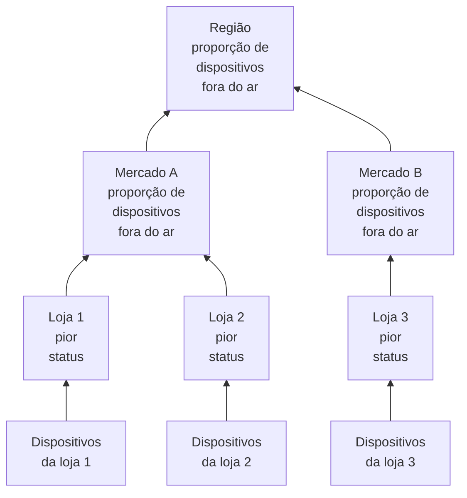

# Sites de rede (resumo de saúde e tempo de atividade)

Um site de rede é um lugar: uma região, um mercado, um franqueado, um centro de distribuição, uma loja. Os sites se aninham uns dentro dos outros, os dispositivos de rede se ligam a eles, e o OneUptime resume a saúde dos dispositivos ao longo da árvore, para que um único status em uma região responda a "tem alguma coisa errada lá fora?".

Encontre-os em **Rede → Sites**, e em um mapa em **Rede → Map**. Esta página define como o status de um site é calculado a partir do que está abaixo dele, o que o tempo de atividade dele significa e como a manutenção programada muda os dois.

:::cards
- [Adicionar um site](#adicionar-um-site): Três etapas, ou um arquivo CSV para um parque inteiro.
- [Definir padrões de monitoramento](#padrões-de-monitoramento): Uma sonda e credenciais para cada dispositivo de um site.
- [Escolher como a saúde é resumida](#como-a-saúde-do-pai-é-calculada): O pior status para uma loja, uma proporção para uma região.
- [Ler o tempo de atividade](#tempo-de-atividade): O que as porcentagens contam, dia a dia.
:::

## Como funciona



O status de cada site vem de todos os dispositivos da subárvore dele, avaliados pela [política de resumo](#como-a-saúde-do-pai-é-calculada) do próprio site. O tempo de atividade de um site vem da linha do tempo de status dele, e uma [janela de manutenção](#manutenção-programada-para-sites-de-rede) em um site tira os dispositivos dele do voto acima.

## A hierarquia

Os sites formam uma árvore. Cada site tem um **Site Type** e, opcionalmente, um site pai. Os tipos de site são a lista do próprio projeto, em **Rede → Configurações → Site Types**, e um projeto novo começa com Account Type, Region, Franchisee, Market e Unit, nessa ordem de cima para baixo, mais Data Center e Other. Os tipos formam uma hierarquia própria (**Parent Site Type**), que decide quais sites podem ser pai de um site. Um tipo marcado como **Is Unit Level** é o nível folha do seu parque, a loja ou a filial individual: os sites dele contêm dispositivos, não outros sites.

O tipo, o nome, a descrição, o pai e a localização de um site são editados em um só lugar: o cartão **Site Settings** na página **Configurações** do site. A visão geral do site os mostra com um link **Editar nas configurações**, e a lista **Sites** adiciona sites, mas não os edita.

Cada dispositivo se liga a um site. A subárvore de um site é o próprio site mais cada site abaixo dele, e os dispositivos da subárvore são de onde a saúde dele é resumida, então uma região sem dispositivos próprios ainda tem um status, porque as unidades abaixo dela têm.

> [!NOTE]
> Um resumo é recalculado quando o status de um dispositivo muda, quando um dispositivo vai para outro site, quando um site muda de lugar na árvore, e por uma passada a cada cinco minutos que pega os casos em que só a passagem do tempo mudou a resposta.

## Adicionar um site

:::steps
### Começar um site novo
Acesse **Rede → Sites** e clique em **Adicionar: Site**.

### Dizer o que o site é
Na etapa **Site Details**, escolha o **Site Type** (que tipo de lugar é: uma região, uma loja, um data center) e digite um **Nome**. A descrição, o endereço e a latitude e a longitude que posicionam o site no mapa ficam recolhidos em **Mais campos**: preencha agora ou depois.

### Posicioná-lo na árvore
Na etapa **Hierarchy**, escolha o **Parent Site** se o site fica abaixo de outro. Deixe vazio para manter o site no nível mais alto.

### Definir os padrões dele
Na etapa **Monitoring Defaults**, escolha a [sonda e o perfil de credenciais padrão](#padrões-de-monitoramento) para os dispositivos adicionados ao site, e clique em **Adicionar: Site**.
:::

Na página **Child Sites** de um site, **Adicionar: Site filho** pede só o tipo e o nome, em uma única página com a localização recolhida, e coloca o novo site abaixo daquele.

### Importar sites de um arquivo CSV

Para trazer um parque inteiro de uma vez, abra o menu no topo da lista **Sites** e clique em **Import from CSV**. O arquivo precisa de uma linha de cabeçalho; as colunas podem vir em qualquer ordem e os nomes delas não diferenciam maiúsculas de minúsculas:

```csv title="sites.csv"
name,siteType,parentName,address,latitude,longitude
North,Region,,,,
Leeds,Market,North,,,
Store 0660,Unit,Leeds,"1 High Street, Leeds",53.7997,-1.5492
```

- `name` e `siteType` são obrigatórios. `siteType` precisa ser um dos tipos de site do projeto.
- `parentName` indica o site pai, que pode estar no mesmo arquivo: as linhas sem pai, ou com um pai que já existe, entram primeiro, e depois os filhos delas. Deixe vazio para um site de nível mais alto.
- Uma linha cujo pai não é encontrado é ignorada, e os resultados a listam. **Preview Import** mostra o que o arquivo vai criar antes de qualquer coisa ser gravada.

## O mapa

**Rede → Map** mostra os seus sites em um mapa, enquadrado onde quer que estejam; clique em um site para entrar nele. Um site com sites abaixo os mostra, no mapa e como um grafo dos enlaces entre eles. Um site sem sites abaixo, mas com dispositivos próprios, ou um site cujo tipo é de nível de unidade, abre a topologia ao vivo desses dispositivos.

Um projeto ainda sem sites também tem um mapa: o Map mostra no lugar a topologia dos dispositivos dele, e agrupar os dispositivos em sites os coloca no mapa pela localização.

## Padrões de monitoramento

Um site também é onde você diz, uma única vez, como os dispositivos dele são monitorados. **Editar definições** no cartão **Site Settings** tem uma etapa **Monitoring Defaults** com dois campos:

| Configuração | Efeito |
| --- | --- |
| **Default Probe** | A sonda que envia ping aos dispositivos deste site, e faz o walk SNMP deles quando têm credenciais. Um dispositivo criado no site sem sonda própria a assume, e o mesmo vale para um dispositivo movido para o site sem nenhuma. |
| **Default SNMP Credential Profile** | O [perfil de credenciais](/docs/monitor/network-device-monitor#credenciais-snmp-e-perfis-de-credenciais) com que os dispositivos deste site passam por walk quando nem o dispositivo nem o perfil dele têm credenciais. |

Defina os dois em um site e um dispositivo novo pode ser adicionado ali só com o endereço: ele recebe ping desde a primeira sondagem e walk desde a primeira sondagem.

Os dois se comportam de forma diferente, de propósito:

- A sonda é copiada para o dispositivo quando o dispositivo é criado no site, ou movido para ele. Mudar depois a sonda padrão de um site não move os dispositivos que já têm uma: qual sonda consegue alcançar um dispositivo é um fato da rede, não uma preferência a reescrever em massa a partir de um formulário de site.
- O perfil de credenciais é lido ao vivo, a cada sondagem. Defina um em um site e cada dispositivo sem credenciais desse site começa a passar por walk na próxima sondagem, sem editar nenhum dispositivo; remova-o e eles voltam a receber só ping.

Eles também chegam a profundidades diferentes na árvore:

- A sonda alcança a árvore inteira. Um dispositivo que chega a um site sem sonda padrão assume a do ancestral mais próximo, então uma única sonda definida em uma região cobre cada mercado e cada unidade abaixo dela, e um mercado que indica a sua própria a substitui na subárvore dele.
- O perfil de credenciais só é lido do site do próprio dispositivo. Um dispositivo em uma unidade não assume um perfil definido na região dele, então defina-o nos sites aos quais os dispositivos realmente se ligam.

## Como a saúde do pai é calculada

Cada site escolhe uma de duas políticas de resumo, no cartão **Health Rollup** da página **Configurações** dele (**Rollup Policy**).

### O pior status de qualquer dispositivo (padrão)

O pior status que qualquer dispositivo da subárvore informa passa a ser o status do site. A gravidade de um status vem da prioridade dele como status de monitor: os status de um projeto novo são Operational (1), Degraded (2) e Offline (3), e mais alto é pior. Um único dispositivo offline deixa o site offline, por mais dispositivos saudáveis que estejam ao lado dele.

É a resposta certa para uma unidade. Quatro switches e um firewall em um mesmo prédio não são independentes: um deles apagado é um problema naquele endereço, e tirar a média esconde uma interrupção real.

Normalmente é a resposta errada para uma região acima de quatrocentas lojas. Um switch apagado na loja 12.000 pinta a região inteira de Offline: verdade no sentido mais estrito e inútil em todo sentido prático, porque a região fica vermelha sempre que qualquer loja em qualquer lugar tem um problema, e deixa de dizer qualquer coisa a você.

### Porcentagem de dispositivos fora do ar

O status do site é decidido pela proporção dos dispositivos da subárvore que informam e não estão em um status operacional:

| Proporção de dispositivos fora do ar | Status do site |
| --- | --- |
| 0% | Operational |
| Acima de 0%, abaixo do limite | Degraded: o status do projeto que não é nem operacional nem offline, ou Offline quando o projeto não tem nenhum |
| No limite ou acima dele | Offline |

O limite é definido por site, como **Offline Threshold (%)**, e é 50 por padrão.

Sem nada fora do ar, o site é Operational por mais baixo que seja o limite: um limite de 0 significa "qualquer dispositivo fora do ar deixa isto offline", e não "uma região saudável está offline".

### Quais dispositivos votam

As duas políticas concordam aqui, e isso importa mais do que parece:

- Dispositivos arquivados nunca votam. Eles foram desativados: mantêm o site, mas ficam de fora.
- Dispositivos que nunca informaram nada nunca votam. Um dispositivo aguardando a primeira sondagem não é prova de uma interrupção, então fica de fora dos dois lados da proporção, e uma região na metade da implantação é avaliada pela metade que respondeu.
- Um dispositivo consultado pela sonda, o tipo normal, vota com o resultado da última sondagem: acessível por ping ou SNMP, e não há quanto tempo ele teve sucesso pela última vez. Um dispositivo que responde ao ping enquanto o walk SNMP dele falha está acessível e vota assim; o site diz que ele está ativo, e a linha do dispositivo diz **SNMP failing** para que alguém corrija as credenciais.
- Um dispositivo baseado em monitor, um que passou para a substituição por monitor vinculado na página de Configurações dele, vota com o status do monitor vinculado a ele, porque nada o consulta. Sem nada vinculado, ele nunca informou, então não vota.

Um monitor de dispositivo de rede em um dispositivo consultado pela sonda não muda como o dispositivo vota. Um monitor com um critério "interface fora do ar, então Offline" carimbaria Offline em um switch que responde a todo ping, e uma única porta apagada deixaria um site inteiro vermelho enquanto cada linha de dispositivo abaixo dele mostra Up: o site discordaria da lista que ele resume. Para um dispositivo consultado, a sondagem é a fonte da saúde dele; o monitor está lá para abrir incidentes.

### Escolher uma política

Um começo razoável para um parque de franquias:

| Nível | Política | Por quê |
| --- | --- | --- |
| Unidade ou loja | Pior status | Um dispositivo fora do ar é um site com problema. |
| Mercado | Porcentagem, limite em torno de 50% | Um mercado com metade das lojas fora do ar está fora do ar. |
| Região | Porcentagem, limite de 25% a 50% | A falha de uma única loja deixa a região em Degraded, não em Offline, e ela passa a Offline quando acontece algo sistêmico. |

A política é definida por site, então você pode dar a política de porcentagem às linhas de região e deixar tudo abaixo delas no padrão.

## Tempo de atividade

Todo site tem uma linha do tempo de status: uma linha por mudança do status resumido dele, aberta quando o status muda e fechada quando ele muda de novo. O tempo de atividade é calculado a partir dela:

- O tempo em um status não marcado como operacional é tempo de inatividade.
- Linhas que se sobrepõem são mescladas, então nenhum segundo conta duas vezes.
- O tempo não coberto por nenhuma linha conta como ativo. A linha do tempo só ganha linhas depois que um resumo rodou, e ausência de evidência não é uma interrupção.
- Uma linha ainda aberta vai até o fim da janela medida.

Degraded não é operacional, então também conta como fora do ar. Com qualquer uma das políticas, portanto, o tempo de atividade de um site é a proporção do tempo em que nenhum dispositivo que informa abaixo dele estava fora do ar: a política muda o status que uma interrupção parcial mostra, Degraded ou Offline, e não se ela conta.

Um site sem nenhuma linha na linha do tempo mostra `—` em vez de 100%: um site que nunca teve nada resumido não está monitorado, não está perfeito.

### Tempo de atividade diário

Ao lado do número de 30 dias, a visão geral de cada site mostra **Uptime (24h)**, e a página **Linha do tempo de status** dele mostra as últimas 24 horas, 7, 30 e 90 dias, e uma barra por dia para os últimos 30.

Uma média de 30 dias não consegue mostrar um dia ruim. Um dia inteiro de interrupção em uma janela de 30 dias custa 3,3 pontos, então um site que ficou apagado durante uma terça-feira inteira ainda informa 96,7% no mês, um número que parece arredondamento. As barras diárias colocam os mesmos dados onde um dia ruim é uma barra ruim.

Os dias são fatias móveis de 24 horas que terminam agora, e não dias do calendário: os dispositivos, quem está olhando e o servidor podem estar cada um em um fuso horário diferente, e não existe um único "dia" com que todos concordariam.

### O tempo de atividade do pai não é a média do tempo de atividade dos filhos

O tempo de atividade de um pai vem da linha do tempo do próprio pai, produzida pela política de resumo dele, e não da média das porcentagens dos filhos.

Uma média sobre os filhos dá à loja com dois dispositivos o mesmo peso de um centro de distribuição com duzentos. A linha do tempo do próprio pai dá, em vez disso, uma leitura que se pode enunciar em uma frase: a proporção do tempo em que absolutamente nada na região estava fora do ar. Ela é rigorosa de propósito, então, em uma região grande, leia-a junto com as barras diárias, e com o status, que diz se uma interrupção parcial foi Degraded ou Offline.

## Manutenção programada para sites de rede

Ligue sites a um evento de manutenção programada em **Outros recursos afetados**, na etapa **Recursos afetados** do evento, como faria com um host. A página **Manutenção programada** de um site lista os eventos ligados a ele, e o **Criar Evento de Manutenção Programada** dela abre o formulário com o site já escolhido.

Uma janela em um pai cobre tudo abaixo dele: uma janela em uma região cobre cada mercado e cada unidade dela, incluindo sites criados depois de a janela ser agendada, então uma troca de operadora regional não precisa listar quatrocentas lojas.

A cobertura só desce. Uma janela em uma unidade não coloca a região dela em manutenção: espera-se que a região continue ativa, e uma falha real em outra unidade nas mesmas horas continua contando contra ela.

### O que uma janela de manutenção muda

| Durante a janela | O que acontece |
| --- | --- |
| O status ao vivo do site | Não muda. Uma unidade desligada para um trabalho planejado continua aparecendo como Offline no mapa e na árvore, com um selo "Em manutenção" ao lado: quem olha precisa saber que ela está desligada. |
| O tempo de atividade do site | A janela é retirada tanto do tempo de inatividade quanto do período medido. Duas horas de manutenção deixam o dia com 22 horas, e nada dentro dessas duas horas conta para um lado ou para o outro. |
| O resumo de saúde dos ancestrais dele | Os dispositivos da subárvore em manutenção param de votar, então a região não fica vermelha por uma troca que estava no calendário. |
| O tempo de atividade dos ancestrais dele | Não é afetado, sem nada a corrigir, porque a interrupção planejada nunca chegou às linhas do tempo deles. |

Essa última linha é o motivo pelo qual os ancestrais são tratados retendo votos, e não retirando a janela do tempo de atividade deles: retirá-la do período da região também apagaria uma falha real em outro ponto da região nas mesmas horas.

O tempo de atividade é corrigido com o início e o fim declarados do evento, e não com o momento em que um processo o moveu entre estados, então o número pode ser conferido à mão contra o calendário. Um dia que cai inteiro dentro de uma janela é desenhado como manutenção nas barras diárias em vez de como um dia perfeito, e não acrescenta nada à média.

### Interação com os monitores

Ligar um monitor ao mesmo evento continua fazendo o que sempre fez: o monitoramento ativo desse monitor pausa durante a janela. As duas coisas são independentes: ligue o site para mantê-lo fora do resumo e do tempo de atividade dele, e ligue os monitores para que parem de alertar.

## Alertas em um site

O cartão **Alerting** na página **Configurações** de um site tem **Alert When Unhealthy**: um alerta é aberto quando o resumo do site passa para um status que não é operacional, e se resolve sozinho quando o site se recupera. **Severidade do alerta** define a severidade dele; deixado em branco, é a mais grave do projeto.

Ele só alerta na mudança: ativá-lo em um site que já não está saudável arma a próxima mudança em vez de alertar sobre o passado. Degraded não é operacional, então um site com a política de porcentagem alerta assim que um dos dispositivos que informam fica fora do ar, como faz um site com a política do pior status; o alerta continua aberto, sem um segundo, enquanto o site passa entre Degraded e Offline, e o título dele indica o status a que o site chegou primeiro.

## Solução de problemas

:::details Uma região está sempre vermelha
O site está na política do pior status, então um único dispositivo offline em qualquer ponto abaixo dele o deixa offline. Mude a região para **Percentage of devices down** no cartão **Health Rollup** dela, com um limite que corresponda a quanto da região precisa estar fora do ar para você considerá-la fora do ar.
:::

:::details Um site mostra — em vez de um tempo de atividade
Nenhum resumo jamais rodou para o site, então ele não tem linhas na linha do tempo: não está monitorado, não está perfeito. Adicione dispositivos ao site, ou aos sites abaixo dele, e o próximo resumo começa a linha do tempo dele.
:::

:::details Um dispositivo não conta para o seu site
Dispositivos arquivados, e dispositivos que ainda não informaram, nunca votam. Um dispositivo baseado em monitor sem monitor vinculado também nunca informou. Confira o status do dispositivo: um dispositivo **Pendente** começa a votar depois da primeira sondagem.
:::

:::details O alerta de um site não disparou
**Alert When Unhealthy** dispara em uma mudança de um status operacional para qualquer outro, então um site que já não estava saudável quando você o ativou alerta na próxima mudança, depois de se recuperar. Confira também se os dispositivos dele votam: dispositivos arquivados e dispositivos aguardando a primeira sondagem nunca votam, e os dispositivos de um site em manutenção não votam nos resumos acima dele.
:::

## Próximos passos

:::cards
- [Monitor de dispositivos de rede](/docs/monitor/network-device-monitor): Adicione, consulte e receba alertas sobre os dispositivos ligados a estes sites.
- [Tráfego de rede](/docs/monitor/network-traffic): Veja o tráfego de um site a partir dos registros de fluxo dos dispositivos dele.
- [Inventário](/docs/inventory/overview): Os dispositivos de rede ao lado de todos os seus outros ativos.
:::
