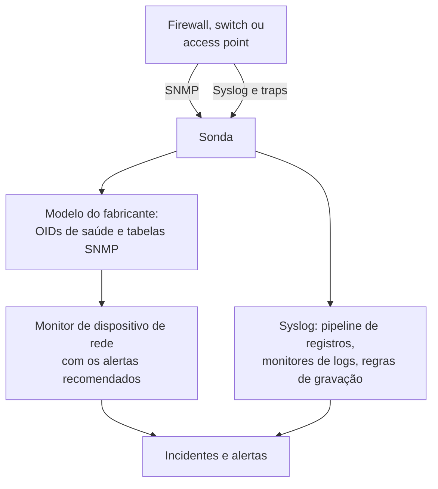

# Guias por fornecedor de rede (Sophos, Extreme, Cambium)

Como monitorar de ponta a ponta três parques comuns com o OneUptime: um Sophos Firewall (XGS, SFOS) com os seus túneis IPsec, enlaces WAN e SD-WAN; os switches da Extreme Networks (EXOS / Switch Engine e Fabric Engine / VOSS) com o seu fabric; e os switches cnMatrix e os access points Wi-Fi corporativos da Cambium Networks, até o canal e a potência de transmissão de cada rádio. Também cobre os switches SAN, Brocade Fabric OS e Cisco MDS 9000, até os erros de cada porta Fibre Channel.

:::cards
- [Sophos Firewall](#sophos-firewall-xgs-sfos): Túneis, enlaces WAN, gateways e SD-WAN.
- [Extreme Networks](#extreme-networks-exos-switch-engine-e-fabric-engine-voss): Os switches, o fabric e o hardware dele.
- [Cambium Networks](#cambium-networks-wi-fi-corporativo-e-cnmatrix): Os access points até cada rádio, e os switches cnMatrix.
- [Brocade Fabric OS](#brocade-fabric-os): Portas Fibre Channel, ópticas, sensores e eventos da fabric.
- [Cisco MDS 9000](#cisco-mds-9000): Interfaces Fibre Channel, VSANs, slow drain e alarmes de port-monitor.
:::

## Como funciona

Todos os guias usam as mesmas peças:



- Um [dispositivo de rede](/docs/monitor/network-device-monitor) por equipamento, consultado por uma sonda que consiga alcançá-lo, com um modelo do fabricante que traz os OIDs de saúde e as [tabelas SNMP](/docs/monitor/network-device-monitor#tabelas-snmp) certos.
- Um monitor de dispositivo de rede por dispositivo para os alertas. Crie-o pela página do dispositivo para que os [alertas recomendados](/docs/monitor/network-device-monitor#pacote-de-alertas-recomendado), incluindo um alerta por linha para cada tabela que sabe como é o estado saudável, sejam preenchidos para você. Para uma frota, uma [política de alertas](/docs/monitor/network-device-monitor#políticas-de-alertas) mantém um em cada dispositivo.
- Para o que um fabricante só informa nos logs: syslog para a sonda, que o OneUptime lê por conta própria como [eventos de rede](/docs/monitor/network-events), [monitores de logs com Group By](/docs/monitor/logs-monitor#alertas-por-grupo-group-by) para alertar uma vez por túnel ou gateway, e [regras de gravação de registros](/docs/telemetry/log-recording-rules) para colocar em gráficos os números desses logs.

## Sophos Firewall (XGS / SFOS)

| O que você quer ver | De onde vem |
| --- | --- |
| A saúde do firewall: memória, disco, swap, estado de HA, serviço IPsec, CPU por núcleo | SNMP, com o modelo do fabricante **Sophos Firewall (SFOS / XGS)** |
| O status de cada túnel IPsec, por nome | A tabela SNMP `ipsec_tunnels` (SFOS v20 e posteriores) |
| O status, a vazão, a utilização e os erros de cada enlace WAN | O walk das interfaces das portas WAN |
| A latência, a perda de pacotes e o jitter de cada enlace WAN | Monitores Ping e sondagens do dispositivo a partir das sondas do OneUptime |
| Gateways ativos e fora do ar, SLA de SD-WAN cumprido ou não, mudanças de rota do SD-WAN | O syslog do firewall |
| Latência, jitter e perda de pacotes do SD-WAN por gateway, em gráficos | Regras de gravação de registros sobre os logs de SLA do SD-WAN |

A Sophos não informa a saúde dos gateways nem do SD-WAN via SNMP, em nenhuma versão do SFOS: isso só existe nos logs do firewall e nos alertas do Sophos Central, e é por isso que as três últimas linhas passam pelo syslog.

### Registrar o firewall

:::steps
1. No firewall, ative o SNMP em **Administration → SNMP**: adicione um usuário SNMPv3, ou uma community v2c, e permita que o endereço da sonda o consulte.
2. No OneUptime, acesse **Rede → Dispositivos** e clique em **Adicionar dispositivo**. Digite o endereço de gerenciamento do firewall, escolha uma sonda que consiga alcançá-lo e adicione as credenciais SNMP em **SNMP**.
3. Na página **Configurações** do dispositivo, em **Polling & Data Collection**, aplique o modelo **Sophos Firewall (SFOS / XGS)** em **Vendor Health Template** e adicione as tabelas dele em **Add a Vendor's Tables**. Ou ative **Auto-Apply Vendor Health Template**, e a primeira sondagem faz as duas coisas.
:::

Depois da próxima sondagem, a página **Tabelas SNMP** do dispositivo lista cada conexão IPsec com o status dela (active, inactive, partially active), e os núcleos da CPU. O SFOS numera os núcleos a partir de 196608, e é por isso que a CPU vem de uma tabela, e não de um único `hrProcessorLoad.1`.

### Alertar sobre cada túnel IPsec

Na página do dispositivo, clique em **Criar monitor**. Os alertas recomendados incluem **IPsec Tunnels: row unhealthy**, um critério **Linha da tabela SNMP não íntegra** sobre a tabela `ipsec_tunnels` com Row `*`: ele abre um incidente por túnel que não está ativo, com o nome do túnel, e resolve cada um quando o túnel dele volta.

Um túnel que a Sophos informa como ativo só tem as associações de segurança estabelecidas. Para provar que o tráfego passa por ele, adicione um [monitor Ping](/docs/monitor/ping-monitor) de uma sonda em um site para um host do outro lado de cada túnel, e desenhe o túnel como um enlace entre sites em **Rede → Topologia → Links do site** entre os dois [sites](/docs/monitor/network-sites), vinculado a esse monitor: o enlace no mapa passa a ter a cor do monitor.

### Enlaces WAN

- **Saúde das portas.** O walk das interfaces já mede o status, os bits de entrada e saída, a utilização e os erros de cada porta WAN. No monitor do firewall, um critério **Interface SNMP inativa** ou **Utilização da interface SNMP (em %)** com **Interface** definido como o nome da porta WAN, ou `*` para todas as portas, alerta por enlace.
- **Qualidade do caminho.** A latência, a perda de pacotes e o jitter de cada enlace são medidos de fora do firewall: um monitor Ping a partir das sondas em nuvem do OneUptime para o endereço público de cada enlace WAN, e um monitor Ping a partir de uma sonda no site para o gateway de cada provedor. Critérios de perda de pacotes e de jitter nesses monitores alertam por enlace, e **Rede → Topologia → Matriz de latência** mostra de relance cada sonda contra cada monitor.
- **Tráfego.** O SFOS exporta NetFlow v5. Envie-o para a sonda em UDP 2055, onde o coletor de fluxos da sonda escuta por padrão, e a página **Tráfego** do dispositivo mostra quem fala com quem em cada enlace WAN; [Tráfego de rede](/docs/monitor/network-traffic) tem os detalhes.

### Gateways e SD-WAN a partir do syslog

:::steps
1. O receptor de syslog da sonda vem ativado por padrão. Ele escuta na porta 5140, por UDP e TCP (`PROBE_SYSLOG_RECEIVER_PORT` muda isso); publique a porta se a sonda roda no Docker. As mensagens são associadas ao dispositivo de rede cujo nome do host, ou um dos **Outros endereços**, é o endereço do remetente, e aparecem nas páginas **Eventos** e **Registros** do dispositivo.
2. No firewall, em **System services → Log settings**, adicione um servidor syslog que aponte para a sonda e essa porta, e marque os tipos de log **Event** para IPsec e gateways e o tipo de log **SD-WAN**: os logs de SLA continuam desligados até que ele seja marcado.
3. Não há nada para analisar. O OneUptime lê os campos `key=value` do firewall como atributos `sophos.*`, e tira deles túneis, gateways, mudanças de SLA de SD-WAN, failovers e logins como [eventos de rede](/docs/monitor/network-events). Abra um log na página **Registros** do dispositivo para ver os nomes exatos de atributos que a sua versão do SFOS produz.
4. Na página **Eventos** do dispositivo, clique em **Criar alerta** e escolha um alerta. Ele abre um [monitor de logs](/docs/monitor/logs-monitor) já preenchido, com **Agrupar por atributos** para que cada túnel ou gateway alerte por conta própria, e **Resolvido por atributos** para que cada alerta feche quando o firewall relatar a volta. As linhas abaixo são as três com que começar.
5. Coloque em gráficos a qualidade do SD-WAN: com o log de SD-WAN ativado, o firewall escreve um resumo de SLA por perfil e gateway (`latency`, `jitter`, `packet_loss`). Em **Registros → Configurações → Regras de gravação**, crie uma regra por número, como a média de `sophos.latency` agrupada por `sophos.gw_name` e `sophos.profile_name`, e então coloque os resultados em gráficos, ou alerte sobre eles com um [monitor de métricas](/docs/monitor/metrics-monitor) que agrupe por gateway. [Regras de gravação de registros](/docs/telemetry/log-recording-rules) mostra esse exemplo passo a passo.
:::

| Alerta | Evento que conta | Um alerta por | Fechado por |
| --- | --- | --- | --- |
| Um túnel VPN cai | `vpn.tunnel_down` | `vpn.tunnel.name` | `vpn.tunnel_up` |
| Um link WAN cai | `gateway.down` | `network.gateway.name` | `gateway.up` |
| Link SD-WAN abaixo do seu SLA | `sdwan.sla_not_met` | `network.gateway.name` | `sdwan.sla_met` |

Os dois primeiros estão na lista de **Criar alerta**; para o terceiro, abra um dos eventos dele e clique em **Criar alerta para este evento**. Os eventos de syslog complementam a tabela SNMP: eles chegam no momento em que um túnel cai, enquanto a tabela também pega um túnel que nunca subiu.

### Traps

Toda notificação da Sophos é o mesmo trap, `sfosNotification` (`1.3.6.1.4.1.2604.5.1.8.1.1`), com o evento como texto em `sfosTrapMessage` (`1.3.6.1.4.1.2604.5.1.8.1.2`). Para alertar sobre um tipo de evento, combine **Trap SNMP recebido (OID do trap)** Igual a `1.3.6.1.4.1.2604.5.1.8.1.1` com **Valor do varbind do trap SNMP** sobre esse varbind, Contém `IPSec` por exemplo. Defina o destino de traps do firewall como SNMP v2c: o receptor de traps da sonda aceita traps v1 e v2c.

## Extreme Networks (EXOS / Switch Engine e Fabric Engine / VOSS)

| O que você quer ver | De onde vem |
| --- | --- |
| EXOS: CPU, temperatura e o alarme dela, estado da alimentação, fontes de alimentação, ventoinhas, memória por slot, membros da pilha | O modelo **Extreme Networks EXOS / Switch Engine** |
| Fabric Engine: CPU e memória por slot, sensores de temperatura, ventoinhas, fontes de alimentação, sessão vIST, contagem de I-SIDs | O modelo **Extreme Networks Fabric Engine / VOSS** |
| Cada adjacência do Fabric Connect (IS-IS), nomeada pelo vizinho | A tabela `isis_adjacencies` do modelo Fabric Engine |
| Portas, vizinhos LLDP, o mapa da rede | O walk das interfaces, nos dois |

### Qual modelo

O Fabric Engine no hardware universal da Extreme (as séries 5000 e 7000) informa o mesmo número enterprise que o EXOS: só a descrição do sistema (`7520-48Y-8C-FabricEngine (9.0.4.0)`) diz qual sistema operacional está rodando. O OneUptime lê os dois, então a aplicação automática e a sugestão da página do dispositivo escolhem o modelo certo, e os switches VSP mais antigos informam o ramo Avaya/Nortel e são reconhecidos diretamente como Fabric Engine.

### Alertas do fabric e do hardware

Os alertas recomendados em um switch Fabric Engine incluem **Fabric Adjacencies (IS-IS): row unhealthy**, um incidente por vizinho cuja adjacência não está ativa. O Fabric Engine também envia um trap quando uma adjacência muda, `rcnIsisPlsbAdjStateTrap` (`1.3.6.1.4.1.2272.1.21.0.281`), e um critério **Trap SNMP recebido (OID do trap)** sobre ele alerta em segundos, antes da próxima sondagem.

Fontes de alimentação, ventoinhas, sensores de temperatura e membros da pilha são tabelas que declaram os seus valores saudáveis, então cada uma recebe um alerta por linha nos alertas recomendados.

### Fluxos e Wi-Fi

O EXOS e o Fabric Engine exportam fluxos como sFlow e IPFIX. Envie o sFlow para a sonda em UDP 6343, ou o IPFIX em UDP 4739, e a página **Tráfego** do dispositivo mostra o tráfego dele; veja [Tráfego de rede](/docs/monitor/network-traffic).

Os access points IQ Engine (HiveOS) e o ExtremeCloud IQ Controller têm modelos do fabricante próprios, que preenchem a página **Wi-Fi** do dispositivo. [Fabricantes de Wi-Fi compatíveis](/docs/monitor/network-device-monitor#fabricantes-de-wi-fi-compatíveis) trata deles, junto com Ubiquiti UniFi, HPE Aruba, TP-Link Omada e Juniper Mist.

## Cambium Networks (Wi-Fi corporativo e cnMatrix)

### Access points

:::steps
1. Ative o SNMP nos access points. No cnMaestro, o SNMP é definido por grupo de AP: **Configuration → Wi-Fi Profiles → AP Groups → Management → SNMP**. Ative-o com uma community de leitura v2c ou um usuário SNMPv3.
2. Adicione cada access point com o endereço de gerenciamento e essas credenciais, e aplique o modelo **Cambium Networks Enterprise Wi-Fi (cnPilot, XV, XE, XH)**, ou ative a aplicação automática.
3. Abra a página **Wi-Fi** do dispositivo. Ela mostra quantos rádios estão ligados, os clientes e os SSIDs, e depois banda, canal, frequência, largura do canal, potência de transmissão, clientes, ruído de fundo e airtime de cada rádio, e cada SSID com os seus clientes. A frequência é calculada a partir da banda e do canal; o access point não a informa.
:::

Alertas úteis, todos sobre a tabela `wifi_radios` com Row `*`, para que cada rádio alerte por conta própria:

| Alerta | Critério |
| --- | --- |
| Um rádio desligado | **Linha da tabela SNMP não íntegra**, parte dos alertas recomendados |
| Potência de transmissão alterada | **Valor da tabela SNMP**, coluna TX Power, Diferente de a potência que você planejou |
| Um rádio lotado | **Valor da tabela SNMP**, coluna Clients, Maior que o seu limite |
| Um canal ruidoso | **Valor da tabela SNMP**, coluna Noise Floor, Maior que `-80` |

Cada valor numérico dos rádios também é uma métrica (`oneuptime.monitor.snmp.table.value`, uma série por rádio e coluna), então canal, potência e clientes podem ser colocados em gráficos ao longo do tempo em um painel; um canal que não para de mudar é o DFS trabalhando.

A Cambium só informa a contagem total de clientes a partir do firmware 6.5.3; firmwares anteriores retornam 0.

### Switches cnMatrix

O modelo **Cambium Networks cnMatrix** coleta CPU, RAM, flash, temperatura e tensão de alimentação, e, como tabelas, as ventoinhas, a fonte de alimentação redundante e o consumo PoE de cada porta. As portas e os vizinhos LLDP vêm do walk das interfaces, como em qualquer switch.

### Alarmes do cnMaestro

O cnMaestro pode enviar os alarmes dele, como um access point que fica offline, para um webhook HTTPS. Aponte-o para um [monitor de requisições recebidas](/docs/monitor/incoming-request-monitor) para transformar esses alarmes em incidentes do OneUptime ao lado dos dados SNMP.

## Brocade Fabric OS

| O que você quer ver | De onde vem |
| --- | --- |
| Estado do switch, firmware, CPU e memória | SNMP, com o modelo do fabricante **Brocade Fabric OS (SAN switches)** |
| O status do switch, seus sensores e suas unidades substituíveis (FRUs), linha por linha | As tabelas `switch_status`, `sensors` e `frus` do modelo |
| O tipo de cada porta Fibre Channel, por que uma porta parada está parada, e seus erros, quadros descartados e esperas de crédito por segundo | SW-MIB e FCMGMT-MIB, na página **Interfaces** do dispositivo |
| A potência recebida e transmitida, a temperatura, a tensão e a corrente de polarização de cada óptica | FA-EXT-MIB, no cartão **Transceptores** |
| Um link entre switches caído, a fabric segmentada ou reconfigurada, uma mudança de zoning, um alerta do MAPS, uma FRU trocada | Traps SNMPv3 |

Todo switch e director com Fabric OS informa um ID de objeto de sistema sob `1.3.6.1.4.1.1588.2.1.1`, então o modelo se aplica a todos eles e a nada mais da Brocade: os switches VDX e SLX mantêm o modelo que têm.

### Configurar o SNMP no Fabric OS

:::steps
1. Adicione um usuário SNMPv3 com autenticação e privacidade, SHA e AES: `snmpconfig --set snmpv3` pede o usuário, seus protocolos e suas frases secretas.
2. Ative a FA-MIB com `snmpconfig --set mibCapability`. Ela contém os contadores de erros de 64 bits de cada porta e sua óptica; sem ela, uma porta informa apenas seus erros de CRC, erros de codificação, quadros de classe 3 descartados e esperas de crédito, como contadores de 32 bits.
3. No OneUptime, adicione o switch com seu endereço de gerenciamento e esse usuário. Com **Auto-Apply Vendor Health Template** ativado, a primeira consulta aplica o modelo **Brocade Fabric OS (SAN switches)**; caso contrário, aplique-o em **Vendor Health Template** na página **Configurações** do dispositivo.
:::

A página **Interfaces** do dispositivo passa então a marcar cada porta Fibre Channel com seu tipo, como E-Port ou F-Port, e diz por que uma porta parada está parada, como o `switchshow` diz: No light, No module, Disabled. Seu cartão **Portas Fibre Channel** mostra por segundo os erros, os quadros descartados e os contadores de crédito de cada porta.

Os erros de CRC, as palavras de transmissão inválidas, as falhas de link e as perdas de sincronização e de sinal de uma porta são os seus erros: **Erros da interface SNMP (por segundo)** alerta sobre eles, e os alertas recomendados incluem **Fibre Channel port errors**, acima de um erro a cada dez segundos. Quadros descartados e esperas de crédito não são erros; alerte sobre um deles com **Contador Fibre Channel SNMP (por segundo)**.

### Virtual Fabrics

Um chassi com Virtual Fabrics responde por cada switch lógico em seu próprio contexto SNMPv3: `VF:` e o ID de fabric do switch lógico. Adicione um dispositivo por switch lógico, todos no endereço de gerenciamento do chassi, e defina em cada um o **Contexto SNMP v3** (`VF:128`, `VF:20`); um dispositivo sem contexto lê o switch lógico padrão.

### Traps da Brocade

O Fabric OS envia suas traps por SNMPv3. Com `snmpconfig --set snmpv3`, adicione a sonda como destinatária de traps para o usuário com que o OneUptime consulta, na porta UDP 162: a sonda aceita as traps SNMPv3 dos usuários dos dispositivos que consulta (veja [Traps e informs SNMPv3](/docs/monitor/network-device-monitor#traps-e-informs-snmpv3)), e as traps de cada switch lógico nomeiam o seu contexto, então disparam apenas no dispositivo dele. Uma atualização do Fabric OS pode desligar de novo traps específicas: verifique-as com `snmpconfig --show mibCapability` após uma atualização, e religue uma com `snmpconfig --enable mibCapability -mib_name SW-MIB -trap_name swFCPortScn`.

Os alertas recomendados em um switch Brocade incluem um para cada evento da fabric que importa: **Inter-switch link down** (uma E-Port que fica offline), **Fabric segmented**, **Fabric reconfigured**, **Zone configuration changed**, **MAPS alert** e **Field-replaceable unit changed**.

## Cisco MDS 9000

| O que você quer ver | De onde vem |
| --- | --- |
| CPU e memória | SNMP, com o modelo do fabricante **Cisco MDS 9000 (SAN switches)** |
| Fontes de alimentação, módulos e bandejas de ventiladores, linha por linha | As tabelas `power_supplies`, `modules` e `fan_trays` do modelo |
| Cada VSAN, com seu estado | A tabela `vsans` do modelo |
| O tipo de cada interface fc, por que uma parada está parada, e seus erros, quadros descartados, perdas de crédito e esperas de crédito por segundo | CISCO-FC-FE-MIB, na página **Interfaces** do dispositivo |
| As leituras e os limites de alarme de cada óptica | CISCO-ENTITY-SENSOR-MIB, no cartão **Transceptores** |
| Alarmes de port-monitor, links caídos, mudanças de zonas, VSANs, fabric e FRUs | Traps |

Um MDS compartilha o número de empresa da Cisco com todos os outros dispositivos Cisco, então o OneUptime o reconhece pelo modelo, ou por uma descrição de sistema que começa com `Cisco NX-OS(tm) m9`: os switches IOS, IOS-XE e Nexus mantêm o modelo Cisco que têm.

### Configurar o SNMP no NX-OS

:::steps
1. Adicione um usuário SNMPv3 somente leitura: `snmp-server user oneuptime network-operator auth sha <auth-passphrase> priv aes-128 <priv-passphrase>`. A função `network-operator` lê e não pode alterar nada.
2. Envie as traps para a sonda como esse usuário: `snmp-server host <probe-address> traps version 3 priv oneuptime`.
3. Ative as traps que vêm desligadas por padrão: `snmp-server enable traps zone`, `snmp-server enable traps vsan`, `snmp-server enable traps fcdomain`, `snmp-server enable traps fspf` e, para as ópticas, `snmp-server enable traps link cisco-xcvr-mon-status-chg`.
4. No OneUptime, adicione o switch com seu endereço de gerenciamento e esse usuário: o modelo **Cisco MDS 9000 (SAN switches)** é aplicado da mesma forma.
:::

Os alertas recomendados em um MDS incluem **Credit loss (slow drain)** e **Timeout discards (slow drain)**, uma vez por interface: um host ou um storage que deixa de devolver crédito de buffer desacelera todos os fluxos atrás dele, e esses contadores mostram isso primeiro.

### Alarmes de port-monitor

Uma política de port-monitor de um MDS dispara um alarme RMON quando um contador de uma porta ultrapassa o limite. Os alertas recomendados incluem **Port monitor alarm**, cujo alerta nomeia o contador e a interface, como "Port monitor: Credit loss rising on fc1/5". Uma política que vigia o slow drain:

```text
port-monitor name slow-drain
  logical-type edge
  counter credit-loss-reco poll-interval 1 delta rising-threshold 1 event 4 falling-threshold 0 event 4
  counter timeout-discards poll-interval 60 delta rising-threshold 200 event 4 falling-threshold 10 event 4
port-monitor activate slow-drain
```

## Solução de problemas

:::details A tabela IPsec Tunnels não tem status
O status dos túneis exige SFOS v20 ou posterior. Confira também se a visão SNMP das suas credenciais inclui a árvore enterprise da Sophos (`1.3.6.1.4.1.2604`): um usuário v3 restrito muitas vezes vê só o grupo de sistema e a IF-MIB.
:::

:::details Nenhum syslog chega do firewall
A sonda escuta syslog na porta 5140, por UDP e TCP, a menos que tenha sido iniciada com `PROBE_SYSLOG_RECEIVER_ENABLED=false`: publique essa porta, ou a sua `PROBE_SYSLOG_RECEIVER_PORT`, se a sonda roda no Docker. As mensagens são associadas a um dispositivo pelo endereço do remetente, então o nome do host do firewall no OneUptime, ou um dos **Outros endereços** dele, precisa ser o endereço de onde ele envia o syslog; até lá, elas ficam listadas na página **Eventos** da rede como **Ainda não é um dispositivo**.
:::

:::details Um switch Fabric Engine recebeu o modelo EXOS
O modelo é escolhido a partir da descrição do sistema do switch. Confira se a visão geral do dispositivo mostra uma descrição que cita o Fabric Engine (como `7520-48Y-8C-FabricEngine (9.0.4.0)`); se mostrar, remova os OIDs e as tabelas do EXOS e aplique **Extreme Networks Fabric Engine / VOSS** em **Vendor Health Template**.
:::

:::details Access points da Cambium informam 0 clientes
A contagem total de clientes exige firmware 6.5.3 ou posterior. Em firmwares mais antigos, os rádios continuam informando canal, potência e ruído de fundo.
:::

## Próximos passos

:::cards
- [Monitor de dispositivos de rede](/docs/monitor/network-device-monitor): Tudo o que um dispositivo coleta, e cada critério sobre o qual ele pode alertar.
- [Eventos de rede](/docs/monitor/network-events): O que o syslog de cada fabricante diz, como eventos e alertas.
- [Pipelines de registros](/docs/telemetry/log-pipelines): Transforme os logs do firewall em atributos.
- [Monitor de logs](/docs/monitor/logs-monitor): Alerte uma vez por túnel ou gateway.
:::
