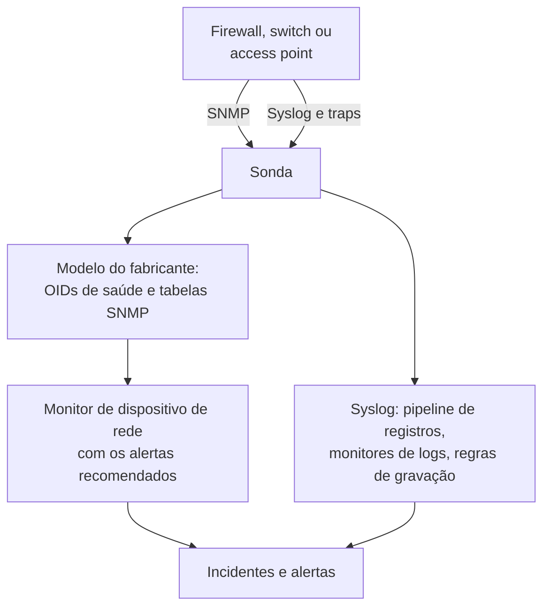

# Guias por fornecedor de rede (Sophos, Extreme, Cambium)

Como monitorar de ponta a ponta três parques comuns com o OneUptime: um Sophos Firewall (XGS, SFOS) com os seus túneis IPsec, enlaces WAN e SD-WAN; os switches da Extreme Networks (EXOS / Switch Engine e Fabric Engine / VOSS) com o seu fabric; e os switches cnMatrix e os access points Wi-Fi corporativos da Cambium Networks, até o canal e a potência de transmissão de cada rádio.

:::cards
- [Sophos Firewall](#sophos-firewall-xgs-sfos): Túneis, enlaces WAN, gateways e SD-WAN.
- [Extreme Networks](#extreme-networks-exos-switch-engine-e-fabric-engine-voss): Os switches, o fabric e o hardware dele.
- [Cambium Networks](#cambium-networks-wi-fi-corporativo-e-cnmatrix): Os access points até cada rádio, e os switches cnMatrix.
:::

## Como funciona

Todos os guias usam as mesmas peças:

- Um [dispositivo de rede](/docs/monitor/network-device-monitor) por equipamento, consultado por uma sonda que consiga alcançá-lo, com um modelo do fabricante que traz os OIDs de saúde e as [tabelas SNMP](/docs/monitor/network-device-monitor#tabelas-snmp) certos.
- Um monitor de dispositivo de rede por dispositivo para os alertas. Crie-o pela página do dispositivo para que os [alertas recomendados](/docs/monitor/network-device-monitor#pacote-de-alertas-recomendado), incluindo um alerta por linha para cada tabela que sabe como é o estado saudável, sejam preenchidos para você. Para uma frota, uma [política de alertas](/docs/monitor/network-device-monitor#políticas-de-alertas) mantém um em cada dispositivo.
- Para o que um fabricante só informa nos logs: syslog para a sonda, um [pipeline de registros](/docs/telemetry/log-pipelines) para transformar cada linha em atributos, [monitores de logs com Group By](/docs/monitor/logs-monitor#alertas-por-grupo-group-by) para alertar uma vez por túnel ou gateway, e [regras de gravação de registros](/docs/telemetry/log-recording-rules) para colocar em gráficos os números desses logs.

## Sophos Firewall (XGS / SFOS)

| O que você quer ver | De onde vem |
| --- | --- |
| A saúde do firewall: memória, disco, swap, estado de HA, serviço IPsec, CPU por núcleo | SNMP, com o modelo do fabricante **Sophos Firewall (SFOS / XGS)** |
| O status de cada túnel IPsec, por nome | A tabela SNMP `ipsec_tunnels` (SFOS v20 e posteriores) |
| O status, a vazão, a utilização e os erros de cada enlace WAN | O walk das interfaces das portas WAN |
| A latência, a perda de pacotes e o jitter de cada enlace WAN | Monitores Ping e sondagens do dispositivo a partir das sondas do OneUptime |
| Gateways ativos e fora do ar, SLA de SD-WAN cumprido ou não, mudanças de rota do SD-WAN | O syslog do firewall |
| Latência, jitter e perda de pacotes do SD-WAN por gateway, em gráficos | Regras de gravação de registros sobre os logs de SLA do SD-WAN |

A Sophos não informa a saúde dos gateways nem do SD-WAN via SNMP, em nenhuma versão do SFOS: isso só existe nos logs do firewall e nos alertas do Sophos Central, e é por isso que as três últimas linhas passam pelo syslog.

### Registrar o firewall

:::steps
1. No firewall, ative o SNMP em **Administration → SNMP**: adicione um usuário SNMPv3, ou uma community v2c, e permita que o endereço da sonda o consulte.
2. No OneUptime, acesse **Rede → Devices** e clique em **Add Device**. Digite o endereço de gerenciamento do firewall, escolha uma sonda que consiga alcançá-lo e adicione as credenciais SNMP em **SNMP**.
3. Na página **Configurações** do dispositivo, em **Polling & Data Collection**, aplique o modelo **Sophos Firewall (SFOS / XGS)** em **Vendor Health Template** e adicione as tabelas dele em **Add a Vendor's Tables**. Ou ative **Auto-Apply Vendor Health Template**, e a primeira sondagem faz as duas coisas.
:::

Depois da próxima sondagem, a página **SNMP Tables** do dispositivo lista cada conexão IPsec com o status dela (active, inactive, partially active), e os núcleos da CPU. O SFOS numera os núcleos a partir de 196608, e é por isso que a CPU vem de uma tabela, e não de um único `hrProcessorLoad.1`.

### Alertar sobre cada túnel IPsec

Na página do dispositivo, clique em **Criar monitor**. Os alertas recomendados incluem **IPsec Tunnels: row unhealthy**, um critério **SNMP Table Row Is Unhealthy** sobre a tabela `ipsec_tunnels` com Row `*`: ele abre um incidente por túnel que não está ativo, com o nome do túnel, e resolve cada um quando o túnel dele volta.

Um túnel que a Sophos informa como ativo só tem as associações de segurança estabelecidas. Para provar que o tráfego passa por ele, adicione um [monitor Ping](/docs/monitor/ping-monitor) de uma sonda em um site para um host do outro lado de cada túnel, e desenhe o túnel como um enlace entre sites em **Rede → Topologia → Site Links** entre os dois [sites](/docs/monitor/network-sites), vinculado a esse monitor: o enlace no mapa passa a ter a cor do monitor.

### Enlaces WAN

- **Saúde das portas.** O walk das interfaces já mede o status, os bits de entrada e saída, a utilização e os erros de cada porta WAN. No monitor do firewall, um critério **SNMP Interface Is Down** ou **SNMP Interface Utilization (in %)** com **Interface** definido como o nome da porta WAN, ou `*` para todas as portas, alerta por enlace.
- **Qualidade do caminho.** A latência, a perda de pacotes e o jitter de cada enlace são medidos de fora do firewall: um monitor Ping a partir das sondas em nuvem do OneUptime para o endereço público de cada enlace WAN, e um monitor Ping a partir de uma sonda no site para o gateway de cada provedor. Critérios de perda de pacotes e de jitter nesses monitores alertam por enlace, e **Rede → Topologia → Latency Matrix** mostra de relance cada sonda contra cada monitor.
- **Tráfego.** O SFOS exporta NetFlow v5. Envie-o para a sonda em UDP 2055, onde o coletor de fluxos da sonda escuta por padrão, e a página **Traffic** do dispositivo mostra quem fala com quem em cada enlace WAN; [Tráfego de rede](/docs/monitor/network-traffic) tem os detalhes.

### Gateways e SD-WAN a partir do syslog

:::steps
1. Ative o receptor de syslog da sonda: defina `PROBE_SYSLOG_RECEIVER_ENABLED=true` na sonda. Ele escuta em UDP 5140 por padrão (`PROBE_SYSLOG_RECEIVER_PORT` muda isso); publique a porta se a sonda roda no Docker. As mensagens são associadas ao dispositivo de rede cujo nome do host, ou um dos **Outros endereços**, é o endereço do remetente, e aparecem na página **Registros** do dispositivo.
2. No firewall, em **System services → Log settings**, adicione um servidor syslog que aponte para a sonda e essa porta, e marque os tipos de log **Event** para IPsec e gateways e o tipo de log **SD-WAN**: os logs de SLA continuam desligados até que ele seja marcado.
3. Em **Registros → Configurações → Pipelines**, crie um pipeline cujo filtro corresponda aos logs do firewall, como `attributes.networkDevice.name = 'hq-firewall'`, e adicione um **Key=Value Parser** com **Target Prefix** `sophos`. Cole uma linha do firewall no testador dele para ver os nomes exatos de atributos que a sua versão do SFOS produz; [o exemplo da Sophos](/docs/telemetry/log-pipelines#exemplo-firewall-sophos-xgs) mostra o passo a passo.
4. Crie [monitores de logs](/docs/monitor/logs-monitor) sobre os logs do firewall, cada um com **Group by Attributes** para que cada túnel ou gateway alerte por conta própria, e o critério **Log Count** **Greater Than** `0` ao longo de alguns minutos. As linhas abaixo são as três com que começar.
5. Coloque em gráficos a qualidade do SD-WAN: com o log de SD-WAN ativado, o firewall escreve um resumo de SLA por perfil e gateway (`latency`, `jitter`, `packet_loss`). Em **Registros → Configurações → Regras de gravação**, crie uma regra por número, como a média de `sophos.latency` agrupada por `sophos.gw_name` e `sophos.profile_name`, e então coloque os resultados em gráficos, ou alerte sobre eles com um [monitor de métricas](/docs/monitor/metrics-monitor) que agrupe por gateway. [Regras de gravação de registros](/docs/telemetry/log-recording-rules) mostra esse exemplo passo a passo.
:::

| Alerta | Logs a contar | Agrupar por |
| --- | --- | --- |
| Túnel IPsec encerrado | Atributo `sophos.log_component` = `IPSec`, corpo contém `terminated` | `sophos.con_name` |
| Gateway fora do ar | Atributo `sophos.log_component` = `Gateway`, corpo contém `is Down` | `sophos.gatewayname` |
| SLA de SD-WAN não cumprido | Atributo `sophos.log_type` = `SD-WAN`, corpo contém `SLA not met` | `sophos.gw_name` |

Os eventos de syslog complementam a tabela SNMP: eles chegam no momento em que um túnel cai, enquanto a tabela também pega um túnel que nunca subiu.

### Traps

Toda notificação da Sophos é o mesmo trap, `sfosNotification` (`1.3.6.1.4.1.2604.5.1.8.1.1`), com o evento como texto em `sfosTrapMessage` (`1.3.6.1.4.1.2604.5.1.8.1.2`). Para alertar sobre um tipo de evento, combine **SNMP Trap Received (Trap OID)** Equal To `1.3.6.1.4.1.2604.5.1.8.1.1` com **SNMP Trap Varbind Value** sobre esse varbind, Contains `IPSec` por exemplo. Defina o destino de traps do firewall como SNMP v2c: o receptor de traps da sonda aceita traps v1 e v2c.

## Extreme Networks (EXOS / Switch Engine e Fabric Engine / VOSS)

| O que você quer ver | De onde vem |
| --- | --- |
| EXOS: CPU, temperatura e o alarme dela, estado da alimentação, fontes de alimentação, ventoinhas, memória por slot, membros da pilha | O modelo **Extreme Networks EXOS / Switch Engine** |
| Fabric Engine: CPU e memória por slot, sensores de temperatura, ventoinhas, fontes de alimentação, sessão vIST, contagem de I-SIDs | O modelo **Extreme Networks Fabric Engine / VOSS** |
| Cada adjacência do Fabric Connect (IS-IS), nomeada pelo vizinho | A tabela `isis_adjacencies` do modelo Fabric Engine |
| Portas, vizinhos LLDP, o mapa da rede | O walk das interfaces, nos dois |

### Qual modelo

O Fabric Engine no hardware universal da Extreme (as séries 5000 e 7000) informa o mesmo número enterprise que o EXOS: só a descrição do sistema (`7520-48Y-8C-FabricEngine (9.0.4.0)`) diz qual sistema operacional está rodando. O OneUptime lê os dois, então a aplicação automática e a sugestão da página do dispositivo escolhem o modelo certo, e os switches VSP mais antigos informam o ramo Avaya/Nortel e são reconhecidos diretamente como Fabric Engine.

### Alertas do fabric e do hardware

Os alertas recomendados em um switch Fabric Engine incluem **Fabric Adjacencies (IS-IS): row unhealthy**, um incidente por vizinho cuja adjacência não está ativa. O Fabric Engine também envia um trap quando uma adjacência muda, `rcnIsisPlsbAdjStateTrap` (`1.3.6.1.4.1.2272.1.21.0.281`), e um critério **SNMP Trap Received (Trap OID)** sobre ele alerta em segundos, antes da próxima sondagem.

Fontes de alimentação, ventoinhas, sensores de temperatura e membros da pilha são tabelas que declaram os seus valores saudáveis, então cada uma recebe um alerta por linha nos alertas recomendados.

### Fluxos e Wi-Fi

O EXOS e o Fabric Engine exportam fluxos como sFlow e IPFIX. Envie o sFlow para a sonda em UDP 6343, ou o IPFIX em UDP 4739, e a página **Traffic** do dispositivo mostra o tráfego dele; veja [Tráfego de rede](/docs/monitor/network-traffic).

Os access points IQ Engine (HiveOS) e o ExtremeCloud IQ Controller têm modelos do fabricante próprios, que preenchem a página **Wi-Fi** do dispositivo. [Fabricantes de Wi-Fi compatíveis](/docs/monitor/network-device-monitor#fabricantes-de-wi-fi-compatíveis) trata deles, junto com Ubiquiti UniFi, HPE Aruba, TP-Link Omada e Juniper Mist.

## Cambium Networks (Wi-Fi corporativo e cnMatrix)

### Access points

:::steps
1. Ative o SNMP nos access points. No cnMaestro, o SNMP é definido por grupo de AP: **Configuration → Wi-Fi Profiles → AP Groups → Management → SNMP**. Ative-o com uma community de leitura v2c ou um usuário SNMPv3.
2. Adicione cada access point com o endereço de gerenciamento e essas credenciais, e aplique o modelo **Cambium Networks Enterprise Wi-Fi (cnPilot, XV, XE, XH)**, ou ative a aplicação automática.
3. Abra a página **Wi-Fi** do dispositivo. Ela mostra quantos rádios estão ligados, os clientes e os SSIDs, e depois banda, canal, frequência, largura do canal, potência de transmissão, clientes, ruído de fundo e airtime de cada rádio, e cada SSID com os seus clientes. A frequência é calculada a partir da banda e do canal; o access point não a informa.
:::

Alertas úteis, todos sobre a tabela `wifi_radios` com Row `*`, para que cada rádio alerte por conta própria:

| Alerta | Critério |
| --- | --- |
| Um rádio desligado | **SNMP Table Row Is Unhealthy**, parte dos alertas recomendados |
| Potência de transmissão alterada | **SNMP Table Value**, coluna TX Power, Not Equal To a potência que você planejou |
| Um rádio lotado | **SNMP Table Value**, coluna Clients, Greater Than o seu limite |
| Um canal ruidoso | **SNMP Table Value**, coluna Noise Floor, Greater Than `-80` |

Cada valor numérico dos rádios também é uma métrica (`oneuptime.monitor.snmp.table.value`, uma série por rádio e coluna), então canal, potência e clientes podem ser colocados em gráficos ao longo do tempo em um painel; um canal que não para de mudar é o DFS trabalhando.

A Cambium só informa a contagem total de clientes a partir do firmware 6.5.3; firmwares anteriores retornam 0.

### Switches cnMatrix

O modelo **Cambium Networks cnMatrix** coleta CPU, RAM, flash, temperatura e tensão de alimentação, e, como tabelas, as ventoinhas, a fonte de alimentação redundante e o consumo PoE de cada porta. As portas e os vizinhos LLDP vêm do walk das interfaces, como em qualquer switch.

### Alarmes do cnMaestro

O cnMaestro pode enviar os alarmes dele, como um access point que fica offline, para um webhook HTTPS. Aponte-o para um [monitor de requisições recebidas](/docs/monitor/incoming-request-monitor) para transformar esses alarmes em incidentes do OneUptime ao lado dos dados SNMP.

## Solução de problemas

:::details A tabela IPsec Tunnels não tem status
O status dos túneis exige SFOS v20 ou posterior. Confira também se a visão SNMP das suas credenciais inclui a árvore enterprise da Sophos (`1.3.6.1.4.1.2604`): um usuário v3 restrito muitas vezes vê só o grupo de sistema e a IF-MIB.
:::

:::details Nenhum syslog chega do firewall
O receptor de syslog da sonda vem desativado por padrão: defina `PROBE_SYSLOG_RECEIVER_ENABLED=true` e publique UDP 5140, ou a sua `PROBE_SYSLOG_RECEIVER_PORT`, até a sonda. As mensagens são associadas a um dispositivo pelo endereço do remetente, então o nome do host do firewall no OneUptime, ou um dos **Outros endereços** dele, precisa ser o endereço de onde ele envia o syslog.
:::

:::details Um switch Fabric Engine recebeu o modelo EXOS
O modelo é escolhido a partir da descrição do sistema do switch. Confira se a visão geral do dispositivo mostra uma descrição que cita o Fabric Engine (como `7520-48Y-8C-FabricEngine (9.0.4.0)`); se mostrar, remova os OIDs e as tabelas do EXOS e aplique **Extreme Networks Fabric Engine / VOSS** em **Vendor Health Template**.
:::

:::details Access points da Cambium informam 0 clientes
A contagem total de clientes exige firmware 6.5.3 ou posterior. Em firmwares mais antigos, os rádios continuam informando canal, potência e ruído de fundo.
:::

## Próximos passos

:::cards
- [Monitor de dispositivos de rede](/docs/monitor/network-device-monitor): Tudo o que um dispositivo coleta, e cada critério sobre o qual ele pode alertar.
- [Pipelines de registros](/docs/telemetry/log-pipelines): Transforme os logs do firewall em atributos.
- [Monitor de logs](/docs/monitor/logs-monitor): Alerte uma vez por túnel ou gateway.
:::
