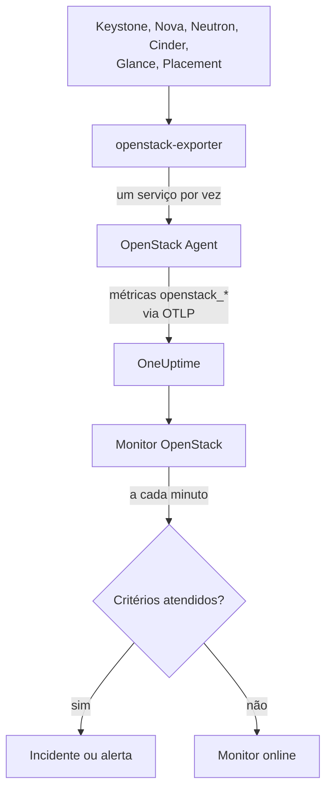

# Monitor de OpenStack

Um monitor OpenStack observa uma nuvem - suas APIs, os workers por trás delas, hipervisores, instâncias, redes, pools de armazenamento e cotas de projetos - e avisa quando uma API deixa de responder, um worker cai, um hipervisor não tem mais espaço para oferecer ou um pool enche. Ele lê as séries `openstack_*` que o OneUptime OpenStack Agent coleta do openstack-exporter, ou que uma sonda coleta das APIs da nuvem.

:::cards
- [Criar o monitor](#criar-um-monitor-openstack): Seis passos no dashboard.
- [Templates](#templates-de-alerta-prontos): Alertas prontos, um incidente por worker, instância, rede ou região.
- [Verificações externas](#verificações-externas): Se alguém consegue de fato iniciar uma instância, a partir de uma sonda fora da nuvem.
- [Atributos de identidade](#atributos-de-identidade): Como direcionar para uma região, host ou projeto.
- [Métricas](#métricas-coletadas): Todas as séries sobre as quais o monitor pode alertar.
:::

## Como funciona

O agente é um OpenTelemetry Collector e um openstack-exporter que você executa em uma máquina com acesso às APIs da nuvem. Ele lê cada serviço do OpenStack em uma coleta própria, de modo que um Nova com falha custa apenas as séries do Nova, e lê com cuidado: compute, network, volume e placement a cada 2 minutos, identity e image a cada 5.

Cada série recebe o nome da nuvem, `openstack.cloud.name`, e cada ponto de dados recebe `openstack.region.name` e `openstack_service`. Uma nuvem é um Keystone, e um monitor OpenStack está atrelado a uma nuvem. A cada minuto ele executa sua consulta sobre as métricas dessa nuvem e compara o resultado com seus critérios.



## Antes de começar

- **Colete as métricas da nuvem** com o OpenStack Agent, ou [uma sonda](/docs/telemetry/openstack-agentless). **Documentação**, em **Produtos → Infraestrutura → OpenStack**, orienta a instalação do agente.
- **Confirme que a nuvem está registrada.** Depois da primeira coleta, ela aparece em **Produtos → Infraestrutura → OpenStack**, com o nome definido em `OPENSTACK_CLOUD_NAME` no agente.

## Criar um monitor OpenStack

:::steps
### Inicie um novo monitor

Acesse **Monitores** e clique em **Criar monitor**.

### Escolha OpenStack

Em **Tipo de monitor**, clique em **Mais tipos de monitor** e escolha **OpenStack** em **Infraestrutura**, ou digite `openstack` na caixa de busca. Informe um **Nome** - ele é usado nos títulos de incidentes e alertas - e clique em **Próximo**.

### Escolha a nuvem

Em **OpenStack Monitor Configuration**, escolha a nuvem em **Nuvem OpenStack**. Toda nuvem que já enviou dados está na lista. Depois de escolhida, uma linha sob o campo informa se há dados chegando.

### Escolha o que observar

Um novo monitor começa em **Cloud Stopped Reporting**, em **Sobre o que alertar**. Para observar outra coisa:

- **Alterar** - escolha outro [template](#templates-de-alerta-prontos). Ele define a métrica, os filtros de atributos, a agregação, o intervalo de tempo, o agrupamento e os limites, e substitui os critérios abaixo pelos seus. Você ainda pode alterar o **Intervalo de tempo**.
- **Custom Metric** (em **Mais campos**) - escolha uma métrica em **Métrica do OpenStack**, defina **Agregação** e **Intervalo de tempo**, e restrinja com os [filtros](#configurações-do-monitor).
- **Avançado** (em **Mais campos**) - monte consultas e fórmulas você mesmo em **Selecionar Métricas**, com filtros em atributos como `status`, `adminState` ou `resourcetype`. Use **Agrupar por** um [atributo de identidade](#atributos-de-identidade) para avaliar cada parte separadamente.

### Verifique os critérios

Abra cada critério em **Critérios** e confira **Métrica**, **Agregação**, **Condição** e **Limite**. Um template preenche esses campos. Com **Custom Metric** ou **Avançado**, o monitor começa com os critérios padrão, que só percebem a métrica deixar de enviar dados, então defina o seu próprio limite.

### Crie o monitor

Clique em **Criar monitor**. O OneUptime abre a página do monitor e o avalia a cada minuto. Os incidentes e alertas que ele gerar também aparecem nas páginas **Incidentes** e **Alertas** da nuvem.
:::

> [!TIP]
> Para configurar vários templates de uma vez, abra a nuvem em **Produtos → Infraestrutura → OpenStack** e acesse **Recomendações**. Escolha os templates desejados, defina quem é acionado, e o OneUptime cria um monitor por template.

## Configurações do monitor

| Campo | Aba | O que faz |
| --- | --- | --- |
| **Nuvem OpenStack** | Todas | Obrigatório. Restringe toda consulta a `resource.openstack.cloud.name`. |
| **Região** | Custom Metric, Avançado | Opcional. Uma região: `openstack.region.name`. Toda série a possui. |
| **Zona de disponibilidade** | Custom Metric, Avançado | Opcional. Uma zona: `availability_zone` em hipervisores, instâncias, volumes e agentes do Neutron, `zone` nos workers do Nova e do Cinder. |
| **Hipervisor** | Custom Metric, Avançado | Opcional. Um host: `hostname` em workers, hipervisores e Placement, `hypervisor_hostname` em instâncias. Os workers do Nova informam o nome curto do host, e hipervisores, Placement e instâncias o nome completo, então use o que a série informa. |
| **Serviço** | Custom Metric, Avançado | Opcional. O binário de um worker, como `nova-compute`: `service`. |
| **ID do Projeto** | Custom Metric, Avançado | Opcional. Um projeto: `tenant_id` nas séries do Nova e do Cinder e em redes e sub-redes, `project_id` em IPs flutuantes, roteadores e disponibilidade de endereços. |
| **Métrica do OpenStack** | Custom Metric | Uma métrica do [catálogo](#métricas-coletadas). |
| **Agregação** | Custom Metric | Como as amostras são combinadas: **Média**, **Máximo**, **Mínimo**, **Soma** ou **Contagem**. Começa na agregação habitual da métrica. |
| **Intervalo de tempo** | Todas | A janela móvel que a consulta lê, de **Past 1 Minute** a **Past 365 Days**. Um novo monitor começa em **Últimos 15 minutos**; os templates definem a sua própria. |
| **Selecionar Métricas** | Avançado | O construtor de consultas: **Métrica**, **Aggregate by**, **Filter by attributes**, **Agrupar por**, além de **Adicionar métrica** e **Adicionar fórmula** para combinar consultas. |

Um filtro restringe apenas uma série que possui o seu rótulo: `openstack_nova_up` não tem projeto, então um filtro de projeto a deixa como está.

Mantenha a janela em três coletas ou mais do que você lê: 6 minutos para compute, network, volume e placement, 15 para identity e image. Uma janela menor não reúne coletas suficientes para que a opção **Todos os valores** signifique uma duração.

## Atributos de identidade

Toda série carrega `openstack.cloud.name` como **atributo de recurso**, e `openstack.region.name` e `openstack_service` como atributos de ponto de dados. Os rótulos do próprio exporter informam o resto:

| Parte | Série | Rótulos que a identificam |
| --- | --- | --- |
| API | `openstack_*_up` | `openstack.region.name`, `openstack_service` |
| Worker | `openstack_nova_agent_state`, `openstack_neutron_agent_state`, `openstack_cinder_agent_state` | `hostname`, `service`. `adminState` indica se um operador o deixou ligado. Nunca agrupe por `uuid` no Cinder: o exporter inventa um a cada coleta |
| Hipervisor | `openstack_placement_resource_*`, `openstack_nova_vcpus_*` | `hostname` (o nome completo), `resourcetype` no Placement |
| Instância | `openstack_nova_server_status` | `uuid`, `name`, `tenant_id`, `hypervisor_hostname`, `status`. O valor é um código: filtre pela palavra de `status` |
| Volume | `openstack_cinder_volume_gb` | `id`, `name`, `tenant_id`, `status` |
| Pool de armazenamento | `openstack_cinder_pool_capacity_*` | `name`, `volume_backend_name` |
| Rede | `openstack_neutron_network_ip_availabilities_*` | `network_id`, `network_name`, `cidr`, `ip_version` |
| Roteador | `openstack_neutron_l3_agent_of_router` | `router_id`, `agent_host`, `ha_state`, `agent_alive`, `agent_admin_up` |
| Projeto | `openstack_nova_limits_*`, `openstack_cinder_limits_*` | `tenant_id`, `tenant` |

Em filtros de monitor e chaves de agrupamento, um atributo de recurso começa com `resource.` (`resource.openstack.cloud.name`), e um atributo de ponto de dados não (`openstack.region.name`, `hostname`, `status`). Um rótulo vazio não chega ao OneUptime, então `disabledReason` só existe em um worker que alguém desativou.

## Templates de alerta prontos

O OneUptime traz 120 templates para problemas comuns do OpenStack, e a lista **Sobre o que alertar** os oferece. A página Recomendações de uma nuvem só oferece um template para Heat, Magnum, Ironic, Manila, Octavia, Trove, Designate, Gnocchi ou Swift a uma nuvem que o execute, um sobre uma série que só uma sonda envia a uma nuvem coletada por sonda, e um sobre uma [verificação externa](#verificações-externas) a uma nuvem com essa verificação ativada: em qualquer outra nuvem suas séries não existem, então ele nunca poderia disparar. Cada um monta um monitor completo: a consulta da métrica, seus filtros de atributos, um agrupamento pelo assunto de um incidente, um critério que dispara e outro que recupera. Os limites são as mesmas linhas que as páginas da própria nuvem desenham, e são pontos de partida que você pode editar.

Todo template lê pelo menos três coletas do que observa e só dispara quando a condição se mantém durante toda a sua janela. Um limite sobre uma proporção se recupera 10% além da sua linha, para que um valor oscilando ali não fique alternando.

| Template | Categoria | Gravidade | Observa | Dispara quando | Recupera quando |
| --- | --- | --- | --- | --- | --- |
| Cloud Stopped Reporting | Disponibilidade | Crítico | `openstack_identity_up`, Contagem sobre a nuvem inteira, **últimos 15 minutos** | Sem dados durante toda a janela: o agente parou ou não alcança o OneUptime, ou o exporter não consegue fazer login no Keystone | Os dados voltam a chegar |
| Identity API Down | Disponibilidade | Crítico | `openstack_identity_up` e `scrape_samples_scraped` para `identity`, Mín. por região, **últimos 15 minutos** | Todas as chamadas falharam, ou a coleta voltou vazia porque o exporter não conseguiu fazer login | Ambos marcam 1 ou mais |
| Compute API Down | Disponibilidade | Crítico | `openstack_nova_up` e `scrape_samples_scraped` para `compute`, Mín. por região, **últimos 10 minutos** | Todas as chamadas falharam, ou a coleta voltou vazia porque o exporter não alcançou a API do Nova | Ambos marcam 1 ou mais |
| Network API Down | Disponibilidade | Crítico | `openstack_neutron_up` e `up` para `network`, Mín. por região, **últimos 10 minutos** | Todas as chamadas falharam, ou o exporter não respondeu | Ambos marcam 1 |
| Block Storage API Down | Disponibilidade | Crítico | `openstack_cinder_up` e `up` para `volume`, Mín. por região, **últimos 10 minutos** | Todas as chamadas falharam, ou o exporter não respondeu | Ambos marcam 1 |
| Image API Down | Disponibilidade | Crítico | `openstack_glance_up` e `up` para `image`, Mín. por região, **últimos 15 minutos** | Todas as chamadas falharam, ou o exporter não respondeu | Ambos marcam 1 |
| Placement API Down | Disponibilidade | Crítico | `openstack_placement_up` e `up` para `placement`, Mín. por região, **últimos 10 minutos** | Todas as chamadas falharam, ou o exporter não respondeu | Ambos marcam 1 |
| Compute Service Down | Plano de controle | Crítico | `openstack_nova_agent_state` filtrado por `service = nova-compute` e `adminState = enabled`, Mín. por host, **últimos 10 minutos** | Abaixo de 1: um nova-compute habilitado está fora do ar. Um que alguém desabilitou nunca dispara | Ativo, ou desabilitado |
| Compute Service Disabled | Plano de controle | Aviso | `openstack_nova_agent_state` filtrado por `service = nova-compute` e `adminState = disabled`, uma Contagem por host, **últimos 10 minutos** | Acima de 0: um `nova-compute` foi desabilitado, e nenhum evento de manutenção em andamento cobre seu host, sua zona de disponibilidade ou a nuvem. Um que se desabilitou sozinho porque o libvirt caiu (seu motivo começa com `AUTO:`) fica quieto enquanto libvirt Service Down estiver aberto. Os projetos não são avisados | Ele é habilitado de novo, ou um evento o cobre |
| Scheduler or Conductor Down | Plano de controle | Aviso | `openstack_nova_agent_state` filtrado por `nova-scheduler` ou `nova-conductor` e `adminState = enabled`, Mín. por host e binário, **últimos 10 minutos** | Abaixo de 1. Os demais seguem funcionando enquanto restar algum | Ativo, ou desabilitado |
| Every Scheduler or Conductor Down | Plano de controle | Crítico | O mesmo, Máx. por região e binário, **últimos 10 minutos** | Abaixo de 1: nenhum está vivo, então nada novo consegue iniciar | Um está ativo |
| Network Agent Down | Plano de controle | Crítico | `openstack_neutron_agent_state` filtrado por `adminState = up`, Mín. por host e binário, **últimos 10 minutos** | Abaixo de 1: um agente configurado como ativo não está vivo. Um que alguém colocou como inativo nunca dispara | Vivo, ou colocado como inativo |
| Block Storage Service Down | Plano de controle | Crítico | `openstack_cinder_agent_state` filtrado por `adminState = enabled`, Mín. por host e binário, **últimos 10 minutos** | Abaixo de 1: um serviço Cinder habilitado está fora do ar. Um que alguém desabilitou nunca dispara | Ativo, ou desabilitado |
| vCPU Allocation High | Computação | Aviso | `openstack_placement_resource_*` filtrado por `resourcetype = VCPU`, uso / ((total - reservado) x razão), por hipervisor, **últimos 10 minutos** | Acima de 90%: alocação, não carga | Em 81% ou menos |
| Memory Allocation High | Computação | Aviso | O mesmo, `resourcetype = MEMORY_MB` | Acima de 90% | Em 81% ou menos |
| Local Disk Allocation High | Computação | Aviso | O mesmo, `resourcetype = DISK_GB` | Acima de 90% | Em 81% ou menos |
| Hypervisor CPU Saturated | Computação | Aviso | `openstack.hypervisor.instances.cpu.utilization`, por hipervisor, **últimos 15 minutos**. Exige o exporter do libvirt ou do Ceilometer | Acima de 90% das suas threads de CPU: carga, não alocação. Sua página aponta as instâncias responsáveis | Em 81% ou menos |
| Hypervisor Memory Pressure | Computação | Aviso | `openstack.hypervisor.instances.memory.utilization`, por hipervisor, **últimos 15 minutos**. Exige o exporter do libvirt, ou a coleta de `memory.resident` pelo Ceilometer | Acima de 90% da sua memória: em uso, não prometida | Em 81% ou menos |
| Instance CPU Saturated | Computação | Aviso | `openstack.instance.cpu.utilization`, Máx. por instância, **últimos 15 minutos**. Exige o exporter do libvirt ou do Ceilometer | Acima de 95% das suas vCPUs | Em 85,5% ou menos |
| Instance Disk Latency High | Computação | Aviso | `openstack.instance.disk.read.latency` e `openstack.instance.disk.write.latency`, Máx. por instância e disco, **últimos 15 minutos**. Exige o exporter do libvirt, ou a coleta de `disk.device.read.latency` e `disk.device.write.latency` pelo Ceilometer | Acima de 50 ms por requisição. Um disco sem requisições não tem latência, então um ocioso nunca dispara | Em 45 ms ou menos, ou deixa de ser usado |
| Instances in Error | Computação | Aviso | `openstack_nova_server_status` filtrado por `status = ERROR`, Contagem por região, **últimos 10 minutos** | Acima de 0 | Nenhuma restante |
| Instance Stuck Building | Computação | Aviso | `openstack_nova_server_status` filtrado por `status = BUILD` ou `BUILD(spawning)`, Máx. por instância, **última 1 hora** | Nesse status em todas as coletas durante uma hora | Saiu dele |
| Instance Stuck Transitioning | Computação | Aviso | O mesmo para `REBUILD`, `RESIZE`, `REVERT_RESIZE`, `MIGRATING`, `REBOOT`, `HARD_REBOOT` e `PASSWORD`, **última 1 hora** | Em um deles em todas as coletas durante uma hora | Saiu dele |
| Instance Stuck in Verify Resize | Computação | Aviso | O mesmo para `VERIFY_RESIZE`, **última 1 hora** | Esperando por uma hora que alguém confirme ou reverta | Confirmada ou revertida |
| Router Not Active | Rede | Aviso | `openstack_neutron_routers_not_active`, Máx. por região, **últimos 10 minutos** | Acima de 0 | Em 0 |
| Floating IP Not Active | Rede | Aviso | `openstack_neutron_floating_ips_associated_not_active`, Máx. por região, **últimos 10 minutos** | Acima de 0: um em uso não está ACTIVE. Um sobressalente deve ficar inativo | Em 0 |
| External IP Pool Nearly Full | Rede | Aviso | `openstack_neutron_network_ip_availabilities_*` para `ip_version = 4`, junto com `is_external = true` em `openstack_neutron_network`, por rede, **últimos 10 minutos** | Acima de 90% dos endereços IPv4 de uma rede externa. A rede de um tenant nunca dispara | Em 81% ou menos |
| Network Out of IPs | Rede | Crítico | O mesmo | Em 100%: nenhum endereço restante | Abaixo de 90% |
| Router Without Active Agent | Rede | Crítico | `openstack_neutron_l3_agent_of_router` filtrado por `agent_admin_up = true`, Máx. por roteador, **últimos 10 minutos** | Abaixo de 1: nenhum agente que o mantém está vivo. Silencioso no OVN, que não tem esses agentes | Um está vivo |
| Router With Two Active Agents | Rede | Crítico | O mesmo filtrado por `ha_state = active` e `agent_alive = true`, Contagem por roteador, **últimos 10 minutos** | Acima de 1: um split brain. Silencioso no OVN | Em 1 ou menos |
| Storage Pool Warning | Armazenamento | Aviso | `openstack_cinder_pool_capacity_*`, (total - livre) / total, por pool, **últimos 10 minutos** | Acima de 85% | Em 76,5% ou menos |
| Storage Pool Critical | Armazenamento | Crítico | O mesmo | Acima de 95% | Em 85,5% ou menos |
| Volumes in Error | Armazenamento | Aviso | `openstack_cinder_volume_status_counter` para cada palavra de erro, Máx. por região e palavra, **últimos 10 minutos** | Acima de 0 | Em 0 |
| Volume Stuck | Armazenamento | Aviso | `openstack_cinder_volume_gb` para cada palavra de status transitório, Máx. por volume, **últimos 30 minutos** | Nesse status em todas as coletas durante 30 minutos | Saiu dele |
| Image Stuck | Armazenamento | Aviso | `openstack_glance_image_created_at` para cada palavra de status transitório, Máx. por imagem, **última 1 hora** | Nesse status em todas as coletas durante uma hora | Saiu dele, ou foi excluída |
| Orchestration API Down | Disponibilidade | Crítico | `openstack_heat_up` e `up` para `orchestration`, Mín. por região, **últimos 15 minutos** | Todas as chamadas falharam, o que um `heat-engine` parado também provoca, ou o exporter não respondeu | Ambos marcam 1 |
| Kubernetes Clusters API Down | Disponibilidade | Crítico | `openstack_container_infra_up` e `up` para `container-infra`, Mín. por região, **últimos 15 minutos** | Todas as chamadas falharam, ou o exporter não respondeu | Ambos marcam 1 |
| Rating API Down | Disponibilidade | Crítico | `openstack_cloudkitty_up` e `up` para `rating`, Mín. por região, **últimos 15 minutos**. Só uma sonda envia isto | A API do CloudKitty não responde, então a tarifação de cada projeto deixa de avançar | Ambos marcam 1 |
| Heat Engine Down | Plano de controle | Aviso | `openstack_heat_agent_state`, Mín. por host, **últimos 15 minutos**. Só uma sonda envia isto | O Heat lista um `heat-engine` como parado. Com todos os engines parados o Heat não consegue listá-los, e Orchestration API Down dispara no lugar | Marca 1, ou o Heat remove seu registro |
| Magnum Conductor Down | Plano de controle | Crítico | `openstack_container_infra_agent_state` com `adminState=enabled`, Mín. por host, **últimos 15 minutos**. Só uma sonda envia isto | O Magnum lista um `magnum-conductor` habilitado como parado. A API do Magnum continua respondendo, então nada mais indica isso | Marca 1, ou alguém o desabilita |
| Stack Failed | Orquestração | Aviso | `openstack_heat_stack_status` com cada status `*_FAILED`, por stack, **últimos 15 minutos** | Uma stack mantém um status de falha durante toda a janela | É atualizada ou excluída |
| Stack Stuck In Progress | Orquestração | Aviso | `openstack_heat_stack_status` com cada status `*_IN_PROGRESS`, por stack, **últimas 2 horas** | Uma stack mantém um status em andamento durante toda a janela, além da hora que o Heat concede, a menos que alguém tenha escolhido mais | Chega ao próximo status, ou é excluída |
| Kubernetes Cluster Failed | Orquestração | Aviso | `openstack_container_infra_cluster_status` com cada status `*_FAILED`, por cluster, **últimos 15 minutos** | Um cluster mantém um status de falha durante toda a janela | É atualizado ou excluído |
| Kubernetes Cluster Stuck | Orquestração | Aviso | `openstack_container_infra_cluster_status` com cada status `*_IN_PROGRESS`, por cluster, **últimas 2 horas** | Um cluster mantém um status em andamento durante toda a janela. Só o conductor do Magnum o faz avançar | Chega ao próximo status, ou é excluído |
| Shared File Systems API Down | Disponibilidade | Crítico | `openstack_sharev2_up` e `up` para `sharev2`, Mín. por região, **últimos 15 minutos** | Todas as chamadas falharam, ou o exporter não respondeu. Toda credencial capaz de fazer login marca 1, então isto não pode ser uma credencial recusada | Ambos marcam 1 |
| Manila Service Down | Plano de controle | Aviso | `openstack_sharev2_agent_state` com `adminState=enabled`, Mín. por host e serviço, **últimos 15 minutos**. Só uma sonda envia isto | O Manila lista um serviço habilitado como parado ou fora do ar. Sua API continua respondendo, então nada mais indica isso | Marca 1, ou alguém o desabilita |
| Share in Error | Armazenamento | Aviso | `openstack_sharev2_share_gb` com cada status de erro, por compartilhamento, **últimos 15 minutos** | Um compartilhamento mantém um status de erro durante toda a janela | É corrigido ou excluído |
| Share Stuck | Armazenamento | Aviso | `openstack_sharev2_share_gb` com cada status transitório, por compartilhamento, **última 1 hora** | Um compartilhamento mantém um status transitório durante toda a janela. O Manila não tem timeout próprio para um backend lento. Um em migração ou em backup não é observado | Chega ao próximo status, ou é excluído |
| Load Balancers API Down | Balanceadores de carga | Crítico | `openstack_loadbalancer_up`, Mín. por região, **últimos 15 minutos** | Abaixo de 1. Uma API do Octavia parada faz o exporter do agente receber uma resposta vazia em vez de um 0, igual a uma nuvem sem Octavia, então na nuvem de um agente isto fica quieto e as páginas da nuvem informam quando o Octavia foi ouvido pela última vez | Marca 1, ou sumiu |
| Load Balancer in Error | Balanceadores de carga | Crítico | `openstack_loadbalancer_loadbalancer_status` com `provisioning_status=ERROR`, Contagem por balanceador de carga, **últimos 15 minutos** | Um balanceador de carga mantém o provisioning ERROR durante toda a janela. O Octavia não tenta de novo nenhum desses | Volta a ACTIVE, ou é excluído |
| Load Balancer Stuck Pending | Balanceadores de carga | Aviso | `openstack_loadbalancer_loadbalancer_status` com cada status de provisioning `PENDING_*`, Contagem por balanceador de carga, **última 1 hora** | Um balanceador de carga mantém um status PENDING durante toda a janela: o worker do Octavia está parado, ou perdeu a requisição | Chega a ACTIVE ou ERROR, ou é excluído |
| Load Balancer With Two Masters | Balanceadores de carga | Crítico | `openstack_loadbalancer_amphora_status` com `role=MASTER` e `status=ALLOCATED`, Contagem por balanceador de carga, **últimos 15 minutos**. Exige uma credencial autorizada a listar amphorae | Mais de uma amphora alocada marca MASTER para um balanceador de carga | Só uma marca |
| Amphora in Error | Balanceadores de carga | Crítico | `openstack_loadbalancer_amphora_status` com `status=ERROR`, Contagem por amphora, **últimos 15 minutos**. Exige uma credencial autorizada a listar amphorae | Uma amphora mantém ERROR durante toda a janela: o health manager não conseguiu substituí-la | É substituída |
| Pool Has No Healthy Members | Balanceadores de carga | Crítico | `openstack_loadbalancer_pool_status` com `operating_status=ERROR`, Contagem por pool, **últimos 15 minutos** | Todo membro de um pool falha na verificação de saúde, enquanto o pool e seu balanceador de carga ainda ficam em provisioning ACTIVE | Um membro volta a ficar saudável |
| DNS API Down | Disponibilidade | Crítico | `openstack_designate_up`, Mín. por região, **últimos 15 minutos**. Só uma sonda oferece isto | Abaixo de 1. Um Designate parado faz o exporter do agente receber uma resposta vazia, igual a uma nuvem sem Designate, então uma nuvem coletada pelo agente só pode dizer que ficou em silêncio | Marca 1 |
| DNS Zone in Error | Rede | Aviso | Uma contagem de `openstack_designate_zone_status` com `status=ERROR`, por zona, **últimos 15 minutos** | Uma zona marca `ERROR` durante toda a janela: seu worker desistiu de gravá-la em um servidor DNS | Marca qualquer outro valor |
| DNS Zone Stuck Pending | Rede | Aviso | Uma contagem de `openstack_designate_zone_status` com `status=PENDING`, por zona, **últimos 30 minutos** | Uma zona marca `PENDING` durante toda a janela. Seu worker desiste em poucos minutos, então nada está trabalhando nela | Marca qualquer outro valor |
| DNS Recordset in Error | Rede | Aviso | Uma contagem de `openstack_designate_recordsets_status` com `status=ERROR` e cada tipo que alguém pedir, por zona, **últimos 15 minutos** | Um recordset diferente do SOA e do NS da própria zona marca `ERROR`. Esses dois marcam `ERROR` junto com a zona, então DNS Zone in Error cobre isso | Marca qualquer outro valor |
| Metrics API Down | Disponibilidade | Crítico | `openstack_gnocchi_up` e `up` para `gnocchi`, Mín. por região, **últimos 15 minutos** | A leitura do Gnocchi pelo exporter falhou, ou o exporter não respondeu. Uma credencial recusada pelo Gnocchi marca o mesmo, então uma nuvem cuja credencial nunca leu o Gnocchi não recebe esta oferta | Ambos marcam 1 |
| Gnocchi No Processors | Métricas | Crítico | `openstack_gnocchi_status_metricd_processors`, Máx. por região, **últimos 15 minutos** | O status do Gnocchi não cita nenhum processador. Sua API continua respondendo e aceitando medições, então **Metrics API Down** não diz nada sobre isso | Cita um |
| Gnocchi Backlog Growing | Métricas | Aviso | `openstack_gnocchi_status_measures_to_process`, uma reta através das **últimas 2 horas** | A reta passa de 10.000 medições dentro da próxima hora. Um backlog acima disso que esteja diminuindo não dispara | A reta deixa de chegar a 9.000 |
| Object Storage API Down | Disponibilidade | Crítico | `openstack_object_store_up` e `up` para `object-store`, Mín. por região, **últimos 15 minutos** | A leitura do Swift pelo exporter falhou, ou o exporter não respondeu. Uma credencial recusada pelo Swift marca o mesmo, então uma nuvem cuja credencial nunca leu o Swift não recebe esta oferta | Ambos marcam 1 |
| Object Container Growth Forecast | Armazenamento | Aviso | `openstack_object_store_bytes`, uma reta através dos **últimos 7 dias**, por contêiner | A reta passa de 1 TiB dentro da próxima semana. Altere para o que sua nuvem deve avisar | A reta deixa de chegar a 90% disso |
| Key Manager API Down | Disponibilidade | Crítico | `openstack_barbican_up`, Mín. por região, **últimos 15 minutos**. Só uma sonda oferece isto | Abaixo de 1. O exporter não tem nenhum leitor para o Barbican | Marca 1 |
| Swift Storage Server Not Answering | Armazenamento | Aviso | `openstack_object_store_recon_up`, Mín. por servidor, **últimos 15 minutos**. Só uma sonda oferece isto, onde as configurações da nuvem nomeiam seus servidores de armazenamento | O servidor não responde a `/recon`. O proxy do Swift continua respondendo sem ele | Ele responde |
| Swift Rings Differ | Armazenamento | Aviso | `openstack_object_store_recon_rings_differ`, Mín. por ring, **últimos 15 minutos**. Só uma sonda oferece isto | Os servidores nomeados informam checksums diferentes para um ring | Eles concordam |
| Swift Replication Stale | Armazenamento | Aviso | `openstack_object_store_recon_replication_age_seconds`, Mín. por servidor e ring, **últimos 15 minutos**. Só uma sonda oferece isto | Um servidor terminou uma passagem pela última vez há mais de 6 horas | Um termina |
| Databases API Down | Disponibilidade | Crítico | `openstack_trove_up` e `up` para `database`, Mín. por região, **últimos 15 minutos** | A leitura do Trove pelo exporter falhou, ou o exporter não respondeu. Ele lê a API mgmt do Trove, então uma credencial recusada marca o mesmo que uma API parada, e uma nuvem cuja credencial nunca leu o Trove não recebe esta oferta | Ambos marcam 1 |
| Database Instance in Error | Bancos de dados | Aviso | Uma contagem de `openstack_trove_instance_status` com cada status de erro, por instância, **últimos 15 minutos** | Uma instância mantém um status de erro durante toda a janela | É corrigida ou excluída |
| Database Instance Stuck | Bancos de dados | Aviso | Uma contagem de `openstack_trove_instance_status` com cada status transitório, por instância, **última 1 hora** | Uma instância mantém um status transitório durante toda a janela. O Trove não tem uma lista de seus workers, então é isto que indica que o `trove-taskmanager` parou | Chega ao próximo status, ou é excluída |
| Database Volume Nearly Full | Bancos de dados | Aviso | `openstack_trove_instance_volume_used_gb` sobre `openstack_trove_instance_volume_size_gb`, por instância, **últimos 15 minutos** | Em 85% ou mais. Uma instância que não está em execução marca 0 usado. Nenhum registro cobre uma em execução | É redimensionado, ou diminui |
| Bare Metal API Down | Bare Metal | Crítico | `openstack_ironic_up`, Mín. por região, **últimos 15 minutos** | Abaixo de 1. Só fala onde uma leitura do Ironic consegue dizê-lo: uma sonda, ou o exporter 1.7.0. Um Ironic parado não dá nada para o exporter do agente ler, igual a uma nuvem sem Ironic, então ali fica quieto e as páginas da nuvem informam quando o Ironic foi ouvido pela última vez | Marca 1, ou sumiu |
| Bare Metal Conductor Down | Bare Metal | Aviso | `openstack_ironic_agent_state`, Mín. por host, **últimos 15 minutos**. Só uma sonda envia isto, e só onde a política da nuvem permite à sua credencial ler os conductors do Ironic: por padrão ela recusa a de um projeto | O Ironic lista um conductor como não vivo. Sua API continua respondendo, e todo nó marca o que marcava, então nada mais indica isso | Marca 1, ou o Ironic remove seu registro |
| Bare Metal Node in Error | Bare Metal | Aviso | `openstack_ironic_node` para cada `provision_state` de falha, Máx. por nó, **últimos 15 minutos** | Nesse estado em todas as coletas durante 15 minutos, em manutenção ou não | Saiu dele, ou foi excluído |
| Bare Metal Node Stuck Transitioning | Bare Metal | Aviso | `openstack_ironic_node` para cada `provision_state` transitório com `maintenance = false`, Máx. por nó, **últimas 2 horas** | Nesse estado em todas as coletas durante 2 horas. Um apagamento longo de disco pode legitimamente levar esse tempo, o que a página de um nó consegue dizer e isto não | Saiu dele, ou foi excluído |
| Bare Metal Node in Maintenance Too Long | Bare Metal | Aviso | `openstack_ironic_node` com `maintenance = true`, Máx. por nó, **últimos 7 dias** | Em manutenção em todas as coletas durante 7 dias. Exige que suas métricas sejam mantidas por esse tempo | Saiu da manutenção, ou foi excluído |
| Bare Metal Power State Unexpected | Bare Metal | Aviso | `openstack_ironic_node` com `provision_state = active`, `power_state = power off` e `maintenance = false`, Máx. por nó, **últimos 15 minutos** | Em todas as coletas durante 15 minutos. Uma instância que seu dono parou marca o mesmo, o que a página de um nó consegue dizer e isto não | Ligado, ou não mais implantado |
| Project Quota Nearly Reached | Projetos | Aviso | `openstack_nova_limits_*` e `openstack_cinder_limits_volume_*`, usado / máx. por projeto, **últimas 3 horas** | Acima de 90% da sua cota de vCPU, memória, instâncias ou volumes. Exige as [séries de limites ativadas](#ative-as-séries-de-limites) | Em 81% ou menos |
| Token Issue Failing | Disponibilidade | Crítico | `openstack_check_token_success`, Mín. por região, **últimos 5 minutos**. Exige as verificações de API ativadas | Abaixo de 1: o Keystone não emitiu token para a sonda | Um token é emitido |
| Service API Check Failing | Disponibilidade | Crítico | `openstack_check_api_success`, Mín. por região e `service_type`, **últimos 5 minutos**. Exige as verificações de API ativadas | Abaixo de 1: esse serviço não respondeu, para qualquer serviço do catálogo | Ele responde, ou sai do catálogo |
| Public Certificate Expiring in 30 Days | Disponibilidade | Aviso | `openstack_check_certificate_expiry_days`, Mín. por região, host e porta, **últimos 5 minutos**. Exige as verificações de API ativadas | Restam menos de 30 dias | Restam 33 dias ou mais, ou o endpoint sai do catálogo |
| Public Certificate Expiring in 7 Days | Disponibilidade | Crítico | O mesmo | Restam menos de 7 dias | Restam 7,7 dias ou mais, ou o endpoint sai do catálogo |
| Instance Boot Failing | Computação | Crítico | `openstack_check_lifecycle_phase_success` filtrado por `phase = boot`, Mín. por região, **últimos 5 minutos**. Exige a verificação de ciclo de vida ativada | Abaixo de 1: a última execução não conseguiu iniciar uma instância | Uma execução inicia uma |
| Instance Boot Slow | Computação | Aviso | `openstack_check_lifecycle_step_duration_seconds` filtrado por `step = server_active`, Máx. por região, **últimos 5 minutos**. Exige a verificação de ciclo de vida ativada | Acima de 300 segundos, o próprio `build_timeout` do Tempest | Em 270 segundos ou menos, ou uma execução que não iniciou, caso de que Instance Boot Failing cuida |
| Volume Attach Failing | Armazenamento | Crítico | `openstack_check_lifecycle_phase_success` filtrado por `phase = volume`, Mín. por região, **últimos 5 minutos**. Exige a parte de volume da verificação ativada | Abaixo de 1: a última execução não conseguiu criar ou anexar um volume | Uma execução anexa um |
| Floating IP Unreachable | Rede | Crítico | `openstack_check_lifecycle_phase_success` filtrado por `phase = floating_ip`, Mín. por região, **últimos 5 minutos**. Exige a parte de IP flutuante da verificação ativada | Abaixo de 1: a última execução não conseguiu alcançar seu servidor por um IP flutuante | Uma execução alcança um |
| Flavor Can No Longer Be Placed | Capacidade | Aviso | `openstack_capacity_flavor_fits`, **por flavor por região** | Nenhum host tem espaço para mais um, por 10 minutos. Só flavors que alguém pode pedir, e nunca um grande demais para todos os hosts, ou cujo único espaço está em um host que alguém desabilitou | Um host tem espaço, ou o flavor deixa de ser observado |
| Capacity Forecast Under 14 Days | Capacidade | Aviso | `openstack_capacity_days_until_full`, **por zona e classe de recurso, rede externa ou pool de armazenamento** | Menos de 14 dias até encher, no ritmo de crescimento da última semana, por 10 minutos. Quieto com menos de um dia de histórico, ou quando não está crescendo | Mais de 15,4 dias, ou sem previsão |
| Reserved Headroom Gone | Capacidade | Aviso | `openstack_capacity_can_lose_a_host`, **por zona** | Ela não conseguiria perder seu maior host e ainda acomodar o que roda nela, por 10 minutos. Quieto em uma zona de um só host, ou com um host que alguém desabilitou | Conseguiria, ou a zona não é mais avaliada |

**Gravidade** é o rótulo que o seletor mostra. O incidente e o alerta que um template cria começam na gravidade mais alta de incidente e de alerta do seu projeto; altere-a nos critérios.

- **Séries de up, vivo e estado usam Mín.**, de modo que qualquer uma fora do ar marca 0. **Séries de contagem e de informação usam Máx.** Nenhuma usa Soma, porque um monitor lê buckets de um minuto entre séries e coletas, e uma Soma os somaria.
- **Todo template, exceto Cloud Stopped Reporting, agrupa pelo assunto de um incidente:** o host e o binário de um worker, a região de uma API, uma instância, um roteador, uma rede, um pool, um projeto. O incidente o nomeia, com os [comandos a executar em seguida](#comandos-a-executar-em-seguida).
- **O valor de uma série de status é um código**, não uma contagem: `openstack_nova_server_status` marca 4 para uma instância em ERROR. Os templates filtram pela palavra de `status`.
- **Uma série que acabou de surgir espera uma janela inteira,** então uma instância, volume ou imagem vista uma vez a caminho de outra coisa não gera nada. Cada template sabe com que frequência seu serviço é coletado pela série `_up` desse mesmo serviço.
- **Uma série que desaparece conta como recuperada:** um worker que alguém desabilitou, a última instância em ERROR excluída, um pool removido. Cada template lê a série `_up` do seu serviço junto com a sua, para distinguir uma parte que sumiu de uma nuvem que ficou em silêncio. Quando nada chega, seus incidentes permanecem abertos e **Cloud Stopped Reporting** se manifesta.
- **Quando uma API está fora do ar, suas próprias séries somem junto**, então os outros templates desse serviço são resolvidos, e disparam de novo uma janela depois que ela volta, se a falha persistir. Se todas as APIs marcarem fora do ar ao mesmo tempo, olhe primeiro o exporter.
- **Uma nuvem que não tem determinado serviço fica quieta.** O exporter responde com nada para um serviço que não está no catálogo da nuvem, e **Rede**, **Block Storage**, **Imagem** e **Placement API Down** não leem isso como uma queda. **Identidade** e **Compute API Down** leem, porque é também assim que o exporter relata uma API do Keystone ou do Nova totalmente parada, e toda nuvem os tem.

### Quando um dispara

Com o `nova-compute` parado, sua linha na página **Serviços** da nuvem fica fora do ar em poucos minutos:


Quando isso dura toda a janela do template, **Compute Service Down** abre um incidente, que nomeia o host e é resolvido sozinho quando o serviço volta:


### O que os serviços dizem

Mais sete templates leem os logs de uma nuvem em vez de suas métricas, então são monitores de Logs, e exigem o [perfil de logs](/docs/telemetry/openstack#logs-de-serviço) do agente. Cada um lê apenas os logs desta nuvem, conta o que procura e é resolvido sozinho quando a contagem cai.

| Template | Categoria | Gravidade | Lê | Dispara quando | Recupera quando |
| --- | --- | --- | --- | --- | --- |
| No Valid Host | Logs de serviço | Aviso | Linhas que um serviço escreveu em `WARNING` ou pior contendo `No valid host was found`, **últimos 15 minutos** | Uma ou mais | Nenhuma restante na janela |
| RabbitMQ Connection Lost | Logs de serviço | Crítico | `AMQP server on <host> is unreachable`, `Unable to connect to AMQP server`, `Connection failed` ou `MessagingTimeout` do oslo.messaging, **últimos 5 minutos** | 5 ou mais | Menos de 5 |
| Database Connection Lost | Logs de serviço | Crítico | `DBConnectionError`, `SQL connection failed`, ou `Lost connection` e `Can't connect` do MySQL, **últimos 5 minutos** | 5 ou mais | Menos de 5 |
| Too Many Errors from a Service | Logs de serviço | Aviso | Linhas `ERROR` e `CRITICAL`, por serviço e máquina, **últimos 5 minutos** | 50 ou mais | Menos de 50 |
| Token Validation Failing | Logs de serviço | Crítico | `Authorization failed for token` de um serviço, **últimos 5 minutos** | 10 ou mais. Uma é a sessão desatualizada de alguém. Um controller cujas chaves Fernet diferem das dos outros aparece assim e nenhuma linha diz mais, então compare `/etc/keystone/fernet-keys` em cada um | Menos de 10 |
| Instance Action Failed | Eventos | Aviso | `compute.exception` e qualquer `instance.*.error`, por instância, evento e motivo, **últimos 15 minutos**. Exige [notificações](/docs/telemetry/openstack#ative-as-notificações) ou uma sonda | Uma ou mais | Nenhuma restante na janela |
| Scheduling Failed | Eventos | Aviso | O erro de uma tarefa de compute citando `NoValidHost`, como `compute_task.build_instances.error`, que é o que o Nova envia. Também `scheduler.create_volume` do Cinder, e `scheduler.select_destinations.error`, que a documentação do Nova cita e que nossas nuvens de teste nunca enviaram. Por instância, evento e motivo, **últimos 15 minutos**. Exige o mesmo | Uma ou mais | Nenhuma restante na janela |

### Em que a nuvem se apoia

Estes leem o que [o agente lê sob a nuvem](/docs/telemetry/openstack#no-que-a-nuvem-se-apoia), depois que você a nomeou. Uma janela lê pelo menos três coletas. Nenhum usa Soma, e uma série que desaparece conta como recuperada. Cada um foi escrito a partir do que clusters reais disseram quando quebrados de propósito.

| Template | Gravidade | Observa | Dispara quando | Um incidente por |
| --- | --- | --- | --- | --- |
| RabbitMQ Down | Crítico | `up`, **últimos 5 minutos** | Nenhum nó responde | Região |
| RabbitMQ Node Down | Aviso | `up`, **últimos 10 minutos** | Um nó não responde | Máquina |
| RabbitMQ Partition Detected | Crítico | `erlang_vm_dist_node_state`, **últimos 5 minutos** | Todos os nós respondem, e um link entre dois não está ativo | Região |
| RabbitMQ Memory Alarm | Crítico | `rabbitmq_alarms_memory_used_watermark`, **últimos 5 minutos** | Acima de 0: ele parou de aceitar mensagens | Máquina |
| RabbitMQ Disk Alarm | Crítico | `rabbitmq_alarms_free_disk_space_watermark`, **últimos 5 minutos** | Acima de 0: ele parou de aceitar mensagens | Máquina |
| RabbitMQ File Descriptors High | Aviso | Abertos contra permitidos, **últimos 5 minutos** | Acima de 90% | Máquina |
| RabbitMQ Messages Unacknowledged | Aviso | `rabbitmq_queue_messages_unacked`, **últimos 10 minutos** | Acima de 1000 | Máquina |
| RabbitMQ Queue Without Consumers | Aviso | Cada fila de `/metrics/detailed`, **últimos 10 minutos** | Mensagens prontas e ninguém lendo. Uma fila de resposta ou fanout fica de fora | Fila |
| MariaDB Cluster Down | Crítico | `up`, `mysql_up` e `wsrep_cluster_status`, **últimos 5 minutos** | Nenhum nó responde, ou nenhum nó está no componente Primary | Região |
| Galera Cluster Size Dropped | Aviso | Nós lidos contra `wsrep_cluster_size`, **últimos 10 minutos** | O Galera conta menos nós do que você informou | Região |
| Galera Node Not Ready | Aviso | `wsrep_ready`, **últimos 10 minutos** | Abaixo de 1 com o Galera ativado | Máquina |
| Galera Node Out of Sync | Aviso | `wsrep_local_state`, **últimos 10 minutos** | Não Synced, a menos que `wsrep_desync` indique que alguém pediu isso, como faz um backup | Máquina |
| MariaDB Too Many Connections | Aviso | Conectadas contra permitidas, **últimos 5 minutos** | Acima de 80% | Máquina |
| MariaDB Slow Queries | Aviso | `mysql_slow_queries_increase`, **últimos 10 minutos** | Mais de 10 por minuto | Máquina |
| Memcached Cluster Down | Aviso | `memcached_up`, **últimos 5 minutos** | Nenhum responde. Nada para, e as APIs ficam lentas | Região |
| Memcached No Connections | Aviso | `memcached_current_connections` e comandos, **últimos 15 minutos** | Menos de 10 conexões e ninguém pedindo. Nunca marca 0: seus próprios listeners e o exporter mantêm algumas | Região |
| Memcached Evictions High | Aviso | `memcached_items_evicted_increase`, **últimos 10 minutos** | Mais de 100 por minuto | Máquina |
| HAProxy Down | Crítico | `up`, **últimos 5 minutos** | Nenhum responde | Região |
| HAProxy Backend Down | Crítico | `haproxy_backend_status` para `DOWN`, **últimos 5 minutos** | Fora do ar em todo balanceador de carga que responde | Backend |
| HAProxy Server Down | Aviso | `haproxy_server_status` para `DOWN`, **últimos 10 minutos** | Um servidor está fora do ar e seu backend tem outros | Backend |
| API 5xx Rate High | Crítico | `haproxy_backend_http_responses_increase`, **últimos 5 minutos** | Acima de 5%, com servidores restantes para responder | Backend |
| API 4xx Rate High | Aviso | O mesmo, **últimos 5 minutos** | Acima de 25%. O HAProxy conta por classe, então é aqui que aparece uma rajada de 401 | Backend |
| OVN Controller Not Running | Crítico | `ovnc_encap_ip` e `ovnc_rconn_queued`, **últimos 5 minutos** | Um chassis que tinha um ficou sem | Máquina |
| Northbound or Southbound Database Without a Leader | Crítico | `ovn_raft_cluster_leader`, **últimos 5 minutos** | Nenhum membro diz que lidera | Banco de dados |
| OVN Northd Not Active | Crítico | `ovn_northd_status`, **últimos 10 minutos** | Nenhum está ativo, que é também o que a parada de todos os bancos do OVN indica | Região |
| Geneve Transmit Errors | Aviso | `ovs_interface_tx_errors_increase` para `type = geneve`, **últimos 10 minutos** | Erros em todos os minutos | Máquina |
| Open vSwitch Service Down | Crítico | `ovs_memory_rules_total`, **últimos 5 minutos** | Sumiu de uma máquina que o tinha, com o exporter respondendo | Máquina |
| Exporter Lost Open vSwitch's Database | Aviso | `ovs_build_info`, **últimos 10 minutos** | Sumiu de uma máquina que o tinha, com o Open vSwitch respondendo. Reinicie o exporter | Máquina |
| Network Exporter Target Down | Aviso | `up`, **últimos 10 minutos** | O openstack-network-exporter não responde | Máquina |
| libvirt Service Down | Crítico | `libvirt_up`, **últimos 5 minutos** | Abaixo de 1. O nova-compute se desabilita, então Compute Service Down e Compute Service Disabled ficam quietos | Máquina |
| libvirt Exporter Target Down | Aviso | `up`, **últimos 10 minutos** | O prometheus-libvirt-exporter não responde | Máquina |

**Uma falha abre um incidente.** Um RabbitMQ parado leva consigo o `nova-compute` e, no ML2/OVS, os agentes do Neutron, cada um com um template próprio. Por isso o que cai junto espera mais do que ele, e seu monitor é ligado àquele pelo qual espera: uma dependência de monitor, criada para você quando ambos vêm destes templates, qualquer que seja o primeiro que você criar. Enquanto RabbitMQ Down está aberto em uma região, o que depende dele não abre nada ali, e aparece como fora do ar na sua própria página. Ele continua esperando por 10 minutos depois que RabbitMQ Down é resolvido, porque o agente lê esses workers a cada 2 a 5 minutos, e um worker ainda fora do ar depois disso tem outro problema.

| O que cai | O que espera por ele |
| --- | --- |
| RabbitMQ Down | RabbitMQ Node Down, todo template de worker e de API, e RabbitMQ Connection Lost e Too Many Errors from a Service dos logs |
| MariaDB Cluster Down | Os templates de nó e de tamanho do Galera, todo template de worker e de API, Cloud Stopped Reporting, e Database Connection Lost, Token Validation Failing e Too Many Errors from a Service dos logs |
| HAProxy Down | Os outros templates do HAProxy, todo template de API e Cloud Stopped Reporting |
| OVN Controller Not Running, Open vSwitch Service Down | Network Agent Down, para `ovn-controller`, `neutron-ovn-agent` e `neutron-openvswitch-agent` e nenhum outro, nessa região |
| Northbound or Southbound Database Without a Leader | OVN Northd Not Active |

Um exporter nomeia uma máquina pelo endereço em que a alcança e o Neutron pelo seu nome de host, então esses dois não podem ser casados por máquina. Enquanto o ovn-controller de uma máquina está fora do ar, um agente `ovn-controller` fora do ar em outra máquina da região espera junto.

O incidente informa o que ele derruba, e um alerta sobre um worker enquanto sua dependência está fora do ar informa a provável causa.

### Ative as séries de limites

Os três templates de **Capacidade** leem séries que o OneUptime grava por conta própria a partir do inventário da nuvem, a cada dois minutos enquanto a nuvem reporta. Nenhuma série do exporter tem uma zona ou a contagem de um flavor. Veja [Capacidade](/docs/telemetry/openstack#capacidade) para entender o que significam. Os três tratam de alocação, do que foi prometido, e nenhum trata de carga.

**Project Quota Nearly Reached** lê `openstack_nova_limits_*` e `openstack_cinder_limits_*`, que vêm desativadas por padrão, porque custam chamadas de API por projeto. O template fica quieto até você ativá-las: execute o `install.sh` do agente novamente com `OPENSTACK_COLLECT_QUOTAS=true`. Um segundo exporter passa então a lê-las uma vez por hora, e o template espera por três dessas leituras. Em uma nuvem lida por uma sonda, ative **Limites do projeto** em **Coleta de dados**, na página **Configurações** dela.

### Comandos a executar em seguida

Um incidente aberto por um template informa o que executar para a parte que ele nomeia, sempre somente leitura e para a própria região. Por exemplo:

| O incidente nomeia | Ele sugere |
| --- | --- |
| Um nova-compute | `openstack compute service list --host <host> --service nova-compute --long`, `openstack server list --all-projects --host <host>` |
| Um agente do Neutron | `openstack network agent list --host <host> --long` |
| Um serviço do Cinder | `openstack volume service list --host <host> --service <binary> --long` |
| Um hipervisor | `openstack hypervisor show <hypervisor>` |
| Uma instância | `openstack server show <instance>`, `openstack server event list <instance> --long` |
| Um roteador | `openstack router show <router>`, `openstack network agent list --router <router> --long` |
| Uma rede | `openstack ip availability show <network>`, `openstack floating ip list --network <network> --long` |
| Um projeto | `openstack limits show --absolute --project <project>` |
| Um nó bare metal | `openstack baremetal node show <node>`, `openstack baremetal node maintenance unset <node>` quando terminar com ele |

## Métricas coletadas

As métricas abaixo são o catálogo que o formulário do monitor oferece. **Leituras** é a agregação habitual, na qual o formulário começa. Os tamanhos em GiB e MiB são o que os próprios campos `_gb` e `_mb` do OpenStack contêm.

### Disponibilidade

| Métrica | Unidade | Leituras | Descrição |
| --- | --- | --- | --- |
| `up` | - | Mín. | Se o exporter respondeu a esta coleta (1) ou não (0): ele foi parado, esgotou o tempo, ou respondeu com um erro. 1 não diz nada sobre a API em si, porque o exporter responde mesmo quando não conseguiu alcançá-la. Reportada pelo coletor do agente, uma série por serviço por região. |
| `scrape_samples_scraped` | `count` | Mín. | Com quantas séries o exporter respondeu a uma coleta. 0 significa que ele não tinha nada a dizer: não conseguiu fazer login no Keystone, ou não conseguiu alcançar a API do Nova para acertar uma microversão, e essas falhas não deixam nenhuma série do OpenStack. Reportada pelo coletor do agente, uma série por serviço por região. |
| `openstack_identity_up` | - | Mín. | Se a API do Keystone respondeu às chamadas do exporter (1) ou todas falharam (0). Quando não é possível fazer login no Keystone, o exporter responde com nada, então esta série some em vez de marcar 0. |
| `openstack_nova_up` | - | Mín. | Se a API do Nova respondeu às chamadas do exporter (1) ou todas falharam (0). Quando a API do Nova não pode ser alcançada, o exporter responde com nada, então esta série some em vez de marcar 0. |
| `openstack_neutron_up` | - | Mín. | Se a API do Neutron respondeu às chamadas do exporter (1) ou todas falharam (0). |
| `openstack_cinder_up` | - | Mín. | Se a API do Cinder respondeu às chamadas do exporter (1) ou todas falharam (0). |
| `openstack_glance_up` | - | Mín. | Se a API do Glance respondeu às chamadas do exporter (1) ou todas falharam (0). |
| `openstack_placement_up` | - | Mín. | Se a API do Placement respondeu às chamadas do exporter (1) ou todas falharam (0). |

### Plano de controle

| Métrica | Unidade | Leituras | Descrição |
| --- | --- | --- | --- |
| `openstack_nova_agent_state` | - | Mín. | Se um worker do Nova (nova-compute, nova-scheduler, nova-conductor) está ativo (1) ou fora do ar (0), uma série por worker. adminState indica habilitado ou desabilitado, e um desabilitado é trabalho planejado, com o motivo em disabledReason. hostname é o nome curto do host no Nova, enquanto as séries de hipervisor e do Placement trazem o nome completo. forced_down indica que um operador informou ao Nova que ele está fora do ar: só uma sonda envia. |
| `openstack_neutron_agent_state` | - | Mín. | Se um agente do Neutron está vivo (1) ou não (0), uma série por host e binário. adminState indica ativo ou inativo, e um colocado como inativo é trabalho planejado. dhcp_network_count indica quantas redes um agente DHCP atende: só uma sonda envia. |
| `openstack_cinder_agent_state` | - | Mín. | Se um serviço do Cinder (cinder-volume, cinder-scheduler, cinder-backup) está ativo (1) ou fora do ar (0), uma série por host e binário. adminState indica habilitado ou desabilitado, e um desabilitado é trabalho planejado. O rótulo uuid é inventado de novo a cada coleta, então nunca agrupe por ele. |

### RabbitMQ

| Métrica | Unidade | Leituras | Descrição |
| --- | --- | --- | --- |
| `erlang_vm_dist_node_state` | - | Mín. | O estado do link deste nó com outro: 3 é ativo, 1 é pendente, que é o que marca um par isolado por uma partição. Um par que parou não tem nenhuma série. |
| `rabbitmq_alarms_memory_used_watermark` | - | Máx. | 1 enquanto este nó ultrapassou seu limite de memória. O RabbitMQ interrompe todos os publicadores do cluster enquanto isso durar. |
| `rabbitmq_alarms_free_disk_space_watermark` | - | Máx. | 1 enquanto este nó tem menos disco livre do que seu limite. O RabbitMQ interrompe todos os publicadores do cluster enquanto isso durar. |
| `rabbitmq_process_open_fds` | `count` | Máx. | Descritores de arquivo que este nó tem abertos. Cada conexão mantém um. |
| `rabbitmq_process_max_fds` | `count` | Máx. | Quantos descritores de arquivo este nó pode abrir. |
| `rabbitmq_queue_messages_unacked` | `count` | Máx. | Mensagens que as filas deste nó entregaram e que não foram confirmadas. Uma contagem que só sobe é um consumidor que parou de funcionar sem liberar as mensagens. |
| `rabbitmq_queue_messages` | `count` | Máx. | Mensagens nas filas deste nó, prontas ou não confirmadas. |
| `rabbitmq_connections` | `count` | Máx. | Conexões que este nó mantém. |
| `rabbitmq_detailed_queue_messages_ready` | `count` | Máx. | Mensagens esperando em uma fila, a partir do endpoint detalhado do RabbitMQ. Filas de resposta e fanout ficam de fora. |
| `rabbitmq_detailed_queue_consumers` | `count` | Máx. | Consumidores em uma fila, a partir do endpoint detalhado do RabbitMQ. Filas de resposta e fanout ficam de fora. |

### MariaDB e Galera

| Métrica | Unidade | Leituras | Descrição |
| --- | --- | --- | --- |
| `mysql_up` | - | Mín. | Se o MariaDB respondeu ao seu exporter (1) ou não (0). O exporter fica ao lado dele, então um MariaDB parado deixa esta série marcando 0 em vez de sumir. |
| `mysql_global_status_wsrep_cluster_status` | - | Máx. | 1 enquanto este nó está no componente Primary, 0 caso contrário. Um MariaDB que ninguém colocou em cluster também marca 0, então leia-a junto com Galera On. |
| `mysql_global_variables_wsrep_on` | - | Máx. | 1 onde o Galera está ativado. Os pacotes do MariaDB trazem o Galera embutido, então um servidor que ninguém colocou em cluster também reporta o restante destas séries, com esta em 0. |
| `mysql_global_status_wsrep_cluster_size` | `count` | Mín. | Quantos nós este nó diz que o cluster tem. |
| `mysql_global_status_wsrep_ready` | - | Mín. | 1 enquanto este nó aceita consultas, 0 enquanto as recusa. |
| `mysql_global_status_wsrep_local_state` | - | Mín. | Em que ponto este nó está, como um código e não uma quantidade: 4 é Synced, 3 Joined, 2 Donor ou Desynced, 1 Joining, e 0 fora do componente Primary. |
| `mysql_global_variables_wsrep_desync` | - | Máx. | 1 enquanto alguém mandou este nó sair de sincronia, geralmente para um backup. Isso é trabalho planejado, e nenhum alerta dispara por isso. |
| `mysql_global_status_threads_connected` | `count` | Máx. | Conexões que este nó mantém. |
| `mysql_global_variables_max_connections` | `count` | Máx. | Quantas conexões este nó aceita. |
| `mysql_slow_queries_increase` | `count` | Máx. | Quantas consultas acima de long_query_time este nó contou desde a última coleta: quanto mysql_global_status_slow_queries cresceu. |

### Memcached

| Métrica | Unidade | Leituras | Descrição |
| --- | --- | --- | --- |
| `memcached_up` | - | Mín. | Se o Memcached respondeu ao seu exporter (1) ou não (0). O exporter fica ao lado dele, então um Memcached parado deixa esta série marcando 0 em vez de sumir. |
| `memcached_current_connections` | `count` | Máx. | Conexões que este Memcached mantém. Nunca marca 0, porque seus próprios listeners e o exporter mantêm algumas. |
| `memcached_commands_increase` | `count` | Máx. | Quantas vezes este Memcached recebeu cada tipo de pedido desde a última coleta: quanto memcached_commands_total cresceu. |
| `memcached_items_evicted_increase` | `count` | Máx. | Quantos itens este Memcached descartou antes do tempo para abrir espaço desde a última coleta: quanto memcached_items_evicted_total cresceu. |

### HAProxy

| Métrica | Unidade | Leituras | Descrição |
| --- | --- | --- | --- |
| `haproxy_backend_status` | - | Máx. | Uma série por estado em que um backend poderia estar, com 1 no estado em que ele está. O rótulo state é a palavra. |
| `haproxy_server_status` | - | Máx. | Uma série por estado em que um servidor de um backend poderia estar, com 1 no estado em que ele está. O rótulo state é a palavra. Manutenção não conta como ativo nem como fora do ar. |
| `haproxy_backend_active_servers` | `count` | Mín. | Quantos servidores cada backend tem ativos. Uma seção sem servidores marca 0 para sempre, então apenas esta nunca diz que um backend está fora do ar. |
| `haproxy_backend_http_responses_increase` | `count` | Máx. | Quantas respostas cada backend deu desde a última coleta, por classe: 2xx, 3xx, 4xx e 5xx. O HAProxy não as conta com mais detalhe, então um 401 é um 4xx. |

### OVN e Open vSwitch

| Métrica | Unidade | Leituras | Descrição |
| --- | --- | --- | --- |
| `ovnc_encap_ip` | - | Mín. | 1 em uma máquina configurada como chassis OVN, rotulada com seu endereço de túnel. É lida do Open vSwitch, então permanece enquanto o ovn-controller está parado e some junto com o Open vSwitch. |
| `ovnc_rconn_queued` | `count` | Máx. | Quantas mensagens OpenFlow o ovn-controller enfileirou desde que iniciou. Só um ovn-controller em execução tem esta série, que é para o que ela é lida aqui. |
| `ovn_raft_cluster_leader` | - | Máx. | 1 no membro de um banco de dados do OVN que o lidera, e 0 nos demais. O openstack-network-exporter lê o Southbound em uma máquina com os sockets de ambos os bancos, então o Northbound só aparece onde uma máquina não tem Southbound para ler. |
| `ovn_northd_status` | - | Máx. | 1 no ovn-northd que está ativo, e 0 em um standby. Marca 0 em todos com os bancos de dados do OVN parados. |
| `ovs_memory_rules_total` | `count` | Máx. | Quantas regras OpenFlow o ovs-vswitchd mantém. É consultada pelo socket do próprio ovs-vswitchd, então some quando ele para e volta imediatamente quando ele inicia. |
| `ovs_build_info` | - | Máx. | 1 enquanto o openstack-network-exporter consegue ler o banco de dados do Open vSwitch, rotulada com sua versão. A versão 0.3.0 conecta a esse banco uma única vez, então depois que o Open vSwitch reinicia esta série fica ausente até o exporter reiniciar também. |
| `ovs_interface_tx_errors_increase` | `count` | Máx. | Quantos erros de transmissão os túneis Geneve de uma máquina reportaram desde a última coleta. O agente mantém as interfaces do Geneve e nenhuma das outras, porque uma máquina tem uma interface por porta. |

### libvirt

| Métrica | Unidade | Leituras | Descrição |
| --- | --- | --- | --- |
| `libvirt_up` | - | Mín. | Se o libvirt respondeu ao seu exporter (1) ou não (0). O exporter fica ao lado dele, então um libvirt parado deixa o exporter respondendo com esta série em 0. |

### Computação

| Métrica | Unidade | Leituras | Descrição |
| --- | --- | --- | --- |
| `openstack_placement_resource_total` | - | Máx. | Quanto de um recurso um hipervisor tem, antes de qualquer razão de alocação: vCPUs para VCPU, MiB para MEMORY_MB, GiB para DISK_GB, pelo rótulo resourcetype. hostname é o nome completo do hipervisor. |
| `openstack_placement_resource_reserved` | - | Máx. | Quanto de um recurso o Placement reserva das instâncias em um hipervisor, nas mesmas unidades de Placement Capacity. |
| `openstack_placement_resource_allocation_ratio` | `ratio` | Máx. | Quantas vezes o Placement promete além do recurso de um hipervisor. O que ele promete é (capacidade - reservado) x esta razão. |
| `openstack_placement_resource_usage` | - | Máx. | Quanto de um recurso o Placement prometeu às instâncias em um hipervisor. Isto é alocação, não carga: uma instância ociosa mantém tudo isso. |
| `openstack_placement_resource_generation` | `count` | Máx. | Quantas vezes o inventário de um hipervisor mudou, como o Placement conta. Sobe a cada mudança, então diz que algo mudou, não o quê. |
| `openstack_placement_resource_provider_allocations` | - | Máx. | Quanto de um recurso um consumidor, seu uuid, mantém em um hipervisor. |
| `openstack_placement_flavor_fits` | `count` | Máx. | Quantos a mais de um flavor o Placement diz que caberiam, contados host a host, a partir de `GET /allocation_candidates`: uma série para a região e uma para cada zona e aggregate. Lida em rodízio, alguns flavors por coleta, e enviada como a última leitura nos intervalos. Só uma sonda pergunta isto. |
| `openstack_nova_vcpus_available` | `count` | Máx. | As vCPUs que um hipervisor tem, apesar do nome, antes de qualquer razão de alocação. O Nova deixou de reportar isto na microversão 2.88, então as séries do Placement são as confiáveis. |
| `openstack_nova_vcpus_used` | `count` | Máx. | As vCPUs que o Nova prometeu às instâncias em um hipervisor. Alocação, não carga. |
| `openstack_nova_memory_available_bytes` | `bytes` | Máx. | A memória que um hipervisor tem, apesar do nome, antes de qualquer razão de alocação. |
| `openstack_nova_memory_used_bytes` | `bytes` | Máx. | A memória que o Nova prometeu às instâncias em um hipervisor. Alocação, não carga. |
| `openstack_nova_local_storage_available_bytes` | `bytes` | Máx. | O disco local que um hipervisor tem, apesar do nome, antes de qualquer razão de alocação. |
| `openstack_nova_local_storage_used_bytes` | `bytes` | Máx. | O disco local que o Nova prometeu às instâncias em um hipervisor. Alocação, não uso. |
| `openstack_nova_free_disk_bytes` | `bytes` | Mín. | O disco local que o Nova conta como livre em um hipervisor. Pode ficar negativo quando um hipervisor prometeu mais do que tem. |
| `openstack_nova_current_workload` | `count` | Máx. | Quantas operações de build, resize, snapshot, migrate e rescue estão em execução em um hipervisor. Não é carga de CPU. |
| `openstack_nova_running_vms` | `count` | Máx. | Quantas instâncias ACTIVE um hipervisor tem. hostname é o nome completo do hipervisor. |
| `openstack_nova_server_status` | - | Máx. | Uma série por instância, cujo valor é um código numérico do seu status: ACTIVE é 0, BUILD é 1, ERROR é 4. Leia a palavra no rótulo status e filtre por ela: o código não é uma contagem nem uma gravidade. O exporter do agente deixa address_ipv4 e address_ipv6 vazios em uma nuvem real, e uma sonda os preenche com os endereços que o Nova lista. hypervisor_hostname, host_id e availability_zone ficam vazios até a instância ser agendada. image_id nomeia a imagem de que ela iniciou: só uma sonda envia, e não para uma instância iniciada de um volume. network_names lista as redes em que ela tem endereço, como um array JSON de seus nomes: só uma sonda envia. |
| `openstack_nova_server_local_gb` | `GiB` | Máx. | O disco local que uma instância mantém. _Desativada por padrão:_ remova `--disable-metric=nova-server_local_gb` do exporter. |
| `openstack_nova_total_vms` | `count` | Máx. | Quantas instâncias a região tem, em qualquer status. |
| `openstack_nova_instances_by_status` | `count` | Máx. | Quantas instâncias estão em cada status, uma série por status em cada região. Uma nuvem além do tamanho de resumo mantém esta no lugar de uma série por instância. As outras nuvens não a enviam. |
| `openstack_nova_instances_by_project` | `count` | Máx. | Quantas instâncias cada projeto mantém, uma série por projeto em cada região. Uma nuvem além do tamanho de resumo mantém esta no lugar de uma série por instância. As outras nuvens não a enviam. |
| `openstack_nova_flavors` | `count` | Máx. | Quantos flavors a região tem. |
| `openstack_nova_flavor` | `count` | Máx. | Uma série por flavor, sempre 1, com seu tamanho nos rótulos vcpus, ram (MiB) e disk (GiB). |
| `openstack_nova_availability_zones` | `count` | Máx. | Quantas zonas de disponibilidade o Nova tem na região. |
| `openstack_nova_security_groups` | `count` | Máx. | Quantos grupos de segurança o Nova reporta na região. O agente a omite com `--disable-metric=nova-security_groups`, porque o Nova não tem mais essa rota. |
| `openstack.instance.cpu.usage` | `{cpu}` | Máx. | Quantas threads de CPU do seu hipervisor esta instância está usando, calculado a partir do seu tempo de CPU acumulado. Reportada apenas onde o exporter do libvirt ou do Ceilometer é lido. |
| `openstack.instance.cpu.utilization` | `%` | Máx. | Essa CPU como proporção das vCPUs da própria instância. 100 é toda vCPU ocupada, e pode passar de 100 enquanto as próprias threads do QEMU trabalham por ela. Reportada apenas onde o exporter do libvirt ou do Ceilometer é lido. |
| `openstack.instance.cpu.contention` | `%` | Máx. | Quanto do tempo as vCPUs da instância quiseram executar e o hipervisor as fez esperar, como proporção de suas vCPUs: o guest chama isso de steal. Indica que um vizinho é o problema, e não a instância. Vem do exporter do libvirt. Nenhum Ceilometer lançado tem ainda seu medidor `cpu.delay`, e ele será lido quando algum tiver. |
| `openstack.instance.memory.usage` | `By` | Máx. | O que o guest diz que está usando, a partir do seu driver de balloon. Um guest sem ele não tem essa leitura. Reportada apenas onde o exporter do libvirt ou do Ceilometer é lido. |
| `openstack.instance.memory.resident` | `By` | Máx. | O que a instância realmente mantém da memória do seu hipervisor, seja o que for que o guest diga estar usando, o que é mais do que o tamanho do seu flavor porque o próprio QEMU está incluído. Reportada onde o exporter do libvirt é lido, ou o Ceilometer coleta `memory.resident`. |
| `openstack.instance.disk.read.rate` | `By/s` | Máx. | Bytes por segundo que esta instância está lendo de um disco, seu `device`. Reportada apenas onde o exporter do libvirt ou do Ceilometer é lido. |
| `openstack.instance.disk.write.rate` | `By/s` | Máx. | Bytes por segundo que esta instância está gravando em um disco. Reportada apenas onde o exporter do libvirt ou do Ceilometer é lido. |
| `openstack.instance.disk.read.operations` | `{operation}/s` | Máx. | Requisições de leitura por segundo em um disco desta instância. Reportada apenas onde o exporter do libvirt ou do Ceilometer é lido. |
| `openstack.instance.disk.write.operations` | `{operation}/s` | Máx. | Requisições de gravação por segundo em um disco desta instância. Reportada apenas onde o exporter do libvirt ou do Ceilometer é lido. |
| `openstack.instance.disk.read.latency` | `ms` | Máx. | Quanto tempo uma leitura levou em um disco desta instância, em média. Um disco sem leituras não tem leitura registrada, em vez de marcar 0. Reportada apenas onde o exporter do libvirt ou do Ceilometer é lido. |
| `openstack.instance.disk.write.latency` | `ms` | Máx. | Quanto tempo uma gravação levou em um disco desta instância, em média. Um disco sem gravações não tem leitura registrada, em vez de marcar 0. Reportada apenas onde o exporter do libvirt ou do Ceilometer é lido. |
| `openstack.instance.network.receive.rate` | `By/s` | Máx. | Bytes por segundo chegando a esta instância em uma interface de rede, seu `device`. Reportada apenas onde o exporter do libvirt ou do Ceilometer é lido. |
| `openstack.instance.network.transmit.rate` | `By/s` | Máx. | Bytes por segundo saindo desta instância em uma interface de rede. Reportada apenas onde o exporter do libvirt ou do Ceilometer é lido. |
| `openstack.hypervisor.instances.cpu.usage` | `{cpu}` | Máx. | Quantas threads de CPU deste hipervisor suas instâncias estão usando no conjunto. Os processos do próprio host não estão incluídos: o produto Host os tem, onde o agente do OneUptime roda nele. Reportada apenas onde o exporter do libvirt ou do Ceilometer é lido. |
| `openstack.hypervisor.instances.cpu.utilization` | `%` | Máx. | Isso como proporção das threads de CPU que este hipervisor tem, antes de qualquer razão de alocação. 100 é toda thread ocupada. Reportada apenas onde o exporter do libvirt ou do Ceilometer é lido, e depois que o inventário sabe o que o hipervisor tem. |
| `openstack.hypervisor.instances.memory.resident` | `By` | Máx. | O que as instâncias deste hipervisor realmente mantêm da memória dele no conjunto, seja o que for que lhes foi prometido. Reportada apenas onde o exporter do libvirt ou do Ceilometer é lido. |
| `openstack.hypervisor.instances.memory.utilization` | `%` | Máx. | Isso como proporção da memória que este hipervisor tem, antes de qualquer razão de alocação. Reportada apenas onde o exporter do libvirt ou do Ceilometer é lido, e depois que o inventário sabe o que o hipervisor tem. |
| `openstack.hypervisor.instances.reporting` | `{instance}` | Máx. | Quantas instâncias essas séries somam, para que um total possa ser distinguido de um total com algumas delas faltando. Reportada apenas onde o exporter do libvirt ou do Ceilometer é lido. |

### Rede

| Métrica | Unidade | Leituras | Descrição |
| --- | --- | --- | --- |
| `openstack_neutron_routers_not_active` | `count` | Máx. | Quantos roteadores da região têm um status diferente de ACTIVE. Marca 0 quando tudo está bem. |
| `openstack_neutron_floating_ips_associated_not_active` | `count` | Máx. | Quantos IPs flutuantes da região estão associados a algo e não estão ACTIVE. Um sobressalente deve ficar inativo, então não conta aqui. Marca 0 quando tudo está bem. |
| `openstack_neutron_l3_agent_of_router` | - | Máx. | Uma série por roteador e agente L3 que o mantém: 1 enquanto o agente está vivo, 0 quando não está, com os rótulos ha_state (active ou standby) e agent_admin_up. Um roteador está bem enquanto qualquer agente estiver vivo, então leia-a com Máx. por roteador. Uma nuvem em OVN não tem esses agentes, e portanto nenhuma dessas séries. |
| `openstack_neutron_network_ip_availabilities_total` | `count` | Máx. | Quantos endereços uma sub-rede tem, uma série por sub-rede de cada rede. |
| `openstack_neutron_network_ip_availabilities_used` | `count` | Máx. | Quantos dos endereços de uma sub-rede estão ocupados, uma série por sub-rede de cada rede. |
| `openstack_neutron_network` | - | Máx. | Uma série por rede, cujo valor é um código numérico do seu status: ACTIVE é 0, BUILD é 1, DOWN é 2, ERROR é 3. Se ela é externa está no rótulo is_external. |
| `openstack_neutron_networks` | `count` | Máx. | Quantas redes a região tem. |
| `openstack_neutron_subnet` | `count` | Máx. | Uma série por sub-rede, sempre 1, com seus detalhes em rótulos. |
| `openstack_neutron_subnets` | `count` | Máx. | Quantas sub-redes a região tem. |
| `openstack_neutron_subnets_total` | `count` | Máx. | Quantas sub-redes de um comprimento de prefixo um pool de sub-redes comportaria no total. _Desativada por padrão:_ remova `--disable-metric=neutron-subnets_total` do exporter. |
| `openstack_neutron_subnets_used` | `count` | Máx. | Quantas sub-redes de um comprimento de prefixo um pool de sub-redes já distribuiu. _Desativada por padrão:_ remova `--disable-metric=neutron-subnets_total` do exporter. |
| `openstack_neutron_subnets_free` | `count` | Mín. | Quantas sub-redes de um comprimento de prefixo um pool de sub-redes ainda tem para distribuir. _Desativada por padrão:_ remova `--disable-metric=neutron-subnets_total` do exporter. |
| `openstack_neutron_router` | `count` | Máx. | Uma série por roteador, sempre 1, com os rótulos status e admin_state_up. |
| `openstack_neutron_routers` | `count` | Máx. | Quantos roteadores a região tem. |
| `openstack_neutron_floating_ip` | `count` | Máx. | Uma série por IP flutuante, sempre 1, com seu status e o roteador por onde passa em rótulos. Um sobressalente marca DOWN sem router_id. |
| `openstack_neutron_floating_ips` | `count` | Máx. | Quantos IPs flutuantes a região tem. |
| `openstack_neutron_security_groups` | `count` | Máx. | Quantos grupos de segurança o Neutron tem na região. |
| `openstack_neutron_port` | `count` | Máx. | Uma série por porta, sempre 1, com os rótulos status e binding_vif_type. O agente a mantém desativada, porque listar todas as portas com uma credencial de administrador pode saturar o Neutron em uma nuvem grande. _Desativada por padrão:_ remova `--disable-metric=neutron-port` do exporter. |
| `openstack_neutron_ports` | `count` | Máx. | Quantas portas a região tem. O agente a mantém desativada, porque listar todas as portas com uma credencial de administrador pode saturar o Neutron em uma nuvem grande. _Desativada por padrão:_ remova `--disable-metric=neutron-ports` do exporter. |
| `openstack_neutron_ports_no_ips` | `count` | Máx. | Quantas portas ACTIVE não têm endereço. O agente a mantém desativada, junto com as outras séries de portas. _Desativada por padrão:_ remova `--disable-metric=neutron-ports_no_ips` do exporter. |
| `openstack_neutron_ports_lb_not_active` | `count` | Máx. | Quantas portas de balanceadores de carga não estão ACTIVE. O agente a mantém desativada, junto com as outras séries de portas. _Desativada por padrão:_ remova `--disable-metric=neutron-ports_lb_not_active` do exporter. |
| `openstack_neutron_vpn_endpoint_groups` | `count` | Máx. | Quantos grupos de endpoints VPN a região tem. |
| `openstack_neutron_vpn_ike_policies` | `count` | Máx. | Quantas políticas IKE de VPN a região tem. |
| `openstack_neutron_vpn_ipsec_policies` | `count` | Máx. | Quantas políticas IPsec de VPN a região tem. |
| `openstack_neutron_vpn_services` | `count` | Máx. | Quantos serviços VPN a região tem. |
| `openstack_neutron_vpn_service` | - | Máx. | Uma série por serviço VPN, cujo valor é um código numérico do seu status: ACTIVE é 0, DOWN é 1, BUILD é 2, ERROR é 3. |
| `openstack_neutron_vpn_siteconnections` | `count` | Máx. | Quantas conexões site-to-site de VPN a região tem. |
| `openstack_neutron_vpn_siteconnection` | - | Máx. | Uma série por conexão site-to-site de VPN, cujo valor é um código numérico do seu status: ACTIVE é 0, DOWN é 1, BUILD é 2, ERROR é 3. |

### Armazenamento

| Métrica | Unidade | Leituras | Descrição |
| --- | --- | --- | --- |
| `openstack_cinder_pool_capacity_total_gb` | `GiB` | Máx. | Quanto um pool de armazenamento do Cinder comporta, conforme seu backend informa. |
| `openstack_cinder_pool_capacity_free_gb` | `GiB` | Mín. | Quanto de um pool de armazenamento do Cinder está livre, conforme seu backend informa. |
| `openstack_cinder_volume_status_counter` | `count` | Máx. | Quantos volumes estão em cada status, uma série por palavra de status no rótulo status. Um status conhecido sem volumes marca 0. |
| `openstack_cinder_volume_gb` | `GiB` | Máx. | Uma série por volume, cujo valor é seu tamanho, com a palavra de status no rótulo status. Em uma nuvem coletada por uma sonda, o rótulo pool indica qual pool o contém, para uma credencial que o Cinder trata como administrador. |
| `openstack_cinder_volume_status` | - | Máx. | Uma série por volume, cujo valor é um código numérico do seu status. O exporter a descontinuou: leia o rótulo status de Volume Size, ou Volumes by Status. |
| `openstack_cinder_volumes` | `count` | Máx. | Quantos volumes a região tem. |
| `openstack_cinder_snapshots` | `count` | Máx. | Quantos snapshots de volume a região tem. |
| `openstack_cinder_snapshot_gb` | `GiB` | Máx. | Uma série por snapshot de volume, cujo valor é seu tamanho, com a palavra de status no rótulo status. Só uma sonda envia isto: o exporter do agente apenas conta os snapshots. |
| `openstack_cinder_backup_gb` | `GiB` | Máx. | Uma série por backup de volume, cujo valor é seu tamanho, com a palavra de status no rótulo status, para que um backup que continua falhando possa ser visto. Só uma sonda envia isto: o exporter do agente não tem backups. |

### Capacidade

O OneUptime grava estas por conta própria, a partir do inventário da nuvem, a cada dois minutos enquanto a nuvem reporta. Nada as coleta. Cada uma é alocação, o que foi prometido, e nenhuma delas é carga.

| Métrica | Unidade | Leituras | O que contém |
| --- | --- | --- | --- |
| `openstack_capacity_allocated` | - | Máx. | O que está alocado de algo que enche: uma classe de recurso de uma zona, os endereços IPv4 de uma rede externa ou os bytes de um pool de armazenamento. `capacity_scope`, `capacity_name` e `resourcetype` indicam qual. Conta o que hosts perdidos e desabilitados mantêm, porque essas instâncias existem. |
| `openstack_capacity_total` | - | Máx. | O que pode ser alocado disso, a partir dos hosts que podem fornecer: (total - reservado) x razão de alocação, para uma zona. |
| `openstack_capacity_days_until_full` | `d` | Máx. | Quantos dias até encher, no ritmo de crescimento da última semana, e 0 quando já está cheio. Sem série com menos de um dia de histórico, ou quando não está crescendo. |
| `openstack_capacity_flavor_fits` | `count` | Máx. | Quantos a mais de um flavor cabem, contados host a host, em cada região. `source` indica se o Placement respondeu ou se os inventários foram somados. Só flavors que alguém pode pedir, e nenhum grande demais para todos os hosts. |
| `openstack_capacity_can_lose_a_host` | - | Mín. | 1 quando uma zona poderia perder seu maior host e ainda acomodar o que roda nela, e 0 quando não poderia, por classe de recurso. Sem série para uma zona de um só host, ou com um host que alguém desabilitou. |

### Imagens

| Métrica | Unidade | Leituras | Descrição |
| --- | --- | --- | --- |
| `openstack_glance_images` | `count` | Máx. | Quantas imagens a região tem. |
| `openstack_glance_image_bytes` | `bytes` | Máx. | Uma série por imagem, cujo valor é seu tamanho. |
| `openstack_glance_image_created_at` | `seconds` | Máx. | Uma série por imagem, cujo valor é quando ela foi criada, como tempo Unix. |

### Identidade

| Métrica | Unidade | Leituras | Descrição |
| --- | --- | --- | --- |
| `openstack_identity_project_info` | `count` | Máx. | Uma série por projeto, sempre 1, com os rótulos name, domain e enabled. |
| `openstack_identity_projects` | `count` | Máx. | Quantos projetos a nuvem tem. |
| `openstack_identity_domain_info` | `count` | Máx. | Uma série por domínio, sempre 1, com os rótulos name e enabled. |
| `openstack_identity_domains` | `count` | Máx. | Quantos domínios a nuvem tem. |
| `openstack_identity_users` | `count` | Máx. | Quantos usuários a nuvem tem. |
| `openstack_identity_groups` | `count` | Máx. | Quantos grupos a nuvem tem. |
| `openstack_identity_regions` | `count` | Máx. | Quantas regiões o Keystone conhece. |

### Orquestração

Uma nuvem que executa Heat ou Magnum tem estas. Uma nuvem que não executa não tem nenhuma delas, e nenhuma de suas páginas ou recomendações as menciona.

| Métrica | Unidade | Leituras | Descrição |
| --- | --- | --- | --- |
| `openstack_heat_up` | | Mín. | Se a API do Heat respondeu. Um `heat-engine` parado também marca 0, porque a API do Heat pede suas listas a um engine. |
| `openstack_heat_stack_status` | | Máx. | Uma série por stack, com `id`, `name`, `project_id` e `status`. Seu valor é um código, então leia o rótulo `status`. `project_id` fica vazio para qualquer credencial abaixo de administrador. |
| `openstack_heat_stack_status_counter` | `count` | Máx. | Quantas stacks mantêm cada status, por região. |
| `openstack_heat_agent_state` | | Mín. | Se o Heat lista cada `heat-engine` como ativo. Só uma sonda envia isto. |
| `openstack_container_infra_up` | | Mín. | Se a API do Magnum respondeu. Um `magnum-conductor` parado a deixa em 1. |
| `openstack_cloudkitty_up` | | Mín. | Se a API do CloudKitty respondeu, em uma nuvem que o executa. Só uma sonda envia isto. |
| `openstack_cloudkitty_rated` | | Máx. | O que o CloudKitty tarifou para um projeto em um mês, uma vez por hora, por projeto e mês. Um número, na unidade em que suas tarifas estiverem. Só uma sonda envia isto. |
| `openstack_container_infra_total_clusters` | `count` | Máx. | Quantos clusters o Magnum listou para esta credencial. |
| `openstack_container_infra_cluster_status` | | Máx. | Uma série por cluster, com `uuid`, `name`, `stack_id`, `status`, `node_count`, `master_count` e `project_id`. Seu valor é um código, então leia o rótulo `status`. `project_id` vem vazio do exporter. |
| `openstack_container_infra_cluster_masters` | `count` | Máx. | Quantos nós do plano de controle foram pedidos para cada cluster. |
| `openstack_container_infra_cluster_nodes` | `count` | Máx. | Quantos nós worker foram pedidos para cada cluster. |
| `openstack_container_infra_agent_state` | | Mín. | Se o Magnum lista cada `magnum-conductor` como ativo. Só uma sonda envia isto. |

### Sistemas de arquivos compartilhados

Só uma nuvem que executa o Manila envia estas, e uma nuvem sem ele não mostra nenhum vestígio delas.

| Métrica | Unidade | Leituras | Descrição |
| --- | --- | --- | --- |
| `openstack_sharev2_up` | | Mín. | Se a API do Manila respondeu. Uma API parada marca 0, e toda credencial capaz de fazer login marca 1. Um `manila-share` parado deixa esta em 1. |
| `openstack_sharev2_share_gb` | `GiB` | Máx. | Uma série por compartilhamento, com `id`, `name`, `project_id`, `availability_zone`, `share_proto`, `share_type` e `status`. Seu valor nunca é 0, então indica que um compartilhamento mantém um status por algum tempo. |
| `openstack_sharev2_share_status` | | Máx. | Uma série por compartilhamento. Seu valor é um código, e o de `creating` é 0, então leia o rótulo `status`. |
| `openstack_sharev2_share_status_counter` | `count` | Máx. | Quantos compartilhamentos mantêm cada status, por região. |
| `openstack_sharev2_shares_counter` | `count` | Máx. | Quantos compartilhamentos o Manila listou para esta credencial, por região. |
| `openstack_sharev2_agent_state` | | Mín. | Se o Manila lista cada serviço como ativo, com `state` indicando `stopped` para um que foi encerrado normalmente e `down` para um que morreu. Só uma sonda envia isto. |

### Balanceadores de carga

Só uma nuvem que executa o Octavia envia estas, e uma nuvem sem ele não mostra nenhum vestígio delas. As séries do Octavia trazem o status em rótulos e um código no valor, e o código de uma saudável é 0, então um template lê quais séries existem e nunca o valor.

| Métrica | Unidade | Leituras | Descrição |
| --- | --- | --- | --- |
| `openstack_loadbalancer_up` | | Mín. | Se uma leitura do Octavia foi longe o bastante para dizer. Uma API parada não dá 0, apenas uma resposta vazia. |
| `openstack_loadbalancer_loadbalancer_status` | | Máx. | Uma série por balanceador de carga, com `provisioning_status`, `operating_status`, `provider`, `vip_address` e `project_id`. Seu valor é um código do operating status: leia as palavras. |
| `openstack_loadbalancer_pool_status` | | Máx. | Uma série por pool, com `provisioning_status`, `operating_status`, `protocol` e `lb_algorithm`. Um pool cujos membros estão todos fora do ar ainda marca 0: leia `operating_status`. |
| `openstack_loadbalancer_amphora_status` | | Máx. | Uma série por amphora, com `status`, `role`, `compute_id`, `loadbalancer_id` e `cert_expiration`, um texto e não um número. Só um administrador pode listar amphorae. |
| `openstack_loadbalancer_listener_status` | | Máx. | Uma série por listener, sempre 1, com `provisioning_status`, `operating_status`, `protocol`, `protocol_port` e `loadbalancer_id`. Só uma sonda envia isto. |
| `openstack_loadbalancer_member_status` | | Máx. | Uma série por membro de pool, sempre 1, com `operating_status` acima de tudo, `pool_id`, `address`, `protocol_port` e `weight`. Só uma sonda envia isto. |
| `openstack_loadbalancer_stats_active_connections` | `{connection}` | Máx. | Conexões abertas no momento da leitura, por balanceador de carga. Só uma sonda envia isto: ela lê a API do Octavia. |
| `openstack_loadbalancer_stats_connections_per_second` | `{connection}/s` | Máx. | Conexões abertas a cada segundo, por balanceador de carga, entre duas leituras. Só uma sonda envia isto. |
| `openstack_loadbalancer_stats_bytes_in_per_second` | `By/s` | Máx. | Bytes que chegaram a cada segundo, por balanceador de carga. Só uma sonda envia isto. |
| `openstack_loadbalancer_stats_bytes_out_per_second` | `By/s` | Máx. | Bytes enviados a cada segundo, por balanceador de carga. Só uma sonda envia isto. |
| `openstack_loadbalancer_stats_request_errors_per_second` | `{request}/s` | Máx. | Requisições que falharam a cada segundo, por balanceador de carga. Só uma sonda envia isto. |
| `openstack_loadbalancer_listener_stats_active_connections` | `{connection}` | Máx. | O mesmo, por listener. Só uma sonda envia isto. |
| `openstack_loadbalancer_listener_stats_connections_per_second` | `{connection}/s` | Máx. | O mesmo, por listener. Só uma sonda envia isto. |
| `openstack_loadbalancer_listener_stats_bytes_in_per_second` | `By/s` | Máx. | O mesmo, por listener. Só uma sonda envia isto. |
| `openstack_loadbalancer_listener_stats_bytes_out_per_second` | `By/s` | Máx. | O mesmo, por listener. Só uma sonda envia isto. |
| `openstack_loadbalancer_listener_stats_request_errors_per_second` | `{request}/s` | Máx. | O mesmo, por listener. Só uma sonda envia isto. |
| `openstack_loadbalancer_total_loadbalancers` | `count` | Máx. | Quantos balanceadores de carga o Octavia listou para esta credencial, por região. |
| `openstack_loadbalancer_total_pools` | `count` | Máx. | Quantos pools o Octavia listou para esta credencial, por região. |
| `openstack_loadbalancer_total_amphorae` | `count` | Máx. | Quantas amphorae o Octavia listou para esta credencial, por região. |

### DNS

Só uma nuvem que executa o Designate envia estas, e uma nuvem sem ele não mostra nenhum vestígio delas.

| Métrica | Unidade | Leituras | Descrição |
| --- | --- | --- | --- |
| `openstack_designate_up` | | Mín. | 1 quando o exporter leu as zonas do Designate. Uma API parada não diz absolutamente nada, então esta série fica em silêncio em vez de marcar 0. Portanto 0 significa que o Designate respondeu e recusou as zonas, que é o que qualquer credencial abaixo de administrador recebe. |
| `openstack_designate_zones` | `count` | Máx. | Quantas zonas o Designate listou, por região. |
| `openstack_designate_zone_status` | | Máx. | Uma série por zona, com `id`, `name`, `tenant_id`, `type` e `status`. Seu valor é um código, e o de `PENDING` é 0, então leia o rótulo `status`. |
| `openstack_designate_recordsets` | `count` | Máx. | Quantos recordsets cada zona mantém. O exporter faz uma chamada por zona para dizer isso, em cada scrape. |
| `openstack_designate_recordsets_status` | | Máx. | Uma série por recordset, com `id`, `name`, `type`, `zone_id`, `zone_name` e `status`. Seu valor é um código, e o de `PENDING` é 0, então leia o rótulo `status`. |
| `openstack_designate_agent_state` | | Mín. | Se o Designate lista cada um de seus serviços como ativo. Só uma sonda envia isto. |

### Métricas

Só uma nuvem que executa o Gnocchi envia estas, e uma nuvem sem ele não mostra nenhum vestígio delas.

| Métrica | Unidade | Leituras | Descrição |
| --- | --- | --- | --- |
| `openstack_gnocchi_up` | | Mín. | Se a leitura do Gnocchi pelo exporter respondeu. Ele lê o status do Gnocchi, que só um administrador pode, então qualquer credencial abaixo disso marca 0 exatamente como uma API parada. |
| `openstack_gnocchi_status_measures_to_process` | `count` | Máx. | Quantas medições o `gnocchi-metricd` ainda tem a processar. |
| `openstack_gnocchi_status_metric_having_measures_to_process` | `count` | Máx. | Quantas métricas têm medições esperando. |
| `openstack_gnocchi_status_metricd_processors` | `count` | Máx. | Quantos processadores o status do Gnocchi cita. |

### Armazenamento de objetos

Só uma nuvem que executa o Swift envia estas, e uma nuvem sem ele não mostra nenhum vestígio delas.

| Métrica | Unidade | Leituras | Descrição |
| --- | --- | --- | --- |
| `openstack_object_store_up` | | Mín. | Se a leitura do Swift pelo exporter respondeu. Uma credencial que o Swift recusa marca 0 exatamente como um proxy parado. |
| `openstack_object_store_bytes` | `bytes` | Máx. | Quanto um contêiner mantém, com `container_name`. Apenas os do projeto da própria credencial, sem rótulo de projeto. |
| `openstack_object_store_recon_servers` | `count` | Máx. | Quantos dos servidores de armazenamento do Swift as configurações da nuvem nomeiam para `/recon`. Só uma sonda envia isto. |
| `openstack_object_store_recon_up` | | Mín. | Se um servidor nomeado respondeu a `/recon`, com `address`. Só uma sonda envia isto. |
| `openstack_object_store_recon_servers_not_answering` | `count` | Máx. | Quantos dos servidores nomeados não estão respondendo. Só uma sonda envia isto. |
| `openstack_object_store_recon_replication_age_seconds` | `s` | Mín. | Há quanto tempo um servidor terminou pela última vez uma passagem de replicação, com `address` e `ring`. Só uma sonda envia isto. |
| `openstack_object_store_recon_replication_failures` | `count` | Máx. | Quantas das tentativas dessa passagem falharam, com `address` e `ring`. Só uma sonda envia isto. |
| `openstack_object_store_recon_oldest_replication_seconds` | `s` | Máx. | A espera mais longa de qualquer uma delas. Só uma sonda envia isto. |
| `openstack_object_store_recon_unmounted_drives` | `count` | Máx. | Quantas unidades um servidor diz não estarem montadas, com `address`. Só uma sonda envia isto. |
| `openstack_object_store_recon_rings_differ` | | Mín. | Se os servidores nomeados informam checksums diferentes para um ring, com `ring`. Só uma sonda envia isto. |
| `openstack_object_store_recon_rings_differing` | `count` | Máx. | Para quantos rings isso acontece. Só uma sonda envia isto. |
| `openstack_object_store_objects` | `count` | Máx. | Quantos objetos um contêiner mantém, com `container_name`. Apenas os do projeto da própria credencial, sem rótulo de projeto. |

### Key manager

Só uma sonda envia estas, em uma nuvem cujo catálogo nomeia o Barbican: o exporter não tem leitor para ele. Uma nuvem sem ele não mostra nenhum vestígio delas, e uma nuvem coletada pelo agente também não.

| Métrica | Unidade | Leituras | Descrição |
| --- | --- | --- | --- |
| `openstack_barbican_up` | | Mín. | Se a API do Barbican respondeu. Uma credencial que ela recusa marca 1, porque ela respondeu. Só uma sonda envia isto. |
| `openstack_barbican_secrets` | `count` | Máx. | Quantos segredos o projeto da própria credencial mantém. Só uma sonda envia isto. |
| `openstack_barbican_orders` | `count` | Máx. | Quantos pedidos o projeto da própria credencial mantém. Só uma sonda envia isto. |
| `openstack_barbican_containers` | `count` | Máx. | Quantos contêineres de segredos o projeto da própria credencial mantém. Só uma sonda envia isto. |

### Bancos de dados

Só uma nuvem que executa o Trove envia estas, e uma nuvem sem ele não mostra nenhum vestígio delas.

| Métrica | Unidade | Leituras | Descrição |
| --- | --- | --- | --- |
| `openstack_trove_up` | | Mín. | Se a leitura do Trove pelo exporter respondeu. Ele lê a API mgmt do Trove, que só um administrador pode, então qualquer credencial abaixo disso marca 0 exatamente como uma API parada. Um `trove-taskmanager` parado deixa esta em 1. |
| `openstack_trove_total_instances` | `count` | Máx. | Quantas instâncias de banco de dados o Trove listou, por região. |
| `openstack_trove_instance_status` | | Máx. | Uma série por instância, com `id`, `name`, `tenant_id`, `datastore_type`, `datastore_version` e `status`. Seu valor é um código, então leia o rótulo `status`. |
| `openstack_trove_instance_volume_size_gb` | `GiB` | Máx. | Quantos GiB o volume de cada instância comporta. |
| `openstack_trove_instance_volume_used_gb` | `GiB` | Máx. | Quantos GiB do volume de cada instância seu banco de dados usou. Uma instância que não está em execução marca 0, seja o que for que contenha. |

### Bare Metal

Só uma nuvem que executa o Ironic envia estas, e uma nuvem sem ele não mostra nenhum vestígio delas.

| Métrica | Unidade | Leituras | Descrição |
| --- | --- | --- | --- |
| `openstack_ironic_up` | | Mín. | 1 quando uma leitura do Ironic foi longe o bastante para dizer. Parado, o exporter que o OpenStack Agent executa responde um 200 vazio, como para uma nuvem sem Ironic, então esta série fica em silêncio em vez de marcar 0: uma sonda e o exporter 1.7.0 conseguem dizer 0. |
| `openstack_ironic_node` | | Máx. | Uma série por nó que o Ironic mostra a esta credencial, sempre 1: o que ela diz está em seus rótulos, seu estado de provisionamento, estado de energia e se está em manutenção. O Ironic mostra a um projeto apenas os nós que ele possui. |
| `openstack_ironic_node_provision_updated_at` | `seconds` | Máx. | Quando o Ironic viu pela última vez o estado de provisionamento deste nó mudar, como tempo Unix. Os heartbeats de um agente de deploy também o movem, então um apagamento longo não é um nó travado. Um nó que nunca mudou não tem essa série. |
| `openstack_ironic_node_updated_at` | `seconds` | Máx. | Quando o registro deste nó mudou pela última vez, como tempo Unix. Um nó que nunca mudou não tem essa série. |
| `openstack_ironic_agent_state` | | Mín. | 1 enquanto o Ironic considera um conductor vivo, 0 quando seu heartbeat expirou. Só uma sonda envia isto: o exporter não tem essa série, e uma credencial restrita a um projeto tem a listagem recusada. |

### Projetos

| Métrica | Unidade | Leituras | Descrição |
| --- | --- | --- | --- |
| `openstack_nova_limits_vcpus_max` | `count` | Máx. | Quantas vCPUs um projeto pode usar, e -1 para sem limite. _Desativada por padrão:_ execute o `install.sh` do agente com `OPENSTACK_COLLECT_QUOTAS=true` para lê-la uma vez por hora. |
| `openstack_nova_limits_vcpus_used` | `count` | Máx. | Quantas vCPUs as instâncias de um projeto mantêm. _Desativada por padrão:_ execute o `install.sh` do agente com `OPENSTACK_COLLECT_QUOTAS=true` para lê-la uma vez por hora. |
| `openstack_nova_limits_memory_max` | `MiB` | Máx. | Quanta memória, em MiB, um projeto pode usar, e -1 para sem limite. _Desativada por padrão:_ execute o `install.sh` do agente com `OPENSTACK_COLLECT_QUOTAS=true` para lê-la uma vez por hora. |
| `openstack_nova_limits_memory_used` | `MiB` | Máx. | Quanta memória, em MiB, as instâncias de um projeto mantêm. _Desativada por padrão:_ execute o `install.sh` do agente com `OPENSTACK_COLLECT_QUOTAS=true` para lê-la uma vez por hora. |
| `openstack_nova_limits_instances_max` | `count` | Máx. | Quantas instâncias um projeto pode ter, e -1 para sem limite. _Desativada por padrão:_ execute o `install.sh` do agente com `OPENSTACK_COLLECT_QUOTAS=true` para lê-la uma vez por hora. |
| `openstack_nova_limits_instances_used` | `count` | Máx. | Quantas instâncias um projeto tem. _Desativada por padrão:_ execute o `install.sh` do agente com `OPENSTACK_COLLECT_QUOTAS=true` para lê-la uma vez por hora. |
| `openstack_cinder_limits_volume_max_gb` | `GiB` | Máx. | Quanto espaço de volume um projeto pode usar, e -1 para sem limite. _Desativada por padrão:_ execute o `install.sh` do agente com `OPENSTACK_COLLECT_QUOTAS=true` para lê-la uma vez por hora. |
| `openstack_cinder_limits_volume_used_gb` | `GiB` | Máx. | Quanto espaço de volume um projeto mantém. _Desativada por padrão:_ execute o `install.sh` do agente com `OPENSTACK_COLLECT_QUOTAS=true` para lê-la uma vez por hora. |
| `openstack_cinder_limits_backup_max_gb` | `GiB` | Máx. | Quanto espaço de backup um projeto pode usar, e -1 para sem limite. _Desativada por padrão:_ execute o `install.sh` do agente com `OPENSTACK_COLLECT_QUOTAS=true` para lê-la uma vez por hora. |
| `openstack_cinder_limits_backup_used_gb` | `GiB` | Máx. | Quanto espaço de backup um projeto mantém. _Desativada por padrão:_ execute o `install.sh` do agente com `OPENSTACK_COLLECT_QUOTAS=true` para lê-la uma vez por hora. |
| `openstack_cinder_volume_type_quota_gigabytes` | `GiB` | Máx. | Quanto de um tipo de volume um projeto pode usar. _Desativada por padrão:_ execute o `install.sh` do agente com `OPENSTACK_COLLECT_QUOTAS=true` para lê-la uma vez por hora. |
| `openstack_nova_quota_cores` | `count` | Máx. | A cota de vCPUs de um projeto. Seu rótulo type indica de que número se trata: in_use, reserved ou limit. _Desativada por padrão:_ remova `--disable-metric=nova-quota_cores` do exporter. |
| `openstack_nova_quota_instances` | `count` | Máx. | A cota de instâncias de um projeto. Seu rótulo type indica de que número se trata: in_use, reserved ou limit. _Desativada por padrão:_ remova `--disable-metric=nova-quota_cores` do exporter. |
| `openstack_nova_quota_ram` | `MiB` | Máx. | A cota de memória de um projeto em MiB. Seu rótulo type indica de que número se trata: in_use, reserved ou limit. _Desativada por padrão:_ remova `--disable-metric=nova-quota_cores` do exporter. |
| `openstack_nova_quota_key_pairs` | `count` | Máx. | A cota de pares de chaves de um projeto. Seu rótulo type indica de que número se trata: in_use, reserved ou limit. _Desativada por padrão:_ remova `--disable-metric=nova-quota_cores` do exporter. |
| `openstack_nova_quota_metadata_items` | `count` | Máx. | A cota de itens de metadados por instância de um projeto. Seu rótulo type indica de que número se trata: in_use, reserved ou limit. _Desativada por padrão:_ remova `--disable-metric=nova-quota_cores` do exporter. |
| `openstack_nova_quota_server_groups` | `count` | Máx. | A cota de grupos de servidores de um projeto. Seu rótulo type indica de que número se trata: in_use, reserved ou limit. _Desativada por padrão:_ remova `--disable-metric=nova-quota_cores` do exporter. |
| `openstack_nova_quota_server_group_members` | `count` | Máx. | A cota de membros por grupo de servidores de um projeto. Seu rótulo type indica de que número se trata: in_use, reserved ou limit. _Desativada por padrão:_ remova `--disable-metric=nova-quota_cores` do exporter. |
| `openstack_nova_quota_fixed_ips` | `count` | Máx. | A cota de IPs fixos de um projeto no Nova, que as nuvens modernas deixam a cargo do Neutron. Seu rótulo type indica de que número se trata: in_use, reserved ou limit. _Desativada por padrão:_ remova `--disable-metric=nova-quota_cores` do exporter. |
| `openstack_nova_quota_floating_ips` | `count` | Máx. | A cota de IPs flutuantes de um projeto no Nova, que as nuvens modernas deixam a cargo do Neutron. Seu rótulo type indica de que número se trata: in_use, reserved ou limit. _Desativada por padrão:_ remova `--disable-metric=nova-quota_cores` do exporter. |
| `openstack_nova_quota_security_groups` | `count` | Máx. | A cota de grupos de segurança de um projeto no Nova, que as nuvens modernas deixam a cargo do Neutron. Seu rótulo type indica de que número se trata: in_use, reserved ou limit. _Desativada por padrão:_ remova `--disable-metric=nova-quota_cores` do exporter. |
| `openstack_nova_quota_security_group_rules` | `count` | Máx. | A cota de regras de grupos de segurança de um projeto no Nova, que as nuvens modernas deixam a cargo do Neutron. Seu rótulo type indica de que número se trata: in_use, reserved ou limit. _Desativada por padrão:_ remova `--disable-metric=nova-quota_cores` do exporter. |
| `openstack_nova_quota_injected_files` | `count` | Máx. | A cota de arquivos injetados por instância de um projeto. Seu rótulo type indica de que número se trata: in_use, reserved ou limit. _Desativada por padrão:_ remova `--disable-metric=nova-quota_cores` do exporter. |
| `openstack_nova_quota_injected_file_content_bytes` | `bytes` | Máx. | A cota de um projeto para o tamanho de um arquivo injetado. Seu rótulo type indica de que número se trata: in_use, reserved ou limit. _Desativada por padrão:_ remova `--disable-metric=nova-quota_cores` do exporter. |
| `openstack_nova_quota_injected_file_path_bytes` | `bytes` | Máx. | A cota de um projeto para o comprimento do caminho de um arquivo injetado. Seu rótulo type indica de que número se trata: in_use, reserved ou limit. _Desativada por padrão:_ remova `--disable-metric=nova-quota_cores` do exporter. |
| `openstack_neutron_quota_network` | `count` | Máx. | A cota de redes de um projeto. Seu rótulo type indica de que número se trata: used, reserved ou limit. _Desativada por padrão:_ execute o `install.sh` do agente com `OPENSTACK_COLLECT_QUOTAS=true` para lê-la uma vez por hora. |
| `openstack_neutron_quota_subnet` | `count` | Máx. | A cota de sub-redes de um projeto. Seu rótulo type indica de que número se trata: used, reserved ou limit. _Desativada por padrão:_ execute o `install.sh` do agente com `OPENSTACK_COLLECT_QUOTAS=true` para lê-la uma vez por hora. |
| `openstack_neutron_quota_subnetpool` | `count` | Máx. | A cota de pools de sub-redes de um projeto. Seu rótulo type indica de que número se trata: used, reserved ou limit. _Desativada por padrão:_ execute o `install.sh` do agente com `OPENSTACK_COLLECT_QUOTAS=true` para lê-la uma vez por hora. |
| `openstack_neutron_quota_port` | `count` | Máx. | A cota de portas de um projeto. Seu rótulo type indica de que número se trata: used, reserved ou limit. _Desativada por padrão:_ execute o `install.sh` do agente com `OPENSTACK_COLLECT_QUOTAS=true` para lê-la uma vez por hora. |
| `openstack_neutron_quota_router` | `count` | Máx. | A cota de roteadores de um projeto. Seu rótulo type indica de que número se trata: used, reserved ou limit. _Desativada por padrão:_ execute o `install.sh` do agente com `OPENSTACK_COLLECT_QUOTAS=true` para lê-la uma vez por hora. |
| `openstack_neutron_quota_floatingip` | `count` | Máx. | A cota de IPs flutuantes de um projeto. Seu rótulo type indica de que número se trata: used, reserved ou limit. _Desativada por padrão:_ execute o `install.sh` do agente com `OPENSTACK_COLLECT_QUOTAS=true` para lê-la uma vez por hora. |
| `openstack_neutron_quota_security_group` | `count` | Máx. | A cota de grupos de segurança de um projeto. Seu rótulo type indica de que número se trata: used, reserved ou limit. _Desativada por padrão:_ execute o `install.sh` do agente com `OPENSTACK_COLLECT_QUOTAS=true` para lê-la uma vez por hora. |
| `openstack_neutron_quota_security_group_rule` | `count` | Máx. | A cota de regras de grupos de segurança de um projeto. Seu rótulo type indica de que número se trata: used, reserved ou limit. _Desativada por padrão:_ execute o `install.sh` do agente com `OPENSTACK_COLLECT_QUOTAS=true` para lê-la uma vez por hora. |
| `openstack_neutron_quota_rbac_policy` | `count` | Máx. | A cota de políticas RBAC de um projeto. Seu rótulo type indica de que número se trata: used, reserved ou limit. _Desativada por padrão:_ execute o `install.sh` do agente com `OPENSTACK_COLLECT_QUOTAS=true` para lê-la uma vez por hora. |

### Verificações

O que uma sonda encontra de fora da nuvem: veja [Verificações externas](#verificações-externas). Nada as coleta, então ficam vazias até alguém ativar as verificações. Todas carregam `openstack.region.name`.

| Métrica | Unidade | Leituras | Descrição |
| --- | --- | --- | --- |
| `openstack_check_token_success` | - | Mín. | Se o Keystone emitiu um token para a sonda que verifica esta nuvem de fora: 1 quando emitiu, 0 quando não emitiu. |
| `openstack_check_token_duration_seconds` | `s` | Máx. | Quanto tempo o Keystone levou para emitir esse token. |
| `openstack_check_api_success` | - | Mín. | Se um serviço do catálogo respondeu a uma leitura de uma linha: 1 quando respondeu, ou recusou esta credencial, porque então sua API está funcionando, e 0 quando falhou, esgotou o tempo ou não pôde ser alcançado. Rótulos `service_type`, `service_name`, `outcome`. |
| `openstack_check_api_duration_seconds` | `s` | Máx. | Quanto tempo esse serviço levou para responder. Rótulos `service_type`, `service_name`. |
| `openstack_check_certificate_expiry_days` | `d` | Mín. | Dias até o certificado de um endpoint nomeado pelo catálogo expirar, negativo depois que expirou. Rótulos `host`, `port`. |
| `openstack_check_lifecycle_success` | - | Mín. | Se a última execução de ciclo de vida a terminar em uma região passou em todos os passos: 1 ou 0. Repetida a cada minuto até a próxima execução terminar, então sua média ao longo de um mês é quanto do mês alguém poderia ter iniciado uma instância. |
| `openstack_check_lifecycle_phase_success` | - | Mín. | No que cada parte da verificação de ciclo de vida resultou por último: rótulo `phase`, um entre `credential`, `boot`, `floating_ip`, `volume` e `cleanup`. Uma parte que uma execução não alcançou mantém o último resultado. |
| `openstack_check_lifecycle_step_success` | - | Mín. | Se cada passo da última execução passou: rótulo `step`. Passos que ela não alcançou não têm série. |
| `openstack_check_lifecycle_step_duration_seconds` | `s` | Máx. | Quanto tempo cada passo da última execução levou, para os passos que passaram: rótulo `step`. `server_active` é o próprio boot. |
| `openstack_check_lifecycle_run_duration_seconds` | `s` | Máx. | Quanto tempo a última execução levou, da primeira requisição à última. |
| `openstack_check_lifecycle_run_age_seconds` | `s` | Máx. | Há quanto tempo a última execução terminou. |
| `openstack_check_lifecycle_leftovers` | `count` | Máx. | Quantas coisas a última execução não conseguiu excluir. |
| `openstack_check_lifecycle_janitor_removed` | `count` | Máx. | Quantas coisas o janitor removeu no início da última execução: o que uma execução que morreu deixou para trás. |
| `openstack_check_lifecycle_refused` | - | Máx. | 1 enquanto a verificação se recusa a escrever com sua credencial, então nenhuma execução tem veredito. |

## Verificações externas

Todo serviço pode reportar estar saudável enquanto ninguém consegue iniciar uma instância. O `/healthcheck` do `oslo.middleware` só mostra que um serviço está acessível, então o teste mais fiel é fazer o que os usuários fazem. Uma sonda faz isso de fora da nuvem, porque uma verificação dentro de uma nuvem com falha não diz nada. Ative-as na página **Verificações** da nuvem. [O guia](/docs/telemetry/openstack#verifique-a-nuvem-de-fora) explica como, e exatamente o que a verificação de ciclo de vida cria e pode tocar.

- **As verificações de API** rodam a cada minuto por padrão e só leem. O Keystone emite um token, cada serviço do catálogo responde a uma leitura autenticada de uma linha, e o certificado de cada endpoint é lido para saber quando expira. Não há lista para manter: um serviço que alguém adiciona ao catálogo passa a ser verificado a partir daí.
- **A verificação de ciclo de vida** roda a cada 30 minutos por padrão, e só se você optar por ela. Em um projeto exclusivo dela, ela cria um servidor, espera por `ACTIVE`, opcionalmente anexa um IP flutuante e faz ping nele, opcionalmente cria e anexa um volume, e então exclui tudo. A duração de cada passo é uma série.

### Um incidente por região, de uma execução com falha até uma boa

Uma execução de ciclo de vida reporta uma vez a cada 30 minutos, e um template lê várias coletas. Então o que a última execução encontrou é repetido a cada minuto junto com a verificação de API, enquanto ela for a última. Um incidente abre minutos depois de uma execução com falha, e fecha minutos depois da próxima execução que passa, seja qual for o intervalo. O incidente de uma execução com falha nomeia o passo e a falha que o Nova ou o Cinder deram, lidos do que a execução reportou. Uma falha é texto livre, então não é um rótulo: um boot que falha de outro jeito na próxima vez continua sendo o mesmo incidente.

Silêncio não é recuperação. Um veredito mais antigo que duas vezes e meia o intervalo deixa de ser repetido, e nada é repetido quando a sonda para, então um incidente aberto permanece aberto em vez de aparecer como resolvido.

### Construindo sobre estas séries

Estes nomes e rótulos são estáveis, e SLOs e páginas de status podem se apoiar neles.

- `openstack_check_lifecycle_success` é o sinal mais fiel de que uma região está funcionando. A qualquer momento ela indica se a última execução passou, então sua média ao longo de um mês é a parcela do mês em que alguém poderia ter iniciado uma instância.
- `openstack_check_api_success` e `openstack_check_token_success` respondem o mesmo para cada API, uma vez por minuto.
- Uma verificação que recusa a própria credencial, ou que foi ignorada porque outra execução pode estar em andamento, não diz nada sobre a nuvem, e deixa estas séries como estavam.

## Critérios de monitoramento

Um critério compara uma das consultas ou fórmulas do monitor com um limite. Os critérios de um monitor OpenStack não têm **Tipo de filtro**: toda regra verifica o valor da métrica, com estes campos.

| Campo | O que faz |
| --- | --- |
| **Métrica** | A consulta ou fórmula a verificar, pelo nome da sua variável. |
| **Agregação** | Como os valores da janela viram uma única resposta: **Média**, **Soma**, **Valor máximo**, **Valor mínimo**, **Todos os valores** (todo valor deve corresponder, em toda a janela) ou **Qualquer valor** (um basta). |
| **Condição** | **Maior que**, **Menor que**, **Maior ou igual a**, **Menor ou igual a** ou **Igual a** — ou uma condição de anomalia: **Anomalamente alto**, **Anomalamente baixo** ou **Anômalo**. **Sem dados** corresponde quando a consulta não enviou nada na janela, **Com dados** quando enviou qualquer coisa. **Previsão acima de** e **Previsão abaixo de** correspondem quando a tendência da métrica na janela estará além do limite ao fim de **Horizonte**. |
| **Limite** | O valor com que comparar. Uma lista de unidades fica ao lado quando a métrica tem unidade. Não é exibido para condições de anomalia. |
| **Sensibilidade** | Somente condições de anomalia. **Baixo** (4σ), **Médio** (3σ, o padrão) ou **Alto** (2σ). |
| **Janela de linha de base** | Somente condições de anomalia. 14 dias (o padrão), 28, 60 ou 90 dias de histórico. |
| **Se não houver dados** | Em **Mais campos**. O que acontece quando a janela não tem amostras: **Ignore** (o padrão), **Treat As Zero** ou **Gatilho**. |

As condições de anomalia comparam cada valor com a mesma hora da semana na linha de base. Elas ficam em estado de "Aprendendo", e não geram nada, até a janela de linha de base reunir histórico suficiente. Este monitor filtra suas consultas por atributos, então cada consulta, e cada série de uma agrupada, é comparada com o próprio histórico, tão longe quanto suas métricas forem mantidas. Se isso for menos de duas semanas, uma Soma, uma Contagem ou uma consulta sobre um histograma permanece nesse estado para sempre, e qualquer outra é comparada com todas as séries da métrica. Um percentil de um histograma sempre permanece nesse estado.

Alguns critérios para começar:

- **O nova-compute de uma zona está fora do ar:** `openstack_nova_agent_state` filtrado por `service = nova-compute`, `adminState = enabled` e `zone = nova`, Mínimo, agrupado por `hostname`, **Menor que** `1`, nos últimos 10 minutos.
- **Um host carrega instâncias demais:** `openstack_nova_running_vms`, Máximo, agrupado por `hostname`, **Maior que** o número que um host deveria carregar.
- **Um pool de armazenamento tem pouco espaço sobrando:** `openstack_cinder_pool_capacity_free_gb`, Mínimo, agrupado por `name`, **Menor que** `100`.
- **Instâncias demais estão sendo construídas ao mesmo tempo:** `openstack_nova_server_status` filtrado por `status = BUILD`, Contagem, agrupado por `openstack.region.name`, **Maior que** `20`.

### Critérios padrão

Um monitor que você não monta a partir de um template começa com dois critérios:

| Ordem | Critério | Corresponde quando | Então |
| --- | --- | --- | --- |
| 1 | Check if _monitor name_ is offline | A primeira consulta não tem dados durante toda a janela | Marca o monitor como **Offline** e declara o incidente "_monitor name_ is offline", que se resolve sozinho quando o monitor se recupera. |
| 2 | Check if _monitor name_ is online | A primeira consulta tem dados | Marca o monitor como **Operacional**. |

> [!IMPORTANT]
> Um valor `0` é dado, então uma métrica que costuma ser zero, como reinicializações ou erros, não deixa o monitor offline. Para alertar sobre um valor, comece de um template ou adicione um critério com um limite. Quando não chega nenhum dado e nenhum critério corresponde, o monitor mantém seu status e os incidentes abertos permanecem abertos: silêncio não é recuperação. O tempo em que o próprio OneUptime não estava recebendo nunca é ausência de dados: uma verificação cuja janela o contém espera, como [Quando o OneUptime não está recebendo dados](/docs/monitor/when-oneuptime-is-not-receiving) explica.

## Terraform

O [provider Terraform do OneUptime](/docs/terraform/monitor-steps) carrega a configuração de uma etapa de monitor OpenStack no atributo `openstack_monitor`: o JSON bruto da configuração `openstackMonitor` (`cloudIdentifier`, `resourceFilters`, `metricViewConfig`, `rollingTime`).

```hcl title="main.tf"
monitor_steps = [{
  openstack_monitor = jsonencode({
    cloudIdentifier = "production"
    resourceFilters = { regionName = "RegionOne" }
    rollingTime     = "Past 10 Minutes"
    metricViewConfig = {
      queryConfigs = [{
        metricAliasData = { metricVariable = "compute_service_up", title = "Compute Service", description = "", legend = "" }
        metricQueryData = {
          filterData = {
            metricName     = "openstack_nova_agent_state"
            attributes     = { service = "nova-compute", adminState = "enabled" }
            aggegationType = "Min"
            aggregateBy    = {}
          }
          groupByAttributeKeys = ["openstack.region.name", "hostname", "service"]
        }
      }]
      formulaConfigs = []
    }
  })
  criteria = [ /* ... */ ]
}]
```

`cloudIdentifier` é o `openstack.cloud.name` da nuvem - o `OPENSTACK_CLOUD_NAME` com que o agente foi iniciado - e não seu ID no OneUptime.

## Solução de problemas

:::details A nuvem não está na lista de nuvens
Uma nuvem se registra a partir dos dados do agente. Verifique se os contêineres do agente estão em execução e se ele alcança o OneUptime com o seu token.
:::

:::details Project Quota Nearly Reached nunca dispara
Suas séries vêm desativadas por padrão. Veja [Ative as séries de limites](#ative-as-séries-de-limites).
:::

:::details Router Without Active Agent nunca dispara
Uma nuvem em OVN não tem agentes L3, então `openstack_neutron_l3_agent_of_router` não existe ali, e os dois templates de agentes de roteador ficam quietos.
:::

:::details Block Storage API Down não disparou quando o Keystone caiu
Sem o Keystone o exporter não consegue ler nada, de nenhum serviço, e responde a cada coleta com nada. **Identity API Down** e **Cloud Stopped Reporting** são os que disparam.
:::

:::details Um worker que desabilitei ainda aparece em um gráfico
Os templates filtram um worker por `adminState`, então um que alguém desabilitou nunca dispara, mas um gráfico sem filtro ainda o desenha. Seu `disabledReason` diz por que ele foi desabilitado.
:::

:::details Um filtro por host não corresponde a nada
Os workers do Nova informam o nome curto do host em `hostname`, enquanto hipervisores, Placement e instâncias informam o nome completo. Use o nome que a série informa.
:::

## Próximos passos

:::cards
- [Monitor Proxmox](/docs/monitor/proxmox-monitor): O mesmo tipo de monitor para o Proxmox VE.
- [Monitor VMware](/docs/monitor/vmware-monitor): O mesmo tipo de monitor para o vCenter.
- [Incidentes](/docs/incidents/index): O que acontece depois que um critério declara um incidente.
:::
