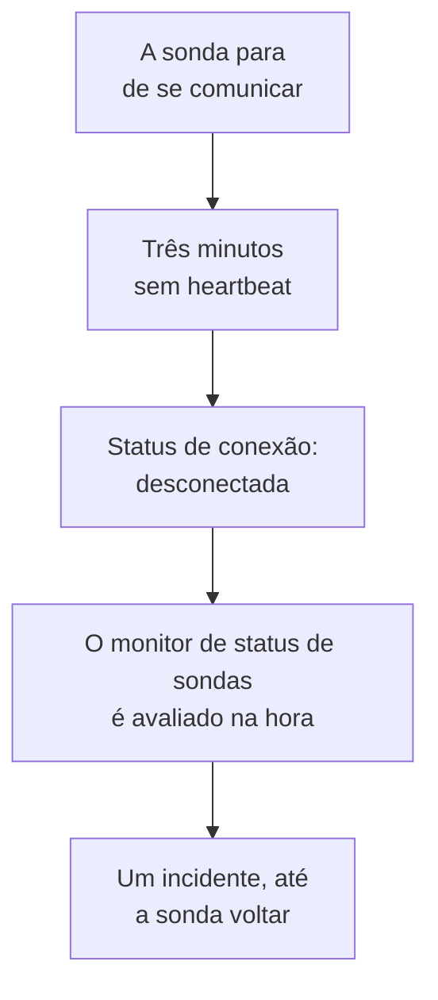

# Monitor de status de sondas

Um monitor de status de sondas avisa você quando uma sonda para de se comunicar: um incidente quando ela se desconecta, resolvido sozinho quando ela volta. Aponte-o para as suas sondas personalizadas ou, em um OneUptime auto-hospedado, para a sonda global em que todo monitor roda, para que uma sonda silenciosa nunca deixe os monitores dela sem verificação sem que ninguém saiba.

:::cards
- [Criar um](#criar-um-monitor-de-status-de-sondas): Escolha as sondas e mantenha os critérios padrão.
- [Critérios](#critérios): Conte as sondas conectadas ou desconectadas, agora ou em uma janela de tempo.
- [Métricas](#métricas): Quantas sondas estavam conectadas, minuto a minuto.
:::

## Como funciona

O OneUptime avalia cada monitor de status de sondas uma vez por minuto, e de novo no momento em que uma das suas sondas se conecta ou se desconecta. Ele lê o status de conexão de cada sonda, o mesmo que a página da sonda mostra: uma sonda está desconectada quando nada foi recebido dela por três minutos. Depois que o próprio OneUptime ficou fora do ar ou sem receber dados, ele espera três minutos inteiros antes de considerar qualquer sonda desconectada, então atualizar o OneUptime nunca abre um incidente.

Uma sonda que continua fora do ar é um único incidente, não um por minuto. O monitor fica offline, com o incidente aberto, até que todas as sondas que ele acompanha estejam conectadas de novo; então o incidente se resolve sozinho.

Um monitor pode acompanhar as sondas do seu próprio projeto e as sondas globais. Uma sonda excluída não é contada em nenhum sentido. Quando não resta nenhuma das sondas que um monitor acompanha, ele mantém o status que tem, e a visão geral dele avisa isso depois de um dia.

## Criar um monitor de status de sondas

:::steps
### Começar um novo monitor

Vá em **Monitores** e clique em **Criar monitor**.

### Escolher o status da sonda

Em **Tipo de monitor**, clique em **Mais tipos de monitor** e escolha **Status da sonda** em **Outro**. Preencha o **Nome** e clique em **Próximo**.

### Escolher as sondas

Em **Sondas a acompanhar**, escolha as sondas. Um novo monitor começa com as sondas do seu projeto. Um OneUptime auto-hospedado sem sondas próprias começa com as suas sondas globais; no OneUptime Cloud as sondas globais são operadas pelo OneUptime, então um projeto as escolhe por conta própria se quiser acompanhá-las.

### Criar o monitor

Mantenha os critérios padrão, descritos abaixo, e clique em **Criar monitor**. O monitor é avaliado na hora, e a visão geral dele lista cada sonda com a última vez em que ela se comunicou.
:::

> [!TIP]
> **Monitorar esta sonda**, na página de uma sonda e no menu da linha dela em **Monitores → Configurações → Sondas**, abre **Criar monitor** com um monitor de status de sondas que acompanha essa sonda e leva o nome dela.

## Critérios

Os filtros de um monitor de status de sondas contam sondas:

| Filtro | O que conta |
| --- | --- |
| **Disconnected Probes** | As sondas acompanhadas que estão desconectadas. |
| **Connected Probes** | As sondas acompanhadas que estão conectadas. |

Os dois são números inteiros, comparados com **Maior que**, **Menor que**, **Igual a** e as demais comparações. Um novo monitor começa com dois critérios:

| Critério | Filtro | O que faz |
| --- | --- | --- |
| Check if a probe is disconnected | **Disconnected Probes** maior que `0` | Deixa o monitor offline e declara um incidente com o título `Probe disconnected: {{disconnectedProbeNames}}`, que se resolve sozinho. |
| Check if every probe is connected | **Disconnected Probes** igual a `0` | Deixa o monitor operacional. |

**Connected Probes** serve para um monitor que acompanha várias sondas e pode perder uma: **Connected Probes** menor que `2` declara um incidente só quando restam menos de duas.

### Esperar mais antes de um incidente

Uma sonda só fica desconectada após três minutos de silêncio, então um reinício rápido não abre nada. Para esperar mais, marque **Avaliar este critério durante um período de tempo** abaixo do filtro, escolha **All Values** em **Avaliar** e uma janela em **Nos últimos (em minutos)**. Com cinco minutos, uma sonda precisa continuar desconectada por mais cinco minutos antes que o incidente seja declarado.

## Métricas

Cada avaliação registra duas séries no monitor: `oneuptime.monitor.probes.connected` e `oneuptime.monitor.probes.disconnected`, o número de sondas acompanhadas que estavam conectadas e desconectadas. Elas aparecem em gráficos na página **Métricas** do monitor, e um painel ou um monitor de métricas as lê como qualquer outra série.

## Variáveis de modelo

Os modelos de incidente e de alerta de um monitor de status de sondas podem usar estas variáveis, além das que todo monitor tem:

| Variável | Valor |
| --- | --- |
| `{{disconnectedProbeNames}}` | Os nomes das sondas desconectadas, separados por vírgulas. |
| `{{disconnectedProbeCount}}` | Quantas das sondas estão desconectadas. |
| `{{connectedProbeNames}}` | Os nomes das sondas conectadas, separados por vírgulas. |
| `{{connectedProbeCount}}` | Quantas das sondas estão conectadas. |
| `{{probeStatusSummary}}` | Uma frase que nomeia as sondas desconectadas, como `1 of 3 probes is disconnected: EU Probe.`, ou que diz que todas as sondas estão conectadas. |
| `{{probes}}` | Cada sonda, com `probeName`, `isConnected`, `isGlobalProbe` e `lastAliveAt`. |

## Solução de problemas

:::details O monitor diz que está esperando dados
Um novo monitor mostra a primeira avaliação em um ou dois minutos. Se ele não acompanha nenhuma sonda, mostra **Not set up** no lugar: escolha as sondas em **Critérios**.
:::

:::details Uma sonda caiu e nenhum incidente foi declarado
Uma sonda fica desconectada após três minutos sem heartbeat, e ainda mais tarde depois que o próprio OneUptime ficou fora do ar. Verifique se o monitor não está desativado nem em uma janela de manutenção, e se os critérios dele ainda declaram um incidente.
:::

## Próximos passos

:::cards
- [Sondas personalizadas](/docs/probe/custom-probe): Rode uma sonda na sua própria rede.
- [Critérios e status do monitor](/docs/monitor/criteria-and-statuses): Como os critérios decidem o status de um monitor.
- [Modelos de incidentes e alertas](/docs/monitor/incident-alert-templating): Redija o incidente que um monitor declara.
:::
