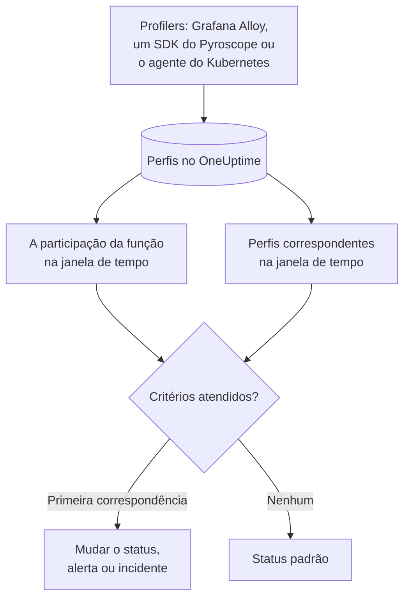

# Monitor de perfis

Um monitor de perfis lê os perfis contínuos que seus serviços enviam ao OneUptime e alerta sobre duas coisas: uma função que ocupa uma participação do tempo maior do que deveria, como um parser que ficou mais pesado depois de um deploy, e perfis que param de chegar de um serviço. A cada minuto, ele mede quanto da sua janela de tempo passou pela função que você indica, conta os perfis que correspondem aos seus filtros, e muda o status do monitor, cria um alerta ou declara um incidente quando seus critérios são atendidos.

:::cards
- [Criar o monitor](#criar-um-monitor-de-perfis): A partir de uma função no Profiler, ou de Criar monitor.
- [O que ele consulta](#o-que-ele-consulta): A função, o tipo de perfil, os serviços e a janela.
- [Critérios](#critérios): A participação de uma função na janela, ou a quantidade de perfis.
- [Uma função fica mais pesada](#exemplo-prático-uma-função-fica-mais-pesada): Alerte quando a participação de uma função dispara.
:::

## Como funciona



A cada minuto, o OneUptime lê os perfis que correspondem aos filtros do monitor e começaram dentro da sua janela de tempo. Ele os conta e, quando o monitor indica uma função, mede a participação do tempo dessa janela que passou pela função. Ele compara esses números com os critérios do monitor de cima para baixo, e o primeiro critério que corresponde decide o que acontece. Quando nenhum corresponde, o monitor volta ao seu status padrão.

## Antes de começar

- Seus serviços enviam dados de profiling contínuo ao OneUptime, pelo Grafana Alloy (eBPF), por um SDK do Pyroscope ou pelo agente do Kubernetes do OneUptime. Veja [Profiling contínuo](/docs/telemetry/profiles).
- Para observar uma função, você sabe o nome dela, ou uma parte do caminho do arquivo ou pacote dela, como o Profiler a mostra.

## Criar um monitor de perfis

:::steps
### Começar pelo Profiler, ou por Criar monitor

O caminho mais rápido parte da própria função: em **Perfis de desempenho**, abra a função e clique no link que oferece um alerta sobre a participação dela. **Criar monitor** abre com o monitor preenchido para essa função e o serviço dela, com um limite acima do que ela ocupa hoje, como descrito em [Exemplo prático: uma função fica mais pesada](#exemplo-prático-uma-função-fica-mais-pesada). Caso contrário, vá para **Monitores** e clique em **Criar monitor**.

### Escolher Profiles

Em **Tipo de monitor**, clique em **Mais tipos de monitor** e escolha **Perfis** em **Telemetria**, ou digite `profiles` na caixa de busca. Informe um **Nome** e clique em **Próximo**.

### Escolher o que ele lê

Em **Configuração do monitor de perfis**, defina **Função** como a função a observar, **O que analisar** como o tipo de perfil e **Monitorar perfis por (tempo)** como a janela. Um monitor novo lê **Tempo de CPU** dos **Últimos 5 minutos**. **O que este monitor lê agora**, abaixo dos campos, mostra quantos perfis correspondem e quanto da janela a função ocupa hoje, para que você possa definir o limite acima disso. Abra **Mais campos** para filtrar por serviço de telemetria ou entidade de infraestrutura.

### Definir os critérios

Um monitor criado em **Criar monitor** tem dois critérios: offline, com um incidente, quando a **Quantidade de perfis** é 0, e online quando ela está acima de 0. Para alertar sobre a função, adicione um filtro **Participação da função (em %)**: veja [Critérios](#critérios).

### Criar o monitor

Clique em **Criar monitor**. O monitor abre na página **Visão geral**, e sua primeira avaliação é executada em até um minuto.
:::

### Criá-lo pela API ou pelo Terraform

A etapa de um monitor contém as mesmas configurações da sua configuração `profileMonitor`. Esta observa `parseOrder` nos perfis de CPU de um serviço nos últimos cinco minutos:

```json
{
  "profileMonitor": {
    "telemetryServiceIds": [],
    "profileTypes": ["cpu"],
    "profileType": "",
    "functionName": "parseOrder",
    "attributes": {},
    "lastXSecondsOfProfiles": 300
  }
}
```

Coloque o ID do serviço em `telemetryServiceIds`, ou deixe a lista vazia para ler os perfis de todos os serviços, e deixe `functionName` vazio para apenas contar perfis. Crie um monitor com o tipo de monitor `Profiles` e uma etapa que contenha essa configuração e pelo menos um critério, pela [API](/docs/api-reference/api-reference) ou pelo [Terraform](/docs/terraform/monitor-steps). No Terraform, passe a configuração como o atributo `profile_monitor` da etapa, escrita com `jsonencode()`.

## O que ele consulta

| Campo | O que seleciona | Padrão |
| --- | --- | --- |
| `profileTypes` | Perfis de qualquer um destes tipos, comparados exatamente, como `cpu`. | Vazio: todos os tipos |
| `profileType` | Perfis cujo tipo contém este texto, sem diferenciar maiúsculas de minúsculas. Quando definido, `profileTypes` é ignorado. | Vazio |
| `functionName` | O código cuja participação **Participação da função (em %)** mede: os frames da pilha cujo nome de função ou caminho de arquivo contém este texto, sem diferenciar maiúsculas de minúsculas. | Vazio: nenhuma participação é medida |
| `telemetryServiceIds` | Perfis de qualquer um destes serviços de telemetria. | Vazio: todos os serviços |
| `entityKeys` | Perfis de qualquer um destes hosts, pods, contêineres e outras entidades de infraestrutura. | Vazio: todas as entidades |
| `attributes` | Perfis cujos atributos têm estes valores. | Vazio: nenhuma condição |
| `lastXSecondsOfProfiles` | Perfis que começaram dentro deste número de segundos antes da avaliação. | Nenhum: defina-o sempre, ou todo perfil armazenado é contado e a contagem nunca cai para 0 |

Todos os filtros que você definir precisam corresponder para que um perfil seja lido. No formulário, **Função** define `functionName`, **O que analisar** define `profileTypes` (**Todos os tipos de perfil** o deixa vazio), **Monitorar perfis por (tempo)** define `lastXSecondsOfProfiles`, e **Filtrar por serviço de telemetria** e **Filtrar por entidade de infraestrutura** definem `telemetryServiceIds` e `entityKeys`.

## Como ele é avaliado

- **A cada minuto.** Um monitor de perfis não é verificado por sondas, por isso não tem intervalo para configurar nem página **Sondas e intervalo**.
- **Dois números por avaliação.** O monitor conta os perfis que correspondem a todos os filtros e começaram dentro de `lastXSecondsOfProfiles`, e mede a participação da função nesses mesmos perfis. Um profiler envia dados em intervalos regulares, então dê à janela espaço para vários envios.
- **Uma unidade por vez.** Uma participação soma amostras de uma só unidade: quando os tipos lidos misturam unidades, como tempo de CPU em nanossegundos vindo de um SDK e contagens de amostras vindas do eBPF, ele lê a unidade com mais amostras na janela.
- **Nenhum perfil é uma contagem de 0 e nenhuma participação.** Um serviço cujo profiler para de enviar dados produz uma contagem de 0, e um critério **Participação da função (em %)** não corresponde a uma janela vazia: alerte sobre a **Quantidade de perfis** para saber que o profiling parou.
- **A indisponibilidade do próprio OneUptime não é silêncio.** Enquanto a janela de tempo contiver um período em que o próprio OneUptime não estava recebendo dados (estava reiniciando, sendo atualizado ou recuperando um atraso), a verificação espera: o status não muda, e nenhum incidente ou alerta é aberto ou resolvido. Veja [Quando o OneUptime não recebe dados](/docs/monitor/when-oneuptime-is-not-receiving).
- **Critérios de cima para baixo.** O primeiro critério que corresponde decide, então coloque o mais grave primeiro.

Cada mudança de status, com o motivo, fica registrada na **Linha do tempo de status** do monitor.

## Critérios

Os critérios de um monitor de perfis comparam um de dois números com um valor.

**Participação da função (em %)** é a participação do tempo da janela, de 0 a 100, que passou pela função do monitor: cada pilha com um frame que corresponde a `functionName` conta uma vez, em qualquer profundidade, então o código próprio da função e tudo o que ela chama estão incluídos.

| Condição do filtro | Corresponde quando a participação da função está… |
| --- | --- |
| **Maior que** | acima do valor |
| **Maior ou igual a** | no valor ou acima |
| **Menor que** | abaixo do valor |
| **Menor ou igual a** | no valor ou abaixo |

A **Quantidade de perfis** é o número de perfis que corresponderam na janela:

| Condição do filtro | Corresponde quando a contagem de perfis está… |
| --- | --- |
| **Maior que** | acima do valor |
| **Maior ou igual a** | no valor ou acima |
| **Menor que** | abaixo do valor |
| **Menor ou igual a** | no valor ou abaixo |
| **Igual a** | exatamente no valor |
| **Diferente de** | em qualquer valor menos esse |

As contagens de perfis não têm condições de anomalia: não há uma referência com a qual compará-las.

## Exemplo prático: uma função fica mais pesada

No serviço de checkout, `parseOrder` ocupa 18% do tempo de CPU dele. Um deploy que analisa um payload maior não deve passar despercebido:

1. Em **Perfis de desempenho**, escolha o serviço de checkout e abra `parseOrder`.
2. Clique no link que oferece um alerta sobre a participação dela. O Profiler sugere 30%: metade a mais que a participação de hoje, pelo menos 10 pontos a mais, arredondado para cima até um múltiplo de 5.
3. **Criar monitor** abre com um monitor de perfis do serviço de checkout que lê **Tempo de CPU** dos **Últimos 5 minutos**, com dois critérios: **Participação da função (em %)** **Maior que** `30` dispara um alerta, que se resolve sozinho, e marca o monitor como degradado; **Menor ou igual a** `30` o marca como operacional. O incidente vem preenchido, mas desativado: ative-o para acionar alguém.
4. Clique em **Criar monitor**.

Quando o deploy faz `parseOrder` ocupar 45% do tempo de CPU, a próxima avaliação dispara o alerta. Quando uma correção a traz de volta para menos de 30%, o alerta se resolve sozinho.

## Exemplo prático: os perfis param de chegar

O serviço de checkout executa um SDK do Pyroscope que envia perfis de CPU. Você quer um incidente quando eles param de chegar por cinco minutos:

- `profileTypes`: `["cpu"]`, `telemetryServiceIds`: o serviço de checkout, `lastXSecondsOfProfiles`: `300`
- Critério 1: **Quantidade de perfis** **Igual a** `0`: colocar o monitor offline e declarar um incidente
- Critério 2: **Quantidade de perfis** **Maior que** `0`: colocar o monitor online

Enquanto o SDK envia dados, cada avaliação conta alguns perfis e o critério 2 mantém o monitor online. Quando o serviço é implantado sem o SDK, a contagem cai para 0 cinco minutos depois do último envio, o critério 1 corresponde e o incidente é declarado. O primeiro envio depois da correção leva a contagem de volta para acima de 0, e o incidente se resolve sozinho se **Resolver incidente automaticamente** estiver ativado para ele.

## Solução de problemas

:::details O monitor conta 0, mas aparecem perfis no OneUptime
Compare os filtros com os perfis que você vê: `profileTypes` deve corresponder exatamente ao tipo, e `telemetryServiceIds` deve conter os IDs de serviço corretos. Um `lastXSecondsOfProfiles` curto também pode cair entre dois envios.
:::

:::details A participação da função fica em 0%
Nenhum frame da janela contém o texto da função. Abra a função no Profiler e copie o nome dela como aparece ali; uma parte do nome basta, e maiúsculas e minúsculas não importam. Depois, verifique se o serviço envia o tipo de perfil que **O que analisar** lê.
:::

## Próximos passos

:::cards
- [Profiling contínuo](/docs/telemetry/profiles): Envie perfis e leia-os no Profiler.
- [Etapas do monitor](/docs/terraform/monitor-steps): Passe a configuração da etapa pelo Terraform.
- [Monitor de traces](/docs/monitor/traces-monitor): Alerte sobre spans com falha.
- [Monitor de métricas](/docs/monitor/metrics-monitor): Alerte sobre CPU, memória e outras métricas.
:::
