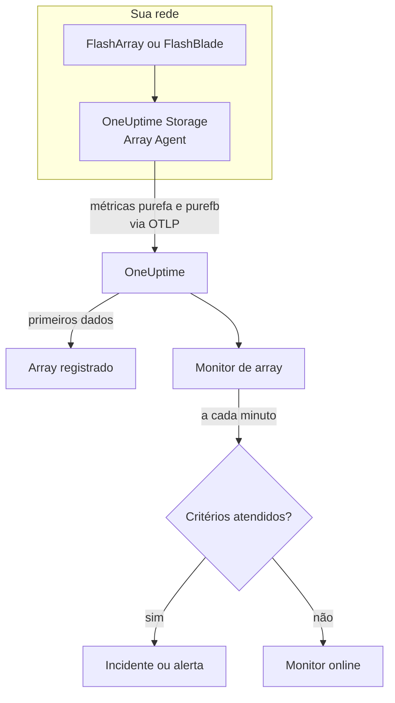

# Monitor de arrays de armazenamento

Um monitor de array de armazenamento observa um array de armazenamento e avisa você quando o array dispara um alerta próprio, fica sem espaço, fica lento, perde hardware ou um caminho de host, ou atrasa na replicação. Ele funciona com Pure Storage FlashArray e Pure Storage FlashBlade, e lê as métricas que o próprio array exporta - as séries `purefa_*` e `purefb_*` da Pure -, coletadas pelo OneUptime Storage Array Agent.

Também funciona com o Dell PowerStore (`dell.powerstore`), a partir das séries `powerstore_*` da Dell.

:::cards
- [Criar o monitor](#criar-um-monitor-de-array-de-armazenamento): Seis passos no painel.
- [Modelos](#modelos-de-alerta-prontos): Alertas prontos, um incidente por volume, host, appliance ou componente.
- [Como as séries da Pure funcionam](#como-as-séries-da-pure-são-montadas): Um nome de métrica, muitos valores.
- [Métricas](#métricas-coletadas): Cada série sobre a qual o monitor pode alertar.
:::

## Como funciona

O OneUptime Storage Array Agent roda em uma máquina que alcança a interface de gerenciamento do array. Ele lê as métricas do array com um token de API somente leitura, rotula-as com o nome do array, `storage.array.name`, e a sua plataforma, `storage.system`, e as envia ao OneUptime via OTLP. Os primeiros dados registram o array.

Um monitor de array de armazenamento fica vinculado a um array. A cada minuto ele executa a sua consulta sobre as métricas desse array e compara o resultado com os seus critérios.



## Antes de começar

- **Instale o Storage Array Agent** onde ele alcance o array via HTTPS, com o token de API de um usuário que tenha o papel **readonly** do array. O [guia do Storage Array Agent](/docs/telemetry/storage-arrays) cobre o usuário, o token e a instalação, por meio de `ONEUPTIME_URL`, `ONEUPTIME_TELEMETRY_INGESTION_KEY`, `STORAGE_ARRAY_NAME`, e o endereço e o token do array (`PURE_FA_ENDPOINT` e `PURE_FA_API_TOKEN`, ou `PURE_FB_ENDPOINT` e `PURE_FB_API_TOKEN`).
- **Verifique se o array está registrado.** Ele aparece em **Produtos → Infraestrutura → Arrays de armazenamento → Todos os arrays de armazenamento**, com o nome do `STORAGE_ARRAY_NAME` do agente, cerca de um minuto depois da primeira leitura.

## Criar um monitor de array de armazenamento

:::steps
### Começar um novo monitor

Vá em **Monitores** e clique em **Criar monitor**.

### Escolher Array de armazenamento

Em **Tipo de monitor**, clique em **Mais tipos de monitor** e escolha **Array de armazenamento** em **Infraestrutura**, ou digite `storage` na caixa de pesquisa. Informe um **Nome** - ele é usado nos títulos de incidentes e alertas - e clique em **Próximo**.

### Escolher o array

Em **Storage Array Monitor Configuration**, escolha o array em **Array de armazenamento**. Todo array que enviou dados está na lista. A sua plataforma decide quais métricas e modelos o formulário oferece. Depois da escolha, uma linha abaixo do campo diz se estão chegando dados. **Adicionar array de armazenamento** abre passos de configuração com as suas chaves já preenchidas, que esperam os primeiros dados.

### Escolher o que observar

Um monitor novo começa com **Array Stopped Reporting**, em **Sobre o que alertar**. Para vigiar outra coisa:

- **Alterar** - escolha outro [modelo](#modelos-de-alerta-prontos). Ele define a métrica, os filtros de rótulos, a agregação, o intervalo de tempo e os limites, e substitui os critérios abaixo pelos seus. Você ainda pode mudar o **Intervalo de tempo**.
- **Custom Metric** (em **Mais campos**) - escolha uma métrica em **Storage Array Metric** e depois defina **Agregação** e **Intervalo de tempo**. Os [filtros](#configurações-do-monitor) a restringem a um volume, host, pod, componente, sistema de arquivos ou bucket.
- **Avançado** (em **Mais campos**) - monte você mesmo consultas e fórmulas em **Selecionar Métricas**, por exemplo a capacidade usada como `purefa_array_space_bytes` filtrada para `space=capacity` menos a mesma métrica filtrada para `space=empty`. Use **Agrupar por** com o rótulo de um objeto para avaliar cada objeto separadamente.

### Conferir os critérios

Abra cada critério em **Critérios** e confira **Métrica**, **Agregação**, **Condição** e **Limite**. Um modelo os preenche. Com **Custom Metric** ou **Avançado**, o monitor começa com os [critérios padrão](#critérios-padrão), que só percebem uma métrica que não envia dados, então defina o seu próprio limite.

### Criar o monitor

Clique em **Criar monitor**. O OneUptime abre a página do monitor e o avalia a cada minuto. Os incidentes e alertas que ele dispara também aparecem nas páginas **Incidentes** e **Alertas** do array.
:::

> [!TIP]
> Para configurar vários modelos de uma vez, abra o array em **Produtos → Infraestrutura → Arrays de armazenamento** e vá em **Recomendações**. Escolha os modelos que quiser, decida quem é acionado, e o OneUptime cria um monitor por modelo.

## Configurações do monitor

| Campo | Aba | O que faz |
| --- | --- | --- |
| **Array de armazenamento** | Todas | Obrigatório. Restringe cada consulta a `resource.storage.array.name`, então dois arrays que têm um volume chamado `vol-01` nunca se misturam. |
| **Volume** | Custom Metric, Avançado | Só FlashArray. Um volume, pelo rótulo `name`, como `vol-db-01`. Um volume em um pod ou em um grupo de volumes se chama `pod::volume` ou `group/volume`. |
| **Host** | Custom Metric, Avançado | Só FlashArray. Um host como o array o conhece, pelo rótulo `host`, como `esxi-01`. |
| **Pod** | Custom Metric, Avançado | Só FlashArray. Um pod do ActiveCluster ou do ActiveDR, pelo rótulo `name`, ou `local_pod` nas séries de links de réplica. |
| **Componente de hardware** | Custom Metric, Avançado | Um componente de hardware, como `CH0.BAY1` ou `CT0`: o rótulo `component_name` em um FlashArray, `name` em um FlashBlade. |
| **Sistema de arquivos** | Custom Metric, Avançado | Só FlashBlade. Um sistema de arquivos, pelo rótulo `name`. |
| **Bucket** | Custom Metric, Avançado | Só FlashBlade. Um bucket de armazenamento de objetos, pelo rótulo `name`. |
| **Storage Array Metric** | Custom Metric | Uma métrica do [catálogo](#métricas-coletadas). O formulário adiciona o filtro de rótulo que lhe dá significado, e a agrupa pelo objeto que ela descreve, então cada volume, host ou componente é avaliado separadamente. |
| **Agregação** | Custom Metric | Como as amostras são combinadas: **Média**, **Máximo**, **Mínimo**, **Soma** ou **Contagem**. Começa na agregação usual da métrica. |
| **Intervalo de tempo** | Todas | A janela móvel que a consulta lê, de **Past 1 Minute** a **Past 365 Days**. Um monitor novo começa em **Últimos 5 minutos**; uma métrica personalizada de um sistema de arquivos ou de um bucket, em **Últimos 15 minutos**; os modelos definem a sua. |
| **Selecionar Métricas** | Avançado | O construtor de consultas: **Métrica**, **Agregar por**, **Filtrar por atributos**, **Agrupar por**, além de **Adicionar métrica** e **Adicionar fórmula** para combinar consultas. |

O agente lê o endpoint do array a cada 60 segundos, e volumes, hosts e pods a cada 2 minutos, então uma janela de 5 minutos sempre tem uma amostra. Ele lê os sistemas de arquivos e os buckets de um FlashBlade a cada 5 minutos, daí os 15, e os diretórios do FlashArray a cada 30 minutos: dê a um monitor de diretório uma janela de 60 minutos.

Ele lê um PowerStore a cada 5 minutos, e o estado do seu cluster a cada 60 segundos: dê a um monitor de PowerStore uma janela de 15 minutos.

## Como as séries da Pure são montadas

A Pure coloca vários valores em **um único** nome de métrica e os diferencia com um rótulo:

- **`dimension`** nas séries de desempenho. `purefa_array_performance_latency_usec` traz a latência de leitura (`usec_per_read_op`), a latência de escrita (`usec_per_write_op`), a latência de escrita espelhada, e o tempo de SAN, de fila, de QoS e de serviço de cada uma. Sempre filtre por uma única `dimension`: uma média entre todas mistura uma latência de leitura de 200 µs com um valor de fila.
- **`space`** nas séries de capacidade: `capacity`, `empty`, `snapshots`, `total_provisioned`, `total_physical`, `available_ratio` e outras.

Várias séries trazem o seu estado em um **rótulo**, com um valor que é sempre 1:

| Série | Rótulo de estado | Uma série por |
| --- | --- | --- |
| `purefa_alerts_open` | `severity`, com `summary`, `code` e `component_type` | Alerta aberto |
| `purefa_hw_component_status` | `component_status` | Componente de hardware |
| `purefa_host_connectivity_info` | `status`, com `details` | Host |
| `purefa_drive_capacity_bytes` | `component_status` (o valor é a capacidade do disco) | Disco |

Uma série filtrada para um estado ruim só existe enquanto algo está nesse estado, então nenhuma série significa que está tudo bem. É por isso que **Max acima de 0 dispara e 0 recupera** é a forma certa para elas, e é assim que os modelos são montados: os seus critérios de recuperação contam uma série ausente como zero. Quando não resta nenhuma série, um modelo assim só recupera se `purefa_info` ou `purefb_info` tiver chegado na mesma janela, então um array que parou de reportar não fecha nada.

Nos filtros do monitor e nas chaves de agrupamento, os atributos do agente começam com `resource.` (`resource.storage.array.name`, `resource.storage.system`), enquanto os rótulos da própria Pure não (`name`, `host`, `component_name`, `dimension`, `space`, `severity`).

## Como as séries do PowerStore são formadas

O exportador da Dell escreve um valor por nome de métrica, então uma série do PowerStore não precisa de filtro de rótulos. Os seus rótulos nomeiam o objeto: `appliance_id` um appliance, `name` uma peça, um volume ou um sistema de arquivos, e `volume_id`, `fc_port_id`, `eth_port_id`, `nas_id` ou `volume_group_id` o objeto de uma série de desempenho. As suas séries de estado valem 1 enquanto tudo está bem e 0 caso contrário, então os modelos disparam abaixo de 1. Os seus próprios alertas chegam por syslog, e os seus modelos, monitores de registros, estão listados depois da sua tabela abaixo.

## Modelos de alerta prontos

O OneUptime traz 36 modelos — 12 para FlashArray, 8 para FlashBlade e 16 para PowerStore — e a lista de **Sobre o que alertar** oferece os da plataforma do array. Cada um monta um monitor completo: a consulta da métrica, os seus filtros de rótulos, um agrupamento pelo rótulo do próprio objeto, um critério que dispara e outro que recupera. Os limites são pontos de partida que você pode editar.

Um critério só dispara quando a condição vale para **cada** valor da sua janela. Um monitor que disparou por um limite de capacidade, latência, atraso ou proporção só se recupera 10 % além dele, então um valor que oscila em torno do limite não fica alternando. Os modelos de alertas, hardware e conectividade disparam quando um estado aparece durante toda a sua janela de 5 minutos, e se recuperam cerca de 5 minutos depois que ele desaparece.

### FlashArray

| Modelo                         | Categoria    | Gravidade | Observa                                                                                         | Dispara quando                                                                                                                                   |
| ------------------------------ | ------------ | --------- | ----------------------------------------------------------------------------------------------- | ------------------------------------------------------------------------------------------------------------------------------------------------ |
| Array Stopped Reporting        | Disponibilidade | Crítico   | `purefa_info`, Count, últimos 10 minutos                                                        | Nenhum dado durante toda a janela — o Storage Array Agent parou, perdeu a rota até o OneUptime ou teve o token revogado, ou o array parou de responder a ele; recupera quando os dados voltam a chegar |
| Critical Array Alert           | Saúde do array | Crítico   | `purefa_alerts_open` filtrada para `severity=critical`, Max por `summary`, últimos 5 minutos    | > 0 — o array tem um alerta crítico aberto (um componente com falha, uma emergência de capacidade, uma falha de replicação). Um incidente por alerta; recupera quando o alerta fecha |
| Warning Array Alert            | Saúde do array | Aviso   | `purefa_alerts_open` filtrada para `severity=warning`, Max por `summary`, últimos 5 minutos     | > 0 — o array tem um alerta de nível warning aberto. Um incidente por alerta; recupera quando o alerta fecha                                    |
| Capacity Above 80%             | Capacidade   | Aviso   | `purefa_array_space_utilization`, Max, últimos 15 minutos                                       | > 80 — o primeiro limite de capacidade da própria Pure; recupera em ≤ 72                                                                         |
| Capacity Above 90%             | Capacidade   | Crítico   | `purefa_array_space_utilization`, Max, últimos 5 minutos                                        | > 90 — o array está perto de recusar escritas; recupera em ≤ 81                                                                                  |
| High Read Latency              | Desempenho   | Aviso   | `purefa_array_performance_latency_usec` filtrada para `dimension=usec_per_read_op`, Avg, últimos 10 minutos  | > 5000 µs (5 ms) — as leituras de um FlashArray normalmente terminam bem abaixo de 1 ms; recupera em ≤ 4500                          |
| High Write Latency             | Desempenho   | Aviso   | `purefa_array_performance_latency_usec` filtrada para `dimension=usec_per_write_op`, Avg, últimos 10 minutos | > 5000 µs (5 ms); recupera em ≤ 4500                                                                                                 |
| Hardware Component Failed      | Hardware     | Crítico   | `purefa_hw_component_status` filtrada para `component_status=critical`, Max por `component_name`, últimos 5 minutos | > 0 — um controlador, uma fonte de alimentação, um ventilador, uma baia ou uma porta está crítico e a redundância acabou. Um incidente por componente; recupera quando informar ok |
| Hardware Component Degraded    | Hardware     | Aviso   | `purefa_hw_component_status` filtrada para `component_status=degraded`, Max por `component_name`, últimos 5 minutos | > 0 — um componente está degradado. Um incidente por componente; recupera quando informar ok                                   |
| Drive Failed                   | Hardware     | Crítico   | `purefa_drive_capacity_bytes` filtrada para `component_status=failed`, Max por `component_name`, últimos 5 minutos | > 0 — um módulo DirectFlash ou um SSD falhou e o array reconstrói nos outros. Um incidente por disco; recupera quando for substituído |
| Host Lost Redundant Paths      | Hosts        | Aviso   | `purefa_host_connectivity_info` filtrada para `status=critical`, Max por `host`, últimos 5 minutos | > 0 — o host alcança o array por um controlador ou por nenhum; um failover de controlador deixaria o seu armazenamento offline. Um incidente por host; recupera quando os seus caminhos voltarem |
| Replication Lag Above 1 Minute | Replicação  | Aviso   | `purefa_pod_replica_links_lag_max_msec`, Max por `local_pod`, últimos 10 minutos                | > 60000 ms (60 s) — um failover agora perderia mais escritas recentes do que o planejado. Um incidente por pod; recupera em ≤ 54000               |

### FlashBlade

| Modelo                       | Categoria    | Gravidade | Observa                                                                                                        | Dispara quando                                                                                                      |
| ---------------------------- | ------------ | --------- | -------------------------------------------------------------------------------------------------------------- | ------------------------------------------------------------------------------------------------------------------- |
| Array Stopped Reporting      | Disponibilidade | Crítico   | `purefb_info`, Count, últimos 10 minutos                                                                       | Nenhum dado durante toda a janela — o agente, o exporter dele ou o FlashBlade parou de responder; recupera quando os dados voltam a chegar |
| Critical Array Alert         | Saúde do array | Crítico   | `purefb_alerts_open` filtrada para `severity=critical`, Max por `summary`, últimos 5 minutos                   | > 0 — o FlashBlade tem um alerta crítico aberto. Um incidente por alerta; recupera quando o alerta fecha            |
| Warning Array Alert          | Saúde do array | Aviso   | `purefb_alerts_open` filtrada para `severity=warning`, Max por `summary`, últimos 5 minutos                    | > 0 — o FlashBlade tem um alerta de nível warning aberto. Um incidente por alerta; recupera quando o alerta fecha   |
| Capacity Above 80%           | Capacidade   | Aviso   | `purefb_array_space_utilization` filtrada para `type=array`, Max, últimos 15 minutos                           | > 80; recupera em ≤ 72                                                                                              |
| Capacity Above 90%           | Capacidade   | Crítico   | `purefb_array_space_utilization` filtrada para `type=array`, Max, últimos 5 minutos                            | > 90 — as escritas falham para todo cliente quando ele enche; recupera em ≤ 81                                      |
| Hardware Component Unhealthy | Hardware     | Crítico   | `purefb_hardware_health`, Min por `name`, últimos 5 minutos                                                    | < 1 — um blade, um módulo de fabric, uma fonte de alimentação ou um ventilador não está saudável (um slot sem uso informa 2). Um incidente por componente; recupera em ≥ 1 |
| High Read Latency            | Desempenho   | Aviso   | `purefb_array_performance_latency_usec` filtrada para `dimension=usec_per_read_op` e `protocol=all`, Avg, últimos 10 minutos | > 10000 µs (10 ms) em todos os protocolos; recupera em ≤ 9000                                         |
| File System Near Full        | Sistemas de arquivos | Aviso   | `purefb_file_systems_space_bytes` filtrada para `space=available_ratio`, Min por `name`, últimos 15 minutos    | < 0.1 — resta menos de 10 % do tamanho provisionado de um sistema de arquivos. Um incidente por sistema de arquivos; recupera em ≥ 0.11 |

### PowerStore

| Modelo                       | Categoria    | Gravidade | Observa                                                                                                        | Dispara quando                                                                                                      |
| --- | --- | --- | --- | --- |
| Array Stopped Reporting | Disponibilidade | Crítico | `powerstore_cluster`, Count, últimos 10 minutos | Nenhum dado durante toda a janela — o agente, o exportador da Dell ou o cluster parou de responder; recupera quando os dados voltam a chegar |
| Capacity Above 80% | Capacidade | Aviso | `powerstore_cap_physical_used_percent`, Max por `appliance_id`, últimos 15 minutos | > 80 — a capacidade de um appliance está enchendo; recupera em ≤ 72 |
| Capacity Above 90% | Capacidade | Crítico | `powerstore_cap_physical_used_percent`, Max por `appliance_id`, últimos 15 minutos | > 90 — um appliance está perto de recusar gravações; recupera em ≤ 81 |
| High Read Latency | Desempenho | Aviso | `powerstore_perf_avg_read_latency`, Avg por `appliance_id`, últimos 15 minutos | > 5000 µs (5 ms); recupera em ≤ 4500 |
| High Write Latency | Desempenho | Aviso | `powerstore_perf_avg_write_latency`, Avg por `appliance_id`, últimos 15 minutos | > 5000 µs (5 ms); recupera em ≤ 4500 |
| Drive Failed | Hardware | Crítico | `powerstore_hardware_Drive_state`, Min por `name`, últimos 10 minutos | < 1 — uma unidade falhou ou foi removida; recupera em ≥ 1 |
| Node Unhealthy | Hardware | Crítico | `powerstore_hardware_node_state`, Min por `name`, últimos 10 minutos | < 1 — um nó não está Healthy; recupera em ≥ 1 |
| Power Supply Unhealthy | Hardware | Aviso | `powerstore_hardware_Power_Supply_state`, Min por `name`, últimos 10 minutos | < 1 — uma fonte de alimentação falhou ou perdeu energia; recupera em ≥ 1 |
| Fan Unhealthy | Hardware | Aviso | `powerstore_hardware_Fan_state`, Min por `name`, últimos 10 minutos | < 1 — um ventilador falhou; recupera em ≥ 1 |
| Battery Unhealthy | Hardware | Aviso | `powerstore_hardware_Battery_state`, Min por `name`, últimos 10 minutos | < 1 — um módulo de bateria de backup falhou; recupera em ≥ 1 |
| Drive Wearing Out | Hardware | Aviso | `powerstore_wear_metrics_by_drive`, Min por `name`, últimos 15 minutos | < 10 — resta a uma unidade menos de 10% da sua resistência; recupera em ≥ 11 |
| NAS Server Not Started | Sistemas de arquivos | Aviso | `powerstore_nas_server_operational_status`, Max por `name`, últimos 10 minutos | < 1 — um servidor NAS está parado ou degradado; recupera em ≥ 1 |
| Volume Not Ready | Saúde do array | Aviso | `powerstore_volume_state`, Max por `name`, últimos 15 minutos | < 1 — um volume está offline; recupera em ≥ 1 |
| File System Near Full | Sistemas de arquivos | Aviso | `powerstore_filesystem_logical_used_percent`, Max por `name`, últimos 15 minutos | > 90 — um sistema de arquivos está quase cheio; recupera em ≤ 81 |
| Cluster Not Configured | Saúde do array | Aviso | `powerstore_cluster`, Max, últimos 10 minutos | < 1 — o cluster não está Configured; recupera em ≥ 1 |
| Metro Witness Not Connected | Replicação | Aviso | `powerstore_metro_witness_status`, Min por `name`, últimos 10 minutos | > 0 — uma testemunha Metro não está conectada; recupera quando volta a estar OK |

### Alertas do PowerStore, por syslog

Os próprios alertas de um PowerStore chegam como registros, então os seus modelos são monitores de **Registros**, oferecidos na página **Recomendações** do array em **Alertas do array**. Cada um abre um alerta por alerta do PowerStore, agrupado por `powerstore.resource.name` e `powerstore.alert.id`, e o resolve quando o PowerStore limpa esse alerta:

| Modelo | Severidade | Abre numa linha com | Resolve-se com |
| --- | --- | --- | --- |
| Critical Array Alert | Crítico | `powerstore.alert.severity=Critical` | `powerstore.alert.state=Cleared` |
| Major Array Alert | Aviso | `powerstore.alert.severity=Major` | `powerstore.alert.state=Cleared` |
| Port Link Down | Aviso | `powerstore.event.code=0x00307404` | `powerstore.alert.state=Cleared` |

**Gravidade** é o rótulo que o seletor mostra. O incidente e o alerta que um modelo cria começam na gravidade de incidente e de alerta mais alta do seu projeto; altere-as no critério.

- **Array Stopped Reporting** conta a série de identidade da plataforma (`purefa_info` ou `purefb_info`), que cada endpoint lido pelo agente exporta em toda leitura. Quando os dados param, os outros modelos não têm nada para comparar e mantêm o último status, então é este que avisa você.
- **Alertas abertos e estados de hardware usam Max** de uma série que só existe enquanto o alerta está aberto ou o componente está nesse estado, então o estado ultrapassa o limite quando aparece durante toda a janela de 5 minutos.
- **Todo modelo por objeto agrupa pelo rótulo do próprio objeto** (`summary`, `component_name`, `host`, `local_pod`, `name`), então um incidente dispara por objeto afetado, e o incidente o nomeia.
- **Os modelos de latência usam Avg** da média por operação calculada pelo próprio array, e os de capacidade **Máx.** do seu próprio percentual de utilização. As latências ficam fixadas em microssegundos e a capacidade em percentual.
- **Hardware Component Unhealthy usa Min** por componente: a sua saúde é 1 quando está saudável e cai para 0 quando não está.

Não há modelo para a latência de cada volume, porque o limite certo depende da carga de trabalho: monte-o a partir do catálogo com um agrupamento por `name`. A previsão de capacidade precisa de uma tendência de crescimento mais do que de um limite, e o desgaste dos discos não tem série sobre a qual alertar.

## Métricas coletadas

O agente envia tudo o que o array exporta; as séries abaixo são o catálogo que o formulário do monitor oferece. Cada valor é um gauge que o próprio array calcula - as latências são microssegundos por operação e a vazão é por segundo -, então não é preciso calcular taxas. **Filtro** é o filtro de rótulo que dá à série o significado que a sua linha indica; o formulário o aplica para você.

### Saúde do array

| Métrica              | Filtro | Plataforma | Unidade | Descrição                                                                                                                                                         |
| -------------------- | ------ | ---------- | ------- | ----------------------------------------------------------------------------------------------------------------------------------------------------------------- |
| `purefa_alerts_open` | —      | FlashArray | `count` | Uma série por alerta aberto no array (valor 1), com os rótulos `severity` (`critical`, `warning`, `info`, `hidden`), `category`, `code`, `component_type` e `summary` |
| `purefb_alerts_open` | —      | FlashBlade | `count` | Uma série por alerta aberto no FlashBlade (valor 1), com os rótulos `severity` (`info`, `warning`, `critical`), `code`, `component_name`, `component_type`, `summary` e `kburl` (o artigo da base de conhecimento da Pure) |
| `powerstore_cluster` | — | PowerStore | `count` | 1 enquanto o cluster PowerStore está Configured (formado e em serviço), 0 em qualquer outro estado: Configuring, Expanding, Removing, Clustering_Failed ou Unconfigured. |

### Capacidade

| Métrica                                   | Filtro                       | Plataforma | Unidade | Descrição                                                                                                                             |
| ----------------------------------------- | ---------------------------- | ---------- | ------- | ------------------------------------------------------------------------------------------------------------------------------------- |
| `purefa_array_space_utilization`          | —                            | FlashArray | `%`     | Parcela da capacidade utilizável do array em uso. A Pure dispara os seus próprios alertas de capacidade em 80 %, 90 % e 100 %          |
| `purefa_array_space_bytes`                | `space=capacity`             | FlashArray | `bytes` | Capacidade utilizável do array                                                                                                        |
| `purefa_array_space_bytes`                | `space=empty`                | FlashArray | `bytes` | Capacidade sem uso — acompanhe a tendência para prever quando o array vai encher                                                     |
| `purefa_array_space_bytes`                | `space=snapshots`            | FlashArray | `bytes` | Espaço físico ocupado só por snapshots; um crescimento rápido costuma significar que um grupo de proteção guarda mais snapshots do que o planejado |
| `purefa_array_space_data_reduction_ratio` | —                            | FlashArray | `ratio` | Deduplicação e compressão em todo o array, por exemplo 4.2 para 4.2:1. Uma queda sustentada significa que os dados novos se reduzem mal |
| `purefb_array_space_utilization`          | `type=array`                 | FlashBlade | `%`     | Parcela da capacidade utilizável do FlashBlade em uso                                                                                 |
| `purefb_array_space_bytes`                | `type=array`, `space=empty`  | FlashBlade | `bytes` | Capacidade sem uso do FlashBlade                                                                                                      |
| `purefb_array_space_data_reduction_ratio` | `type=array`                 | FlashBlade | `ratio` | Redução de dados em todo o FlashBlade                                                                                                 |
| `powerstore_cap_physical_used_percent` | — | PowerStore | `%` | Parcela da capacidade física de cada appliance em uso, em porcentagem: o seu espaço físico usado sobre o seu total físico, a partir do resumo diário de espaço do PowerStore. O PowerStore emite os seus próprios alertas de capacidade a partir de 70%. Agrupe por appliance_id. |
| `powerstore_cap_last_physical_total` | — | PowerStore | `bytes` | Capacidade física utilizável de cada appliance em bytes. |
| `powerstore_cap_last_physical_used` | — | PowerStore | `bytes` | Capacidade física que cada appliance usa em bytes, após deduplicação e compressão. Acompanhe a tendência para prever quando um appliance vai encher. |
| `powerstore_cap_last_logical_provisioned` | — | PowerStore | `bytes` | Capacidade lógica provisionada em cada appliance em bytes: o tamanho de cada volume, sistema de arquivos e vVol que contém, que pode estar muito acima da sua capacidade física. |
| `powerstore_cap_last_logical_used` | — | PowerStore | `bytes` | Dados que os hosts gravaram em cada appliance em bytes, antes da deduplicação e da compressão. |
| `powerstore_cap_last_data_reduction` | — | PowerStore | `ratio` | Deduplicação e compressão em cada appliance, por exemplo 3.4 para 3.4:1. Uma queda contínua significa que os dados recém-gravados se reduzem mal: dados criptografados ou já comprimidos. |
| `powerstore_cap_last_efficiency_ratio` | — | PowerStore | `ratio` | Eficiência geral de cada appliance: a redução de dados junto com a economia de snapshots e do thin provisioning. |

### Desempenho

| Métrica                                    | Filtro                                         | Plataforma | Unidade   | Descrição                                                                                                    |
| ------------------------------------------ | ---------------------------------------------- | ---------- | --------- | ------------------------------------------------------------------------------------------------------------ |
| `purefa_array_performance_latency_usec`    | `dimension=usec_per_read_op`                   | FlashArray | `µs`      | Latência média de uma leitura como os hosts a veem; as leituras de um FlashArray costumam terminar bem abaixo de 1 ms |
| `purefa_array_performance_latency_usec`    | `dimension=usec_per_write_op`                  | FlashArray | `µs`      | Latência média de uma escrita como os hosts a veem                                                           |
| `purefa_array_performance_latency_usec`    | `dimension=usec_per_mirrored_write_op`         | FlashArray | `µs`      | Latência média de uma escrita em um pod estendido do ActiveCluster, incluindo a ida e volta até o array par  |
| `purefa_array_performance_latency_usec`    | `dimension=san_usec_per_read_op`               | FlashArray | `µs`      | Tempo que uma leitura passa na SAN; latência de SAN alta com latência de serviço baixa aponta para o fabric ou o host |
| `purefa_array_performance_throughput_iops` | `dimension=reads_per_sec`                      | FlashArray | `ops/s`   | Operações de leitura por segundo                                                                             |
| `purefa_array_performance_throughput_iops` | `dimension=writes_per_sec`                     | FlashArray | `ops/s`   | Operações de escrita por segundo                                                                             |
| `purefa_array_performance_bandwidth_bytes` | `dimension=read_bytes_per_sec`                 | FlashArray | `bytes/s` | Bytes lidos por segundo                                                                                      |
| `purefa_array_performance_bandwidth_bytes` | `dimension=write_bytes_per_sec`                | FlashArray | `bytes/s` | Bytes escritos por segundo                                                                                   |
| `purefa_array_performance_queue_depth_ops` | —                                              | FlashArray | `ops`     | Operações na fila do array; uma fila que cresce com a latência subindo significa que os hosts enviam mais do que ele consegue atender |
| `purefa_array_performance_average_bytes`   | `dimension=bytes_per_op`                       | FlashArray | `bytes`   | Tamanho médio de uma operação — E/S grande aumenta a latência sem que nada esteja errado                     |
| `purefb_array_performance_latency_usec`    | `dimension=usec_per_read_op`, `protocol=all`   | FlashBlade | `µs`      | Latência média de leitura em todos os protocolos                                                             |
| `purefb_array_performance_latency_usec`    | `dimension=usec_per_write_op`, `protocol=all`  | FlashBlade | `µs`      | Latência média de escrita em todos os protocolos                                                             |
| `purefb_array_performance_throughput_iops` | `dimension=reads_per_sec`, `protocol=all`      | FlashBlade | `ops/s`   | Operações de leitura por segundo em todos os protocolos                                                      |
| `purefb_array_performance_throughput_iops` | `dimension=writes_per_sec`, `protocol=all`     | FlashBlade | `ops/s`   | Operações de escrita por segundo em todos os protocolos                                                      |
| `purefb_array_performance_bandwidth_bytes` | `dimension=read_bytes_per_sec`, `protocol=all` | FlashBlade | `bytes/s` | Bytes lidos por segundo em todos os protocolos                                                               |
| `purefb_array_performance_bandwidth_bytes` | `dimension=write_bytes_per_sec`, `protocol=all` | FlashBlade | `bytes/s` | Bytes escritos por segundo em todos os protocolos                                                           |
| `powerstore_perf_avg_read_latency` | — | PowerStore | `µs` | Latência média de uma leitura em cada appliance, em microssegundos, na amostra de cinco minutos mais recente do PowerStore. As leituras do PowerStore costumam terminar bem abaixo de 1 ms. |
| `powerstore_perf_avg_write_latency` | — | PowerStore | `µs` | Latência média de uma gravação em cada appliance, em microssegundos. |
| `powerstore_perf_avg_read_iops` | — | PowerStore | `ops/s` | Operações de leitura por segundo em cada appliance. |
| `powerstore_perf_avg_write_iops` | — | PowerStore | `ops/s` | Operações de gravação por segundo em cada appliance. |
| `powerstore_perf_avg_read_bandwidth` | — | PowerStore | `bytes/s` | Bytes lidos por segundo em cada appliance. |
| `powerstore_perf_avg_write_bandwidth` | — | PowerStore | `bytes/s` | Bytes gravados por segundo em cada appliance. |
| `powerstore_perf_avg_io_workload_cpu_utilization` | — | PowerStore | `%` | Parcela dos núcleos de CPU que cada appliance dedica à E/S de armazenamento que estão ocupados, em porcentagem. Valores altos contínuos significam que o appliance está perto da carga que pode atender. |

### Volumes

| Métrica                                     | Filtro                           | Plataforma | Unidade   | Descrição                                                     |
| ------------------------------------------- | -------------------------------- | ---------- | --------- | ------------------------------------------------------------- |
| `purefa_volume_performance_latency_usec`    | `dimension=usec_per_read_op`     | FlashArray | `µs`      | Latência média de leitura de cada volume — agrupe por `name`  |
| `purefa_volume_performance_latency_usec`    | `dimension=usec_per_write_op`    | FlashArray | `µs`      | Latência média de escrita de cada volume                      |
| `purefa_volume_performance_throughput_iops` | `dimension=reads_per_sec`        | FlashArray | `ops/s`   | Operações de leitura por segundo de cada volume               |
| `purefa_volume_performance_throughput_iops` | `dimension=writes_per_sec`       | FlashArray | `ops/s`   | Operações de escrita por segundo de cada volume               |
| `purefa_volume_performance_bandwidth_bytes` | `dimension=read_bytes_per_sec`   | FlashArray | `bytes/s` | Bytes lidos por segundo de cada volume                        |
| `purefa_volume_performance_bandwidth_bytes` | `dimension=write_bytes_per_sec`  | FlashArray | `bytes/s` | Bytes escritos por segundo em cada volume                     |
| `purefa_volume_space_bytes`                 | `space=total_provisioned`        | FlashArray | `bytes`   | Tamanho de cada volume como os hosts o veem                   |
| `purefa_volume_space_bytes`                 | `space=total_physical`           | FlashArray | `bytes`   | Espaço físico que cada volume usa depois da redução de dados  |
| `purefa_volume_space_data_reduction_ratio`  | —                                | FlashArray | `ratio`   | Taxa de redução de dados de cada volume                       |
| `powerstore_volume_state` | — | PowerStore | `count` | 1 enquanto um volume está Ready, 0 enquanto está Initializing, Offline ou sendo destruído. Agrupe por name para encontrar o volume que os hosts não alcançam. |
| `powerstore_volume_size` | — | PowerStore | `bytes` | Tamanho de cada volume como os hosts o veem, em bytes. |
| `powerstore_volume_logical_used` | — | PowerStore | `bytes` | Dados que os hosts gravaram em cada volume em bytes, antes da deduplicação e da compressão. |
| `powerstore_metricVolume_avg_read_latency` | — | PowerStore | `µs` | Latência média de leitura de cada volume em microssegundos. Agrupe por volume_id, que contém o nome do volume, para encontrar o volume lento. |
| `powerstore_metricVolume_avg_write_latency` | — | PowerStore | `µs` | Latência média de gravação de cada volume em microssegundos. |
| `powerstore_metricVolume_avg_read_iops` | — | PowerStore | `ops/s` | Operações de leitura por segundo de cada volume. |
| `powerstore_metricVolume_avg_write_iops` | — | PowerStore | `ops/s` | Operações de gravação por segundo de cada volume. |
| `powerstore_metricVolume_avg_read_bandwidth` | — | PowerStore | `bytes/s` | Bytes lidos por segundo de cada volume. |
| `powerstore_metricVolume_avg_write_bandwidth` | — | PowerStore | `bytes/s` | Bytes gravados por segundo em cada volume. |
| `powerstore_volumegroup_logical_provisioned` | — | PowerStore | `bytes` | Capacidade provisionada para os volumes de cada grupo de volumes, em bytes. Agrupe por name. |
| `powerstore_volumegroup_logical_used` | — | PowerStore | `bytes` | Dados que os hosts gravaram nos volumes de cada grupo de volumes em bytes, antes da deduplicação e da compressão. |
| `powerstore_metricVg_avg_read_latency` | — | PowerStore | `µs` | Latência média de leitura nos volumes de cada grupo de volumes, em microssegundos. Agrupe por volume_group_id, que contém o nome do grupo. |
| `powerstore_metricVg_avg_write_latency` | — | PowerStore | `µs` | Latência média de gravação nos volumes de cada grupo de volumes, em microssegundos. |
| `powerstore_metricVg_avg_total_iops` | — | PowerStore | `ops/s` | Operações de leitura e gravação por segundo nos volumes de cada grupo de volumes. |

### Hosts

| Métrica                                   | Filtro                        | Plataforma | Unidade | Descrição                                                                                                                                      |
| ----------------------------------------- | ----------------------------- | ---------- | ------- | ---------------------------------------------------------------------------------------------------------------------------------------------- |
| `purefa_host_connectivity_info`           | —                             | FlashArray | `count` | Uma série por host (valor 1) com o rótulo da sua conectividade `status` (`healthy`, `critical`, `unused`) e `details` (`Redundant`, `Single Controller`, `None`, ...) |
| `purefa_host_performance_latency_usec`    | `dimension=usec_per_read_op`  | FlashArray | `µs`    | Latência média de leitura que cada host vê — agrupe por `host`                                                                                 |
| `purefa_host_performance_latency_usec`    | `dimension=usec_per_write_op` | FlashArray | `µs`    | Latência média de escrita que cada host vê                                                                                                     |
| `purefa_host_performance_throughput_iops` | `dimension=reads_per_sec`     | FlashArray | `ops/s` | Operações de leitura por segundo de cada host                                                                                                  |
| `purefa_host_performance_throughput_iops` | `dimension=writes_per_sec`    | FlashArray | `ops/s` | Operações de escrita por segundo de cada host                                                                                                  |

### Replicação

| Métrica                                              | Filtro                                 | Plataforma | Unidade   | Descrição                                                                                                                                                    |
| ---------------------------------------------------- | -------------------------------------- | ---------- | --------- | ------------------------------------------------------------------------------------------------------------------------------------------------------------ |
| `purefa_pod_replica_links_lag_max_msec`              | —                                      | FlashArray | `ms`      | Maior atraso de replicação de cada link de réplica de pod (ActiveDR / assíncrono), com os rótulos `local_pod`, `remote_pod`, `remote`, `direction` e `status` — agrupe por `local_pod` |
| `purefa_pod_replica_links_lag_average_msec`          | —                                      | FlashArray | `ms`      | Atraso médio de replicação de cada link de réplica de pod                                                                                                    |
| `purefa_pod_performance_replication_bandwidth_bytes` | `direction=total`                      | FlashArray | `bytes/s` | Tráfego de replicação de cada pod, com os rótulos `direction` e `dimension`                                                                                  |
| `purefa_pod_performance_latency_usec`                | `dimension=usec_per_mirrored_write_op` | FlashArray | `µs`      | Latência média de escrita espelhada de cada pod do ActiveCluster                                                                                             |
| `powerstore_metro_witness_status` | — | PowerStore | `count` | Estado de cada testemunha Metro: 0 OK, 1 parcialmente conectada, 2 desconectada, 3 sendo excluída, 4 inicializando. Acima de 0, uma sessão Metro pode não fazer o failover sozinha. |

### Hardware

| Métrica                                       | Filtro                           | Plataforma | Unidade    | Descrição                                                                                                                                                                                                    |
| --------------------------------------------- | -------------------------------- | ---------- | ---------- | ------------------------------------------------------------------------------------------------------------------------------------------------------------------------------------------------------------ |
| `purefa_hw_component_status`                  | —                                | FlashArray | `count`    | Uma série por componente de hardware (valor 1) — chassi, controladores, baias de disco e de NVRAM, fontes de alimentação, ventiladores, sensores de temperatura, portas Ethernet e Fibre Channel — com o rótulo `component_status` (`ok`, `critical`, `degraded`, `device_off`, `identifying`, `not_installed`, `unknown`) |
| `purefa_hw_component_temperature_celsius`     | —                                | FlashArray | `°C`       | Temperatura de cada sensor — agrupe por `component_name`                                                                                                                                                     |
| `purefa_drive_capacity_bytes`                 | —                                | FlashArray | `bytes`    | Capacidade bruta de cada disco, com o rótulo do seu `component_status` (`healthy`, `failed`, `missing`, `recovering`, `unhealthy`, `empty`, ...) e do seu tipo                                               |
| `purefa_network_interface_performance_errors` | `dimension=total_errors_per_sec` | FlashArray | `errors/s` | Erros por segundo em cada interface Ethernet e Fibre Channel — erros persistentes costumam indicar um cabo, uma óptica ou uma porta de switch com defeito                                                     |
| `purefb_hardware_health`                      | —                                | FlashBlade | —          | Saúde de cada componente de hardware (blades, módulos de fabric, fontes de alimentação, ventiladores, ...): 1 = saudável, 2 = sem uso, 0 = não saudável. Use o mínimo por `name`                               |
| `powerstore_hardware_node_state` | — | PowerStore | `count` | 1 enquanto um nó de um appliance está Healthy, 0 em qualquer outro estado, que o seu rótulo state nomeia (Failed, Disconnected, Initializing...). Agrupe por name e appliance_id. |
| `powerstore_hardware_Drive_state` | — | PowerStore | `count` | 1 enquanto uma unidade está Healthy, 0 quando falhou, foi removida ou não está pronta. Agrupe por name para abrir um incidente por unidade. |
| `powerstore_wear_metrics_by_drive` | — | PowerStore | `%` | Parcela da resistência de gravação restante de cada unidade, em porcentagem. Uma unidade perto de 0 está perto do fim da sua vida útil: planeje a sua substituição. |
| `powerstore_hardware_Fan_state` | — | PowerStore | `count` | 1 enquanto o módulo de ventilação de um nó está Healthy, 0 quando falhou ou foi removido. |
| `powerstore_hardware_Power_Supply_state` | — | PowerStore | `count` | 1 enquanto a fonte de alimentação de um nó está Healthy, 0 quando falhou, perdeu a energia de entrada ou foi desconectada. |
| `powerstore_hardware_Battery_state` | — | PowerStore | `count` | 1 enquanto o módulo de bateria de backup de um nó está Healthy, 0 quando falhou ou foi desconectado. |
| `powerstore_fc_port_is_link_up` | — | PowerStore | `count` | 1 enquanto o link de uma porta Fibre Channel está ativo, 0 enquanto está inativo, como sempre está uma porta sem cabo. Agrupe por fc_port_id, que contém o nome da porta. |
| `powerstore_eth_port_is_link_up` | — | PowerStore | `count` | 1 enquanto o link de uma porta Ethernet está ativo, 0 enquanto está inativo. Agrupe por eth_port_id, que contém o nome da porta. |
| `powerstore_metricFcPort_avg_read_latency` | — | PowerStore | `µs` | Latência média de uma leitura por cada porta Fibre Channel, em microssegundos. |
| `powerstore_metricFcPort_avg_write_latency` | — | PowerStore | `µs` | Latência média de uma gravação por cada porta Fibre Channel, em microssegundos. |
| `powerstore_metricFcPort_avg_total_iops` | — | PowerStore | `ops/s` | Operações de leitura e gravação por segundo por cada porta Fibre Channel. |
| `powerstore_metricFcPort_avg_total_bandwidth` | — | PowerStore | `bytes/s` | Bytes lidos e gravados por segundo por cada porta Fibre Channel. |
| `powerstore_metricFcPort_avg_invalid_crc_count_ps` | — | PowerStore | `errors/s` | Quadros recebidos com CRC inválido por segundo em cada porta Fibre Channel. Erros contínuos costumam indicar um cabo, uma óptica ou uma porta de switch com defeito. |
| `powerstore_metricFcPort_avg_link_failure_count_ps` | — | PowerStore | `errors/s` | Falhas de link por segundo em cada porta Fibre Channel. Qualquer uma merece uma verificação do cabo, da óptica e do switch da porta. |
| `powerstore_metricEthPort_avg_bytes_rx_ps` | — | PowerStore | `bytes/s` | Bytes recebidos por segundo em cada porta Ethernet. |
| `powerstore_metricEthPort_avg_bytes_tx_ps` | — | PowerStore | `bytes/s` | Bytes transmitidos por segundo em cada porta Ethernet. |
| `powerstore_metricEthPort_avg_pkt_rx_crc_error_ps` | — | PowerStore | `errors/s` | Pacotes recebidos com erro de CRC por segundo em cada porta Ethernet. Erros contínuos costumam indicar um cabo, uma óptica ou uma porta de switch com defeito. |

### Sistemas de arquivos

| Métrica                                        | Filtro                        | Plataforma | Unidade | Descrição                                                                                    |
| ---------------------------------------------- | ----------------------------- | ---------- | ------- | -------------------------------------------------------------------------------------------- |
| `purefb_file_systems_performance_latency_usec` | `dimension=usec_per_read_op`  | FlashBlade | `µs`    | Latência média de leitura de cada sistema de arquivos — agrupe por `name`                    |
| `purefb_file_systems_performance_latency_usec` | `dimension=usec_per_write_op` | FlashBlade | `µs`    | Latência média de escrita de cada sistema de arquivos                                        |
| `purefb_file_systems_space_bytes`              | `space=total_physical`        | FlashBlade | `bytes` | Espaço físico que cada sistema de arquivos usa                                               |
| `purefb_file_systems_space_bytes`              | `space=available_ratio`       | FlashBlade | `ratio` | Parcela do tamanho provisionado de cada sistema de arquivos ainda disponível, de 0 a 1 — perto de 0 ele está prestes a encher a sua cota |
| `powerstore_nas_server_operational_status` | — | PowerStore | `count` | 1 enquanto um servidor NAS está Started, 0 enquanto está Stopped, Starting, Stopping, em failover ou Degraded (funcionando sem o seu nó de reserva). Agrupe por name. |
| `powerstore_metricNas_avg_read_latency` | — | PowerStore | `µs` | Latência média de uma leitura atendida por cada servidor NAS, em microssegundos. Agrupe por nas_id, que contém o nome do servidor. |
| `powerstore_metricNas_avg_write_latency` | — | PowerStore | `µs` | Latência média de uma gravação atendida por cada servidor NAS, em microssegundos. |
| `powerstore_metricNas_avg_total_iops` | — | PowerStore | `ops/s` | Operações de leitura e gravação por segundo atendidas por cada servidor NAS. |
| `powerstore_filesystem_logical_used_percent` | — | PowerStore | `%` | Parcela do tamanho de cada sistema de arquivos em uso, em porcentagem: o seu espaço lógico usado sobre o seu tamanho provisionado. Agrupe por name. |
| `powerstore_filesystem_logical_provisioned` | — | PowerStore | `bytes` | Tamanho de cada sistema de arquivos como os clientes o veem, em bytes. |
| `powerstore_filesystem_logical_used` | — | PowerStore | `bytes` | Dados que os clientes gravaram em cada sistema de arquivos, em bytes. |
| `powerstore_metricFilesystem_avg_read_latency` | — | PowerStore | `µs` | Latência média de uma leitura de cada sistema de arquivos, em microssegundos. Agrupe por name. |
| `powerstore_metricFilesystem_avg_write_latency` | — | PowerStore | `µs` | Latência média de uma gravação em cada sistema de arquivos, em microssegundos. |
| `powerstore_metricFilesystem_avg_read_iops` | — | PowerStore | `ops/s` | Operações de leitura por segundo de cada sistema de arquivos. |
| `powerstore_metricFilesystem_avg_write_iops` | — | PowerStore | `ops/s` | Operações de gravação por segundo de cada sistema de arquivos. |

### Buckets

| Métrica                                   | Filtro                       | Plataforma | Unidade | Descrição                                             |
| ----------------------------------------- | ---------------------------- | ---------- | ------- | ----------------------------------------------------- |
| `purefb_buckets_performance_latency_usec` | `dimension=usec_per_read_op` | FlashBlade | `µs`    | Latência média de leitura de cada bucket — agrupe por `name` |
| `purefb_buckets_space_bytes`              | `space=total_physical`       | FlashBlade | `bytes` | Espaço físico que cada bucket usa                     |
| `purefb_buckets_object_count`             | —                            | FlashBlade | `count` | Número de objetos em cada bucket                      |

## Critérios de monitoramento

Um critério compara uma das consultas ou fórmulas do monitor com um limite. Os critérios de um monitor de array de armazenamento não têm **Tipo de filtro**: cada regra verifica o valor da métrica, com estes campos.

| Campo | O que faz |
| --- | --- |
| **Métrica** | A consulta ou fórmula a verificar, pelo nome da sua variável. |
| **Agregação** | Como os valores da janela viram uma única resposta: **Média**, **Soma**, **Valor máximo**, **Valor mínimo**, **Todos os valores** (todo valor precisa corresponder, na janela inteira) ou **Qualquer valor** (basta um). |
| **Condição** | **Maior que**, **Menor que**, **Maior ou igual a**, **Menor ou igual a**, **Igual a** ou **Diferente de** — ou uma condição de anomalia: **Anomalamente alto**, **Anomalamente baixo** ou **Anômalo**. **Sem dados** corresponde quando a consulta não retornou nada na janela, e **Com dados** quando retornou algo. **Previsão acima de** e **Previsão abaixo de** correspondem quando a tendência da métrica na janela tiver passado do limite ao fim de **Horizonte**. |
| **Limite** | O valor com que comparar. Uma lista de unidades fica ao lado quando a métrica tem unidade. Não aparece nas condições de anomalia. |
| **Sensibilidade** | Só condições de anomalia. **Baixo** (4σ), **Médio** (3σ, o padrão) ou **Alto** (2σ). |
| **Janela de linha de base** | Só condições de anomalia. 14 dias (o padrão), 28, 60 ou 90 dias de histórico. |
| **Se não houver dados** | Em **Mais campos**. O que acontece quando a janela não tem amostras: **Ignore** (o padrão), **Treat As Zero** ou **Gatilho**. |

As condições de anomalia comparam cada valor com a mesma hora da semana na linha de base. Elas ficam em um estado "Learning", e não disparam nada, até que a janela de linha de base tenha histórico suficiente. Este monitor filtra suas consultas por atributos, então cada consulta, e cada série de uma consulta agrupada, é comparada com o próprio histórico, até onde suas métricas são mantidas. Se isso for menos de duas semanas, uma soma, uma contagem ou uma consulta sobre um histograma permanece nesse estado para sempre, e todo o resto é comparado com todas as séries da métrica. Um percentil de um histograma sempre permanece nesse estado.

Alguns critérios para começar:

- **Um volume está lento:** `purefa_volume_performance_latency_usec` filtrada para `dimension=usec_per_read_op`, Média, agrupada por `name`, **Maior que** `2000`, nos últimos 10 minutos.
- **O array está enchendo:** `purefa_array_space_utilization`, Máximo, **Maior que** `85`, nos últimos 15 minutos.
- **Um host roda com um único controlador:** `purefa_host_connectivity_info` filtrada para `status=critical`, Máximo, agrupada por `host`, **Maior que** `0`.
- **Um sistema de arquivos do FlashBlade está quase cheio:** `purefb_file_systems_space_bytes` filtrada para `space=available_ratio`, Mínimo, agrupada por `name`, **Menor que** `0.05`.

### Critérios padrão

Um monitor que você não monta a partir de um modelo começa com dois critérios:

| Ordem | Critério | Corresponde quando | Então |
| --- | --- | --- | --- |
| 1 | Verificar se _nome do monitor_ está offline | A primeira consulta não tem dados em toda a janela | Marca o monitor como **Offline** e declara o incidente "_nome do monitor_ está offline", que se resolve sozinho quando o monitor se recupera. |
| 2 | Verificar se _nome do monitor_ está online | A primeira consulta tem dados | Marca o monitor como **Operacional**. |

> [!IMPORTANT]
> Um valor de `0` é um dado, então uma métrica que costuma ser zero, como reinícios ou erros, não deixa o monitor offline. Para receber alertas sobre um valor, comece por um modelo ou adicione um critério com um limite. Quando nenhum dado chega e nenhum critério corresponde, o monitor mantém o status e os incidentes abertos continuam abertos: silêncio não é recuperação. O tempo em que o próprio OneUptime não recebia dados nunca conta como falta de dados: uma verificação cuja janela o inclui espera, como explica [Quando o OneUptime não recebe dados](/docs/monitor/when-oneuptime-is-not-receiving).

## Terraform

O [provedor Terraform do OneUptime](/docs/terraform/monitor-steps) leva a configuração de uma etapa de monitor de array de armazenamento no atributo `storage_array_monitor`: o JSON bruto da configuração `storageArrayMonitor` (`arrayIdentifier`, `storageSystem`, `resourceFilters`, `metricViewConfig`, `rollingTime`), escrito com `jsonencode()`:

```hcl title="main.tf"
monitor_steps = [{
  storage_array_monitor = jsonencode({
    arrayIdentifier = "my-storage-array"
    storageSystem   = "purestorage.flasharray"
    resourceFilters = {}
    rollingTime     = "Past 15 Minutes"
    metricViewConfig = {
      queryConfigs = [{
        metricAliasData = { metricVariable = "capacity_used_percent", title = "Capacity Used", description = "", legend = "" }
        metricQueryData = {
          filterData = {
            metricName     = "purefa_array_space_utilization"
            attributes     = {}
            aggegationType = "Max"
            aggregateBy    = {}
          }
        }
      }]
      formulaConfigs = []
    }
  })
  criteria = [ /* ... */ ]
}]
```

`arrayIdentifier` é o `storage.array.name` do array - o `STORAGE_ARRAY_NAME` com que o agente foi iniciado -, não o seu ID no OneUptime. `storageSystem` é `purestorage.flasharray` ou `purestorage.flashblade`. Ele decide qual catálogo e quais modelos o formulário mostra, e se um filtro de hardware lê `component_name` ou `name`.

## Solução de problemas

:::details O array não está na lista Array de armazenamento
Os arrays se registram sozinhos a partir dos dados do agente. Verifique se o agente está rodando e enviando dados (veja o [guia do Storage Array Agent](/docs/telemetry/storage-arrays)), e se `STORAGE_ARRAY_NAME` está definido.
:::

:::details Um modelo de alertas ou de hardware nunca dispara
Esse é o caso saudável. `purefa_alerts_open`, `purefa_hw_component_status`, `purefa_drive_capacity_bytes` e `purefa_host_connectivity_info` trazem o seu estado em um rótulo, e uma série filtrada para um estado ruim (`severity=critical`, `component_status=failed`) só existe enquanto algo está nesse estado. Para ver a série por trás de um modelo, execute a sua consulta sem o filtro na página **Métricas**.
:::

:::details Um monitor de latência mostra valores errados
A Pure coloca os valores de leitura, escrita, escrita espelhada, SAN, fila e QoS em um único nome de métrica, diferenciados só pelo rótulo `dimension`, e uma consulta sem filtro de `dimension` tira a média de todos juntos. Filtre por uma única dimensão, como fazem os modelos e o catálogo do formulário. As séries por volume e por host mantêm só `usec_per_read_op`, `usec_per_write_op` e `usec_per_mirrored_write_op`: o agente descarta o resto para economizar séries, e só `purefa_array_performance_latency_usec`, do array inteiro, mantém todas.
:::

:::details Uma janela de 1 minuto não mostra dados
O agente lê volumes, hosts e pods a cada 2 minutos, os sistemas de arquivos e os buckets de um FlashBlade a cada 5, e os diretórios do FlashArray a cada 30, então uma janela de 1 minuto pode não ter nenhuma amostra. Use 5 minutos ou mais: 15 para sistemas de arquivos e buckets, 60 para diretórios.
:::

:::details Os incidentes disparam uma vez para o array inteiro em vez de uma vez por volume
Agrupe a consulta pelo rótulo do objeto: `name` para volumes, pods, diretórios, sistemas de arquivos e buckets, `host` para hosts, e `component_name` para o hardware do FlashArray. Os rótulos da Pure não têm prefixo, então `resource.name` não corresponde a nada.
:::

## Próximos passos

:::cards
- [Agente de arrays de armazenamento](/docs/telemetry/storage-arrays): Instalar o agente que envia as métricas.
- [Monitor de Ceph](/docs/monitor/ceph-monitor): O mesmo tipo de monitor para clusters de armazenamento Ceph.
- [Monitor de métricas](/docs/monitor/metrics-monitor): Alertar sobre qualquer métrica, de qualquer origem.
- [Visão geral dos incidentes](/docs/incidents/index): O que acontece depois que um critério declara um incidente.
:::
