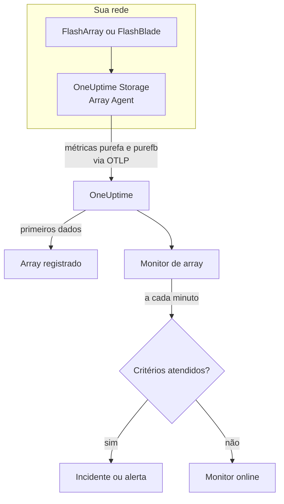

# Monitor de arrays de armazenamento

Um monitor de array de armazenamento observa um array de armazenamento e avisa você quando o array dispara um alerta próprio, fica sem espaço, fica lento, perde hardware ou um caminho de host, ou atrasa na replicação. Ele funciona com Pure Storage FlashArray, Pure Storage FlashBlade e NetApp ONTAP (incluindo o Amazon FSx for NetApp ONTAP), e lê as métricas que o OneUptime Storage Array Agent coleta: as séries `purefa_*` e `purefb_*` da Pure, e as séries `netapp_*` que o NetApp Harvest lê de um cluster ONTAP.

Também funciona com o Dell PowerStore (`dell.powerstore`), a partir das séries `powerstore_*` da Dell.

Também funciona com o Dell PowerScale (`dell.powerscale`), a partir das séries `powerscale_*` da Dell.

:::cards
- [Criar o monitor](#criar-um-monitor-de-array-de-armazenamento): Seis passos no painel.
- [Modelos](#modelos-de-alerta-prontos): Alertas prontos, um incidente por volume, host, appliance ou componente.
- [Como as séries da Pure funcionam](#como-as-séries-da-pure-são-montadas): Um nome de métrica, muitos valores. As do ONTAP [têm uma seção própria](#como-as-séries-do-ontap-são-montadas).
- [Métricas](#métricas-coletadas): Cada série sobre a qual o monitor pode alertar.
:::

## Como funciona

O OneUptime Storage Array Agent roda em uma máquina que alcança a interface de gerenciamento do array. Ele lê as métricas do array com um token de API somente leitura (as de um PowerScale via SNMP, com uma community somente leitura ou um usuário SNMPv3), rotula-as com o nome do array, `storage.array.name`, e a sua plataforma, `storage.system`, e as envia ao OneUptime via OTLP. Os primeiros dados registram o array.

Um Dell PowerMax (`dell.powermax`) não precisa de agente: uma sonda do OneUptime faz login no Unisphere for PowerMax com uma conta somente leitura a cada 5 minutos e envia do mesmo jeito cada array que ele gerencia, com o nome do seu Symmetrix ID até que você o renomeie ([Dell PowerMax](/docs/telemetry/storage-arrays#dell-powermax)).

Um monitor de array de armazenamento fica vinculado a um array. A cada minuto ele executa a sua consulta sobre as métricas desse array e compara o resultado com os seus critérios.



## Antes de começar

- **Instale o Storage Array Agent** onde ele alcance o array via HTTPS, com o token de API de um usuário que tenha o papel **readonly** do array. O [guia do Storage Array Agent](/docs/telemetry/storage-arrays) cobre o usuário, o token e a instalação, por meio de `ONEUPTIME_URL`, `ONEUPTIME_TELEMETRY_INGESTION_KEY`, `STORAGE_ARRAY_NAME`, e o endereço e o token do array (`PURE_FA_ENDPOINT` e `PURE_FA_API_TOKEN`, ou `PURE_FB_ENDPOINT` e `PURE_FB_API_TOKEN`), ou, no ONTAP, o endereço do cluster e um usuário REST somente leitura (`NETAPP_ONTAP_ENDPOINT`, `NETAPP_ONTAP_USERNAME` e `NETAPP_ONTAP_PASSWORD`).
- **Verifique se o array está registrado.** Ele aparece em **Produtos → Infraestrutura → Arrays de armazenamento → Todos os arrays de armazenamento**, com o nome do `STORAGE_ARRAY_NAME` do agente, cerca de um minuto depois da primeira leitura.
- **Para um Dell PowerMax**, conecte em vez disso o Unisphere for PowerMax que o gerencia em **Produtos → Infraestrutura → Arrays de armazenamento → Conexões**, como [Dell PowerMax](/docs/telemetry/storage-arrays#dell-powermax) explica.

## Criar um monitor de array de armazenamento

:::steps
### Começar um novo monitor

Vá em **Monitores** e clique em **Criar monitor**.

### Escolher Array de armazenamento

Em **Tipo de monitor**, clique em **Mais tipos de monitor** e escolha **Array de armazenamento** em **Infraestrutura**, ou digite `storage` na caixa de pesquisa. Informe um **Nome** - ele é usado nos títulos de incidentes e alertas - e clique em **Próximo**.

### Escolher o array

Em **Storage Array Monitor Configuration**, escolha o array em **Array de armazenamento**. Todo array que enviou dados está na lista. A sua plataforma decide quais métricas e modelos o formulário oferece. Depois da escolha, uma linha abaixo do campo diz se estão chegando dados. **Adicionar array de armazenamento** abre passos de configuração com as suas chaves já preenchidas, que esperam os primeiros dados.

### Escolher o que observar

Um monitor novo começa com **Array Stopped Reporting**, em **Sobre o que alertar**. Para vigiar outra coisa:

- **Alterar** - escolha outro [modelo](#modelos-de-alerta-prontos). Ele define a métrica, os filtros de rótulos, a agregação, o intervalo de tempo e os limites, e substitui os critérios abaixo pelos seus. Você ainda pode mudar o **Intervalo de tempo**.
- **Custom Metric** (em **Mais campos**) - escolha uma métrica em **Storage Array Metric** e depois defina **Agregação** e **Intervalo de tempo**. Os [filtros](#configurações-do-monitor) a restringem a um volume, host, pod, componente, sistema de arquivos ou bucket.
- **Avançado** (em **Mais campos**) - monte você mesmo consultas e fórmulas em **Selecionar Métricas**, por exemplo a capacidade usada como `purefa_array_space_bytes` filtrada para `space=capacity` menos a mesma métrica filtrada para `space=empty`. Use **Agrupar por** com o rótulo de um objeto para avaliar cada objeto separadamente.

### Conferir os critérios

Abra cada critério em **Critérios** e confira **Métrica**, **Agregação**, **Condição** e **Limite**. Um modelo os preenche. Com **Custom Metric** ou **Avançado**, o monitor começa com os [critérios padrão](#critérios-padrão), que só percebem uma métrica que não envia dados, então defina o seu próprio limite.

### Criar o monitor

Clique em **Criar monitor**. O OneUptime abre a página do monitor e o avalia a cada minuto. Os incidentes e alertas que ele dispara também aparecem nas páginas **Incidentes** e **Alertas** do array.
:::

> [!TIP]
> Para configurar vários modelos de uma vez, abra o array em **Produtos → Infraestrutura → Arrays de armazenamento** e vá em **Recomendações**. Escolha os modelos que quiser, decida quem é acionado, e o OneUptime cria um monitor por modelo.

## Configurações do monitor

| Campo | Aba | O que faz |
| --- | --- | --- |
| **Array de armazenamento** | Todas | Obrigatório. Restringe cada consulta a `resource.storage.array.name`, então dois arrays que têm um volume chamado `vol-01` nunca se misturam. |
| **Volume** | Custom Metric, Avançado | Um volume: em um FlashArray pelo rótulo `name`, como `vol-db-01` (um volume em um pod ou em um grupo de volumes se chama `pod::volume` ou `group/volume`); no ONTAP pelo rótulo `volume`, que dois SVMs podem compartilhar; em um PowerMax pelo rótulo `volume`, o seu ID de dispositivo, como `00847`. |
| **Host** | Custom Metric, Avançado | Só FlashArray. Um host como o array o conhece, pelo rótulo `host`, como `esxi-01`. |
| **Pod** | Custom Metric, Avançado | Só FlashArray. Um pod do ActiveCluster ou do ActiveDR, pelo rótulo `name`, ou `local_pod` nas séries de links de réplica. |
| **Componente de hardware** | Custom Metric, Avançado | Um componente de hardware, como `CH0.BAY1` ou `CT0`: o rótulo `component_name` em um FlashArray, `name` em um FlashBlade, no ONTAP o rótulo pelo qual a série o identifica (`node`, `disk`, `shelf` ou `port`), e `component` em um PowerMax, um diretor como `FA-1D` ou uma porta como `FA-1D:4`. Em um PowerScale, um nó pelo rótulo `node`, como `ps-prod-2`. |
| **Sistema de arquivos** | Custom Metric, Avançado | FlashBlade e PowerScale. Um sistema de arquivos pelo rótulo `name` em um FlashBlade; uma cota pelo rótulo `quota` em um PowerScale, como `/ifs/data/home`. |
| **Bucket** | Custom Metric, Avançado | Só FlashBlade. Um bucket de armazenamento de objetos, pelo rótulo `name`. |
| **Storage Array Metric** | Custom Metric | Uma métrica do [catálogo](#métricas-coletadas). O formulário adiciona o filtro de rótulo que lhe dá significado, e a agrupa pelo objeto que ela descreve, então cada volume, host ou componente é avaliado separadamente. |
| **Agregação** | Custom Metric | Como as amostras são combinadas: **Média**, **Máximo**, **Mínimo**, **Soma** ou **Contagem**. Começa na agregação usual da métrica. |
| **Intervalo de tempo** | Todas | A janela móvel que a consulta lê, de **Past 1 Minute** a **Past 365 Days**. Um monitor novo começa em **Últimos 5 minutos**; uma métrica personalizada de um sistema de arquivos ou de um bucket, em **Últimos 15 minutos**; os modelos definem a sua. |
| **Selecionar Métricas** | Avançado | O construtor de consultas: **Métrica**, **Agregar por**, **Filtrar por atributos**, **Agrupar por**, além de **Adicionar métrica** e **Adicionar fórmula** para combinar consultas. |

O agente lê o endpoint do array a cada 60 segundos, e volumes, hosts e pods a cada 2 minutos, então uma janela de 5 minutos sempre tem uma amostra. Ele lê os sistemas de arquivos e os buckets de um FlashBlade a cada 5 minutos, daí os 15, e os diretórios do FlashArray a cada 30 minutos: dê a um monitor de diretório uma janela de 60 minutos. No ONTAP, o Harvest lê o desempenho do cluster a cada minuto e a configuração, o estado e os eventos EMS a cada 3 minutos, então uma janela de 5 minutos sempre tem uma amostra. Ele consulta um cluster PowerScale e cada um dos seus nós a cada 60 segundos, e as suas cotas a cada 5 minutos: dê a um monitor de cota uma janela de 15 minutos.

Ele lê um PowerStore a cada 5 minutos, e o estado do seu cluster a cada 60 segundos: dê a um monitor de PowerStore uma janela de 15 minutos.

## Como as séries da Pure são montadas

A Pure coloca vários valores em **um único** nome de métrica e os diferencia com um rótulo:

- **`dimension`** nas séries de desempenho. `purefa_array_performance_latency_usec` traz a latência de leitura (`usec_per_read_op`), a latência de escrita (`usec_per_write_op`), a latência de escrita espelhada, e o tempo de SAN, de fila, de QoS e de serviço de cada uma. Sempre filtre por uma única `dimension`: uma média entre todas mistura uma latência de leitura de 200 µs com um valor de fila.
- **`space`** nas séries de capacidade: `capacity`, `empty`, `snapshots`, `total_provisioned`, `total_physical`, `available_ratio` e outras.

Várias séries trazem o seu estado em um **rótulo**, com um valor que é sempre 1:

| Série | Rótulo de estado | Uma série por |
| --- | --- | --- |
| `purefa_alerts_open` | `severity`, com `summary`, `code` e `component_type` | Alerta aberto |
| `purefa_hw_component_status` | `component_status` | Componente de hardware |
| `purefa_host_connectivity_info` | `status`, com `details` | Host |
| `purefa_drive_capacity_bytes` | `component_status` (o valor é a capacidade do disco) | Disco |

Uma série filtrada para um estado ruim só existe enquanto algo está nesse estado, então nenhuma série significa que está tudo bem. É por isso que **Max acima de 0 dispara e 0 recupera** é a forma certa para elas, e é assim que os modelos são montados: os seus critérios de recuperação contam uma série ausente como zero. Quando não resta nenhuma série, um modelo assim só recupera se `purefa_info`, `purefb_info` ou `powermax_array_info` tiver chegado na mesma janela, então um array que parou de reportar não fecha nada.

As séries de um PowerMax têm um único número cada, e o nome diz qual: `powermax_array_response_time_usec` separa leituras de escritas com `operation`. As suas séries de estado só existem, do mesmo jeito, enquanto algo está errado: `powermax_alert_open` enquanto o Unisphere tem um alerta aberto, `powermax_director_offline` enquanto um diretor não está online, `powermax_port_offline` enquanto uma porta da qual alguém depende está fora do ar, e `powermax_srdf_group_not_healthy` enquanto um grupo SRDF está suspenso ou offline.

Nos filtros do monitor e nas chaves de agrupamento, os atributos do agente começam com `resource.` (`resource.storage.array.name`, `resource.storage.system`), enquanto os rótulos da própria Pure não (`name`, `host`, `component_name`, `dimension`, `space`, `severity`), nem os do PowerMax (`storage_group`, `volume`, `director`, `port_id`, `srdf_group`) nem os do PowerScale (`node`, `quota`, `drive`, `protocol`).

## Como as séries do PowerStore são formadas

O exportador da Dell escreve um valor por nome de métrica, então uma série do PowerStore não precisa de filtro de rótulos. Os seus rótulos nomeiam o objeto: `appliance_id` um appliance, `name` uma peça, um volume ou um sistema de arquivos, e `volume_id`, `fc_port_id`, `eth_port_id`, `nas_id` ou `volume_group_id` o objeto de uma série de desempenho. As suas séries de estado valem 1 enquanto tudo está bem e 0 caso contrário, então os modelos disparam abaixo de 1. Os seus próprios alertas chegam por syslog, e os seus modelos, monitores de registros, estão listados depois da sua tabela abaixo.

## Como as séries do ONTAP são montadas

O NetApp Harvest dá a cada série o nome `netapp_<object>_<counter>` e identifica o objeto pelos rótulos: um volume por `volume` dentro do seu `svm`, um agregado por `aggr`, um LUN por `lun` dentro do seu `volume` e `svm`, um nó por `node`, um disco por `disk`, uma gaveta por `shelf`, um relacionamento SnapMirror por `destination_location`. As latências são microssegundos por operação, `_ops` são operações por segundo e `_data`, bytes por segundo.

Os estados do ONTAP chegam de três formas:

| Série | Estado | Uma série por |
| --- | --- | --- |
| `netapp_*_new_status` | 1 íntegro, online, operacional ou em execução, 0 se não | Objeto, a cada consulta |
| `netapp_health_*_alerts` | Valor 1, com `severity` (`error` ou `warning`) e o motivo nos rótulos | Problema aberto: um disco quebrado, uma falha de gaveta, um nó que não consegue assumir o parceiro, uma porta inoperante, um alerta de integridade do sistema |
| `netapp_ems_events` | Valor 1, com `message`, `severity` e os parâmetros do evento | Evento EMS, na única consulta que o coletou; quando um evento em par é resolvido, ele é exportado mais uma vez como 0 |

Um estado em forma de número dispara quando todas as leituras da janela estão abaixo de 1, e se recupera quando uma leitura volta a ser 1. Um problema aberto dispara enquanto a série dele existe e se recupera quando ela some, desde que `netapp_cluster_new_status` continue chegando, então um agente parado não fecha nada. Um evento EMS dispara com a sua única leitura e fica aberto enquanto está dentro da hora do modelo; ele se recupera quando passa uma hora sem outro.

## Modelos de alerta prontos

O OneUptime traz 93 modelos — 12 para FlashArray, 8 para FlashBlade, 16 para PowerStore, 31 para ONTAP, 13 para PowerMax e 13 para PowerScale — e a lista de **Sobre o que alertar** oferece os da plataforma do array. Cada um monta um monitor completo: a consulta da métrica, os seus filtros de rótulos, um agrupamento pelo rótulo do próprio objeto, um critério que dispara e outro que recupera. Os limites são pontos de partida que você pode editar.

Um critério só dispara quando a condição vale para **cada** valor da sua janela, exceto no caso de um modelo EMS do ONTAP: o Harvest exporta um evento durante uma única consulta, então basta uma leitura. Um monitor que disparou por um limite de capacidade, latência, atraso ou proporção só se recupera 10 % além dele, então um valor que oscila em torno do limite não fica alternando. Os modelos de alertas, hardware e conectividade disparam quando um estado aparece durante toda a sua janela de 5 minutos, e se recuperam cerca de 5 minutos depois que ele desaparece.

### FlashArray

| Modelo                         | Categoria    | Gravidade | Observa                                                                                         | Dispara quando                                                                                                                                   |
| ------------------------------ | ------------ | --------- | ----------------------------------------------------------------------------------------------- | ------------------------------------------------------------------------------------------------------------------------------------------------ |
| Array Stopped Reporting        | Disponibilidade | Crítico   | `purefa_info`, Count, últimos 10 minutos                                                        | Nenhum dado durante toda a janela — o Storage Array Agent parou, perdeu a rota até o OneUptime ou teve o token revogado, ou o array parou de responder a ele; recupera quando os dados voltam a chegar |
| Critical Array Alert           | Saúde do array | Crítico   | `purefa_alerts_open` filtrada para `severity=critical`, Max por `summary`, últimos 5 minutos    | > 0 — o array tem um alerta crítico aberto (um componente com falha, uma emergência de capacidade, uma falha de replicação). Um incidente por alerta; recupera quando o alerta fecha |
| Warning Array Alert            | Saúde do array | Aviso   | `purefa_alerts_open` filtrada para `severity=warning`, Max por `summary`, últimos 5 minutos     | > 0 — o array tem um alerta de nível warning aberto. Um incidente por alerta; recupera quando o alerta fecha                                    |
| Capacity Above 80%             | Capacidade   | Aviso   | `purefa_array_space_utilization`, Max, últimos 15 minutos                                       | > 80 — o primeiro limite de capacidade da própria Pure; recupera em ≤ 72                                                                         |
| Capacity Above 90%             | Capacidade   | Crítico   | `purefa_array_space_utilization`, Max, últimos 5 minutos                                        | > 90 — o array está perto de recusar escritas; recupera em ≤ 81                                                                                  |
| High Read Latency              | Desempenho   | Aviso   | `purefa_array_performance_latency_usec` filtrada para `dimension=usec_per_read_op`, Avg, últimos 10 minutos  | > 5000 µs (5 ms) — as leituras de um FlashArray normalmente terminam bem abaixo de 1 ms; recupera em ≤ 4500                          |
| High Write Latency             | Desempenho   | Aviso   | `purefa_array_performance_latency_usec` filtrada para `dimension=usec_per_write_op`, Avg, últimos 10 minutos | > 5000 µs (5 ms); recupera em ≤ 4500                                                                                                 |
| Hardware Component Failed      | Hardware     | Crítico   | `purefa_hw_component_status` filtrada para `component_status=critical`, Max por `component_name`, últimos 5 minutos | > 0 — um controlador, uma fonte de alimentação, um ventilador, uma baia ou uma porta está crítico e a redundância acabou. Um incidente por componente; recupera quando informar ok |
| Hardware Component Degraded    | Hardware     | Aviso   | `purefa_hw_component_status` filtrada para `component_status=degraded`, Max por `component_name`, últimos 5 minutos | > 0 — um componente está degradado. Um incidente por componente; recupera quando informar ok                                   |
| Drive Failed                   | Hardware     | Crítico   | `purefa_drive_capacity_bytes` filtrada para `component_status=failed`, Max por `component_name`, últimos 5 minutos | > 0 — um módulo DirectFlash ou um SSD falhou e o array reconstrói nos outros. Um incidente por disco; recupera quando for substituído |
| Host Lost Redundant Paths      | Hosts        | Aviso   | `purefa_host_connectivity_info` filtrada para `status=critical`, Max por `host`, últimos 5 minutos | > 0 — o host alcança o array por um controlador ou por nenhum; um failover de controlador deixaria o seu armazenamento offline. Um incidente por host; recupera quando os seus caminhos voltarem |
| Replication Lag Above 1 Minute | Replicação  | Aviso   | `purefa_pod_replica_links_lag_max_msec`, Max por `local_pod`, últimos 10 minutos                | > 60000 ms (60 s) — um failover agora perderia mais escritas recentes do que o planejado. Um incidente por pod; recupera em ≤ 54000               |

### FlashBlade

| Modelo                       | Categoria    | Gravidade | Observa                                                                                                        | Dispara quando                                                                                                      |
| ---------------------------- | ------------ | --------- | -------------------------------------------------------------------------------------------------------------- | ------------------------------------------------------------------------------------------------------------------- |
| Array Stopped Reporting      | Disponibilidade | Crítico   | `purefb_info`, Count, últimos 10 minutos                                                                       | Nenhum dado durante toda a janela — o agente, o exporter dele ou o FlashBlade parou de responder; recupera quando os dados voltam a chegar |
| Critical Array Alert         | Saúde do array | Crítico   | `purefb_alerts_open` filtrada para `severity=critical`, Max por `summary`, últimos 5 minutos                   | > 0 — o FlashBlade tem um alerta crítico aberto. Um incidente por alerta; recupera quando o alerta fecha            |
| Warning Array Alert          | Saúde do array | Aviso   | `purefb_alerts_open` filtrada para `severity=warning`, Max por `summary`, últimos 5 minutos                    | > 0 — o FlashBlade tem um alerta de nível warning aberto. Um incidente por alerta; recupera quando o alerta fecha   |
| Capacity Above 80%           | Capacidade   | Aviso   | `purefb_array_space_utilization` filtrada para `type=array`, Max, últimos 15 minutos                           | > 80; recupera em ≤ 72                                                                                              |
| Capacity Above 90%           | Capacidade   | Crítico   | `purefb_array_space_utilization` filtrada para `type=array`, Max, últimos 5 minutos                            | > 90 — as escritas falham para todo cliente quando ele enche; recupera em ≤ 81                                      |
| Hardware Component Unhealthy | Hardware     | Crítico   | `purefb_hardware_health`, Min por `name`, últimos 5 minutos                                                    | < 1 — um blade, um módulo de fabric, uma fonte de alimentação ou um ventilador não está saudável (um slot sem uso informa 2). Um incidente por componente; recupera em ≥ 1 |
| High Read Latency            | Desempenho   | Aviso   | `purefb_array_performance_latency_usec` filtrada para `dimension=usec_per_read_op` e `protocol=all`, Avg, últimos 10 minutos | > 10000 µs (10 ms) em todos os protocolos; recupera em ≤ 9000                                         |
| File System Near Full        | Sistemas de arquivos | Aviso   | `purefb_file_systems_space_bytes` filtrada para `space=available_ratio`, Min por `name`, últimos 15 minutos    | < 0.1 — resta menos de 10 % do tamanho provisionado de um sistema de arquivos. Um incidente por sistema de arquivos; recupera em ≥ 0.11 |

### PowerStore

| Modelo                       | Categoria    | Gravidade | Observa                                                                                                        | Dispara quando                                                                                                      |
| --- | --- | --- | --- | --- |
| Array Stopped Reporting | Disponibilidade | Crítico | `powerstore_cluster`, Count, últimos 10 minutos | Nenhum dado durante toda a janela — o agente, o exportador da Dell ou o cluster parou de responder; recupera quando os dados voltam a chegar |
| Capacity Above 80% | Capacidade | Aviso | `powerstore_cap_physical_used_percent`, Max por `appliance_id`, últimos 15 minutos | > 80 — a capacidade de um appliance está enchendo; recupera em ≤ 72 |
| Capacity Above 90% | Capacidade | Crítico | `powerstore_cap_physical_used_percent`, Max por `appliance_id`, últimos 15 minutos | > 90 — um appliance está perto de recusar gravações; recupera em ≤ 81 |
| High Read Latency | Desempenho | Aviso | `powerstore_perf_avg_read_latency`, Avg por `appliance_id`, últimos 15 minutos | > 5000 µs (5 ms); recupera em ≤ 4500 |
| High Write Latency | Desempenho | Aviso | `powerstore_perf_avg_write_latency`, Avg por `appliance_id`, últimos 15 minutos | > 5000 µs (5 ms); recupera em ≤ 4500 |
| Drive Failed | Hardware | Crítico | `powerstore_hardware_Drive_state`, Min por `name`, últimos 10 minutos | < 1 — uma unidade falhou ou foi removida; recupera em ≥ 1 |
| Node Unhealthy | Hardware | Crítico | `powerstore_hardware_node_state`, Min por `name`, últimos 10 minutos | < 1 — um nó não está Healthy; recupera em ≥ 1 |
| Power Supply Unhealthy | Hardware | Aviso | `powerstore_hardware_Power_Supply_state`, Min por `name`, últimos 10 minutos | < 1 — uma fonte de alimentação falhou ou perdeu energia; recupera em ≥ 1 |
| Fan Unhealthy | Hardware | Aviso | `powerstore_hardware_Fan_state`, Min por `name`, últimos 10 minutos | < 1 — um ventilador falhou; recupera em ≥ 1 |
| Battery Unhealthy | Hardware | Aviso | `powerstore_hardware_Battery_state`, Min por `name`, últimos 10 minutos | < 1 — um módulo de bateria de backup falhou; recupera em ≥ 1 |
| Drive Wearing Out | Hardware | Aviso | `powerstore_wear_metrics_by_drive`, Min por `name`, últimos 15 minutos | < 10 — resta a uma unidade menos de 10% da sua resistência; recupera em ≥ 11 |
| NAS Server Not Started | Sistemas de arquivos | Aviso | `powerstore_nas_server_operational_status`, Max por `name`, últimos 10 minutos | < 1 — um servidor NAS está parado ou degradado; recupera em ≥ 1 |
| Volume Not Ready | Saúde do array | Aviso | `powerstore_volume_state`, Max por `name`, últimos 15 minutos | < 1 — um volume está offline; recupera em ≥ 1 |
| File System Near Full | Sistemas de arquivos | Aviso | `powerstore_filesystem_logical_used_percent`, Max por `name`, últimos 15 minutos | > 90 — um sistema de arquivos está quase cheio; recupera em ≤ 81 |
| Cluster Not Configured | Saúde do array | Aviso | `powerstore_cluster`, Max, últimos 10 minutos | < 1 — o cluster não está Configured; recupera em ≥ 1 |
| Metro Witness Not Connected | Replicação | Aviso | `powerstore_metro_witness_status`, Min por `name`, últimos 10 minutos | > 0 — uma testemunha Metro não está conectada; recupera quando volta a estar OK |

### Alertas do PowerStore, por syslog

Os próprios alertas de um PowerStore chegam como registros, então os seus modelos são monitores de **Registros**, oferecidos na página **Recomendações** do array em **Alertas do array**. Cada um abre um alerta por alerta do PowerStore, agrupado por `powerstore.resource.name` e `powerstore.alert.id`, e o resolve quando o PowerStore limpa esse alerta:

| Modelo | Severidade | Abre numa linha com | Resolve-se com |
| --- | --- | --- | --- |
| Critical Array Alert | Crítico | `powerstore.alert.severity=Critical` | `powerstore.alert.state=Cleared` |
| Major Array Alert | Aviso | `powerstore.alert.severity=Major` | `powerstore.alert.state=Cleared` |
| Port Link Down | Aviso | `powerstore.event.code=0x00307404` | `powerstore.alert.state=Cleared` |

### ONTAP

| Modelo | Categoria | Gravidade | Observa | Dispara quando |
| --- | --- | --- | --- | --- |
| Array Stopped Reporting | Disponibilidade | Crítico | `netapp_cluster_new_status`, Count, últimos 10 minutos | Nenhum dado durante toda a janela — o agente ou o Harvest parou, ou o cluster parou de responder ao Harvest; recupera quando os dados voltam a chegar |
| Cluster Not Healthy | Saúde do array | Aviso | `netapp_cluster_new_status`, Max, últimos 10 minutos | < 1 — o ONTAP informa que o cluster não está íntegro; recupera em ≥ 1 |
| System Health Alert | Saúde do array | Aviso | `netapp_health_support_alerts`, Max por `name`, últimos 5 minutos | > 0 — o monitor de integridade do sistema do ONTAP gerou um alerta (um caminho ausente até uma gaveta, um problema de conectividade de um nó). Um incidente por alerta; recupera quando o ONTAP o resolve |
| Emergency EMS Event | Saúde do array | Crítico | `netapp_ems_events` filtrada para `severity=emergency`, Max por `message`, janela de 1 hora, qualquer leitura | > 0 — o ONTAP registrou um evento de emergência. Um incidente por evento; recupera quando passa uma hora sem outro |
| Alert EMS Event | Saúde do array | Crítico | `netapp_ems_events` filtrada para `severity=alert`, Max por `message`, janela de 1 hora, qualquer leitura | > 0 — o ONTAP registrou um evento de alerta (um ventilador falhou); recupera quando passa uma hora sem outro |
| Disk Out of Service | Hardware | Aviso | `netapp_ems_events` filtrada para `message=disk.outOfService`, Max por `disk`, janela de 1 hora, qualquer leitura | > 0 — o ONTAP tirou um disco de serviço; recupera quando passa uma hora sem outro |
| Node Panic | Hardware | Crítico | `netapp_ems_events` filtrada para `message=sk.panic`, Max por `node`, janela de 1 hora, qualquer leitura | > 0 — um nó entrou em pânico e reiniciou, e o parceiro assumiu o armazenamento dele; recupera quando passa uma hora sem outro |
| Aggregate Above 80% | Capacidade | Aviso | `netapp_aggr_space_used_percent`, Max por `aggr`, últimos 15 minutos | > 80; recupera em ≤ 72 |
| Aggregate Above 90% | Capacidade | Crítico | `netapp_aggr_space_used_percent`, Max por `aggr`, últimos 5 minutos | > 90 — os volumes nele não podem mais crescer; recupera em ≤ 81 |
| Volume Above 90% | Capacidade | Aviso | `netapp_volume_size_used_percent`, Max por `volume` e `svm`, últimos 15 minutos | > 90; recupera em ≤ 81 |
| Volume Above 98% | Capacidade | Crítico | `netapp_volume_size_used_percent`, Max por `volume` e `svm`, últimos 5 minutos | > 98 — os clientes recebem erros de falta de espaço, e um LUN nele pode ficar offline; recupera em ≤ 88.2 |
| High Read Latency | Desempenho | Aviso | `netapp_cluster_read_latency`, Avg, últimos 15 minutos | > 10000 µs (10 ms); recupera em ≤ 9000 |
| High Write Latency | Desempenho | Aviso | `netapp_cluster_write_latency`, Avg, últimos 15 minutos | > 10000 µs (10 ms); recupera em ≤ 9000 |
| Volume Latency Above 20 ms | Desempenho | Aviso | `netapp_volume_read_latency`, Avg por `volume` e `svm`, últimos 15 minutos | > 20000 µs; recupera em ≤ 18000 |
| Node Not Healthy | Hardware | Crítico | `netapp_node_new_status`, Max por `node`, últimos 10 minutos | < 1 — o ONTAP informa que o nó não está íntegro; recupera em ≥ 1 |
| Takeover Not Possible | Hardware | Crítico | `netapp_health_ha_alerts`, Max por `node`, últimos 5 minutos | > 0 — um nó não consegue assumir o parceiro de HA, então uma falha deixaria offline o armazenamento desse parceiro; recupera quando ele voltar a conseguir |
| Disk Failed | Hardware | Crítico | `netapp_health_disk_alerts` filtrada para `container_type=broken`, Max por `disk`, últimos 5 minutos | > 0 — um disco está quebrado; recupera quando ele for substituído |
| Shelf Fault | Hardware | Crítico | `netapp_health_shelf_alerts` filtrada para `severity=error`, Max por `shelf`, últimos 5 minutos | > 0 — o ONTAP informa um erro em uma gaveta de discos (uma fonte de alimentação, um módulo, um caminho); recupera quando o ONTAP o resolve |
| Node Fan Failed | Hardware | Aviso | `netapp_node_failed_fan`, Max por `node`, últimos 10 minutos | > 0 ventiladores com falha; recupera em ≤ 0 |
| Node Power Supply Failed | Hardware | Crítico | `netapp_node_failed_power`, Max por `node`, últimos 10 minutos | > 0 fontes de alimentação com falha; recupera em ≤ 0 |
| Shelf Power Supply Failed | Hardware | Crítico | `netapp_shelf_psu_status`, Max por `shelf`, últimos 10 minutos | < 1 — a fonte de alimentação de uma gaveta não está normal; recupera em ≥ 1 |
| Shelf Fan Failed | Hardware | Aviso | `netapp_shelf_fan_status`, Max por `shelf`, últimos 10 minutos | < 1 — o ventilador de uma gaveta não está normal; recupera em ≥ 1 |
| Ethernet Port Down | Hardware | Aviso | `netapp_health_network_ethernet_port_alerts`, Max por `port` e `node`, últimos 5 minutos | > 0 — uma porta Ethernet habilitada está inoperante; recupera quando o link dela volta a ficar ativo |
| FC Port Link Failures | Hardware | Aviso | `netapp_fcp_link_failure`, Max por `port` e `node`, últimos 15 minutos | > 0 — o link de uma porta Fibre Channel falhou na janela; recupera em ≤ 0 |
| SnapMirror Behind Schedule | Replicação | Aviso | `netapp_snapmirror_lag_time` sobre `netapp_snapmirror_schedule_seconds`, Max por `destination_location`, últimos 15 minutos | > 1.5 — um relacionamento está mais de um intervalo e meio do agendamento atrasado (com um agendamento horário, 90 minutos); recupera em ≤ 1.35 |
| SnapMirror Relationship Unhealthy | Replicação | Crítico | `netapp_snapmirror_labels` filtrada para `healthy=false`, Max por `destination_location`, últimos 5 minutos | > 0 — o ONTAP informa que o relacionamento não está íntegro, com o motivo no rótulo `unhealthy_reason`; recupera quando o ONTAP o informa como íntegro |
| SnapMirror Lag Above 1 Day | Replicação | Aviso | `netapp_snapmirror_lag_time`, Max por `destination_location`, últimos 15 minutos | > 86400 s, seja qual for o agendamento; recupera em ≤ 77760 |
| Aggregate Offline | Disponibilidade | Crítico | `netapp_aggr_new_status`, Max por `aggr`, últimos 10 minutos | < 1 — um agregado não está online, então nenhum dos volumes dele pode ser alcançado; recupera em ≥ 1 |
| Volume Offline | Disponibilidade | Aviso | `netapp_volume_new_status`, Max por `volume` e `svm`, últimos 10 minutos | < 1 — um volume não está online; recupera em ≥ 1 |
| LUN Offline | Disponibilidade | Crítico | `netapp_lun_new_status`, Max por `lun`, `volume` e `svm`, últimos 10 minutos | < 1 — um LUN não está online, e os hosts dele perderam o disco; recupera em ≥ 1 |
| SVM Stopped | Disponibilidade | Aviso | `netapp_svm_labels` filtrada para `state=stopped` e `type=data`, Max por `svm`, últimos 10 minutos | > 0 — um SVM de dados está parado; recupera quando volta a funcionar. Os SVMs que o ONTAP mantém para si nunca são observados |

### PowerMax

| Modelo | Categoria | Gravidade | Observa | Dispara quando |
| --- | --- | --- | --- | --- |
| Array Stopped Reporting | Disponibilidade | Crítico | `powermax_array_info`, Count, últimos 10 minutos | Nenhum dado durante toda a janela — a sonda parou de coletar o array: a conexão dele falha (a página dela em **Conexões** diz por quê), a sonda está desconectada, ou o Unisphere não gerencia mais o array; recupera quando os dados voltam a chegar |
| Critical Unisphere Alert | Saúde do array | Crítico | `powermax_alert_open` filtrada para `severity=critical`, Max por `description`, últimos 10 minutos | > 0 — o Unisphere tem um alerta aberto de severidade Critical ou Fatal para o array. Um incidente por alerta; recupera quando o alerta é confirmado ou limpo no Unisphere |
| Warning Unisphere Alert | Saúde do array | Aviso | `powermax_alert_open` filtrada para `severity=warning`, Max por `description`, últimos 10 minutos | > 0 — o Unisphere tem um alerta aberto de severidade Warning ou Minor. Um incidente por alerta; recupera quando o alerta é confirmado ou limpo |
| Performance Collection Off | Saúde do array | Aviso | `powermax_array_performance_collection`, Min, últimos 15 minutos | < 1 — o Unisphere não coleta o desempenho de 5 minutos do array, então nenhum tempo de resposta, IOPS ou vazão vira gráfico ou alerta; recupera em ≥ 1 |
| Storage Resource Pool Above 80% | Capacidade | Aviso | `powermax_srp_capacity_used_percent`, Max por `srp`, últimos 15 minutos | > 80 — os grupos de armazenamento do pool deixam de aceitar novas escritas quando ele enche. Um incidente por pool; recupera em ≤ 72 |
| Storage Resource Pool Above 90% | Capacidade | Crítico | `powermax_srp_capacity_used_percent`, Max por `srp`, últimos 15 minutos | > 90 — as escritas nos seus grupos de armazenamento falham assim que ele fica cheio. Um incidente por pool; recupera em ≤ 81 |
| Storage Group Response Time Above 5 ms | Desempenho | Aviso | `powermax_storage_group_response_time_usec`, Avg por `storage_group`, últimos 15 minutos | > 5000 µs (5 ms) — um PowerMax normalmente responde bem abaixo de um milissegundo. Um incidente por grupo de armazenamento; recupera em ≤ 4500 |
| High Read Response Time | Desempenho | Aviso | `powermax_array_response_time_usec` filtrada para `operation=read`, Avg, últimos 15 minutos | > 3000 µs (3 ms); recupera em ≤ 2700 |
| High Write Response Time | Desempenho | Aviso | `powermax_array_response_time_usec` filtrada para `operation=write`, Avg, últimos 15 minutos | > 3000 µs (3 ms) — o SRDF síncrono acrescenta a cada escrita a ida e volta até o array remoto; recupera em ≤ 2700 |
| Director Not Online | Hardware | Crítico | `powermax_director_offline`, Max por `component`, últimos 10 minutos | > 0 — um diretor não está online, e o array funciona com os demais. Um incidente por diretor; recupera quando ele volta a ficar online |
| Port Down | Hardware | Aviso | `powermax_port_offline`, Max por `component`, últimos 10 minutos | > 0 — uma porta em um port group, uma masking view ou um grupo SRDF não está ativa. Um incidente por porta; recupera quando ela volta a ficar ativa |
| SRDF Group Suspended or Offline | Replicação | Crítico | `powermax_srdf_group_not_healthy`, Max por `srdf_group`, últimos 10 minutos | > 0 — o link do grupo está offline ou os seus pares estão suspensos, divididos ou em failover, então a cópia remota não fica atualizada. Um incidente por grupo; recupera quando ele volta a ficar sincronizado |
| SRDF/A Lag Above 2 Minutes | Replicação | Aviso | `powermax_srdf_group_lag_seconds`, Avg por `srdf_group`, últimos 15 minutos | > 120 (2 minutos) — um failover agora perderia mais escritas recentes do que o planejado. Um incidente por grupo; recupera em ≤ 108 |

### PowerScale

| Modelo | Categoria | Gravidade | Observa | Dispara quando |
| --- | --- | --- | --- | --- |
| Array Stopped Reporting | Disponibilidade | Crítico | `powerscale_cluster_health`, Count, últimos 10 minutos | Nenhum dado durante toda a janela — o Storage Array Agent parou, perdeu a rota até o OneUptime ou teve o token revogado, ou o cluster parou de responder às consultas dele; recupera quando os dados voltam a chegar |
| Cluster Needs Attention | Saúde do array | Aviso | `powerscale_cluster_health`, Max, últimos 5 minutos | > 0 — o OneFS informa que o cluster precisa de atenção, está fora do ar ou é inválido, e `isi event groups list` diz o motivo; recupera em ≤ 0 |
| Cluster Down | Saúde do array | Crítico | `powerscale_cluster_health`, Max, últimos 5 minutos | ≥ 2 — o OneFS informa que o cluster está fora do ar ou é inválido; recupera em < 2 |
| Node Offline | Hardware | Crítico | `powerscale_cluster_offline_nodes`, Max, últimos 5 minutos | > 0 — um nó do cluster está offline, e `offline_nodes` diz qual; recupera em ≤ 0 |
| Node Needs Attention | Hardware | Aviso | `powerscale_node_health`, Max por `node`, últimos 5 minutos | > 0 — um nó informa que precisa de atenção, está fora do ar ou é inválido. Um incidente por nó; recupera em ≤ 0 |
| Node Read-Only | Hardware | Aviso | `powerscale_node_read_only`, Max por `node`, últimos 5 minutos | > 0 — um nó está em modo somente leitura, e os clientes conectados a ele não podem gravar. Um incidente por nó; recupera em ≤ 0 |
| Drive Failed | Hardware | Crítico | `powerscale_drive_size_bytes` filtrada para `status=DEAD`, Count por `drive`, últimos 5 minutos | > 0 — um disco morreu, e o OneFS volta a proteger os dados dele nos outros. Um incidente por disco; recupera quando ele informar outro status |
| Drive Smartfailed | Hardware | Aviso | `powerscale_drive_size_bytes` filtrada para `status=SMARTFAIL`, Count por `drive`, últimos 5 minutos | > 0 — o OneFS está tirando os dados de um disco que está falhando antes que ele seja substituído. Um incidente por disco; recupera quando ele informar outro status |
| Capacity Above 80% | Capacidade | Aviso | `powerscale_ifs_used_percent`, Max, últimos 15 minutos | > 80, contando o espaço reservado para os virtual hot spares; recupera em ≤ 72 |
| Capacity Above 90% | Capacidade | Crítico | `powerscale_ifs_used_percent`, Max, últimos 5 minutos | > 90 — o cluster está perto de recusar escritas; recupera em ≤ 81 |
| Quota Near Its Limit | Capacidade | Aviso | `powerscale_quota_used_percent`, Max por `quota`, últimos 15 minutos | > 90 do seu limite rígido, ou do seu limite flexível quando ela não tem um. Um incidente por cota; recupera em ≤ 81 |
| Quota Full | Capacidade | Crítico | `powerscale_quota_used_percent`, Max por `quota`, últimos 5 minutos | ≥ 100 — as escritas sob o caminho da cota falham em um limite rígido. Um incidente por cota; recupera em < 90 |
| High Protocol Latency | Desempenho | Aviso | `powerscale_protocol_latency_microseconds`, Max por `protocol`, últimos 10 minutos | > 20000 µs (20 ms) no nó mais lento. Um incidente por protocolo; recupera em ≤ 18000 |

**Gravidade** é o rótulo que o seletor mostra. O incidente e o alerta que um modelo cria começam na gravidade de incidente e de alerta mais alta do seu projeto; altere-as no critério.

- **Array Stopped Reporting** conta a série de identidade da plataforma (`purefa_info` ou `purefb_info`, que cada endpoint lido pelo agente exporta em toda leitura, ou `powermax_array_info`, que toda coleta do PowerMax grava); a de um PowerScale é `powerscale_cluster_health`, que a consulta do agente ao cluster envia a cada minuto. Quando os dados param, os outros modelos não têm nada para comparar e mantêm o último status, então é este que avisa você.
- **Alertas abertos e estados de hardware usam Max** de uma série que só existe enquanto o alerta está aberto ou o componente está nesse estado, então o estado ultrapassa o limite quando aparece durante toda a janela de 5 minutos.
- **Todo modelo por objeto agrupa pelo rótulo do próprio objeto** (`summary`, `component_name`, `host`, `local_pod`, `name` e, em um PowerMax, `description`, `component`, `srp`, `srdf_group` e `storage_group`, e os de um PowerScale: `node`, `drive`, `quota` e `protocol`), então um incidente dispara por objeto afetado, e o incidente o nomeia.
- **Os modelos de latência usam Avg** da média por operação calculada pelo próprio array, e os de capacidade **Máx.** do seu próprio percentual de utilização. As latências ficam fixadas em microssegundos e a capacidade em percentual.
- **Hardware Component Unhealthy usa Min** por componente: a sua saúde é 1 quando está saudável e cai para 0 quando não está.

Não há modelo do FlashArray para a latência de cada volume, porque o limite certo depende da carga de trabalho: monte-o a partir do catálogo com um agrupamento por `name`. A previsão de capacidade precisa de uma tendência de crescimento mais do que de um limite, e o desgaste dos discos não tem série sobre a qual alertar.

## Métricas coletadas

O agente envia tudo o que o array exporta, e uma sonda tudo o que lê de um PowerMax, nas mesmas unidades (os milissegundos do Unisphere como microssegundos, os seus MB por segundo como bytes por segundo); as séries abaixo são o catálogo que o formulário do monitor oferece. Cada valor é um gauge que o próprio array calcula - as latências são microssegundos por operação e a vazão é por segundo -, então não é preciso calcular taxas. **Filtro** é o filtro de rótulo que dá à série o significado que a sua linha indica; o formulário o aplica para você.

### Saúde do array

| Métrica              | Filtro | Plataforma | Unidade | Descrição                                                                                                                                                         |
| -------------------- | ------ | ---------- | ------- | ----------------------------------------------------------------------------------------------------------------------------------------------------------------- |
| `purefa_alerts_open` | —      | FlashArray | `count` | Uma série por alerta aberto no array (valor 1), com os rótulos `severity` (`critical`, `warning`, `info`, `hidden`), `category`, `code`, `component_type` e `summary` |
| `purefb_alerts_open` | —      | FlashBlade | `count` | Uma série por alerta aberto no FlashBlade (valor 1), com os rótulos `severity` (`info`, `warning`, `critical`), `code`, `component_name`, `component_type`, `summary` e `kburl` (o artigo da base de conhecimento da Pure) |
| `powerstore_cluster` | — | PowerStore | `count` | 1 enquanto o cluster PowerStore está Configured (formado e em serviço), 0 em qualquer outro estado: Configuring, Expanding, Removing, Clustering_Failed ou Unconfigured. |
| `netapp_cluster_new_status` | — | ONTAP | — | 1 enquanto o ONTAP informa que o cluster está íntegro; é também o que indica que o agente ainda o lê |
| `netapp_cluster_subsystem_outstanding_alerts` | — | ONTAP | `count` | Alertas abertos em cada subsistema de integridade do ONTAP, por `subsystem` |
| `netapp_health_support_alerts` | — | ONTAP | `count` | Uma série por alerta aberto no monitor de integridade do sistema do ONTAP, enquanto estiver aberto |
| `netapp_ems_events` | — | ONTAP | `count` | Uma série por evento EMS, na consulta que o coletou; quando um evento em par é resolvido, ele é exportado mais uma vez como 0 |
| `powermax_alert_open` | — | PowerMax | `count` | Uma série por alerta que o Unisphere mantém aberto para o array (valor 1): não confirmado, não limpo e de severidade Minor ou pior. O seu rótulo severity é critical (Critical e Fatal) ou warning (Warning e Minor); os seus rótulos alert_type, object e description dizem do que se trata. Confirme o alerta no Unisphere e a série desaparece |
| `powermax_array_health_score` | — | PowerMax | `score` | A pontuação de integridade do array no Unisphere, de 0 a 100, por health_metric: geral e de cada área que ele avalia (capacidade, configuração, desempenho, conformidade com o nível de serviço) |
| `powermax_array_performance_collection` | — | PowerMax | `count` | 1 enquanto o Unisphere coleta os dados de desempenho de 5 minutos do array, 0 enquanto não coleta. Com ela desativada, o OneUptime ainda lista o inventário e os alertas do array, mas não exibe gráficos de desempenho. Ative-a no Unisphere em Settings > Performance > System Registrations |
| `powerscale_cluster_health` | — | PowerScale | — | A saúde que o OneFS informa para o cluster: 0 é OK, 1 precisa de atenção, 2 está fora do ar e 3 é inválido. Use o máximo para ver qualquer mudança |
| `powerscale_cluster_offline_nodes` | — | PowerScale | `count` | Quantos nós do cluster estão offline; o rótulo `offline_nodes` lista os seus números lógicos de nó |

### Capacidade

| Métrica                                   | Filtro                       | Plataforma | Unidade | Descrição                                                                                                                             |
| ----------------------------------------- | ---------------------------- | ---------- | ------- | ------------------------------------------------------------------------------------------------------------------------------------- |
| `purefa_array_space_utilization`          | —                            | FlashArray | `%`     | Parcela da capacidade utilizável do array em uso. A Pure dispara os seus próprios alertas de capacidade em 80 %, 90 % e 100 %          |
| `purefa_array_space_bytes`                | `space=capacity`             | FlashArray | `bytes` | Capacidade utilizável do array                                                                                                        |
| `purefa_array_space_bytes`                | `space=empty`                | FlashArray | `bytes` | Capacidade sem uso — acompanhe a tendência para prever quando o array vai encher                                                     |
| `purefa_array_space_bytes`                | `space=snapshots`            | FlashArray | `bytes` | Espaço físico ocupado só por snapshots; um crescimento rápido costuma significar que um grupo de proteção guarda mais snapshots do que o planejado |
| `purefa_array_space_data_reduction_ratio` | —                            | FlashArray | `ratio` | Deduplicação e compressão em todo o array, por exemplo 4.2 para 4.2:1. Uma queda sustentada significa que os dados novos se reduzem mal |
| `purefb_array_space_utilization`          | `type=array`                 | FlashBlade | `%`     | Parcela da capacidade utilizável do FlashBlade em uso                                                                                 |
| `purefb_array_space_bytes`                | `type=array`, `space=empty`  | FlashBlade | `bytes` | Capacidade sem uso do FlashBlade                                                                                                      |
| `purefb_array_space_data_reduction_ratio` | `type=array`                 | FlashBlade | `ratio` | Redução de dados em todo o FlashBlade                                                                                                 |
| `powerstore_cap_physical_used_percent` | — | PowerStore | `%` | Parcela da capacidade física de cada appliance em uso, em porcentagem: o seu espaço físico usado sobre o seu total físico, a partir do resumo diário de espaço do PowerStore. O PowerStore emite os seus próprios alertas de capacidade a partir de 70%. Agrupe por appliance_id. |
| `powerstore_cap_last_physical_total` | — | PowerStore | `bytes` | Capacidade física utilizável de cada appliance em bytes. |
| `powerstore_cap_last_physical_used` | — | PowerStore | `bytes` | Capacidade física que cada appliance usa em bytes, após deduplicação e compressão. Acompanhe a tendência para prever quando um appliance vai encher. |
| `powerstore_cap_last_logical_provisioned` | — | PowerStore | `bytes` | Capacidade lógica provisionada em cada appliance em bytes: o tamanho de cada volume, sistema de arquivos e vVol que contém, que pode estar muito acima da sua capacidade física. |
| `powerstore_cap_last_logical_used` | — | PowerStore | `bytes` | Dados que os hosts gravaram em cada appliance em bytes, antes da deduplicação e da compressão. |
| `powerstore_cap_last_data_reduction` | — | PowerStore | `ratio` | Deduplicação e compressão em cada appliance, por exemplo 3.4 para 3.4:1. Uma queda contínua significa que os dados recém-gravados se reduzem mal: dados criptografados ou já comprimidos. |
| `powerstore_cap_last_efficiency_ratio` | — | PowerStore | `ratio` | Eficiência geral de cada appliance: a redução de dados junto com a economia de snapshots e do thin provisioning. |
| `netapp_aggr_space_used_percent` | — | ONTAP | `%` | Parcela do espaço utilizável de cada agregado em uso — agrupe por `aggr` |
| `netapp_aggr_space_total` | — | ONTAP | `bytes` | Espaço utilizável de cada agregado; a capacidade do cluster é a soma deles |
| `netapp_aggr_space_used` | — | ONTAP | `bytes` | Espaço que cada agregado tem em uso ou reservado |
| `netapp_aggr_space_available` | — | ONTAP | `bytes` | Espaço que resta em cada agregado — acompanhe a tendência para prever quando ele vai encher |
| `netapp_aggr_inode_used_percent` | — | ONTAP | `%` | Parcela dos arquivos (inodes) de cada agregado em uso |
| `netapp_aggr_new_status` | — | ONTAP | — | 1 enquanto um agregado está online |
| `netapp_aggr_logical_used_wo_snapshots_flexclones` | — | ONTAP | `bytes` | O que os dados de cada agregado ocupariam sem a eficiência de armazenamento, sem contar snapshots e FlexClones |
| `netapp_aggr_physical_used_wo_snapshots_flexclones` | — | ONTAP | `bytes` | O que os dados de cada agregado ocupam em disco depois da eficiência de armazenamento |
| `powermax_array_capacity_used_percent` | — | PowerMax | `%` | Parcela da capacidade utilizável do array em uso, em porcentagem, em todos os seus pools de recursos de armazenamento |
| `powermax_array_capacity_usable_bytes` | — | PowerMax | `bytes` | A capacidade utilizável do array, em bytes, conforme informada pelo Unisphere |
| `powermax_array_capacity_used_bytes` | — | PowerMax | `bytes` | A capacidade utilizável em uso do array, em bytes |
| `powermax_array_capacity_subscribed_bytes` | — | PowerMax | `bytes` | A capacidade de todos os volumes thin do array, em bytes: o que foi prometido aos hosts, que pode exceder a capacidade utilizável |
| `powermax_array_data_reduction_ratio` | — | PowerMax | `ratio` | Quantas vezes os dados que os hosts escreveram são maiores que o espaço que ocupam após compressão e deduplicação, conforme informado pelo Unisphere |
| `powermax_srp_capacity_used_percent` | — | PowerMax | `%` | Parcela da capacidade utilizável em uso de cada pool de recursos de armazenamento, em porcentagem, pelo seu rótulo srp. Um pool que enche deixa de aceitar novas escritas para todos os grupos de armazenamento nele |
| `powermax_srp_capacity_used_bytes` | — | PowerMax | `bytes` | Capacidade utilizável em uso de cada pool de recursos de armazenamento, em bytes, pelo seu rótulo srp |
| `powerscale_ifs_used_percent` | — | PowerScale | `%` | Parcela da capacidade do cluster que não está mais disponível para escritas: o que está em uso, mais o espaço que o OneFS reserva para os virtual hot spares |
| `powerscale_ifs_available_bytes` | — | PowerScale | `bytes` | Espaço ainda disponível para escritas no `/ifs` |
| `powerscale_ifs_used_bytes` | — | PowerScale | `bytes` | Espaço em uso no `/ifs`, como o OneFS o conta |
| `powerscale_ifs_total_bytes` | — | PowerScale | `bytes` | O tamanho do `/ifs` em todo o cluster |
| `powerscale_quota_used_percent` | — | PowerScale | `%` | O uso de cada cota como parcela do seu limite rígido, ou do seu limite flexível quando ela não tem um rígido (o rótulo `limit` diz qual) — agrupe por `quota` |
| `powerscale_quota_usage_bytes` | — | PowerScale | `bytes` | O que cada cota contém, como o OneFS o contabiliza na cota |

### Desempenho

| Métrica                                    | Filtro                                         | Plataforma | Unidade   | Descrição                                                                                                    |
| ------------------------------------------ | ---------------------------------------------- | ---------- | --------- | ------------------------------------------------------------------------------------------------------------ |
| `purefa_array_performance_latency_usec`    | `dimension=usec_per_read_op`                   | FlashArray | `µs`      | Latência média de uma leitura como os hosts a veem; as leituras de um FlashArray costumam terminar bem abaixo de 1 ms |
| `purefa_array_performance_latency_usec`    | `dimension=usec_per_write_op`                  | FlashArray | `µs`      | Latência média de uma escrita como os hosts a veem                                                           |
| `purefa_array_performance_latency_usec`    | `dimension=usec_per_mirrored_write_op`         | FlashArray | `µs`      | Latência média de uma escrita em um pod estendido do ActiveCluster, incluindo a ida e volta até o array par  |
| `purefa_array_performance_latency_usec`    | `dimension=san_usec_per_read_op`               | FlashArray | `µs`      | Tempo que uma leitura passa na SAN; latência de SAN alta com latência de serviço baixa aponta para o fabric ou o host |
| `purefa_array_performance_throughput_iops` | `dimension=reads_per_sec`                      | FlashArray | `ops/s`   | Operações de leitura por segundo                                                                             |
| `purefa_array_performance_throughput_iops` | `dimension=writes_per_sec`                     | FlashArray | `ops/s`   | Operações de escrita por segundo                                                                             |
| `purefa_array_performance_bandwidth_bytes` | `dimension=read_bytes_per_sec`                 | FlashArray | `bytes/s` | Bytes lidos por segundo                                                                                      |
| `purefa_array_performance_bandwidth_bytes` | `dimension=write_bytes_per_sec`                | FlashArray | `bytes/s` | Bytes escritos por segundo                                                                                   |
| `purefa_array_performance_queue_depth_ops` | —                                              | FlashArray | `ops`     | Operações na fila do array; uma fila que cresce com a latência subindo significa que os hosts enviam mais do que ele consegue atender |
| `purefa_array_performance_average_bytes`   | `dimension=bytes_per_op`                       | FlashArray | `bytes`   | Tamanho médio de uma operação — E/S grande aumenta a latência sem que nada esteja errado                     |
| `purefb_array_performance_latency_usec`    | `dimension=usec_per_read_op`, `protocol=all`   | FlashBlade | `µs`      | Latência média de leitura em todos os protocolos                                                             |
| `purefb_array_performance_latency_usec`    | `dimension=usec_per_write_op`, `protocol=all`  | FlashBlade | `µs`      | Latência média de escrita em todos os protocolos                                                             |
| `purefb_array_performance_throughput_iops` | `dimension=reads_per_sec`, `protocol=all`      | FlashBlade | `ops/s`   | Operações de leitura por segundo em todos os protocolos                                                      |
| `purefb_array_performance_throughput_iops` | `dimension=writes_per_sec`, `protocol=all`     | FlashBlade | `ops/s`   | Operações de escrita por segundo em todos os protocolos                                                      |
| `purefb_array_performance_bandwidth_bytes` | `dimension=read_bytes_per_sec`, `protocol=all` | FlashBlade | `bytes/s` | Bytes lidos por segundo em todos os protocolos                                                               |
| `purefb_array_performance_bandwidth_bytes` | `dimension=write_bytes_per_sec`, `protocol=all` | FlashBlade | `bytes/s` | Bytes escritos por segundo em todos os protocolos                                                           |
| `powerstore_perf_avg_read_latency` | — | PowerStore | `µs` | Latência média de uma leitura em cada appliance, em microssegundos, na amostra de cinco minutos mais recente do PowerStore. As leituras do PowerStore costumam terminar bem abaixo de 1 ms. |
| `powerstore_perf_avg_write_latency` | — | PowerStore | `µs` | Latência média de uma gravação em cada appliance, em microssegundos. |
| `powerstore_perf_avg_read_iops` | — | PowerStore | `ops/s` | Operações de leitura por segundo em cada appliance. |
| `powerstore_perf_avg_write_iops` | — | PowerStore | `ops/s` | Operações de gravação por segundo em cada appliance. |
| `powerstore_perf_avg_read_bandwidth` | — | PowerStore | `bytes/s` | Bytes lidos por segundo em cada appliance. |
| `powerstore_perf_avg_write_bandwidth` | — | PowerStore | `bytes/s` | Bytes gravados por segundo em cada appliance. |
| `powerstore_perf_avg_io_workload_cpu_utilization` | — | PowerStore | `%` | Parcela dos núcleos de CPU que cada appliance dedica à E/S de armazenamento que estão ocupados, em porcentagem. Valores altos contínuos significam que o appliance está perto da carga que pode atender. |
| `netapp_cluster_read_latency` | — | ONTAP | `µs` | Latência média de uma leitura em todo o cluster |
| `netapp_cluster_write_latency` | — | ONTAP | `µs` | Latência média de uma escrita em todo o cluster |
| `netapp_cluster_read_ops` | — | ONTAP | `ops/s` | Operações de leitura por segundo em todo o cluster |
| `netapp_cluster_write_ops` | — | ONTAP | `ops/s` | Operações de escrita por segundo em todo o cluster |
| `netapp_cluster_total_ops` | — | ONTAP | `ops/s` | Todas as operações por segundo em todo o cluster, metadados incluídos |
| `netapp_cluster_read_data` | — | ONTAP | `bytes/s` | Bytes lidos por segundo em todo o cluster |
| `netapp_cluster_write_data` | — | ONTAP | `bytes/s` | Bytes escritos por segundo em todo o cluster |
| `netapp_aggr_read_latency` | — | ONTAP | `µs` | Latência média de uma leitura em cada agregado |
| `netapp_aggr_write_latency` | — | ONTAP | `µs` | Latência média de uma escrita em cada agregado |
| `netapp_aggr_read_ops` | — | ONTAP | `ops/s` | Operações de leitura por segundo em cada agregado |
| `netapp_aggr_write_ops` | — | ONTAP | `ops/s` | Operações de escrita por segundo em cada agregado |
| `netapp_svm_vol_read_latency` | — | ONTAP | `µs` | Latência média de uma leitura nos volumes de cada SVM |
| `netapp_svm_vol_write_latency` | — | ONTAP | `µs` | Latência média de uma escrita nos volumes de cada SVM |
| `netapp_svm_vol_read_ops` | — | ONTAP | `ops/s` | Operações de leitura por segundo nos volumes de cada SVM |
| `netapp_svm_vol_write_ops` | — | ONTAP | `ops/s` | Operações de escrita por segundo nos volumes de cada SVM |
| `netapp_svm_vol_read_data` | — | ONTAP | `bytes/s` | Bytes lidos por segundo dos volumes de cada SVM |
| `netapp_svm_vol_write_data` | — | ONTAP | `bytes/s` | Bytes escritos por segundo nos volumes de cada SVM |
| `powermax_array_response_time_usec` | `operation=read` | PowerMax | `µs` | Tempo médio de uma leitura do host no array, em microssegundos, no último intervalo de 5 minutos do Unisphere (operation read) |
| `powermax_array_response_time_usec` | `operation=write` | PowerMax | `µs` | Tempo médio de uma escrita do host no array, em microssegundos, no último intervalo de 5 minutos do Unisphere (operation write) |
| `powermax_array_read_iops` | — | PowerMax | `ops/s` | Leituras do host por segundo no array: as I/O do host do Unisphere multiplicadas pela parcela de leituras |
| `powermax_array_write_iops` | — | PowerMax | `ops/s` | Escritas do host por segundo no array: as I/O do host do Unisphere multiplicadas pela parcela de escritas |
| `powermax_array_read_throughput_bytes` | — | PowerMax | `bytes/s` | Bytes por segundo que os hosts leem do array |
| `powermax_array_write_throughput_bytes` | — | PowerMax | `bytes/s` | Bytes por segundo que os hosts escrevem no array |
| `powermax_array_cache_hit_percent` | — | PowerMax | `%` | Parcela da I/O do host que o array respondeu a partir do cache, em porcentagem |
| `powermax_array_write_pending_percent` | — | PowerMax | `%` | Parcela do cache do array com escritas ainda não descarregadas para as suas unidades, em porcentagem. Perto do seu limite, o array deixa as escritas dos hosts mais lentas |
| `powermax_array_frontend_busy_percent` | — | PowerMax | `%` | O quanto estão ocupados os diretores que atendem os hosts, em porcentagem |
| `powermax_array_backend_busy_percent` | — | PowerMax | `%` | O quanto estão ocupados os diretores que atendem as unidades, em porcentagem |
| `powermax_array_srdf_busy_percent` | — | PowerMax | `%` | O quanto estão ocupados os diretores que replicam para outros arrays, em porcentagem |
| `powermax_srp_response_time_usec` | — | PowerMax | `µs` | Tempo médio de uma I/O em cada pool de recursos de armazenamento, em microssegundos, pelo seu rótulo srp |
| `powerscale_cluster_ifs_read_bytes_per_second` | — | PowerScale | `bytes/s` | Bytes lidos do `/ifs` por segundo, em todo o cluster |
| `powerscale_cluster_ifs_write_bytes_per_second` | — | PowerScale | `bytes/s` | Bytes gravados no `/ifs` por segundo, em todo o cluster |
| `powerscale_cluster_network_in_bytes_per_second` | — | PowerScale | `bytes/s` | Bytes por segundo que as portas front-end do cluster recebem |
| `powerscale_cluster_network_out_bytes_per_second` | — | PowerScale | `bytes/s` | Bytes por segundo que as portas front-end do cluster enviam |
| `powerscale_cluster_cpu_busy_percent` | — | PowerScale | `%` | Parcela do tempo de CPU em uso, em média entre os nós do cluster |
| `powerscale_protocol_latency_microseconds` | — | PowerScale | `µs` | Tempo médio de uma operação por protocolo (NFS, SMB, HDFS, ...) em cada nó; o máximo é o nó mais lento — agrupe por `protocol` ou `node` |
| `powerscale_protocol_latency_max_microseconds` | — | PowerScale | `µs` | A operação individual mais lenta por protocolo em cada nó |
| `powerscale_protocol_operations_per_second` | — | PowerScale | `ops/s` | Operações por segundo por protocolo em cada nó; o máximo é o nó mais ocupado |
| `powerscale_protocol_in_bytes_per_second` | — | PowerScale | `bytes/s` | Bytes por segundo que os clientes enviam por cada protocolo a cada nó: escritas e solicitações |
| `powerscale_protocol_out_bytes_per_second` | — | PowerScale | `bytes/s` | Bytes por segundo enviados aos clientes por cada protocolo a partir de cada nó: leituras e respostas |

### Volumes

| Métrica                                     | Filtro                           | Plataforma | Unidade   | Descrição                                                     |
| ------------------------------------------- | -------------------------------- | ---------- | --------- | ------------------------------------------------------------- |
| `purefa_volume_performance_latency_usec`    | `dimension=usec_per_read_op`     | FlashArray | `µs`      | Latência média de leitura de cada volume — agrupe por `name`  |
| `purefa_volume_performance_latency_usec`    | `dimension=usec_per_write_op`    | FlashArray | `µs`      | Latência média de escrita de cada volume                      |
| `purefa_volume_performance_throughput_iops` | `dimension=reads_per_sec`        | FlashArray | `ops/s`   | Operações de leitura por segundo de cada volume               |
| `purefa_volume_performance_throughput_iops` | `dimension=writes_per_sec`       | FlashArray | `ops/s`   | Operações de escrita por segundo de cada volume               |
| `purefa_volume_performance_bandwidth_bytes` | `dimension=read_bytes_per_sec`   | FlashArray | `bytes/s` | Bytes lidos por segundo de cada volume                        |
| `purefa_volume_performance_bandwidth_bytes` | `dimension=write_bytes_per_sec`  | FlashArray | `bytes/s` | Bytes escritos por segundo em cada volume                     |
| `purefa_volume_space_bytes`                 | `space=total_provisioned`        | FlashArray | `bytes`   | Tamanho de cada volume como os hosts o veem                   |
| `purefa_volume_space_bytes`                 | `space=total_physical`           | FlashArray | `bytes`   | Espaço físico que cada volume usa depois da redução de dados  |
| `purefa_volume_space_data_reduction_ratio`  | —                                | FlashArray | `ratio`   | Taxa de redução de dados de cada volume                       |
| `powerstore_volume_state` | — | PowerStore | `count` | 1 enquanto um volume está Ready, 0 enquanto está Initializing, Offline ou sendo destruído. Agrupe por name para encontrar o volume que os hosts não alcançam. |
| `powerstore_volume_size` | — | PowerStore | `bytes` | Tamanho de cada volume como os hosts o veem, em bytes. |
| `powerstore_volume_logical_used` | — | PowerStore | `bytes` | Dados que os hosts gravaram em cada volume em bytes, antes da deduplicação e da compressão. |
| `powerstore_metricVolume_avg_read_latency` | — | PowerStore | `µs` | Latência média de leitura de cada volume em microssegundos. Agrupe por volume_id, que contém o nome do volume, para encontrar o volume lento. |
| `powerstore_metricVolume_avg_write_latency` | — | PowerStore | `µs` | Latência média de gravação de cada volume em microssegundos. |
| `powerstore_metricVolume_avg_read_iops` | — | PowerStore | `ops/s` | Operações de leitura por segundo de cada volume. |
| `powerstore_metricVolume_avg_write_iops` | — | PowerStore | `ops/s` | Operações de gravação por segundo de cada volume. |
| `powerstore_metricVolume_avg_read_bandwidth` | — | PowerStore | `bytes/s` | Bytes lidos por segundo de cada volume. |
| `powerstore_metricVolume_avg_write_bandwidth` | — | PowerStore | `bytes/s` | Bytes gravados por segundo em cada volume. |
| `powerstore_volumegroup_logical_provisioned` | — | PowerStore | `bytes` | Capacidade provisionada para os volumes de cada grupo de volumes, em bytes. Agrupe por name. |
| `powerstore_volumegroup_logical_used` | — | PowerStore | `bytes` | Dados que os hosts gravaram nos volumes de cada grupo de volumes em bytes, antes da deduplicação e da compressão. |
| `powerstore_metricVg_avg_read_latency` | — | PowerStore | `µs` | Latência média de leitura nos volumes de cada grupo de volumes, em microssegundos. Agrupe por volume_group_id, que contém o nome do grupo. |
| `powerstore_metricVg_avg_write_latency` | — | PowerStore | `µs` | Latência média de gravação nos volumes de cada grupo de volumes, em microssegundos. |
| `powerstore_metricVg_avg_total_iops` | — | PowerStore | `ops/s` | Operações de leitura e gravação por segundo nos volumes de cada grupo de volumes. |
| `netapp_svm_new_status` | — | ONTAP | — | 1 enquanto um SVM está em execução — agrupe por `svm` |
| `netapp_svm_labels` | `state=stopped`, `type=data` | ONTAP | — | Uma série por SVM de dados que está parado |
| `netapp_volume_size_used_percent` | — | ONTAP | `%` | Parcela do espaço de cada volume em uso, como o `volume show` informa — agrupe por `volume` e `svm` |
| `netapp_volume_size_total` | — | ONTAP | `bytes` | Tamanho utilizável de cada volume, sem a reserva de snapshots |
| `netapp_volume_size_used` | — | ONTAP | `bytes` | Espaço que cada volume tem em uso |
| `netapp_volume_size_available` | — | ONTAP | `bytes` | Espaço que resta em cada volume |
| `netapp_volume_snapshots_size_used` | — | ONTAP | `bytes` | Espaço que os snapshots de cada volume usam |
| `netapp_volume_inode_used_percent` | — | ONTAP | `%` | Parcela dos arquivos (inodes) de cada volume em uso |
| `netapp_volume_sis_total_saved_percent` | — | ONTAP | `%` | Parcela dos dados de cada volume que a desduplicação e a compressão economizam |
| `netapp_volume_new_status` | — | ONTAP | — | 1 enquanto um volume está online |
| `netapp_volume_read_latency` | — | ONTAP | `µs` | Latência média de uma leitura em cada volume |
| `netapp_volume_write_latency` | — | ONTAP | `µs` | Latência média de uma escrita em cada volume |
| `netapp_volume_read_ops` | — | ONTAP | `ops/s` | Operações de leitura por segundo em cada volume |
| `netapp_volume_write_ops` | — | ONTAP | `ops/s` | Operações de escrita por segundo em cada volume |
| `netapp_volume_read_data` | — | ONTAP | `bytes/s` | Bytes lidos por segundo de cada volume |
| `netapp_volume_write_data` | — | ONTAP | `bytes/s` | Bytes escritos por segundo em cada volume |
| `netapp_lun_size_used_percent` | — | ONTAP | `%` | Parcela do tamanho de cada LUN que o host dele já escreveu |
| `netapp_lun_size` | — | ONTAP | `bytes` | O tamanho que cada LUN apresenta aos hosts dele |
| `netapp_lun_size_used` | — | ONTAP | `bytes` | Espaço que cada LUN usa no volume dele |
| `netapp_lun_new_status` | — | ONTAP | — | 1 enquanto um LUN está online |
| `netapp_lun_avg_read_latency` | — | ONTAP | `µs` | Latência média de uma leitura em cada LUN |
| `netapp_lun_avg_write_latency` | — | ONTAP | `µs` | Latência média de uma escrita em cada LUN |
| `netapp_lun_read_ops` | — | ONTAP | `ops/s` | Operações de leitura por segundo em cada LUN |
| `netapp_lun_write_ops` | — | ONTAP | `ops/s` | Operações de escrita por segundo em cada LUN |
| `netapp_lun_read_data` | — | ONTAP | `bytes/s` | Bytes lidos por segundo de cada LUN |
| `netapp_lun_write_data` | — | ONTAP | `bytes/s` | Bytes escritos por segundo em cada LUN |
| `powermax_storage_group_response_time_usec` | — | PowerMax | `µs` | Tempo médio de uma I/O em cada grupo de armazenamento, em microssegundos, pelo seu rótulo storage_group, no último intervalo de 5 minutos do Unisphere |
| `powermax_storage_group_read_response_time_usec` | — | PowerMax | `µs` | Tempo médio de uma leitura em cada grupo de armazenamento, em microssegundos, pelo seu rótulo storage_group |
| `powermax_storage_group_write_response_time_usec` | — | PowerMax | `µs` | Tempo médio de uma escrita em cada grupo de armazenamento, em microssegundos, pelo seu rótulo storage_group |
| `powermax_storage_group_iops` | — | PowerMax | `ops/s` | I/O do host por segundo em cada grupo de armazenamento, pelo seu rótulo storage_group |
| `powermax_storage_group_throughput_bytes` | — | PowerMax | `bytes/s` | Bytes por segundo que os hosts leem e escrevem em cada grupo de armazenamento, pelo seu rótulo storage_group |
| `powermax_storage_group_used_bytes` | — | PowerMax | `bytes` | A capacidade que os volumes de cada grupo de armazenamento usam, em bytes, pelo seu rótulo storage_group |
| `powermax_storage_group_host_io_limit_exceeded_percent` | — | PowerMax | `%` | Parcela do intervalo em que cada grupo de armazenamento ficou retido pelo seu limite de I/O do host, em porcentagem. Só os grupos de armazenamento com um limite definido a informam |
| `powermax_storage_group_realtime_read_response_time_usec` | — | PowerMax | `µs` | Tempo de resposta de leitura dos grupos de armazenamento registrados para a coleta em tempo real no Unisphere, em microssegundos, a cada 5 segundos. É possível registrar até 100 grupos de armazenamento por array |
| `powermax_storage_group_realtime_write_response_time_usec` | — | PowerMax | `µs` | Tempo de resposta de escrita dos grupos de armazenamento registrados para a coleta em tempo real no Unisphere, em microssegundos, a cada 5 segundos |
| `powermax_storage_group_realtime_iops` | — | PowerMax | `ops/s` | I/O do host por segundo dos grupos de armazenamento registrados para a coleta em tempo real, a cada 5 segundos |
| `powermax_storage_group_realtime_throughput_bytes` | — | PowerMax | `bytes/s` | Bytes por segundo dos grupos de armazenamento registrados para a coleta em tempo real, a cada 5 segundos |
| `powermax_volume_response_time_usec` | — | PowerMax | `µs` | Tempo médio de uma I/O em cada volume, em microssegundos, pelo seu rótulo volume. O Unisphere só o informa para volumes de grupos de armazenamento registrados para a coleta em tempo real |
| `powermax_volume_iops` | — | PowerMax | `ops/s` | I/O do host por segundo em cada volume, pelo seu rótulo volume, para volumes de grupos de armazenamento registrados para a coleta em tempo real |
| `powermax_volume_used_bytes` | — | PowerMax | `bytes` | A capacidade que cada volume usa, em bytes, pelo seu rótulo volume |

### Hosts

| Métrica                                   | Filtro                        | Plataforma | Unidade | Descrição                                                                                                                                      |
| ----------------------------------------- | ----------------------------- | ---------- | ------- | ---------------------------------------------------------------------------------------------------------------------------------------------- |
| `purefa_host_connectivity_info`           | —                             | FlashArray | `count` | Uma série por host (valor 1) com o rótulo da sua conectividade `status` (`healthy`, `critical`, `unused`) e `details` (`Redundant`, `Single Controller`, `None`, ...) |
| `purefa_host_performance_latency_usec`    | `dimension=usec_per_read_op`  | FlashArray | `µs`    | Latência média de leitura que cada host vê — agrupe por `host`                                                                                 |
| `purefa_host_performance_latency_usec`    | `dimension=usec_per_write_op` | FlashArray | `µs`    | Latência média de escrita que cada host vê                                                                                                     |
| `purefa_host_performance_throughput_iops` | `dimension=reads_per_sec`     | FlashArray | `ops/s` | Operações de leitura por segundo de cada host                                                                                                  |
| `purefa_host_performance_throughput_iops` | `dimension=writes_per_sec`    | FlashArray | `ops/s` | Operações de escrita por segundo de cada host                                                                                                  |

### Replicação

| Métrica                                              | Filtro                                 | Plataforma | Unidade   | Descrição                                                                                                                                                    |
| ---------------------------------------------------- | -------------------------------------- | ---------- | --------- | ------------------------------------------------------------------------------------------------------------------------------------------------------------ |
| `purefa_pod_replica_links_lag_max_msec`              | —                                      | FlashArray | `ms`      | Maior atraso de replicação de cada link de réplica de pod (ActiveDR / assíncrono), com os rótulos `local_pod`, `remote_pod`, `remote`, `direction` e `status` — agrupe por `local_pod` |
| `purefa_pod_replica_links_lag_average_msec`          | —                                      | FlashArray | `ms`      | Atraso médio de replicação de cada link de réplica de pod                                                                                                    |
| `purefa_pod_performance_replication_bandwidth_bytes` | `direction=total`                      | FlashArray | `bytes/s` | Tráfego de replicação de cada pod, com os rótulos `direction` e `dimension`                                                                                  |
| `purefa_pod_performance_latency_usec`                | `dimension=usec_per_mirrored_write_op` | FlashArray | `µs`      | Latência média de escrita espelhada de cada pod do ActiveCluster                                                                                             |
| `powerstore_metro_witness_status` | — | PowerStore | `count` | Estado de cada testemunha Metro: 0 OK, 1 parcialmente conectada, 2 desconectada, 3 sendo excluída, 4 inicializando. Acima de 0, uma sessão Metro pode não fazer o failover sozinha. |
| `netapp_snapmirror_lag_time` | — | ONTAP | `s` | Quanto o destino de cada relacionamento SnapMirror está atrasado em relação à origem |
| `netapp_snapmirror_schedule_seconds` | — | ONTAP | `s` | Com que frequência o agendamento de cada relacionamento transfere; o agente grava esta série a partir do nome do agendamento |
| `netapp_snapmirror_last_transfer_duration` | — | ONTAP | `s` | Quanto tempo levou a última transferência de cada relacionamento |
| `netapp_snapmirror_last_transfer_size` | — | ONTAP | `bytes` | Quanto a última transferência de cada relacionamento enviou |
| `netapp_snapmirror_update_failed_count` | — | ONTAP | `count` | Quantas atualizações de cada relacionamento falharam; o contador só cresce |
| `netapp_snapmirror_labels` | `healthy=false` | ONTAP | — | Uma série por relacionamento que o ONTAP informa como não íntegro, com o motivo em `unhealthy_reason` |
| `powermax_srdf_group_not_healthy` | — | PowerMax | `count` | Uma série por grupo SRDF cujo link está offline ou cujos pares estão suspensos, particionados, divididos, em failover ou inválidos (valor 1), com os seus rótulos srdf_group, state e remote_symmetrix_id. A série não existe enquanto o grupo replica |
| `powermax_srdf_group_lag_seconds` | — | PowerMax | `s` | O quanto a cópia remota de cada grupo SRDF assíncrono está atrasada, em segundos, pelo seu rótulo srdf_group. Um failover agora perderia as escritas desse período |
| `powermax_srdf_group_throughput_bytes` | — | PowerMax | `bytes/s` | Bytes por segundo que cada grupo SRDF envia ao seu array remoto, pelo seu rótulo srdf_group |
| `powermax_srdf_group_response_time_usec` | — | PowerMax | `µs` | Tempo médio que uma escrita replicada leva para chegar ao array remoto em cada grupo SRDF, em microssegundos, pelo seu rótulo srdf_group |

### Hardware

| Métrica                                       | Filtro                           | Plataforma | Unidade    | Descrição                                                                                                                                                                                                    |
| --------------------------------------------- | -------------------------------- | ---------- | ---------- | ------------------------------------------------------------------------------------------------------------------------------------------------------------------------------------------------------------ |
| `purefa_hw_component_status`                  | —                                | FlashArray | `count`    | Uma série por componente de hardware (valor 1) — chassi, controladores, baias de disco e de NVRAM, fontes de alimentação, ventiladores, sensores de temperatura, portas Ethernet e Fibre Channel — com o rótulo `component_status` (`ok`, `critical`, `degraded`, `device_off`, `identifying`, `not_installed`, `unknown`) |
| `purefa_hw_component_temperature_celsius`     | —                                | FlashArray | `°C`       | Temperatura de cada sensor — agrupe por `component_name`                                                                                                                                                     |
| `purefa_drive_capacity_bytes`                 | —                                | FlashArray | `bytes`    | Capacidade bruta de cada disco, com o rótulo do seu `component_status` (`healthy`, `failed`, `missing`, `recovering`, `unhealthy`, `empty`, ...) e do seu tipo                                               |
| `purefa_network_interface_performance_errors` | `dimension=total_errors_per_sec` | FlashArray | `errors/s` | Erros por segundo em cada interface Ethernet e Fibre Channel — erros persistentes costumam indicar um cabo, uma óptica ou uma porta de switch com defeito                                                     |
| `purefb_hardware_health`                      | —                                | FlashBlade | —          | Saúde de cada componente de hardware (blades, módulos de fabric, fontes de alimentação, ventiladores, ...): 1 = saudável, 2 = sem uso, 0 = não saudável. Use o mínimo por `name`                               |
| `powerstore_hardware_node_state` | — | PowerStore | `count` | 1 enquanto um nó de um appliance está Healthy, 0 em qualquer outro estado, que o seu rótulo state nomeia (Failed, Disconnected, Initializing...). Agrupe por name e appliance_id. |
| `powerstore_hardware_Drive_state` | — | PowerStore | `count` | 1 enquanto uma unidade está Healthy, 0 quando falhou, foi removida ou não está pronta. Agrupe por name para abrir um incidente por unidade. |
| `powerstore_wear_metrics_by_drive` | — | PowerStore | `%` | Parcela da resistência de gravação restante de cada unidade, em porcentagem. Uma unidade perto de 0 está perto do fim da sua vida útil: planeje a sua substituição. |
| `powerstore_hardware_Fan_state` | — | PowerStore | `count` | 1 enquanto o módulo de ventilação de um nó está Healthy, 0 quando falhou ou foi removido. |
| `powerstore_hardware_Power_Supply_state` | — | PowerStore | `count` | 1 enquanto a fonte de alimentação de um nó está Healthy, 0 quando falhou, perdeu a energia de entrada ou foi desconectada. |
| `powerstore_hardware_Battery_state` | — | PowerStore | `count` | 1 enquanto o módulo de bateria de backup de um nó está Healthy, 0 quando falhou ou foi desconectado. |
| `powerstore_fc_port_is_link_up` | — | PowerStore | `count` | 1 enquanto o link de uma porta Fibre Channel está ativo, 0 enquanto está inativo, como sempre está uma porta sem cabo. Agrupe por fc_port_id, que contém o nome da porta. |
| `powerstore_eth_port_is_link_up` | — | PowerStore | `count` | 1 enquanto o link de uma porta Ethernet está ativo, 0 enquanto está inativo. Agrupe por eth_port_id, que contém o nome da porta. |
| `powerstore_metricFcPort_avg_read_latency` | — | PowerStore | `µs` | Latência média de uma leitura por cada porta Fibre Channel, em microssegundos. |
| `powerstore_metricFcPort_avg_write_latency` | — | PowerStore | `µs` | Latência média de uma gravação por cada porta Fibre Channel, em microssegundos. |
| `powerstore_metricFcPort_avg_total_iops` | — | PowerStore | `ops/s` | Operações de leitura e gravação por segundo por cada porta Fibre Channel. |
| `powerstore_metricFcPort_avg_total_bandwidth` | — | PowerStore | `bytes/s` | Bytes lidos e gravados por segundo por cada porta Fibre Channel. |
| `powerstore_metricFcPort_avg_invalid_crc_count_ps` | — | PowerStore | `errors/s` | Quadros recebidos com CRC inválido por segundo em cada porta Fibre Channel. Erros contínuos costumam indicar um cabo, uma óptica ou uma porta de switch com defeito. |
| `powerstore_metricFcPort_avg_link_failure_count_ps` | — | PowerStore | `errors/s` | Falhas de link por segundo em cada porta Fibre Channel. Qualquer uma merece uma verificação do cabo, da óptica e do switch da porta. |
| `powerstore_metricEthPort_avg_bytes_rx_ps` | — | PowerStore | `bytes/s` | Bytes recebidos por segundo em cada porta Ethernet. |
| `powerstore_metricEthPort_avg_bytes_tx_ps` | — | PowerStore | `bytes/s` | Bytes transmitidos por segundo em cada porta Ethernet. |
| `powerstore_metricEthPort_avg_pkt_rx_crc_error_ps` | — | PowerStore | `errors/s` | Pacotes recebidos com erro de CRC por segundo em cada porta Ethernet. Erros contínuos costumam indicar um cabo, uma óptica ou uma porta de switch com defeito. |
| `netapp_node_new_status` | — | ONTAP | — | 1 enquanto o ONTAP informa que um nó está íntegro — agrupe por `node` |
| `netapp_node_avg_processor_busy` | — | ONTAP | `%` | Quão ocupados estão os processadores de cada nó |
| `netapp_node_failed_fan` | — | ONTAP | `count` | Ventiladores com falha de cada nó |
| `netapp_node_failed_power` | — | ONTAP | `count` | Fontes de alimentação com falha de cada nó |
| `netapp_node_uptime` | — | ONTAP | `s` | Há quanto tempo cada nó está ativo; uma queda é uma reinicialização ou um giveback |
| `netapp_disk_new_status` | — | ONTAP | — | 1 enquanto um disco não informa interrupção — agrupe por `disk` |
| `netapp_health_disk_alerts` | — | ONTAP | `count` | Uma série por disco que o ONTAP informa como quebrado ou não atribuído, enquanto estiver assim |
| `netapp_shelf_new_status` | — | ONTAP | — | 1 enquanto uma gaveta de discos está online |
| `netapp_health_shelf_alerts` | — | ONTAP | `count` | Uma série por falha que o ONTAP informa em uma gaveta de discos, enquanto ela durar |
| `netapp_shelf_psu_status` | — | ONTAP | — | 1 enquanto a fonte de alimentação de uma gaveta está normal |
| `netapp_shelf_fan_status` | — | ONTAP | — | 1 enquanto o ventilador de uma gaveta está normal |
| `netapp_shelf_temperature_status` | — | ONTAP | — | 1 enquanto o sensor de temperatura de uma gaveta está dentro dos limites |
| `netapp_shelf_temperature_reading` | — | ONTAP | `°C` | O que cada sensor de temperatura das gavetas lê |
| `netapp_environment_sensor_status` | — | ONTAP | — | 1 enquanto o sensor ambiental de um nó está dentro dos limites |
| `netapp_health_node_alerts` | — | ONTAP | `count` | Uma série por nó que o ONTAP informa como não íntegro, enquanto estiver assim |
| `netapp_health_ha_alerts` | — | ONTAP | `count` | Uma série por nó que não consegue assumir o parceiro de HA, enquanto não conseguir |
| `netapp_net_port_status` | — | ONTAP | — | 1 enquanto o link de uma porta Ethernet está ativo |
| `netapp_health_network_ethernet_port_alerts` | — | ONTAP | `count` | Uma série por porta Ethernet habilitada que está inoperante, enquanto estiver assim |
| `netapp_nic_rx_bytes` | — | ONTAP | `bytes/s` | Bytes que cada porta Ethernet recebe por segundo |
| `netapp_nic_tx_bytes` | — | ONTAP | `bytes/s` | Bytes que cada porta Ethernet envia por segundo |
| `netapp_nic_util_percent` | — | ONTAP | `%` | Quanto da velocidade de cada porta Ethernet está em uso |
| `netapp_nic_rx_total_errors` | — | ONTAP | `count` | Erros de recepção que cada porta Ethernet contou no último minuto |
| `netapp_fcp_read_data` | — | ONTAP | `bytes/s` | Bytes lidos por segundo através de cada porta Fibre Channel |
| `netapp_fcp_write_data` | — | ONTAP | `bytes/s` | Bytes escritos por segundo através de cada porta Fibre Channel |
| `netapp_fcp_util_percent` | — | ONTAP | `%` | Quanto da velocidade de cada porta Fibre Channel está em uso |
| `netapp_fcp_link_failure` | — | ONTAP | `count` | Falhas de link que cada porta Fibre Channel contou no último minuto |
| `powermax_director_offline` | — | PowerMax | `count` | Uma série por diretor que não está online (valor 1), com os seus rótulos director, role e status. A série não existe enquanto todos os diretores estão online |
| `powermax_director_busy_percent` | — | PowerMax | `%` | O quanto cada diretor está ocupado, em porcentagem, pelo seu rótulo component (como FA-1D) |
| `powermax_port_offline` | — | PowerMax | `count` | Uma série por porta que atende hosts ou SRDF (em um port group, uma masking view ou um grupo SRDF), mas não está ativa (valor 1), com os seus rótulos component, protocol e status. Portas que ninguém usa ficam de fora: elas podem estar desligadas de propósito |
| `powermax_port_busy_percent` | — | PowerMax | `%` | O quanto cada porta está ocupada, em porcentagem, pelo seu rótulo component (como FA-1D:4) |
| `powermax_port_read_throughput_bytes` | — | PowerMax | `bytes/s` | Bytes por segundo lidos por cada porta, pelo seu rótulo component |
| `powermax_port_rx_power_milliwatts` | — | PowerMax | `mW` | A potência de luz que cada porta óptica recebe, em miliwatts, pelo seu rótulo component. Um valor em queda indica um módulo óptico ou cabo se deteriorando. Requer o Unisphere 10.3 ou posterior |
| `powerscale_node_health` | — | PowerScale | — | A saúde que cada nó informa: 0 é OK, 1 precisa de atenção, 2 está fora do ar e 3 é inválido — agrupe por `node` |
| `powerscale_node_read_only` | — | PowerScale | — | 1 enquanto um nó está em modo somente leitura, 0 caso contrário — agrupe por `node` |
| `powerscale_node_cpu_busy_percent` | — | PowerScale | `%` | Parcela do tempo de CPU em uso de cada nó — agrupe por `node` |
| `powerscale_node_ifs_read_bytes_per_second` | — | PowerScale | `bytes/s` | Bytes lidos do `/ifs` por segundo através de cada nó |
| `powerscale_node_ifs_write_bytes_per_second` | — | PowerScale | `bytes/s` | Bytes gravados no `/ifs` por segundo através de cada nó |
| `powerscale_drive_size_bytes` | — | PowerScale | `bytes` | Uma série por baia de disco, com o tamanho do disco como valor e os rótulos `status` (`HEALTHY`, `SMARTFAIL`, `DEAD`, ...), `model` e `serial` |
| `powerscale_drive_operations_per_second` | — | PowerScale | `ops/s` | Operações por segundo que cada disco atende — agrupe por `drive` |
| `powerscale_temperature_celsius` | — | PowerScale | `°C` | A leitura de cada sensor de temperatura em cada nó; o máximo por nó é o seu sensor mais quente |
| `powerscale_fan_speed_rpm` | — | PowerScale | `rpm` | A velocidade de cada ventilador em cada nó; o mínimo encontra um ventilador que está desacelerando |
| `powerscale_interface_status` | — | PowerScale | — | O estado de cada porta de nó: 1 é ativa, 2 é inativa, 7 é inativa abaixo da porta (sem link); `admin_status` é 1 para uma porta que deveria estar ativa |

### Sistemas de arquivos

| Métrica                                        | Filtro                        | Plataforma | Unidade | Descrição                                                                                    |
| ---------------------------------------------- | ----------------------------- | ---------- | ------- | -------------------------------------------------------------------------------------------- |
| `purefb_file_systems_performance_latency_usec` | `dimension=usec_per_read_op`  | FlashBlade | `µs`    | Latência média de leitura de cada sistema de arquivos — agrupe por `name`                    |
| `purefb_file_systems_performance_latency_usec` | `dimension=usec_per_write_op` | FlashBlade | `µs`    | Latência média de escrita de cada sistema de arquivos                                        |
| `purefb_file_systems_space_bytes`              | `space=total_physical`        | FlashBlade | `bytes` | Espaço físico que cada sistema de arquivos usa                                               |
| `purefb_file_systems_space_bytes`              | `space=available_ratio`       | FlashBlade | `ratio` | Parcela do tamanho provisionado de cada sistema de arquivos ainda disponível, de 0 a 1 — perto de 0 ele está prestes a encher a sua cota |
| `powerstore_nas_server_operational_status` | — | PowerStore | `count` | 1 enquanto um servidor NAS está Started, 0 enquanto está Stopped, Starting, Stopping, em failover ou Degraded (funcionando sem o seu nó de reserva). Agrupe por name. |
| `powerstore_metricNas_avg_read_latency` | — | PowerStore | `µs` | Latência média de uma leitura atendida por cada servidor NAS, em microssegundos. Agrupe por nas_id, que contém o nome do servidor. |
| `powerstore_metricNas_avg_write_latency` | — | PowerStore | `µs` | Latência média de uma gravação atendida por cada servidor NAS, em microssegundos. |
| `powerstore_metricNas_avg_total_iops` | — | PowerStore | `ops/s` | Operações de leitura e gravação por segundo atendidas por cada servidor NAS. |
| `powerstore_filesystem_logical_used_percent` | — | PowerStore | `%` | Parcela do tamanho de cada sistema de arquivos em uso, em porcentagem: o seu espaço lógico usado sobre o seu tamanho provisionado. Agrupe por name. |
| `powerstore_filesystem_logical_provisioned` | — | PowerStore | `bytes` | Tamanho de cada sistema de arquivos como os clientes o veem, em bytes. |
| `powerstore_filesystem_logical_used` | — | PowerStore | `bytes` | Dados que os clientes gravaram em cada sistema de arquivos, em bytes. |
| `powerstore_metricFilesystem_avg_read_latency` | — | PowerStore | `µs` | Latência média de uma leitura de cada sistema de arquivos, em microssegundos. Agrupe por name. |
| `powerstore_metricFilesystem_avg_write_latency` | — | PowerStore | `µs` | Latência média de uma gravação em cada sistema de arquivos, em microssegundos. |
| `powerstore_metricFilesystem_avg_read_iops` | — | PowerStore | `ops/s` | Operações de leitura por segundo de cada sistema de arquivos. |
| `powerstore_metricFilesystem_avg_write_iops` | — | PowerStore | `ops/s` | Operações de gravação por segundo de cada sistema de arquivos. |

### Buckets

| Métrica                                   | Filtro                       | Plataforma | Unidade | Descrição                                             |
| ----------------------------------------- | ---------------------------- | ---------- | ------- | ----------------------------------------------------- |
| `purefb_buckets_performance_latency_usec` | `dimension=usec_per_read_op` | FlashBlade | `µs`    | Latência média de leitura de cada bucket — agrupe por `name` |
| `purefb_buckets_space_bytes`              | `space=total_physical`       | FlashBlade | `bytes` | Espaço físico que cada bucket usa                     |
| `purefb_buckets_object_count`             | —                            | FlashBlade | `count` | Número de objetos em cada bucket                      |

## Critérios de monitoramento

Um critério compara uma das consultas ou fórmulas do monitor com um limite. Os critérios de um monitor de array de armazenamento não têm **Tipo de filtro**: cada regra verifica o valor da métrica, com estes campos.

| Campo | O que faz |
| --- | --- |
| **Métrica** | A consulta ou fórmula a verificar, pelo nome da sua variável. |
| **Agregação** | Como os valores da janela viram uma única resposta: **Média**, **Soma**, **Valor máximo**, **Valor mínimo**, **Todos os valores** (todo valor precisa corresponder, na janela inteira) ou **Qualquer valor** (basta um). |
| **Condição** | **Maior que**, **Menor que**, **Maior ou igual a**, **Menor ou igual a**, **Igual a** ou **Diferente de** — ou uma condição de anomalia: **Anomalamente alto**, **Anomalamente baixo** ou **Anômalo**. **Sem dados** corresponde quando a consulta não retornou nada na janela, e **Com dados** quando retornou algo. **Previsão acima de** e **Previsão abaixo de** correspondem quando a tendência da métrica na janela tiver passado do limite ao fim de **Horizonte**. |
| **Limite** | O valor com que comparar. Uma lista de unidades fica ao lado quando a métrica tem unidade. Não aparece nas condições de anomalia. |
| **Sensibilidade** | Só condições de anomalia. **Baixo** (4σ), **Médio** (3σ, o padrão) ou **Alto** (2σ). |
| **Janela de linha de base** | Só condições de anomalia. 14 dias (o padrão), 28, 60 ou 90 dias de histórico. |
| **Se não houver dados** | Em **Mais campos**. O que acontece quando a janela não tem amostras: **Ignore** (o padrão), **Treat As Zero** ou **Gatilho**. |

As condições de anomalia comparam cada valor com a mesma hora da semana na linha de base. Elas ficam em um estado "Learning", e não disparam nada, até que a janela de linha de base tenha histórico suficiente. Este monitor filtra suas consultas por atributos, então cada consulta, e cada série de uma consulta agrupada, é comparada com o próprio histórico, até onde suas métricas são mantidas. Se isso for menos de duas semanas, uma soma, uma contagem ou uma consulta sobre um histograma permanece nesse estado para sempre, e todo o resto é comparado com todas as séries da métrica. Um percentil de um histograma sempre permanece nesse estado.

Alguns critérios para começar:

- **Um volume está lento:** `purefa_volume_performance_latency_usec` filtrada para `dimension=usec_per_read_op`, Média, agrupada por `name`, **Maior que** `2000`, nos últimos 10 minutos.
- **O array está enchendo:** `purefa_array_space_utilization`, Máximo, **Maior que** `85`, nos últimos 15 minutos.
- **Um host roda com um único controlador:** `purefa_host_connectivity_info` filtrada para `status=critical`, Máximo, agrupada por `host`, **Maior que** `0`.
- **Um sistema de arquivos do FlashBlade está quase cheio:** `purefb_file_systems_space_bytes` filtrada para `space=available_ratio`, Mínimo, agrupada por `name`, **Menor que** `0.05`.

### Critérios padrão

Um monitor que você não monta a partir de um modelo começa com dois critérios:

| Ordem | Critério | Corresponde quando | Então |
| --- | --- | --- | --- |
| 1 | Verificar se _nome do monitor_ está offline | A primeira consulta não tem dados em toda a janela | Marca o monitor como **Offline** e declara o incidente "_nome do monitor_ está offline", que se resolve sozinho quando o monitor se recupera. |
| 2 | Verificar se _nome do monitor_ está online | A primeira consulta tem dados | Marca o monitor como **Operacional**. |

> [!IMPORTANT]
> Um valor de `0` é um dado, então uma métrica que costuma ser zero, como reinícios ou erros, não deixa o monitor offline. Para receber alertas sobre um valor, comece por um modelo ou adicione um critério com um limite. Quando nenhum dado chega e nenhum critério corresponde, o monitor mantém o status e os incidentes abertos continuam abertos: silêncio não é recuperação. O tempo em que o próprio OneUptime não recebia dados nunca conta como falta de dados: uma verificação cuja janela o inclui espera, como explica [Quando o OneUptime não recebe dados](/docs/monitor/when-oneuptime-is-not-receiving).

## Terraform

O [provedor Terraform do OneUptime](/docs/terraform/monitor-steps) leva a configuração de uma etapa de monitor de array de armazenamento no atributo `storage_array_monitor`: o JSON bruto da configuração `storageArrayMonitor` (`arrayIdentifier`, `storageSystem`, `resourceFilters`, `metricViewConfig`, `rollingTime`), escrito com `jsonencode()`:

```hcl title="main.tf"
monitor_steps = [{
  storage_array_monitor = jsonencode({
    arrayIdentifier = "my-storage-array"
    storageSystem   = "purestorage.flasharray"
    resourceFilters = {}
    rollingTime     = "Past 15 Minutes"
    metricViewConfig = {
      queryConfigs = [{
        metricAliasData = { metricVariable = "capacity_used_percent", title = "Capacity Used", description = "", legend = "" }
        metricQueryData = {
          filterData = {
            metricName     = "purefa_array_space_utilization"
            attributes     = {}
            aggegationType = "Max"
            aggregateBy    = {}
          }
        }
      }]
      formulaConfigs = []
    }
  })
  criteria = [ /* ... */ ]
}]
```

`arrayIdentifier` é o `storage.array.name` do array - o `STORAGE_ARRAY_NAME` com que o agente foi iniciado -, não o seu ID no OneUptime. `storageSystem` é `purestorage.flasharray`, `purestorage.flashblade` ou `netapp.ontap`. Ele decide qual catálogo e quais modelos o formulário mostra, e qual rótulo um filtro de volume ou de hardware lê.

## Solução de problemas

:::details O array não está na lista Array de armazenamento
Os arrays se registram sozinhos a partir dos dados do agente. Verifique se o agente está rodando e enviando dados (veja o [guia do Storage Array Agent](/docs/telemetry/storage-arrays)), e se `STORAGE_ARRAY_NAME` está definido.
:::

:::details Um modelo de alertas ou de hardware nunca dispara
Esse é o caso saudável. `purefa_alerts_open`, `purefa_hw_component_status`, `purefa_drive_capacity_bytes` e `purefa_host_connectivity_info` trazem o seu estado em um rótulo, e uma série filtrada para um estado ruim (`severity=critical`, `component_status=failed`) só existe enquanto algo está nesse estado. Para ver a série por trás de um modelo, execute a sua consulta sem o filtro na página **Métricas**.
:::

:::details Um monitor de latência mostra valores errados
A Pure coloca os valores de leitura, escrita, escrita espelhada, SAN, fila e QoS em um único nome de métrica, diferenciados só pelo rótulo `dimension`, e uma consulta sem filtro de `dimension` tira a média de todos juntos. Filtre por uma única dimensão, como fazem os modelos e o catálogo do formulário. As séries por volume e por host mantêm só `usec_per_read_op`, `usec_per_write_op` e `usec_per_mirrored_write_op`: o agente descarta o resto para economizar séries, e só `purefa_array_performance_latency_usec`, do array inteiro, mantém todas.
:::

:::details Um modelo do ONTAP para um evento EMS nunca dispara
Um modelo EMS só dispara enquanto um evento do seu tipo está na janela: o Harvest exporta um evento uma única vez, na consulta que o coletou. Verifique se o Harvest do agente executa o coletor `Ems` (ele executa, como vem) e se o evento está na lista padrão do Harvest: `sk.panic`, `disk.outOfService` e os eventos de alerta e de emergência estão. Uma falha do ONTAP que perdura (um disco quebrado, um erro de gaveta, um nó que não consegue assumir o parceiro) também é observada pelo modelo do problema aberto correspondente, que fica aberto até o ONTAP resolvê-la.
:::

:::details Uma janela de 1 minuto não mostra dados
O agente lê volumes, hosts e pods a cada 2 minutos, os sistemas de arquivos e os buckets de um FlashBlade a cada 5, e os diretórios do FlashArray a cada 30, então uma janela de 1 minuto pode não ter nenhuma amostra. Use 5 minutos ou mais: 15 para sistemas de arquivos e buckets, 60 para diretórios.
:::

:::details Um monitor de PowerMax não mostra dados
Uma sonda lê um PowerMax a cada 5 minutos, então use uma janela de 10 minutos ou mais. Tempos de resposta, IOPS e vazão exigem a coleta de desempenho do Unisphere, que o modelo **Performance Collection Off** observa, e os números de um volume exigem que o grupo de armazenamento dele esteja registrado para tempo real no Unisphere. A página da conexão em **Produtos → Infraestrutura → Arrays de armazenamento → Conexões** diz o que a última coleta dela não conseguiu ler.
:::

:::details Os incidentes disparam uma vez para o array inteiro em vez de uma vez por volume
Agrupe a consulta pelo rótulo do objeto: `name` para volumes, pods, diretórios, sistemas de arquivos e buckets, `host` para hosts, e `component_name` para o hardware do FlashArray; em um PowerMax, `storage_group`, `volume`, `component` ou `srdf_group`. Os rótulos da Pure e do PowerMax não têm prefixo, então `resource.name` não corresponde a nada.
:::

## Próximos passos

:::cards
- [Agente de arrays de armazenamento](/docs/telemetry/storage-arrays): Instalar o agente que envia as métricas.
- [Monitor de Ceph](/docs/monitor/ceph-monitor): O mesmo tipo de monitor para clusters de armazenamento Ceph.
- [Monitor de métricas](/docs/monitor/metrics-monitor): Alertar sobre qualquer métrica, de qualquer origem.
- [Visão geral dos incidentes](/docs/incidents/index): O que acontece depois que um critério declara um incidente.
:::
