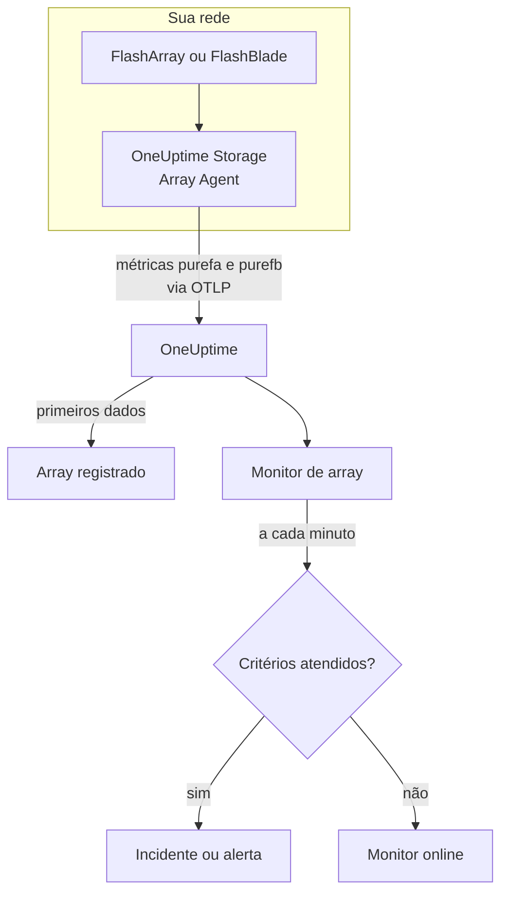

# Monitor de arrays de armazenamento

Um monitor de array de armazenamento observa um array de armazenamento e avisa você quando o array dispara um alerta próprio, fica sem espaço, fica lento, perde hardware ou um caminho de host, ou atrasa na replicação. Ele funciona com Pure Storage FlashArray e Pure Storage FlashBlade, e lê as métricas que o próprio array exporta - as séries `purefa_*` e `purefb_*` da Pure -, coletadas pelo OneUptime Storage Array Agent.

:::cards
- [Criar o monitor](#criar-um-monitor-de-array-de-armazenamento): Seis passos no painel.
- [Modelos](#modelos-de-alerta-prontos): Dezoito alertas prontos, um incidente por volume, host ou componente.
- [Como as séries da Pure funcionam](#como-as-séries-da-pure-são-montadas): Um nome de métrica, muitos valores.
- [Métricas](#métricas-coletadas): Cada série sobre a qual o monitor pode alertar.
:::

## Como funciona

O OneUptime Storage Array Agent roda em uma máquina que alcança a interface de gerenciamento do array. Ele lê as métricas do array com um token de API somente leitura, rotula-as com o nome do array, `storage.array.name`, e a sua plataforma, `storage.system`, e as envia ao OneUptime via OTLP. Os primeiros dados registram o array.

Um monitor de array de armazenamento fica vinculado a um array. A cada minuto ele executa a sua consulta sobre as métricas desse array e compara o resultado com os seus critérios.



## Antes de começar

- **Instale o Storage Array Agent** onde ele alcance o array via HTTPS, com o token de API de um usuário que tenha o papel **readonly** do array. O [guia do Storage Array Agent](/docs/telemetry/storage-arrays) cobre o usuário, o token e a instalação, por meio de `ONEUPTIME_URL`, `ONEUPTIME_TELEMETRY_INGESTION_KEY`, `STORAGE_ARRAY_NAME`, e o endereço e o token do array (`PURE_FA_ENDPOINT` e `PURE_FA_API_TOKEN`, ou `PURE_FB_ENDPOINT` e `PURE_FB_API_TOKEN`).
- **Verifique se o array está registrado.** Ele aparece em **Produtos → Infraestrutura → Storage Arrays → All Storage Arrays**, com o nome do `STORAGE_ARRAY_NAME` do agente, cerca de um minuto depois da primeira leitura.

## Criar um monitor de array de armazenamento

:::steps
### Começar um novo monitor

Vá em **Monitores** e clique em **Criar monitor**.

### Escolher Array de armazenamento

Em **Tipo de monitor**, clique em **Mais tipos de monitor** e escolha **Array de armazenamento** em **Infraestrutura**, ou digite `storage` na caixa de pesquisa. Informe um **Nome** - ele é usado nos títulos de incidentes e alertas - e clique em **Próximo**.

### Escolher o array

Em **Storage Array Monitor Configuration**, escolha o array em **Array de armazenamento**. Todo array que enviou dados está na lista. A sua plataforma decide quais métricas e modelos o formulário oferece.

### Escolher o que observar

Escolha uma das três abas:

- **Quick Setup** - clique em um [modelo](#modelos-de-alerta-prontos). Ele define a métrica, os filtros de rótulos, a agregação, o intervalo de tempo e os limites, e substitui os critérios abaixo pelos seus. Você ainda pode mudar o **Intervalo de tempo**.
- **Custom Metric** - escolha uma métrica em **Storage Array Metric** e depois defina **Agregação** e **Intervalo de tempo**. Os [filtros](#configurações-do-monitor) a restringem a um volume, host, pod, componente, sistema de arquivos ou bucket.
- **Avançado** - monte você mesmo consultas e fórmulas em **Selecionar Métricas**, por exemplo a capacidade usada como `purefa_array_space_bytes` filtrada para `space=capacity` menos a mesma métrica filtrada para `space=empty`. Use **Group by** com o rótulo de um objeto para avaliar cada objeto separadamente.

### Conferir os critérios

Abra cada critério em **Critérios do monitor** e confira **Métrica**, **Agregação**, **Condição** e **Threshold**. Um modelo os preenche. Com **Custom Metric** ou **Avançado**, o monitor começa com os [critérios padrão](#critérios-padrão), que só percebem uma métrica caindo para zero, então defina o seu próprio limite.

### Criar o monitor

Clique em **Criar monitor**. O OneUptime abre a página do monitor e o avalia a cada minuto. Os incidentes e alertas que ele dispara também aparecem nas páginas **Incidentes** e **Alertas** do array.
:::

> [!TIP]
> Para configurar vários modelos de uma vez, abra o array em **Produtos → Infraestrutura → Storage Arrays** e vá em **Recommendations**. Escolha os modelos que quiser, decida quem é acionado, e o OneUptime cria um monitor por modelo.

## Configurações do monitor

| Campo | Aba | O que faz |
| --- | --- | --- |
| **Array de armazenamento** | Todas | Obrigatório. Restringe cada consulta a `resource.storage.array.name`, então dois arrays que têm um volume chamado `vol-01` nunca se misturam. |
| **Volume** | Custom Metric, Avançado | Só FlashArray. Um volume, pelo rótulo `name`, como `vol-db-01`. Um volume em um pod ou em um grupo de volumes se chama `pod::volume` ou `group/volume`. |
| **Host** | Custom Metric, Avançado | Só FlashArray. Um host como o array o conhece, pelo rótulo `host`, como `esxi-01`. |
| **Pod** | Custom Metric, Avançado | Só FlashArray. Um pod do ActiveCluster ou do ActiveDR, pelo rótulo `name`, ou `local_pod` nas séries de links de réplica. |
| **Hardware Component** | Custom Metric, Avançado | Um componente de hardware, como `CH0.BAY1` ou `CT0`: o rótulo `component_name` em um FlashArray, `name` em um FlashBlade. |
| **File System** | Custom Metric, Avançado | Só FlashBlade. Um sistema de arquivos, pelo rótulo `name`. |
| **Bucket** | Custom Metric, Avançado | Só FlashBlade. Um bucket de armazenamento de objetos, pelo rótulo `name`. |
| **Storage Array Metric** | Custom Metric | Uma métrica do [catálogo](#métricas-coletadas). O formulário adiciona o filtro de rótulo que lhe dá significado, e a agrupa pelo objeto que ela descreve, então cada volume, host ou componente é avaliado separadamente. |
| **Agregação** | Custom Metric | Como as amostras são combinadas: **Média**, **Máximo**, **Mínimo**, **Soma** ou **Contagem**. Começa na agregação usual da métrica. |
| **Intervalo de tempo** | Todas | A janela móvel que a consulta lê, de **Past 1 Minute** a **Past 365 Days**. Um monitor novo começa em **Past 5 Minutes**; uma métrica personalizada de um sistema de arquivos ou de um bucket, em **Past 15 Minutes**; os modelos definem a sua. |
| **Selecionar Métricas** | Avançado | O construtor de consultas: **Métrica**, **Aggregate by**, **Filter by attributes**, **Group by**, além de **Adicionar métrica** e **Adicionar fórmula** para combinar consultas. |

O agente lê o endpoint do array a cada 60 segundos, e volumes, hosts e pods a cada 2 minutos, então uma janela de 5 minutos sempre tem uma amostra. Ele lê os sistemas de arquivos e os buckets de um FlashBlade a cada 5 minutos, daí os 15, e os diretórios do FlashArray a cada 30 minutos: dê a um monitor de diretório uma janela de 60 minutos.

## Como as séries da Pure são montadas

A Pure coloca vários valores em **um único** nome de métrica e os diferencia com um rótulo:

- **`dimension`** nas séries de desempenho. `purefa_array_performance_latency_usec` traz a latência de leitura (`usec_per_read_op`), a latência de escrita (`usec_per_write_op`), a latência de escrita espelhada, e o tempo de SAN, de fila, de QoS e de serviço de cada uma. Sempre filtre por uma única `dimension`: uma média entre todas mistura uma latência de leitura de 200 µs com um valor de fila.
- **`space`** nas séries de capacidade: `capacity`, `empty`, `snapshots`, `total_provisioned`, `total_physical`, `available_ratio` e outras.

Várias séries trazem o seu estado em um **rótulo**, com um valor que é sempre 1:

| Série | Rótulo de estado | Uma série por |
| --- | --- | --- |
| `purefa_alerts_open` | `severity`, com `summary`, `code` e `component_type` | Alerta aberto |
| `purefa_hw_component_status` | `component_status` | Componente de hardware |
| `purefa_host_connectivity_info` | `status`, com `details` | Host |
| `purefa_drive_capacity_bytes` | `component_status` (o valor é a capacidade do disco) | Disco |

Uma série filtrada para um estado ruim só existe enquanto algo está nesse estado, então nenhuma série significa que está tudo bem. É por isso que **Max acima de 0 dispara e 0 recupera** é a forma certa para elas, e é assim que os modelos são montados: os seus critérios de recuperação contam uma série ausente como zero.

Nos filtros do monitor e nas chaves de agrupamento, os atributos do agente começam com `resource.` (`resource.storage.array.name`, `resource.storage.system`), enquanto os rótulos da própria Pure não (`name`, `host`, `component_name`, `dimension`, `space`, `severity`).

## Modelos de alerta prontos

O OneUptime traz 18 modelos — 11 para FlashArray e 7 para FlashBlade — e o **Quick Setup** oferece os da plataforma do array. Cada um monta um monitor completo: a consulta da métrica, os seus filtros de rótulos, um agrupamento pelo rótulo do próprio objeto, um critério que dispara e outro que recupera. Os limites são pontos de partida que você pode editar.

Um critério só dispara quando a condição vale para **cada** valor da sua janela. Um monitor que disparou por um limite de capacidade, latência, atraso ou proporção só se recupera 10 % além dele, então um valor que oscila em torno do limite não fica alternando; os modelos de alertas e de hardware se recuperam assim que o estado desaparece.

### FlashArray

| Modelo                         | Categoria    | Gravidade | Observa                                                                                         | Dispara quando                                                                                                                                   |
| ------------------------------ | ------------ | --------- | ----------------------------------------------------------------------------------------------- | ------------------------------------------------------------------------------------------------------------------------------------------------ |
| Critical Array Alert           | Array Health | Crítico   | `purefa_alerts_open` filtrada para `severity=critical`, Max por `summary`, últimos 5 minutos    | > 0 — o array tem um alerta crítico aberto (um componente com falha, uma emergência de capacidade, uma falha de replicação). Um incidente por alerta; recupera quando o alerta fecha |
| Warning Array Alert            | Array Health | Warning   | `purefa_alerts_open` filtrada para `severity=warning`, Max por `summary`, últimos 5 minutos     | > 0 — o array tem um alerta de nível warning aberto. Um incidente por alerta; recupera quando o alerta fecha                                    |
| Capacity Above 80%             | Capacidade   | Warning   | `purefa_array_space_utilization`, Max, últimos 15 minutos                                       | > 80 — o primeiro limite de capacidade da própria Pure; recupera em ≤ 72                                                                         |
| Capacity Above 90%             | Capacidade   | Crítico   | `purefa_array_space_utilization`, Max, últimos 5 minutos                                        | > 90 — o array está perto de recusar escritas; recupera em ≤ 81                                                                                  |
| High Read Latency              | Performance  | Warning   | `purefa_array_performance_latency_usec` filtrada para `dimension=usec_per_read_op`, Avg, últimos 10 minutos  | > 5000 µs (5 ms) — as leituras de um FlashArray normalmente terminam bem abaixo de 1 ms; recupera em ≤ 4500                          |
| High Write Latency             | Performance  | Warning   | `purefa_array_performance_latency_usec` filtrada para `dimension=usec_per_write_op`, Avg, últimos 10 minutos | > 5000 µs (5 ms); recupera em ≤ 4500                                                                                                 |
| Hardware Component Failed      | Hardware     | Crítico   | `purefa_hw_component_status` filtrada para `component_status=critical`, Max por `component_name`, últimos 5 minutos | > 0 — um controlador, uma fonte de alimentação, um ventilador, uma baia ou uma porta está crítico e a redundância acabou. Um incidente por componente; recupera quando informar ok |
| Hardware Component Degraded    | Hardware     | Warning   | `purefa_hw_component_status` filtrada para `component_status=degraded`, Max por `component_name`, últimos 5 minutos | > 0 — um componente está degradado. Um incidente por componente; recupera quando informar ok                                   |
| Drive Failed                   | Hardware     | Crítico   | `purefa_drive_capacity_bytes` filtrada para `component_status=failed`, Max por `component_name`, últimos 5 minutos | > 0 — um módulo DirectFlash ou um SSD falhou e o array reconstrói nos outros. Um incidente por disco; recupera quando for substituído |
| Host Lost Redundant Paths      | Hosts        | Warning   | `purefa_host_connectivity_info` filtrada para `status=critical`, Max por `host`, últimos 5 minutos | > 0 — o host alcança o array por um controlador ou por nenhum; um failover de controlador deixaria o seu armazenamento offline. Um incidente por host; recupera quando os seus caminhos voltarem |
| Replication Lag Above 1 Minute | Replication  | Warning   | `purefa_pod_replica_links_lag_max_msec`, Max por `local_pod`, últimos 10 minutos                | > 60000 ms (60 s) — um failover agora perderia mais escritas recentes do que o planejado. Um incidente por pod; recupera em ≤ 54000               |

### FlashBlade

| Modelo                       | Categoria    | Gravidade | Observa                                                                                                        | Dispara quando                                                                                                      |
| ---------------------------- | ------------ | --------- | -------------------------------------------------------------------------------------------------------------- | ------------------------------------------------------------------------------------------------------------------- |
| Critical Array Alert         | Array Health | Crítico   | `purefb_alerts_open` filtrada para `severity=critical`, Max por `summary`, últimos 5 minutos                   | > 0 — o FlashBlade tem um alerta crítico aberto. Um incidente por alerta; recupera quando o alerta fecha            |
| Warning Array Alert          | Array Health | Warning   | `purefb_alerts_open` filtrada para `severity=warning`, Max por `summary`, últimos 5 minutos                    | > 0 — o FlashBlade tem um alerta de nível warning aberto. Um incidente por alerta; recupera quando o alerta fecha   |
| Capacity Above 80%           | Capacidade   | Warning   | `purefb_array_space_utilization` filtrada para `type=array`, Max, últimos 15 minutos                           | > 80; recupera em ≤ 72                                                                                              |
| Capacity Above 90%           | Capacidade   | Crítico   | `purefb_array_space_utilization` filtrada para `type=array`, Max, últimos 5 minutos                            | > 90 — as escritas falham para todo cliente quando ele enche; recupera em ≤ 81                                      |
| Hardware Component Unhealthy | Hardware     | Crítico   | `purefb_hardware_health`, Min por `name`, últimos 5 minutos                                                    | < 1 — um blade, um módulo de fabric, uma fonte de alimentação ou um ventilador não está saudável (um slot sem uso informa 2). Um incidente por componente; recupera em ≥ 1 |
| High Read Latency            | Performance  | Warning   | `purefb_array_performance_latency_usec` filtrada para `dimension=usec_per_read_op` e `protocol=all`, Avg, últimos 10 minutos | > 10000 µs (10 ms) em todos os protocolos; recupera em ≤ 9000                                         |
| File System Near Full        | File Systems | Warning   | `purefb_file_systems_space_bytes` filtrada para `space=available_ratio`, Min por `name`, últimos 15 minutos    | < 0.1 — resta menos de 10 % do tamanho provisionado de um sistema de arquivos. Um incidente por sistema de arquivos; recupera em ≥ 0.11 |

**Gravidade** é o rótulo que o seletor mostra. O incidente e o alerta que um modelo cria começam na gravidade de incidente e de alerta mais alta do seu projeto; altere-as no critério.

- **Alertas abertos e estados de hardware usam Max** de uma série que só existe enquanto o alerta está aberto ou o componente está nesse estado, então uma única leitura que a mostre ultrapassa o limite.
- **Todo modelo por objeto agrupa pelo rótulo do próprio objeto** (`summary`, `component_name`, `host`, `local_pod`, `name`), então um incidente dispara por objeto afetado, e o incidente o nomeia.
- **Os modelos de latência usam Avg** da média por operação calculada pelo próprio array, e os de capacidade **Max** do seu próprio percentual de utilização. As latências ficam fixadas em microssegundos e a capacidade em percentual.
- **Hardware Component Unhealthy usa Min** por componente: a sua saúde é 1 quando está saudável e cai para 0 quando não está.

Não há modelo para a latência de cada volume, porque o limite certo depende da carga de trabalho: monte-o a partir do catálogo com um agrupamento por `name`. A previsão de capacidade precisa de uma tendência de crescimento mais do que de um limite, e o desgaste dos discos não tem série sobre a qual alertar.

## Métricas coletadas

O agente envia tudo o que o array exporta; as séries abaixo são o catálogo que o formulário do monitor oferece. Cada valor é um gauge que o próprio array calcula - as latências são microssegundos por operação e a vazão é por segundo -, então não é preciso calcular taxas. **Filtro** é o filtro de rótulo que dá à série o significado que a sua linha indica; o formulário o aplica para você.

### Array Health

| Métrica              | Filtro | Plataforma | Unidade | Descrição                                                                                                                                                         |
| -------------------- | ------ | ---------- | ------- | ----------------------------------------------------------------------------------------------------------------------------------------------------------------- |
| `purefa_alerts_open` | —      | FlashArray | `count` | Uma série por alerta aberto no array (valor 1), com os rótulos `severity` (`critical`, `warning`, `info`, `hidden`), `category`, `code`, `component_type` e `summary` |
| `purefb_alerts_open` | —      | FlashBlade | `count` | Uma série por alerta aberto no FlashBlade (valor 1), com os rótulos `severity` (`info`, `warning`, `critical`), `code`, `component_name`, `component_type`, `summary` e `kburl` (o artigo da base de conhecimento da Pure) |

### Capacity

| Métrica                                   | Filtro                       | Plataforma | Unidade | Descrição                                                                                                                             |
| ----------------------------------------- | ---------------------------- | ---------- | ------- | ------------------------------------------------------------------------------------------------------------------------------------- |
| `purefa_array_space_utilization`          | —                            | FlashArray | `%`     | Parcela da capacidade utilizável do array em uso. A Pure dispara os seus próprios alertas de capacidade em 80 %, 90 % e 100 %          |
| `purefa_array_space_bytes`                | `space=capacity`             | FlashArray | `bytes` | Capacidade utilizável do array                                                                                                        |
| `purefa_array_space_bytes`                | `space=empty`                | FlashArray | `bytes` | Capacidade sem uso — acompanhe a tendência para prever quando o array vai encher                                                     |
| `purefa_array_space_bytes`                | `space=snapshots`            | FlashArray | `bytes` | Espaço físico ocupado só por snapshots; um crescimento rápido costuma significar que um grupo de proteção guarda mais snapshots do que o planejado |
| `purefa_array_space_data_reduction_ratio` | —                            | FlashArray | `ratio` | Deduplicação e compressão em todo o array, por exemplo 4.2 para 4.2:1. Uma queda sustentada significa que os dados novos se reduzem mal |
| `purefb_array_space_utilization`          | `type=array`                 | FlashBlade | `%`     | Parcela da capacidade utilizável do FlashBlade em uso                                                                                 |
| `purefb_array_space_bytes`                | `type=array`, `space=empty`  | FlashBlade | `bytes` | Capacidade sem uso do FlashBlade                                                                                                      |
| `purefb_array_space_data_reduction_ratio` | `type=array`                 | FlashBlade | `ratio` | Redução de dados em todo o FlashBlade                                                                                                 |

### Performance

| Métrica                                    | Filtro                                         | Plataforma | Unidade   | Descrição                                                                                                    |
| ------------------------------------------ | ---------------------------------------------- | ---------- | --------- | ------------------------------------------------------------------------------------------------------------ |
| `purefa_array_performance_latency_usec`    | `dimension=usec_per_read_op`                   | FlashArray | `µs`      | Latência média de uma leitura como os hosts a veem; as leituras de um FlashArray costumam terminar bem abaixo de 1 ms |
| `purefa_array_performance_latency_usec`    | `dimension=usec_per_write_op`                  | FlashArray | `µs`      | Latência média de uma escrita como os hosts a veem                                                           |
| `purefa_array_performance_latency_usec`    | `dimension=usec_per_mirrored_write_op`         | FlashArray | `µs`      | Latência média de uma escrita em um pod estendido do ActiveCluster, incluindo a ida e volta até o array par  |
| `purefa_array_performance_latency_usec`    | `dimension=san_usec_per_read_op`               | FlashArray | `µs`      | Tempo que uma leitura passa na SAN; latência de SAN alta com latência de serviço baixa aponta para o fabric ou o host |
| `purefa_array_performance_throughput_iops` | `dimension=reads_per_sec`                      | FlashArray | `ops/s`   | Operações de leitura por segundo                                                                             |
| `purefa_array_performance_throughput_iops` | `dimension=writes_per_sec`                     | FlashArray | `ops/s`   | Operações de escrita por segundo                                                                             |
| `purefa_array_performance_bandwidth_bytes` | `dimension=read_bytes_per_sec`                 | FlashArray | `bytes/s` | Bytes lidos por segundo                                                                                      |
| `purefa_array_performance_bandwidth_bytes` | `dimension=write_bytes_per_sec`                | FlashArray | `bytes/s` | Bytes escritos por segundo                                                                                   |
| `purefa_array_performance_queue_depth_ops` | —                                              | FlashArray | `ops`     | Operações na fila do array; uma fila que cresce com a latência subindo significa que os hosts enviam mais do que ele consegue atender |
| `purefa_array_performance_average_bytes`   | `dimension=bytes_per_op`                       | FlashArray | `bytes`   | Tamanho médio de uma operação — E/S grande aumenta a latência sem que nada esteja errado                     |
| `purefb_array_performance_latency_usec`    | `dimension=usec_per_read_op`, `protocol=all`   | FlashBlade | `µs`      | Latência média de leitura em todos os protocolos                                                             |
| `purefb_array_performance_latency_usec`    | `dimension=usec_per_write_op`, `protocol=all`  | FlashBlade | `µs`      | Latência média de escrita em todos os protocolos                                                             |
| `purefb_array_performance_throughput_iops` | `dimension=reads_per_sec`, `protocol=all`      | FlashBlade | `ops/s`   | Operações de leitura por segundo em todos os protocolos                                                      |
| `purefb_array_performance_throughput_iops` | `dimension=writes_per_sec`, `protocol=all`     | FlashBlade | `ops/s`   | Operações de escrita por segundo em todos os protocolos                                                      |
| `purefb_array_performance_bandwidth_bytes` | `dimension=read_bytes_per_sec`, `protocol=all` | FlashBlade | `bytes/s` | Bytes lidos por segundo em todos os protocolos                                                               |
| `purefb_array_performance_bandwidth_bytes` | `dimension=write_bytes_per_sec`, `protocol=all` | FlashBlade | `bytes/s` | Bytes escritos por segundo em todos os protocolos                                                           |

### Volumes

| Métrica                                     | Filtro                           | Plataforma | Unidade   | Descrição                                                     |
| ------------------------------------------- | -------------------------------- | ---------- | --------- | ------------------------------------------------------------- |
| `purefa_volume_performance_latency_usec`    | `dimension=usec_per_read_op`     | FlashArray | `µs`      | Latência média de leitura de cada volume — agrupe por `name`  |
| `purefa_volume_performance_latency_usec`    | `dimension=usec_per_write_op`    | FlashArray | `µs`      | Latência média de escrita de cada volume                      |
| `purefa_volume_performance_throughput_iops` | `dimension=reads_per_sec`        | FlashArray | `ops/s`   | Operações de leitura por segundo de cada volume               |
| `purefa_volume_performance_throughput_iops` | `dimension=writes_per_sec`       | FlashArray | `ops/s`   | Operações de escrita por segundo de cada volume               |
| `purefa_volume_performance_bandwidth_bytes` | `dimension=read_bytes_per_sec`   | FlashArray | `bytes/s` | Bytes lidos por segundo de cada volume                        |
| `purefa_volume_performance_bandwidth_bytes` | `dimension=write_bytes_per_sec`  | FlashArray | `bytes/s` | Bytes escritos por segundo em cada volume                     |
| `purefa_volume_space_bytes`                 | `space=total_provisioned`        | FlashArray | `bytes`   | Tamanho de cada volume como os hosts o veem                   |
| `purefa_volume_space_bytes`                 | `space=total_physical`           | FlashArray | `bytes`   | Espaço físico que cada volume usa depois da redução de dados  |
| `purefa_volume_space_data_reduction_ratio`  | —                                | FlashArray | `ratio`   | Taxa de redução de dados de cada volume                       |

### Hosts

| Métrica                                   | Filtro                        | Plataforma | Unidade | Descrição                                                                                                                                      |
| ----------------------------------------- | ----------------------------- | ---------- | ------- | ---------------------------------------------------------------------------------------------------------------------------------------------- |
| `purefa_host_connectivity_info`           | —                             | FlashArray | `count` | Uma série por host (valor 1) com o rótulo da sua conectividade `status` (`healthy`, `critical`, `unused`) e `details` (`Redundant`, `Single Controller`, `None`, ...) |
| `purefa_host_performance_latency_usec`    | `dimension=usec_per_read_op`  | FlashArray | `µs`    | Latência média de leitura que cada host vê — agrupe por `host`                                                                                 |
| `purefa_host_performance_latency_usec`    | `dimension=usec_per_write_op` | FlashArray | `µs`    | Latência média de escrita que cada host vê                                                                                                     |
| `purefa_host_performance_throughput_iops` | `dimension=reads_per_sec`     | FlashArray | `ops/s` | Operações de leitura por segundo de cada host                                                                                                  |
| `purefa_host_performance_throughput_iops` | `dimension=writes_per_sec`    | FlashArray | `ops/s` | Operações de escrita por segundo de cada host                                                                                                  |

### Replication

| Métrica                                              | Filtro                                 | Plataforma | Unidade   | Descrição                                                                                                                                                    |
| ---------------------------------------------------- | -------------------------------------- | ---------- | --------- | ------------------------------------------------------------------------------------------------------------------------------------------------------------ |
| `purefa_pod_replica_links_lag_max_msec`              | —                                      | FlashArray | `ms`      | Maior atraso de replicação de cada link de réplica de pod (ActiveDR / assíncrono), com os rótulos `local_pod`, `remote_pod`, `remote`, `direction` e `status` — agrupe por `local_pod` |
| `purefa_pod_replica_links_lag_average_msec`          | —                                      | FlashArray | `ms`      | Atraso médio de replicação de cada link de réplica de pod                                                                                                    |
| `purefa_pod_performance_replication_bandwidth_bytes` | —                                      | FlashArray | `bytes/s` | Tráfego de replicação de cada pod, com os rótulos `direction` e `dimension`                                                                                  |
| `purefa_pod_performance_latency_usec`                | `dimension=usec_per_mirrored_write_op` | FlashArray | `µs`      | Latência média de escrita espelhada de cada pod do ActiveCluster                                                                                             |

### Hardware

| Métrica                                       | Filtro                           | Plataforma | Unidade    | Descrição                                                                                                                                                                                                    |
| --------------------------------------------- | -------------------------------- | ---------- | ---------- | ------------------------------------------------------------------------------------------------------------------------------------------------------------------------------------------------------------ |
| `purefa_hw_component_status`                  | —                                | FlashArray | `count`    | Uma série por componente de hardware (valor 1) — chassi, controladores, baias de disco e de NVRAM, fontes de alimentação, ventiladores, sensores de temperatura, portas Ethernet e Fibre Channel — com o rótulo `component_status` (`ok`, `critical`, `degraded`, `device_off`, `identifying`, `not_installed`, `unknown`) |
| `purefa_hw_component_temperature_celsius`     | —                                | FlashArray | `°C`       | Temperatura de cada sensor — agrupe por `component_name`                                                                                                                                                     |
| `purefa_drive_capacity_bytes`                 | —                                | FlashArray | `bytes`    | Capacidade bruta de cada disco, com o rótulo do seu `component_status` (`healthy`, `failed`, `missing`, `recovering`, `unhealthy`, `empty`, ...) e do seu tipo                                               |
| `purefa_network_interface_performance_errors` | `dimension=total_errors_per_sec` | FlashArray | `errors/s` | Erros por segundo em cada interface Ethernet e Fibre Channel — erros persistentes costumam indicar um cabo, uma óptica ou uma porta de switch com defeito                                                     |
| `purefb_hardware_health`                      | —                                | FlashBlade | —          | Saúde de cada componente de hardware (blades, módulos de fabric, fontes de alimentação, ventiladores, ...): 1 = saudável, 2 = sem uso, 0 = não saudável. Use o mínimo por `name`                               |

### File Systems

| Métrica                                        | Filtro                        | Plataforma | Unidade | Descrição                                                                                    |
| ---------------------------------------------- | ----------------------------- | ---------- | ------- | -------------------------------------------------------------------------------------------- |
| `purefb_file_systems_performance_latency_usec` | `dimension=usec_per_read_op`  | FlashBlade | `µs`    | Latência média de leitura de cada sistema de arquivos — agrupe por `name`                    |
| `purefb_file_systems_performance_latency_usec` | `dimension=usec_per_write_op` | FlashBlade | `µs`    | Latência média de escrita de cada sistema de arquivos                                        |
| `purefb_file_systems_space_bytes`              | `space=total_physical`        | FlashBlade | `bytes` | Espaço físico que cada sistema de arquivos usa                                               |
| `purefb_file_systems_space_bytes`              | `space=available_ratio`       | FlashBlade | `ratio` | Parcela do tamanho provisionado de cada sistema de arquivos ainda disponível, de 0 a 1 — perto de 0 ele está prestes a encher a sua cota |

### Buckets

| Métrica                                   | Filtro                       | Plataforma | Unidade | Descrição                                             |
| ----------------------------------------- | ---------------------------- | ---------- | ------- | ----------------------------------------------------- |
| `purefb_buckets_performance_latency_usec` | `dimension=usec_per_read_op` | FlashBlade | `µs`    | Latência média de leitura de cada bucket — agrupe por `name` |
| `purefb_buckets_space_bytes`              | `space=total_physical`       | FlashBlade | `bytes` | Espaço físico que cada bucket usa                     |
| `purefb_buckets_object_count`             | —                            | FlashBlade | `count` | Número de objetos em cada bucket                      |

## Critérios de monitoramento

Um critério compara uma das consultas ou fórmulas do monitor com um limite. Os critérios de um monitor de array de armazenamento não têm **Tipo de filtro**: cada regra verifica o valor da métrica, com estes campos.

| Campo | O que faz |
| --- | --- |
| **Métrica** | A consulta ou fórmula a verificar, pelo nome da sua variável. |
| **Agregação** | Como os valores da janela viram uma única resposta: **Média**, **Soma**, **Maximum Value**, **Minimum Value**, **All Values** (todo valor precisa corresponder) ou **Any Value** (basta um). |
| **Condição** | **Greater Than**, **Less Than**, **Greater Than Or Equal To**, **Less Than Or Equal To** ou **Equal To** — ou uma condição de anomalia: **Anomalously High**, **Anomalously Low** ou **Anomalous**. |
| **Threshold** | O valor com que comparar. Uma lista de unidades fica ao lado quando a métrica tem unidade. Não aparece nas condições de anomalia. |
| **Sensibilidade** | Só condições de anomalia. **Baixo** (4σ), **Médio** (3σ, o padrão) ou **Alto** (2σ). |
| **Janela de linha de base** | Só condições de anomalia. 14 dias (o padrão), 28, 60 ou 90 dias de histórico. |
| **Se não houver dados** | Em **Mais campos**. O que acontece quando a janela não tem amostras: **Ignore** (o padrão), **Treat As Zero** ou **Trigger**. |

As condições de anomalia comparam cada valor com a mesma hora da semana na linha de base. Elas ficam em um estado "Learning", e não disparam nada, até que a janela de linha de base tenha histórico suficiente.

Alguns critérios para começar:

- **Um volume está lento:** `purefa_volume_performance_latency_usec` filtrada para `dimension=usec_per_read_op`, Média, agrupada por `name`, **Greater Than** `2000`, nos últimos 10 minutos.
- **O array está enchendo:** `purefa_array_space_utilization`, Máximo, **Greater Than** `85`, nos últimos 15 minutos.
- **Um host roda com um único controlador:** `purefa_host_connectivity_info` filtrada para `status=critical`, Máximo, agrupada por `host`, **Greater Than** `0`.
- **Um sistema de arquivos do FlashBlade está quase cheio:** `purefb_file_systems_space_bytes` filtrada para `space=available_ratio`, Mínimo, agrupada por `name`, **Less Than** `0.05`.

### Critérios padrão

Um monitor que você não monta a partir de um modelo começa com dois critérios:

| Ordem | Critério | Corresponde quando | Então |
| --- | --- | --- | --- |
| 1 | Check if _monitor name_ is offline | Algum valor da primeira consulta é `0` | Marca o monitor como **Offline** e declara o incidente "_monitor name_ is offline", que se resolve sozinho quando o monitor se recupera. |
| 2 | Check if _monitor name_ is online | Algum valor está acima de `0` | Marca o monitor como **Operacional**. |

> [!IMPORTANT]
> O silêncio não corresponde a nenhum dos dois critérios: um array que para de enviar dados deixa o monitor como estava. Para ser avisado quando os dados param, defina **Se não houver dados** como **Trigger** em um critério. O tempo em que o próprio OneUptime não estava recebendo nunca conta como ausência de dados: uma verificação cuja janela o contém espera, como explica [Quando o OneUptime não recebe dados](/docs/monitor/when-oneuptime-is-not-receiving).

## Terraform

O [provedor Terraform do OneUptime](/docs/terraform/monitor-steps) leva a configuração de uma etapa de monitor de array de armazenamento no atributo `storage_array_monitor`: o JSON bruto da configuração `storageArrayMonitor` (`arrayIdentifier`, `storageSystem`, `resourceFilters`, `metricViewConfig`, `rollingTime`), escrito com `jsonencode()`:

```hcl title="main.tf"
monitor_steps = [{
  storage_array_monitor = jsonencode({
    arrayIdentifier = "my-storage-array"
    storageSystem   = "purestorage.flasharray"
    resourceFilters = {}
    rollingTime     = "Past 15 Minutes"
    metricViewConfig = {
      queryConfigs = [{
        metricAliasData = { metricVariable = "capacity_used_percent", title = "Capacity Used", description = "", legend = "" }
        metricQueryData = {
          filterData = {
            metricName     = "purefa_array_space_utilization"
            attributes     = {}
            aggegationType = "Max"
            aggregateBy    = {}
          }
        }
      }]
      formulaConfigs = []
    }
  })
  criteria = [ /* ... */ ]
}]
```

`arrayIdentifier` é o `storage.array.name` do array - o `STORAGE_ARRAY_NAME` com que o agente foi iniciado -, não o seu ID no OneUptime. `storageSystem` é `purestorage.flasharray` ou `purestorage.flashblade`. Ele decide qual catálogo e quais modelos o formulário mostra, e se um filtro de hardware lê `component_name` ou `name`.

## Solução de problemas

:::details O array não está na lista Array de armazenamento
Os arrays se registram sozinhos a partir dos dados do agente. Verifique se o agente está rodando e enviando dados (veja o [guia do Storage Array Agent](/docs/telemetry/storage-arrays)), e se `STORAGE_ARRAY_NAME` está definido.
:::

:::details Um modelo de alertas ou de hardware nunca dispara
Esse é o caso saudável. `purefa_alerts_open`, `purefa_hw_component_status`, `purefa_drive_capacity_bytes` e `purefa_host_connectivity_info` trazem o seu estado em um rótulo, e uma série filtrada para um estado ruim (`severity=critical`, `component_status=failed`) só existe enquanto algo está nesse estado. Para ver a série por trás de um modelo, execute a sua consulta sem o filtro na página **Métricas**.
:::

:::details Um monitor de latência mostra valores errados
A Pure coloca os valores de leitura, escrita, escrita espelhada, SAN, fila e QoS em um único nome de métrica, diferenciados só pelo rótulo `dimension`, e uma consulta sem filtro de `dimension` tira a média de todos juntos. Filtre por uma única dimensão, como fazem os modelos e o catálogo do formulário. As séries por volume e por host mantêm só `usec_per_read_op`, `usec_per_write_op` e `usec_per_mirrored_write_op`: o agente descarta o resto para economizar séries, e só `purefa_array_performance_latency_usec`, do array inteiro, mantém todas.
:::

:::details Uma janela de 1 minuto não mostra dados
O agente lê volumes, hosts e pods a cada 2 minutos, os sistemas de arquivos e os buckets de um FlashBlade a cada 5, e os diretórios do FlashArray a cada 30, então uma janela de 1 minuto pode não ter nenhuma amostra. Use 5 minutos ou mais: 15 para sistemas de arquivos e buckets, 60 para diretórios.
:::

:::details Os incidentes disparam uma vez para o array inteiro em vez de uma vez por volume
Agrupe a consulta pelo rótulo do objeto: `name` para volumes, pods, diretórios, sistemas de arquivos e buckets, `host` para hosts, e `component_name` para o hardware do FlashArray. Os rótulos da Pure não têm prefixo, então `resource.name` não corresponde a nada.
:::

## Próximos passos

:::cards
- [Agente de arrays de armazenamento](/docs/telemetry/storage-arrays): Instalar o agente que envia as métricas.
- [Monitor de Ceph](/docs/monitor/ceph-monitor): O mesmo tipo de monitor para clusters de armazenamento Ceph.
- [Monitor de métricas](/docs/monitor/metrics-monitor): Alertar sobre qualquer métrica, de qualquer origem.
- [Visão geral dos incidentes](/docs/incidents/index): O que acontece depois que um critério declara um incidente.
:::
