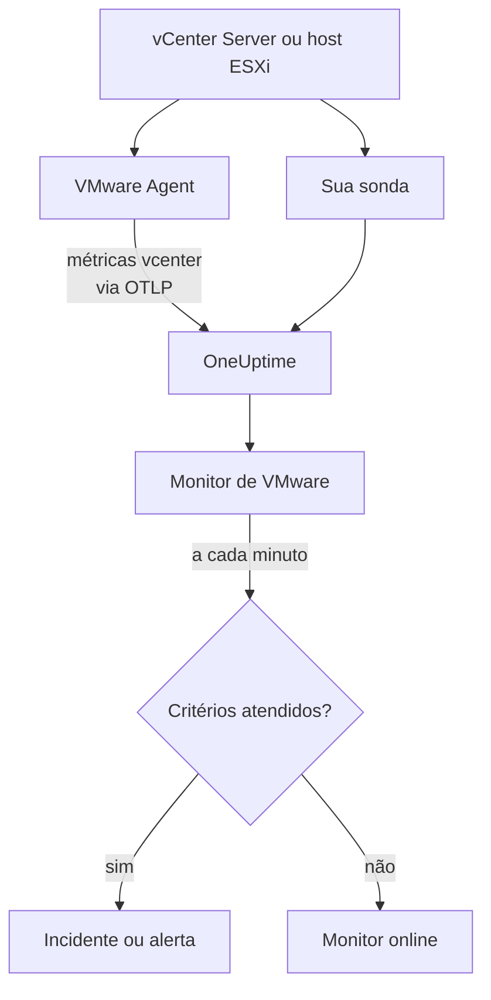

# Monitor de VMware

Um monitor de VMware observa um vCenter - os seus datacenters, clusters, hosts ESXi, máquinas virtuais, datastores, resource pools e vSAN - e avisa você quando um host satura, falta CPU ou memória para uma VM, um datastore enche ou o vSphere dispara um alarme. Ele lê as métricas `vcenter.*` que o OneUptime VMware Agent coleta, ou que uma das suas sondas coleta sem agente.

:::cards
- [Criar o monitor](#criar-um-monitor-de-vmware): Seis passos no painel.
- [Modelos](#modelos-de-alerta-prontos): Vinte e três alertas prontos, um incidente por host, VM ou datastore.
- [Atributos de identidade](#atributos-de-identidade): Como mirar um host, uma VM ou um datastore.
- [Métricas](#métricas-coletadas): Cada série `vcenter.*` sobre a qual o monitor pode alertar.
:::

## Como funciona

As métricas vêm da API do vCenter, lidas com uma conta somente leitura de uma de duas formas:

- **O VMware Agent**, um OpenTelemetry Collector com o seu receiver `vcenter`, que você executa em uma máquina que alcança o vCenter. Veja [Agente VMware](/docs/telemetry/vmware).
- **Uma sonda**, sem nada para instalar: você conecta o vCenter no OneUptime e escolhe a sonda que o alcança. Veja [VMware sem agente](/docs/telemetry/vmware-agentless).

Os dois enviam as mesmas séries a cada intervalo de coleta (2 minutos por padrão), marcadas com o nome do vCenter, `vmware.vcenter.name`. Um vCenter é um endpoint do vSphere: um vCenter Server ou um host ESXi independente. Um monitor de VMware fica vinculado a um vCenter. A cada minuto ele executa a sua consulta sobre as métricas desse vCenter e compara o resultado com os seus critérios.



## Antes de começar

- **Colete as métricas do vCenter**, com o [VMware Agent](/docs/telemetry/vmware) ou [sem agente](/docs/telemetry/vmware-agentless). Os dois usam um usuário do vSphere com o papel **Read-Only** no objeto vCenter de nível mais alto, com **Propagate to children** marcado. O agente lê `ONEUPTIME_URL`, `ONEUPTIME_TELEMETRY_INGESTION_KEY`, `VMWARE_VCENTER_NAME`, `VCENTER_ENDPOINT`, `VCENTER_USERNAME` e `VCENTER_PASSWORD`.
- **Verifique se o vCenter está registrado.** Ele aparece em **Produtos → Infraestrutura → VMware → Todos os vCenters**: pelo agente, com o nome do seu `VMWARE_VCENTER_NAME`, depois da sua primeira coleta completa; sem agente, a partir do momento em que você o conecta.

## Criar um monitor de VMware

:::steps
### Começar um novo monitor

Vá em **Monitores** e clique em **Criar monitor**.

### Escolher VMware

Em **Tipo de monitor**, clique em **Mais tipos de monitor** e escolha **VMware** em **Infraestrutura**, ou digite `vmware` na caixa de pesquisa. Informe um **Nome** - ele é usado nos títulos de incidentes e alertas - e clique em **Próximo**.

### Escolher o vCenter

Em **VMware Monitor Configuration**, escolha o vCenter em **vCenter**. Todo vCenter que enviou dados, ou que você conectou sem agente, está na lista.

### Escolher o que observar

Escolha uma das três abas:

- **Quick Setup** - clique em um [modelo](#modelos-de-alerta-prontos). Ele define a métrica, os filtros de atributos, a agregação, o intervalo de tempo, o agrupamento e os limites, e substitui os critérios abaixo pelos seus. Você ainda pode mudar o **Intervalo de tempo**.
- **Custom Metric** - escolha uma métrica em **VMware Metric** e depois defina **Agregação** e **Intervalo de tempo**. O formulário a agrupa pelo objeto que ela descreve, então cada host, VM ou datastore é avaliado separadamente, e os [filtros](#configurações-do-monitor) a restringem a um datacenter, cluster, host, VM, datastore ou resource pool.
- **Avançado** - monte você mesmo consultas e fórmulas em **Selecionar Métricas**, com filtros em atributos como `disk_state`, `power_state` ou `status`. Use **Group by** com um [atributo de identidade](#atributos-de-identidade) para avaliar cada objeto separadamente.

### Conferir os critérios

Abra cada critério em **Critérios do monitor** e confira **Métrica**, **Agregação**, **Condição** e **Threshold**. Um modelo os preenche. Com **Custom Metric** ou **Avançado**, o monitor começa com os [critérios padrão](#critérios-padrão), que só percebem uma métrica caindo para zero, então defina o seu próprio limite.

### Criar o monitor

Clique em **Criar monitor**. O OneUptime abre a página do monitor e o avalia a cada minuto. Os incidentes e alertas que ele dispara também aparecem nas páginas **Incidentes** e **Alertas** do vCenter.
:::

> [!TIP]
> Para configurar vários modelos de uma vez, abra o vCenter em **Produtos → Infraestrutura → VMware** e vá em **Recommendations**. Escolha os modelos que quiser, decida quem é acionado, e o OneUptime cria um monitor por modelo.

## Configurações do monitor

| Campo | Aba | O que faz |
| --- | --- | --- |
| **vCenter** | Todas | Obrigatório. Restringe cada consulta a `resource.vmware.vcenter.name`. |
| **Datacenter** | Custom Metric, Avançado | Opcional. Um datacenter: `resource.vcenter.datacenter.name`. Toda série o carrega. |
| **Cluster** | Custom Metric, Avançado | Opcional. Um cluster: `resource.vcenter.cluster.name`. Corresponde às séries do próprio cluster e às dos hosts, VMs e resource pools que ele contém; um host ESXi independente não tem nenhum. |
| **ESXi Host** | Custom Metric, Avançado | Opcional. Um host ESXi: `resource.vcenter.host.name`. Corresponde às séries do próprio host **e** às de cada VM que ele executa, porque uma VM carrega o nome do seu host. |
| **Virtual Machine** | Custom Metric, Avançado | Opcional. Uma VM: `resource.vcenter.vm.name`. Os nomes de VM não precisam ser únicos: adicione um host ou um cluster quando duas VMs tiverem o mesmo nome. |
| **Datastore** | Custom Metric, Avançado | Opcional. Um datastore: `resource.vcenter.datastore.name`. |
| **Resource Pool Path** | Custom Metric, Avançado | Opcional. Um resource pool, pelo seu caminho de inventário (`/DC/host/Cluster/Resources/pool`): `resource.vcenter.resource_pool.inventory_path`. Um caminho, porque os nomes de pools só são únicos dentro do seu objeto pai. |
| **VMware Metric** | Custom Metric | Uma métrica do [catálogo](#métricas-coletadas). |
| **Agregação** | Custom Metric | Como as amostras são combinadas: **Média**, **Máximo**, **Mínimo**, **Soma** ou **Contagem**. Começa na agregação usual da métrica. |
| **Intervalo de tempo** | Todas | A janela móvel que a consulta lê, de **Past 1 Minute** a **Past 365 Days**. Um monitor novo começa em **Past 5 Minutes**; os modelos definem a sua. |
| **Selecionar Métricas** | Avançado | O construtor de consultas: **Métrica**, **Aggregate by**, **Filter by attributes**, **Group by**, além de **Adicionar métrica** e **Adicionar fórmula** para combinar consultas. |

O vCenter é lido uma vez por intervalo de coleta, 2 minutos por padrão, então uma janela de 1 minuto pode não ter nenhuma amostra. Mantenha a janela em 5 minutos ou mais, e maior se você aumentou o intervalo de coleta para um inventário grande.

## Atributos de identidade

O receiver `vcenter` envia um recurso do OpenTelemetry por objeto do vSphere, e o nomeia com **atributos de recurso**. Os que uma série carrega dizem que tipo de objeto ela descreve:

| Objeto do vSphere   | Atributos de recurso de identidade                                                                                             |
| ------------------- | ------------------------------------------------------------------------------------------------------------------------------ |
| Datacenter          | `vcenter.datacenter.name`                                                                                                      |
| Cluster             | `vcenter.datacenter.name`, `vcenter.cluster.name`                                                                              |
| Host ESXi           | `vcenter.datacenter.name`, `vcenter.host.name` (+ `vcenter.cluster.name` quando está em um cluster)                            |
| Máquina virtual     | `vcenter.datacenter.name`, `vcenter.host.name`, `vcenter.vm.name`, `vcenter.vm.id` (+ `vcenter.cluster.name`; `vcenter.resource_pool.*` ou `vcenter.virtual_app.*`) |
| Modelo de VM        | `vcenter.datacenter.name`, `vcenter.host.name`, `vcenter.vm_template.name`, `vcenter.vm_template.id`                           |
| Datastore           | `vcenter.datacenter.name`, `vcenter.datastore.name`                                                                            |
| Resource pool       | `vcenter.datacenter.name`, `vcenter.resource_pool.name`, `vcenter.resource_pool.inventory_path` (+ `vcenter.cluster.name` ou `vcenter.host.name`) |

Nos filtros do monitor e nas chaves de agrupamento, os atributos de recurso começam com `resource.` (`resource.vcenter.host.name`), enquanto os atributos de ponto de dados não (`disk_state`, `power_state`, `status`, `effective`, `direction`, `object`, `type`). O atributo booleano `effective` é armazenado como o texto `"true"` ou `"false"`, então filtre-o com o texto. Filtre por um atributo de identidade para mirar um objeto, e agrupe por ele para avaliar cada objeto separadamente.

## Modelos de alerta prontos

O OneUptime traz 23 modelos para problemas comuns de VMware, e o **Quick Setup** oferece todos eles. Cada um monta um monitor completo: a consulta da métrica, os seus filtros de atributos, um agrupamento pelo atributo de identidade do próprio objeto, um critério que dispara e outro que recupera. Os limites são pontos de partida que você pode editar.

Os modelos leem os últimos 5 minutos, a menos que a tabela diga outra coisa. Um critério só dispara quando a condição vale em cada minuto da sua janela, e um critério de limite se recupera 10 % além do seu limite, então um valor que oscila na linha não fica alternando.

| Modelo | Categoria | Gravidade | Observa | Dispara quando | Recupera quando |
| --- | --- | --- | --- | --- | --- |
| Host CPU Saturation | Host | Warning | `vcenter.host.cpu.utilization`, Avg por `resource.vcenter.host.name` | Acima de 90 %: cada VM no host disputa núcleos, e mostra tempo de CPU ready | Em 81 % ou menos |
| Host Memory Saturation | Host | Warning | `vcenter.host.memory.utilization`, Avg por host | Acima de 90 %: o host começa a recuperar memória com ballooning, compressão e swapping | Em 81 % ou menos |
| Host Disk Latency High | Host | Warning | `vcenter.host.disk.latency.max`, Max por host | Acima de 50 ms: cada VM cujos discos estão nesse caminho espera pelo armazenamento. Precisa do nível 3 de contadores de desempenho | Em 45 ms ou menos |
| Host Network Packet Errors | Host | Warning | `vcenter.host.network.packet.error.rate`, Max por host | Acima de 0: quase sempre uma falha de cabo, SFP ou porta de switch | Em 0 |
| Host Network Packet Drops | Host | Warning | `vcenter.host.network.packet.drop.rate`, Max por host | Acima de 0: um uplink sobrecarregado, ou buffers em anel da NIC que transbordam | Em 0 |
| VM CPU Saturation | Virtual Machine | Warning | `vcenter.vm.cpu.utilization`, Avg por `resource.vcenter.vm.name`, **últimos 15 minutos** | Acima de 90 % das vCPUs da VM durante os 15 minutos: uma VM pode usar o que recebeu, então só aciona uma que nunca desce | Em 81 % ou menos |
| VM CPU Ready Contention | Virtual Machine | Warning | `vcenter.vm.cpu.readiness`, Avg por VM | Acima de 10 %: a VM estava pronta para rodar, mas o host não tinha um núcleo físico para ela. Invisível de dentro do convidado | Em 9 % ou menos |
| VM Memory Saturation | Virtual Machine | Warning | `vcenter.vm.memory.utilization`, Avg por VM | Acima de 90 % da sua memória: o convidado está prestes a paginar | Em 81 % ou menos |
| VM Memory Ballooning | Virtual Machine | Warning | `vcenter.vm.memory.ballooned`, Max por VM | Acima de 0: falta memória ao host, e ele a toma de volta deste convidado | Em 0 |
| VM Memory Swapping | Virtual Machine | Crítico | `vcenter.vm.memory.swapped`, Max por VM | Acima de 0: o host faz swap da memória da VM, o último recurso depois do ballooning e da compressão | Em 0 |
| VM Disk Latency High | Virtual Machine | Warning | `vcenter.vm.disk.latency.max`, Max por VM | Acima de 50 ms: as aplicações do convidado esgotam o tempo de espera na E/S | Em 45 ms ou menos |
| VM Disk Usage High | Virtual Machine | Warning | `vcenter.vm.disk.utilization`, Avg por VM | Acima de 90 % do seu armazenamento provisionado comprometido: uma VM com thin provisioning está prestes a reivindicar o seu tamanho total | Em 81 % ou menos |
| Datastore Capacity Warning | Datastore | Warning | `vcenter.datastore.disk.utilization`, Avg por `resource.vcenter.datastore.name` | Acima de 80 %: um aviso antecipado, já que discos thin e snapshots consomem o resto rapidamente | Em 72 % ou menos |
| Datastore Capacity Critical | Datastore | Crítico | `vcenter.datastore.disk.utilization`, Avg por datastore | Acima de 90 %: um datastore cheio pausa cada VM que tem um disco nele | Em 81 % ou menos |
| Cluster Host Not Effective | Cluster | Crítico | `vcenter.cluster.host.count` filtrada para `effective = false`, Max por `resource.vcenter.cluster.name` | Acima de 0: um host está em modo de manutenção, desconectado ou sem resposta, então o cluster roda com menos capacidade do que foi dimensionado | Em 0 |
| Datacenter Hosts Unhealthy | Datacenter | Crítico | `vcenter.datacenter.host.count` filtrada para `status = red`, Max por `resource.vcenter.datacenter.name` | Acima de 0: um host tem um alarme crítico, como um sensor de hardware, um caminho de armazenamento perdido ou um erro do agente de HA | Em 0 |
| Datacenter Hosts Degraded | Datacenter | Warning | `vcenter.datacenter.host.count` filtrada para `status = yellow`, Max por datacenter | Acima de 0: um host tem um alarme de aviso | Em 0 |
| Datacenter Hosts Powered Off | Datacenter | Warning | `vcenter.datacenter.host.count` filtrada para `power_state = off`, Max por datacenter | Acima de 0: um host está desligado - travou, perdeu energia ou foi colocado em standby pelo DPM | Em 0 |
| Datacenter VMs Unhealthy | Datacenter | Warning | `vcenter.datacenter.vm.count` filtrada para `status = red`, Max por datacenter | Acima de 0: uma VM tem um alarme crítico, como uma reinicialização de HA que falhou, um datastore perdido ou um heartbeat do Tools perdido | Em 0 |
| Datacenter Clusters Unhealthy | Datacenter | Crítico | `vcenter.datacenter.cluster.count` filtrada para `status = red`, Max por datacenter | Acima de 0: um cluster tem um alarme crítico, como recursos de failover de HA insuficientes, uma eleição de HA que falhou ou uma verificação de integridade do vSAN crítica | Em 0 |
| vSAN Latency High | vSAN | Warning | `vcenter.cluster.vsan.latency.avg`, Avg por cluster | Acima de 20 000 µs (20 ms): o armazenamento fica lento para cada VM no datastore vSAN. Silencioso em clusters sem vSAN | Em 18 000 µs ou menos |
| vSAN Congestion | vSAN | Warning | `vcenter.cluster.vsan.congestions`, Max por cluster | Acima de 0: um grupo de discos não dá conta, e o vSAN desacelera a E/S dos seus clientes | Em 0 |
| Resource Pool Memory Swapped | Cluster | Warning | `vcenter.resource_pool.memory.swapped`, Max por `resource.vcenter.resource_pool.inventory_path` | Acima de 0: as VMs do pool tiram memória do swap do host, geralmente porque o limite ou as shares de memória do pool estão baixos demais | Em 0 |

**Gravidade** é o rótulo que o seletor mostra. O incidente e o alerta que um modelo cria começam na gravidade de incidente e de alerta mais alta do seu projeto; altere-as no critério.

- **Os modelos de utilização usam Avg:** o receiver informa uma porcentagem real de 0 a 100 para cada objeto, então a média em um minuto é a utilização sustentada.
- **Os modelos de latência usam Max:** a métrica já é a pior latência entre os discos do objeto, então a sua maior amostra é a honesta.
- **Os modelos de contagem e de estado usam Max**, então uma única coleta que mostre a condição os dispara: erros de pacotes, ballooning, swapping, status vermelho e amarelo, hosts não efetivos, congestionamento.
- **Todo modelo agrupa pelo atributo de identidade do próprio objeto**, então um incidente dispara por objeto afetado, e o incidente o nomeia.
- **Os limites ficam fixados na sua unidade** (`%`, `ms`, `us`), então mantêm o seu significado seja qual for a unidade que um gráfico mostre.

## Métricas coletadas

As métricas abaixo são o catálogo que o formulário do monitor oferece. As unidades são as do próprio receiver: `MHz`, `%`, `MiBy` (mebibytes), `By` (bytes), `KiBy`, `ms`, `us` (microssegundos), `{KiBy/s}`, `By/s` e contagens. Uma métrica marcada como _desativada por padrão_ só é coletada depois que você a ativa no `otel-collector-config.yaml` do agente; a configuração fornecida já ativa `vcenter.host.memory.capacity`.

### Datacenter

| Métrica                              | Unidade             | Descrição                                                                                                                                                      |
| ------------------------------------ | ------------------- | -------------------------------------------------------------------------------------------------------------------------------------------------------------- |
| `vcenter.datacenter.cluster.count`   | `{clusters}`        | Clusters no datacenter, separados por `status` (`red` / `yellow` / `green` / `gray`). Some para o total; filtre `status = red` para clusters com um alarme crítico |
| `vcenter.datacenter.cpu.limit`       | `MHz`               | CPU total disponível para o datacenter em todos os hosts ESXi                                                                                                  |
| `vcenter.datacenter.datastore.count` | `{datastores}`      | Datastores no datacenter                                                                                                                                       |
| `vcenter.datacenter.disk.space`      | `By`                | Espaço de datastore em todo o datacenter, separado por `disk_state` (`used` / `available`). used ÷ (used + available) é a utilização de armazenamento de todo o datacenter |
| `vcenter.datacenter.host.count`      | `{hosts}`           | Hosts ESXi no datacenter, separados por `status` e `power_state` (`on` / `off` / `standby` / `unknown`). Filtre `status = red` ou `power_state = off`          |
| `vcenter.datacenter.memory.limit`    | `By`                | Memória física total disponível para o datacenter em todos os hosts ESXi                                                                                       |
| `vcenter.datacenter.vm.count`        | `{virtual_machines}` | Máquinas virtuais no datacenter, separadas por `status` e `power_state` (`on` / `off` / `suspended` / `unknown`). Filtre `power_state = on` para as VMs em execução |

### Cluster

| Métrica                             | Unidade                       | Descrição                                                                                                                                                    |
| ----------------------------------- | ----------------------------- | ------------------------------------------------------------------------------------------------------------------------------------------------------------ |
| `vcenter.cluster.cpu.effective`     | `MHz`                         | CPU que o cluster realmente consegue agendar — exclui hosts em modo de manutenção ou sem resposta. Compare com `vcenter.cluster.cpu.limit` para a capacidade fora de serviço |
| `vcenter.cluster.cpu.limit`         | `MHz`                         | CPU total de cada host ESXi do cluster, independentemente do estado do host                                                                                  |
| `vcenter.cluster.host.count`        | `{hosts}`                     | Hosts ESXi no cluster, separados por `effective` (`"true"` / `"false"`). Um host não é efetivo enquanto está em modo de manutenção, desconectado ou sem resposta |
| `vcenter.cluster.memory.effective`  | `By`                          | Memória que o cluster realmente consegue alocar para VMs — exclui hosts em manutenção ou sem resposta e a memória reservada do próprio ESXi                  |
| `vcenter.cluster.memory.limit`      | `By`                          | Memória física total de cada host ESXi do cluster                                                                                                            |
| `vcenter.cluster.vm.count`          | `{virtual_machines}`          | Máquinas virtuais no cluster, separadas por `power_state`. Some para o total; filtre `power_state = on` para as VMs em execução                              |
| `vcenter.cluster.vm_template.count` | `{virtual_machine_templates}` | Modelos de máquinas virtuais no cluster                                                                                                                      |

### Host (ESXi)

| Métrica                                  | Unidade       | Descrição                                                                                                                                                         |
| ---------------------------------------- | ------------- | ----------------------------------------------------------------------------------------------------------------------------------------------------------------- |
| `vcenter.host.cpu.capacity`              | `MHz`         | Capacidade total de CPU do host ESXi (núcleos × frequência) — o denominador de `vcenter.host.cpu.usage`                                                           |
| `vcenter.host.cpu.reserved`              | `MHz`         | CPU reservada para máquinas virtuais, separada por `cpu_reservation_type` (`total` / `used`). Um `used` que se aproxima de `total` significa que novas reservas vão falhar no controle de admissão |
| `vcenter.host.cpu.usage`                 | `MHz`         | CPU consumida agora no host por todas as VMs e pelo próprio hipervisor                                                                                            |
| `vcenter.host.cpu.utilization`           | `%`           | Utilização de CPU do host como porcentagem (0–100) da sua capacidade                                                                                              |
| `vcenter.host.disk.latency.avg`          | `ms`          | Latência média de disco (tempo de dispositivo + kernel), separada por `direction` (`read` / `write`) e `object` (dispositivo de disco). Requer o nível 2 de contadores de desempenho |
| `vcenter.host.disk.latency.max`          | `ms`          | Maior latência observada em todos os discos que o host usa, por `object`, no último intervalo de 20 s. Requer o nível 3 de contadores de desempenho                |
| `vcenter.host.disk.throughput`           | `{KiBy/s}`    | Kilobytes por segundo lidos dos discos do host ou escritos neles, por `direction` e `object`. Requer o nível 4 de contadores de desempenho                         |
| `vcenter.host.memory.active`             | `MiBy`        | Memória que as VMs ligadas do host estão usando ativamente. _Desativada por padrão_ — ative `vcenter.host.memory.active` na configuração do agente                |
| `vcenter.host.memory.ballooned`          | `MiBy`        | Memória de convidado recuperada das VMs do host pelo driver de balloon; acima de 0 significa pressão de memória no host. _Desativada por padrão_                  |
| `vcenter.host.memory.capacity`           | `MiBy`        | Memória física total do host — o denominador de `vcenter.host.memory.usage`. Desativada por padrão no projeto original; a configuração fornecida do agente a ativa |
| `vcenter.host.memory.granted`            | `MiBy`        | Memória de máquina concedida às VMs ligadas no host. _Desativada por padrão_                                                                                      |
| `vcenter.host.memory.usage`              | `MiBy`        | Memória consumida agora no host, incluindo a sobrecarga do próprio hipervisor                                                                                     |
| `vcenter.host.memory.utilization`        | `%`           | Utilização de memória do host como porcentagem (0–100) da sua capacidade física                                                                                   |
| `vcenter.host.network.packet.drop.rate`  | `{packets/s}` | Pacotes por segundo descartados em cada NIC física, por `direction` (`transmitted` / `received`) e `object` (por exemplo `vmnic0`) — um uplink sobrecarregado ou uma NIC com falha |
| `vcenter.host.network.packet.error.rate` | `{errors/s}`  | Erros de pacotes por segundo nas NICs físicas do host, por `direction` e `object` — quase sempre uma falha de cabo, SFP ou porta de switch                         |
| `vcenter.host.network.packet.rate`       | `{packets/s}` | Pacotes por segundo transmitidos ou recebidos em cada NIC física, por `direction` e `object`                                                                     |
| `vcenter.host.network.throughput`        | `{KiBy/s}`    | Kilobytes por segundo transmitidos ou recebidos pelo host, por `direction` e `object`                                                                            |
| `vcenter.host.network.usage`             | `{KiBy/s}`    | Taxa combinada de transmissão e recepção nas NICs do host, por `object`                                                                                           |

### Máquina virtual

| Métrica                                    | Unidade       | Descrição                                                                                                                                                                     |
| ------------------------------------------ | ------------- | ----------------------------------------------------------------------------------------------------------------------------------------------------------------------------- |
| `vcenter.vm.cpu.readiness`                 | `%`           | Porcentagem do tempo em que a VM estava pronta para rodar mas não pôde ser agendada em uma CPU física (CPU ready). Acima de 5 % o convidado fica lento; acima de 10 % o host está sobrecarregado. Só VMs ligadas |
| `vcenter.vm.cpu.time`                      | `%`           | Tempo que as vCPUs da VM passaram em cada estado, por `cpu_state` (`idle` / `ready` / `wait`) e `object` (vCPU). _Desativada por padrão_ — ative `vcenter.vm.cpu.time`        |
| `vcenter.vm.cpu.usage`                     | `MHz`         | CPU consumida pela VM. Só VMs ligadas — a sua presença é como o OneUptime deduz o estado de energia de uma VM                                                                  |
| `vcenter.vm.cpu.utilization`               | `%`           | Utilização de CPU da VM como porcentagem (0–100) das suas vCPUs configuradas. Só VMs ligadas                                                                                   |
| `vcenter.vm.disk.latency.avg`              | `ms`          | Latência média de disco, por `direction` (`read` / `write`), `disk_type` (`virtual` / `physical`) e `object` (disco virtual). Requer o nível 2 de contadores de desempenho     |
| `vcenter.vm.disk.latency.max`              | `ms`          | Maior latência total (tempo de dispositivo + kernel) que a VM viu em algum disco em um intervalo de 20 s, por `object`                                                         |
| `vcenter.vm.disk.throughput`               | `{KiBy/s}`    | Kilobytes por segundo lidos dos discos da VM ou escritos neles, por `direction` e `object`. Requer o nível 2 de contadores de desempenho                                       |
| `vcenter.vm.disk.usage`                    | `By`          | Espaço de datastore consumido pelos arquivos da VM, separado por `disk_state` (`used` / `available`). Também é emitida para modelos de VM. Filtre `disk_state = used` para o tamanho comprometido |
| `vcenter.vm.disk.utilization`              | `%`           | Porcentagem (0–100) do armazenamento provisionado da VM que está comprometida no datastore — uma VM com thin provisioning perto de 100 % está prestes a reivindicar o seu tamanho total |
| `vcenter.vm.memory.ballooned`              | `MiBy`        | Memória de convidado recuperada da VM pelo driver de balloon (VMware Tools). Acima de 0 significa que falta memória ao host ESXi                                               |
| `vcenter.vm.memory.granted`                | `MiBy`        | Memória de máquina concedida à VM pelo host. _Desativada por padrão_ — ative `vcenter.vm.memory.granted`                                                                      |
| `vcenter.vm.memory.swapped`                | `MiBy`        | Memória concedida à VM a partir do arquivo de swap do host — o último recurso depois do ballooning e da compressão; qualquer valor acima de 0 significa que a VM paga latência de disco pela RAM |
| `vcenter.vm.memory.swapped_ssd`            | `KiBy`        | Memória da VM enviada para o cache de swap em flash do host — menos penoso que o arquivo de swap, mas ainda pressão de memória                                                 |
| `vcenter.vm.memory.usage`                  | `MiBy`        | Memória usada ativamente pelo convidado da VM. Emitida igualmente para VMs ligadas e desligadas (0 quando desligada)                                                           |
| `vcenter.vm.memory.utilization`            | `%`           | Utilização de memória da VM como porcentagem (0–100) da sua memória configurada                                                                                                |
| `vcenter.vm.network.broadcast.packet.rate` | `{packets/s}` | Pacotes de broadcast por segundo por vNIC, por `direction` e `object`. _Desativada por padrão_                                                                                |
| `vcenter.vm.network.multicast.packet.rate` | `{packets/s}` | Pacotes de multicast por segundo por vNIC, por `direction` e `object`. _Desativada por padrão_                                                                                |
| `vcenter.vm.network.packet.drop.rate`      | `{packets/s}` | Pacotes por segundo descartados por cada vNIC, por `direction` e `object`. Descartes na recepção costumam significar que o convidado não esvazia o seu buffer em anel rápido o suficiente |
| `vcenter.vm.network.packet.rate`           | `{packets/s}` | Pacotes por segundo transmitidos ou recebidos por cada vNIC, por `direction` e `object`                                                                                      |
| `vcenter.vm.network.throughput`            | `By/s`        | Bytes por segundo transmitidos ou recebidos pela rede da VM, por `direction` e `object`                                                                                      |
| `vcenter.vm.network.usage`                 | `{KiBy/s}`    | Taxa combinada de transmissão e recepção da VM, por `object`                                                                                                                   |

### Datastore

| Métrica                              | Unidade | Descrição                                                                                                                                  |
| ------------------------------------ | ------- | ------------------------------------------------------------------------------------------------------------------------------------------ |
| `vcenter.datastore.disk.usage`       | `By`    | Espaço no datastore, separado por `disk_state` (`used` / `available`). used + available é a capacidade do datastore                       |
| `vcenter.datastore.disk.utilization` | `%`     | Porcentagem (0–100) da capacidade do datastore em uso. Um datastore cheio pausa cada VM que escreve nele, então alerte bem antes de 100 %   |

### Resource pool

| Métrica                                  | Unidade    | Descrição                                                                                                                                                                |
| ---------------------------------------- | ---------- | ------------------------------------------------------------------------------------------------------------------------------------------------------------------------ |
| `vcenter.resource_pool.cpu.shares`       | `{shares}` | Shares de CPU configuradas no pool — a sua prioridade relativa diante dos pools irmãos quando o pai está em disputa                                                       |
| `vcenter.resource_pool.cpu.usage`        | `MHz`      | CPU consumida por todas as VMs do pool (e dos seus pools filhos)                                                                                                         |
| `vcenter.resource_pool.memory.ballooned` | `MiBy`     | Memória recuperada pelo driver de balloon em todas as VMs do pool                                                                                                        |
| `vcenter.resource_pool.memory.granted`   | `MiBy`     | Memória do host concedida às VMs do pool, separada por `type` (`private` / `shared` — as páginas compartilhadas são deduplicadas pelo transparent page sharing)          |
| `vcenter.resource_pool.memory.shares`    | `{shares}` | Shares de memória configuradas no pool                                                                                                                                   |
| `vcenter.resource_pool.memory.swapped`   | `MiBy`     | Memória concedida às VMs do pool a partir do espaço de swap dos hosts ESXi — qualquer valor acima de 0 significa que pelo menos uma VM do pool sofre swap do host        |
| `vcenter.resource_pool.memory.usage`     | `MiBy`     | Memória usada pelo pool, separada por `type` (`guest` / `host` / `overhead`) nas versões recentes do coletor; as mais antigas emitem uma única série sem tipo. Filtre `type = guest` |

### vSAN

Enviadas só para clusters com vSAN, os hosts que eles contêm e as VMs em um datastore vSAN. As latências estão em **microssegundos** (`us`), ao contrário das latências em milissegundos de hosts e VMs:

| Métrica                             | Unidade           | Descrição                                                                                                                                       |
| ----------------------------------- | ----------------- | ----------------------------------------------------------------------------------------------------------------------------------------------- |
| `vcenter.cluster.vsan.congestions`  | `{congestions/s}` | Eventos de congestionamento por segundo gerados contra a E/S de cada cliente vSAN do cluster — o próprio sinal de contrapressão do vSAN         |
| `vcenter.cluster.vsan.latency.avg`  | `us`              | Latência média que o cluster vê ao acessar o armazenamento vSAN, por `type` (`read` / `write`). 20 000 µs = 20 ms                               |
| `vcenter.cluster.vsan.operations`   | `{operations/s}`  | Operações de E/S do vSAN por segundo em todo o cluster, por `type` (`read` / `write` / `unmap`)                                                 |
| `vcenter.cluster.vsan.throughput`   | `By/s`            | Vazão do vSAN do cluster, por `direction` (`read` / `write`)                                                                                    |
| `vcenter.host.vsan.cache.hit_rate`  | `%`               | Porcentagem da E/S de leitura do vSAN do host atendida pelo seu cache de cliente local no último intervalo de 5 min — uma taxa em queda significa que as leituras atingem a camada de capacidade |
| `vcenter.host.vsan.congestions`     | `{congestions/s}` | Eventos de congestionamento por segundo gerados contra a E/S do vSAN do host                                                                    |
| `vcenter.host.vsan.latency.avg`     | `us`              | Latência média que o host vê ao acessar o armazenamento vSAN, por `type`                                                                        |
| `vcenter.host.vsan.operations`      | `{operations/s}`  | Operações de E/S do vSAN por segundo emitidas pelo host, por `type`                                                                             |
| `vcenter.host.vsan.throughput`      | `By/s`            | Vazão do vSAN do host, por `direction`                                                                                                          |
| `vcenter.vm.vsan.latency.avg`       | `us`              | Latência média que a VM vê ao acessar o armazenamento vSAN, por `type`                                                                          |
| `vcenter.vm.vsan.operations`        | `{operations/s}`  | Operações de E/S do vSAN por segundo emitidas pela VM, por `type`                                                                               |
| `vcenter.vm.vsan.throughput`        | `By/s`            | Vazão do vSAN da VM, por `direction`                                                                                                            |

> [!NOTE]
> O estado de energia de uma VM não é uma métrica. O receiver só envia `vcenter.vm.cpu.*` para VMs ligadas, então o OneUptime distingue **Powered on** de **Powered off** pela chegada ou não de dados de CPU na mesma coleta que os dados de memória e disco da VM; a página **Virtual Machines** do vCenter mostra o resultado. Para alertar sobre hosts desligados ou sobre quantas VMs estão rodando, use o atributo `power_state` de `vcenter.datacenter.host.count`, `vcenter.datacenter.vm.count` ou `vcenter.cluster.vm.count`.

## Critérios de monitoramento

Um critério compara uma das consultas ou fórmulas do monitor com um limite. Os critérios de um monitor de VMware não têm **Tipo de filtro**: cada regra verifica o valor da métrica, com estes campos.

| Campo | O que faz |
| --- | --- |
| **Métrica** | A consulta ou fórmula a verificar, pelo nome da sua variável. |
| **Agregação** | Como os valores da janela viram uma única resposta: **Média**, **Soma**, **Maximum Value**, **Minimum Value**, **All Values** (todo valor precisa corresponder) ou **Any Value** (basta um). |
| **Condição** | **Greater Than**, **Less Than**, **Greater Than Or Equal To**, **Less Than Or Equal To** ou **Equal To** — ou uma condição de anomalia: **Anomalously High**, **Anomalously Low** ou **Anomalous**. |
| **Threshold** | O valor com que comparar. Uma lista de unidades fica ao lado quando a métrica tem unidade. Não aparece nas condições de anomalia. |
| **Sensibilidade** | Só condições de anomalia. **Baixo** (4σ), **Médio** (3σ, o padrão) ou **Alto** (2σ). |
| **Janela de linha de base** | Só condições de anomalia. 14 dias (o padrão), 28, 60 ou 90 dias de histórico. |
| **Se não houver dados** | Em **Mais campos**. O que acontece quando a janela não tem amostras: **Ignore** (o padrão), **Treat As Zero** ou **Trigger**. |

As condições de anomalia comparam cada valor com a mesma hora da semana na linha de base. Elas ficam em um estado "Learning", e não disparam nada, até que a janela de linha de base tenha histórico suficiente.

Alguns critérios para começar:

- **Um host está saturado:** `vcenter.host.cpu.utilization`, Média, agrupada por `resource.vcenter.host.name`, **Greater Than** `90`, nos últimos 5 minutos.
- **Um datastore está enchendo:** `vcenter.datastore.disk.utilization`, Média, agrupada por `resource.vcenter.datastore.name`, **Greater Than** `80`.
- **Um cluster perdeu um host:** `vcenter.cluster.host.count` filtrada para `effective = false`, Máximo, agrupada por `resource.vcenter.cluster.name`, **Greater Than** `0`.
- **Menos VMs rodam do que o esperado:** `vcenter.cluster.vm.count` filtrada para `power_state = on` e `resource.vcenter.cluster.name = Production`, Soma, **Less Than** o número que você espera.
- **O host está fazendo swap de uma VM:** `vcenter.vm.memory.swapped`, Máximo, agrupada por `resource.vcenter.vm.name`, **Greater Than** `0`.

### Critérios padrão

Um monitor que você não monta a partir de um modelo começa com dois critérios:

| Ordem | Critério | Corresponde quando | Então |
| --- | --- | --- | --- |
| 1 | Check if _monitor name_ is offline | Algum valor da primeira consulta é `0` | Marca o monitor como **Offline** e declara o incidente "_monitor name_ is offline", que se resolve sozinho quando o monitor se recupera. |
| 2 | Check if _monitor name_ is online | Algum valor está acima de `0` | Marca o monitor como **Operacional**. |

> [!IMPORTANT]
> O silêncio não corresponde a nenhum dos dois critérios: um vCenter que para de enviar dados deixa o monitor como estava. Para ser avisado quando os dados param, defina **Se não houver dados** como **Trigger** em um critério. O tempo em que o próprio OneUptime não estava recebendo nunca conta como ausência de dados: uma verificação cuja janela o contém espera, como explica [Quando o OneUptime não recebe dados](/docs/monitor/when-oneuptime-is-not-receiving).

## Terraform

O [provedor Terraform do OneUptime](/docs/terraform/monitor-steps) leva a configuração de uma etapa de monitor de VMware no atributo `vmware_monitor`: o JSON bruto da configuração `vmwareMonitor` (`vcenterIdentifier`, `resourceFilters`, `metricViewConfig`, `rollingTime`), escrito com `jsonencode()`:

```hcl title="main.tf"
monitor_steps = [{
  vmware_monitor = jsonencode({
    vcenterIdentifier = "prod-vcenter"
    resourceFilters   = { clusterName = "Production" }
    rollingTime       = "Past 5 Minutes"
    metricViewConfig = {
      queryConfigs = [{
        metricAliasData = { metricVariable = "host_cpu", title = "Host CPU", description = "", legend = "" }
        metricQueryData = {
          filterData = {
            metricName     = "vcenter.host.cpu.utilization"
            attributes     = {}
            aggegationType = "Avg"
            aggregateBy    = {}
          }
          groupByAttributeKeys = ["resource.vcenter.host.name"]
        }
      }]
      formulaConfigs = []
    }
  })
  criteria = [ /* ... */ ]
}]
```

`vcenterIdentifier` é o `vmware.vcenter.name` do vCenter - o `VMWARE_VCENTER_NAME` com que o agente foi iniciado -, não o seu ID no OneUptime.

## Solução de problemas

:::details O vCenter não está na lista vCenter
Um vCenter que o agente coleta se registra sozinho a partir dos dados do agente. Verifique se o agente está rodando e enviando dados (veja [Verificar a instalação](/docs/telemetry/vmware#verificar-a-instalação)), se `VMWARE_VCENTER_NAME` está definido e se já passou um intervalo de coleta: nada é enviado até que a primeira varredura completa do inventário termine.
:::

:::details Os hosts têm métricas, mas VMs, datastores ou clusters não
O usuário somente leitura do vSphere recebeu o seu papel sem **Propagate to children**, ou em um objeto abaixo da raiz do vCenter. Os objetos que o usuário não consegue ver simplesmente faltam nas métricas. Defina a permissão no objeto vCenter de nível mais alto, com a propagação marcada.
:::

:::details O Host CPU Saturation nunca dispara
O modelo tira a média de `vcenter.host.cpu.utilization` por `resource.vcenter.host.name`, então cada host é verificado separadamente. Se você montou a sua própria consulta, agrupe-a pelo atributo de identidade com o prefixo `resource.`: o `vcenter.host.name` sem prefixo não corresponde a nada, e uma média de todos os hosts é puxada para baixo pelos ociosos.
:::

:::details Os modelos de vSAN nunca disparam
`vcenter.cluster.vsan.*`, `vcenter.host.vsan.*` e `vcenter.vm.vsan.*` só são enviadas para clusters com vSAN, os hosts que eles contêm e as VMs em um datastore vSAN. Sem vSAN as séries não existem, e os modelos ficam em silêncio.
:::

:::details Um critério filtrado por effective não corresponde a nada
O atributo booleano `effective` do receiver é armazenado como o texto `"true"` ou `"false"`. Filtre-o com o texto, não com um booleano.
:::

:::details Faltam métricas de latência ou de vazão de disco
`vcenter.host.disk.latency.avg` e `vcenter.vm.disk.*` precisam do nível de estatísticas 2 do vCenter, `vcenter.host.disk.latency.max` precisa do nível 3, e `vcenter.host.disk.throughput` do nível 4. Aumente o nível de estatísticas do intervalo de 5 minutos em _vCenter → Configure → General → Statistics_.
:::

:::details Uma janela de 1 minuto não mostra dados
O vCenter é lido uma vez por intervalo de coleta, 2 minutos por padrão e muitas vezes mais para um inventário grande, então uma janela de 1 minuto pode não ter nenhuma amostra. Use 5 minutos ou mais.
:::

## Próximos passos

:::cards
- [Agente VMware](/docs/telemetry/vmware): Instalar o agente que coleta do vCenter.
- [VMware sem agente](/docs/telemetry/vmware-agentless): Deixar uma sonda coletar no lugar dele.
- [Monitor de Proxmox](/docs/monitor/proxmox-monitor): O mesmo tipo de monitor para o Proxmox VE.
- [Visão geral dos incidentes](/docs/incidents/index): O que acontece depois que um critério declara um incidente.
:::
