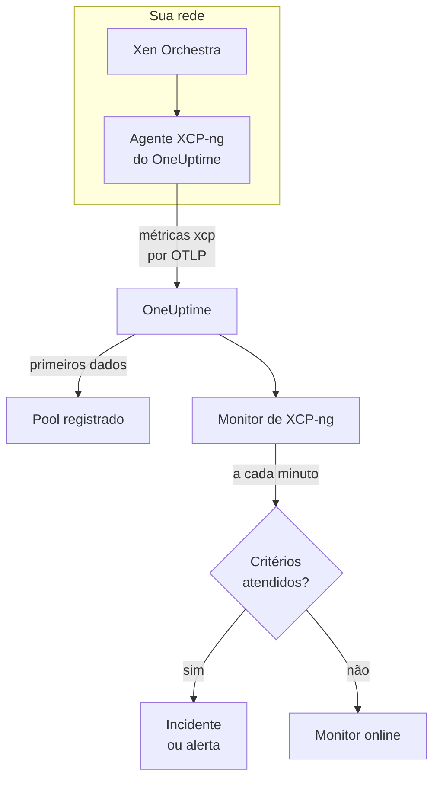

# Monitor de XCP-ng

Um monitor de XCP-ng observa um pool do XCP-ng – os seus hosts, VMs, repositórios de armazenamento e discos virtuais – e avisa você quando o Xen Orchestra perde o pool, um host fica offline ou continua desabilitado, uma VM que estava em execução para ou fica sem CPU, ou um repositório de armazenamento enche ou fica lento. Ele lê as séries `xcp_*` do plugin OpenMetrics do Xen Orchestra, que o agente XCP-ng do OneUptime coleta, e as séries de integridade que o OneUptime deriva delas, então nada é sondado de fora.

:::cards
- [Criar o monitor](#criar-um-monitor-de-xcp-ng): Seis passos no painel.
- [Modelos](#modelos-de-alerta-prontos): Dez alertas prontos, um incidente por host, VM ou repositório de armazenamento.
- [Identidade dos recursos](#identidade-dos-recursos): Como mirar um único host, VM ou repositório de armazenamento.
- [Métricas](#métricas-coletadas): Cada série sobre a qual o monitor pode alertar.
:::

## Como funciona

O agente XCP-ng do OneUptime roda em uma máquina que alcança o Xen Orchestra. A cada 60 segundos, ele lê o plugin OpenMetrics do Xen Orchestra, que lê cada host de cada pool que o Xen Orchestra gerencia, e envia as séries ao OneUptime por OTLP, um recurso por pool, carimbado com o UUID do pool, `xcp_ng.pool.id`. Os primeiros dados registram cada pool.

Um monitor de XCP-ng fica ligado a um pool. A cada minuto, ele executa a sua consulta sobre as métricas desse pool e compara o resultado com os seus critérios.



## Antes de começar

- **Instale o agente XCP-ng** onde ele alcance o Xen Orchestra, com o segredo do plugin OpenMetrics do Xen Orchestra. O [guia do agente XCP-ng](/docs/telemetry/xcp-ng) cobre o plugin, o certificado do Xen Orchestra e a instalação.
- **Verifique se o pool está registrado.** Ele aparece em **Produtos → Infraestrutura → XCP-ng → Todos os pools**, com o nome que o Xen Orchestra lhe dá, cerca de um minuto depois da primeira leitura.

## Criar um monitor de XCP-ng

:::steps
### Começar um monitor novo

Acesse **Monitores** e clique em **Criar monitor**.

### Escolher XCP-ng

Em **Tipo de monitor**, clique em **Mais tipos de monitor** e escolha **XCP-ng** em **Infraestrutura**, ou digite `xcp` na caixa de busca. Informe um **Nome** – ele é usado nos títulos de incidentes e alertas – e clique em **Próximo**.

### Escolher o pool

Em **XCP-ng Monitor Configuration**, escolha o pool em **Pool do XCP-ng**. Cada pool que enviou dados está na lista. Depois de escolhido, uma linha abaixo do campo diz se os dados estão chegando. **Adicionar pool do XCP-ng** abre os passos de configuração com as suas chaves já preenchidas, que esperam os primeiros dados.

### Escolher o que monitorar

Um monitor novo começa em **Pool Disconnected**, em **Sobre o que alertar**. Para observar outra coisa:

- **Alterar** – escolha outro [modelo](#modelos-de-alerta-prontos). Ele define as métricas, os filtros, a agregação, o intervalo de tempo e os limites, e substitui os critérios abaixo pelos dele. Você ainda pode mudar o **Intervalo de tempo**.
- **Custom Metric** (em **Mais campos**) – escolha uma métrica em **XCP-ng Metric** e depois defina a **Agregação** e o **Intervalo de tempo**. Os [filtros](#configurações-do-monitor) a restringem a um tipo de objeto ou a um único objeto.
- **Avançado** (em **Mais campos**) – monte você mesmo consultas e fórmulas em **Selecionar Métricas**, por exemplo a parte usada de um repositório de armazenamento a partir de `xcp_sr_physical_usage_bytes / xcp_sr_physical_size_bytes`. Use **Agrupar por** `xcp_ng.id` para julgar cada objeto separadamente.

### Revisar os critérios

Abra cada critério em **Critérios** e confira sua **Métrica**, **Agregação**, **Condição** e **Limite**. Um modelo os preenche. Com **Custom Metric** ou **Avançado**, o monitor começa com os [critérios padrão](#critérios-padrão), que só percebem uma métrica que não envia dados, então defina o seu próprio limite.

### Criar o monitor

Clique em **Criar monitor**. O OneUptime abre a página do monitor e o avalia a cada minuto. Os incidentes e alertas que ele gera também aparecem nas páginas **Incidentes** e **Alertas** do pool.
:::

> [!TIP]
> Para configurar vários modelos de uma vez, abra o pool em **Produtos → Infraestrutura → XCP-ng** e vá para **Recomendações**. Escolha os modelos que quiser, decida quem é avisado, e o OneUptime cria um monitor por modelo.

## Configurações do monitor

| Campo | Aba | O que faz |
| --- | --- | --- |
| **Pool do XCP-ng** | Todas | Obrigatório. Limita cada consulta a `resource.xcp_ng.pool.id`, o UUID do pool, para que dois pools com o mesmo nome nunca se misturem. |
| **Escopo do recurso** | Custom Metric, Avançado | Opcional. **Host**, **VM**, **Repositório de armazenamento**, **Disco virtual**, **XOSTOR** ou **Pool do XCP-ng** – uma correspondência exata com `xcp_ng.scope`. |
| **UUID** | Custom Metric, Avançado | Opcional. Correspondência exata com `xcp_ng.id`: o UUID de um host, uma VM, um repositório de armazenamento ou um disco virtual, como o Xen Orchestra o mostra. Combine-o com um escopo para mirar um único objeto. |
| **Nome do Host** | Custom Metric, Avançado | Opcional. Correspondência exata com o rótulo `host_name` do Xen Orchestra: as próprias séries do host e as das VMs que rodam nele. |
| **XCP-ng Metric** | Custom Metric | Uma métrica do [catálogo](#métricas-coletadas). |
| **Agregação** | Custom Metric | Como as amostras são combinadas: **Média**, **Máximo**, **Mínimo**, **Soma** ou **Contagem**. Começa na agregação usual da métrica. |
| **Intervalo de tempo** | Todas | A janela móvel que a consulta lê, de **Past 1 Minute** a **Past 365 Days**. Um monitor novo começa em **Past 1 Minute**; os modelos definem a sua. |
| **Selecionar Métricas** | Avançado | O construtor de consultas: **Métrica**, **Agregar por**, **Filtrar por atributos**, **Agrupar por**, além de **Adicionar métrica** e **Adicionar fórmula** para combinar consultas. |

O agente lê o Xen Orchestra a cada 60 segundos, e o Xen Orchestra lê os seus hosts com resolução de 60 segundos, então uma janela de 1 minuto contém cerca de uma amostra; os modelos leem 5 minutos ou mais.

## Identidade dos recursos

O Xen Orchestra nomeia um host ou uma VM pelo rótulo `uuid`, um repositório de armazenamento por `sr_uuid` e um disco virtual por `vdi_uuid`. O OneUptime carimba dois atributos em cada ponto ao chegar, então um único filtro lê cada série de um objeto, seja qual for o rótulo que o nomeou. Os modelos se apoiam neles:

| Atributo | Valores | Para uma VM |
| --- | --- | --- |
| `xcp_ng.scope` | `pool`, `host`, `vm`, `sr` (um repositório de armazenamento), `vdi` (um disco virtual), `xostor` | `vm` |
| `xcp_ng.id` | O UUID do objeto, em minúsculas: o `uuid` de um host ou de uma VM, o `sr_uuid` de um repositório de armazenamento ou de um cluster XOSTOR, o `vdi_uuid` de um disco virtual, e o próprio UUID do pool nas séries do pool | `5c6d7e8f-1a2b-4c3d-9e8f-0a1b2c3d4e5f` |

Filtre por `xcp_ng.scope` para um tipo de objeto, por `xcp_ng.id` para um objeto, e agrupe por `xcp_ng.id` para julgar cada objeto separadamente. Os próprios rótulos do Xen Orchestra ficam como ele os envia: `host_name` nomeia um host nas suas séries e o host de uma VM nas da VM, `vm_name`, `sr_name` e `vdi_name` nomeiam o resto, `power_state` e `enabled` levam o estado de um host ou de uma VM nas séries de estado, e `is_control_domain` vale `true` nas séries de VM de um domínio de controle.

O próprio pool é o recurso em que as séries chegam, então os seus atributos levam o prefixo `resource.` nos filtros e nas chaves de agrupamento: `resource.xcp_ng.pool.id` (o seu UUID), `resource.xcp_ng.pool.name` (o seu nome no Xen Orchestra) e `resource.xen_orchestra.name` (o Xen Orchestra de onde ele é lido).

## Modelos de alerta prontos

A lista **Sobre o que alertar** oferece 10 modelos. Cada um monta um monitor completo – consultas, filtros de atributos, um agrupamento, um critério que dispara e outro que recupera. A maioria agrupa por `xcp_ng.id`, então cada host, VM ou repositório de armazenamento recebe o seu próprio incidente e o seu próprio alerta. Os limites são pontos de partida que você pode editar.

Um critério só dispara quando a condição se mantém em cada minuto da sua janela, e um critério de limite se recupera 10% além do seu limite, para que um valor que oscila na linha não fique alternando. Uma série 0/1 se recupera no outro valor.

| Modelo | Categoria | Gravidade | Observa | Dispara quando | Recupera quando |
| --- | --- | --- | --- | --- | --- |
| Pool Disconnected | Disponibilidade | Crítico | `xcp_pool_connected`, Count sobre todo o pool, últimos 10 minutos | Sem dados durante toda a janela | Os dados voltam a chegar |
| Host Offline | Disponibilidade | Crítico | `xcp_ng.host.running` para `xcp_ng.scope = host`, Min por `xcp_ng.id`, últimos 5 minutos | Abaixo de 1 | Em 1 |
| VM Stopped | VM | Aviso | `xcp_ng.vm.stopped_after_running` para `xcp_ng.scope = vm`, Min por `xcp_ng.id`, últimos 5 minutos | Acima de 0 | Em 0 |
| Storage Repository Near Full | Armazenamento | Crítico | `xcp_sr_physical_usage_bytes` ÷ `xcp_sr_physical_size_bytes` × 100 para `xcp_ng.scope = sr` (ambos Soma), por `xcp_ng.id`, últimos 5 minutos | Acima de 90% | Em 81% ou menos |
| Host Disabled | Host | Aviso | `xcp_ng.host.enabled` para `xcp_ng.scope = host`, Max por `xcp_ng.id`, últimos 30 minutos | Abaixo de 1 | Em 1 |
| Host Restarted | Host | Aviso | `xcp_host_uptime_seconds` e `xcp_ng.host.running` para `xcp_ng.scope = host`, Min por `xcp_ng.id`, últimos 5 minutos | `xcp_host_uptime_seconds` está abaixo de 900 (15 minutos) enquanto `xcp_ng.host.running` é 1 | `xcp_host_uptime_seconds` está em 990 ou mais, ou `xcp_ng.host.running` é 0 |
| High Host CPU Usage | Host | Aviso | `xcp_host_cpu_average` para `xcp_ng.scope = host`, Avg por `xcp_ng.id`, últimos 10 minutos | Acima de 0,9 (90% da CPU do host) | Em 0,81 ou menos |
| High Host Memory Usage | Host | Aviso | (`xcp_host_memory_total_bytes` − `xcp_host_memory_free_bytes`) ÷ `xcp_host_memory_total_bytes` × 100 para `xcp_ng.scope = host` (ambos Soma), por `xcp_ng.id`, últimos 10 minutos | Acima de 95% | Em 85,5% ou menos |
| VM Starved of CPU | VM | Aviso | `xcp_vm_runstate_full_contention` para `xcp_ng.scope = vm`, Avg por `xcp_ng.id`, últimos 15 minutos | Acima de 0,1 (10% do tempo) | Em 0,09 ou menos |
| Storage Repository Slow | Armazenamento | Aviso | `xcp_host_disk_latency_seconds` para `xcp_ng.scope = host`, Avg por `sr`, últimos 15 minutos | Acima de 0,05 (50 ms) | Em 0,045 ou menos |

**Gravidade** é o rótulo que o seletor mostra. O incidente e o alerta que um modelo cria começam com a gravidade de incidente e de alerta mais alta do seu projeto; altere-as nos critérios.

- **Pool Disconnected** dispara quando `xcp_pool_connected` para de chegar por dez minutos. O Xen Orchestra a envia a cada leitura enquanto está conectado ao pool, e para de enviá-la, em vez de enviar 0, quando perde o mestre do pool; ela também para quando o Xen Orchestra, o seu plugin ou o agente XCP-ng para, ou quando o agente perde a sua rota até o OneUptime. Ele se resolve quando a série volta. Quando os dados param, os outros modelos não têm nada para comparar e mantêm o seu último status, então é este que avisa você.
- **Host Offline** lê `xcp_ng.host.running`, que o OneUptime deriva de `xcp_host_status`: 0 enquanto o Xen Orchestra relata o host como Halted, ou o seu estado como Unknown porque o mestre do pool perdeu o contato com ele. As VMs que rodavam no host também caíram, a menos que o HA as tenha reiniciado em outro lugar.
- **VM Stopped** lê `xcp_ng.vm.stopped_after_running`: 1 enquanto uma VM que rodou nas últimas 24 horas está Halted ou Paused. Uma VM desligada há mais de um dia conta como desligada de propósito e para de alertar, uma VM suspensa (Suspended) nunca alerta, e os domínios de controle e os modelos de VM ficam de fora.
- **Host Disabled** dispara para um host que continua desabilitado por 30 minutos: em modo de manutenção, ou deixado desabilitado por uma evacuação. O XAPI não inicia nenhuma VM nele e o HA não consegue fazer failover para ele. Trinta minutos deixam passar uma reinicialização ou uma atualização planejada sem aviso.
- **Host Restarted** dispara para um host que está em execução mas está ligado há menos de 15 minutos: ele reiniciou, ou travou e voltou. Ele se resolve quando o host está ligado há 16,5 minutos, 10% além do limite; um host fora do ar gera em vez disso **Host Offline**.
- As **fórmulas de razão** usam a **Soma** dos dois lados. Os dois vêm da mesma leitura, então o resultado é uma porcentagem real. Um repositório de armazenamento que informa um tamanho de 0, como fazem algumas bibliotecas ISO e mídias removíveis, nunca dispara.
- **VM Starved of CPU** lê a contenção total: a parte do tempo em que todas as vCPUs de uma VM estavam prontas para rodar mas esperavam uma CPU física. O seu host tem mais vCPUs executáveis do que threads de CPU, então a VM roda mais devagar do que o seu próprio uso de CPU sugere.
- **Storage Repository Slow** agrupa por `sr`, o identificador curto de um repositório de armazenamento no Xen Orchestra, presente em cada série de disco de um host, então cada repositório de armazenamento recebe um incidente, com a latência como média dos hosts que leem e gravam nele.

O plugin não relata alarmes além dos do XOSTOR, nem estado de HA, nem mestre do pool, nem patches pendentes, nem backups, então nenhum modelo os observa ainda: veja [O que o plugin ainda não cobre](/docs/telemetry/xcp-ng#o-que-o-plugin-ainda-não-cobre).

## Métricas coletadas

O agente lê cada série do plugin OpenMetrics do Xen Orchestra a cada 60 segundos; as séries abaixo são o catálogo que o formulário do monitor oferece. O Xen Orchestra já converte os KiB, MiB/s e microssegundos do XAPI em bytes, bytes por segundo e segundos. Oito séries que ele chama de `_total` e tipifica como contadores contêm taxas por segundo, e o OneUptime as armazena como as taxas que são, como explica o [guia do agente XCP-ng](/docs/telemetry/xcp-ng#o-que-o-agente-coleta). As quatro séries `xcp_ng.*` são do próprio OneUptime, derivadas das séries de estado do Xen Orchestra quando chegam.

### Disponibilidade

| Métrica | Unidade | Descrição |
| --- | --- | --- |
| `xcp_pool_connected` | — | 1 enquanto o Xen Orchestra está conectado ao pool. O Xen Orchestra para de enviá-la quando perde o pool, em vez de enviar 0: observe quando ela para. |
| `xcp_ng.host.running` | — | 1 enquanto o Xen Orchestra relata um host como Running, 0 enquanto ele está Halted ou o seu estado é Unknown. Derivada pelo OneUptime do estado do host. |
| `xcp_ng.host.enabled` | — | 1 enquanto um host está habilitado, 0 enquanto está em modo de manutenção ou sendo evacuado, quando o XAPI não inicia nenhuma VM nele. Derivada pelo OneUptime do estado do host. |
| `xcp_ng.vm.running` | — | 1 enquanto uma VM está Running, 0 enquanto está Halted, Paused ou Suspended. Os domínios de controle ficam de fora. Derivada pelo OneUptime do estado da VM. |
| `xcp_ng.vm.stopped_after_running` | — | 1 enquanto uma VM que rodou nas últimas 24 horas está Halted ou Paused, senão 0. Uma VM que ninguém viu rodar em um dia conta como desligada de propósito, e uma VM suspensa nunca conta. Derivada pelo OneUptime. |
| `xcp_host_status` | count | Sempre 1 para cada host, em execução ou não; o estado do host está nos rótulos `power_state` (Running, Halted, Unknown) e `enabled`. |
| `xcp_vm_status` | count | Sempre 1 para cada VM, exceto domínios de controle e modelos; o estado da VM está no rótulo `power_state` (Running, Halted, Paused, Suspended). |
| `xcp_host_uptime_seconds` | seconds | Há quanto tempo um host está ligado desde que iniciou. |
| `xcp_vm_uptime_seconds` | seconds | Há quanto tempo uma VM em execução está ligada desde que iniciou. Só é relatada enquanto a VM roda. |

### Host

| Métrica | Unidade | Descrição |
| --- | --- | --- |
| `xcp_host_cpu_average` | ratio | O uso de CPU de um host, em média sobre os seus núcleos, como razão de 0 a 1. |
| `xcp_host_cpu_core_usage` | ratio | O uso de uma thread de CPU em um host, como razão de 0 a 1; o rótulo `core` diz qual. |
| `xcp_host_load` | — | As vCPUs rodando ou esperando para rodar em um host, por CPU física. Acima de 1, as VMs esperam por uma CPU. |
| `xcp_host_load_average` | — | A carga média do domínio de controle (dom0) de um host. |
| `xcp_host_memory_total_bytes` | bytes | A memória física de um host. |
| `xcp_host_memory_free_bytes` | bytes | A memória de um host não atribuída a nenhuma VM. Compare-a com `xcp_host_memory_total_bytes` para ver o quanto o host está cheio. |
| `xcp_host_memory_reclaimed_bytes` | bytes | A memória recuperada das VMs de um host pelo controle dinâmico de memória. |
| `xcp_host_memory_reclaimed_max_bytes` | bytes | A memória máxima que o controle dinâmico de memória poderia recuperar das VMs de um host. |
| `xcp_host_running_vcpus` | count | As vCPUs das VMs em execução em um host, somadas. |
| `xcp_host_power_consumption_watts` | W | O consumo de energia de um host, lido do seu sensor DCMI. Onde o Xen Orchestra o lê por IPMI, ele envia essa leitura sem o seu pool, então o agente não a mantém; a parte estimada de cada VM é mantida. |

### VM

| Métrica | Unidade | Descrição |
| --- | --- | --- |
| `xcp_vm_cpu_usage` | ratio | O uso de CPU de uma VM, em média sobre as suas vCPUs, como razão de 0 a 1. |
| `xcp_vm_cpu_core_usage` | ratio | O uso de uma vCPU, como razão de 0 a 1; o rótulo `core` diz qual. |
| `xcp_vm_runstate_full_contention` | ratio | A parte do tempo em que todas as vCPUs de uma VM estavam prontas para rodar mas esperavam uma CPU física, de 0 a 1. Um valor alto significa que as vizinhas deixam a VM sem CPU. |
| `xcp_vm_runstate_partial_contention` | ratio | A parte do tempo em que algumas vCPUs de uma VM esperavam uma CPU física enquanto as outras estavam bloqueadas, de 0 a 1. |
| `xcp_vm_runstate_concurrency_hazard` | ratio | A parte do tempo em que algumas vCPUs de uma VM rodavam enquanto outras esperavam uma CPU física, de 0 a 1. |
| `xcp_vm_runstate_fullrun` | ratio | A parte do tempo em que todas as vCPUs de uma VM estavam rodando, de 0 a 1. |
| `xcp_vm_runstate_partial_run` | ratio | A parte do tempo em que algumas vCPUs de uma VM rodavam e as outras estavam bloqueadas, de 0 a 1. |
| `xcp_vm_runstate_blocked` | ratio | A parte do tempo em que todas as vCPUs de uma VM estavam bloqueadas, sem nada para fazer ou esperando E/S, de 0 a 1. |
| `xcp_vm_memory_bytes` | bytes | A memória atribuída a uma VM. |
| `xcp_vm_memory_target_bytes` | bytes | A memória que o controle dinâmico de memória pretende atribuir a uma VM. |
| `xcp_vm_memory_internal_free_bytes` | bytes | A memória que o convidado declara livre. Precisa das ferramentas de convidado na VM. |
| `xcp_vm_power_consumption_watts` | W | A estimativa do Xen Orchestra da parte de uma VM no consumo do seu host, dividida pela carga de CPU. O seu rótulo `data_complete` é `false` quando a leitura de CPU da VM faltava. |

### Armazenamento

| Métrica | Unidade | Descrição |
| --- | --- | --- |
| `xcp_sr_physical_size_bytes` | bytes | O tamanho físico de um repositório de armazenamento. Algumas bibliotecas ISO e mídias removíveis informam 0. |
| `xcp_sr_physical_usage_bytes` | bytes | O espaço usado em um repositório de armazenamento. Divida-o pelo seu tamanho para ver o quanto ele está cheio. |
| `xcp_sr_virtual_size_bytes` | bytes | O tamanho virtual de todos os discos em um repositório de armazenamento, somado. Acima do seu tamanho, o repositório tem thin provisioning além do que consegue guardar. |
| `xcp_vdi_virtual_size_bytes` | bytes | O tamanho de um disco virtual como a sua VM o vê. |
| `xcp_vdi_physical_usage_bytes` | bytes | O espaço que um disco virtual ocupa no seu repositório de armazenamento. |
| `xcp_host_disk_iops_read` | ops/s | Operações de leitura por segundo de um host para um repositório de armazenamento; o rótulo `sr_name` diz qual. |
| `xcp_host_disk_iops_write` | ops/s | Operações de gravação por segundo de um host para um repositório de armazenamento. |
| `xcp_host_disk_iops_total` | ops/s | Operações de leitura e gravação por segundo de um host para um repositório de armazenamento. |
| `xcp_host_disk_throughput_read_bytes` | bytes/s | Bytes por segundo que um host lê de um repositório de armazenamento. |
| `xcp_host_disk_throughput_write_bytes` | bytes/s | Bytes por segundo que um host grava em um repositório de armazenamento. |
| `xcp_host_disk_throughput_total_bytes` | bytes/s | Bytes por segundo que um host lê de um repositório de armazenamento e grava nele. |
| `xcp_host_disk_read_latency_seconds` | seconds | Quanto tempo levam as leituras de um host em um repositório de armazenamento. |
| `xcp_host_disk_write_latency_seconds` | seconds | Quanto tempo levam as gravações de um host em um repositório de armazenamento. |
| `xcp_host_disk_latency_seconds` | seconds | Quanto tempo levam as leituras e gravações de um host em um repositório de armazenamento. |
| `xcp_host_disk_iowait` | ratio | A parte do tempo em que um host esperou por um repositório de armazenamento, de 0 a 1. |
| `xcp_vm_disk_read_bytes_total` | bytes/s | Bytes por segundo que uma VM lê de um dos seus discos; o rótulo `device` diz qual. Uma taxa, embora o Xen Orchestra a chame de `_total` e a tipifique como contador. |
| `xcp_vm_disk_write_bytes_total` | bytes/s | Bytes por segundo que uma VM grava em um dos seus discos. Uma taxa, embora o Xen Orchestra a chame de `_total` e a tipifique como contador. |
| `xcp_vm_disk_iops_read` | ops/s | Operações de leitura por segundo no disco de uma VM. |
| `xcp_vm_disk_iops_write` | ops/s | Operações de gravação por segundo no disco de uma VM. |
| `xcp_vm_disk_iops_total` | ops/s | Operações de leitura e gravação por segundo no disco de uma VM. |
| `xcp_vm_disk_throughput_read_bytes` | bytes/s | Bytes por segundo lidos do disco de uma VM. |
| `xcp_vm_disk_throughput_write_bytes` | bytes/s | Bytes por segundo gravados no disco de uma VM. |
| `xcp_vm_disk_throughput_total_bytes` | bytes/s | Bytes por segundo lidos do disco de uma VM e gravados nele. |
| `xcp_vm_disk_read_latency_seconds` | seconds | Quanto tempo levam as leituras do disco de uma VM. |
| `xcp_vm_disk_write_latency_seconds` | seconds | Quanto tempo levam as gravações no disco de uma VM. |
| `xcp_vm_disk_latency_seconds` | seconds | Quanto tempo levam, em média, as leituras e gravações no disco de uma VM. |
| `xcp_vm_disk_iowait` | ratio | A parte do tempo em que uma VM esperou por um dos seus discos, de 0 a 1. |
| `xcp_vm_disk_inflight` | count | As requisições no disco de uma VM ainda sem resposta. |
| `xcp_vm_disk_queue_size` | count | A fila média de requisições no disco de uma VM. |

### Rede

| Métrica | Unidade | Descrição |
| --- | --- | --- |
| `xcp_host_network_receive_bytes_total` | bytes/s | Bytes por segundo que um host recebe em uma interface física; o rótulo `interface` diz qual. Uma taxa, embora o Xen Orchestra a chame de `_total` e a tipifique como contador. |
| `xcp_host_network_transmit_bytes_total` | bytes/s | Bytes por segundo que um host envia por uma interface física. Uma taxa, embora o Xen Orchestra a chame de `_total` e a tipifique como contador. |
| `xcp_host_network_aggregated_receive_bytes` | bytes/s | Bytes por segundo que um host recebe em todas as suas interfaces físicas. |
| `xcp_host_network_aggregated_transmit_bytes` | bytes/s | Bytes por segundo que um host envia por todas as suas interfaces físicas. |
| `xcp_vm_network_receive_bytes_total` | bytes/s | Bytes por segundo que uma VM recebe em uma das suas interfaces de rede; o rótulo `vif` diz qual. Uma taxa, embora o Xen Orchestra a chame de `_total` e a tipifique como contador. |
| `xcp_vm_network_transmit_bytes_total` | bytes/s | Bytes por segundo que uma VM envia por uma das suas interfaces de rede. Uma taxa, embora o Xen Orchestra a chame de `_total` e a tipifique como contador. |
| `xcp_vm_network_receive_errors_total` | errors/s | Erros de recepção por segundo em uma das interfaces de rede de uma VM. Uma taxa, embora o Xen Orchestra a tipifique como contador. |
| `xcp_vm_network_transmit_errors_total` | errors/s | Erros de envio por segundo em uma das interfaces de rede de uma VM. Uma taxa, embora o Xen Orchestra a tipifique como contador. |

### XOSTOR

Enviadas só para os pools que executam o XOSTOR, o armazenamento replicado da Vates construído sobre o LINSTOR.

| Métrica | Unidade | Descrição |
| --- | --- | --- |
| `xcp_xostor_up` | — | 1 quando o Xen Orchestra conseguiu ler a integridade de um cluster XOSTOR, 0 quando não conseguiu. |
| `xcp_xostor_node_status` | count | Sempre 1 para cada nó de um cluster XOSTOR; o seu papel e o seu estado estão nos rótulos `role` e `state`. |
| `xcp_xostor_resource_total` | count | Os recursos do LINSTOR que um cluster XOSTOR define. |
| `xcp_xostor_resource_state_count` | count | As réplicas de recursos de um cluster XOSTOR em cada estado de disco; o rótulo `state` diz qual. |
| `xcp_xostor_alarms_up` | — | 1 quando o Xen Orchestra conseguiu ler os alarmes de um cluster XOSTOR, 0 quando não conseguiu. |
| `xcp_xostor_alarms_count` | count | Os alarmes do XAPI ativos em um repositório de armazenamento XOSTOR ou nos seus hosts, por `alarm_name` e `target_type`. Ausente quando nenhum está levantado. |
| `xcp_xostor_smart_up` | — | 1 quando o Xen Orchestra conseguiu ler os dados SMART de um host para o XOSTOR, 0 quando não conseguiu. |
| `xcp_xostor_disk_smart_status` | count | Sempre 1 para cada disco de um host XOSTOR; a sua saúde SMART está no rótulo `status`. |
| `xcp_xostor_updates_up` | — | 1 quando a verificação de atualizações do XOSTOR de um host respondeu, 0 quando falhou. |
| `xcp_xostor_package_update_available` | count | 1 para cada pacote do XOSTOR com uma atualização pendente em um host; o rótulo `package` diz qual. |

## Critérios de monitoramento

Um critério compara uma das consultas ou fórmulas do monitor com um limite. Os critérios de um monitor de XCP-ng não têm **Tipo de filtro**: cada regra verifica o valor da métrica, com estes campos.

| Campo | O que faz |
| --- | --- |
| **Métrica** | A consulta ou fórmula a verificar, pelo nome da variável. |
| **Agregação** | Como os valores da janela viram uma única resposta: **Média**, **Soma**, **Valor máximo**, **Valor mínimo**, **Todos os valores** (todos os valores precisam corresponder, na janela inteira) ou **Qualquer valor** (basta um). |
| **Condição** | **Maior que**, **Menor que**, **Maior ou igual a**, **Menor ou igual a**, **Igual a** ou **Diferente de** – ou uma condição de anomalia: **Anomalamente alto**, **Anomalamente baixo** ou **Anômalo**. **Sem dados** corresponde quando a consulta não retornou nada na janela, e **Com dados** quando retornou algo. **Previsão acima de** e **Previsão abaixo de** correspondem quando a tendência da métrica na janela tiver passado do limite ao fim de **Horizonte**. |
| **Limite** | O valor com que comparar. Uma lista de unidades fica ao lado quando a métrica tem unidade. Não aparece em condições de anomalia. |
| **Sensibilidade** | Só condições de anomalia. **Baixo** (4σ), **Médio** (3σ, o padrão) ou **Alto** (2σ). |
| **Janela de linha de base** | Só condições de anomalia. 14 dias (o padrão), 28, 60 ou 90 dias de histórico. |
| **Se não houver dados** | Em **Mais campos**. O que acontece quando a janela não tem amostras: **Ignore** (o padrão), **Treat As Zero** ou **Gatilho**. |

As condições de anomalia comparam cada valor com a mesma hora da semana na linha de base. Elas ficam em um estado "Learning", e não geram nada, até a janela de linha de base ter histórico suficiente. Este monitor filtra suas consultas por atributos, então cada consulta, e cada série de uma consulta agrupada, é comparada com o próprio histórico, até onde suas métricas são mantidas. Se isso for menos de duas semanas, uma soma, uma contagem ou uma consulta sobre um histograma permanece nesse estado para sempre, e todo o resto é comparado com todas as séries da métrica. Um percentil de um histograma sempre permanece nesse estado.

Cada critério também diz o que fazer quando corresponde: mudar o status do monitor, criar um alerta ou declarar um incidente. Os critérios são verificados de cima para baixo, e o primeiro que corresponde decide.

### Critérios padrão

Um monitor que você não cria a partir de um modelo começa com dois critérios:

| Ordem | Critério | Corresponde quando | Então |
| --- | --- | --- | --- |
| 1 | Verificar se _nome do monitor_ está offline | A primeira consulta não tem dados em toda a janela | Marca o monitor como **Offline** e declara o incidente "_nome do monitor_ está offline", que se resolve sozinho quando o monitor se recupera. |
| 2 | Verificar se _nome do monitor_ está online | A primeira consulta tem dados | Marca o monitor como **Operacional**. |

> [!IMPORTANT]
> Um valor `0` é um dado, então uma métrica que costuma ser zero, como os erros de rede de uma VM, não deixa o monitor offline. Para alertar sobre um valor, comece de um modelo ou adicione um critério com um limite. Quando nenhum dado chega e nenhum critério corresponde, o monitor mantém o seu status e os incidentes abertos continuam abertos: silêncio não é recuperação. O tempo em que o próprio OneUptime não estava recebendo nunca é ausência de dados: uma verificação cuja janela o contém espera, como explica [Quando o OneUptime não está recebendo dados](/docs/monitor/when-oneuptime-is-not-receiving).

## Terraform

O [provider Terraform do OneUptime](/docs/terraform/monitor-steps) leva a configuração de uma etapa de monitor de XCP-ng no atributo `xcp_ng_monitor`: o JSON bruto da configuração `xcpNgMonitor` (`poolIdentifier`, `resourceFilters`, `metricViewConfig`, `rollingTime`), escrito com `jsonencode()`:

```hcl title="main.tf"
monitor_steps = [{
  xcp_ng_monitor = jsonencode({
    poolIdentifier  = "b7569d99-30f8-178a-7d94-801de3e29b5b"
    resourceFilters = { scope = "host" }
    rollingTime     = "Past 10 Minutes"
    metricViewConfig = {
      queryConfigs = [{
        metricAliasData = { metricVariable = "host_cpu", title = "Host CPU", description = "", legend = "" }
        metricQueryData = {
          filterData = {
            metricName     = "xcp_host_cpu_average"
            attributes     = {}
            aggegationType = "Avg"
            aggregateBy    = {}
          }
          groupByAttributeKeys = ["xcp_ng.id"]
        }
      }]
      formulaConfigs = []
    }
  })
  criteria = [ /* ... */ ]
}]
```

`poolIdentifier` é o UUID do pool, o seu `xcp_ng.pool.id` como as **Configurações** do pool o mostram, não o seu ID do OneUptime. `resourceFilters` contém os [filtros](#configurações-do-monitor) que o formulário chama de **Escopo do recurso**, **UUID** e **Nome do Host**: `scope` (`host`, `vm`, `sr`, `vdi`, `xostor` ou `pool`), `xcpNgId` e `hostName`.

## Solução de problemas

:::details O pool não está na lista Pool do XCP-ng
Os pools se registram a partir dos dados do agente. Verifique se o agente está em execução e enviando dados (veja o [guia do agente XCP-ng](/docs/telemetry/xcp-ng)), e se o Xen Orchestra está conectado ao pool: um pool que o Xen Orchestra não relata nunca chega ao OneUptime.
:::

:::details Host Offline ou VM Stopped nunca dispara
Eles leem `xcp_ng.host.running` e `xcp_ng.vm.stopped_after_running`, que o OneUptime deriva de `xcp_host_status` e `xcp_vm_status`. As duas séries de estado vêm do plugin OpenMetrics do Xen Orchestra 6.9 ou posterior: em um Xen Orchestra mais antigo, atualize-o. **VM Stopped** também fica em silêncio para uma VM que ninguém viu rodar nas últimas 24 horas, e para uma VM suspensa.
:::

:::details Os incidentes disparam uma vez para todo o pool em vez de uma vez por host
Agrupe a consulta por `xcp_ng.id`, como fazem os modelos. Sem agrupamento, a consulta lê cada host, VM ou repositório de armazenamento do pool como uma única série, e uma média de todos esconde o que está com problema.
:::

:::details Um gráfico de vazão mostra valores altos demais, ou fica abaixo de zero
As oito séries `_total` que contêm taxas são armazenadas como gauges em bytes ou erros por segundo, os valores que o Xen Orchestra fornece. Leia-as como são, com **Média** ou **Máximo**: **Converter em taxa por segundo** no construtor de consultas tiraria uma taxa de uma taxa. Um coletor que você mesmo configurou também precisa transformá-las em gauges, como faz o processador `transform/xcp-ng-rates` do agente; o OneUptime também converte as que ainda chegarem como contadores.
:::

:::details Pool Disconnected dispara para todos os pools de um Xen Orchestra de uma vez
O agente, o Xen Orchestra ou o seu plugin OpenMetrics parou, ou o agente perdeu a sua rota até o OneUptime: todos os pools desse Xen Orchestra silenciaram juntos. O `troubleshoot.sh` do agente aponta a etapa que falha, como explica o [guia do agente XCP-ng](/docs/telemetry/xcp-ng#solução-de-problemas).
:::

## Próximos passos

:::cards
- [Agente XCP-ng](/docs/telemetry/xcp-ng): Instale o agente que envia as métricas.
- [Monitor de Proxmox](/docs/monitor/proxmox-monitor): O mesmo tipo de monitor para o Proxmox VE.
- [Monitor de VMware](/docs/monitor/vmware-monitor): O mesmo tipo de monitor para o vSphere.
- [Visão geral dos incidentes](/docs/incidents/index): O que acontece depois que um critério declara um incidente.
:::
