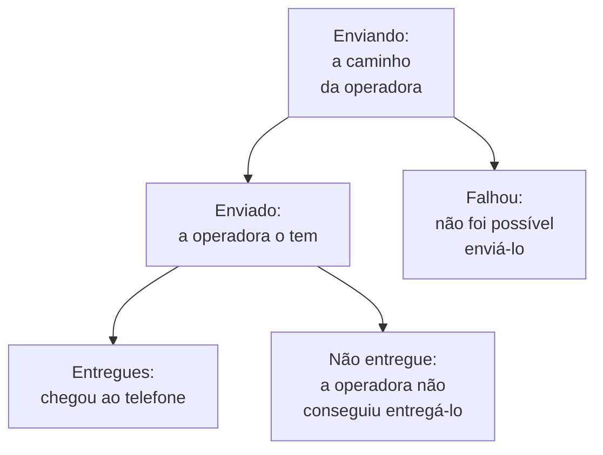

# Logs de notificação

Os logs de notificação listam cada mensagem que o OneUptime enviou para o seu projeto, uma aba por canal, e o que aconteceu com cada uma: se saiu, se chegou e, se não, por quê. Abra-os em **Configurações do projeto → Notificações → Logs de notificação**, ou em **Logs de notificação** de um incidente, um alerta, um evento de manutenção, uma página de status ou uma política de plantão, para ver o que foi enviado sobre ele.

:::cards
- [Como ler um status](#como-ler-um-status): A cor diz onde a mensagem está, e apontar para ele diz o que significa.
- [SMS](#sms): Enviando, depois Enviado, depois Entregues, conforme a operadora informa.
- [Chamadas](#chamadas): Chamando, depois como a chamada terminou.
- [WhatsApp e Telegram](#whatsapp-e-telegram): O que cada aplicativo informa depois de aceitar uma mensagem.
- [E-mail, push, webhooks e espaços de trabalho](#e-mail-push-webhooks-e-espaços-de-trabalho): Sucesso, ou Erro e por quê.
- [Quando um SMS fica em Enviado](#quando-um-sms-fica-em-enviado): Operadoras que nunca respondem, e relatórios que nunca chegam.
:::

## Como ler um status

Cada status é uma etiqueta cuja cor diz onde a mensagem está:

| Cor | Onde a mensagem está |
| --- | --- |
| Cinza | Entregue ao provedor, e nada voltou ainda, como **Enviando**. |
| Azul | O provedor a tem, e ainda vai dizer como terminou, como **Enviado** em um SMS ou **Chamando** em uma chamada. |
| Verde | Chegou à pessoa, como **Entregues**, ou este é o último status que terá. |
| Amarelo | Chegou ao telefone e ninguém atendeu, como **Chamada perdida**, ou saiu com um aviso. |
| Vermelho | Não chegou à pessoa, como **Não entregue**, **Falhou**, **Erro** ou **Saldo insuficiente**. |

Aponte para um status, toque nele ou chegue até ele com a tecla Tab, e ele diz o que significa e o que vem depois. **Ver mensagem de status**, no menu da linha, mostra o que o provedor respondeu, como o ID da mensagem ou o motivo da falha. O filtro **Status** de cada aba lista todos os status que a aba pode mostrar, na ordem em que uma mensagem passa por eles.

O cartão **Quem foi avisado**, na visão geral de um incidente ou de um alerta, e o resultado de uma chamada de teste mostram o status de cada mensagem da mesma forma, nas mesmas cores: uma chamada que ainda está tocando aparece como **Chamando** lá também, nunca como **Enviado**.

## SMS

| Status | O que significa |
| --- | --- |
| **Enviando** | O OneUptime entregou o SMS ao Twilio, que o está repassando à operadora. |
| **Enviado** | A operadora aceitou o SMS. Passa para **Entregues** ou **Não entregue** assim que a operadora responder. |
| **Entregues** | A operadora confirmou que o SMS chegou ao telefone. É o último status de um SMS que chegou. |
| **Não entregue** | A operadora não conseguiu entregá-lo. **Código de erro** informa o motivo e o que o código significa. |
| **Falhou** | O Twilio não conseguiu enviá-lo. **Código de erro** informa o motivo. |
| **Erro** | Não foi enviado, por exemplo porque os SMS estão desativados no projeto, ou porque o Twilio recusou o número. **Ver mensagem de status** informa o motivo. |
| **Saldo insuficiente** | Não foi enviado: o saldo do projeto era baixo demais para pagar por ele. |
| **Sucesso** | Foi enviado antes de o OneUptime acompanhar a entrega, e o Twilio o aceitou. |

Um SMS que o próprio gateway de SMS e chamadas do servidor aceitou fica em **Enviado**, em verde: o gateway não informa a entrega, então esse é o seu último status.

O Twilio informa ao OneUptime cada mudança assim que ela acontece, assinada com o token de autenticação da conta pela qual o SMS saiu, e o OneUptime recusa qualquer relatório que não seja do Twilio. Para isso, o Twilio precisa conseguir alcançar o seu servidor: veja [Integração do Twilio](/docs/self-hosted/twilio-integration).

### Códigos de erro

Cada código em **Código de erro** abre a página do Twilio sobre ele, que lista o que pode causá-lo. Abaixo dos códigos com que um SMS mais falha, o log diz em uma linha o que eles significam:

| Código | O que significa |
| --- | --- |
| `20003` | O Twilio não aceitou as credenciais da conta. |
| `21211` | O número não é um número de telefone válido. |
| `21408` | A conta Twilio não tem permissão para enviar SMS para este país. |
| `21606` | O número de envio não pode enviar SMS por esta conta Twilio. |
| `21608` | Uma conta de teste do Twilio só pode enviar para números verificados nela. |
| `21610` | O destinatário respondeu STOP, então o Twilio não envia mais SMS para ele a partir deste número. |
| `21612` | O número de envio não consegue alcançar este número. |
| `21614` | O número não é um número de celular, e sim, por exemplo, um telefone fixo. |
| `30001` | Foram enviados SMS demais de uma vez, e a fila do Twilio transbordou. |
| `30002` | A conta Twilio foi suspensa antes de o SMS sair. |
| `30003` | O telefone está desligado ou fora de alcance. |
| `30004` | O número está bloqueado para receber o SMS. |
| `30005` | O número é desconhecido e pode não existir mais. |
| `30006` | O número não pode receber SMS, por exemplo por ser um telefone fixo. |
| `30007` | O Twilio ou a operadora filtrou o SMS como spam. |
| `30008` | A operadora não conseguiu entregar o SMS e não disse o motivo. |
| `30032` | O número gratuito de envio ainda não foi verificado. |
| `30034` | O número de envio não está registrado no A2P 10DLC, que as operadoras dos EUA exigem. |

Um código que não é do Twilio, como o status HTTP com que o seu gateway de SMS e chamadas respondeu, é mostrado como está.

## Chamadas

| Status | O que significa |
| --- | --- |
| **Chamando** | O Twilio fez a chamada. Muda assim que o Twilio informar como a chamada terminou. |
| **Sucesso** | A chamada foi atendida, e **Ver mensagem de status** informa quanto tempo ela durou. Uma chamada que o próprio gateway de SMS e chamadas do servidor aceitou fica em **Sucesso** assim que o gateway a aceita. |
| **Chamada perdida** | A chamada tocou sem resposta: ninguém atendeu. |
| **Ocupado** | A linha estava ocupada, ou a chamada foi recusada. |
| **Caixa postal** | A caixa postal atendeu uma chamada de plantão. **Ver mensagem de status** informa se uma mensagem foi deixada. |
| **Erro** | Não foi possível fazer ou conectar a chamada. |
| **Saldo insuficiente** | Não foi feita: o saldo do projeto era baixo demais para pagar por ela. |

## WhatsApp e Telegram

Uma mensagem do WhatsApp fica **Na fila** enquanto o OneUptime a entrega, **Enviado** assim que o WhatsApp a aceita, **Entregues** assim que chega ao telefone, e **Lido** assim que é aberta, se a pessoa compartilhar confirmações de leitura. **Falhou** é uma mensagem que o WhatsApp não conseguiu entregar, e **Aviso** uma que ele enviou com um aviso: **Ver mensagem de status** informa o que o WhatsApp relatou. **Erro** e **Saldo insuficiente** significam que ela não foi enviada, como em um SMS.

O Telegram não informa mais nada depois de aceitar uma mensagem, então o status **Enviado** de uma mensagem do Telegram é verde: o Telegram a publicou no chat, e esse é o seu último status.

## E-mail, push, webhooks e espaços de trabalho

Estas abas dizem **Sucesso** ou **Erro**. **Sucesso** é o último status: o servidor de e-mail aceitou o e-mail, o serviço de push aceitou a notificação, o endereço do webhook respondeu que recebeu a solicitação, ou o espaço de trabalho fez o que foi pedido. O OneUptime não acompanha um e-mail depois que o servidor de e-mail o aceita, e uma notificação push muda para **Erro** se o serviço de push informar depois que ela não foi entregue. **Ver mensagem de status** informa por que uma mensagem está em **Erro**, assim como **Motivo** na aba **Espaço de trabalho**.

## Quando um SMS fica em Enviado

**Enviado** significa que a operadora tem o SMS e ainda não respondeu. A maioria das operadoras responde em segundos ou minutos, mas algumas nunca respondem: então o Twilio também mantém o SMS em `sent`, como mostram os seus logs de mensagens, e o OneUptime não tem como saber se ele chegou.

Um SMS que fica em **Enviando** é outra coisa: os relatórios do Twilio não estão chegando ao OneUptime. Verifique se o Twilio consegue alcançar o seu servidor, e procure no log do servidor as linhas que começam com `Twilio callback refused`: veja [Integração do Twilio](/docs/self-hosted/twilio-integration).

## Próximos passos

:::cards
- [Integração do Twilio](/docs/self-hosted/twilio-integration): Conecte o Twilio, e deixe os seus relatórios de entrega chegarem ao OneUptime.
- [Gateway de SMS e chamadas](/docs/self-hosted/sms-and-call-gateway): Envie SMS e chamadas por um gateway próprio.
- [Métricas de entrega de notificações](/docs/self-hosted/notification-delivery-metrics): Conte o que foi entregue em toda a instalação.
:::
