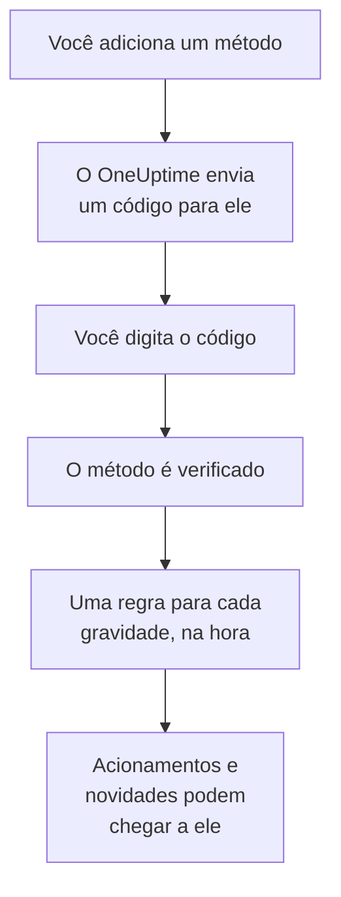

# Métodos de notificação

Um método de notificação é um endereço em que o OneUptime pode encontrar você em um projeto: um endereço de e-mail, um número de telefone para SMS ou chamadas, um número do WhatsApp, uma conta do Telegram, a sua conta do Slack ou do Microsoft Teams, um telefone ou navegador para notificações push, ou um webhook. Você os adiciona em **Configurações do usuário → Métodos de notificação**, verifica, e o OneUptime começa a usá-los nos seus acionamentos na hora.

:::cards
- [Escolha um método](#escolha-um-método): O que cada método precisa, e como ele é verificado.
- [Adicione e verifique um método](#adicione-e-verifique-um-método): E-mail, SMS, chamadas e WhatsApp, com um código de 6 dígitos.
- [Webhooks](#webhooks): Envie os acionamentos para o seu próprio endpoint, assinados se quiser.
- [Ative um canal para o seu projeto](#ative-um-canal-para-o-seu-projeto): Por que SMS, chamadas, WhatsApp ou Telegram podem estar faltando.
:::

## Como um método passa a valer



Um método que você não verificou nunca é usado. Dispositivos push, Slack, Microsoft Teams e webhooks dispensam o código: registrar um dispositivo ou vincular a sua conta prova que é seu, e um webhook não precisa de prova. Verificar um método adiciona na hora as suas [regras padrão](/docs/notifications/on-call-rules#as-regras-com-que-você-começa) para ele, então um número de telefone novo aciona você em todas as gravidades até você mudar as regras dele.

## Escolha um método

Cada aba de **Métodos de notificação** tem um ou mais cartões, um por tipo de método:

| Cartão | Aba | O que você adiciona | Como é verificado |
| --- | --- | --- | --- |
| **E-mails para notificações** | **Direct Contact** | Um endereço de e-mail | Um código por e-mail |
| **Números de telefone para notificações SMS** | **Direct Contact** | Um número de telefone | Um código por SMS |
| **Números de telefone para notificações por chamada** | **Direct Contact** | Um número de telefone | Um código lido em uma chamada, ou nenhum para um número verificado para SMS |
| **Números do WhatsApp para notificações** | **Direct Contact** | Um número do WhatsApp | Um código pelo WhatsApp |
| **Contas do Telegram para Notificações** | **Direct Contact** | A sua conta do Telegram | Uma mensagem para o bot do OneUptime |
| **Slack Account for Notifications** | **Workspace Apps** | A sua conta do Slack | Vincular a sua conta ao espaço de trabalho do projeto |
| **Microsoft Teams Account for Notifications** | **Workspace Apps** | A sua conta do Microsoft Teams | Vincular a sua conta ao espaço de trabalho do projeto |
| **Dispositivos de Notificação Push** | **Push Notifications** | Um telefone com o app OneUptime On-Call, ou um navegador | Registrar o dispositivo |
| **Webhooks para notificações** | **Webhooks** | Um endpoint HTTPS seu | Nenhum |

**Workspace Apps** só aparece quando o projeto conectou o Slack ou o Microsoft Teams, e só mostra os que ele conectou. SMS, chamadas, WhatsApp e Telegram podem estar desativados para o projeto inteiro; veja [Ative um canal para o seu projeto](#ative-um-canal-para-o-seu-projeto).

## Adicione e verifique um método

Endereços de e-mail, números para SMS, números para chamadas e números do WhatsApp são verificados com um código de 6 dígitos.

:::steps
### Abra os seus métodos

Vá até **Configurações do usuário → Métodos de notificação**. **Direct Contact** é a primeira aba.

### Adicione o endereço

No cartão do método, clique no botão de adicionar dele, por exemplo **Adicionar: Número de telefone para notificações SMS**. Digite o **E-mail**, ou o **Número de telefone** no formato internacional, por exemplo `+11234567890`, e salve.

### Digite o código

A caixa de verificação abre sozinha, e diz para onde o código foi e até quando ele vale. Digite o código em **Código de verificação** e clique em **Verificar**.

### Confira a linha

A linha agora aparece como **Verificado**. Fechou a caixa cedo demais? Clique em **Verificar** na linha para abri-la de novo.
:::

- Um código vale por 15 minutos. Cinco tentativas erradas o anulam, e você precisa de um novo.
- **Send a new code**, ou **Call me with a new code** para um número de chamadas, fica na caixa. Você pode pedir um novo um minuto depois do anterior.
- Um número que você verificou para SMS também fica verificado para chamadas. Adicioná-lo em **Números de telefone para notificações por chamada** não pede código, e verificar um número de SMS também verifica o número de chamadas que você adicionou para ele.
- O seu e-mail de login já está lá, verificado, desde o dia em que você entrou no projeto.

## Vincule o Telegram

:::steps
### Adicione a conta

Em **Contas do Telegram para Notificações**, clique em **Adicionar: Conta do Telegram**. **Identificador do Telegram (opcional)** é só um rótulo para você, e pode ficar vazio.

### Escreva para o bot

Clique em **Verificar** na nova linha. A caixa **Verificar conta do Telegram** oferece três formas de chegar ao bot do OneUptime: escanear o código QR com o seu telefone, clicar em **Open in Telegram**, ou procurar o bot no Telegram e enviar a ele o comando `/start` que a caixa mostra.

### Confirme

De volta ao OneUptime, clique em **I've sent the message — check**. Assim que o bot recebe a sua mensagem, a conta fica verificada.
:::

**Rotacionar código** gera um novo código para uma conta que ainda não está verificada. O código QR e o link que você abriu antes param de funcionar. Em um OneUptime auto-hospedado, o administrador do servidor conecta um bot do Telegram antes que alguém possa vincular uma conta.

## Slack e Microsoft Teams

1. Vincule a sua própria conta ao espaço de trabalho do projeto: **Configurações do usuário → Espaço de trabalho → Slack**, ou **Microsoft Teams**. Veja [Slack](/docs/workspace-connections/slack) e [Microsoft Teams](/docs/workspace-connections/microsoft-teams).
2. Na aba **Workspace Apps**, clique em **Add Slack Account** ou **Add Microsoft Teams Account**. A conta fica verificada ao ser adicionada.
3. Clique em **Send Test Message** na linha dela. Os acionamentos chegam como mensagens diretas do app do OneUptime.

## Notificações push

A aba **Push Notifications** lista os seus **Dispositivos de Notificação Push**.

- **Um telefone.** Instale o app OneUptime On-Call, conecte-o ao seu OneUptime, faça login e permita as notificações: o telefone se adiciona sozinho a esta lista. Veja [Visão geral dos aplicativos](/docs/mobile-desktop-apps/index).
- **Este navegador.** Clique em **Registrar Dispositivo**, preencha **Nome do dispositivo** e permita as notificações quando o navegador pedir.
- **Notificação de teste** na linha de um dispositivo envia um push para ele agora.
- **Alertas críticos** diz se os acionamentos do telefone tocam mesmo no modo silencioso e em Não perturbe. Isso é ativado no app, nunca aqui, e um navegador não consegue fazer isso. Veja [Alertas de plantão críticos](/docs/self-hosted/push-notifications#alertas-críticos-de-plantão-ignorando-o-modo-silencioso).
- Um dispositivo marcado como **Não está recebendo notificações** não recebe nada. Abra o app nesse telefone, ou registre o navegador de novo, e ele volta.

## Webhooks

Um webhook envia cada acionamento como JSON para um endpoint HTTPS seu, para que uma ferramenta sua aja.

:::steps
### Adicione o webhook

Na aba **Webhooks**, clique em **Adicionar: Webhook**. Preencha **Nome** com algo que você reconheça, depois **URL do webhook** e **Segredo de assinatura (opcional)**.

### Envie um teste

Clique em **Enviar teste** na linha dele. O seu endpoint recebe um evento cujo `eventType` é `test`.

### Confira o que chega

Um acionamento é um `POST` JSON como o abaixo. Responda com qualquer status `2xx` em até 10 segundos; redirecionamentos não são seguidos.
:::

```json title="A page, as your endpoint receives it"
{
  "eventType": "on-call.incident.created",
  "timestamp": "2026-10-15T09:30:00.000Z",
  "projectId": "6a3f0d2e-1c4b-4e8a-9b7d-2f5c8e1a0b3c",
  "userId": "0c9e8d7f-6b5a-4c3d-8e2f-1a0b9c8d7e6f",
  "incident": {
    "id": "5b4a3c2d-1e0f-4a9b-8c7d-6e5f4a3b2c1d",
    "title": "Checkout API is down",
    "description": "Health check failed from 3 probes.",
    "incidentNumber": 42,
    "incidentNumberWithPrefix": "INC-42",
    "severity": "Critical Incident",
    "state": "Identified"
  },
  "onCallPolicyId": "7d6c5b4a-3e2f-4d1c-9b8a-7f6e5d4c3b2a",
  "onCallPolicyEscalationRuleId": "8e7d6c5b-4a3f-4e2d-8c1b-9a8f7e6d5c4b"
}
```

| `eventType` | Enviado para | A chave do registro |
| --- | --- | --- |
| `on-call.incident.created` | Um incidente | `incident` |
| `on-call.alert.created` | Um alerta | `alert` |
| `on-call.incidentEpisode.created` | Um episódio de incidente | `incidentEpisode` |
| `on-call.alertEpisode.created` | Um episódio de alerta | `alertEpisode` |

As novidades que você ativa para Webhook em **Configurações de notificação** chegam ao mesmo endpoint, com o evento da configuração em `eventType` e um breve resumo em `subject` e `message`.

Toda requisição traz `X-OneUptime-Event`, o tipo de evento. Com um segredo de assinatura, ela também traz `X-OneUptime-Signature`: `sha256=` seguido do HMAC-SHA256 do corpo bruto, em hexadecimal. Confira antes de confiar na requisição:

```javascript title="verify-signature.js"
const crypto = require("crypto");

// rawBody: the request body exactly as it arrived, before any JSON parsing.
function isFromOneUptime(rawBody, signatureHeader, secret) {
  const expected =
    "sha256=" + crypto.createHmac("sha256", secret).update(rawBody).digest("hex");
  const received = Buffer.from(signatureHeader || "");
  const wanted = Buffer.from(expected);
  return received.length === wanted.length && crypto.timingSafeEqual(received, wanted);
}
```

Um webhook não precisa de verificação, então adicioná-lo adiciona as regras dele na hora. Endereços privados e internos são recusados, a menos que o administrador de um servidor auto-hospedado os permita: veja [Acesso à rede privada](/docs/self-hosted/private-network-access#webhooks-e-workflows).

## Ative um canal para o seu projeto

**SMS**, **Chamadas telefônicas**, **WhatsApp** e **Telegram** começam desativados em todo projeto novo, porque cada mensagem custa dinheiro: no OneUptime Cloud ela é paga com o saldo do projeto, e SMS e chamadas passam pela conta Twilio do próprio projeto quando a conta padrão os envia. E-mail, push, Slack, Microsoft Teams e webhooks estão sempre ativados.

Enquanto um canal está desativado, ninguém no projeto pode adicionar um método nele: o cartão dele não tem botão de adicionar, e diz quem pode ativá-lo. Um proprietário do projeto, um **Administrador de cobrança** ou alguém com **Manage Billing** o ativa, no cartão **Canais de notificação** em **Configurações do projeto → Notificações → Configurações de notificação**. Um administrador do projeto não pode. Em um OneUptime auto-hospedado, SMS e chamadas também precisam de uma conta Twilio, e o Telegram de um bot que o administrador do servidor conecta; veja [Integração do Twilio](/docs/self-hosted/twilio-integration).

## Exclua um método

Clique em **Excluir** na linha do método. Excluir um método exclui todas as regras de plantão que o usam, então a caixa primeiro conta essas regras e nomeia qualquer gravidade que a exclusão deixaria sem nenhuma regra.

## Solução de problemas

:::details Um cartão não tem botão de adicionar
Esse canal está desativado neste projeto. O cartão diz quem pode ativá-lo; veja [Ative um canal para o seu projeto](#ative-um-canal-para-o-seu-projeto).
:::

:::details O código nunca chegou
E-mails podem levar alguns minutos, e às vezes caem no spam; SMS podem levar um minuto. Espere um minuto e depois clique em **Send a new code** na caixa. **Configurações do projeto → Notificações → Logs de notificação** mostra o que aconteceu com a mensagem.
:::

:::details Não consigo adicionar a minha conta do Slack
Vincule primeiro a sua conta em **Configurações do usuário → Espaço de trabalho → Slack**, e depois clique de novo em **Add Slack Account**. A caixa de erro tem um botão que leva você até lá.
:::

:::details O meu telefone não recebe notificações push
Confira se o telefone aparece em **Dispositivos de Notificação Push**, e envie a ele uma **Notificação de teste**. Veja [Perguntas frequentes e solução de problemas](/docs/mobile-desktop-apps/faq-troubleshooting#notificações).
:::

## Próximos passos

:::cards
- [Regras de Plantão pessoais](/docs/notifications/on-call-rules): Decida qual método cada acionamento tenta, e quando.
- [Configurações de notificação](/docs/notifications/notification-settings): Escolha as novidades de que você fica sabendo, e por quais canais.
- [Visão geral dos aplicativos](/docs/mobile-desktop-apps/index): Receba os acionamentos no seu telefone ou computador.
- [Como o OneUptime chega até você](/docs/notifications/index): Como métodos, regras e configurações se encaixam.
:::
