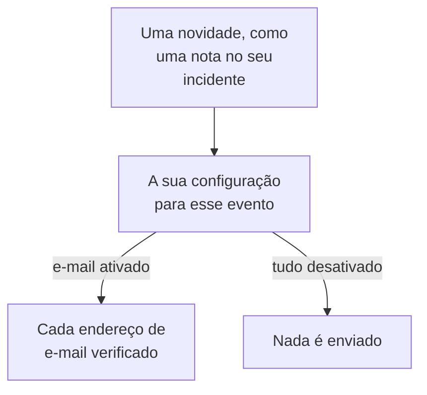

# Configurações de notificação

As configurações de notificação decidem quais novidades chegam até você sobre os registros que são seus, como um incidente, um monitor ou uma página de status, e sobre os seus próprios turnos de plantão, e por quais canais. Elas nunca acionam você: acionar é o papel das suas regras de plantão. Você as define em **Configurações do usuário → Configurações de notificação**, com um interruptor por evento e canal.

:::cards
- [Como as configurações funcionam](#como-as-configurações-funcionam): Um interruptor por evento e canal, enviado a cada método verificado.
- [Altere uma configuração](#altere-uma-configuração): Três cliques, salvos na hora.
- [O que fica ativado para um novo membro](#o-que-fica-ativado-para-um-novo-membro): Os padrões, aba por aba.
- [Menos e-mails](#menos-e-mails): Agrupe as rajadas, ou deixe de fora os de rotina.
:::

## Como as configurações funcionam

- Cada linha é um evento, e cada coluna um canal: E-mail, SMS, Chamada, Push, WhatsApp, Telegram, Slack e Microsoft Teams, e Webhook. Slack e Microsoft Teams só são colunas quando o projeto os conectou.
- Um canal ativado envia para cada método verificado que você tem nele neste projeto, não só para um.
- Um canal ativado sem um método verificado por trás não envia nada. **Your setup checklist** avisa sobre isso em **Staying informed**.
- Uma novidade vai para os proprietários do registro: as pessoas indicadas como proprietárias e os membros das equipes proprietárias dele. Quando um registro não tem proprietários, ela vai para os proprietários do projeto. Um evento sobre ter sido adicionado como proprietário vai só para a pessoa adicionada.
- Os casos de segurança não têm proprietários. Um caso novo vai para todos que podem ver os casos do projeto, na prioridade que cada um escolhe, e um caso atribuído vai para as pessoas a quem ele está atribuído. Veja [Casos de segurança](/docs/telemetry/security-cases#notificações).
- Todo e-mail para proprietários termina com um link "Manage notification preferences" que leva de volta a esta página.

## Altere uma configuração

:::steps
### Abra as suas configurações

Vá até **Configurações do usuário → Configurações de notificação**. As abas são **Incidentes**, **Alertas**, **Monitoramento**, **Páginas de status**, **Manutenção programada**, **Plantão** e **Segurança**.

### Encontre o evento

Cada aba tem um ou mais cartões, como **Incidente Episódios** na aba **Incidentes**. Cada linha é um evento, com uma frase que diz quando ele é enviado.

### Clique em um canal

Clique no círculo de um canal para ativá-lo, e de novo para desativá-lo. Uma marca de seleção significa ativado. As alterações são salvas automaticamente.
:::

## O que fica ativado para um novo membro

Quando você entra em um projeto, estes eventos começam ativados, por e-mail. Todo o resto começa desativado, e não envia nada até você ativar um canal.

| Aba | Ativados por e-mail | Desativados até você ativá-los |
| --- | --- | --- |
| **Incidentes** | **Incidente criado**, **Estado do incidente alterado**, **Incident reminder**, **SLA de incidente violado**, **Episódio de incidente criado**, **Estado do episódio de incidente alterado**, **Incidente adicionado ao episódio de incidente** | **Nota de incidente publicada**, **Adicionado como proprietário do incidente**, **Atribuído a um incidente**, **Nota de episódio de incidente publicada**, **Adicionado como proprietário do episódio de incidente** |
| **Alertas** | **Alerta criado**, **Estado do alerta alterado**, **Alert reminder**, **Episódio de alerta criado**, **Estado do episódio de alerta alterado**, **Alerta adicionado ao episódio de alerta** | **Nota do alerta publicada**, **Adicionado como proprietário do alerta**, **Nota do episódio de alerta publicada**, **Adicionado como proprietário do episódio de alerta** |
| **Monitoramento** | **Status da sonda alterado para o seu monitor**, **O monitor não tem sondas ativas**, **SLO status changed**, **Added as SLO owner**, **Exceção atribuída a mim**, **Status da sonda alterado**, **Adicionado como proprietário da sonda** | **Monitor criado**, **Status do monitor alterado**, **Adicionado como proprietário do monitor**, **Status do agente de IA alterado**, **Adicionado como proprietário do agente de IA** |
| **Páginas de status** | Nenhum | **Página de status criada**, **Anúncio da página de status publicado**, **Adicionado como proprietário da página de status** |
| **Manutenção programada** | **Maintenance reminder** | **Evento de manutenção criado**, **Estado da manutenção alterado**, **Nota de manutenção publicada**, **Adicionado como proprietário da manutenção** |
| **Plantão** | **Você entra no plantão**, **Você é o próximo no plantão**, **Você sai do plantão**, **Adicionado à política de plantão**, **Removido da política de plantão**, **Chamada perdida**, e também por push: **Antes de o meu turno de prevenção começar**, **O meu próximo turno de prevenção é reatribuído** | Nenhum |
| **Segurança** | Também por push: **Novo caso de segurança** (casos High e Crítico), **Caso de segurança atribuído a mim**, **Etapa de playbook aguardando minha aprovação**, **Meta de resposta de caso de segurança**, **Tarefa de caso de segurança atribuída a mim**, **Uma caçada encontrou eventos de segurança** | Nenhum |

> [!IMPORTANT]
> **Status do monitor alterado** começa desativado. Para saber quando um monitor seu cai ou volta, ative-o na aba **Monitoramento**.

## Os seus turnos

A aba **Plantão** é sobre você, não sobre os registros que são seus:

- **Você entra no plantão**, **Você é o próximo no plantão** e **Você sai do plantão** acompanham os seus turnos nas escalas de plantão em que você está.
- **Adicionado à política de plantão** e **Removido da política de plantão** avisam quando uma política de plantão começa ou deixa de nomear você.
- **Antes de o meu turno de prevenção começar** envia lembretes nos horários que você escolhe em **Configurações do usuário → Calendário → Feed de calendário**, e **O meu próximo turno de prevenção é reatribuído** avisa quando outra pessoa cobre um turno sobre o qual você foi lembrado. Veja [Feeds de calendário](/docs/on-call/calendar-feeds#lembretes-e-avisos-de-reatribuição).
- **Chamada perdida**, no cartão **Políticas de chamadas recebidas**, avisa os proprietários de uma política de chamadas recebidas que alguém ligou e não falou com ninguém. Veja [Política de chamadas recebidas](/docs/on-call/incoming-call-policy#chamadas-perdidas).

## Casos de segurança

A aba **Segurança** é sobre os casos de segurança que você pode ver:

- **Novo caso de segurança** tem uma prioridade embaixo do nome: a prioridade mais baixa que um caso precisa ter para notificar você. Ela é **Alta e acima**, a menos que você escolha **Somente Crítica**, **Média e acima**, **Baixa e acima** ou **Todos os casos**.
- **Caso de segurança atribuído a mim** acompanha os casos atribuídos a você e às equipes de que você faz parte.
- **Etapa de playbook aguardando minha aprovação** pede que você aprove ou rejeite uma etapa de playbook em um caso no qual você pode aprovar etapas.

Veja [Casos de segurança](/docs/telemetry/security-cases#notificações).

## Menos e-mails

Esses interruptores decidem quais novidades chegam até você, não quantos e-mails elas somam. **Configurações do usuário → Preferências de e-mail** tem dois cartões para isso, ambos só para você, neste projeto:

- **Email Rollup** junta uma rajada de novidades em um só e-mail: as primeiras continuam chegando uma a uma, e o resto junto alguns minutos depois.
- **Fewer routine emails** desativa, com **Reduce routine emails**, os e-mails sobre notas, novos proprietários, novos monitores e páginas de status, inclusões em episódios e mudanças em políticas de plantão.

Veja [Resumo de notificações](/docs/emails/notification-rollup).

## Solução de problemas

:::details Um interruptor está ativado, mas nada chega
Confira se você tem um método verificado nesse canal em **Configurações do usuário → Métodos de notificação**. Para SMS, chamadas, WhatsApp e Telegram, o projeto também precisa ter o canal ativado.
:::

:::details Sou proprietário de um monitor, mas nunca sei quando ele cai
**Status do monitor alterado** começa desativado. Ative um canal para ele, na aba **Monitoramento**.
:::

:::details Continuo recebendo e-mails depois de desativar tudo
Os acionamentos seguem as suas regras de plantão, não esses interruptores, e e-mails de login, segurança e cobrança não são novidades sobre registros. Cada projeto tem as próprias configurações, então confira o projeto de onde o e-mail veio. Veja [Regras de Plantão pessoais](/docs/notifications/on-call-rules).
:::

## Próximos passos

:::cards
- [Métodos de notificação](/docs/notifications/notification-methods): Adicione os métodos para os quais as suas configurações enviam.
- [Regras de Plantão pessoais](/docs/notifications/on-call-rules): Decida como um acionamento chega até você.
- [Resumo de notificações](/docs/emails/notification-rollup): Menos e-mails, mais completos, durante uma rajada.
- [Como o OneUptime chega até você](/docs/notifications/index): Como métodos, regras e configurações se encaixam.
:::
