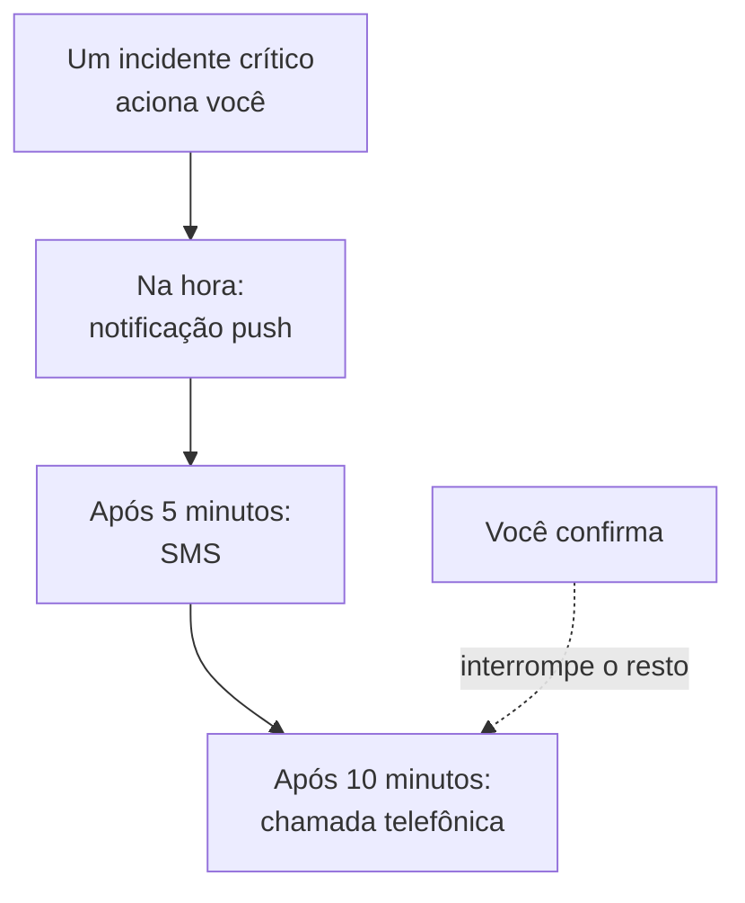

# Regras de Plantão pessoais

As suas regras de plantão decidem como um acionamento chega até você: quais dos seus métodos de notificação o OneUptime tenta, e quanto tempo depois do início do acionamento. Cada tipo de acionamento tem as próprias regras, um conjunto por gravidade, então um incidente crítico pode ligar para você na hora enquanto um alerta de baixa gravidade espera por um e-mail. Você as define em **Configurações do usuário → Regras de Plantão**.

> [!NOTE]
> Estas regras são só suas. As **Regras de Plantão** em **Incidentes → Regras** e **Alertas → Regras** são outra coisa: elas decidem quais políticas de plantão um novo incidente ou alerta executa.

:::cards
- [Como um acionamento chega até você](#como-um-acionamento-chega-até-você): As suas regras para um acionamento, passo a passo.
- [As regras com que você começa](#as-regras-com-que-você-começa): O que cada método verificado adiciona, e como enxugar.
- [Adicione uma regra](#adicione-uma-regra): Um método e um atraso para uma gravidade.
- [Regras de push](#regras-de-push): Tocar mesmo no silencioso, e repetir até alguém confirmar.
:::

## Como um acionamento chega até você

Uma política de plantão aciona você quando uma das regras de escalonamento dela nomeia você, uma equipe da qual você faz parte ou uma escala em que você está de plantão. O OneUptime então percorre as suas regras para esse tipo de acionamento e a gravidade dele: cada regra dispara no próprio método assim que o atraso dela passa desde o início do acionamento. Confirmar o incidente ou o alerta, a partir de qualquer mensagem ou no OneUptime, interrompe todas as regras que ainda não dispararam.

A maioria das mensagens pode confirmar o acionamento: e-mails, SMS e mensagens do WhatsApp, do Telegram, do Slack e do Microsoft Teams trazem um link de confirmação, e uma chamada pede que você pressione 1. Se você não puder atender um acionamento, as mesmas mensagens permitem escaloná-lo, e uma chamada pede que você pressione 2: a política aciona o próximo nível na hora, e você não é mais acionado sobre isso. Veja [Escalonar um acionamento](/docs/on-call/escalation-rules#escalonar-um-acionamento). Cada acionamento que você recebe aparece em **Configurações do usuário → Registros de plantão**, onde **Ver linha do tempo** mostra cada mensagem enviada e se ela foi entregue.

## As quatro abas

**Configurações do usuário → Regras de Plantão** tem uma aba para cada tipo de acionamento. Cada aba tem um cartão por gravidade, com o nome e a cor que o seu projeto deu a ela:

| Aba | Acionamentos de | Cartões para |
| --- | --- | --- |
| **Incidentes** | Incidentes | Gravidades de incidente |
| **Incidente Episódios** | Episódios que agrupam incidentes | Gravidades de incidente |
| **Alertas** | Alertas | Gravidades de alerta |
| **Alerta Episódios** | Episódios que agrupam alertas | Gravidades de alerta |

Um episódio aciona você pelas próprias políticas de plantão, à parte dos incidentes ou alertas que ele contém, por isso as regras dele ficam em uma aba própria. O endereço da página indica a aba aberta, por exemplo `/dashboard/{projectId}/user-settings/on-call-rules?type=alerts`; os outros valores são `incident-episodes` e `alert-episodes`, e sem `type` a página abre em **Incidentes**.

## As regras com que você começa

Cada método que você verifica recebe uma regra em cada cartão de cada aba, enviada assim que você é acionado. O seu e-mail de login as tem desde o dia em que você entrou, para que um acionamento sempre chegue até você. Verifique um número de telefone para SMS, e todo acionamento também manda um SMS para você.

É um começo seguro, e normalmente demais. Enxugue para o que cada gravidade merece:

| Gravidade | Um conjunto sensato |
| --- | --- |
| Crítica | Push na hora, uma chamada após 5 minutos |
| Grave | Push na hora, um SMS após 10 minutos |
| Menor ou baixa | Um e-mail na hora |

Suas próprias regras não têm horário de silêncio: deixe as gravidades baixas no e-mail, ou em uma regra de push definida como **Normal**, para que elas nunca acordem você. Para que o acionamento de uma gravidade baixa aguarde o horário comercial para todos, defina a regra de plantão que o aciona como **Somente em horário comercial**: veja [Regras de plantão](/docs/alerts/settings#regras-de-plantão).

## Adicione uma regra

:::steps
### Abra o cartão

Vá até **Configurações do usuário → Regras de Plantão**, abra a aba do tipo de acionamento e encontre o cartão da gravidade.

### Escolha o método

Clique em **Adicionar: Notificação Regra**. Em **Método de notificação**, escolha um dos seus métodos verificados; um método que você não verificou não é oferecido.

### Escolha como o push toca

Para um telefone, escolha **Notificação push**: **Alerta crítico** ou **Normal**. Para qualquer dispositivo push, escolha **Repetir até a confirmação**. Veja [Regras de push](#regras-de-push).

### Defina o atraso

Escolha **Notificar-me após**: **Imediatamente**, **5 minutos**, **10 minutos**, **15 minutos**, **30 minutos** ou **1 hora**. Depois clique em **Adicionar: Notificação Regra** na caixa.
:::

O cartão lista as regras dele em ordem de atraso, com **Método de notificação** e **Notificar após** para cada uma.

## Altere ou exclua uma regra

- **Editar** na linha de uma regra muda o atraso dela. Para enviar uma regra a outro método, exclua-a e adicione uma nova.
- Em uma regra de push, clique no rótulo abaixo do método para alternar entre **Alerta crítico** e **Normal**, ou para mudar de quanto em quanto tempo ela se repete. Isso é salvo na hora.
- **Excluir** pede confirmação antes, e diz se a gravidade fica sem regra. Uma gravidade sem regra recorre aos seus métodos verificados; veja [Quando uma gravidade não tem regra](#quando-uma-gravidade-não-tem-regra).

## Regras de push

Uma regra que aciona um telefone diz como o push dela toca:

| Opção | O que o telefone faz |
| --- | --- |
| **Alerta crítico** | Toca mesmo quando o telefone está no silencioso ou em Não perturbe, depois que Critical On-Call Alerts é ativado no app OneUptime On-Call. Uma nova regra de telefone começa aqui. |
| **Normal** | Segue as configurações de som, silencioso e Não perturbe do telefone. |

Uma regra de push, para um telefone ou um navegador, também pode reenviar o push até alguém confirmar: **Não repetir**, o padrão, ou **A cada minuto**, **A cada 2 minutos**, **A cada 3 minutos**, **A cada 5 minutos**, **A cada 10 minutos**, **A cada 15 minutos** ou **A cada 30 minutos**. Ela se repete até 10 vezes a mais, e para assim que o incidente, o alerta ou o episódio é confirmado. Veja [Alertas de plantão críticos](/docs/self-hosted/push-notifications#alertas-críticos-de-plantão-ignorando-o-modo-silencioso).

## Quando uma gravidade não tem regra

Uma gravidade que o seu projeto adiciona depois recebe regras em poucos minutos, feitas a partir do que você já escolheu nessa aba: os mesmos métodos, após os mesmos atrasos. Se você não tinha regras nessa aba, ela recebe o seu e-mail verificado, na hora.

Um acionamento que mesmo assim não encontra regra é enviado aos seus métodos verificados de qualquer forma, e você recebe um e-mail sobre isso; veja [Quando nenhuma regra corresponde](/docs/notifications/index#quando-nenhuma-regra-corresponde).

:::details Desativar uma gravidade de propósito
A API pode salvar uma regra de exclusão, com `isOptOut` definido e sem método: aí você não é acionado para esse tipo de acionamento e essa gravidade, e nada assume no lugar. A linha mostra **Muted - notifications turned off for this rule**, e excluí-la reativa os acionamentos. Uma gravidade adicionada depois também fica silenciada quando todas as regras que você tem nessa aba são exclusões.
:::

:::details Desativar a alternativa para um projeto inteiro
Um proprietário do projeto, ou alguém com **Manage Billing**, pode definir `disableOnCallNotificationFallback` do projeto pela API. Um acionamento que não encontra regra então não é entregue, e o registro dele diz que o usuário deve adicionar regras em **Configurações do usuário → Regras de Plantão**.
:::

## As regras de um colega

Proprietários e administradores do projeto podem ver e alterar a mesma página para qualquer pessoa do projeto: em **Usuários**, eles abrem a pessoa e depois **Regras de Plantão** na seção **Plantão**. **Prontidão**, ao lado, mostra se cada gravidade chega até ela. Quando outra pessoa adiciona, altera ou exclui as suas regras, você recebe um e-mail sobre isso, e cada mudança fica no log de auditoria do projeto.

## Solução de problemas

:::details O meu telefone ficou em silêncio em um acionamento crítico
Confira se o push da regra é **Alerta crítico**, e não **Normal**, e se **Alertas críticos** está ativado para o telefone em **Configurações do usuário → Métodos de notificação**, na aba **Push Notifications**.
:::

:::details Sou acionado duas vezes a cada incidente
Cada método verificado tem uma regra para cada gravidade, enviada na hora. Exclua as regras que você não quer, ou dê um atraso a elas. Um incidente em um episódio pode acionar você uma vez pelo incidente e outra pelo episódio, por duas políticas.
:::

:::details Recebi um e-mail embora a minha regra diga SMS
O acionamento não encontrou regra para o tipo ou a gravidade dele, e recorreu aos seus métodos gratuitos: adicione a regra na aba e no cartão certos. Ou o e-mail era uma novidade sobre um registro seu, que segue as **Configurações de notificação**, e não as suas regras. Os seus **Registros de plantão** listam só acionamentos.
:::

## Próximos passos

:::cards
- [Métodos de notificação](/docs/notifications/notification-methods): Adicione e verifique os métodos para onde as suas regras apontam.
- [Regras de escalonamento](/docs/on-call/escalation-rules): Como uma política de plantão aciona as pessoas, nível por nível.
- [Notificações push](/docs/self-hosted/push-notifications): Alertas críticos, sons de alarme e repetições nos telefones.
- [Como o OneUptime chega até você](/docs/notifications/index): Como métodos, regras e configurações se encaixam.
:::
