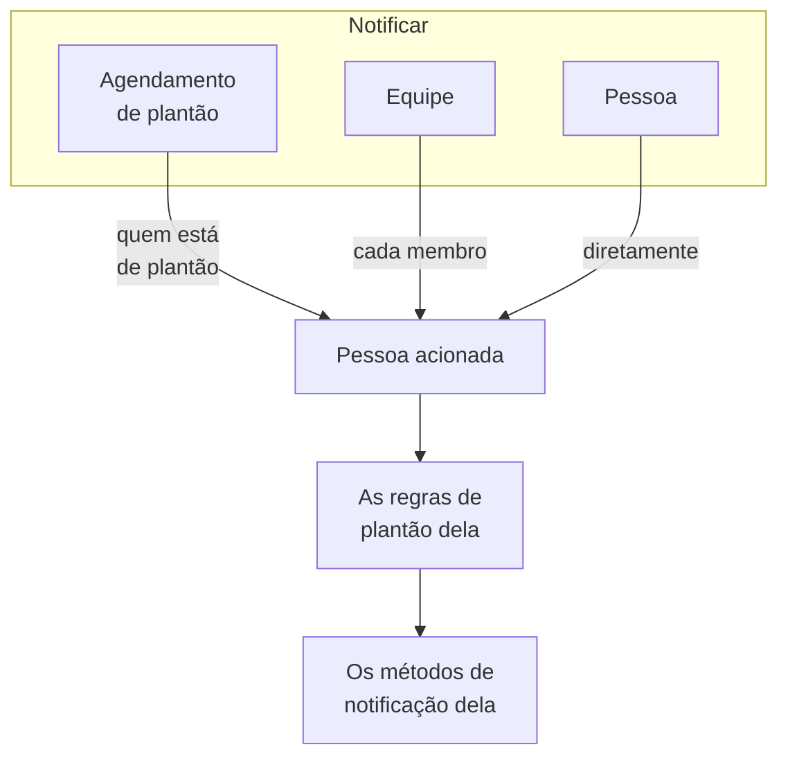

# Regras de escalonamento

Uma política de plantão aciona as pessoas por níveis. Cada regra de escalonamento é um nível: quem é acionado e quanto tempo esperar que alguém confirme antes de acionar o próximo nível. As regras de uma política aparecem, em ordem, na página **Regras de escalonamento** dela.

```mermaid title="Uma política de plantão aciona nível a nível até alguém confirmar"
flowchart TB
    trigger["Incidente ou alerta"] --> level1["Level 1 aciona"]
    level1 --> ack1{"Confirmado<br/>a tempo?"}
    ack1 -->|"Sim"| stop["Os acionamentos param"]
    ack1 -->|"Não"| level2["Level 2 aciona"]
    level2 --> ack2{"Confirmado<br/>a tempo?"}
    ack2 -->|"Sim"| stop
    ack2 -->|"Não, último nível"| repeat{"Repetir a política?"}
    repeat -->|"Sim"| level1
    repeat -->|"Não"| done["A política para"]
```

:::cards
- [Quem é acionado primeiro](#quem-é-acionado-primeiro): Crie uma política com o primeiro nível.
- [Adicionar uma regra de escalonamento](#adicionar-uma-regra-de-escalonamento): Adicione o próximo nível, passo a passo.
- [Como os níveis acionam as pessoas](#como-os-níveis-acionam-as-pessoas): Tempos, repetições e como cada pessoa é contatada.
- [A próxima pessoa da rotação](#escalonar-para-a-próxima-pessoa-da-rotação): Acione o backup de quem está de plantão, da mesma rotação.
- [Escalonar um acionamento](#escalonar-um-acionamento): Não pode atender um acionamento? Acione o próximo nível na hora.
- [API e Terraform](#criar-regras-com-a-api-ou-o-terraform): Crie políticas e regras como código.
:::

## Quem é acionado primeiro

Ao criar uma política de plantão na página **Políticas de plantão**, o formulário pede o **Nome** dela e **Quem é acionado primeiro?**. A pergunta usa o mesmo seletor de **Notificar**: agendamentos de plantão, equipes e pessoas, quantos forem necessários. Quem você escolher vira a primeira regra de escalonamento da política, **Level 1**, que espera **30 minutos** por uma confirmação antes de acionar o próximo nível.

:::steps
1. Vá em **Plantão** > **Políticas de plantão** e clique em **Criar: Política de plantão**.
2. Digite um **Nome**.
3. Em **Quem é acionado primeiro?**, clique em **Adicionar destinatário** e escolha os agendamentos de plantão, as equipes e as pessoas a acionar primeiro.
4. Clique em **Criar: Política de plantão**. A nova política abre depois na página **Regras de escalonamento** dela, onde você pode adicionar mais níveis.
:::

**Quem é acionado primeiro?** é opcional. Se você deixar em branco, a política começa sem regras de escalonamento: não aciona ninguém até você adicionar uma, e a visão geral dela avisa isso. A descrição e os rótulos ficam em **Mais campos**. A pergunta só é feita a quem pode adicionar regras de escalonamento.

## Adicionar uma regra de escalonamento

:::steps
### Abra as regras de escalonamento da política

Abra a política de plantão, escolha **Regras de escalonamento** no menu lateral dela e clique em **Adicionar regra de escalonamento**. A caixa de diálogo é uma única página curta.

### Escolha quem notificar

Em **Notificar**, clique em **Adicionar destinatário**, pesquise e escolha quantos agendamentos de plantão, equipes e pessoas este nível deve acionar. Adicione pelo menos um.

| Destinatário | Quem é acionado quando o nível é executado |
| --- | --- |
| Um **agendamento de plantão** | Quem estiver de plantão nele quando o nível for executado, não uma pessoa fixa. |
| O **Próximo da rotação** de um agendamento | A pessoa depois de quem estiver de plantão nele, da mesma rotação. Veja [Escalonar para a próxima pessoa da rotação](#escalonar-para-a-próxima-pessoa-da-rotação). |
| Uma **equipe** | Cada membro da equipe. |
| Uma **pessoa** | Essa pessoa, diretamente. |

### Defina quanto esperar

**Escalonar após (em minutos)** é quanto esperar por uma confirmação antes de acionar o próximo nível. Começa em **30 minutos**; ajuste ao que fizer sentido para o nível.

### Dê um nome à regra, se quiser

Todo o resto fica em **Mais campos**, recolhido até você abrir:

- **Nome**: opcional. Uma regra sem nome recebe o nome do nível dela: a primeira regra de uma política é **Level 1**, a segunda **Level 2**, e assim por diante. O campo de nome mostra o nome que a regra vai receber.
- **Descrição**: notas opcionais, como quem este nível aciona e por quê.

Recolhido, o cabeçalho de **Mais campos** cita os dois e mostra os que a regra tem: uma descrição ou um nome próprio.

### Crie a regra

Clique em **Criar regra**. A regra é adicionada abaixo das outras, como o próximo nível da política.
:::

## Como os níveis acionam as pessoas

Quando um incidente ou alerta chega à política, **Level 1** aciona os destinatários dele na hora. Se ninguém confirmar dentro da espera, **Level 2** é acionado, e assim por diante na lista. Quando a espera do último nível passa sem confirmação, a política recomeça do **Level 1** se a **Política de Repetição** dela (abaixo das regras) mandar repetir, quantas vezes ela permitir, e caso contrário para. Confirmar ou resolver o incidente ou alerta interrompe os acionamentos em qualquer nível. Quem é acionado e não pode atender pode escalonar o acionamento, e o próximo nível é acionado sem esperar: veja [Escalonar um acionamento](#escalonar-um-acionamento).

Um incidente, alerta ou episódio criado já confirmado ou resolvido — registrado depois do fato — não executa nenhuma de suas políticas: ninguém é acionado, e o feed dele informa isso, citando-as. Veja [Declarado já confirmado ou resolvido](/docs/incidents/declaring-incidents#declarado-já-confirmado-ou-resolvido).

Para repetir uma política, clique em **Editar** no cartão **Política de Repetição**, escolha **Recomeçar a partir do Level 1** e defina **Quantas vezes mais?**.

### O resumo do escalonamento

O resumo no topo da página **Regras de escalonamento** mostra a escada inteira: quando cada nível é acionado, quem ele aciona e o que acontece depois do último. Um nível cujos destinatários não podem ser todos acionados avisa isso no cartão; clique no rótulo para ver quem e por quê.

### Como cada pessoa é contatada

Cada pessoa que um nível aciona é contatada do jeito que as próprias regras de plantão dela mandam: **Configurações do usuário** > **Regras de Plantão**, com uma aba para incidentes, episódios de incidente, alertas e episódios de alerta, e um cartão por severidade que mostra qual método de notificação é tentado e depois de quanto tempo. Um administrador do projeto pode ver e mudar as regras de um membro em **Usuários** > o membro > **Regras de Plantão**. Veja [Regras de Plantão pessoais](/docs/notifications/on-call-rules).



Uma substituição de usuário em vigor para uma pessoa envia os acionamentos dela para quem a cobre. Uma que não nomeia ninguém para cobrir pula a pessoa: ela não é acionada, a execução da política informa que ela está ausente e até quando, e em um agendamento de plantão cada um dos turnos dela vai para a próxima pessoa da rotação. Veja [Substituições de usuário](/docs/on-call/user-overrides).

Toda mensagem é uma que o provedor aceita, então um acionamento sempre sai. Isto é o que cada canal leva:

| Canal | A maior mensagem que leva |
| --- | --- |
| SMS | 1.600 caracteres |
| Chamada telefônica | O que cabe no roteiro de chamada de 4.000 caracteres do Twilio |
| Notificação push | 4 KB, dos quais título, texto e dados ocupam no máximo 3 KB |
| WhatsApp | 1.024 caracteres |
| Telegram | 4.096 caracteres |

Uma mensagem mais longa, com um título longo ou uma descrição longa que um modelo colocou nela, é cortada e termina com um aviso de que o texto completo está no OneUptime: "… (truncated — see OneUptime for the full text)". O texto de uma mensagem de WhatsApp é um modelo fixo, então ali são cortados os valores mais longos, cada um terminando com "…". Os links de uma mensagem nunca são cortados.

### O que diz o SMS de um acionamento

Um SMS é enviado, e cobrado, em partes de 160 caracteres. Um acionamento por SMS é escrito para caber em uma só parte sempre que possível, e diz só o que você precisa em um telefone bloqueado: quem envia, o que aconteceu e o único link para confirmar o acionamento ou escaloná-lo. No telefone, ele aparece assim:

```text
OneUptime: Critical Incident INC-42 in Acme Prod: Checkout API is down.
Ack or escalate: https://oneuptime.com/l/XJlaZRsd
```

Ele informa a severidade e o que aconteceu (um incidente, um alerta ou um episódio de qualquer um deles), o número, o projeto e o título, nessa ordem. Quando nem tudo cabe em uma parte:

1. Primeiro o projeto é omitido.
2. Depois o título é cortado e termina com `...`.

A severidade, o número e o link nunca são cortados. Um título mantém pelo menos 20 caracteres: se nem isso couber, por exemplo com um endereço ou um nome de produto muito longo, o SMS ocupa uma segunda parte e diz tudo.

Quando uma política aciona de novo porque um incidente ou alerta confirmado ainda não foi resolvido, o SMS diz isso depois do número e do projeto, e essas palavras também nunca são cortadas:

```text
OneUptime: Critical Incident INC-42 in Acme Prod is still not resolved:
Checkout API is down. Ack or escalate: https://oneuptime.com/l/XJlaZRsd
```

Um único caractere fora do alfabeto simples do SMS faz a mensagem inteira sair em partes de 70 caracteres. Por isso aspas e travessões tipográficos são escritos como `"`, `'` e `-`, `…` como `...`, e letras como `ç` e `ł` perdem seus diacríticos; emojis são omitidos. Um título em outra escrita, como japonês ou russo, é enviado como foi escrito e ocupa duas partes ou mais.

Os outros SMS que o OneUptime envia para você, por exemplo sobre uma mudança em um incidente do qual você é dono ou o início do seu turno de plantão, também começam com `OneUptime:` e terminam com `Turn off in User Settings > Notification Settings.`, uma frase que é omitida quando é isso que faz o SMS caber em uma parte.

### Quando um acionamento não é enviado

Um acionamento não enviado diz o motivo nos **Registros de plantão** da pessoa (Configurações do usuário): a linha mostra **Erro**, e a mensagem de status dá a razão. Ele não fica mais parado em **Enviando**. A mensagem diz uma destas coisas:

- o saldo do projeto não pôde pagá-lo, e quem pode adicionar saldo;
- o canal está desligado no projeto, e quem pode ligá-lo.

Os proprietários do projeto recebem um e-mail sobre isso uma vez, até o saldo ser recarregado ou o canal ser ligado de novo.

No OneUptime Cloud, cada SMS, chamada, mensagem de WhatsApp e de Telegram é pago com o saldo do projeto em **Configurações do projeto > Notificações > Configurações de notificação**: o custo exato sai do saldo quando o provedor aceita a mensagem, não importa quantas mensagens saiam ao mesmo tempo.

- Com a **Recarga automática** ligada ali, a mensagem que encontra o saldo abaixo do limite adiciona primeiro o valor definido na recarga automática, cobrando o cartão do projeto; mensagens que o encontram baixo no mesmo momento cobram o cartão uma única vez.
- Se essa cobrança falhar (não há forma de pagamento ou o cartão foi recusado), a recarga automática tenta o cartão de novo uma hora depois, e **Configurações de notificação** avisa isso no topo até lá. Adicionar saldo manualmente, ou salvar a recarga automática de novo, tenta na hora.
- Os acionamentos continuam saindo com o saldo restante enquanto a recarga automática não consegue cobrar o cartão.

> [!IMPORTANT]
> SMS, chamadas telefônicas, WhatsApp e Telegram começam desligados em um projeto novo: no OneUptime Cloud, cada mensagem é paga com o saldo do projeto, e uma instalação auto-hospedada precisa antes de uma conta do Twilio ou de um bot do Telegram configurado. Enquanto um canal está desligado, ninguém no projeto pode adicionar um método nele. Só um proprietário do projeto ou alguém com o papel **Administrador de cobrança** ou a permissão **Manage Billing** pode ligar um, no cartão **Canais de notificação** de **Configurações do projeto > Notificações > Configurações de notificação** — um administrador do projeto não pode. Todos os outros são informados exatamente de quem pode, onde quer que um canal esteja desligado: acima da própria lista de métodos nele, na lista de configuração deles e na mensagem que recebem quando algo precisa dele.

## Escalonar para a próxima pessoa da rotação

Um nível pode acionar a próxima pessoa da rotação de um agendamento de plantão: a pessoa depois de quem estiver de plantão nele. Assim, uma política pode acionar primeiro quem está de plantão, depois o backup dessa pessoa na mesma rotação e depois uma equipe ou um gerente, tudo a partir de um único agendamento.

| Nível | Notificar | Quem é acionado |
| --- | --- | --- |
| **Level 1** | O agendamento Payments primary | Quem estiver de plantão nele, digamos Alex |
| **Level 2** | O **Próximo da rotação** do mesmo agendamento | A pessoa depois de Alex na rotação, digamos Sam |
| **Level 3** | A equipe Platform | Cada membro da equipe |

:::steps
1. Confirme que o primeiro nível da política, **Level 1**, notifica o agendamento de plantão.
2. Clique em **Adicionar regra de escalonamento**, depois em **Adicionar destinatário**, e escolha o mesmo agendamento em **Próximo da rotação**. Defina **Escalonar após (em minutos)** e clique em **Criar regra**.
3. Adicione mais um nível para a equipe ou o gerente que deve saber em seguida.
:::

A próxima pessoa é definida quando o nível é executado, com base no agendamento como ele está nesse momento:

- É a pessoa depois de quem está de plantão, na ordem em que as pessoas da rotação se revezam. Depois da última pessoa vem a primeira de novo.
- Pessoas ausentes são puladas, havendo ou não alguém que as cubra, assim como quem está de plantão no lugar de outra pessoa.
- É sempre alguém da mesma rotação: com várias camadas, a camada de onde vem quem está de plantão. Uma rotação sem mais ninguém, ou com todos os outros ausentes, não tem próxima pessoa, e o nível não aciona ninguém ali e informa isso.
- Quando ninguém está de plantão no agendamento, também não há próxima pessoa, e o nível é tentado de novo por alguns minutos, como acontece com o próprio agendamento.

A mensagem da execução no Slack e no Microsoft Teams, o feed do incidente e a **Linha do tempo de execução** dizem quem foi acionado como o próximo da rotação, e de qual agendamento: "Sam Lee (next in the Payments primary rotation)".

> [!TIP]
> Um agendamento basta: não há um segundo agendamento de backup para manter em sintonia com o primeiro, e as ausências que as pessoas dele registram valem para os dois níveis.

## Escalonar um acionamento

Quem é acionado e não pode atender, porque está dormindo, em um avião ou já trabalhando em outro incidente, pode escalonar o acionamento em vez de deixá-lo tocar até o fim. A política então aciona o próximo nível na hora, sem esperar o **Escalonar após (em minutos)** do nível, e essa pessoa não é mais acionada sobre isso.

```mermaid title="Escalonar um acionamento leva a política ao próximo nível na hora"
flowchart TB
    page["Level 1 aciona Alex"] --> take{"Alex pode<br/>atender?"}
    take -->|"Sim"| ack["Alex confirma:<br/>os acionamentos param"]
    take -->|"Não"| pass["Alex escalona"]
    pass --> others{"Mais alguém no<br/>Level 1 ainda acionado?"}
    others -->|"Sim"| wait["A política espera<br/>por eles, como antes"]
    others -->|"Não"| next["Level 2 é<br/>acionado agora"]
```

Todo acionamento pode ser escalonado de onde ele chegou até você:

| Onde | Como escalonar |
| --- | --- |
| E-mail | O botão **Escalate**, e depois **Escalate** na página que ele abre |
| SMS e WhatsApp | O link da mensagem abre a página de confirmação, que também tem **Escalate** |
| Telegram, Slack e Microsoft Teams | O link "Can't take it? Escalate", e depois **Escalate** na página que ele abre |
| Chamada | Pressione 2. A chamada então diz o que aconteceu |
| Notificação push | Toque nela: o incidente, alerta ou episódio abre no app OneUptime On-Call, com **Escalate** abaixo |
| OneUptime | **Escalonar** no topo do incidente, alerta ou episódio, depois dos botões de estado |

Todos os meios, menos a chamada, perguntam antes de fazer qualquer coisa e dizem o que vai acontecer, por exemplo "This will immediately page Platform leads (Level 2 of 3), without waiting."; em uma chamada, pressionar 2 é a resposta. Só a pessoa acionada pode escalonar o acionamento dela: o botão no OneUptime aparece só para ela, e o link de uma mensagem escalona só o acionamento de que trata, para a pessoa a quem foi enviado, durante 7 dias.

O que acontece depois depende de quem mais está sendo acionado:

- Outras pessoas do mesmo nível ainda estão sendo acionadas: a política espera por elas, como antes. Ela segue quando a espera do nível acaba, ou assim que a última delas também escalona.
- Não resta mais ninguém no nível: o próximo nível é acionado na hora.
- Era o último nível: se a **Política de Repetição** mandar repetir, a política recomeça do **Level 1** na hora. Caso contrário, os acionamentos param, e alguém precisa assumir.

Escalonar um acionamento não o confirma: o incidente ou alerta continua esperando que alguém o confirme, e quem escalonou ainda pode confirmá-lo. Esta execução não aciona mais essa pessoa sobre isso: um nível posterior, ou uma repetição, que a inclua passa por cima dela. Quando todos que ela acionou já escalonaram e não resta ninguém para acionar, os acionamentos param, e o feed do incidente informa isso.

Um acionamento que um workflow envia diretamente a pessoas não tem níveis: escaloná-lo faz você deixar de ser acionado, e quando todos que ele acionou já escalonaram, os acionamentos param.

Cada escalonamento fica registrado. A **Linha do tempo de execução** da execução marca a linha da pessoa como **Escalonado**, o feed do incidente diz "Alex Kim escalated the page from on-call policy Payments at Level 1 of 3.", a mensagem da execução no Slack e no Microsoft Teams diz que ela escalonou, e os **Registros de plantão** dela mostram o acionamento como **Escalonado**.

## Editar, reordenar e excluir regras

O cartão de cada regra tem **Editar regra** e um menu **⋯** com as outras ações:

- **Editar regra** abre a mesma caixa de diálogo de uma página, preenchida com a regra como está: os destinatários, a espera, e o nome e a descrição em **Mais campos**. Adicione ou remova destinatários e clique em **Salvar alterações**. Apagar o nome devolve à regra o nome do nível dela.
- **Mover para cima** e **Mover para baixo**, no menu **⋯** de uma regra, mudam o nível dela. Uma regra com o nome do nível mantém um nome que corresponde ao lugar dela: quando **Level 3** sobe acima de **Level 2**, as duas trocam de nome. Um nome que você escolheu, como **Gestores**, continua igual aonde quer que a regra vá.
- **Excluir regra** pergunta antes e diz quem o nível aciona. Excluir um nível sobe os níveis abaixo dele, e as regras com o nome do nível são renomeadas para corresponder.

## Criar regras com a API ou o Terraform

As regras de escalonamento são o recurso `/api/on-call-duty-policy-escalation-rule`; as pessoas, equipes e agendamentos que uma regra aciona são os recursos `/api/on-call-duty-policy-escalation-rule-user`, `-team` e `-schedule`.

- Uma regra criada sem `name` recebe o nome do nível, como no painel: **Level 3** para uma regra que vira o terceiro nível da política. O recurso de regra de escalonamento do Terraform continua exigindo um nome.
- `escalateAfterInMinutes` não tem padrão fora do painel. Uma regra criada sem ele não espera: o próximo nível é acionado assim que este é executado. Defina-o explicitamente — 30 é o que o painel sugere.
- Uma regra criada com `onCallSchedules`, `teams` ou `users` (listas de IDs) nos `miscDataProps` recebe esses destinatários; é assim que o seletor **Notificar** do painel os envia. Uma regra criada sem eles não aciona ninguém até você adicionar destinatários pelos recursos acima.
- Uma regra criada com `nextInRotationSchedules` (uma lista de IDs de agendamentos) nos `miscDataProps` aciona a próxima pessoa da rotação de cada um desses agendamentos. No recurso `-schedule`, uma linha com `pageNextInRotation` igual a `true` faz o mesmo; esse valor é definido quando a linha é criada.
- As regras com o nome do nível são renomeadas quando você move ou exclui regras no painel. Mudar `order` pela API ou pelo Terraform muda só a ordem.
- Criar uma política de plantão em `/api/on-call-duty-policy` com `onCallSchedules`, `teams` ou `users` (listas de IDs) nos `miscDataProps` dá a ela a primeira regra de escalonamento, como faz o painel: **Level 1**, que os aciona, com um `escalateAfterInMinutes` de 30. Todo ID precisa pertencer ao projeto e quem chama precisa poder criar regras de escalonamento, senão a política não é criada. Uma política criada sem eles não tem regras, como antes; o recurso de política do Terraform não os envia.

```bash
curl -X POST https://oneuptime.com/api/on-call-duty-policy \
  -H "apikey: $ONEUPTIME_API_KEY" \
  -H "Content-Type: application/json" \
  -d '{
    "data": {
      "projectId": "<project-id>",
      "name": "Production on-call"
    },
    "miscDataProps": {
      "onCallSchedules": ["<schedule-id>"],
      "users": ["<user-id>"]
    }
  }'
```

## Próximos passos

:::cards
- [Agendamentos de plantão](/docs/on-call/schedules): Monte as rotações que um nível aciona.
- [Linha do tempo de plantões](/docs/on-call/schedule-timeline): Veja quem está de plantão em todos os agendamentos e encontre lacunas de cobertura.
- [Política de chamadas recebidas](/docs/on-call/incoming-call-policy): Deixe quem liga falar com a pessoa de plantão por telefone.
:::
