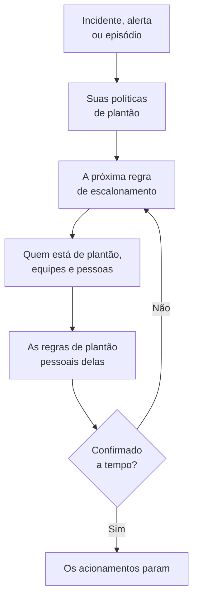

# Visão geral do plantão

O plantão é a forma como o OneUptime coloca uma pessoa diante de um problema, a qualquer hora. Quando um incidente, um alerta ou um episódio precisa de alguém, suas políticas de plantão acionam pessoas nível a nível até que alguém confirme, e cada pessoa é contatada como escolheu: notificação push, SMS, ligação, e-mail ou mensagem de chat. Esta página mostra como as peças se encaixam e onde fica cada uma.

:::cards
- [Como um acionamento chega a alguém](#como-um-acionamento-chega-a-alguém): De um novo incidente até a pessoa que responde.
- [As peças](#as-peças): Políticas, regras de escalonamento, agendamentos, substituições e regras pessoais.
- [Configurar o plantão](#configurar-o-plantão): Do zero a uma equipe que é acionada, em cinco passos.
- [Onde fica o plantão](#onde-fica-o-plantão): O menu Plantão, seção por seção.
:::

## Como um acionamento chega a alguém

1. Um novo incidente, alerta ou episódio executa na hora suas políticas de plantão: as escolhidas nele e as que suas regras de plantão adicionam. Cada política é executada por conta própria. Uma regra de plantão definida como **Somente em horário comercial** faz as políticas que adiciona aguardarem até esse horário começar.
2. A primeira regra de escalonamento de uma política aciona imediatamente: quem está de plantão agora nos seus agendamentos, cada membro das suas equipes e as pessoas que ela nomeia.
3. Se uma delas estiver ausente, uma substituição de usuário envia o acionamento dela para a pessoa que a cobre, ou a pula.
4. Cada pessoa é contatada pelas suas regras de plantão pessoais: qual método é tentado e depois de quanto tempo. Um acionamento sem regra ainda chega a ela pelos métodos que ela verificou.
5. Se ninguém confirmar antes de acabar a espera da regra, a próxima regra aciona. Depois da última, a política recomeça se for repetida e, se não, para.

Confirmar ou resolver o incidente, o alerta ou o episódio para toda política que ainda esteja acionando por ele. O OneUptime avança as políticas em andamento a cada minuto e registra cada execução, regra por regra, em **Registros de execução**.

Na primeira vez que um acionamento chega a alguém, o OneUptime registra isso no incidente, no alerta ou no episódio como `First Paged At`. Uma medição pode contar a partir daí: o **Tempo até a confirmação após o acionamento** mede quanto tempo as pessoas levaram para responder depois de acionadas, e não quanto tempo o incidente, o alerta ou o episódio esperou até alguém ser acionado. Veja [Tempo até a confirmação após o acionamento](/docs/incidents/settings#tempo-até-a-confirmação-após-o-acionamento).

> [!NOTE]
> Um incidente, alerta ou episódio criado já confirmado ou resolvido não executa nenhuma das suas políticas, e o feed dele diz isso. Veja [Criado já confirmado ou resolvido](/docs/alerts/index#criado-já-confirmado-ou-resolvido).

## As peças

| Peça | O que decide | Saiba mais |
| --- | --- | --- |
| Política de plantão | Quem é acionado por um incidente ou alerta, nível a nível | [Políticas de plantão](/docs/on-call/policies) |
| Regra de escalonamento | Um nível de uma política: quem ela aciona e quanto tempo espera por uma confirmação | [Regras de escalonamento](/docs/on-call/escalation-rules) |
| Agendamento de plantão | Quem está de plantão a cada momento, em revezamento | [Agendamentos de plantão](/docs/on-call/schedules) |
| Substituição de usuário | Quem cobre alguém enquanto essa pessoa está ausente | [Substituições de usuário](/docs/on-call/user-overrides) |
| Regras de plantão pessoais | Como uma pessoa é contatada: por qual método e depois de quanto tempo | [Regras de Plantão pessoais](/docs/notifications/on-call-rules) |
| Política de chamadas recebidas | Um número de telefone que toca para quem está de plantão | [Política de chamadas recebidas](/docs/on-call/incoming-call-policy) |

Políticas, regras de escalonamento, agendamentos e substituições pertencem ao projeto, em **Plantão**. Métodos de notificação e regras de plantão pessoais pertencem a cada pessoa, em **Configurações do usuário**: um administrador pode ver a configuração de alguém, mas só a própria pessoa pode verificar seu telefone ou e-mail. Veja [Como o OneUptime chega até você](/docs/notifications/index).

## Configurar o plantão

:::steps
### Criar um agendamento

Abra **Plantão** pelo menu **Produtos** e vá para **Agendamentos de plantão**. Clique em **Criar agendamento de plantão**, dê um nome a ele e, em **Quem se reveza?**, escolha as pessoas na ordem em que se revezam. Veja [Agendamentos de plantão](/docs/on-call/schedules).

### Criar uma política

Vá para **Políticas de plantão** e clique em **Criar: Política de plantão**. Em **Quem é acionado primeiro?**, escolha o agendamento. Ele vira a primeira regra de escalonamento da política, **Level 1**, que espera 30 minutos por uma confirmação.

### Adicionar os próximos níveis

Na página **Regras de escalonamento** da política, clique em **Adicionar regra de escalonamento** para cada nível depois do primeiro: a próxima pessoa da rotação do mesmo agendamento, um líder de equipe, um gerente. Veja [Regras de escalonamento](/docs/on-call/escalation-rules).

### Executar a política automaticamente

A primeira política de um projeto pode fazer isso já ao ser criada: deixe **Dispará-la a cada novo incidente e a cada novo alerta** ativado. Para qualquer outra política, vá para **Incidentes → Regras → Regras de Plantão** ou **Alertas → Regras → Regras de Plantão** e adicione uma regra que a execute para os incidentes ou alertas que corresponderem, por exemplo cada incidente crítico. Veja [O que executa uma política](/docs/on-call/policies#o-que-executa-uma-política).

### Conferir se todos podem ser contatados

Abra **Plantão → Prontidão**. Cada pessoa que suas políticas podem acionar aparece como **Pronto**, **Precisa de configuração** ou **Inacessível**, com o que está faltando. Veja [Prontidão e relatórios](/docs/on-call/readiness).
:::

> [!NOTE]
> No OneUptime Cloud, as políticas de plantão e as regras de escalonamento estão em todos os planos. Agendamentos de plantão, substituições de usuário, registros de execução e o relatório de tempo de plantão precisam do plano **Growth**.

## Onde fica o plantão

Abra **Plantão** pelo menu **Produtos** na barra superior. Ele abre em **Políticas de plantão**, em `/dashboard/{projectId}/on-call-duty/policies`, e seu menu lateral contém o resto:

| Seção | Páginas |
| --- | --- |
| **Políticas** | **Políticas de plantão** e **Prontidão**: quem suas políticas realmente alcançam |
| **Agendamentos** | **Agendamentos de plantão**, **Linha do tempo de plantões** e **Feeds de calendário** |
| **Chamadas recebidas** | **Políticas de chamadas recebidas**: um número de telefone que toca para quem está de plantão |
| **Avançado** | **Substituições de usuário**, **Registros de execução** e **Políticas arquivadas** |
| **Relatórios** | **Tempo de plantão do usuário**: quanto tempo cada pessoa ficou de plantão |
| **Espaço de trabalho** | **Slack** e **Microsoft Teams**: regras que publicam eventos de plantão em um canal |
| **Configurações** | **Campos personalizados**, **Regras de Rótulos** e **Regras de proprietário** |
| **Desenvolvedores** | **Terraform**, **API** e **Assistentes de IA**: o plantão configurado por código |

**Políticas**, **Agendamentos** e **Chamadas recebidas** ficam abertas; as outras seções começam recolhidas, e uma seção se abre sozinha quando você está em uma de suas páginas. **Espaço de trabalho** lista as ferramentas de chat que o projeto conectou, ou **Conectar Slack ou Teams** quando não há nenhuma.

Quando você está de plantão em uma política, o sino no canto superior direito mostra isso. Clique nele para abrir **Minhas Políticas de Plantão**: cada política em que você está de plantão, em todos os seus projetos, e se você é nomeado diretamente, em uma equipe ou em um agendamento.

## Solução de problemas

:::details Ninguém foi acionado por um novo incidente
Abra a página **Execuções de plantão** do incidente. Se estiver vazia, o incidente não tinha nenhuma política de plantão: nenhuma foi escolhida nele e nenhuma regra de plantão correspondeu. Uma execução com **Execution Completed - No One Notified** passou por todas as regras de escalonamento sem encontrar ninguém: em geral um agendamento sem ninguém de plantão. Veja [Registros de execução](/docs/on-call/policies#registros-de-execução). Uma execução **Aguardando** aguarda o horário comercial, por uma regra de plantão definida como **Somente em horário comercial**, e não aciona ninguém até ele começar.
:::

:::details Alguém foi acionado pelo canal errado, ou não foi acionado
Abra **Plantão → Prontidão** e clique em **Coverage** na linha da pessoa. Ali aparecem os métodos que ela verificou e cada gravidade para a qual não tem regra. Só ela pode corrigir isso, em **Configurações do usuário**: envie a ela um lembrete de configuração pela mesma página. Veja [Prontidão e relatórios](/docs/on-call/readiness). No OneUptime Cloud, um telefone que bloqueia chamadas desconhecidas pode silenciar um acionamento: adicione [os números do OneUptime](/docs/on-call/phone-number-whitelist) à lista de permitidos dele.
:::

:::details Uma pessoa de férias continua sendo acionada
Adicione uma substituição de usuário com ela em **Quem está ausente?**. Uma em **Plantão → Avançado → Substituições de usuário** cobre todas as políticas; uma na página **Substituições de usuário** de uma política cobre só essa política. Veja [Substituições de usuário](/docs/on-call/user-overrides).
:::

## Próximos passos

:::cards
- [Políticas de plantão](/docs/on-call/policies): Criar uma política, decidir o que a executa e ver o que ela fez.
- [Regras de escalonamento](/docs/on-call/escalation-rules): Acionar pessoas nível a nível até alguém responder.
- [Agendamentos de plantão](/docs/on-call/schedules): Rodízios, camadas e passagens de turno.
- [Como o OneUptime chega até você](/docs/notifications/index): Os métodos e as regras que decidem como cada pessoa é contatada.
:::
