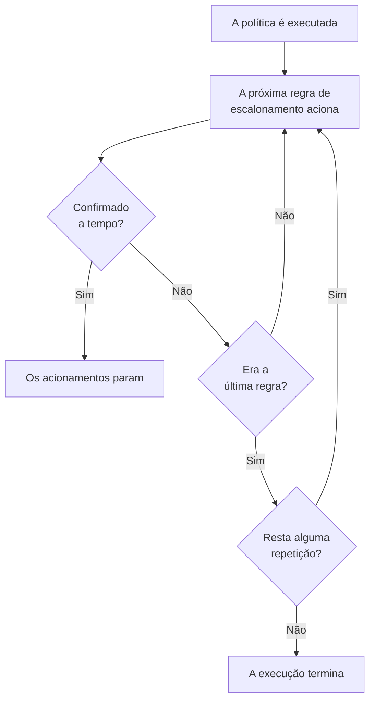

# Políticas de plantão

Uma política de plantão decide quem é acionado por um incidente ou alerta, e quem é o próximo se ninguém confirmar. Suas regras de escalonamento são seus níveis, e quem a executa são os incidentes, alertas e episódios que a usam. Esta página explica como criar uma política, o que a executa, o que suas páginas mostram e como cada execução é registrada.

:::cards
- [Criar uma política](#criar-uma-política): Um nome, e quem é acionado primeiro.
- [O que executa uma política](#o-que-executa-uma-política): Regras, modelos, monitores, chat e você.
- [Registros de execução](#registros-de-execução): Cada execução, regra por regra, e por que ela parou.
- [Arquivar ou excluir uma política](#arquivar-ou-excluir-uma-política): Tirar uma política de serviço.
:::

## Criar uma política

:::steps
1. Vá para **Plantão → Políticas de plantão** e clique em **Criar: Política de plantão**.
2. Informe um **Nome**, por exemplo "Pagamentos principal".
3. Em **Quem é acionado primeiro?**, clique em **Adicionar destinatário** e escolha os agendamentos de plantão, as equipes e as pessoas a acionar primeiro.
4. Clique em **Criar: Política de plantão**. A política abre na sua página **Regras de escalonamento**, com **Level 1** já criado.
:::

**Quem é acionado primeiro?** é opcional, e só é perguntado a quem pode adicionar regras de escalonamento: se ficar vazio, a política não aciona ninguém até ter uma regra. **Descrição** e **Rótulos** ficam em **Mais campos**. Para adicionar os próximos níveis, veja [Regras de escalonamento](/docs/on-call/escalation-rules).

A lista **Políticas de plantão** mostra de cada política o **Nome**, a **Descrição**, os **Rótulos** e os **Proprietários**. Selecione políticas para **Adicionar rótulos**, **Remover rótulos**, **Adicionar proprietário**, **Remover proprietário**, **Arquivar**, **Exportar: JSON** ou excluí-las. **Import JSON** cria políticas a partir de uma exportação: uma exportação contém as configurações próprias de uma política, não suas regras de escalonamento nem seus proprietários.

## O que executa uma política

Uma política não aciona ninguém até que algo a execute. Cada incidente, alerta e episódio executa as políticas que tem assim que é criado:

| O quê | Como adiciona a política | Saiba mais |
| --- | --- | --- |
| O próprio registro | O campo **Política de plantão** ao criar um incidente ou alerta, um modelo de incidente, ou a seção recolhida **Plantão** dos critérios de um monitor | [Declarar um incidente](/docs/incidents/declaring-incidents) |
| Regras de plantão | **Incidentes → Regras → Regras de Plantão** e **Alertas → Regras → Regras de Plantão** adicionam as políticas de cada regra que corresponde | [Regras de plantão de incidente](/docs/incidents/settings#regras-de-plantão-de-incidente) |
| Regras de agrupamento | Uma regra de agrupamento executa suas políticas quando abre um episódio | [Episódios de alertas e regras de agrupamento](/docs/alerts/episodes) |
| À mão | **Executar política de plantão**, no menu **Ações** de um feed, ou em uma mensagem do Slack ou do Microsoft Teams | [O feed do incidente](/docs/incidents/notes-owners-and-feed#o-feed-do-incidente) |
| Chat e workflows | `/oneuptime page` no Slack ou no Microsoft Teams, e a etapa **Page an On-Call Policy** de um workflow | [Paging](/docs/workflows/components#paging) |

Uma política que várias regras adicionam é executada uma única vez. Uma gravidade nunca executa uma política sozinha: quem faz isso é uma regra de plantão que corresponde a essa gravidade. Um incidente ou alerta criado já confirmado ou resolvido não executa nenhuma das suas políticas. Uma regra de plantão definida como **Somente em horário comercial** faz as políticas que adiciona aguardarem até esse horário começar.

## As páginas de uma política

Abra uma política a partir da lista. O menu lateral dela reúne tudo sobre ela:

| Seção | Páginas |
| --- | --- |
| **Básico** | **Visão geral**, **Regras de escalonamento** e **Proprietários** |
| **Registros** | **Registros de execução** e **Logs de notificação** |
| **Desenvolvedores** | **Terraform**, **API** e **Assistentes de IA** |
| **Avançado** | **Substituições de usuário**, **Campos personalizados**, **Configurações**, **Registros de auditoria** e **Excluir política** |

**Básico** fica aberta; as outras seções começam recolhidas até você clicar nelas.

- **Visão geral** mostra os **Detalhes da política de Plantão** e depois **Política em resumo**: quantos níveis e destinatários a política tem, quanto tempo falta até o último nível e quantas vezes ela se repete. **Prontidão dos destinatários** diz se cada pessoa que ela pode acionar pode ser contatada agora, e **Feed da política de plantão** lista o que mudou: pessoas, equipes e agendamentos adicionados ou removidos, substituições e passagens de turno.
- Os **Proprietários** são as pessoas e as equipes responsáveis pela política. Quando um acionamento que ela envia não encontra regra para alguém, ou não pode ser entregue, eles recebem um e-mail; uma política sem proprietários escreve aos proprietários do projeto.
- **Logs de notificação** lista cada mensagem que a política enviou, com uma aba por canal.
- **Substituições de usuário** cobre pessoas só nesta política. Veja [Substituições de usuário](/docs/on-call/user-overrides).
- **Configurações** tem **Exportar: Política de plantão** e o cartão que arquiva a política.

## Repetir uma política

Quando a espera do último nível acaba sem que ninguém confirme, uma política para, a menos que se repita. Para escolher, abra a página **Regras de escalonamento** da política e clique em **Editar** no cartão **Política de Repetição** abaixo das regras. **Editar política de repetição** pergunta **Se ninguém confirmar depois do último nível**:

| Resposta | O que faz |
| --- | --- |
| **Parar de acionar** | Ninguém é acionado de novo, então a política é executada uma única vez. Uma nova política começa com esta resposta. |
| **Recomeçar a partir do Level 1** | Cada nível é acionado de novo, em ordem. **Quantas vezes mais?** diz quantas vezes: 1 ou mais. |

Uma política que recomeça mais três vezes percorre seus níveis quatro vezes no total. A linha **Depois do último nível** do cartão diz o que a política faz, e **Política em resumo** na **Visão geral** diz o mesmo em palavras.

## Acionar de novo se não for resolvido

Confirmar encerra os acionamentos de uma política de vez, mesmo que depois ninguém resolva o incidente ou alerta. Em vez disso, uma política pode acionar de novo: abra a página **Regras de escalonamento** dela, abra **Mais configurações** na parte de baixo e clique em **Editar** no cartão **Tempo limite após a confirmação**. **Editar tempo limite após a confirmação** pergunta **Se for confirmado, mas não resolvido**:

| Resposta | O que faz |
| --- | --- |
| **Não acionar de novo** | A confirmação encerra os acionamentos de vez. Uma nova política começa com esta resposta. |
| **Acionar de novo** | Aciona quem confirmou e quem está de plantão agora. **Depois de quantos minutos?** diz quando: de 5 a 1440, 30 no início. |

Os minutos contam a partir de cada confirmação, e uma política aciona de novo no máximo 5 vezes pelo mesmo incidente, alerta ou episódio. Um novo acionamento começa no nível que estava acionando quando houve a confirmação, aciona quem está de plantão agora nesse nível e segue pelos níveis como a primeira execução. O incidente ou alerta continua confirmado: o novo acionamento é uma execução própria, no seu feed e nos registros de execução da política, onde o seu **Status** diz "Acionado de novo (1 de 5)".

Quem é acionado de novo confirma pela mensagem, ou com **Confirmar de novo** na página do incidente ou alerta, e os minutos recomeçam; **Escalonar** passa o acionamento para o próximo nível. Resolver ou excluir o incidente ou alerta, arquivar ou excluir a política, ou escolher **Não acionar de novo** o encerra. A linha **Depois de uma confirmação** do cartão diz o que a política faz, e **Mais configurações** mostra os minutos enquanto está recolhido. **Política em resumo** na **Visão geral** e **Resumo do escalonamento** dizem o mesmo em palavras.

## Registros de execução

Cada vez que uma política é executada, ela grava um registro de execução, e o registro passa pelos seus status conforme a execução avança:

| Status | O que significa |
| --- | --- |
| **Aguardando** | Uma regra de plantão definida como **Somente em horário comercial** faz a execução aguardar até esse horário começar: ela diz quando o acionamento começa, e até lá não aciona ninguém. Termina sem acionar se o incidente ou o alerta for confirmado ou resolvido antes. Começa a acionar na hora se o incidente ou o alerta mudar e passar a corresponder a uma regra de plantão que aciona imediatamente. |
| **Agendado**, **Iniciada** | A execução está sendo preparada. Uma que ainda esteja aqui depois de 5 minutos é encerrada como **Erro**. |
| **Executing** | A execução está acionando. O OneUptime a avança a cada minuto. |
| **Execution Completed** | Alguém confirmou, o incidente ou alerta foi resolvido, todas as regras e repetições foram usadas, ou a política foi arquivada. |
| **Execution Completed - No One Notified** | A execução passou por todas as regras sem acionar ninguém: em geral um agendamento sem ninguém de plantão. |
| **Erro** | A execução falhou. **Ver mensagem de status** diz por quê. |

Você encontra registros de execução em três lugares:

- nos próprios **Registros de execução** da política, em **Registros**;
- em **Plantão → Avançado → Registros de execução**, para todas as políticas, onde os acionamentos diretos de workflows e do chat aparecem como **Acionamento direto**;
- na página **Execuções de plantão** de um incidente ou de um alerta.

Cada linha mostra o que disparou a execução, quando, seu **Status** e quem a confirmou. **Ver linha do tempo** abre a **Linha do tempo de execução** dela: cada regra de escalonamento, quem ela acionou, por qual agendamento e como cada acionamento terminou. Um agendamento sem ninguém de plantão mostra **Ninguém estava de plantão** no lugar de uma pessoa. No OneUptime Cloud, os registros de execução precisam do plano **Growth**.

## Arquivar ou excluir uma política

Arquivar tira uma política de serviço e mantém tudo: abra as **Configurações** da política e clique em **Arquivar** no cartão de arquivamento dela, ou selecione políticas na lista e escolha **Arquivar**.

- Uma política arquivada não aciona ninguém. Os incidentes e alertas que a usam a pulam, e uma execução que ainda esteja escalonando para no próximo passo.
- Ela sai da lista **Políticas de plantão** e vai para **Plantão → Avançado → Políticas arquivadas**, onde **Desarquivar** a coloca de volta em serviço.

**Excluir política**, em **Avançado**, exclui a política junto com suas regras de escalonamento e substituições de usuário. A exclusão pela lista pede confirmação antes e sugere arquivar no lugar.

## Quem pode alterar uma política

**Proprietário do projeto**, **Administrador do projeto**, **Membro do projeto**, **Administrador de plantão** e **Membro de plantão** podem criar, alterar e excluir políticas; **Visualizador** e **Visualizador de plantão** podem lê-las. Em uma função personalizada, as permissões são **Create On-Call Duty Policy**, **Edit On-Call Duty Policy**, **Delete On-Call Duty Policy** e **Read On-Call Duty Policy**, e uma função limitada a alguns rótulos só alcança as políticas que os têm. Adicionar proprietários e campos personalizados precisa do plano **Growth** no OneUptime Cloud.

## API e Terraform

As políticas de plantão são o recurso `/api/on-call-duty-policy`, e o recurso `oneuptime_on_call_policy` no Terraform:

| Configuração | Campo da API |
| --- | --- |
| **Nome** | `name` |
| **Descrição** | `description` |
| **Se ninguém confirmar depois do último nível** | `repeatPolicyIfNoOneAcknowledges` |
| **Quantas vezes mais?** | `repeatPolicyIfNoOneAcknowledgesNoOfTimes` |
| **Depois de quantos minutos?** | `acknowledgementTimeoutInMinutes` |
| Arquivada | `isArchived` |

`repeatPolicyIfNoOneAcknowledges` é `false` para **Parar de acionar** e `true` para **Recomeçar a partir do Level 1**. Com `true` e `repeatPolicyIfNoOneAcknowledgesNoOfTimes` em `0`, uma política nunca se repete, e o painel a mostra como **Parar de acionar**.

`acknowledgementTimeoutInMinutes` é `null` para **Não acionar de novo**, e um número inteiro de minutos de 5 a 1440 para **Acionar de novo**. O OneUptime recusa qualquer outro valor.

Para criar uma política com seu primeiro nível em uma única requisição, veja [Criar regras com a API ou o Terraform](/docs/on-call/escalation-rules#criar-regras-com-a-api-ou-o-terraform).

## Solução de problemas

:::details Uma política foi executada, mas ninguém foi acionado
A execução dela diz **Execution Completed - No One Notified**. Abra **Ver linha do tempo**: uma linha com **Ninguém estava de plantão** aponta para um agendamento com uma lacuna, e a mensagem de status de uma linha **Ignorado** diz por quê, por exemplo alguém ausente sem ninguém para cobrir. **Plantão → Prontidão** mostra quem não pôde ser contatado.
:::

:::details O próximo nível foi acionado um minuto depois da espera
O OneUptime avança as políticas em andamento uma vez por minuto, então um nível é acionado na primeira verificação depois que sua espera acaba.
:::

:::details Um incidente mostra uma política que não acionou ninguém
A política está arquivada: uma política arquivada continua nos incidentes e alertas que a usam, não aciona ninguém, e o registro de execução dela diz que não foi executada. Desarquive-a em **Plantão → Avançado → Políticas arquivadas**.
:::

## Próximos passos

:::cards
- [Regras de escalonamento](/docs/on-call/escalation-rules): Adicionar os níveis que uma política aciona, e quanto tempo cada um espera.
- [Substituições de usuário](/docs/on-call/user-overrides): Enviar os acionamentos de alguém para um colega enquanto essa pessoa está ausente.
- [Prontidão e relatórios](/docs/on-call/readiness): Conferir se cada pessoa que uma política aciona pode ser contatada.
:::
