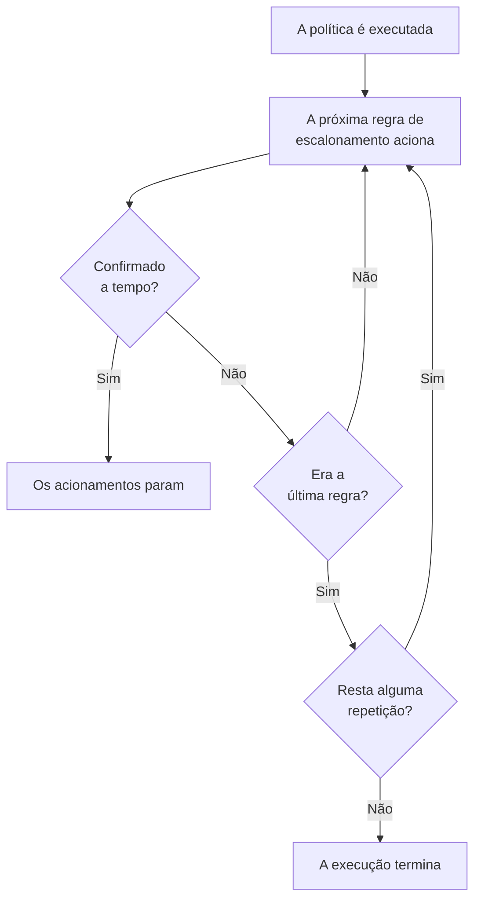

# Políticas de plantão

Uma política de plantão decide quem é acionado por um incidente ou alerta, e quem é o próximo se ninguém confirmar. Suas regras de escalonamento são seus níveis, e quem a executa são os incidentes, alertas e episódios que a usam. Esta página explica como criar uma política, o que a executa, o que suas páginas mostram e como cada execução é registrada.

:::cards
- [Criar uma política](#criar-uma-política): Um nome, e quem é acionado primeiro.
- [O que executa uma política](#o-que-executa-uma-política): Regras, modelos, monitores, chat e você.
- [Registros de execução](#registros-de-execução): Cada execução, regra por regra, e por que ela parou.
- [Arquivar ou excluir uma política](#arquivar-ou-excluir-uma-política): Tirar uma política de serviço.
:::

## Criar uma política

:::steps
1. Vá para **Plantão → Políticas de plantão** e clique em **Criar política de plantão**.
2. Informe um **Nome**, por exemplo "Pagamentos principal".
3. Em **Quem é acionado primeiro?**, clique em **Adicionar destinatário** e escolha os agendamentos de plantão, as equipes e as pessoas a acionar primeiro.
4. Clique em **Criar política de plantão**. A política abre na sua página **Regras de escalonamento**, com **Level 1** já criado.
:::

**Quem é acionado primeiro?** é opcional, e só é perguntado a quem pode adicionar regras de escalonamento: se ficar vazio, a política não aciona ninguém até ter uma regra. **Descrição** e **Rótulos** ficam em **Mais campos**. Para adicionar os próximos níveis, veja [Regras de escalonamento](/docs/on-call/escalation-rules).

O formulário também pergunta **Dispará-la a cada novo incidente e a cada novo alerta** a quem pode adicionar regras de plantão. Ele adiciona uma regra em **Incidentes → Regras → Regras de plantão** e outra em **Alertas → Regras → Regras de plantão**, cada uma correspondendo a tudo e executando esta política. Começa ativado na primeira política de um projeto, enquanto o projeto não tiver nenhuma política de plantão nem regra de plantão, e desativado nas seguintes: disparar duas políticas a cada novo incidente e a cada novo alerta é uma escolha a fazer. Desativado, a política não aciona ninguém até que uma regra, um monitor ou uma pessoa a execute.

Para ser guiado passo a passo, do seu celular até um acionamento de teste, clique em **Configuração guiada**: na lista vazia de **Políticas de plantão** ou em **Como funciona**. Veja [Ser acionado por telefone, SMS ou push](/docs/guides/paging).

A lista **Políticas de plantão** mostra de cada política o **Nome**, os **Acionados primeiro**, a **Descrição**, os **Rótulos** e os **Proprietários**. **Acionados primeiro** mostra quem é acionado pela primeira regra de escalonamento da política: seus agendamentos de plantão, cada um com quem está de plantão nele agora, suas equipes e as pessoas que ela nomeia, ou **Nenhuma regra de escalonamento** ou **Nenhum destinatário** quando ela não aciona ninguém. Selecione políticas para **Adicionar rótulos**, **Remover rótulos**, **Adicionar proprietário**, **Remover proprietário**, **Arquivar**, **Exportar JSON** ou excluí-las. **Importar JSON** cria políticas a partir de uma exportação: uma exportação contém as configurações próprias de uma política, não suas regras de escalonamento nem seus proprietários.

## O que executa uma política

Uma política não aciona ninguém até que algo a execute. Cada incidente, alerta e episódio executa as políticas que tem assim que é criado:

| O quê | Como adiciona a política | Saiba mais |
| --- | --- | --- |
| O próprio registro | O campo **Política de plantão** ao criar um incidente ou alerta, um modelo de incidente, ou a seção recolhida **Plantão** dos critérios de um monitor | [Declarar um incidente](/docs/incidents/declaring-incidents) |
| Regras de plantão | **Incidentes → Regras → Regras de plantão** e **Alertas → Regras → Regras de plantão** adicionam as políticas de cada regra que corresponde | [Regras de plantão de incidente](/docs/incidents/settings#regras-de-plantão-de-incidente) |
| Regras de agrupamento | Uma regra de agrupamento executa suas políticas quando abre um episódio | [Episódios de alertas e regras de agrupamento](/docs/alerts/episodes) |
| À mão | **Executar política de plantão**, no menu **Ações** de um feed, ou em uma mensagem do Slack ou do Microsoft Teams | [O feed do incidente](/docs/incidents/notes-owners-and-feed#o-feed-do-incidente) |
| Chat e workflows | `/oneuptime page` no Slack ou no Microsoft Teams, e a etapa **Page an On-Call Policy** de um workflow | [Paging](/docs/workflows/components#paging) |

Uma política que várias regras adicionam é executada uma única vez. Uma gravidade nunca executa uma política sozinha: quem faz isso é uma regra de plantão que corresponde a essa gravidade. Um incidente ou alerta criado já confirmado ou resolvido não executa nenhuma das suas políticas. Uma regra de plantão definida como **Somente em horário comercial** faz as políticas que adiciona aguardarem até esse horário começar.

## As páginas de uma política

Abra uma política a partir da lista. O menu lateral dela reúne tudo sobre ela:

| Seção | Páginas |
| --- | --- |
| **Básico** | **Visão geral**, **Regras de escalonamento** e **Proprietários** |
| **Registros** | **Registros de execução** e **Logs de notificação** |
| **Desenvolvedores** | **Terraform**, **API**, **CLI** e **Assistentes de IA** |
| **Avançado** | **Substituições de usuário**, **Campos personalizados**, **Configurações**, **Registros de auditoria** e **Excluir política** |

**Básico** fica aberta; as outras seções começam recolhidas até você clicar nelas.

- **Visão geral** mostra os **Detalhes da política de plantão** e depois **Política em resumo**: quantos níveis e destinatários a política tem, quanto tempo falta até o último nível e quantas vezes ela se repete. **Prontidão dos destinatários** diz se cada pessoa que ela pode acionar pode ser contatada agora, e **Feed da política de plantão** lista o que mudou: pessoas, equipes e agendamentos adicionados ou removidos, substituições e passagens de turno. As regras dela para Slack, Microsoft Teams e Mattermost as publicam nos seus canais, uma passagem de turno em uma linha: veja [Mensagens de plantão](/docs/workspace-connections/slack#mensagens-de-plantão).
- Os **Proprietários** são as pessoas e as equipes responsáveis pela política. Quando um acionamento que ela envia não encontra regra para alguém, ou não pode ser entregue, eles recebem um e-mail; uma política sem proprietários escreve aos Proprietários do projeto.
- **Logs de notificação** lista cada mensagem que a política enviou, com uma aba por canal.
- **Substituições de usuário** cobre pessoas só nesta política. Veja [Substituições de usuário](/docs/on-call/user-overrides).
- **Configurações** tem **Exportar: Política de plantão** e o cartão que arquiva a política.

**O que aciona esta política**, na **Visão geral**, lista as regras de plantão, os monitores cujos critérios acionam a política, os modelos e outras regras que a acionam, e os fluxos de trabalho que fazem isso, cada um com um link. Uma regra desativada mostra **Desativado**. Quando nada aciona a política, o cartão diz isso: ela não aciona ninguém até que algo a acione. Excluir ou arquivar a política diz o mesmo primeiro. O que você não pode abrir é contado, não nomeado.

## Repetir uma política

Quando a espera do último nível acaba sem que ninguém confirme, uma política para, a menos que se repita. Para escolher, abra a página **Regras de escalonamento** da política e clique em **Editar** no cartão **Política de Repetição** abaixo das regras. **Editar política de repetição** pergunta **Se ninguém confirmar depois do último nível**:

| Resposta | O que faz |
| --- | --- |
| **Parar de acionar** | Ninguém é acionado de novo, então a política é executada uma única vez. Uma nova política começa com esta resposta. |
| **Recomeçar a partir do Level 1** | Cada nível é acionado de novo, em ordem. **Quantas vezes mais?** diz quantas vezes: 1 ou mais. |

Uma política que recomeça mais três vezes percorre seus níveis quatro vezes no total. Uma passada em que nenhum nível tinha alguém para acionar não se repete: outra também não acionaria ninguém, então a política para. A linha **Depois do último nível** do cartão diz o que a política faz, e **Política em resumo** na **Visão geral** diz o mesmo em palavras.

## Acionar de novo se não for resolvido

Confirmar encerra os acionamentos de uma política de vez, mesmo que depois ninguém resolva o incidente ou alerta. Em vez disso, uma política pode acionar de novo: abra a página **Regras de escalonamento** dela, abra **Mais configurações** na parte de baixo e clique em **Editar** no cartão **Tempo limite após a confirmação**. **Editar tempo limite após a confirmação** pergunta **Se for confirmado, mas não resolvido**:

| Resposta | O que faz |
| --- | --- |
| **Não acionar de novo** | A confirmação encerra os acionamentos de vez. Uma nova política começa com esta resposta. |
| **Acionar de novo** | Aciona quem confirmou e quem está de plantão agora. **Depois de quantos minutos?** diz quando: de 5 a 1440, 30 no início. |

Os minutos contam a partir de cada confirmação, e uma política aciona de novo no máximo 5 vezes pelo mesmo incidente, alerta ou episódio. Um novo acionamento começa no nível que estava acionando quando houve a confirmação, aciona quem está de plantão agora nesse nível e segue pelos níveis como a primeira execução. O incidente ou alerta continua confirmado: o novo acionamento é uma execução própria, no seu feed e nos registros de execução da política, onde o seu **Status** diz "Acionado de novo (1 de 5)".

Quem é acionado de novo confirma pela mensagem, ou com **Confirmar de novo** na página do incidente ou alerta, e os minutos recomeçam; **Escalonar** passa o acionamento para o próximo nível. Resolver ou excluir o incidente ou alerta, arquivar ou excluir a política, ou escolher **Não acionar de novo** o encerra. A linha **Depois de uma confirmação** do cartão diz o que a política faz, e **Mais configurações** mostra os minutos enquanto está recolhido. **Política em resumo** na **Visão geral** e **Resumo do escalonamento** dizem o mesmo em palavras.

## Quando várias políticas acionam

Um incidente, alerta ou episódio executa cada uma das suas políticas por conta própria, ao mesmo tempo.

- Quem está de plantão em duas delas é acionado uma só vez. Quando o nível de uma política chega a alguém que outra política já está acionando sobre isso, ele não aciona essa pessoa de novo: o registro de execução da política mostra a pessoa como **Já chamado**, e o feed do incidente e a mensagem da política no Slack e no Microsoft Teams citam a política que está acionando a pessoa. Mesmo assim, o nível espera os seus minutos antes do próximo nível, como faz com qualquer pessoa que acionou. Responder a esse único acionamento vale para as duas políticas. Dentro de uma política, alguém que um nível cita duas vezes, pessoalmente e por meio de uma equipe ou de um agendamento, é acionado uma só vez.
- Um acionamento enviado diretamente a pessoas também conta. Quando o nível de uma política chega a alguém que um acionamento pelo Slack ou pelo Microsoft Teams, ou o bloco de acionamento de um fluxo de trabalho, já está acionando sobre isso, ele não aciona essa pessoa de novo: o registro de execução da política cita quem enviou esse acionamento, ou o fluxo de trabalho. O bloco de acionamento de um fluxo de trabalho também não aciona de novo alguém que uma política ou outro acionamento já está acionando.
- Confirmar o incidente ou alerta encerra em até um minuto todas as políticas em execução para ele, onde quer que seja confirmado: em qualquer acionamento sobre ele, na sua própria página, no aplicativo móvel ou no Slack ou no Microsoft Teams. Nenhum próximo nível é acionado, e nenhuma ligação ou SMS que ainda esperava para sair é enviado. As notificações já enviadas continuam enviadas.

Ninguém perde um acionamento por ser acionado uma só vez. Esse único acionamento pode terminar sem resposta: a pessoa o escalona por uma das mensagens dele, o que só escalona esse acionamento, o acionamento não pode ser enviado, ou ele termina. Então a outra política, ou o bloco do fluxo de trabalho, aciona a pessoa por conta própria em até um minuto, sem enviar de novo o que já chegou a ela. **Escalonar** na página do incidente ou no aplicativo móvel escalona as duas. Um novo acionamento, uma política iniciada à mão e um acionamento que alguém enviou pelo Slack ou pelo Microsoft Teams sempre acionam as suas pessoas por conta própria, mesmo alguém que outra política está acionando. O acionamento de um observador e o de um destinatário nunca são juntados.

Alguns acionamentos continuam depois da confirmação, até que alguém que eles acionaram responda ou que seja resolvido: um novo acionamento, um acionamento a observadores, um acionamento que alguém enviou a pessoas pelo Slack ou pelo Microsoft Teams, e uma política iniciada à mão.

Uma política iniciada à mão é aquela iniciada com **Executar política de plantão**, ou por um acionamento do Slack ou do Microsoft Teams que a cita. Ela aciona nível por nível como qualquer execução, com ligações e notificações push repetidas, e outra pessoa confirmar o incidente não a encerra: é assim que você aciona outra equipe para um incidente de que alguém já está cuidando. Quem ela acionou responde pela mensagem do acionamento, por uma ligação ou um SMS, ou confirmando o incidente pessoalmente; quando o incidente já está confirmado, a página dele oferece **Confirmar de novo**. **Escalonar** passa a política para o próximo nível. Em um incidente, alerta ou episódio resolvido, nada é iniciado, e você fica sabendo por quê: o painel desativa **Executar política de plantão** e mostra o motivo. Suas notificações dizem quem iniciou qual política e trazem a mensagem enviada com um acionamento pelo Slack ou pelo Microsoft Teams.

## Testar uma política

**Testar esta política**, nas regras de escalonamento de uma política, aciona o primeiro nível como teste, sem nenhum incidente por trás: cada mensagem diz TEST, e nenhuma página de status, nenhum assinante e nenhum canal é avisado. Ative **Percorrer todos os níveis de escalonamento** para acionar cada nível por vez, com no máximo 2 minutos de intervalo, até que alguém confirme. Antes de enviar qualquer coisa, a caixa de diálogo lista quem o teste aciona e como, e quanto custa no OneUptime Cloud.

**Enviar chamada de teste** fica desativado enquanto o teste não alcançaria ninguém: cada pessoa que ele aciona optou por não receber essa gravidade, não tem nenhuma regra para ela nem nada a que recorrer, ou só tem métodos não verificados ou desativados no projeto. Uma linha abaixo da lista diz o porquê. Quando só um nível seguinte pode ser alcançado, a linha oferece **Percorrer todos os níveis de escalonamento** com um clique.

Quem é acionado confirma o teste por qualquer uma das suas mensagens: o link de um e-mail, de um SMS ou de uma mensagem de chat, o 1 de uma ligação, ou a sua notificação push no app OneUptime On-Call, nas versões mais novas que a 1.6.0. Uma política pode ser testada uma vez a cada 5 minutos, e um projeto envia no máximo 20 testes por hora.

### Fazer um simulado em um monitor

**Fazer um simulado**, no cartão **Quando cair** de um monitor, ensaia uma das suas falhas: um incidente ou alerta que um dos seus critérios abre, ou o incidente que uma regra de incidente de alertas declara a partir desse alerta. Ele testa cada política de plantão que essa falha acionaria, cada uma como **Testar esta política** a testa, e nada público acontece: nenhum incidente ou alerta é criado, e nenhuma página de status, nenhum assinante e nenhum canal é avisado. Antes de enviar qualquer coisa, a caixa de diálogo nomeia a falha, cada política e quem essa política aciona agora. Para um incidente declarado, ela nomeia também a regra e quanto tempo o alerta fica aberto antes: o simulado testa as políticas do incidente na hora, sem essa espera.

Um simulado aciona o primeiro nível de cada política. Em **Mais campos**, ative **Percorrer todos os níveis de escalonamento** para acionar os níveis de cada política por vez, com no máximo 2 minutos de intervalo, até que alguém confirme: a caixa de diálogo lista então cada nível que cada política alcança e quanto o percurso custa no máximo. Quando ninguém nos primeiros níveis pode ser alcançado, mas um nível seguinte pode, a linha abaixo da lista oferece **Percorrer todos os níveis de escalonamento** com um clique.

**Iniciar simulado** fica desativado enquanto uma dessas políticas for uma que você não pode testar, porque não pode editá-la, ou enquanto ninguém que elas acionam puder ser alcançado. Cada política de um simulado conta como um teste próprio: uma política testada nos últimos 5 minutos impede todo o simulado, e um simulado de três políticas ocupa três dos 20 testes por hora do projeto.

Depois que a caixa de diálogo é fechada, **Último simulado** no cartão diz qual falha o último simulado do monitor ensaiou, quando e por quem foi iniciado e quantos dos seus testes foram confirmados. **Mostrar detalhes** lista o teste de cada política: se foi confirmado, por quem, por qual meio e com que rapidez. Cada teste fica nos registros de execução da sua política, marcado como simulado do monitor. Os resultados de um simulado aparecem para quem pode ler o monitor e cada um desses registros de execução.

## Registros de execução

Cada vez que uma política é executada, ela grava um registro de execução, e o registro passa pelos seus status conforme a execução avança:

| Status | O que significa |
| --- | --- |
| **Aguardando** | Uma regra de plantão definida como **Somente em horário comercial** faz a execução aguardar até esse horário começar: ela diz quando o acionamento começa, e até lá não aciona ninguém. Termina sem acionar se o incidente ou o alerta for confirmado ou resolvido antes. Começa a acionar na hora se o incidente ou o alerta mudar e passar a corresponder a uma regra de plantão que aciona imediatamente. |
| **Agendado**, **Iniciada** | A execução está sendo preparada. Uma que ainda esteja aqui depois de 5 minutos não terminou de iniciar: passa para **Executando** e aciona a partir de onde o início parou. Um acionamento direto ou de teste que ainda esteja aqui é encerrado como **Erro**. |
| **Executando** | A execução está acionando. O OneUptime a avança a cada minuto. Uma etapa que falha por um momento, por exemplo porque não foi possível alcançar o banco de dados, é tentada de novo um minuto depois, depois de 2 e 4 minutos, e então a cada 5 minutos. |
| **Execução concluída** | Alguém confirmou, o incidente ou alerta foi resolvido, todas as regras e repetições foram usadas, ou a política foi arquivada. |
| **Execução concluída - ninguém foi notificado** | A execução passou por todas as regras sem acionar ninguém: em geral um agendamento sem ninguém de plantão, ou um nível sem destinatários. |
| **Erro** | A execução falhou: uma etapa falhou de um jeito que uma nova tentativa não consegue corrigir, como uma regra de escalonamento excluída, ou falhou 10 tentativas seguidas, ao longo de cerca de 37 minutos. **Ver mensagem de status** diz por quê. |

Você encontra registros de execução em três lugares:

- nos próprios **Registros de execução** da política, em **Registros**;
- em **Plantão → Avançado → Registros de execução**, para todas as políticas, onde os acionamentos diretos de workflows e do chat aparecem como **Acionamento direto**;
- na página **Execuções de plantão** de um incidente ou de um alerta.

Cada linha mostra o que disparou a execução, quando, seu **Status** e quem a confirmou. **Ver linha do tempo** abre a **Linha do tempo de execução** dela: cada regra de escalonamento, quem ela acionou, por qual agendamento e como cada acionamento terminou. **Notificado por** mostra como cada acionamento chegou à pessoa: chamada telefônica, SMS, e-mail, notificação push e assim por diante. Um agendamento sem ninguém de plantão mostra **Ninguém estava de plantão** no lugar de uma pessoa. Um nível que não acionou ninguém diz por quê, com **Seguiu sem esperar** embaixo: a política não esperou por ele. Alguém que outra política, ou um acionamento enviado diretamente, já estava acionando mostra **Já chamado**: veja [Quando várias políticas acionam](#quando-várias-políticas-acionam). No OneUptime Cloud, os registros de execução precisam do plano **Growth**.

## Arquivar ou excluir uma política

Arquivar tira uma política de serviço e mantém tudo: abra as **Configurações** da política e clique em **Arquivar** no cartão de arquivamento dela, ou selecione políticas na lista e escolha **Arquivar**.

- Uma política arquivada não aciona ninguém. Os incidentes e alertas que a usam a pulam, e uma execução que ainda esteja escalonando para no próximo passo.
- Ela sai da lista **Políticas de plantão** e vai para **Plantão → Avançado → Políticas arquivadas**, onde **Desarquivar** a coloca de volta em serviço.

**Excluir política**, em **Avançado**, exclui a política junto com suas regras de escalonamento e substituições de usuário. A exclusão pela lista pede confirmação antes e sugere arquivar no lugar.

## Quem pode alterar uma política

**Proprietário do projeto**, **Administrador do projeto**, **Membro do projeto**, **Administrador de plantão** e **Membro de plantão** podem criar, alterar e excluir políticas; **Visualizador** e **Visualizador de plantão** podem lê-las. Em uma função personalizada, as permissões são **Create On-Call Policy**, **Edit On-Call Policy**, **Delete On-Call Policy** e **Read On-Call Policy**, e uma função limitada a alguns rótulos só alcança as políticas que os têm. Adicionar proprietários e campos personalizados precisa do plano **Growth** no OneUptime Cloud.

## API e Terraform

As políticas de plantão são o recurso `/api/on-call-duty-policy`, e o recurso `oneuptime_on_call_policy` no Terraform:

| Configuração | Campo da API |
| --- | --- |
| **Nome** | `name` |
| **Descrição** | `description` |
| **Se ninguém confirmar depois do último nível** | `repeatPolicyIfNoOneAcknowledges` |
| **Quantas vezes mais?** | `repeatPolicyIfNoOneAcknowledgesNoOfTimes` |
| **Depois de quantos minutos?** | `acknowledgementTimeoutInMinutes` |
| Arquivada | `isArchived` |

`repeatPolicyIfNoOneAcknowledges` é `false` para **Parar de acionar** e `true` para **Recomeçar a partir do Level 1**. Com `true`, `repeatPolicyIfNoOneAcknowledgesNoOfTimes` precisa ser um número inteiro de 1 ou mais: o OneUptime recusa `0`. Uma política mais antiga salva com `0` nunca se repete, e o painel a mostra como **Parar de acionar**.

`acknowledgementTimeoutInMinutes` é `null` para **Não acionar de novo**, e um número inteiro de minutos de 5 a 1440 para **Acionar de novo**. O OneUptime recusa qualquer outro valor.

Para criar uma política com seu primeiro nível em uma única requisição, veja [Criar regras com a API ou o Terraform](/docs/on-call/escalation-rules#criar-regras-com-a-api-ou-o-terraform).

## Solução de problemas

:::details Uma política foi executada, mas ninguém foi acionado
A execução dela diz **Execução concluída - ninguém foi notificado**. Abra **Ver linha do tempo**: uma linha com **Ninguém estava de plantão** aponta para um agendamento com uma lacuna, e a mensagem de status de uma linha **Ignorado** diz por quê, por exemplo alguém ausente sem ninguém para cobrir. **Plantão → Prontidão** mostra quem não pôde ser contatado.
:::

:::details O próximo nível foi acionado um minuto depois da espera
O OneUptime avança as políticas em andamento uma vez por minuto, então um nível é acionado na primeira verificação depois que sua espera acaba.
:::

:::details O próximo nível foi acionado na hora, sem esperar
O nível anterior não tinha ninguém para acionar: nenhum destinatário, ninguém de plantão nos agendamentos dele ou ninguém que pudesse ser contatado. Um nível que não aciona ninguém não tem espera, então o próximo nível é acionado assim que a política chega a ele. **Ver linha do tempo** mostra por que esse nível não acionou ninguém.
:::

:::details Um incidente mostra uma política que não acionou ninguém
A política está arquivada: uma política arquivada continua nos incidentes e alertas que a usam, não aciona ninguém, e o registro de execução dela diz que não foi executada. Desarquive-a em **Plantão → Avançado → Políticas arquivadas**.
:::

:::details Alguém foi acionado duas vezes pelo mesmo incidente
Quem está de plantão em duas das políticas que o incidente executa é acionado uma só vez, pela primeira política que chega até essa pessoa, assim como alguém a quem chegam tanto uma política quanto um acionamento pelo Slack, pelo Microsoft Teams ou por um fluxo de trabalho. A segunda também aciona a pessoa quando se trata de um novo acionamento, de uma política iniciada à mão, de um acionamento enviado pelo Slack ou pelo Microsoft Teams ou de um acionamento a observadores, que acionam as suas pessoas por conta própria, ou quando o primeiro acionamento dela já tinha terminado antes de a segunda chegar até ela: a pessoa o tinha escalonado, ou ele tinha sido encerrado. **Ver linha do tempo** do segundo acionamento mostra **Já chamado** para quem ela não acionou de novo.
:::

:::details Uma política continuou acionando depois que o incidente foi confirmado
Ela foi iniciada à mão, ou é um novo acionamento: continua até que alguém que ela acionou responda, ou que o incidente seja resolvido. Veja [Quando várias políticas acionam](#quando-várias-políticas-acionam).
:::

## Próximos passos

:::cards
- [Regras de escalonamento](/docs/on-call/escalation-rules): Adicionar os níveis que uma política aciona, e quanto tempo cada um espera.
- [Substituições de usuário](/docs/on-call/user-overrides): Enviar os acionamentos de alguém para um colega enquanto essa pessoa está ausente.
- [Prontidão e relatórios](/docs/on-call/readiness): Conferir se cada pessoa que uma política aciona pode ser contatada.
:::
