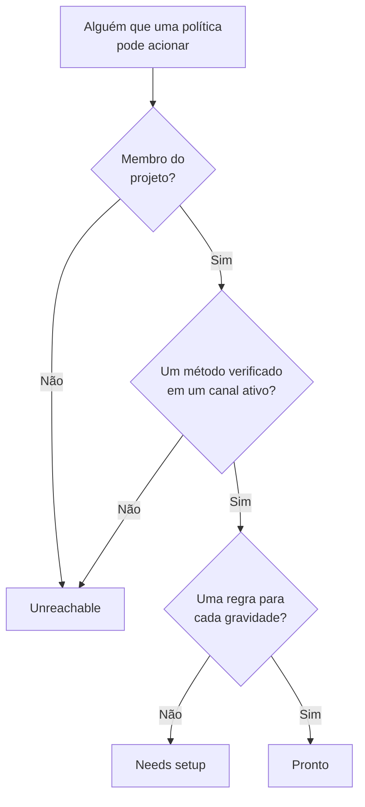

# Prontidão e relatórios

A prontidão responde a uma pergunta antes que um incidente a responda: se algo disparasse agora, cada pessoa que suas políticas de plantão acionam seria mesmo contatada? Ela lista cada destinatário do projeto, diz quem está pronto e quem não está, e permite lembrar as pessoas de terminar a configuração. O relatório **Tempo de plantão do usuário** mostra depois quanto tempo cada pessoa ficou de plantão.

:::cards
- [Como um status é definido](#como-um-status-é-definido): Pronto, Needs setup ou Unreachable, e por quê.
- [A página Prontidão](#a-página-prontidão): Cada destinatário do projeto, em uma lista.
- [Lembrar as pessoas de terminar a configuração](#lembrar-as-pessoas-de-terminar-a-configuração): Um e-mail que diz o que está faltando.
- [Tempo de plantão do usuário](#tempo-de-plantão-do-usuário): Quanto tempo cada pessoa ficou de plantão.
:::

## Como um status é definido

Um destinatário é qualquer pessoa que uma política de plantão pode acionar: alguém nomeado em uma regra de escalonamento, um membro de uma equipe que uma regra aciona, alguém em uma camada de um agendamento que uma regra aciona, e quem cobre em uma substituição de usuário que ainda não terminou. Um agendamento que nenhuma política aciona não adiciona ninguém.

| Status | O que significa |
| --- | --- |
| **Pronto** | A pessoa tem um método verificado em um canal que o projeto ligou, e uma regra para cada gravidade, em cada aba das suas regras de plantão. |
| **Precisa de configuração** | A pessoa pode ser contatada, mas algumas gravidades não têm regra. A linha conta essas lacunas. |
| **Inacessível** | Nada chega à pessoa: nenhum método verificado, cada método verificado está em um canal que o projeto desligou, ou ela não é membro do projeto. |

Uma lacuna é uma gravidade sem regra, na aba de incidentes, episódios de incidentes, alertas ou episódios de alertas. Uma regra que desliga uma gravidade de propósito não é uma lacuna. Um acionamento que encontra uma lacuna ainda chega à pessoa pelos métodos verificados dela, a menos que o projeto tenha desligado essa alternativa: veja [Quando nenhuma regra corresponde](/docs/notifications/index#quando-nenhuma-regra-corresponde).

## A página Prontidão

Abra **Plantão → Prontidão**. O cartão **On-call readiness** lista cada pessoa que uma política de plantão do projeto pode alcançar, primeiro as que precisam de algo. Qualquer pessoa do projeto pode abri-lo.

Acima da lista, os blocos contam **Destinatários**, **Pronto**, **Precisa de configuração** e **Inacessível**. Clique em **Pronto**, **Precisa de configuração** ou **Inacessível** para listar só esses destinatários, e clique de novo para listar todos.

| Coluna | O que mostra |
| --- | --- |
| **Destinatário** | A pessoa, com o endereço de e-mail dela. |
| **Status** | **Pronto**, **Inacessível** ou quantas lacunas a pessoa tem. |
| **Canais** | Um segmento por canal: cheio para um método verificado, vazado para um ainda não verificado. |
| **Coverage** | Quantas gravidades têm regra, em cada aba, do total. |
| **Reached via** | Como as políticas chegam à pessoa: cada equipe que a aciona por meio de uma regra de escalonamento, pelo nome, ou **Direct**, **Agendamento** ou **Substituição**. |

**Coverage** em uma linha mostra os métodos de notificação da pessoa, por que ela tem o status dela e uma grade de cada gravidade com ou sem regra. O funil filtra a lista por **Destinatário**, **Status**, **Equipe** ou **Reached via**. A resposta pode ter um minuto: **Atualizar** a calcula de novo.

## Lembrar as pessoas de terminar a configuração

Só a própria pessoa pode adicionar e verificar seus métodos de notificação e suas regras, então a solução é pedir a ela.

:::steps
1. Na página Prontidão, marque os destinatários que quer lembrar. Destinatários prontos não podem ser marcados: não há nada para lembrá-los.
2. Clique em **Enviar lembrete de configuração**. A confirmação nomeia cada pessoa que vai receber o e-mail.
3. Confirme. Cada pessoa recebe um e-mail que diz o que falta na própria configuração, com um link para a página que resolve isso.
:::

Depois, um aviso diz quantos lembretes foram enviados, ignorados ou falharam, e por quê para cada um que não foi enviado. Ninguém recebe mais de um lembrete a cada 24 horas, e um envio lembra no máximo 250 pessoas. Enviar lembretes exige **Proprietário do projeto**, **Administrador do projeto** ou **Administrador de plantão**, ou **Edit On-Call Duty Policy** em uma função personalizada.

## A prontidão em outras páginas

- Na **Visão geral** de uma política, **Prontidão dos destinatários** lista cada pessoa que essa política pode acionar e que precisa de atenção, e **Verificar de novo** lê tudo de novo. A sua própria linha tem um botão para a página que resolve o problema; a de outra pessoa abre um e-mail para ela no seu próprio programa de e-mail, com a solução nele.
- Nas **Regras de escalonamento** de uma política, um nível cujos destinatários não podem ser todos acionados diz isso no seu cartão. Veja [O resumo do escalonamento](/docs/on-call/escalation-rules#o-resumo-do-escalonamento).
- Em **Usuários**, abra um membro e depois **Prontidão** na seção **Plantão**: o status, os métodos e a grade de cobertura da pessoa.
- Para a sua própria configuração, **Configurações do usuário → Lista de configuração** guia você. Veja [A lista de configuração](/docs/notifications/index#a-lista-de-configuração).

## O e-mail semanal de prontidão

Uma vez por semana, o OneUptime verifica cada projeto que tem uma política de plantão. Quando alguém nele está **Inacessível** ou **Precisa de configuração**, os proprietários do projeto recebem um e-mail que lista essas pessoas em dois grupos, quem não pode ser acionado de jeito nenhum e quem pode ser contatado com lacunas, até 20 nomes cada, com um link para a página Prontidão.

Uma semana em que todos estão prontos não envia nada, então o e-mail sempre significa que há algo a corrigir. Quando alguém não pode ser acionado de jeito nenhum, o assunto começa com `[Action Required]`.

## Tempo de plantão do usuário

**Plantão → Relatórios → Tempo de plantão do usuário** mostra quanto tempo cada pessoa ficou de plantão, em um período que você escolhe: **Último mês** de início.

| Coluna | O que mostra |
| --- | --- |
| **Usuário** | A pessoa. |
| **Tempo em que o usuário esteve de plantão** | O tempo de plantão dela no período, em horas e minutos. |

O tempo é registrado conforme as pessoas entram e saem do plantão: a partir do momento em que um agendamento que uma regra aciona passa um turno para elas, ou em que são adicionadas a uma regra diretamente ou por meio de uma equipe, até a passagem de turno ou até serem removidas. O plantão por duas políticas ao mesmo tempo conta uma única vez, e o tempo ainda em andamento conta até agora.

A **Linha do tempo de plantões** e os feeds de calendário mostram os turnos passados conforme a rotação está configurada hoje. Este relatório é gravado à medida que as coisas acontecem, então use-o para revisões de equidade e para o pagamento do plantão.

> [!NOTE]
> No OneUptime Cloud, o relatório precisa do plano **Growth**, e o tempo que terminou há mais de 200 dias é excluído. Uma instalação auto-hospedada guarda tudo.

## Solução de problemas

:::details Alguém está inacessível, mas tem um número de telefone verificado
Talvez todos os métodos dessa pessoa estejam em canais que o projeto desligou: SMS, ligações, WhatsApp e Telegram começam desligados em um projeto novo. Veja [Ative um canal para o seu projeto](/docs/notifications/notification-methods#ative-um-canal-para-o-seu-projeto).
:::

:::details Alguém não aparece na lista
A lista só tem pessoas que uma política de plantão pode acionar. Ficam de fora um membro de equipe que não aceitou o convite, alguém em um agendamento que nenhuma política aciona e quem cobria em uma substituição que já terminou.
:::

:::details Os proprietários nunca recebem o e-mail semanal
Ele só é enviado em uma semana em que alguém está **Inacessível** ou **Precisa de configuração**, e só para os proprietários do projeto.
:::

## Próximos passos

:::cards
- [Como o OneUptime chega até você](/docs/notifications/index): Os métodos, as regras e a alternativa por trás de cada status.
- [Métodos de notificação](/docs/notifications/notification-methods): Adicionar e verificar as formas como o OneUptime contata alguém.
- [Regras de Plantão pessoais](/docs/notifications/on-call-rules): Fechar as lacunas, gravidade por gravidade.
:::
