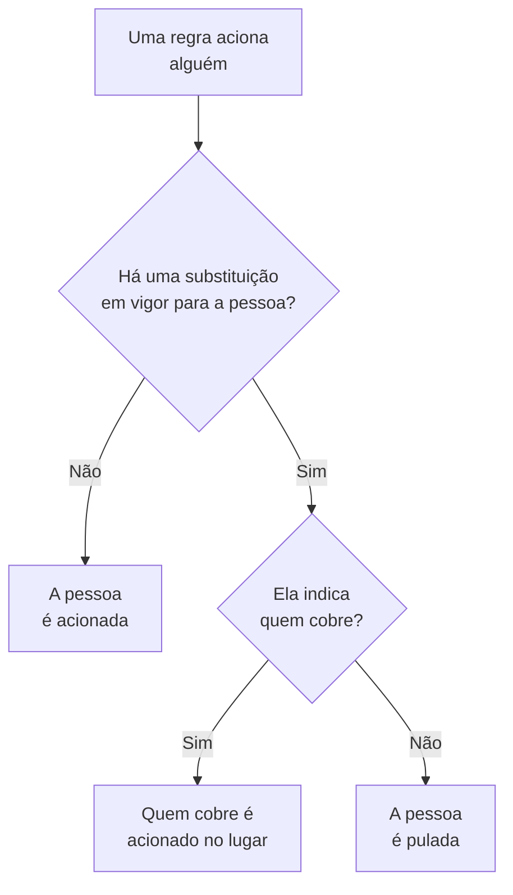

# Substituições de usuário

Enquanto alguém está ausente, uma substituição de usuário envia os acionamentos que chegariam a essa pessoa para quem a cobre, por um período definido. Sem ninguém indicado para cobrir, ela pula a pessoa: cada turno dela em um agendamento de plantão passa para a próxima pessoa da rotação. Use uma para férias, um dia de licença médica ou um turno trocado.

:::cards
- [Como uma substituição muda um acionamento](#como-uma-substituição-muda-um-acionamento): Quem é acionado no lugar, e quando.
- [Adicionar uma substituição](#adicionar-uma-substituição): Quem está ausente, quem cobre, a partir de quando e até quando.
- [Todas as políticas, ou uma](#todas-as-políticas-ou-uma): Onde adicionar uma substituição, e qual vale.
- [Outras formas de adicionar uma](#outras-formas-de-adicionar-uma): A partir de um agendamento e dos seus próximos turnos.
:::

## Como uma substituição muda um acionamento



Enquanto uma substituição está em vigor, do início ao fim:

- Com alguém em **Quem cobre?**, essa pessoa recebe todos os acionamentos da pessoa ausente, de cada agendamento, equipe e regra a que a substituição se aplica. O acionamento chega a ela pelas suas próprias regras de plantão pessoais.
- Sem ninguém para cobrir, a pessoa é pulada. Em um agendamento de plantão, cada turno dela passa para a próxima pessoa da rotação que não esteja ausente; se todos de uma camada estiverem ausentes, as camadas abaixo assumem. Uma regra que a nomeia diretamente, ou por meio de uma equipe, não a aciona, e a execução da política diz que ela está ausente, e até quando.
- As substituições não se encadeiam. Se quem cobre também estiver ausente, ainda é essa pessoa que é acionada pela pessoa que ela cobre.

Quando a substituição termina, os acionamentos voltam a ser dela. A **Linha do tempo de plantões**, as camadas de um agendamento e os feeds de calendário mostram quem tem cada turno coberto.

## Adicionar uma substituição

:::steps
### Abrir as substituições

Vá para **Plantão → Avançado → Substituições de usuário** para cobrir alguém em todas as políticas de plantão, ou para a página **Substituições de usuário** de uma política, em **Avançado**, para cobrir a pessoa só nessa política. Clique em **Adicionar: Substituição de usuário**.

### Dizer quem está ausente

**Quem está ausente?** começa com você, porque registrar a própria folga é o caso mais comum. Escolha outra pessoa para organizar a cobertura dela.

### Dizer quem cobre

Deixe **Quem cobre?** em **Próxima pessoa da rotação** para pular a pessoa, ou escolha o colega que fica com todos os acionamentos dela. A pessoa ausente não é oferecida.

### Definir o horário

**Começa** é agora, a menos que você escolha outro horário. Defina **Termina** para quando a pessoa voltar: precisa ser depois do início. Clique em **Adicionar: Substituição de usuário**.
:::

Cada substituição é uma linha: **Ausente**, **Coberto por**, **Começa** e **Termina**, que podem ser filtradas pelo início e pelo fim. **Coberto por** mostra **Próxima pessoa da rotação** quando a pessoa é pulada. Uma substituição não pode ser editada: exclua-a e adicione uma nova, ou exclua-a para trazer alguém de volta antes.

## Todas as políticas, ou uma

| Adicionada em | Cartão | Vale para |
| --- | --- | --- |
| **Plantão → Avançado → Substituições de usuário** | **Substituições de usuário globais** | Todas as políticas de plantão do projeto |
| **Substituições de usuário** de uma política | **Substituições de usuário da política de plantão** | Só essa política |

Quando duas substituições da mesma pessoa se sobrepõem, a da própria política vale mais que uma global, e a que indica quem cobre vale mais que um pulo. Um acionamento enviado sem política, de um workflow ou do chat, segue só as substituições globais.

## Outras formas de adicionar uma

- A partir de um agendamento: na página **Camadas** de um agendamento, expanda uma camada e clique em **Pular até…** ao lado de uma pessoa. Abre o mesmo formulário, com ela ausente e a rotação cobrindo, como substituição global. Veja [Quando alguém está ausente](/docs/on-call/schedules#quando-alguém-está-ausente).
- A partir dos seus próximos turnos: **Obter cobertura** em um dos seus turnos, em **Configurações do usuário → Calendário → Feed de calendário**, abre o formulário com você ausente nos horários desse turno, de modo que só falta **Quem cobre?**. Veja [Próximos turnos e cobertura](/docs/on-call/calendar-feeds#próximos-turnos-e-cobertura).

Quando alguém sai do projeto, cada substituição que nomeia essa pessoa e que ainda não terminou é excluída, dos dois lados.

## Quem pode adicionar substituições

**Proprietário do projeto**, **Administrador do projeto**, **Membro do projeto**, **Administrador de plantão** e **Membro de plantão** podem adicionar e excluir substituições; **Visualizador** e **Visualizador de plantão** podem vê-las. Em uma função personalizada, as permissões são **Create On-Call Duty Policy User Override**, **Delete On-Call Duty Policy User Override** e **Read On-Call Duty Policy User Override**. Na **Linha do tempo de plantões**, só quem pode ler substituições vê de quem é o turno coberto.

No OneUptime Cloud, as substituições de usuário precisam do plano **Growth**.

## API

As substituições de usuário são o recurso `/api/on-call-duty-policy-user-override`:

| Campo | O que guarda |
| --- | --- |
| `overrideUserId` | A pessoa ausente. Obrigatório. |
| `routeAlertsToUserId` | A pessoa que cobre. Deixe de fora para pular a pessoa no lugar. |
| `startsAt`, `endsAt` | Quando a substituição começa e termina. Os dois são obrigatórios, e o fim vem depois do início. |
| `onCallDutyPolicyId` | A política a que se aplica. Deixe de fora para uma substituição global. |

```bash
curl -X POST https://oneuptime.com/api/on-call-duty-policy-user-override \
  -H "apikey: $ONEUPTIME_API_KEY" \
  -H "Content-Type: application/json" \
  -d '{
    "data": {
      "projectId": "<project-id>",
      "overrideUserId": "<away-user-id>",
      "routeAlertsToUserId": "<cover-user-id>",
      "startsAt": "2026-12-22T09:00:00Z",
      "endsAt": "2027-01-05T09:00:00Z"
    }
  }'
```

Uma substituição em que a pessoa ausente e quem cobre são a mesma pessoa é recusada, assim como uma que termina antes de começar.

## Solução de problemas

:::details A pessoa de férias foi acionada mesmo assim
Confira onde a substituição foi adicionada. Uma na página **Substituições de usuário** de uma política cobre só essa política, e as outras políticas continuam acionando a pessoa: adicione-a em **Plantão → Avançado → Substituições de usuário** para cobrir todas as políticas. Confira também **Começa** e **Termina**: os horários aparecem no seu fuso horário.
:::

:::details Quem cobria também não foi acionado
Essa pessoa é contatada pelas suas próprias regras de plantão pessoais e métodos verificados. Procure-a em **Plantão → Prontidão** e confira a execução nos **Registros de execução** da política.
:::

:::details Não consigo adicionar uma substituição
É preciso ter uma das funções acima e, no OneUptime Cloud, o plano **Growth**.
:::

## Próximos passos

:::cards
- [Agendamentos de plantão](/docs/on-call/schedules): Rodízios, camadas e como pular alguém em uma camada.
- [Linha do tempo de plantões](/docs/on-call/schedule-timeline): Ver cada turno coberto em todos os agendamentos.
- [Feeds de calendário](/docs/on-call/calendar-feeds): Obter cobertura para um dos seus próprios turnos.
:::
