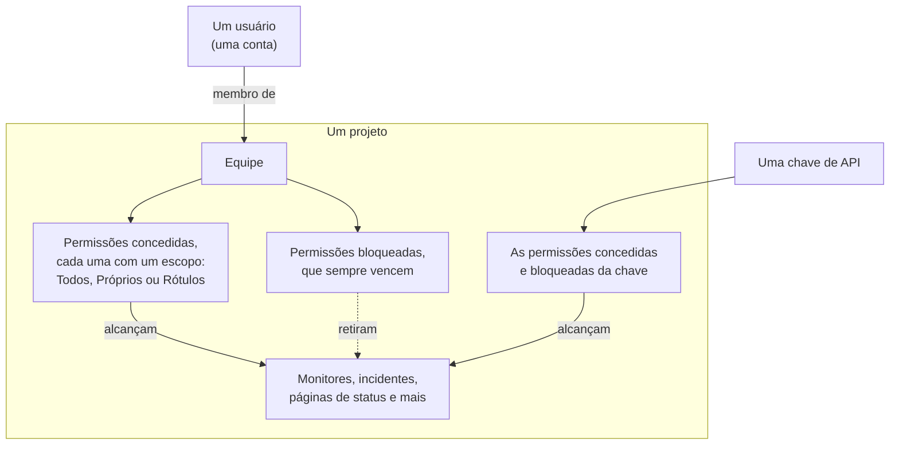
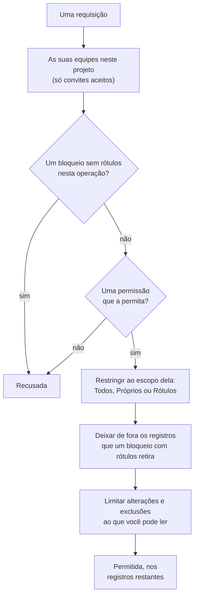

# Usuários, equipes e permissões

Tudo no OneUptime vive dentro de um **projeto**. Quem pode fazer o quê nesse projeto se resume a três coisas: os **usuários** que estão nele, as **equipes** a que esses usuários pertencem e as **permissões** concedidas a essas equipes.

> [!IMPORTANT]
> **Usuários nunca têm permissões diretamente.** O acesso de um usuário é a união das permissões de todas as equipes a que ele pertence nesse projeto. Se você quer mudar o que alguém pode fazer, mude a participação dele em uma equipe ou mude as permissões dessa equipe.

Os **proprietários** são outra ideia. Um proprietário é quem responde por um recurso específico — um monitor, um incidente, um painel. Os proprietários são notificados sobre os seus recursos, e as permissões podem, se você quiser, ser restringidas a «apenas o que é meu».

## Como o acesso funciona

| Conceito | O que é |
| --- | --- |
| Usuário | Uma única conta do OneUptime. Um login, qualquer número de projetos. |
| Projeto | O limite do locatário. Monitores, incidentes, equipes e dados pertencem a exatamente um projeto. |
| Equipe | Um grupo com nome dentro de um projeto que carrega permissões. |
| Membro da equipe | Um usuário que foi convidado para uma equipe e aceitou. |
| Permissão | Uma capacidade única, por ex. `CreateProjectMonitor`, ou uma função que agrupa muitas, por ex. `MonitorAdmin`. |
| Escopo | Até onde vai uma permissão concedida: todos os recursos, só os próprios ou só os rotulados. |
| Proprietário | Um usuário ou equipe marcado como responsável por um recurso específico. |
| Rótulo | Uma marca que você coloca nos recursos, usada para restringir permissões e para organizar. |

## Usuários

Uma conta de usuário é global para a instância do OneUptime — o mesmo login funciona em todos os projetos para os quais o usuário foi convidado.

Um usuário está «em» um projeto quando é membro de **pelo menos uma equipe** nele. Não existe uma etapa separada de «adicionar usuário ao projeto»: convidar alguém para um projeto é convidá-lo para uma equipe.

:::steps
1. Abra **Usuários** no menu **Produtos**, em **Configurações**, e clique em **Convidar Usuário**. A lista mostra todas as pessoas do projeto e o status do convite delas.
2. Digite o **E-mail** da pessoa. Quem ainda não tem uma conta do OneUptime também precisa informar um **Nome**.
3. Escolha a **Equipe** dela, que decide o que ela pode fazer, e clique em **Convidar**.
4. A pessoa aceita pelo sino no canto superior direito, em **Convites do projeto**, e a partir daí faz parte do projeto.
:::

- Convites criam um membro de equipe pendente. O usuário só conta como membro do projeto — e só ganha qualquer permissão — **depois de aceitar o convite.**
- **Convidar Usuário** começa na equipe de membros do projeto: a equipe que tem `ProjectMember` para o projeto inteiro, que é **Members** a menos que você a tenha renomeado. Escolha outra equipe para dar à pessoa mais ou menos acesso. Nada vem escolhido quando você mesmo não poderia convidar para essa equipe — convidar alguém repassa as permissões da equipe, e você só pode repassar permissões que tem — ou quando o projeto não tem uma equipe assim. O painel de administração começa na mesma equipe sempre que um administrador da instância adiciona alguém a um projeto: **Convidar Usuário** em um projeto, **Adicionar ao projeto** em um usuário e em vários usuários de uma vez, e os projetos ligados a um [provedor de SSO global](/docs/identity/global-sso).
- Remover um usuário de todas as equipes de um projeto retira o acesso dele a esse projeto, a partir da próxima requisição dele — inclusive enquanto ele está conectado. A conta e os outros projetos dele não são afetados. Ele sai das escalas de plantão, das regras de escalonamento e das substituições do projeto, dos papéis dos incidentes e episódios abertos e dos proprietários dos recursos; os incidentes resolvidos guardam o registro de quem foi proprietário deles e os conduziu.
- Quem sai de um projeto deixa de receber as notificações dele. Os próprios métodos, regras e configurações de notificação da pessoa para o projeto são removidos com a última equipe — e-mail, SMS, chamada, WhatsApp, Telegram, push, webhook, Slack e Microsoft Teams, o resumo por e-mail e o e-mail ainda não enviado, o número para chamadas recebidas e os lembretes de plantão —, então quem volta começa com os padrões. O que ainda a menciona, como o usuário para quem uma regra de chamadas recebidas liga ou um responsável mantido em um incidente resolvido, não a notifica mais: nada é enviado em nome de um projeto a quem não é membro dele, e um convite pendente ainda não é participação. Esses lugares mostram **Não é mais membro** ao lado do nome, para que você coloque outra pessoa. Quem foi convidado e ainda não aceitou mostra **Convite ainda não aceito** no lugar. Se uma substituição encaminha os chamados de alguém para uma pessoa que saiu, quem é chamado é a pessoa que ela cobre. Sair também desconecta os clientes MCP que a pessoa conectou ao projeto, e o link pessoal do calendário de plantão dela passa a mostrar um calendário vazio. No OneUptime Cloud, quem volta pelo login único (SSO) do projeto confirma-o novamente pelo e-mail.
- Se o seu projeto exige SSO e um usuário ainda não se autenticou pelo provedor de identidade, ele é tratado como usuário SSO não autorizado e não vê nada até fazê-lo. Veja [SSO](/docs/identity/sso).
- Com o SCIM configurado, o provedor de identidade pode criar, atualizar e remover usuários e suas participações em equipes automaticamente. Veja [SCIM](/docs/identity/scim).

## Equipes

As equipes são o caminho pelo qual as permissões chegam às pessoas. Todo projeto novo começa com três:

| Equipe | Permissão que tem | Editável |
| --- | --- | --- |
| Owners | `ProjectOwner` | Não. Sempre tem pelo menos um membro. |
| Admin | `ProjectAdmin` | Não |
| Members | `ProjectMember` | Sim — esta é um ponto de partida, altere à vontade |

As equipes **Owners** e **Admin** são bloqueadas de propósito: suas permissões não podem ser editadas e as equipes não podem ser excluídas nem renomeadas. É isso que impede um projeto de se trancar do lado de fora por acidente. A equipe Owners precisa manter sempre pelo menos um membro.

`ProjectOwner` é o nível de acesso mais alto: faturamento, exclusão do projeto e tudo o que um administrador pode fazer. `ProjectAdmin` cobre tudo, exceto o faturamento e a exclusão do projeto.

Ligar ou desligar SMS, chamadas telefônicas, WhatsApp ou Telegram para o projeto conta como faturamento, porque cada mensagem custa dinheiro. Somente `ProjectOwner`, a função `BillingAdmin` (**Billing Admin**) e a permissão `ManageProjectBilling` (**Manage Billing**) podem alterar essas chaves, em **Configurações do projeto > Notificações > Configurações de notificação** — não `ProjectAdmin`.

Recarregar os saldos pré-pagos do projeto também conta como faturamento. No OneUptime Cloud, SMS, chamadas telefônicas, WhatsApp e Telegram são pagos pelo saldo em **Configurações do projeto > Notificações > Configurações de notificação**, e a IA pelos créditos de IA em **Configurações do projeto > IA > Créditos de IA**. Somente um proprietário do projeto ou alguém com **Manage Billing** pode recarregá-los ou alterar a **Recarga automática** deles — um administrador do projeto não pode. Uma mensagem sobre um saldo que está acabando diz quem pode recarregá-lo, e só essas pessoas recebem um botão **Recarregar Saldo** que funciona ou um link para a página.

Crie quantas equipes adicionais quiser — «Plantão de Frontend», «Suporte», «Auditores somente leitura» — e dê a cada uma as permissões de que ela precisa. No OneUptime Cloud, criar uma equipe e alterar as permissões dela exige o plano Scale.

**Criar uma equipe** pede um nome e o **Acesso** dela, ou seja, o que os membros da equipe podem fazer:

| Acesso | O que os membros da equipe podem fazer |
| --- | --- |
| Administrador do projeto | Criar, alterar e excluir qualquer coisa no projeto, incluindo as configurações dele. Não o faturamento, nem excluir o projeto. |
| Membro do projeto | Criar, alterar e excluir monitores, incidentes, páginas de status e os outros recursos do projeto. |
| Visualizador | Ler tudo no projeto e não alterar nada. |
| Escolher as permissões depois | Nada ainda. Escolhido de início. |

:::steps
1. Abra **Equipes** no menu **Produtos**, em **Configurações**, e clique em **Criar equipe**.
2. Digite o **Nome** da equipe e escolha o **Acesso** dela. A descrição fica em **Mais campos**.
3. Crie a equipe. Uma equipe com uma função abre na página **Membros** dela, pronta para você convidar pessoas; com **Escolher as permissões depois**, ela abre na página **Permissões** dela, onde você adiciona uma função mais restrita, como `IncidentMember`, ou permissões avulsas.
:::

A função que você escolher se torna a primeira permissão da equipe, para todos os recursos do projeto, assim que a equipe existe — exatamente como se você a tivesse adicionado com **Adicionar função** na página Permissões da equipe. Só são oferecidas as funções que você mesmo tem, porque todos que você convidar para a equipe recebem as permissões dela, e quem pode criar equipes mas não alterar o que elas podem fazer não é consultado. Se a função não puder ser adicionada, a equipe é criada mesmo assim e um aviso acima da lista leva até ela.

Onde encontrar: abra uma equipe em **Equipes** para chegar a **Membros** e **Permissões**; **Bloquear permissões** fica em **Mais configurações**, no fim da página Permissões, cujo cabeçalho recolhido mostra quantas a equipe tem.

## Permissões

Uma permissão é uma capacidade única. Há duas formas de distribuí-las, e as duas ficam na aba **Permissões** da equipe.

### Funções

Uma função agrupa uma área inteira do produto em um de três níveis:

- **Admin** — o que o Member faz, mais a configuração própria da área, como as severidades e os estados de incidentes e alertas, os status de monitor e os estados de manutenção.
- **Member** — o trabalho do dia a dia: criar, alterar e excluir os recursos da área, com suas notas, proprietários e modelos. Para páginas de status e plantão, o Member faz tudo o que o Admin faz.
- **Viewer** — somente leitura.

`MonitorAdmin`, `IncidentMember`, `StatusPageViewer` e assim por diante. As funções são o que você quer quase sempre — elas continuam corretas à medida que o OneUptime adiciona recursos, porque uma nova tabela ligada a monitores é adicionada às funções de monitor existentes em vez de exigir uma nova concessão sua.

Fluxos de trabalho e runbooks são a exceção. Ambos executam código no seu projeto — um fluxo de trabalho as suas etapas, um runbook os seus scripts nos seus Runners —, então `WorkflowMember` abre os fluxos de trabalho e suas execuções e os executa manualmente, e `RunbookMember` abre os runbooks e suas execuções e os executa: inicia uma execução, conclui ou pula suas etapas e a cancela. Nenhum dos dois cria, altera ou exclui o que executa; `WorkflowAdmin` e `RunbookAdmin` os constroem. Uma função só executa os runbooks que o seu escopo alcança, então um `RunbookMember` limitado a alguns rótulos executa os runbooks que os carregam. Veja [Permissões dos fluxos de trabalho](/docs/workflows/configuration#permissões) e [Permissões dos runbooks](/docs/runbooks/configuration#permissões).

As regras de uma área (regras de rótulos, de proprietários, de plantão, de agrupamento e de lembretes), os campos personalizados, os SLAs e os segredos são configuração do projeto: exigem `ProjectAdmin`, qualquer que seja a função de área da pessoa. O mesmo vale para chaves de API, equipes e suas permissões, rótulos, SSO e domínios — as funções Settings cuidam dos serviços, probes, infraestrutura e integrações do projeto, não de quem pode fazer o quê.

O faturamento tem três funções próprias. `BillingViewer` lê o faturamento do projeto — o plano e a assinatura, as faturas, o uso, os saldos, os créditos de IA, as formas de pagamento e os dados de contato de cobrança — e não altera nada. `BillingMember` também baixa faturas e altera os dados de contato de cobrança. `BillingAdmin` faz o que o `BillingMember` faz e liga e desliga SMS, chamadas telefônicas, WhatsApp e Telegram. Alterar o plano, as formas de pagamento ou os saldos, e pagar faturas, exige `ProjectOwner` ou **Manage Billing**; nas páginas de faturamento esses botões ficam bloqueados para todos os outros e dizem quem pode usá-los.

Todas as {{PERMISSION_ROLE_COUNT}} funções estão listadas na [Referência de permissões](/docs/permissions/reference).

### Permissões granulares

Cada capacidade individual também pode ser atribuída sozinha — `CreateProjectMonitor`, `ReadProjectIncident`, `DeleteProjectStatusPage` e mais {{PERMISSION_TOTAL_COUNT}}. Use-as quando uma função for ampla demais e você precisar conceder exatamente uma coisa.

Uma permissão para alterar ou excluir algo só alcança o que você também pode ler, então conceda com ela a permissão de leitura correspondente: `EditProjectIncident` não altera nenhum incidente sem `ReadProjectIncident`. Um registro lido por meio de outro, como a nota de um incidente, também precisa de uma permissão para ler esse outro registro: `ReadIncidentInternalNote` não alcança nenhuma nota sem uma permissão para ler incidentes, e `CreateIncidentInternalNote` só adiciona uma nota a um incidente que você pode ler. As funções já incluem as duas.

Essas também são as chaves que você usa ao criar chaves de API, e as que a API e o provedor Terraform esperam.

A lista completa está na [Referência de permissões](/docs/permissions/reference).

### Permitir e bloquear

Cada equipe tem duas listas:

- **Permissões** (permitir) — o que esta equipe pode fazer.
- **Bloquear permissões** — o que esta equipe nunca pode fazer, independentemente de qualquer entrada permitida.

As duas ficam na página **Permissões** da equipe. Poucas equipes precisam de um bloqueio, por isso as permissões bloqueadas ficam recolhidas em **Mais configurações**, no fim da página.

> [!WARNING]
> **O bloqueio sempre vence.** Uma entrada de bloqueio sem rótulos remove essa capacidade da equipe por completo. Uma entrada de bloqueio com rótulos a remove apenas para os recursos que carregam esses rótulos — útil para «esta equipe pode editar monitores, exceto os rotulados como Production».

Uma permissão não pode ter rótulos de restrição nas duas listas ao mesmo tempo; o OneUptime recusa a segunda com uma explicação.

As entradas permitidas de um usuário se somam entre todas as suas equipes, mas um bloqueio se aplica a tudo o que o usuário faz: um bloqueio sem rótulos em uma equipe retira a capacidade mesmo onde outra equipe a permite, e uma entrada de bloqueio nunca concede nada. Se alguém tem menos acesso do que você espera, procure um bloqueio em cada uma das equipes dele; se tem mais, procure uma permissão concedida em cada equipe.

### Alterar um estado

Um incidente, um alerta, um episódio de alertas ou de incidentes e uma manutenção agendada mudam de estado, e um monitor muda de status, por uma nova linha na sua linha do tempo de estados. **Confirmar**, **Resolver**, **Alterar estado**, a página **Linha do tempo de estado**, a API e os fluxos de trabalho adicionam todos uma. Adicioná-la exige a permissão de criação dessa linha do tempo, junto com uma permissão para ler o registro que ela altera:

| Para alterar o estado de | É preciso |
| --- | --- |
| Um incidente | **Create Incident State Timeline** |
| Um alerta | **Create Alert State Timeline** |
| Um episódio de alertas | **Create Alert Episode State Timeline** |
| Um episódio de incidentes | **Create Incident Episode State Timeline** |
| Uma manutenção agendada | **Create Scheduled Maintenance State Timeline** |
| Um monitor (seu status) | **Create Monitor Status Timeline** |

O registro então recebe o novo estado do próprio OneUptime, com o que o acompanha, como quando um episódio foi resolvido ou quando uma manutenção volta a lembrar seus assinantes. Então uma mudança não exige também uma permissão para editar o registro: uma função personalizada com **Create Incident State Timeline** mas sem **Edit Incident** altera o estado de um incidente. Para impedir que uma equipe altere estados, bloqueie a permissão de criação da linha do tempo; um bloqueio em **Edit Incident** não afeta as mudanças de estado. Rótulos, proprietários e registros privados restringem a permissão de criação da linha do tempo como restringem qualquer outra, por meio do registro cujo estado ela altera: veja as regras de escopo mais abaixo.

Só o estado é escrito por você. Uma nota publicada com uma mudança é publicada em seu nome e exige a permissão própria da nota, como descrito em [Avisar os assinantes da página de status sobre uma mudança de estado](/docs/incidents/states-and-severities#avisar-os-assinantes-da-página-de-status-sobre-uma-mudança-de-estado). Confirmar os alertas de um incidente enquanto você o declara exige o mesmo que confirmar cada um deles na própria página: **Create Alert State Timeline**, restringida por meio de cada alerta, e nenhum **Edit Alert**. Veja [Confirmar os alertas ao declarar](/docs/incidents/linked-alerts#confirmar-os-alertas-ao-declarar).

## Escopo: até onde vai uma permissão concedida

Toda permissão concedida tem um escopo, escolhido em **Escopo** quando você a adiciona:

| Escopo | Significado |
| --- | --- |
| Todos os recursos do projeto | O padrão. A permissão se aplica a todos os recursos correspondentes. |
| De propriedade desta equipe ou de seus membros | A permissão só se aplica a recursos em que esta equipe, ou o usuário que age, está listado como proprietário. |
| Restringir por rótulos (avançado) | A permissão só se aplica a recursos que carregam pelo menos um dos rótulos selecionados. |

**Próprios** é a forma mais simples de montar um modelo de «cada um cuida dos seus próprios serviços»: dê a uma equipe `MonitorAdmin` com escopo Próprios e depois torne essa equipe proprietária dos monitores pelos quais ela é responsável. Isso só restringe recursos que realmente podem ter proprietários — monitores, incidentes, painéis, serviços e afins. A configuração do projeto (estados de incidentes, rótulos, as próprias equipes) não tem proprietário, então uma função com escopo Próprios se comporta normalmente ali.

**Rótulos** é a versão mais manual da mesma ideia: marque os recursos e depois conceda permissões restritas a essas marcas.

**Agir sobre o projeto inteiro exige uma permissão que o alcance.** **Run Now** de uma regra aplica a regra a todos os recursos do projeto, e as regras de atribuição de site, de rótulo de dispositivo e de importação automática de uma rede a todos os dispositivos de rede ou varreduras, então isso exige permissões com escopo em todos os recursos do projeto: uma permissão restrita a rótulos ou a recursos próprios não basta, e um bloqueio com rótulos nos recursos que uma execução altera recusa a execução, porque ela também alteraria os recursos que carregam esses rótulos.

Algumas funções valem para o projeto inteiro por definição e não oferecem escopo algum, porque restringi-las não faria sentido — «Billing Admin, mas só para o faturamento que é meu» não descreve nada:

{{PERMISSION_SCOPE_EXEMPT_ROLES}}

## Proprietários

Um proprietário é um usuário ou uma equipe ligado a um recurso específico. A maioria dos recursos que representam algo que você opera — monitores, incidentes, alertas, manutenções agendadas, políticas de plantão, painéis, serviços, páginas de status, fluxos de trabalho, runbooks e SLOs — tem uma aba **Proprietários**.

Os proprietários fazem dois trabalhos:

1. **Notificação.** Os proprietários são quem o OneUptime avisa quando algo acontece com o recurso — um monitor cai, um incidente é criado, um SLO começa a consumir seu orçamento de erros.
2. **Acesso, quando você pede.** A propriedade é aquilo contra o que o escopo de permissão `Owned` (Próprios) é resolvido. Um usuário corresponde se ele mesmo é proprietário, ou se qualquer equipe a que ele pertence é proprietária.

A propriedade sozinha não concede nada. Ser proprietário de um monitor não permite editá-lo, a menos que uma equipe a que você pertence também tenha uma permissão sobre monitores. A propriedade restringe o acesso; ela nunca o amplia.

Quem é proprietário de um recurso é lido por meio do recurso. Os proprietários de um monitor ou de qualquer outro recurso só são listados, lidos, adicionados e removidos por quem pode ler esse recurso, e uma permissão apenas sobre os proprietários não alcança os proprietários de nenhum recurso que você não pode ler.

## Rótulos

Rótulos são marcas válidas em todo o projeto que você coloca nos recursos. Eles servem a dois propósitos: filtrar e agrupar no painel, e restringir permissões como descrito acima.

Uma restrição por rótulos é satisfeita se o recurso carrega **pelo menos um** dos rótulos da permissão. Um recurso sem nenhum rótulo não satisfaz nenhuma permissão restrita por rótulos.

Um registro sem rótulos próprios, como a nota de um incidente, um anúncio de uma página de status ou um insight de IA sobre um serviço, carrega os rótulos dos registros aos quais pertence ou de que trata. Uma permissão restrita a rótulos o alcança quando um desses registros carrega um dos rótulos da permissão, e um bloqueio com rótulos o retira quando um deles carrega um rótulo bloqueado, para leitura, alteração e exclusão igualmente. Um registro que não trata de nenhum deles, como um insight de IA sobre nenhum serviço, pertence ao projeto: uma restrição por rótulos não o restringe, e um bloqueio com rótulos não o retira.

Onde encontrar: **Configurações do projeto > Básico > Rótulos**. A cor de um novo rótulo já vem escolhida quando o formulário dele abre, uma que os rótulos listados na página ainda não usam; escolha outra se quiser. No OneUptime Cloud, criar e alterar rótulos exige o plano Growth.

## Telemetria

Logs, traces, métricas, exceções, perfis e reproduções de sessão pertencem ao recurso que os enviou: um serviço, um host, um cluster Kubernetes, um monitor, uma aplicação RUM e afins. Uma permissão de telemetria lê até onde o seu escopo alcança:

- **Todos os recursos** lê a telemetria de todos os recursos do projeto.
- **Próprios** lê a telemetria dos recursos que você ou uma das suas equipes possuem, e a telemetria que não nomeia nenhum recurso.
- **Rótulos** lê a telemetria dos recursos que carregam um dos rótulos da permissão.

Um bloqueio com rótulos em uma permissão de telemetria deixa de fora a telemetria dos recursos que carregam esses rótulos, seja o que for que você tenha além disso. Isso vale onde quer que a telemetria seja lida: nos exploradores e seus gráficos, filtros e listas de atributos, nas exportações, nas reproduções de sessão e no que o assistente de IA lê por você. A lista de nomes de métricas mostra as métricas que um serviço que você pode ler reporta, e as métricas que nenhum serviço reporta, como as de hosts e clusters. Se você também pode ler a telemetria de outros tipos de recursos, como hosts ou clusters, ela mostra todos os nomes de métricas.

Excluir telemetria se mantém nos mesmos recursos: uma exclusão alcança as linhas dos recursos que tanto a sua permissão para ler o sinal quanto a sua permissão para excluí-lo alcançam, menos as que um bloqueio com rótulos em qualquer uma delas retira, e é feita em um projeto de cada vez.

Os logs de monitor, o histórico de SLO, os fluxos de rede e as alocações de custo do Kubernetes são lidos da mesma forma, por meio do monitor, do SLO, do dispositivo de rede ou do cluster a que pertencem: Próprios e Rótulos alcançam as linhas dos registros que você pode ler, e um bloqueio com rótulos deixa de fora as linhas dos registros que carregam esses rótulos. O log de auditoria e os indicadores de inteligência de ameaças são lidos em todo o projeto por quem pode lê-los.

## Chaves de API

As chaves de API recebem permissões diretamente, na própria chave — elas não pertencem a equipes e não são afetadas pela participação em equipes.

- Atribua as mesmas permissões granulares e funções que você daria a uma equipe.
- As chaves suportam **permissões bloqueadas** e **restrições por rótulos**, da mesma forma que as equipes.
- As chaves **não** suportam o escopo Próprios. A propriedade é resolvida contra um usuário, e uma chave não é um usuário, então conceda às chaves o acesso de que precisam de forma explícita.

**Criar uma chave** pede um nome e o **Acesso** dela:

| Acesso | O que a chave pode fazer |
| --- | --- |
| Administrador do projeto | Criar, alterar e excluir qualquer coisa no projeto, incluindo as configurações dele. Não o faturamento, nem excluir o projeto. |
| Membro do projeto | Criar, alterar e excluir monitores, incidentes, páginas de status e os outros recursos do projeto, como um membro do projeto pode. |
| Visualizador | Ler tudo no projeto e não alterar nada. |
| Escolher as permissões depois | Nada ainda. Escolhido de início. |

:::steps
1. Abra **Configurações do projeto > Avançado > Chaves de API** e clique em **Criar: Chave de API**. No OneUptime Cloud, as chaves de API exigem o plano Growth.
2. Digite o **Nome** da chave e escolha o **Acesso** dela. A descrição e a data de expiração ficam em **Mais campos**; uma chave expira um ano depois do dia em que é criada, a menos que você escolha outra data, e a seção recolhida diz isso.
3. Crie a chave. Ela abre na página dela, onde você a copia.
:::

A função que você escolher se torna a primeira permissão da chave assim que a chave existe, exatamente como se você a tivesse adicionado na página da chave. Só são oferecidas as funções que você mesmo tem — uma chave nunca pode receber mais do que a pessoa que a dá tem — e quem pode criar chaves mas não alterar o que elas podem fazer não é consultado.

Na página de uma chave, **Adicionar função** adiciona uma função da mesma lista que a aba Permissões de uma equipe oferece, e **Adicionar permissão** (no menu **⋯** do cartão) adiciona uma permissão granular. **Bloquear permissões** fica em **Mais configurações**, no fim da página, cujo cabeçalho recolhido mostra quantas a chave tem.

> [!TIP]
> Dê a cada integração a sua própria chave, com o conjunto de permissões mais restrito que funcione, para poder revogar uma sem atrapalhar as outras.

## Como o OneUptime decide se uma requisição é permitida

Para um usuário conectado, em ordem:

1. Encontrar as equipes a que o usuário pertence neste projeto, contando apenas convites aceitos. Uma requisição alcança apenas os registros deste projeto: um registro de outro projeto, indicado pelo seu id ou em um filtro, é tratado como se não existisse.
2. Reunir todas as linhas de permissão dessas equipes — permitidas e bloqueadas — cada uma com seus rótulos e seu escopo.
3. Verificar primeiro a lista de bloqueios. Um bloqueio sem rótulos em qualquer permissão que a tabela de destino aceite para essa operação rejeita a requisição de imediato, seja qual for a equipe em que estiver.
4. Verificar a lista de permitidas. A requisição precisa de pelo menos uma permissão que a tabela de destino aceite para essa operação. Em um recurso operacional — um monitor, um incidente, um painel e afins — a permissão **All Operational Resources** correspondente (Create, Read, Edit ou Delete) também conta, a menos que ela própria esteja bloqueada.
5. Aplicar o escopo. Concessões com escopo Próprios restringem a consulta aos recursos próprios; as de rótulos restringem aos rótulos correspondentes. Se qualquer outra concessão para a mesma operação for mais ampla, a mais ampla vence. Um registro sem rótulos próprios, como uma nota de um incidente, satisfaz uma concessão por rótulos quando um dos registros aos quais pertence carrega um dos seus rótulos. Uma permissão **All Operational Resources** restrita a rótulos restringe da mesma forma: alcança os recursos operacionais que carregam um dos seus rótulos, como faria a própria permissão do recurso restrita a esses rótulos. Uma criação é restringida da mesma forma: uma permissão para criar páginas de status restrita a rótulos cria apenas páginas de status que carregam um dos seus rótulos, e uma permissão para criar notas de incidentes restrita a rótulos adiciona notas apenas a incidentes que carregam um deles, a menos que outra permissão para a criação alcance o projeto inteiro; uma criação fora deles é recusada com uma mensagem que indica os rótulos permitidos. Uma permissão para criar com o escopo Próprios cria um recurso com proprietários próprios, como um monitor ou uma página de status, apenas para uma pessoa, que passa a ser sua proprietária, e uma nota apenas em um incidente de que você ou uma das suas equipes são proprietários. Uma alteração dos rótulos que um registro carrega é restringida da mesma forma: com uma permissão para alterá-lo restrita a rótulos, o registro mantém pelo menos um deles, a menos que outra permissão para alterá-lo alcance todo o projeto, e uma alteração que tira o último é recusada com uma mensagem que nomeia os rótulos permitidos. Quando a sua permissão para criar um tipo de registro só alcança o que é seu, você se torna proprietário do que cria antes que qualquer outra coisa aconteça com ele, e se não puder sê-lo, a criação é recusada sem deixar nada para trás.
6. Aplicar os bloqueios por rótulos. Um bloqueio com rótulos rejeita a requisição se o recurso de destino carregar um deles. Um bloqueio com rótulos sobre uma permissão **All Operational Resources** retira os recursos que carregam esses rótulos do que essa permissão concede. Quando um registro não tem rótulos próprios, como uma nota de um incidente ou um anúncio de uma página de status, um bloqueio com rótulos o deixa de fora de leituras, alterações e exclusões se um registro ao qual ele pertence carregar um desses rótulos. Uma lista de registros de todos os seus projetos de uma vez, como os incidentes da sua página inicial, restringe os registros de cada projeto pelos seus bloqueios e concessões naquele projeto. Um bloqueio com rótulos sobre uma permissão para criar recusa um registro novo que carrega um dos seus rótulos ou, se não tiver rótulos próprios, que pertence a um registro que carrega um deles. Um bloqueio com rótulos sobre uma permissão para alterar impede que você dê a um registro um dos seus rótulos ou, se ele não tiver rótulos próprios, que o aponte para um registro que carrega um deles.
7. Limitar alterações e exclusões ao que você pode ler. Uma alteração ou exclusão é restringida pelas suas permissões de leitura além da permissão para a alteração: um registro que você não pode ler — fora dos seus rótulos ou proprietários, ou com um rótulo que um bloqueio de leitura retira — não é um que você possa alterar ou excluir, e um bloqueio sem rótulos sobre a leitura de um tipo de registro retira também alterá-lo e excluí-lo. Um registro lido por meio de outro, como uma nota de um incidente ou um anúncio de uma página de status, só é alcançado por meio de um registro que você pode ler: sem permissão para ler incidentes, uma permissão sobre notas não alcança nenhuma nota, um bloqueio com rótulos sobre a leitura de incidentes deixa de fora as notas dos incidentes que os carregam, e quando sua permissão para ler incidentes tem o escopo Próprios, uma permissão sobre notas alcança apenas as notas dos incidentes de que você ou uma das suas equipes são proprietários. Um registro assim também só é criado sob um registro que você pode ler: uma nota só em um incidente que você pode ler, e um anúncio só em páginas de status que você pode ler, cada uma delas; indicar um que você não pode ler é recusado como se não existisse. Uma alteração segue a mesma regra: um registro movido para baixo de outro, como um anúncio colocado em outra página de status, só vai para baixo de um registro que você pode ler, e aquilo sob o qual ele já está permanece como está. Os registros que uma criação ou uma alteração lista, como os monitores de um incidente ou os serviços de um alerta, seguem a sua permissão para lê-los quando você tem uma, e sempre um bloqueio com rótulos sobre a leitura deles: um registro fora disso é recusado como se não existisse, enquanto um que o registro já lista permanece. O único registro que uma criação ou uma alteração nomeia em um campo próprio, como o monitor de um alerta ou o monitor que uma página de status mostra, segue a mesma regra, assim como os registros que um modelo preenche, como os monitores e as páginas de status que um modelo de incidente adiciona a um incidente declarado a partir dele; as probes globais e os agentes de IA da OneUptime continuam abertos a todos os projetos. Uma alteração ou exclusão de um registro, indicado pelo seu ID, que não alcança nada é respondida como se o registro não existisse (`404`) quando você não pode lê-lo, e recusada quando você pode lê-lo, mas não alterá-lo. Uma leitura de um registro pelo seu ID responde `404` da mesma forma quando o registro não existe ou você não pode lê-lo.

Cada campo de um registro é lido com a permissão de leitura do próprio registro: uma permissão para outro tipo de registro nunca o abre. Alguns campos são mais restritos de propósito. Os segredos só são lidos por quem pode editar ou administrar o registro a que pertencem, como as chaves de requisições recebidas e de e-mails recebidos de um monitor e a chave do seu agente de servidor, ou as chaves de webhook e de e-mail recebido de um fluxo de trabalho. Assistir à gravação de uma reprodução de sessão exige **Watch Session Replays**, não apenas **List Session Replays**. A telemetria é lida sinal por sinal: **Read Telemetry Service Log** lê os logs, **Read Telemetry Service Traces** lê os traces e **Read Telemetry Service Metrics** lê as métricas, incluindo os gráficos de métricas.

Os campos seguem a mesma regra. Um bloqueio sem rótulos sobre a permissão de um campo retira esse campo, e em um recurso operacional a permissão **All Operational Resources** correspondente abre cada campo que qualquer pessoa que possa ler ou alterar o registro pode abrir — mas não um campo mais restrito de propósito, como uma chave secreta.

Uma configuração que guarda credenciais só é nomeada por quem pode lê-la. Uma criação ou uma alteração nomeia um servidor SMTP, um provedor de chamadas e SMS, uma credencial de runbook, credenciais SNMP, uma conexão de videochamada ou uma chave de API — como o servidor SMTP com que uma página de status envia e-mails, ou a credencial com que uma etapa de runbook é executada — somente quando você pode ler esse tipo de configuração; uma que você não pode ler é recusada como se não existisse, enquanto um registro mantém a que já nomeia. Buscar números para comprar em um provedor de chamadas e SMS, ou listar os números que ele possui, exige a mesma leitura. Aprovar um plano de comandos de IA com um comando SSH, que é executado com uma credencial de runbook que o OneUptime AI escolheu entre as do seu Runner, exige a leitura das credenciais de runbook (**Read Runbook Credential**; Project Owners e Project Admins podem), assim como salvar uma regra de remediação automática que deixa o OneUptime AI executar os seus comandos sem perguntar, quando o salvamento ativa isso ou adiciona padrões à lista de permissões ou Runners, ativar **Executa comandos de remediação por IA** para um Runner que tem credenciais SSH, ou atribuir uma credencial SSH a um Runner que executa os comandos do OneUptime AI. Uma etapa de fluxo de trabalho age como um Project Admin, mas nunca recebe emprestada a leitura de uma configuração que guarda credenciais: ela não nomeia nenhuma e não faz nenhuma dessas alterações; uma pessoa que pode lê-las precisa fazer isso.

A mesma regra decide tudo o mais que pergunta se você tem uma permissão: ações que não são uma simples leitura ou escrita — adicionar crédito de SMS, chamadas ou IA, pagar uma fatura ou testar uma regra de notificação — e os botões que o OneUptime mostra a você. Um botão que você não pode usar aparece bloqueado e diz por quê; quando um bloqueio em uma das suas equipes é o motivo, ele nomeia a permissão bloqueada.

As atualizações ao vivo seguem a mesma regra. Quando um registro é criado, alterado ou excluído, o OneUptime avisa as páginas abertas das pessoas que podem ler esse registro, e de mais ninguém. O que limita o que você lê limita também as suas atualizações ao vivo: rótulos, proprietários, um bloqueio com rótulos, um incidente privado ou a conversa de IA de outra pessoa. Quando uma alteração tira um registro de você, como torná-lo privado, as suas páginas abertas também são avisadas, para que deixem de mostrá-lo. Uma mudança nas suas permissões, um bloqueio ou deixar de ser administrador master chega às suas páginas abertas na hora.

As atualizações ao vivo também terminam com o login que as abriu. Sair, alterar a sua senha ou ser bloqueado interrompe na hora as atualizações ao vivo das suas páginas abertas. Uma página aberta renova o login a cada 15 minutos e retoma as suas atualizações ao vivo; quando o login não pode ser renovado, ela leva você à página de login. Um projeto que exige SSO só envia atualizações ao vivo a páginas conectadas com SSO, como faz com todo o resto.

Todo usuário conectado tem ainda um pequeno conjunto de permissões automáticas que cobrem coisas como ler o próprio perfil e as próprias regras de notificação. Essas não são permissões de administração e não liberam os dados de mais ninguém.

As permissões resolvidas ficam em cache por usuário e projeto, e são atualizadas quando a participação em equipes ou as permissões das equipes mudam. Se você alterar permissões e um usuário não vir a mudança na hora, peça para ele recarregar.

## Receitas

**Uma equipe que só observa.** Crie a equipe com **Visualizador** em **Acesso**. Para só algumas áreas, escolha **Escolher as permissões depois** e adicione as funções `*Viewer` por área que ela deve ver.

**Engenheiros de plantão que cuidam dos próprios serviços.** Dê à equipe `MonitorAdmin`, `IncidentMember` e `OnCallMember` com escopo **Próprios**, e depois adicione a equipe como proprietária dos monitores que ela opera.

**Prestadores de serviço longe da produção.** Dê à equipe as funções de que ela precisa com escopo **Todos** e depois adicione uma **permissão bloqueada** (em **Mais configurações**, na página Permissões da equipe) para as capacidades sensíveis, restrita ao rótulo `Production`.

**Um pipeline de CI que só informa implantações.** Crie uma chave de API com **Escolher as permissões depois** e depois adicione na página dela só as permissões granulares de que ela precisa — nenhuma função.

**Alguém que não deve alterar o faturamento nem ver faturas.** Dê a essa pessoa `ProjectMember`, não `ProjectAdmin`: um administrador do projeto não pode alterar o plano, as formas de pagamento nem os saldos, mas lê e baixa as faturas. Para que alguém leia as páginas de faturamento sem alterar nada, dê `BillingViewer`.

Quando o acesso não é o que você espera:

:::details Alguém não consegue ver ou alterar algo que deveria
Verifique se a pessoa aceitou o convite: um membro de equipe pendente não tem permissões. Depois abra cada uma das equipes dela: um bloqueio sem rótulos em qualquer equipe retira a capacidade, e um escopo Próprios ou por rótulos só alcança recursos próprios ou rotulados. Um botão bloqueado nomeia a permissão de que precisa, ou o bloqueio que o recusa.
:::

:::details Alguém pode fazer mais do que você espera
O acesso da pessoa é a união de todas as equipes em que ela está, então procure uma permissão concedida em cada equipe, incluindo **Admin** e **Owners**. Para retirar uma capacidade, seja o que for que as equipes dela permitam, adicione uma permissão bloqueada em uma das equipes dela.
:::

## Próximos passos

:::cards
- [Referência de permissões](/docs/permissions/reference): Cada função e cada permissão granular, geradas a partir do código-fonte do OneUptime.
- [SSO](/docs/identity/sso): Deixe as pessoas entrarem com o seu provedor de identidade.
- [SCIM](/docs/identity/scim): Crie usuários e participações em equipes a partir do seu provedor de identidade.
- [Referência da API](/docs/api-reference/api-reference): Chame a API com uma chave de API e as permissões dela.
:::
