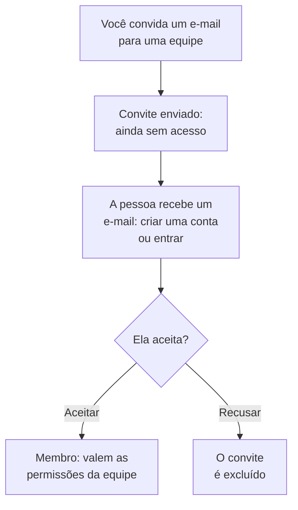

# Convidar pessoas

As pessoas entram em um projeto por convite. Você convida o endereço de e-mail de alguém para uma equipe, a pessoa aceita e, a partir daí, a equipe dela decide o que ela pode fazer. Esta página mostra como convidar pessoas, o que elas veem e como mudar ou encerrar o acesso delas depois.

:::cards
- [Convidar alguém](#convidar-alguém): Um endereço de e-mail e uma equipe.
- [Aceitar um convite](#aceitar-um-convite): O que a pessoa convidada vê e faz.
- [Mudar as equipes de alguém](#mudar-as-equipes-de-alguém): Dar mais acesso, ou menos.
- [Remover alguém](#remover-alguém-do-projeto): O que sair do projeto leva embora.
:::

## Como funciona um convite

- **A equipe decide o que a pessoa pode fazer.** Ninguém tem permissões próprias: uma pessoa pode fazer o que as equipes de que participa permitem. Veja [Usuários, equipes e permissões](/docs/permissions/index).
- **Nada é concedido até a pessoa aceitar.** Um convite pendente aparece como **Convite enviado** e não dá acesso ao projeto.
- **Uma aceitação vale para o projeto todo.** Aceitar um convite aceita todos os outros convites que a pessoa tem para o mesmo projeto. Um membro que você adiciona depois a outra equipe já entra nela, sem nada para aceitar.

## Antes de começar

- **Uma função que pode convidar.** Proprietário do projeto, Administrador do projeto ou uma função com a permissão **Invite New Members**. Você só pode convidar pessoas para uma equipe cujas permissões você mesmo tem, porque um convite dá a elas o acesso da equipe.
- **No OneUptime Cloud, espaço no seu plano.** Cada pessoa do projeto é um assento na fatura dele, a partir do momento em que é convidada. O plano Free tem espaço para uma pessoa. Veja [Cobrança e uso](/docs/configuration/billing#seu-plano-e-seus-assentos).
- **Sem SCIM Push Groups.** Enquanto seu provedor de identidade gerencia as equipes do projeto pelo SCIM Push Groups, você convida e remove pessoas lá, não no OneUptime.

## Convidar alguém

:::steps
### Abrir Usuários

Acesse **Produtos → Configurações → Usuários**. A lista **Usuários** mostra todas as pessoas do projeto, as equipes delas e se já entraram.

### Clicar em Convidar Usuário

Clique em **Convidar Usuário**. A caixa de diálogo **Convidar Novo Usuário** se abre.

### Informar o endereço de e-mail

Digite o endereço em **E-mail**. Enquanto você digita, **E-mail** sugere as pessoas do projeto por nome ou endereço e mostra quem está **Convidado** e quem **Já está nesta equipe**: clique em uma delas para preencher o endereço. Em um servidor auto-hospedado, um administrador mestre também recebe como sugestão as outras contas do servidor, marcadas como **Ainda não está neste projeto**, assim como qualquer pessoa que possa convidar, depois que um administrador mestre permitir isso no Admin Dashboard. Para um endereço que você digita, a caixa de diálogo também pede um **Nome**, que é opcional: se essa pessoa ainda não tiver conta no OneUptime, ela será criada com esse nome. Até ela aceitar, o projeto a mostra com esse nome, ou só com o endereço, nunca com o nome ou a foto da conta dela. Os formulários de convite do Admin Dashboard sugerem pessoas da mesma forma.

### Escolher a equipe

**Equipe** começa na equipe de membros do projeto: a equipe que tem Membro do projeto para o projeto todo, ou então a chamada Members. Escolha outra equipe para dar mais acesso, ou menos. **Equipe** fica vazia quando o projeto não tem essa equipe, ou quando você mesmo não poderia convidar ninguém para ela.

### Enviar o convite

Clique em **Convidar**. O OneUptime envia o convite por e-mail e abre a página da pessoa. Ela aparece como **Convite enviado** até aceitar.

Em um servidor auto-hospedado que ainda não consegue enviar e-mails, nenhum e-mail é enviado, e a pessoa aparece como **Convidado**. Um administrador mestre vê primeiro **Envie o link de convite**: copie o link, envie-o você mesmo à pessoa e depois clique em **Concluído**. Qualquer outra pessoa pede ao administrador do servidor que [configure o e-mail](/docs/emails/smtp#abrir-o-formulário). Configurar o e-mail depois não envia os convites feitos antes: a pessoa entra com o link de convite dela, ou se cadastrando com o endereço convidado.
:::

> [!TIP]
> Convide as pessoas para a equipe mais restrita que permita a elas fazer o trabalho. Você pode adicioná-las a mais equipes depois, e cada equipe em que entram amplia o que podem fazer.

## Aceitar um convite

O e-mail de convite nomeia o projeto e quem convidou a pessoa. O botão dele é **Create Your Account** para quem ainda não tem conta no OneUptime e **Sign In to OneUptime** para quem já tem. Quando o SSO for gerenciar o login dela, porque o projeto gerencia o login das pessoas com SSO, assim como todos os outros projetos de que ela faz parte, ou porque todo o servidor exige SSO, o e-mail diz isso no lugar, e o botão dele é **Sign In with SSO**.

**Create Your Account** abre a página de cadastro com o endereço dela e o nome que você digitou já preenchidos, e diz qual projeto a convidou e quem. Cadastrar-se ali a coloca no projeto, sem mais nada para aceitar. **Sign In with SSO** abre a mesma página, que oferece single sign-on em vez de uma senha: fazer login ali com um dos provedores de identidade do projeto a coloca no projeto.

Em um servidor auto-hospedado que ainda não consegue enviar e-mails, ninguém recebe e-mail: o link de convite que a pessoa recebe no lugar abre a mesma página de cadastro, ou a página de entrada para quem já tem conta.

Quem entra, ou se cadastra de outro jeito, aceita em um de dois lugares:

| Onde ela está | O que ela vê | Onde ela clica |
| --- | --- | --- |
| Ainda em nenhum projeto | O convite, na página em que ela chega depois de entrar | **Accept & Join**, ou **Decline** |
| Já em outro projeto | O convite pendente no sino no canto superior direito, que abre **Convites do projeto** | **Aceitar**, ou **Rejeitar** |

Ao aceitar, a pessoa entra no projeto na hora, com as permissões da equipe dela e a configuração de notificações com que todo membro começa: veja [Com o que você começa](/docs/notifications/index#com-o-que-você-começa). Recusar exclui o convite, então entrar depois exige um novo.

## Ver quem está no projeto

**Usuários** tem uma linha por pessoa:

| Coluna | O que mostra |
| --- | --- |
| **Usuário** | O nome e o endereço de e-mail dela. Até ela aceitar, o nome que você digitou para ela, se houver. |
| **Equipes** | Cada equipe do projeto de que ela participa, ou para a qual foi convidada. |
| **Status** | **Membro** depois que ela entrou, com o número de convites para outras equipes que ainda não aceitou. **Convite enviado** até lá, ou **E-mail não enviado** quando o serviço de e-mail recusou o último e-mail de convite dela. Em um servidor auto-hospedado que ainda não consegue enviar e-mails, **Convidado** no lugar: o convite é criado, mas nenhum e-mail é enviado. |

Filtre a lista por **Usuário**, **Status** ou **Equipe**. Clique em uma linha para abrir a página da pessoa:

| Página | Para que serve |
| --- | --- |
| **Perfil** | O nome, o endereço de e-mail, a foto e o ID de usuário dela. |
| **Equipes** | As equipes de que ela participa. Adicione ou remova uma equipe aqui. |
| **Prontidão**, **Métodos de notificação**, **Como me contatar** | Se ela pode ser acionada, e como. Visível para Proprietários do projeto, Administradores do projeto, a própria pessoa e quem pode ler as regras de notificação dos outros. Veja [Prontidão e relatórios](/docs/on-call/readiness). |
| **Campos personalizados** | Os campos personalizados do projeto para pessoas, quando há algum. |
| **Remover do Projeto** | Tirar a pessoa do projeto. |

## Mudar as equipes de alguém

:::steps
### Abrir a página Equipes da pessoa

Em **Usuários**, clique na pessoa e depois em **Equipes**.

### Adicionar a pessoa a uma equipe

Clique em **Convidar**, escolha a **Equipe** e clique em **Convidar** na caixa de diálogo. Um membro entra na nova equipe na hora. Quem ainda não entrou recebe mais um convite, e aceitar qualquer um deles aceita os dois.

### Tirar a pessoa de uma equipe

Clique em **Remover** na linha da equipe. Se for a última equipe em que ela entrou, removê-la a tira do projeto, e a caixa de diálogo avisa antes que qualquer coisa mude.
:::

A equipe Owners sempre mantém pelo menos um membro que entrou, para que um projeto nunca perca o último proprietário.

## Remover alguém do projeto

Em **Usuários**, abra o menu da linha da pessoa, **⋯**, e clique em **Remover do Projeto**. Ou abra a pessoa e escolha **Remover do Projeto** no menu lateral dela. Para remover várias pessoas de uma vez, selecione as linhas delas e exclua a seleção: cada uma é removida do mesmo jeito.

Se a sua função remove pessoas só de algumas equipes, como as que são suas, **Remover do Projeto** fica bloqueado para quem também está em uma equipe da qual você não pode removê-la, e nomeia as equipes que a mantêm no projeto, as que você pode ver. Remover várias pessoas de uma vez a deixa de fora, e diz isso.

Remover alguém tira a pessoa de todas as equipes do projeto. Ela perde o acesso na hora, mesmo com a sessão aberta, sai das escalas de plantão e das regras de escalonamento e deixa de receber as notificações do projeto. A conta dela no OneUptime não é excluída, e você pode convidá-la de novo. [Usuários, equipes e permissões](/docs/permissions/index#usuários) lista tudo o que sair de um projeto leva junto.

## Outras formas de entrar

- **Login único.** Quem entra pela primeira vez com o provedor de identidade do projeto passa a fazer parte das equipes que o provedor indica. Veja [Funções e equipes para usuários de SSO](/docs/identity/sso#funções-e-equipes-dos-usuários-de-sso).
- **SCIM.** Seu provedor de identidade cria as pessoas e as adiciona às equipes padrão da conexão. Veja [SCIM](/docs/identity/scim#como-um-usuário-de-projeto-é-provisionado).
- **O Admin Dashboard.** Em uma instalação auto-hospedada, um administrador mestre pode adicionar alguém a um projeto e aceitar o convite por essa pessoa. Veja [Usuários, equipes e permissões](/docs/permissions/index#usuários). Um administrador mestre também pode criar a conta de alguém em **Usuários** com **Criar: Usuário**: ele informa um nome e um e-mail, e o OneUptime envia para esse endereço um link para escolher uma senha, que funciona uma vez, por 7 dias. Para definir a senha ele mesmo, ele abre **Mais campos**. Se o e-mail não for enviado, o link é mostrado para que ele mesmo o envie.

## Solução de problemas

:::details "This user has already been invited to this team"
A pessoa já está nessa equipe, como membro ou com um convite que não aceitou. Abra-a em **Usuários** para ver as equipes dela, ou convide-a para outra equipe.
:::

:::details "You have reached the user limit for the free plan"
No OneUptime Cloud, um projeto no plano Free tem espaço para uma pessoa. Mude o plano e convide de novo. Veja [Mudar o plano](/docs/configuration/billing#mudar-o-plano).
:::

:::details "Too many invitations were sent to this email address in the last hour"
Um endereço pode receber 10 convites por hora, para projetos e páginas de status privadas juntos, seja quem for que os envie. Aguarde uma hora e convide a pessoa de novo.
:::

:::details "You can remove this person from only some of their teams, so you can't remove them from the project"
A sua função remove pessoas só de algumas equipes do projeto, como as que são suas, e essa pessoa também está em outras. Remova-a das suas próprias equipes na página **Equipes** dela, ou peça a um Proprietário do projeto ou a um Administrador do projeto que a remova do projeto.
:::

:::details O e-mail de convite não chegou, ou o link expirou
O convite não depende do e-mail. Peça à pessoa que se cadastre com o endereço convidado: o OneUptime envia para esse endereço um novo link para terminar de criar a conta. Quem já tem conta entra e encontra o convite esperando.

Para ver se ele saiu, abra a guia **E-mail** dos **Logs de notificação** do projeto: a linha de cada convite diz se ele foi enviado, e por que não. Em um servidor auto-hospedado, um administrador mestre também encontra cada e-mail que o servidor não conseguiu enviar no [log de e-mails](/docs/emails/email-providers#ver-o-que-o-servidor-enviou) dele.

Em um servidor auto-hospedado que ainda não consegue enviar e-mails, o cadastro também não consegue enviar um novo link por e-mail: em vez disso, pede à pessoa que solicite o seu link de convite. Depois que o administrador do servidor [configurar o e-mail](/docs/emails/smtp#abrir-o-formulário), o cadastro funciona como acima. Até lá, um administrador mestre pode enviar a ela um novo link, que funciona uma vez, só para esse endereço, por 7 dias: em **Usuários**, abra o menu da linha da pessoa, **⋯**, e clique em **Obter link de convite**.
:::

:::details Uma pessoa mostra E-mail não enviado
O serviço de e-mail recusou o último e-mail de convite dela, então nada chegou até ela. Aponte para **E-mail não enviado**, ou toque nele, para ver o motivo, como a guia **E-mail** dos **Logs de notificação** do projeto o mostra. Confira o endereço convidado e, quando o e-mail funcionar, abra o menu da linha da pessoa em **Usuários**, **⋯**, e clique em **Reenviar convite**: ela volta a aparecer como **Convite enviado** assim que ele sai. Em um servidor auto-hospedado, o administrador do servidor pode enviar a ela o link de convite em vez disso: um administrador mestre clica em **Obter link de convite** no mesmo menu.
:::

:::details Convidar Usuário diz que os usuários são gerenciados pelo SCIM Push Groups
Seu provedor de identidade gerencia as equipes do projeto. Convide ou remova pessoas no provedor de identidade, ou desative o Push Groups em **Configurações do projeto → Segurança → SCIM** para gerenciá-las aqui.
:::

## Próximos passos

:::cards
- [Usuários, equipes e permissões](/docs/permissions/index): Decidir o que cada equipe pode fazer.
- [Configurações do projeto](/docs/configuration/project-settings): Tudo o que vale para o projeto inteiro.
- [Sua conta](/docs/introduction/your-account): Login, perfil e os projetos de que você faz parte.
- [SCIM](/docs/identity/scim): Deixar seu provedor de identidade gerenciar pessoas e equipes.
:::
